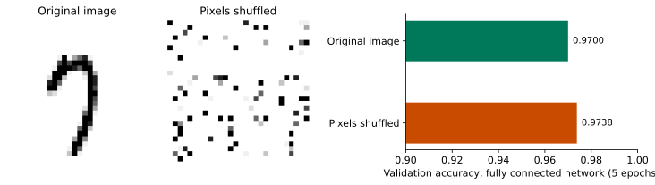
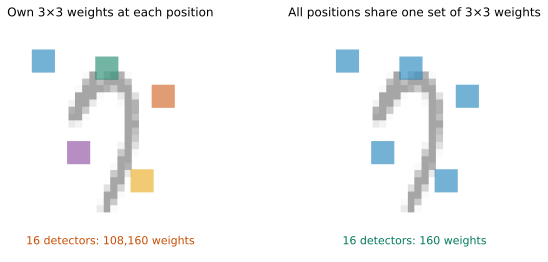
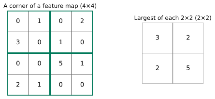
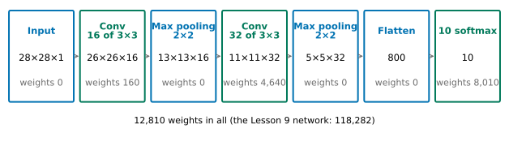
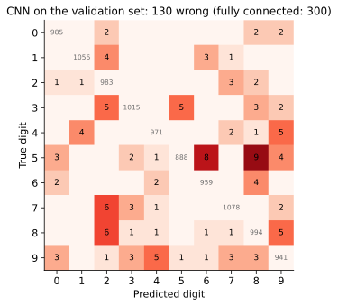
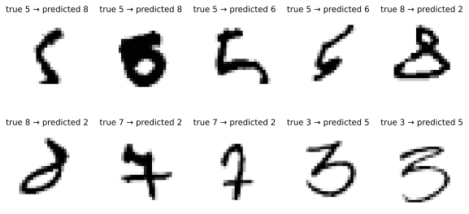
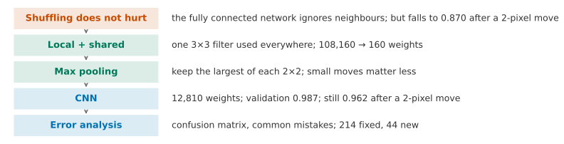

## 1. Motivation: Shuffle the Pixels and It Does Not Mind

The fully connected network from Lesson 9 was trained on MNIST for 5 epochs and reached a validation accuracy of 0.970. Its input is 784 pixels laid out in one row.

Let us run a strange experiment first. Choose one shuffling order (for example, pixel 1 moves to some position, pixel 2 moves to another position, and so on). **Every image is rearranged with this same order**: all 784 pixels are put in new places. The shuffled image becomes a patch of noise, and a person cannot tell which digit it is. Then train the same network again from scratch on the shuffled images.

Predict first: what will happen to the validation accuracy?

{fig-alt="On the left, a handwritten 7. In the middle, the same image shuffled into black and white noise. On the right, two horizontal bars: original images 0.9700, shuffled images 0.9738"}

::: {.callout-note collapse="true" title="Show answer"}
Almost no change: 0.9738, against 0.9700 before. The difference is 0.38 percentage points, about the same size as the difference from changing the seed in Lesson 9 (0.26 percentage points). For the network, the shuffled problem and the original problem are the same problem: each pixel has its own weight, and it does not matter which place the pixel has in the order.
:::

This shows that the network **does not use "which pixel is next to which" at all**. Yet this is the most important information in an image: a stroke is a line of black pixels next to each other, and a circle is black pixels around a ring.

Now the second experiment. We do not shuffle. We only move every validation image a few pixels to the right. The network is not retrained. We only test it again.



Drag the slider: after a move of 2 pixels, can a person still read the digit? What about the network?

::: {.callout-note collapse="true" title="Show answer"}
A person can still read it, even after a move of 4 pixels. The network falls from 0.970 to 0.870 (2 pixels), and then to 0.390 (4 pixels). What it learned is "pixel 300 is black and pixel 412 is white, so this looks like a 7". When the digit moves, the same stroke falls on other pixel numbers, and the network no longer knows it.
:::

What we want is this: **the network should use the spatial structure of the image.** It should look at pixels that are next to each other, and it should recognise a stroke wherever it is in the image.

**By the end of this lesson, you should be able to:**

- explain why a fully connected network does not care about the order of the pixels, but is sensitive to a shift;
- explain what "look at only a small patch" and "use the same detector everywhere" each solve, and count the parameters;
- explain what keeping only the largest number in each small patch is for;
- use Keras to train a small network on MNIST that uses spatial structure, and compare it fairly with the fully connected network;
- do error analysis with a confusion matrix and the images that were classified wrongly.

## 2. What We Want: Look at a Small Patch, Use the Same Detector Everywhere

First, let us state the properties we want.

1. **Look at only a small patch.** A horizontal stroke, a vertical stroke and a curve are each a few pixels next to each other. To detect them, we need to look at only a small patch, for example 3 × 3.
2. **Use the same detector everywhere.** A horizontal stroke is a horizontal stroke, whether it is at the top left or the bottom right of the image. The way to detect it should be the same.

The first one is easy: each detector connects to only 3 × 3 = 9 pixels (plus one constant), not to all 784. For the second one there are two candidates:

1. Each position has its own set of 9 weights. A 3 × 3 patch has 26 × 26 = 676 positions in a 28 × 28 image. With 16 detectors, we need $676 \times 16 \times (9 + 1) = 108{,}160$ weights. One layer already comes close to the 118,282 weights of the whole network in Lesson 9. Also, a horizontal stroke learned at the top left has to be learned again at the bottom right.
2. All positions share one set of 9 weights. With 16 detectors we need only $16 \times (9 + 1) = 160$ weights. What is learned in one place can be used everywhere.

{fig-alt="Two pale grey images of a 7, each with five 3 by 3 squares on top. In the left image the five squares have different colours and the label says 108,160 weights. In the right image the five squares have the same colour and the label says 160 weights"}

We choose the second one: it satisfies both properties, and it needs far fewer weights. This shared 3 × 3 square is called a **filter**. We slide it from the top left of the image to the bottom right. At each position, we multiply its 9 weights by the 9 pixels under it, one by one, and add the results to get one number. These numbers form a 26 × 26 image called a **feature map**. This operation of "slide over, multiply and add" is called **convolution**.

Try it yourself:



First choose "Horizontal edge" and see where the feature map of the 7 is darkest. Then change to "Vertical edge". How do the two feature maps differ? What about the digit 1?

::: {.callout-note collapse="true" title="Show answer"}
The upper row of "Horizontal edge" is 1 and the lower row is −1. Where the pixels above are dark and the pixels below are light, the result of multiplying and adding is largest. So the lower edge of the top bar of the 7 is darkest. The left column of "Vertical edge" is 1 and the right column is −1. It is largest where the left is dark and the right is light, so the vertical stroke of the 7 is darkest there, and the top bar hardly lights up. The digit 1 has almost only a vertical stroke. "Horizontal edge" lights up only here and there at the two ends and where the stroke is slanted, much weaker than "Vertical edge" (in the widget, every feature map is drawn on the same scale). The same filter looks for the same thing everywhere in the image, and wherever it finds it, that place lights up.
:::

The filters above were chosen by hand. In the network we build in Section 4, the 9 weights of a filter are like the other weights: they are learned with cross-entropy and gradient descent (in Section 7 we look at what they learn). After the convolution we apply a ReLU as usual: negative numbers become 0, as in Lesson 9.

## 3. What If the Digit Moves: Keep One Number per Small Patch

Convolution solves "use the same detector everywhere", but it does not fully solve the shift. If the image moves 2 steps to the right, the feature map also moves 2 steps to the right. If we then connect a fully connected layer directly, it still recognises by position, and it is still affected.

How can we make the result less sensitive to a small move? The candidates:

1. Keep every position of the feature map and pass it to the next layer;
2. Cut the feature map into 2 × 2 patches and keep one number per patch: the average of the 4 numbers;
3. Cut it into 2 × 2 patches in the same way and keep only the largest number in each patch.

{fig-alt="On the left, a 4 by 4 table of numbers divided by green frames into four 2 by 2 blocks. On the right, a 2 by 2 table where each cell is the largest number of the matching block: 3, 2, 2, 5"}

The last two methods both halve the height and width of the feature map, so the next layer needs fewer weights. Taking the largest number has one more advantage. If the largest number in a patch moves by one step and stays in the same patch, the number we keep does not change at all. With the average, a move changes the average. The third method is called **max pooling**.

Let us compare them (using the network we build in Section 4: two convolution layers, each followed by one such reduction, and then 10 softmax units; each of the three methods is trained for 5 epochs):

| | Keep every position | 2 × 2 average | 2 × 2 maximum |
|---|---|---|---|
| Number of parameters | 189,130 | 12,810 | 12,810 |
| Validation accuracy | 0.984 | 0.984 | 0.987 |
| After a shift of 2 pixels to the right | 0.941 | 0.949 | 0.962 |

If we keep every position, the number of parameters is more than 14 times larger (the feature map is not reduced, so many more numbers feed the next layer). The accuracy is not higher, and it falls the most after the shift. The average and the maximum have similar validation accuracy (the difference is within the variation from changing the seed). After the shift, the maximum falls less (0.962 against 0.949).

## 4. Building a CNN

Put these parts together in order: convolution (16 filters of 3 × 3) → max pooling → convolution (32 filters of 3 × 3) → max pooling → flatten into one row → 10 softmax units. Such a network is called a **convolutional neural network** (**CNN**).

{fig-alt="Seven boxes from left to right: input 28×28×1, after convolution 26×26×16 (160 weights), after pooling 13×13×16, after convolution 11×11×32 (4,640 weights), after pooling 5×5×32, flattened to 800, 10 softmax units (8,010 weights), 12,810 weights in total"}

A few notes:

- The input is no longer a row of 784 numbers. It is 28 × 28 × 1: height, width, and "1 image" (a colour image has 3: red, green and blue).
- A 3 × 3 filter has only 26 positions across an image 28 cells wide, so 28 becomes 26 (Keras does not pad the edges with zeros by default). When 2 × 2 pooling is applied to 11 × 11, the last row and column cannot form a full block and are dropped, so the result is 5 × 5.
- **Flatten**: the final 5 × 5 × 32 feature maps are laid out as one row of 800 numbers and given to the softmax layer, in the same way as Lesson 9 laid out an image as one row of 784 numbers.
- Each filter in the second layer looks at the 16 feature maps of the first layer, so it has $3 \times 3 \times 16 + 1 = 145$ weights. The 32 filters have 4,640 weights in total.

There are 12,810 weights in total, less than one ninth of the fully connected network in Lesson 9 (118,282). This lesson does not compare why we use two convolution layers and connect softmax directly after flattening (Question 4 of Advanced Study 3 is a starting point). Both were trained for 5 epochs:

| | Fully connected network (Lesson 9) | CNN |
|---|---|---|
| Number of parameters | 118,282 | 12,810 |
| Validation accuracy (5 epochs) | 0.970 | 0.987 |
| Images wrong on the validation set | 300 | 130 |
| Time to train 5 epochs (this machine, differs by a few seconds per run) | about 11 seconds | about 29 seconds |

The CNN is more accurate, makes less than half as many mistakes, and has far fewer weights. The cost is that each epoch is slower: the convolution must be computed at every position.

## 5. Checking: Does It Really Use Spatial Structure?

Being more accurate does not mean "using spatial structure". Go back to the two experiments in Section 1 and repeat them with the CNN.

**Moving the image.**



Drag the slider and compare the two networks.

::: {.callout-note collapse="true" title="Show answer"}
Move to the right by 0 to 4 pixels. The CNN gives 0.987, 0.984, 0.962, 0.877, 0.663. The fully connected network gives 0.970, 0.957, 0.870, 0.626, 0.390. The CNN drops less at every step. After 2 pixels, the CNN loses only 2.5 percentage points and the fully connected network loses 10. But after 4 pixels, the CNN also drops to 0.663: two rounds of 2 × 2 pooling can only "absorb" a very small shift.
:::

**Shuffling the pixels.** Use the same shuffle order as in Section 1 and train the CNN from scratch for 5 epochs. The validation accuracy drops from 0.987 to 0.945. The fully connected network is almost the same before and after shuffling, but the CNN becomes much worse. After shuffling, a 3 × 3 patch no longer contains neighbouring pixels, and the filters cannot find the strokes. This shows that the CNN uses "which pixel is next to which".

## 6. Where Does It Go Wrong?

An accuracy of 0.987 says only that the mistakes are few. It does not say where they are. Put the CNN's predictions on the validation set and the true digits into the confusion matrix from Lesson 4:

{fig-alt="A 10 by 10 table. The diagonal has grey numbers from 941 to 1078, most off-diagonal cells are empty, and the two darkest cells are in row 5: 9 images predicted as 8 and 8 images predicted as 6"}

Read the table: which digit is most often wrong? What is it mistaken for?

::: {.callout-note collapse="true" title="Show answer"}
The 5 most common mistakes: 5 mistaken for 8 (9 images), 5 mistaken for 6 (8 images), 7 mistaken for 2 and 8 mistaken for 2 (tied, 6 images each); fifth place is a five-way tie at 5 images each (3 for 2, 3 for 5, 4 for 9, 8 for 9, 9 for 4). Table 5 of Assignment 2 may also have ties: report them as they are. The digit 5 is wrong most often. Its lower half is a curve. If it is written rounder, it looks like a 6, and if the top is joined up, it looks like an 8.
:::

Now look at a few wrong images:

{fig-alt="Two rows of ten handwritten digits: two 5s predicted as 8, two 5s predicted as 6, two 8s predicted as 2, two 7s predicted as 2, two 3s predicted as 5"}

Look: can you recognise these images yourself? Is the mistake a problem of the image, or of the model?

::: {.callout-note collapse="true" title="Show answer"}
Some are hard even for a person: the lower half of the second 5 is a filled-in loop, which looks like a 6 and also like an 8; the second 8 has a tiny top loop and a large bottom loop, like a 2. Others a person recognises at once but the model gets wrong, such as the last two 3s (predicted as 5) and the 7 with a bar across it (predicted as 2). The first kind is ambiguous data, and even a very good model cannot get all of them right. The second kind is where the model can still improve.
:::

Compare with the fully connected network: of the 300 images it got wrong, the CNN corrected 214. The CNN also got 44 new images wrong that the fully connected network had right. The mistakes of the two models do not fully overlap.

## 7. What Did the Filters Learn?

The 16 filters in the first layer are learned. Draw 8 of them, and then look at their feature maps on one image of a 7:

{fig-alt="The top row has an image of a 7 on the left and eight small red and blue 3 by 3 squares on the right. The bottom row has eight feature maps of the 7: some turn dark only at the horizontal stroke or on one side of a stroke, and some turn dark along the whole stroke"}

Look: are the learned filters like the hand-made "horizontal edge" and "vertical edge" in Section 2?

::: {.callout-note collapse="true" title="Show answer"}
Some are very similar. Filter 7 is red in the top row and blue in the bottom row, which is a kind of "horizontal edge". Its feature map is darkest at the horizontal stroke of the 7. Filter 1 is the opposite (blue in the top row, red in the bottom row) and lights up along the upper edge of the stroke. The feature maps of filters 2, 5 and 8 mark almost the whole stroke, as if asking "is there ink here?". Nobody designed them. They were learned from the data in order to classify the digits correctly. How the second layer combines them is not checked in this lesson.
:::


## 8. Implementation: Doing It in Keras

**Read the data and make it 28 × 28 × 1 (Section 4):**

```python
import numpy as np                           # numbers and arrays
from tensorflow import keras                 # neural networks

(x_train, y_train), (x_test, y_test) = keras.datasets.mnist.load_data()   # x_test is not used here
X = x_train.reshape(-1, 28, 28, 1) / 255.0   # 60,000 images of 28 x 28 x 1, scaled to 0 to 1
y = y_train                                  # digits 0 to 9
X_fit = X[:50000]                            # fitting part: the first 50,000 images
y_fit = y[:50000]                            # and their digits
X_val = X[50000:]                            # validation set: the last 10,000 images
y_val = y[50000:]                            # and their digits
```

**Build the CNN and train it (Sections 2 to 4):**

```python
keras.utils.set_random_seed(0)               # fix the random starting weights and batches
cnn = keras.Sequential([
    keras.layers.Input((28, 28, 1)),                       # height, width, one image
    keras.layers.Conv2D(16, 3, activation="relu"),         # 16 filters of 3 x 3
    keras.layers.MaxPooling2D(2),                          # keep the largest of each 2 x 2
    keras.layers.Conv2D(32, 3, activation="relu"),         # 32 filters of 3 x 3
    keras.layers.MaxPooling2D(2),                          # keep the largest of each 2 x 2
    keras.layers.Flatten(),                                # 5 x 5 x 32 = 800 numbers in one row
    keras.layers.Dense(10, activation="softmax"),          # one probability per digit
])
cnn.compile(optimizer="adam",                              # as in Lesson 9
            loss="sparse_categorical_crossentropy",
            metrics=["accuracy"])
hist = cnn.fit(X_fit, y_fit, epochs=5,                     # 5 passes over the fitting part
               validation_data=(X_val, y_val), verbose=0)  # validation accuracy after every epoch
print(cnn.count_params())                    # 12810
print(hist.history["val_accuracy"][-1])      # 0.987
```

**Move 2 pixels to the right (Section 5):**

```python
X_shift = np.zeros_like(X_val)               # same shape as X_val, all white
X_shift[:, :, 2:] = X_val[:, :, :-2]         # every image moved 2 pixels to the right
print(cnn.evaluate(X_shift, y_val, verbose=0)[1])   # accuracy after the shift: 0.962
```

A fully connected network needs one row of 784 numbers, so before testing it, use `X_shift.reshape(-1, 784)`.

**The confusion matrix and the most common mistakes (Section 6):**

```python
from sklearn.metrics import confusion_matrix     # the 10 x 10 table of Lesson 4

probs = cnn.predict(X_val, verbose=0)        # 10,000 rows of 10 probabilities
pred = probs.argmax(axis=1)                  # the most probable digit of each image
cm = confusion_matrix(y_val, pred)           # rows: true digit, columns: predicted digit
print(cm)                                    # the table
mistakes = cm.copy()                         # a copy to keep only the mistakes
np.fill_diagonal(mistakes, 0)                # the diagonal is right: set it to 0
for k in range(5):                           # the 5 most common mistakes
    flat = mistakes.argmax()                 # position of the largest number, counted row by row
    i = flat // 10                           # its row: the true digit
    j = flat % 10                            # its column: the predicted digit
    print("true", i, "predicted", j, "images", mistakes[i, j])   # first line: true 5 predicted 8 images 9
    mistakes[i, j] = 0                       # remove it and look for the next one
wrong = np.where(pred != y_val)[0]           # positions of the images it gets wrong
print(len(wrong))                            # 130
```

## 9. One-Page Review

If you read only one page, read this one.

{fig-alt="A horizontal flowchart of five boxes: shuffling does not matter, local and shared, max pooling, CNN, error analysis"}

| What you see | What you can do | Evidence to judge by |
|---|---|---|
| After shuffling the pixels, the fully connected network is still accurate | It does not use neighbours: we need a model that looks locally | 0.9700 against 0.9738 |
| A separate set of weights for each position is too many, and what is learned cannot be used everywhere | Use the same detector everywhere: convolution | 108,160 against 160 weights |
| The feature map still moves when the image moves | Max pooling | Move of 2 pixels: max 0.962, average 0.949, keep all 0.941 |
| We want to know where it is better than the fully connected network | Compare weights, validation accuracy, time and the move | 12,810 against 118,282; 0.987 against 0.970; about 29 against 11 seconds |
| We want to know whether it really used the spatial structure | Shuffle the pixels and train again | CNN falls to 0.945, the fully connected network does not change |
| We know only the accuracy | Confusion matrix, most common mistakes, wrongly classified images | 5 read as 8, and 6, are the most common |

## 10. Summary and Limitations

The question at the start was this: shuffling the pixels cannot fool a fully connected network, because it never looked at neighbours. A CNN uses a small filter to look for the same thing everywhere in the image (local and shared), and then uses max pooling so that the result is not sensitive to small moves. It is more accurate (0.987), it is less affected by a move to the right (0.962 for 2 pixels), and it has far fewer weights.

**Transfer question.** In their own experiment (5 epochs, seed 0), a student changed the number of filters from 16 and 32 to 32 and 64. The validation accuracy went from 0.9870 to 0.9874. The number of parameters rose from 12,810 to 34,826. The training time rose from about 27 seconds to about 33 seconds. (These numbers come from a real run of the script for this lesson. It is not the same run as in Section 4, so the timing differs slightly.) The student says, "With twice as many filters, the model is better." Answer without calculation: do you agree? What else do you need to see?

::: {.callout-note collapse="true" title="Model answer"}
We cannot conclude this. The accuracy differs by only 0.04 percentage points. This is much smaller than the difference from changing the seed in Lesson 9 (a few tenths of a percentage point), so it may well be luck with the seed. Meanwhile the parameters are 2.7 times as many, and the training time is more than one fifth longer. First compare the average over several seeds, and then weigh the two sides: for the same accuracy, the smaller model is faster and less likely to memorise the training set. We can also compare the accuracy after the move, to see whether the change in structure brings a real benefit.
:::

**Where this method cannot be trusted.**

1. **It absorbs only small moves.** With a move of 4 pixels, the CNN is down to 0.663. Rotation and scaling are worse. They need more layers, or moved images in the training set (Advanced Study 3).
2. **Each epoch is slower.** The weights are fewer, but the convolution must be calculated at every position: about 29 seconds against 11 seconds on this machine. With bigger images and more layers, the gap grows.
3. **There are many choices of structure.** The number of filters, the size, the number of layers, and whether to use pooling must each be compared on the validation set, and each comparison is affected by the seed.
4. **It assumes that "pixels next to each other are related".** This is true for images. For tabular data with no order (for example the 30 features of breast lumps in Lesson 4), the assumption does not hold, and a CNN has no advantage.
5. **Some of the wrong images are unclear in themselves.** Even a very good model will not be right every time. After the accuracy is high enough, the remaining mistakes must be looked at one image at a time.

**Back to the promise at the start.** You can now: use the two experiments of shuffling and moving to show that a fully connected network does not use spatial structure; explain the local and shared parts of convolution, and calculate 108,160 against 160 weights; explain why max pooling makes the result insensitive to small moves; train a CNN in Keras and compare it with a fully connected network by the number of parameters, validation accuracy, training time and accuracy after the move; and use the confusion matrix and the wrongly classified images for error analysis.

**30-second feedback.** After this lesson, please scan the code and leave anonymous feedback or a question: what you did not understand, and where we went too fast. All of it helps us to improve.

{fig-align="center" width="160px" fig-alt="Feedback QR code"}

*The following are Advanced Studies. They do not affect the main line, and each Study can be read on its own. MPS311 students are encouraged to read them. MPS439 students have one main task, which is required: Advanced A of Lab 10. It builds on Study 1 here but trains for 2 epochs only, so its self-check values differ from the ones on this page. The other Studies are optional.*

---

## Advanced Study 1: Comparing One Choice of Structure

Extension task A of Assignment 2 compares a CNN with a fully connected network, and both must use the same number of epochs and the same seed as Section 4 of the assignment (20 epochs, seed 0). Here we first practise the same method of comparison, but we compare one choice of structure inside the CNN. We change only this one thing and keep everything else the same (the same split, 5 epochs, seed 0).

```python
results = []                                             # one row per choice
for filters in [(8, 16), (16, 32), (32, 64)]:             # three choices of the number of filters
    keras.utils.set_random_seed(0)                        # the same seed each time
    model = keras.Sequential([
        keras.layers.Input((28, 28, 1)),                  # height, width, one image
        keras.layers.Conv2D(filters[0], 3, activation="relu"),   # first layer: filters[0] filters
        keras.layers.MaxPooling2D(2),                     # keep the largest of each 2 x 2
        keras.layers.Conv2D(filters[1], 3, activation="relu"),   # second layer: filters[1] filters
        keras.layers.MaxPooling2D(2),                     # keep the largest of each 2 x 2
        keras.layers.Flatten(),                           # all numbers in one row
        keras.layers.Dense(10, activation="softmax"),     # one probability per digit
    ])
    model.compile(optimizer="adam", loss="sparse_categorical_crossentropy", metrics=["accuracy"])   # as in Section 8
    hist = model.fit(X_fit, y_fit, epochs=5, validation_data=(X_val, y_val), verbose=0)           # 5 epochs
    results.append([filters, model.count_params(), hist.history["val_accuracy"][-1]])           # choice, weights, accuracy
print(results)                                           # three rows
```

The results from the script for this lesson (the training time is the number of seconds of `fit` measured on this machine with `time.time()`; this is another run, and its timing differs by a few seconds from Section 4):

| Filters | Parameters | Validation accuracy | Training time |
|---|---|---|---|
| 8, 16 | 5,258 | 0.9815 | about 23 seconds |
| 16, 32 | 12,810 | 0.9870 | about 27 seconds |
| 32, 64 | 34,826 | 0.9874 | about 33 seconds |
| 16, 32, without the two poolings | 189,130 | 0.9837 | about 36 seconds (from the run in Section 3) |

Now try the following yourself:

1. Add a column to the table: "accuracy after a move of 2 pixels to the right". Which choice of structure has the largest effect on the move?
2. Use the method of Section 4 to calculate by hand the number of weights in each layer of the 8, 16 network and the 32, 64 network, and compare with `count_params()`.
3. Change the seed twice, and repeat the 16, 32 and 32, 64 rows. Is the difference between 0.9870 and 0.9874 still there? Write your conclusion, and say how strong its evidence is.

## Advanced Study 2: Where Shapes and Numbers of Weights Come From

1. A $k \times k$ filter on an $n \times n$ image (no padding, moving one step each time) can be placed at how many positions? Use it to check 28 → 26 and 13 → 11.
2. The second layer has 32 filters, and each looks at the 16 feature maps of the first layer. Why does each filter have $3 \times 3 \times 16 + 1$ weights?
3. Section 2 said that "a separate set of weights for each position" needs 108,160. If the second layer did the same, how many would it need? Compare with the shared 4,640.

## Advanced Study 3: Open Questions

This lesson does not develop the following four questions. Each comes with a starting point.

1. **Moved images in training.** If the training set already contains moved images, is a fully connected network still afraid of moves? Starting point: move part of `X_fit` 1 to 3 pixels to the right and add it to the training set (this is called data augmentation), then test the accuracy after the move.
2. **Using a network trained by others.** Can the filters in the first layers of a big CNN trained on millions of photos be used directly to read handwritten digits? Starting point: look up transfer learning and `keras.applications`. Note that Assignment 2 does not allow models trained by others.
3. **Padding and stride.** Can the image after convolution stay 28 × 28? Can the filter move two steps each time? Starting point: `padding="same"` and `strides=2` in `Conv2D`; see how the shapes and parameters change.
4. **Why two convolution layers.** What happens to the accuracy with only one convolution and pooling? Starting point: remove the second `Conv2D` and `MaxPooling2D`, and compare the parameters and the validation accuracy.
