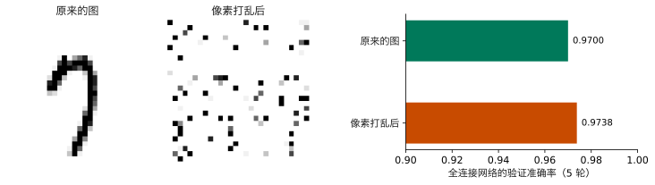
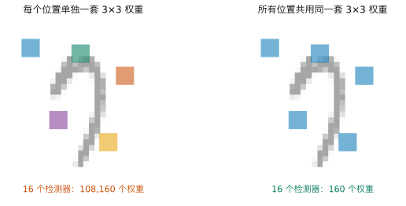
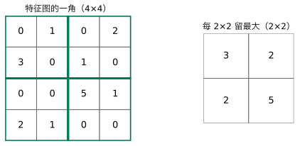
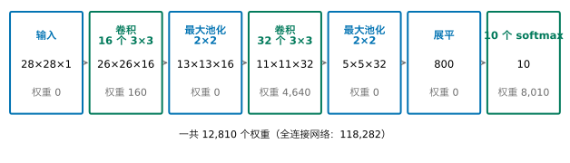
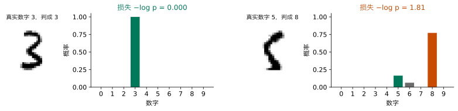
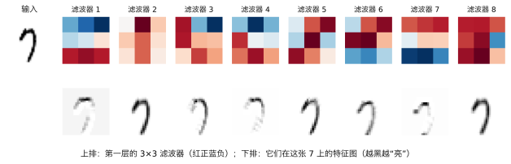
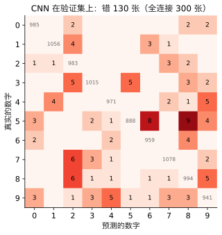
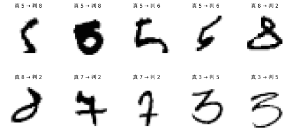
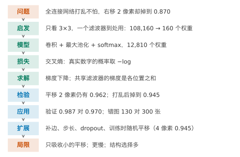

::: {.callout-tip title="怎样读这一讲"}
做 Lab 和作业，读第 1 到 3 节、第 4 和第 5 节开头的结论，以及第 6 到 9 节。第 7 节的错误分析，作业 2 第 4 节要用；第 3 节的参数怎样数，附加题 A 要用。第 10 节是拓展，想多看几种结构时读。Advanced Study 1 练习比较一项结构选择，2 弄清形状和权重个数，3 解释权重少的 CNN 为什么反而慢。
:::

## 1. 问题：打乱像素它不怕，挪一挪却怕

手写数字最常用的神经网络是**全连接网络**：把一张 28 × 28 的图排成一行 784 个数，经过两个各有 128 个单元的隐藏层，最后 10 个 softmax 单元给出每个数字的概率。在 MNIST 上训练 5 轮，验证准确率 0.970。

先做一个奇怪的实验。选定一种打乱的顺序（例如第 1 个像素换到某个位置，第 2 个换到另一个位置，依此类推），**所有的图都按这同一种顺序**把 784 个像素重新排一遍。打乱后的图变成一片噪点，人完全认不出是几。再用打乱后的图，从头训练同一个网络。

请先预测：验证准确率会怎样？

{fig-alt="左边是手写的 7，中间是同一张图打乱后的黑白噪点，右边两条横条：原来的图 0.9700，打乱后 0.9738"}

::: {.callout-note collapse="true" title="展开答案"}
几乎不变：0.9738，原来是 0.9700，相差 0.38 个百分点，和只换随机种子带来的差别（0.26 个百分点）同一量级。对网络来说，打乱前后是同一个问题：每个像素各连一个权重，像素排在第几位无所谓。
:::

这说明它**根本没有用到“哪个像素挨着哪个”**。图里最重要的信息恰恰是这个：一笔是一串挨着的黑像素，一个圈是围成一圈的黑像素。

再做第二个实验。不打乱，只把每张验证图整体右移几个像素，网络不重新训练，只重新测一次。



请拖动滑块：移 2 个像素，人还认得出吗？网络呢？

::: {.callout-note collapse="true" title="展开答案"}
人完全认得出，移 4 个像素也认得出。网络从 0.970 掉到 0.870（2 个像素），再到 0.390（4 个像素）。它学的是“第 300 号像素黑、第 412 号像素白，就像 7”。数字一挪，同一笔落到了别的号上，它就不认识了。
:::

本讲的问题：**怎样让网络利用图像的空间结构**，看挨着的像素，而且不管笔画在图的哪个位置，都能认出来。

**本讲之后你能做到：**

- 说明全连接网络为什么不在乎像素的排列，却怕平移；
- 说清“只看一小块”和“到处用同一个检测器”各解决什么，并算出参数量；
- 说明“每一小块只留最大的数”有什么用；
- 用 Keras 在 MNIST 上训练一个利用空间结构的小网络，与全连接网络公平比较；
- 用混淆矩阵和分错的图做错误分析。

## 2. 启发：只看一小块，到处用同一个检测器

先说清要什么性质。

1. **只看一小块。**一横、一竖、一个弯，都是几个挨着的像素。检测它们，只要看一小块，比如 3 × 3。
2. **同一个检测器到处用。**一横出现在图的左上角还是右下角，都是一横。检测它的办法应该一样。

第一条容易：每个检测器只连 3 × 3 = 9 个像素（加一个常数），不连全部 784 个。第二条有两个候选：

1. 每个位置单独一套 9 个权重。3 × 3 的小块在 28 × 28 的图上有 26 × 26 = 676 个位置。16 个检测器就要 $676 \times 16 \times (9 + 1) = 108{,}160$ 个权重，一层就快赶上整个全连接网络的 118,282 个。而且在左上角学会的一横，到了右下角还得重新学。
2. 所有位置共用同一套 9 个权重。16 个检测器只要 $16 \times (9 + 1) = 160$ 个权重。在哪里学会的，到处都能用。

{fig-alt="两张淡灰色的 7，上面各有五个 3 乘 3 的小方块；左图五个方块颜色各不相同，标着 108,160 个权重；右图五个方块颜色相同，标着 160 个权重"}

选第二个：它同时满足两条，而且权重少得多。这个共用的 3 × 3 小方块叫**滤波器**（filter）。让它从图的左上角滑到右下角，每到一个位置，就把 9 个权重和那里的 9 个像素对应相乘再加起来，得到一个数。这些数排成一张 26 × 26 的图，叫**特征图**（feature map）。这个“滑过去、乘了加”的操作叫**卷积**（convolution）。

自己试一试：



请先选“横边”，看 7 的特征图哪里最黑；再换“竖边”。两张特征图有什么不同？换成数字 1 呢？

::: {.callout-note collapse="true" title="展开答案"}
“横边”的上一行是 1、下一行是 −1：上面黑、下面白的地方，乘了加之后最大。所以 7 顶上那一横的下沿最黑。“竖边”左列是 1、右列是 −1，在左边黑、右边白的地方最大，7 的竖笔那里最黑，顶上的横几乎不亮。数字 1 几乎只有竖笔，“横边”只在两端和斜着的地方零星地亮，比“竖边”弱得多（组件里每张特征图按同一个刻度画）。同一个滤波器在图上到处找同一种东西，找到哪里，哪里就亮。
:::

上面的滤波器是我们手定的。网络里的滤波器怎样定下来，是第 5 节的事。

## 3. 模型：卷积、池化，搭成一个网络

**特征图仍然随平移挪动。**卷积解决了“到处用同一个检测器”，但还没完全解决平移。图右移 2 格，特征图也跟着右移 2 格。后面如果直接接全连接层，它仍然按位置认，还是会受影响。

怎样让结果对小的挪动不那么敏感？候选：

1. 特征图的每个位置都留着，交给后面的层；
2. 把特征图切成 2 × 2 的小块，每块只留一个数：取这 4 个数的平均；
3. 同样切成 2 × 2 的小块，每块只留最大的那个数。

{fig-alt="左边是一个 4 乘 4 的数字表，用绿框分成四个 2 乘 2 的块；右边是 2 乘 2 的表，每格是对应块里最大的数：3、2、2、5"}

后两个做法都让特征图的长和宽减半，后面要连的权重少了。取最大的那个还有一个好处：整张特征图跟着图像挪动一格时，每块的最大数只要没跨出这一块，留下的数完全不变；取平均时，有数移进、移出这一块，平均值就变了。第三个做法叫**最大池化**（max pooling）。

比较一下（用下面要搭的网络：两层卷积，各接一次这样的缩小，最后接 10 个 softmax 单元；三种做法各训练 5 轮）：

| | 每个位置都留着 | 2 × 2 取平均 | 2 × 2 取最大 |
|---|---|---|---|
| 参数个数 | 189,130 | 12,810 | 12,810 |
| 验证准确率 | 0.984 | 0.984 | 0.987 |
| 右移 2 个像素后 | 0.941 | 0.949 | 0.962 |

都留着，参数是原来的 14 倍多（特征图没缩小，后面要连的数多了很多），准确率没有更高，平移后掉得最多。取平均和取最大的验证准确率差不多（差别在换种子的波动之内），平移后取最大掉得少（0.962 对 0.949）。

**搭起来。**把这些零件按顺序接起来：卷积（16 个 3 × 3 滤波器）→ 最大池化 → 卷积（32 个 3 × 3 滤波器）→ 最大池化 → 排成一行 → 10 个 softmax 单元。这样的网络叫**卷积神经网络**（convolutional neural network，**CNN**）。

{fig-alt="七个方框从左到右：输入 28×28×1，卷积后 26×26×16（160 个权重），池化后 13×13×16，卷积后 11×11×32（4,640 个权重），池化后 5×5×32，展平成 800，10 个 softmax（8,010 个权重），一共 12,810 个权重"}

几点说明：

- 输入不再是一行 784 个数，而是 28 × 28 × 1：高、宽，以及“1 张图”（彩色图是 3 张：红、绿、蓝）。
- 3 × 3 的滤波器在 28 格宽的图上只能放 26 个位置，所以 28 变 26（Keras 默认不在边上补零）。11 × 11 做 2 × 2 池化时，最后一行一列凑不成一块，被舍掉，所以是 5 × 5。
- 卷积之后照样过一次 ReLU，负数变成 0，和全连接网络的隐藏层一样。
- **展平**（flatten）：把最后 5 × 5 × 32 的特征图排成一行 800 个数，交给 softmax 层，就像全连接网络把一张图排成一行 784 个数。
- 第二层的每个滤波器看的是第一层的 16 张特征图，所以它有 $3 \times 3 \times 16 + 1 = 145$ 个权重，32 个滤波器共 4,640 个。

一共 12,810 个权重，不到全连接网络（118,282）的九分之一。为什么用两层卷积、展平后直接接 softmax，本讲不去比较（第 10 节有几种别的搭法）。

这个模型对数据只做了一个假设：**挨着的像素有关系，同一种笔画可以出现在图上任何位置。**前半句对应卷积，后半句对应共享和池化。

## 4. 损失：还是交叉熵

CNN 的任务和全连接网络一样：给一张图，说出它是几。最后的 10 个 softmax 单元给出 10 个概率 $p_0, \dots, p_9$，加起来是 1。一张图的真实数字是 $y$，它的损失是

$$
-\log p_y ,
$$

真实数字得到的概率越接近 1，损失越接近 0；概率越小，损失越大。整个拟合部分的损失是 50,000 张图的平均，叫**交叉熵**（cross-entropy），和训练全连接网络时用的完全一样，换掉的只是概率的算法。

{fig-alt="两组柱状图，左边一张 3，柱子几乎全在 3 上，标着损失接近 0；右边一张 5，最高的柱在 8 上，5 上的柱很矮，标着损失较大"}

训练 5 轮后，验证集 10,000 张图的平均损失是 0.0485。左边这张 3，CNN 给 3 的概率几乎是 1，损失接近 0。右边这张 5，CNN 给 8 的概率是 0.77，给 5 只有 0.16，损失是 $-\log 0.16 = 1.81$。训练要做的，就是让拟合图上的这个平均数尽量小。

## 5. 求解：12,810 个数，用梯度下降找

第 3 节的 12,810 个权重全是未知数：16 个第一层滤波器的 9 个数和常数，32 个第二层滤波器的 145 个数，最后一层的 8,010 个。滤波器也在里面，没有人去手定。没有约束：任何一组数都是一个能用的网络，只是损失不同。

解法和全连接网络一样：每次取一小批图，用链式法则算出损失对每个权重的梯度，再用 adam 往损失变小的方向挪一步；所有拟合图过一遍叫一轮。

和全连接网络比，只多一个要说明的地方：一个滤波器只有一套 9 个数，却在 676 个位置都用到了。位置 $(i, j)$ 的特征图是

$$
a_{ij} = \sum_{r, s} w_{rs}\, x_{i+r,\, j+s} + b ,
$$

$w_{rs}$ 在每一个位置都出现，所以它的梯度是各个位置的贡献加起来：

$$
\frac{\partial L}{\partial w_{rs}} = \sum_{i, j} \frac{\partial L}{\partial a_{ij}}\, x_{i+r,\, j+s} .
$$

白话：每个位置都对这 9 个数提一次意见，加起来再改。左上角看到的一横和右下角看到的一横，改的是同一个滤波器。

**结果：滤波器学到了什么。**训练 5 轮，验证准确率 0.987。把第一层的 16 个滤波器里的 8 个画出来，再看它们在一张 7 上的特征图：

{fig-alt="上排左边是一张 7，右边八个 3 乘 3 的红蓝小方块；下排是八张 7 的特征图，有的只在横笔或笔画的一侧变黑，有的整个笔画都变黑"}

请看：学出来的滤波器和第 2 节手定的“横边”“竖边”像吗？

::: {.callout-note collapse="true" title="展开答案"}
有的很像。滤波器 7 上排红、下排蓝，就是一种“横边”，它的特征图在 7 的横笔那里最黑；滤波器 1 正好反过来（上排蓝、下排红），在笔画的上沿亮。滤波器 2、5、8 的特征图几乎把整个笔画都标了出来，像是在问“这里有没有墨”。它们没有人去设计，是为了把数字分对，从数据里学出来的。第二层怎样组合它们，本讲不去验证。
:::

## 6. 检验：它真的用了空间结构吗

更准不等于“用了空间结构”。回到第 1 节的两个实验，用 CNN 再做一遍。

**平移。**



请拖动滑块，比较两个网络。

::: {.callout-note collapse="true" title="展开答案"}
右移 0 到 4 个像素，CNN 是 0.987、0.984、0.962、0.877、0.663；全连接网络是 0.970、0.957、0.870、0.626、0.390。CNN 每一步都掉得少。移 2 个像素，CNN 只掉 2.5 个百分点，全连接网络掉 10 个。但移 4 个像素，CNN 也掉到 0.663：两次 2 × 2 的池化只能“吸收”很小的挪动。
:::

**打乱像素。**用第 1 节同样的打乱顺序，从头训练 CNN 5 轮：验证准确率从 0.987 掉到 0.945。全连接网络打乱前后几乎一样，CNN 却明显变差：打乱之后，3 × 3 的小块里不再是挨着的像素，滤波器找不到笔画了。这正说明 CNN 用到了“哪个像素挨着哪个”，也就是第 3 节说的那个假设。

## 7. 应用：和全连接网络比，错在哪里

**比较。**同样的划分、同样训练 5 轮、同样的种子：

| | 全连接网络 | CNN |
|---|---|---|
| 参数个数 | 118,282 | 12,810 |
| 验证准确率（5 轮） | 0.970 | 0.987 |
| 验证集上错的图 | 300 张 | 130 张 |
| 训练 5 轮用的时间（本机，每次运行差几秒） | 11.8 秒 | 29.5 秒 |

CNN 更准，错的图少了一半多，权重也少得多。代价是每轮更慢：卷积要在每个位置都算一遍（Advanced Study 3 算一算慢多少）。

**错在哪里。**准确率 0.987 只说了“错得少”，没说错在哪里。把 CNN 在验证集上的预测和真实数字列成混淆矩阵：

{fig-alt="10 乘 10 的表，对角线是 941 到 1078 的灰色数字，非对角的格子大多是空的，最深的两格在第 5 行：认成 8 的 9 张、认成 6 的 8 张"}

请读表：哪一个数字最常被认错？认成了什么？

::: {.callout-note collapse="true" title="展开答案"}
最常见的错误：5 认成 8（9 张）、5 认成 6（8 张）、7 认成 2 和 8 认成 2（并列，各 6 张）；第 5 名有五种并列，各 5 张（3 认成 2、3 认成 5、4 认成 9、8 认成 9、9 认成 4）。作业 2 的表 5 也可能遇到并列，照实写出即可。数字 5 错得最多：它的下半部是一个弯，写得圆一点像 6，上面再连起来就像 8。
:::

再看几张分错的图：

{fig-alt="两行十张手写数字：两张 5 判成 8，两张 5 判成 6，两张 8 判成 2，两张 7 判成 2，两张 3 判成 5"}

请看：这些图你自己认得出吗？错是图的问题，还是模型的问题？

::: {.callout-note collapse="true" title="展开答案"}
有一些人也很难认：第二张 5 的下半部写成了一个涂满的圈，像 6 也像 8；第二张 8 上面的圈很小，下面拖成一个大圈，像 2。也有一些人一眼就认得出、模型却错了，比如最后两张 3（被认成 5）和中间加了一横的 7（被认成 2）。前一种是数据本身含糊，再好的模型也难全对；后一种才是模型还能改进的地方。
:::

和全连接网络对照：全连接网络错的 300 张里，CNN 改对了 214 张；CNN 又新错了 44 张全连接网络认对的。两个模型的错并不完全重叠。

## 8. 实现：用 Keras 完成

**读数据，做成 28 × 28 × 1（第 3 节）：**

```python
import numpy as np                           # numbers and arrays
from tensorflow import keras                 # neural networks

(x_train, y_train), (x_test, y_test) = keras.datasets.mnist.load_data()   # x_test is not used here
X = x_train.reshape(-1, 28, 28, 1) / 255.0   # 60,000 images of 28 x 28 x 1, scaled to 0 to 1
y = y_train                                  # digits 0 to 9
X_fit = X[:50000]                            # fitting part: the first 50,000 images
y_fit = y[:50000]                            # and their digits
X_val = X[50000:]                            # validation set: the last 10,000 images
y_val = y[50000:]                            # and their digits
```

**搭 CNN、训练（第 3 到 5 节）：**

```python
keras.utils.set_random_seed(0)               # fix the random starting weights and batches
cnn = keras.Sequential([
    keras.layers.Input((28, 28, 1)),                       # height, width, one image
    keras.layers.Conv2D(16, 3, activation="relu"),         # 16 filters of 3 x 3
    keras.layers.MaxPooling2D(2),                          # keep the largest of each 2 x 2
    keras.layers.Conv2D(32, 3, activation="relu"),         # 32 filters of 3 x 3
    keras.layers.MaxPooling2D(2),                          # keep the largest of each 2 x 2
    keras.layers.Flatten(),                                # 5 x 5 x 32 = 800 numbers in one row
    keras.layers.Dense(10, activation="softmax"),          # one probability per digit
])
cnn.compile(optimizer="adam",                              # the same optimiser as the fully connected network
            loss="sparse_categorical_crossentropy",        # cross-entropy, with the digits as numbers 0 to 9
            metrics=["accuracy"])
hist = cnn.fit(X_fit, y_fit, epochs=5,                     # 5 passes over the fitting part
               validation_data=(X_val, y_val), verbose=0)  # validation accuracy after every epoch
print(cnn.count_params())                    # 12810
print(hist.history["val_accuracy"][-1])      # 0.987
```

**平移 2 个像素（第 6 节）：**

```python
X_shift = np.zeros_like(X_val)               # same shape as X_val, all white
X_shift[:, :, 2:] = X_val[:, :, :-2]         # every image moved 2 pixels to the right
print(cnn.evaluate(X_shift, y_val, verbose=0)[1])   # accuracy after the shift: 0.962
```

全连接网络要的是一行 784 个数，测它时先 `X_shift.reshape(-1, 784)`。

**混淆矩阵和最常见的错误（第 7 节）：**

```python
from sklearn.metrics import confusion_matrix     # the 10 x 10 table of right and wrong answers

probs = cnn.predict(X_val, verbose=0)        # 10,000 rows of 10 probabilities
pred = probs.argmax(axis=1)                  # the most probable digit of each image
cm = confusion_matrix(y_val, pred)           # rows: true digit, columns: predicted digit
print(cm)                                    # the table
mistakes = cm.copy()                         # a copy to keep only the mistakes
np.fill_diagonal(mistakes, 0)                # the diagonal is right: set it to 0
for k in range(5):                           # the 5 most common mistakes
    flat = mistakes.argmax()                 # position of the largest number, counted row by row
    i = flat // 10                           # its row: the true digit
    j = flat % 10                            # its column: the predicted digit
    print("true", i, "predicted", j, "images", mistakes[i, j])   # first line: true 5 predicted 8 images 9
    mistakes[i, j] = 0                       # remove it and look for the next one
wrong = np.where(pred != y_val)[0]           # positions of the images it gets wrong
print(len(wrong))                            # 130
```

## 9. 一页回顾

如果只读一页，读这里。

{fig-alt="九个步骤的竖向流程图：问题、启发、模型、损失、求解、检验、应用、扩展、局限，每步右边一行要点和数字"}

| 步骤 | 这一讲做了什么 | 证据 |
|---|---|---|
| 问题 | 全连接网络不看“哪个像素挨着哪个”：打乱不怕，平移却怕 | 打乱 0.9700 对 0.9738；右移 2 像素掉到 0.870 |
| 启发 | 只看一小块，同一个检测器到处用：卷积 | 108,160 对 160 个权重 |
| 模型 | 卷积、最大池化、展平、softmax；假设挨着的像素有关系 | 平移 2 像素：取最大 0.962，取平均 0.949，都留着 0.941；12,810 个权重 |
| 损失 | 交叉熵，和全连接网络一样 | 认对的图损失接近 0，认错的大 |
| 求解 | 12,810 个未知数，梯度下降；共享滤波器的梯度是各位置之和 | 学出的滤波器像横边、竖边 |
| 检验 | 平移、打乱像素再训练 | 平移 2 像素 0.962；打乱后 CNN 掉到 0.945，全连接不变 |
| 应用 | 比参数、准确率、时间；混淆矩阵、分错的图 | 0.987 对 0.970；29.5 对 11.8 秒；5 认成 8、6 最多 |

## 10. 拓展：一行就能换的结构（选读）

第 3 节的网络只是一种搭法。下面每一行只在 Keras 代码里改一两处，其余不变（同一划分、5 轮、种子 0）：

| 改了什么 | 代码 | 参数个数 | 验证准确率 | 右移 2 像素 | 右移 4 像素 |
|---|---|---:|---:|---:|---:|
| 原来的网络（第 3 节） | — | 12,810 | 0.987 | 0.962 | 0.663 |
| 边上补零，卷积后大小不变 | `Conv2D(..., padding="same")` | 20,490 | 0.987 | 0.959 | 0.693 |
| 滤波器每次挪两格，代替池化 | `Conv2D(..., strides=2)`，去掉池化 | 16,330 | 0.982 | 0.938 | 0.561 |
| 每张特征图只留平均数，代替展平 | `GlobalAveragePooling2D()` | 5,130 | 0.902 | 0.784 | 0.584 |
| 再加一层卷积 | 再加一个 `Conv2D(64, 3)` | 29,066 | 0.988 | 0.959 | 0.622 |
| 训练时随机关掉一半输入 | softmax 前加 `Dropout(0.5)` | 12,810 | 0.987 | 0.965 | 0.665 |
| 训练时把图随机左右挪一挪 | 最前面加 `RandomTranslation(0, 0.1)` | 12,810 | 0.988 | 0.986 | 0.945 |

多数改动在验证准确率上差不到 0.2 个百分点，在换种子的波动之内；每张特征图只留平均数的那一行参数最少，准确率也掉得最多（0.902）。真正改变平移结果的只有最后一行：训练时就让网络看到挪动过的图，叫**数据增强**（data augmentation）。右移 4 个像素还有 0.945，原来是 0.663。结构和参数个数都不变，只是训练数据里多了挪动过的图。

还有两种常用的做法，本讲不做实验：

- 用别人训练好的网络：在几百万张照片上训练好的大 CNN（`keras.applications`），前几层的滤波器可以直接拿来用在新的图像任务上，只重新训练最后几层，叫**迁移学习**（transfer learning）。作业 2 规定不能使用别人训练好的模型。
- 更深的网络：照片比手写数字复杂得多，常用的 CNN 有几十层卷积；想法和本讲一样，只是层数多。

## 11. 总结与局限

开场的问题是：打乱像素骗不了全连接网络，因为它本来就不看邻居。CNN 用一个小滤波器在图上到处找同一种东西（局部、共享），再用最大池化让结果对小的挪动不敏感；损失和解法都和全连接网络一样，滤波器是学出来的。它更准（0.987），更不怕平移（2 个像素 0.962），权重还少得多。

**迁移题。**一位同学在自己的实验里（5 轮、种子 0）把滤波器个数从 16、32 改成 32、64，验证准确率从 0.9870 变成 0.9874，参数从 12,810 涨到 34,826，训练时间从约 27 秒涨到约 33 秒（这些数是本讲脚本真实跑出来的，和第 7 节不是同一次运行，计时略有不同）。这位同学说“滤波器多一倍，模型更好”。请不做计算回答：你同意吗？还要看什么？

::: {.callout-note collapse="true" title="参考回答"}
不能这样下结论。准确率只差 0.04 个百分点，远小于只换种子带来的差别（零点几个百分点），完全可能是种子的运气；而参数是原来的 2.7 倍，训练时间多了两成多。要先用几个种子比较平均值，再权衡：同样的准确率，小的模型更快、更不容易记训练集。还可以比平移后的准确率，看结构的改变是否带来了真正的好处。
:::

**这个方法在哪里不可信。**

1. **结构本身只吸收小的平移。**移 4 个像素，CNN 也只剩 0.663；要靠训练时加入挪动过的图（第 10 节最后一行）。旋转、缩放更不行。
2. **每轮更慢。**权重虽少，卷积要在每个位置都算一遍：本机 29.5 秒对 11.8 秒。图更大、层更多时差得更多。
3. **结构的选择很多。**滤波器个数、大小、层数、要不要池化，每一项都要在验证集上比，而每一次比较都受种子影响。
4. **它假设“挨着的像素有关系”。**对图像成立；对一张没有顺序的表格数据（例如乳腺肿块的 30 个测量），这个假设就不成立，CNN 没有优势。
5. **错的图里有一部分本身就含糊。**再好的模型也不会全对；准确率高到一定程度后，剩下的错要一张张看。

**回到开头的承诺。**现在，你可以：用打乱和平移两个实验说明全连接网络没用空间结构；说清卷积的局部与共享，并算出 108,160 对 160 个权重；说明最大池化为什么让结果对小的挪动不敏感；用 Keras 训练一个 CNN，按参数量、验证准确率、训练时间和平移后的准确率与全连接网络比较；用混淆矩阵和分错的图做错误分析。

**30 秒反馈。**读完这一讲，请扫码留下匿名反馈或问题：哪里没看懂、哪里讲得太快，都对改进有用。

{fig-align="center" width="160px" fig-alt="反馈二维码"}

*以下是 Advanced Study，不影响主线，每个 Study 可以单独阅读。MPS311 鼓励选读。MPS439 的必做是 Lab 10 的 Advanced A（训练时加入挪动过的图），这里三项都是选读。*

---

## Advanced Study 1：比较一项结构选择

作业 2 附加题 A 比的是 CNN 和全连接网络，而且两者要用与作业第 4 节相同的轮数和种子（20 轮、种子 0）。这里先练同一种比较方法，换成比较 CNN 自己的一项结构：只改这一项，其余不变（同一划分、5 轮、种子 0）。

```python
results = []                                             # one row per choice
for filters in [(8, 16), (16, 32), (32, 64)]:             # three choices of the number of filters
    keras.utils.set_random_seed(0)                        # the same seed each time
    model = keras.Sequential([
        keras.layers.Input((28, 28, 1)),                  # height, width, one image
        keras.layers.Conv2D(filters[0], 3, activation="relu"),   # first layer: filters[0] filters
        keras.layers.MaxPooling2D(2),                     # keep the largest of each 2 x 2
        keras.layers.Conv2D(filters[1], 3, activation="relu"),   # second layer: filters[1] filters
        keras.layers.MaxPooling2D(2),                     # keep the largest of each 2 x 2
        keras.layers.Flatten(),                           # all numbers in one row
        keras.layers.Dense(10, activation="softmax"),     # one probability per digit
    ])
    model.compile(optimizer="adam", loss="sparse_categorical_crossentropy", metrics=["accuracy"])   # as in Section 8
    hist = model.fit(X_fit, y_fit, epochs=5, validation_data=(X_val, y_val), verbose=0)           # 5 epochs
    results.append([filters, model.count_params(), hist.history["val_accuracy"][-1]])           # choice, weights, accuracy
print(results)                                           # three rows
```

本讲脚本得到的结果（训练时间是本机用 `time.time()` 量的 `fit` 的秒数；这是另一次运行，和第 7 节的计时差几秒）：

| 滤波器 | 参数个数 | 验证准确率 | 训练时间 |
|---|---|---|---|
| 8、16 | 5,258 | 0.9815 | 约 23 秒 |
| 16、32 | 12,810 | 0.9870 | 约 27 秒 |
| 32、64 | 34,826 | 0.9874 | 约 33 秒 |
| 16、32，去掉两个池化 | 189,130 | 0.9837 | 约 36 秒（来自第 3 节那次运行） |

接下来请自己做：

1. 给表加一列“右移 2 个像素后的准确率”。哪一项结构选择对平移影响最大？
2. 用第 3 节的方法，手算 8、16 和 32、64 两个网络每一层的权重个数，和 `count_params()` 对照。
3. 换两个种子，重做 16、32 和 32、64 两行。0.9870 和 0.9874 的差别还在吗？据此写出你的结论，以及它的证据有多强。

## Advanced Study 2：形状和权重个数从哪里来

1. 一个 $k \times k$ 的滤波器在 $n \times n$ 的图上（不补边、每次挪一格）能放几个位置？用它验证 28 → 26、13 → 11。
2. 第二层有 32 个滤波器，每个看第一层的 16 张特征图。为什么每个滤波器有 $3 \times 3 \times 16 + 1$ 个权重？
3. 第 2 节说“每个位置单独一套权重”要 108,160 个。如果第二层也这样做，要多少个？和共享的 4,640 个比一比。
4. 第 10 节里 `padding="same"` 让参数从 12,810 变成 20,490，可每个滤波器的权重个数没变。多出来的 7,680 个在哪一层？为什么？

## Advanced Study 3：权重少，为什么反而慢

电脑训练和预测时，大部分时间花在乘法上。数一数每张图要做多少次乘法（加法的次数差不多，先不管）。

1. 全连接网络：第一层 784 个输入连 128 个单元，是 784 × 128 次乘法。再加上后两层，一共多少？
2. CNN 第一层：16 个滤波器，每个在 26 × 26 个位置各做 9 次乘法。第二层：32 个滤波器，每个在 11 × 11 个位置各做 3 × 3 × 16 次。最后一层：800 × 10。一共多少？
3. 两个网络的乘法次数之比是多少？和第 7 节的训练时间之比（29.5 对 11.8 秒）比，哪个大？为什么时间之比小一些？（提示：池化、ReLU、读写内存也花时间；电脑一次能并排做很多次乘法。）
4. 为什么同一个滤波器在 676 个位置都用到，权重只算一次，乘法却要算 676 次？用这一点说明“参数少”和“算得快”是两回事。

::: {.callout-note collapse="true" title="参考答案"}
1. 784 × 128 + 128 × 128 + 128 × 10 = 100,352 + 16,384 + 1,280 = 118,016 次，和权重个数（118,282）差不多：全连接网络每个权重只用一次。
2. 16 × 676 × 9 = 97,344；32 × 121 × 144 = 557,568；800 × 10 = 8,000；一共 662,912 次。
3. 662,912 ÷ 118,016 ≈ 5.6，时间之比 29.5 ÷ 11.8 ≈ 2.5，乘法之比大一些。电脑一次并排做很多次乘法，卷积这种“同一组数在很多位置上重复算”的计算很适合并排做；池化、ReLU、读写内存这些和乘法次数无关的开销两个网络都有，也把比例拉近了。
4. 权重是“要学的数”，存一份就够；乘法是“要做的事”，每个位置都要做一遍。CNN 用共享把要学的数从 108,160 压到 160，可每张图要做的乘法一点没少。参数少带来的是存起来小、不容易记住训练集；算得快要看乘法的次数。
:::
