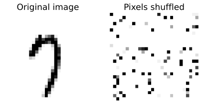
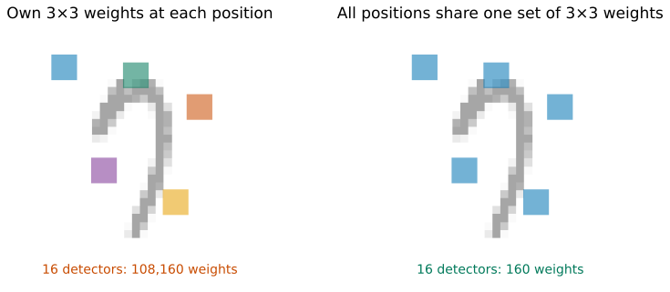
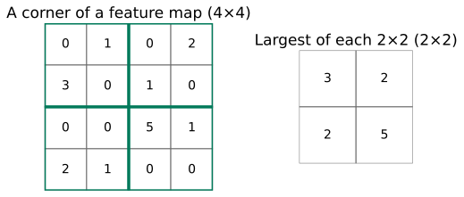
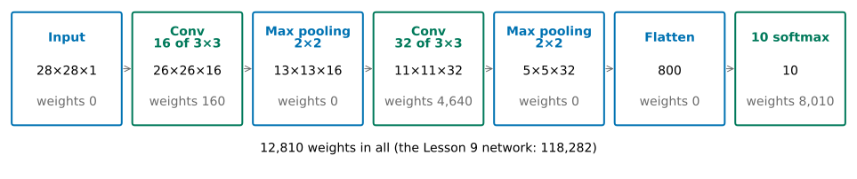
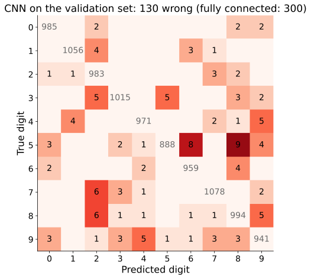
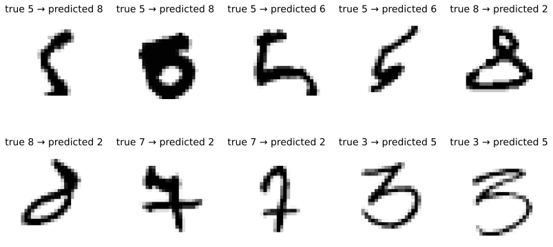
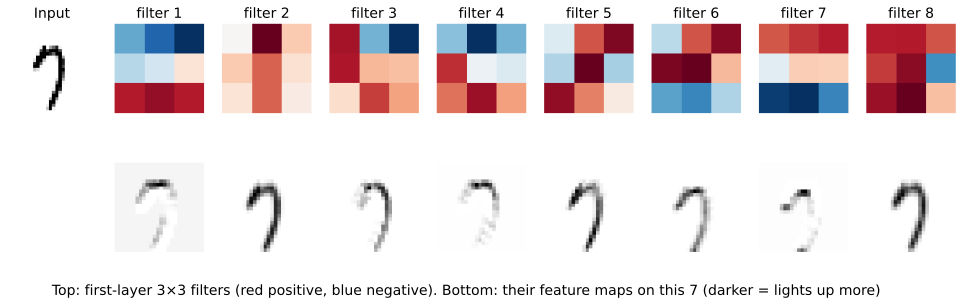

## Shuffle every image's pixels, the same way

::: {.stage}
{.fig .fig-s1 fig-alt="Left: a handwritten 7. Right: the same image after its 784 pixels are moved into a fixed new order, a cloud of dots"}

::: {.ask}
<small>Predict</small>
Train the Lesson 9 network (0.970) again on shuffled images. Its validation accuracy?
:::
:::

::: {.notes}
约 2.5 分钟。开场：Lesson 9 的全连接网络把图排成一行，先看它漏掉了什么。所有图都按同一种顺序打乱。人认不出。请学生写下预测（掉到 0.1？0.5？），下一页揭晓。
:::

## The network does not mind

::: {.stage}
::: {.two .side}
{.fig .fig-s1 fig-alt="Left: a handwritten 7. Right: the same image with its pixels shuffled"}

::: {.bigtab}
| images | validation accuracy |
|---|---:|
| original | 0.9700 |
| shuffled | **0.9738** |
:::
:::

::: {.say .center}
0.9738 against 0.9700. It never used **which pixel is next to which**.
:::
:::

::: {.notes}
约 1.5 分钟。相差 0.38 个百分点，和 Lesson 9 换种子的差别（0.26）同一量级。每个像素各连一个权重，排在第几位无所谓。可是一笔就是一串挨着的黑像素。
:::

## Move every digit a few pixels to the right

::: {.stage .top}


::: {.say .center}
Moved 2 pixels: 0.970 → **0.870**. Moved 4 pixels: **0.390**.
:::
:::

::: {.notes}
约 2.5 分钟。网络不重新训练，只重新测。请学生拖：移 2 个像素人还认得出吗？网络 0.970 → 0.870；4 个像素 0.390。它学的是“第 300 号像素黑”，数字一挪，笔画就落到了别的号上。
:::

## [Problem:]{.stg} What we want

::: {.stage}
::: {.say .xl .center}
Use the **neighbours**, and recognise a stroke **wherever** it is.
:::

::: {.ask}
<small>Your turn</small>
Turn this into two properties of a **detector**: a small set of weights that looks for one pattern, like one hidden unit of Lesson 9.
:::
:::

::: {.notes}
约 2 分钟。期待：只看一小块（笔画是局部的）；同一个检测器到处用（左上角的一横和右下角的一横是同一种东西）。
:::

## What you will be able to do

::: {.stage .tight}
::: {.say .xl}
**Explain** why shuffling does not hurt and moving does, **build** a detector that looks at a small patch everywhere, **compare** the new network with the fully connected one fairly, and **read** its mistakes.
:::

::: {.flow .four}
<div><span>1</span>A small patch, everywhere</div>
<div><span>2</span>One number per block</div>
<div><span>3</span>The new network, tested</div>
<div><span>4</span>Its mistakes</div>
:::
:::

::: {.notes}
约 1 分钟。能力承诺，念出四段路线。
:::

## [A small patch, everywhere:]{.stg} Look at 3 × 3 only. Then?

::: {.stage}
::: {.two .even}
::: {.tile .txt}
**Own weights at each position**

A 3 × 3 patch fits in 26 × 26 = 676 places. Each place learns its own 9 weights.
:::

::: {.tile .txt}
**One set shared by all positions**

The same 9 weights slide over every place.
:::
:::

::: {.say .center}
Wanted: (1) look at a 3 × 3 patch only; (2) the same detector everywhere.
:::

::: {.ask}
<small>Your turn</small>
With 16 detectors, how many weights does each candidate need (count each detector's constant too)? Which meets both properties?
:::
:::

::: {.notes}
约 2 分钟。第一个性质（局部）两个候选都满足；区别在第二个性质。请学生算：676 × 16 × (9 + 1)，以及 16 × (9 + 1)。
:::

## [A small patch, everywhere:]{.stg} Share one small filter

::: {.stage}
{.fig .fig-f2 fig-alt="Two faint 7s, each with five 3 by 3 squares; on the left the squares have different colours, 108,160 weights; on the right the same colour, 160 weights"}

::: {.say .center}
Each detector has 9 weights + 1 constant: own weights 26 × 26 × 16 × (9 + 1) = 108,160; shared 16 × (9 + 1) = 160.

The shared 3 × 3 block is a **filter**; sliding it gives a **feature map**; the operation is a **convolution**.
:::
:::

::: {.notes}
约 2 分钟。108,160 个，一层就快赶上 Lesson 9 整个网络；而且左上角学会的一横到右下角还得重新学。共享只要 160 个，学会一次到处能用。点名 filter、feature map、convolution。
:::

## [A small patch, everywhere:]{.stg} Slide a filter over a digit

::: {.stage .top}

:::

::: {.notes}
约 6 分钟。先选 7 和 “Horizontal edge”：上一行 1、下一行 −1，上黑下白的地方最大，7 的横笔下沿最黑。换 “Vertical edge”：竖笔亮，横笔几乎不亮。换数字 1：横边几乎全白。点 “Slide over” 看它滑过去。CNN 里这些权重是学出来的；卷积后照样过 ReLU。
:::

## [One number per block:]{.stg} The feature map still moves

::: {.stage}
::: {.say .xl .center}
Move the digit 2 pixels: its feature map moves 2 places too. The layer after it still reads positions.
:::

::: {.three}
::: {.tile .txt}
**1. Keep every position**

Pass the whole feature map on.
:::

::: {.tile .txt}
**2. Mean of each 2 × 2**

One number per block: the average of the 4.
:::

::: {.tile .txt}
**3. Largest of each 2 × 2**

One number per block: the largest of the 4.
:::
:::

::: {.ask}
<small>Your turn</small>
Which of the three cares least about a small move?
:::
:::

::: {.notes}
约 1.5 分钟。期待：取最大的那个。最大的数挪一格，只要还在同一块里，留下的数完全不变；平均值会变。
:::

## [One number per block:]{.stg} Keep the largest

::: {.stage}
::: {.two .wideleft}
{.fig .fig-f3 fig-alt="A 4 by 4 table split into four 2 by 2 blocks; the pooled 2 by 2 table holds the largest of each block: 3, 2, 2, 5"}

::: {.bigtab}
Two convolution layers (next slide). Between them: 1. keep every position, 2. mean of each 2 × 2 block, 3. its largest.

| | 1. keep every position | 2. mean | 3. largest |
|---|---:|---:|---:|
| weights | 189,130 | 12,810 | 12,810 |
| validation | 0.984 | 0.984 | 0.987 |
| moved 2 | 0.941 | 0.949 | **0.962** |
:::
:::

::: {.say .center}
**Max pooling**: smaller maps, fewer weights, less hurt by small moves.
:::
:::

::: {.notes}
约 2 分钟。下一页要搭的网络，三种做法各训练 5 轮。都留着参数多了 14 倍多（特征图没缩小），准确率没更高，平移后掉得最多；取平均和取最大的验证准确率差不多（在换种子的波动之内），平移后取最大掉得少。点名 max pooling。
:::

## [The new network, tested:]{.stg} The pieces in order

::: {.stage}
{.fig .fig-f4 fig-alt="Seven boxes: input 28×28×1, convolution to 26×26×16 with 160 weights, pooling to 13×13×16, convolution to 11×11×32 with 4,640 weights, pooling to 5×5×32, flatten to 800, 10 softmax with 8,010 weights; 12,810 weights in all"}

::: {.say .center}
Second convolution: each of its 32 filters looks at all 16 feature maps, so 32 × (3 × 3 × 16 + 1) = 4,640 weights.<br><small>Pooling halves each side, rounding down (26 → 13, 11 → 5). Then 5 × 5 × 32 = 800 numbers, and the output layer has 800 × 10 + 10 = 8,010 weights.</small>
:::

::: {.ask}
<small>Predict</small>
Against the Lesson 9 network (118,282 weights, 0.970): more or less accurate? Faster or slower per epoch?
:::
:::

::: {.notes}
约 3 分钟。输入是 28×28×1（彩色是 3）。28 变 26：3×3 只能放 26 个位置，Keras 默认不补边。第二层每个滤波器看 16 张特征图：3×3×16+1 = 145 个权重。最后 5×5×32 的特征图排成一行 800 个数（Flatten），交给 softmax，就像 Lesson 9 把图排成 784 个数。这样的网络叫 CNN。请学生写下两个预测。
:::

## [The new network, tested:]{.stg} Fewer weights, more accurate, slower

::: {.stage .bigtab}
| | fully connected (Lesson 9) | CNN |
|---|---:|---:|
| weights | 118,282 | **12,810** |
| validation accuracy (5 epochs) | 0.970 | **0.987** |
| wrong validation images | 300 | **130** |
| seconds for 5 epochs (laptop) | **about 11** | about 29 |

::: {.say .center}
The price: a convolution is computed at every position.
:::
:::

::: {.notes}
约 1.5 分钟。错的图少了一半多，权重不到九分之一；但每轮慢。作业 2 附加题 A 的表 A 就是这几列。
:::

## [The new network, tested:]{.stg} Move the digits again

::: {.stage .top}


::: {.say .center}
Moved 2 pixels: CNN **0.962**, fully connected 0.870. Moved 4: 0.663 and 0.390.
:::
:::

::: {.notes}
约 2.5 分钟。拖 0 到 4：CNN 0.987、0.984、0.962、0.877、0.663；全连接 0.970、0.957、0.870、0.626、0.390。移 2 个像素，CNN 掉 2.5 个百分点，全连接掉 10 个。移 4 个像素 CNN 也掉到 0.663：两次 2×2 池化只能吸收很小的挪动。
:::

## [The new network, tested:]{.stg} Does it really use neighbours?

::: {.stage}
::: {.say .xl .center}
Shuffle the pixels the same way as before, and train the CNN from scratch.
:::

::: {.ask}
<small>Predict</small>
The fully connected network did not mind (0.970 → 0.974). And the CNN (0.987)?
:::
:::

::: {.notes}
约 1 分钟。请学生先预测。
:::

## [The new network, tested:]{.stg} Shuffling hurts the CNN

::: {.stage}
::: {.say .xl .center}
CNN: 0.987 → **0.945**. Fully connected: no change.
:::

::: {.say .center}
After shuffling, a 3 × 3 patch no longer holds neighbouring pixels: the filters cannot find strokes.
:::
:::

::: {.notes}
约 1 分钟。这正说明 CNN 用了“哪个像素挨着哪个”。更准不等于用了空间结构，这两个实验才是证据。
:::

## [Its mistakes:]{.stg} Where does 0.987 go wrong?

::: {.stage}
::: {.two .wideleft}
{.fig .fig-f5 fig-alt="10 by 10 confusion matrix of the CNN on the validation set; the darkest off-diagonal cells are in row 5: 9 images predicted as 8 and 8 as 6"}

::: {.ask}
<small>Your turn</small>
Which digit is most often mistaken, and for what? Why might that be?
:::
:::
:::

::: {.notes}
约 2.5 分钟。Lesson 4 的混淆矩阵。最常见：5 认成 8（9 张）、5 认成 6（8 张）、7 认成 2、8 认成 2（各 6 张）；第 5 名五种并列（各 5 张）。5 的下半部是一个弯，写圆了像 6，上面再连起来像 8。
:::

## [Its mistakes:]{.stg} Could you read them?

::: {.stage}
{.fig .fig-f6 fig-alt="Ten validation images the CNN gets wrong, two of each of the five most common mistakes: 5 predicted as 8, 5 as 6, 8 as 2, 7 as 2, 3 as 5"}

::: {.ask}
<small>Your turn</small>
For how many of these can **you** read the true digit? Is it the image or the model?
:::
:::

::: {.notes}
约 2.5 分钟。最常见的五种错误各两张。有些人也难认：第二张 5 下半部是涂满的圈，像 6 也像 8；第二张 8 上圈很小、下圈很大，像 2。有些人一眼认得出、模型却错了：最后两张 3、加了一横的 7。前者是数据含糊，后者才是模型能改进的地方。全连接网络错的 300 张里，CNN 改对了 214 张，又新错 44 张。作业 2 的表 5、图 3 就是这样做，但在 test 上做一次。
:::

## [Its mistakes:]{.stg} What did the filters learn?

::: {.stage}
{.fig .fig-f7 fig-alt="Top row: a 7 and eight learned 3 by 3 filters in red and blue. Bottom row: their feature maps on the 7"}

::: {.say .center}
Some are edges, like the hand-made ones; some mark "is there ink here". Nobody designed them.
:::
:::

::: {.notes}
约 1.5 分钟。滤波器 7 上红下蓝，一种横边，横笔处最黑；滤波器 1 相反，笔画上沿亮；2、5、8 几乎标出整个笔画。第二层怎样组合，本讲不验证。
:::

## Today in code

::: {.stage}
```python
X = x_train.reshape(-1, 28, 28, 1) / 255.0            # images, not rows; X_fit, X_val as in Lesson 9
keras.utils.set_random_seed(0)                        # fix the random start
cnn = keras.Sequential([
    keras.layers.Input((28, 28, 1)),                   # height, width, one image
    keras.layers.Conv2D(16, 3, activation="relu"),     # 16 shared 3 x 3 filters
    keras.layers.MaxPooling2D(2),                      # keep the largest of each 2 x 2
    keras.layers.Conv2D(32, 3, activation="relu"),     # 32 filters on the 16 feature maps
    keras.layers.MaxPooling2D(2),                      # halve again
    keras.layers.Flatten(),                            # 5 x 5 x 32 = 800 numbers in a row
    keras.layers.Dense(10, activation="softmax"),      # one probability per digit
])
cnn.compile(optimizer="adam", loss="sparse_categorical_crossentropy",
            metrics=["accuracy"])                      # as in Lesson 9
cnn.fit(X_fit, y_fit, epochs=5, validation_data=(X_val, y_val), verbose=0)   # 5 epochs
```
:::

::: {.notes}
约 1 分钟。不讲语法。Lab 10 一步步做：打乱像素、搭 CNN、平移、错误分析。
:::

## Back to the opening shuffle

::: {.stage}
::: {.say .xl .center}
Shuffling never fooled the fully connected network: it never looked at neighbours. The CNN does: **0.987**, and **0.962** after a 2-pixel move.
:::

::: {.say .center}
The price: slower epochs, many structural choices, and it still fails at 4 pixels (0.663).
:::
:::

::: {.notes}
约 1 分钟。局限（口头）：只吸收小的平移；每轮更慢；结构选择多，每次比较受种子影响；它假设挨着的像素有关系，表格数据没有这个结构；错的图里一部分本身含糊。
:::

## What you can do now {.final-slide}

::: {.takeaway}
::: {.rows .tiny .chain}
<div><span class="n">see it</span><div><b>Shuffle and move</b><p>the fully connected network ignores neighbours</p></div></div>
<div><span class="n">local</span><div><b>Look at 3 × 3</b><p>strokes are local</p></div></div>
<div><span class="n">shared</span><div><b>One filter everywhere</b><p>108,160 → 160 weights: a convolution</p></div></div>
<div><span class="n">pool</span><div><b>Max pooling</b><p>small moves matter less</p></div></div>
<div><span class="n">compare</span><div><b>Weights, accuracy, time, moves</b><p>12,810 weights, 0.987, slower</p></div></div>
<div><span class="n">check</span><div><b>Confusion matrix, wrong images</b><p>image or model?</p></div></div>
:::

::: {.qr}
{fig-alt="Feedback QR code for Lesson 10"}
<b>30-second feedback</b>
<p>After class: Lab 10</p>
:::
:::

::: {.notes}
约 1.5 分钟，课堂最终停在这一页。沿六行把整条链念一遍。答疑和扫码都在这里。课后 Lab 10。
:::
