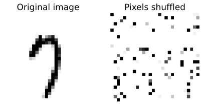
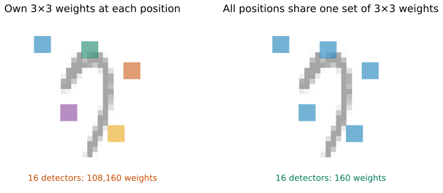
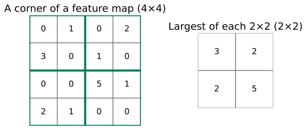
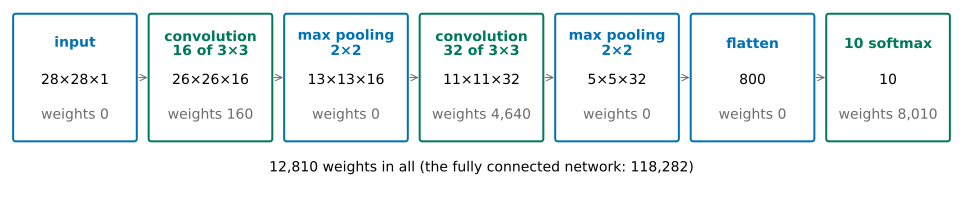
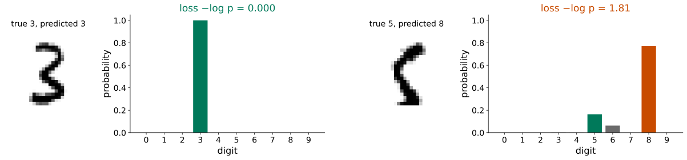
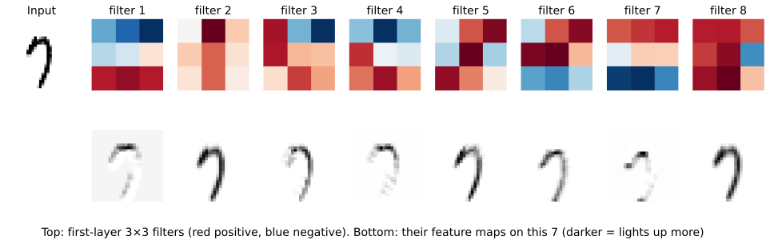
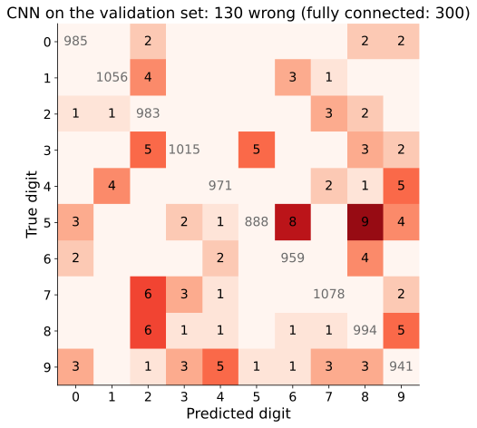
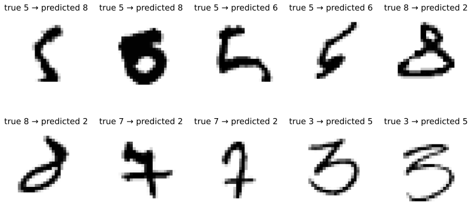

## [Problem:]{.stg} Shuffle every image's pixels, the same way

::: {.stage}
{.fig .fig-s1 fig-alt="Left: a handwritten 7. Right: the same image after its 784 pixels are moved into a fixed new order, a cloud of dots"}

::: {.ask .vote}
<small>Vote on your phone</small>
All images shuffled the same way; the fully connected network (0.970) retrained. Accuracy?

::: {.opts}
<span><b>A</b>about 0.1</span>
<span><b>B</b>about 0.5</span>
<span><b>C</b>about 0.97</span>
:::
:::

::: {.scan}
{fig-alt="QR code for today's live page"}
<b>Scan now</b>
votes, questions, feedback
:::
:::

::: {.notes}
约 3 分钟。先请大家扫右下角（或右屏）的二维码，页面整节课开着。投票（右屏 Shuffle every image's pixels → Open，30 秒，先不显示结果，再 Reveal），揭晓后请选 A 的同学说理由，下一页给答案（C）。开场：全连接网络把一张图排成一行 784 个数，两个各 128 个单元的隐藏层，5 轮验证 0.970。所有图都按同一种顺序打乱，人认不出。请学生写下预测（掉到 0.1？0.5？），下一页揭晓。
:::

## [Problem:]{.stg} The network does not mind

::: {.stage}
::: {.two .side}
{.fig .fig-s1 fig-alt="Left: a handwritten 7. Right: the same image with its pixels shuffled"}

::: {.bigtab}
| images | validation accuracy |
|---|---:|
| original | 0.9700 |
| shuffled | **0.9738** |
:::
:::

::: {.say}
0.9738 against 0.9700. It never used **which pixel is next to which**.
:::
:::

::: {.notes}
约 1.5 分钟。相差 0.38 个百分点，和只换随机种子的差别（0.26）同一量级。每个像素各连一个权重，排在第几位无所谓。可是一笔就是一串挨着的黑像素。
:::

## [Problem:]{.stg} Move every digit a few pixels to the right

::: {.stage .top}


::: {.say}
Moved 2 pixels: 0.970 → **0.870**. Moved 4 pixels: **0.390**.
:::
:::

::: {.notes}
约 2.5 分钟。网络不重新训练，只重新测。请学生拖：移 2 个像素人还认得出吗？网络 0.970 → 0.870；4 个像素 0.390。它学的是“第 300 号像素黑”，数字一挪，笔画就落到了别的号上。
:::

## [Problem:]{.stg} What we want

::: {.stage}
::: {.say .xl}
Use the **neighbours**, and recognise a stroke **wherever** it is.
:::

::: {.ask}
<small>Your turn</small>
Turn this into two properties of a **detector**: a small set of weights that looks for one pattern, like one hidden unit of the fully connected network.
:::
:::

::: {.notes}
约 2 分钟。期待：只看一小块（笔画是局部的）；同一个检测器到处用（左上角的一横和右下角的一横是同一种东西）。
:::

## What you will be able to do

::: {.stage .tight}
::: {.say .xl}
**Explain** why shuffling does not hurt and moving does, **build** a detector that looks at a small patch everywhere, **compare** the new network with the fully connected one fairly, and **read** its mistakes.
:::

::: {.flow .six}
<div><span>1</span>Problem</div>
<div><span>2</span>Model</div>
<div><span>3</span>Loss</div>
<div><span>4</span>Solution</div>
<div><span>5</span>Test</div>
<div><span>6</span>Application</div>
:::
:::

::: {.notes}
约 1 分钟。能力承诺，念出六步路线：先从问题里找出想要的性质，搭模型，说清损失和怎样求解，再检验、用到 MNIST 上。
:::

## [Problem:]{.stg} Look at 3 × 3 only. Then?

::: {.stage}
::: {.two .even}
::: {.tile .txt}
**Own weights at each position**

A 3 × 3 patch fits in 26 × 26 = 676 places. Each place learns its own 9 weights.
:::

::: {.tile .txt}
**One set shared by all positions**

The same 9 weights slide over every place.
:::
:::

::: {.say}
Wanted: (1) look at a 3 × 3 patch only; (2) the same detector everywhere.
:::

::: {.ask}
<small>Your turn</small>
With 16 detectors, how many weights does each candidate need (count each detector's constant too)? Which meets both properties?
:::
:::

::: {.notes}
约 2 分钟。第一个性质（局部）两个候选都满足；区别在第二个性质。请学生算：676 × 16 × (9 + 1)，以及 16 × (9 + 1)。
:::

## [Problem:]{.stg} Share one small filter

::: {.stage}
{.fig .fig-f2 fig-alt="Two faint 7s, each with five 3 by 3 squares; on the left the squares have different colours, 108,160 weights; on the right the same colour, 160 weights"}

::: {.say}
Each detector has 9 weights + 1 constant: own weights 26 × 26 × 16 × (9 + 1) = 108,160; shared 16 × (9 + 1) = 160.

The shared 3 × 3 block is a **filter**; sliding it gives a **feature map**; the operation is a **convolution**.
:::
:::

::: {.notes}
约 2 分钟。108,160 个，一层就快赶上整个全连接网络（118,282）；而且左上角学会的一横到右下角还得重新学。共享只要 160 个，学会一次到处能用。点名 filter、feature map、convolution。
:::

## [Problem:]{.stg} Slide a filter over a digit

::: {.stage .top}

:::

::: {.notes}
约 4.5 分钟。先选 7 和 “Horizontal edge”：上一行 1、下一行 −1，上黑下白的地方最大，7 的横笔下沿最黑。换 “Vertical edge”：竖笔亮，横笔几乎不亮。换数字 1：横边几乎全白。点 “Slide over” 看它滑过去。这些滤波器是手定的；网络里的滤波器怎样来，是 Solution 那一页的事。
:::

## [Model:]{.stg} The feature map still moves

::: {.stage}
::: {.say .xl}
Move the digit 2 pixels: its feature map moves 2 places too. The layer after it still reads positions.
:::

::: {.three}
::: {.tile .txt}
**1. Keep every position**

Pass the whole feature map on.
:::

::: {.tile .txt}
**2. Mean of each 2 × 2**

One number per block: the average of the 4.
:::

::: {.tile .txt}
**3. Largest of each 2 × 2**

One number per block: the largest of the 4.
:::
:::

::: {.ask .vote}
<small>Vote on your phone</small>
Digits moved 2 pixels. Which keeps accuracy highest?

::: {.opts}
<span><b>A</b>keep every position</span>
<span><b>B</b>mean of each 2&nbsp;×&nbsp;2</span>
<span><b>C</b>largest of each 2&nbsp;×&nbsp;2</span>
:::
:::
:::

::: {.notes}
约 2 分钟。投票（右屏 The feature map still moves → Open，30 秒，先不显示结果，再 Reveal）；请选 B 的同学说为什么平均值也稳。期待：取最大的那个。直觉：笔画稍微一挪，一块里最大的那个数常常还落在同一块里，留下的数不变；平均值会因为有数移进、移出这一块而变；全部保留时下一层读到的位置整体都挪了。
:::

## [Model:]{.stg} Keep the largest

::: {.stage}
::: {.two .wideleft}
{.fig .fig-f3 fig-alt="A 4 by 4 table split into four 2 by 2 blocks; the pooled 2 by 2 table holds the largest of each block: 3, 2, 2, 5"}

::: {.bigtab}
Two convolution layers (next slide). Between them: 1. keep every position, 2. mean of each 2 × 2 block, 3. its largest.

| | 1. keep every position | 2. mean | 3. largest |
|---|---:|---:|---:|
| weights | 189,130 | 12,810 | 12,810 |
| validation | 0.984 | 0.984 | 0.987 |
| moved 2 | 0.941 | 0.949 | **0.962** |
:::
:::

::: {.say}
**Max pooling**: smaller maps, fewer weights, less hurt by small moves.
:::
:::

::: {.notes}
约 2 分钟。下一页要搭的网络，三种做法各训练 5 轮。都留着参数多了 14 倍多（特征图没缩小），准确率没更高，平移后掉得最多；取平均和取最大的验证准确率差不多（在换种子的波动之内），平移后取最大掉得少。点名 max pooling。
:::

## [Model:]{.stg} The pieces in order

::: {.stage}
{.fig .fig-f4 fig-alt="Seven boxes: input 28×28×1, convolution to 26×26×16 with 160 weights, pooling to 13×13×16, convolution to 11×11×32 with 4,640 weights, pooling to 5×5×32, flatten to 800, 10 softmax with 8,010 weights; 12,810 weights in all"}

::: {.say}
Second convolution: each of its 32 filters looks at all 16 feature maps, so 32 × (3 × 3 × 16 + 1) = 4,640 weights.<br><small>Pooling halves each side, rounding down (26 → 13, 11 → 5). Then 5 × 5 × 32 = 800 numbers, and the output layer has 800 × 10 + 10 = 8,010 weights.</small>
:::

::: {.say}
The assumption: **neighbouring pixels belong together**, and the same stroke can appear **anywhere**.
:::
:::

::: {.notes}
约 2.5 分钟。输入是 28×28×1（彩色是 3）。28 变 26：3×3 只能放 26 个位置，Keras 默认不补边。第二层每个滤波器看 16 张特征图：3×3×16+1 = 145 个权重。最后 5×5×32 的特征图排成一行 800 个数（Flatten），交给 softmax。这样的网络叫 CNN。最后一句是这个模型对数据的假设：卷积用前半句，共享和池化用后半句。
:::

## [Loss:]{.stg} Cross-entropy: −log of the true digit's probability

::: {.stage}
{.fig .fig-f9 fig-alt="Two validation images with the CNN's 10 probabilities as bars. Left: a 3, almost all probability on 3, loss close to 0. Right: a 5 read as 8, the bar of 5 is short, the loss is large"}

::: {.formula}
$$
\text{loss} = -\log p_{\text{true digit}}
$$
:::

::: {.say}
Averaged over the 50,000 fitting images. The same loss as for the fully connected network: only **how the probabilities are computed** has changed.
:::
:::

::: {.notes}
约 1.5 分钟。10 个 softmax 给出 10 个概率，加起来是 1。真实数字的概率越接近 1，损失越接近 0；认错的图（右边，5 被认成 8）真实数字的概率小，损失大。和训练全连接网络时完全一样，叫交叉熵。
:::

## [Solution:]{.stg} 12,810 unknowns, found by gradient descent

::: {.stage}
{.fig .fig-f7 fig-alt="Top row: a 7 and eight learned 3 by 3 filters in red and blue. Bottom row: their feature maps on the 7"}

::: {.say}
Unknowns: **all 12,810 weights**, the filters too. Gradient descent with adam, one small batch of images at a time. A shared filter is used at 676 positions, so its gradient **adds up** what every position says.
:::
:::

::: {.notes}
约 2.5 分钟。梯度的式子在 Note 第 5 节，课上不写。未知数：第一层 16 个滤波器的 9 个数和常数、第二层 32 个滤波器、最后一层，一共 12,810 个，没有人手定。解法和全连接网络一样：一小批一小批地算梯度（链式法则），adam 往损失小的方向挪。唯一新的一点：一个滤波器只有一套 9 个数，却在 676 个位置都用到，所以它的梯度是各个位置的贡献加起来；左上角的一横和右下角的一横改的是同一个滤波器。结论：训练 5 轮后，学出来的滤波器有的像手定的横边（滤波器 7 上红下蓝）、有的标出整个笔画（2、5、8）。没有人设计它们。
:::

## [Test:]{.stg} Move the digits again

::: {.stage .top}


::: {.say}
Moved 2 pixels: CNN **0.962**, fully connected 0.870. Moved 4: 0.663 and 0.390.
:::
:::

::: {.notes}
约 2.5 分钟。拖 0 到 4：CNN 0.987、0.984、0.962、0.877、0.663；全连接 0.970、0.957、0.870、0.626、0.390。移 2 个像素，CNN 掉 2.5 个百分点，全连接掉 10 个。移 4 个像素 CNN 也掉到 0.663：两次 2×2 池化只能吸收很小的挪动。
:::

## [Test:]{.stg} Does it really use neighbours?

::: {.stage}
::: {.say .xl}
Shuffle the pixels the same way as before, and train the CNN from scratch.
:::

::: {.ask .vote}
<small>Vote on your phone</small>
Same shuffle, CNN (0.987) retrained. Its accuracy?

::: {.opts}
<span><b>A</b>still about 0.987</span>
<span><b>B</b>clearly lower</span>
<span><b>C</b>about 0.1</span>
:::
:::
:::

::: {.notes}
约 1.5 分钟。投票（右屏 Does it really use neighbours? → Open，30 秒，先不显示结果，再 Reveal），请选 A 的同学说理由：全连接网络不在乎，CNN 为什么会在乎？
:::

## [Test:]{.stg} Shuffling hurts the CNN

::: {.stage}
::: {.say .xl}
CNN: 0.987 → **0.945**. Fully connected: no change.
:::

::: {.say}
After shuffling, a 3 × 3 patch no longer holds neighbouring pixels: the filters cannot find strokes. The assumption of the model is what makes it work.
:::
:::

::: {.notes}
约 1 分钟。这正说明 CNN 用了“哪个像素挨着哪个”。更准不等于用了空间结构，这两个实验才是证据。
:::

## [Application:]{.stg} Fewer weights, more accurate, slower

::: {.stage .bigtab}
| | fully connected | CNN |
|---|---:|---:|
| weights | 118,282 | **12,810** |
| validation accuracy (5 epochs) | 0.970 | **0.987** |
| wrong validation images | 300 | **130** |
| seconds for 5 epochs (laptop) | **11.8** | 29.5 |

::: {.say}
The price: a convolution is computed at every position.
:::
:::

::: {.notes}
约 1.5 分钟。同一划分、同样 5 轮、同一种子。错的图少了一半多，权重不到九分之一；但每轮慢。作业 2 附加题 A 的表 A 就是这几列。
:::

## [Application:]{.stg} Where does 0.987 go wrong?

::: {.stage}
::: {.two .wideleft}
{.fig .fig-f5 fig-alt="10 by 10 confusion matrix of the CNN on the validation set; the darkest off-diagonal cells are in row 5: 9 images predicted as 8 and 8 as 6"}

::: {.ask}
<small>Your turn</small>
Which digit is most often mistaken, and for what? Why might that be?
:::
:::
:::

::: {.notes}
约 2.5 分钟。混淆矩阵：行是真实数字，列是预测。最常见：5 认成 8（9 张）、5 认成 6（8 张）、7 认成 2、8 认成 2（各 6 张）；第 5 名五种并列（各 5 张）。5 的下半部是一个弯，写圆了像 6，上面再连起来像 8。
:::

## [Application:]{.stg} Could you read them?

::: {.stage}
{.fig .fig-f6 fig-alt="Ten validation images the CNN gets wrong, two of each of the five most common mistakes: 5 predicted as 8, 5 as 6, 8 as 2, 7 as 2, 3 as 5"}

::: {.ask}
<small>Your turn</small>
For how many of these can **you** read the true digit? Is it the image or the model?
:::
:::

::: {.notes}
约 2 分钟。最常见的五种错误各两张。有些人也难认：第二张 5 下半部是涂满的圈，像 6 也像 8；第二张 8 上圈很小、下圈很大，像 2。有些人一眼认得出、模型却错了：最后两张 3、加了一横的 7。前者是数据含糊，后者才是模型能改进的地方。全连接网络错的 300 张里，CNN 改对了 214 张，又新错 44 张。作业 2 的表 5、图 3 就是这样做，但在 test 上做一次。
:::

## [Extension:]{.stg} One line changes the structure

::: {.stage .bigtab .ext}
| one change | weights | validation | moved 4 |
|---|---:|---:|---:|
| none (today's CNN) | 12,810 | 0.987 | 0.663 |
| keep the size: pad the edges with zeros | 20,490 | 0.987 | 0.693 |
| one more convolution layer | 29,066 | 0.988 | 0.622 |
| **move the images at random while training** | 12,810 | 0.988 | **0.945** |

::: {.say}
Structure changes stay within the seed's variation. **Moved images in training** (data augmentation) fix the 4-pixel move, with no new weight.
:::
:::

::: {.notes}
约 1 分钟，选讲，超时先压这一页。每一行只改 Keras 里的一两处（padding="same"、再加 Conv2D(64, 3)、RandomTranslation(0, 0.1)），其余不变（5 轮、种子 0）。Note 第 10 节有七行的完整表，含步长、全局平均、dropout。多数改动的差别在换种子的波动之内；只留平均数的那行参数最少、准确率掉得最多。只有最后一行（训练时随机平移，叫数据增强）让 4 像素后的准确率从 0.663 升到 0.945，不加一个参数。 还有迁移学习：拿别人在几百万张照片上训练好的网络（keras.applications），作业 2 不允许。
:::

## [Limitations:]{.stg} Where the CNN cannot be trusted

::: {.stage}
::: {.rows}
<div><span class="n">1</span><div><b>Small moves only, by itself</b><p>4 pixels: 0.663, unless moved images are added in training</p></div></div>
<div><span class="n">2</span><div><b>Slower</b><p>29.5 against 11.8 seconds, with a tenth of the weights</p></div></div>
<div><span class="n">3</span><div><b>Many structural choices</b><p>each one compared on the validation set, each comparison moved by the seed</p></div></div>
<div><span class="n">4</span><div><b>It assumes neighbours matter</b><p>true for images; a table of 30 tumour measurements has no neighbours</p></div></div>
<div><span class="n">5</span><div><b>Some images are unclear</b><p>no model reads them all</p></div></div>
:::
:::

::: {.notes}
约 1 分钟。回到开场：打乱骗不了全连接网络，因为它本来就不看邻居；CNN 看邻居，所以更准、更不怕小的平移。五条局限：4 像素仍然掉到 0.663；每轮更慢（卷积在每个位置都要算）；结构选择多，每次比较受种子影响；它的假设对表格数据不成立；一部分错图本身含糊。
:::

## Today in code

::: {.stage}
```python
X = x_train.reshape(-1, 28, 28, 1) / 255.0            # images, not rows; X_fit, X_val: first 50,000 and last 10,000
keras.utils.set_random_seed(0)                        # fix the random start
cnn = keras.Sequential([
    keras.layers.Input((28, 28, 1)),                   # height, width, one image
    keras.layers.Conv2D(16, 3, activation="relu"),     # 16 shared 3 x 3 filters
    keras.layers.MaxPooling2D(2),                      # keep the largest of each 2 x 2
    keras.layers.Conv2D(32, 3, activation="relu"),     # 32 filters on the 16 feature maps
    keras.layers.MaxPooling2D(2),                      # halve again
    keras.layers.Flatten(),                            # 5 x 5 x 32 = 800 numbers in a row
    keras.layers.Dense(10, activation="softmax"),      # one probability per digit
])
cnn.compile(optimizer="adam", loss="sparse_categorical_crossentropy",
            metrics=["accuracy"])                      # cross-entropy, adam
cnn.fit(X_fit, y_fit, epochs=5, validation_data=(X_val, y_val), verbose=0)   # 5 epochs
```
:::

::: {.notes}
约 0.5 分钟。不讲语法。Lab 10 用它：给 CNN 正确的形状、公平地比两个网络、亲手算一层、找错、查 AI 写的代码。
:::

## What you can do now {.final-slide}

::: {.takeaway}
::: {.rows .tiny .chain}
<div><span class="n">problem</span><div><b>Shuffle and move</b><p>the fully connected network ignores neighbours</p></div></div>
<div><span class="n">model</span><div><b>Convolution + max pooling</b><p>one 3 × 3 filter everywhere: 108,160 → 160 weights</p></div></div>
<div><span class="n">loss</span><div><b>Cross-entropy</b><p>the same goal as before</p></div></div>
<div><span class="n">solution</span><div><b>Gradient descent</b><p>a shared filter adds up all its positions</p></div></div>
<div><span class="n">test</span><div><b>Move and shuffle again</b><p>0.962 after 2 pixels; shuffled 0.945</p></div></div>
<div><span class="n">apply</span><div><b>Weights, accuracy, time, mistakes</b><p>12,810 weights, 0.987, slower; image or model?</p></div></div>
:::

::: {.qr}
{fig-alt="QR code for today's live page"}
<b>Feedback</b>
<p>After class: Lab 10</p>
:::
:::

::: {.notes}
约 1.5 分钟，课堂最终停在这一页。沿六行把整条链念一遍。答疑和扫码都在这里。课后 Lab 10。
:::
