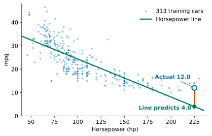
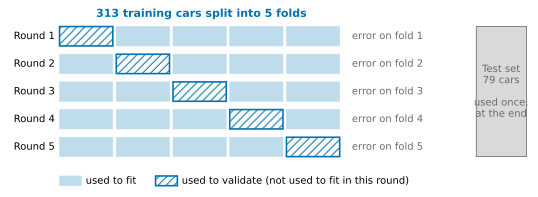
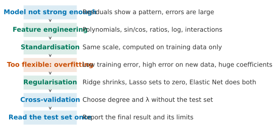

## 1. Motivation: Where Last Lesson's Model Falls Short

In the last lesson we went through the five steps once. We stated the problem, chose a linear model, used the mean squared error (MSE) to say what counts as good, solved it with the normal equation, and then tested it on cars it had not seen. This lesson works on the same kind of problem with the same 392 cars, and the split into 313 training cars and 79 test cars stays the same. Our job is the step that comes after testing: **find where the model falls short, and then improve it.**

Start with one car. The car with the highest horsepower in the test set was built in 1973. It has 225 hp and weighs 4951 pounds. In the last lesson, using horsepower alone gave this line:

$$
\textcolor{#00795A}{\hat y}=40.61-0.1626\,\textcolor{#0072B2}{x},
$$

Here $x$ is the horsepower. Before reading on, make a quick estimate in your head: what mpg will this line predict for this car?

::: {.callout-note collapse="true" title="Show answer"}
The line predicts 4.0 mpg, but the measured value is 12.0 mpg, so the prediction is 8.0 too low. On the 79 test cars, the typical error of this line (the test root mean squared error, RMSE) is 4.71. The error for this car is about 1.7 times as large.
:::

{fig-alt="Scatter plot of mpg against horsepower with a falling straight line, where the prediction for one car in the lower right is far below its measured value"}

One wrong guess could be bad luck. To decide whether the model itself has a problem, we need to check whether the errors follow a pattern. Before you read the next paragraph, look at this figure and think: what is going wrong, and in which of the five steps?

Sort the training cars by horsepower and split them into five groups of equal size. For each group, compute the average residual (measured value minus predicted value): +3.43, −0.65, −2.19, −1.61, +0.80. The two ends are positive and the middle is negative. So the line guesses too low for cars with very low or very high horsepower, and too high for cars in the middle. This is a pattern, not noise. The points follow a curve, but a straight line can only use one slope all the way across.

So the fault is not in the loss, and it is not in the solution. Once we have fixed the form of a straight line, the normal equation has already found the best one. The fault is in the **model**, because it can only represent too few shapes. This is where this lesson starts. How can we make the model stronger? And once it is stronger, what new problems will appear?

By the end of this lesson, you should be able to handle a regression problem where the model is not strong enough. You should first use the evidence to see where the problem lies, and then propose a fix. Use feature engineering so that the model can see structure it could not see before. Put the features on the same scale first. When the model is too flexible, use regularisation to hold it back. Use cross-validation, not the test set, to decide how flexible it should be.

The colour scheme stays the same: blue is data, green is the model, and red is error.

## 2. Model: Making the Model Stronger with Feature Engineering

The previous section found that a straight-line model can represent too few shapes. The question in this section is this: how can we make it draw a curved line while we keep the linear model and the normal equation?

For car $i$, last lesson's model computes $\hat y_i=w_0+w_1x_i$: it can only multiply the columns we give it by weights and add them up. Think first: with nothing but such a weighted sum, is there any way to draw a curved line? Hint: the model cares only about the form "weighted sum", not about which columns are being weighted.

::: {.callout-note collapse="true" title="Show answer"}
We can build a column ourselves. If we compute one more column $x_i^2$ for every car and use it as a second feature, the weighted sum can bend.
:::

We compute one more column $x_i^2$ for every car and use it as a second feature:

$$
\textcolor{#00795A}{\hat y_i}=\textcolor{#00795A}{w_0}+\textcolor{#00795A}{w_1}\textcolor{#0072B2}{x_i}+\textcolor{#00795A}{w_2}\textcolor{#0072B2}{x_i^2}.
$$

As a function of the horsepower $x$, this is a parabola, so it can bend. As a function of the parameters, it is still a weighted sum. The word "linear" in "linear model" means **linear in the parameters**. The data matrix only gains one extra column:

$$
\textcolor{#0072B2}{\mathbf X}=\begin{pmatrix}1&x_1&x_1^2\\ 1&x_2&x_2^2\\ \vdots&\vdots&\vdots\\ 1&x_n&x_n^2\end{pmatrix}\quad(n\times3),
$$

The loss is still the MSE, and we can still use the normal equation $\mathbf X^T\mathbf X\,\mathbf w=\mathbf X^T\mathbf y$. Computing new features from the quantities we already have is called **feature transformation**, or **feature engineering**. Using $x,x^2,\dots,x^d$ as features is called using **polynomial features** of degree $d$.

Solving on the 313 training cars gives the curve $\hat y=58.21−0.4845\,x+0.00129\,x^2$.

| Model | Training RMSE (mpg) | Test RMSE (mpg) |
|---|---:|---:|
| Straight line (horsepower) | 4.95 | 4.71 |
| Adding horsepower squared | 4.38 | 4.29 |

The error falls on both sets of data. The average residuals of the five groups become +1.02, −0.66, −0.93, +0.53, +0.05, and the largest one drops from 3.43 to 1.02. The curvature is not fully removed, but the model now represents most of it.

{fig-alt="Left panel shows a scatter plot with a straight line and a parabola; right panel shows two lines of average residuals"}

**Polynomials with several inputs.** With horsepower as the only input, the columns of a degree 2 polynomial are $x$ and $x^2$. With two inputs, for example horsepower $x_{i1}$ and weight $x_{i2}$, a degree 2 polynomial lists every product of degree 2 or less:

$$
\textcolor{#0072B2}{x_{i1}},\quad \textcolor{#0072B2}{x_{i2}},\quad \textcolor{#0072B2}{x_{i1}^2},\quad \textcolor{#0072B2}{x_{i1}x_{i2}},\quad \textcolor{#0072B2}{x_{i2}^2}.
$$

Here $x_{i1}x_{i2}$ is the product of the two inputs, and it is called an **interaction term**. With it, the effect of horsepower on fuel use can change with weight. The number of columns grows quickly as the inputs grow. A degree 2 polynomial of the six features (without the constant column) has 6 linear terms, 6 squares and 15 products of pairs, which is 27 columns. At degree 3 there are 83 columns. More columns make the model more flexible, and later we will see that this is both a benefit and a problem.

**Not only squares.** Polynomials are only one kind of feature engineering. The most useful features often come from understanding the problem itself. Here are three situations. Before you look at the answers, think: what feature would you build?

1. You want to predict the number of shared bikes rented each hour, and you have "the hour of the day" (0 to 23).
2. You want to predict house prices in a neighbourhood, and you have the average number of rooms per household and the average number of bedrooms per household.
3. You want to predict fuel consumption, and you have the weight of the car.

::: {.callout-note collapse="true" title="Show suggested answers"}
**1. Use sin and cos for quantities that repeat in a cycle.** If we use the hour as a plain number, the model treats 23:00 and 0:00 as 23 apart, although they are next to each other. A straight line also cannot draw the two peaks in the morning and the evening. If we turn the hour $h$ into two columns, $\sin(2\pi h/24)$ and $\cos(2\pi h/24)$, the end of the day joins up with the start and forms a circle. On 17379 hourly records of shared bike rentals in Washington, using the hour itself gives a test R² of 0.16. Using sin and cos gives 0.34. Adding one more pair with half the period, $\sin(4\pi h/24)$ and $\cos(4\pi h/24)$, gives 0.41. The same idea works for months, days of the week, wind directions and angles.

**2. A ratio often means more than the original quantities.** In data on 20640 neighbourhoods in California, the average number of bedrooms per household is almost unrelated to house price (the correlation is −0.05). If we use "the share of rooms that are bedrooms" instead, the correlation becomes −0.26, which is a negative relationship. For the same number of rooms, the larger the share of bedrooms, the lower the price. Both original columns contain this information, but it is hidden in their ratio, and a weighted sum cannot express "divide by". Population divided by area gives population density, and spending divided by the number of people gives spending per person. These are the same kind of idea.

**3. Sometimes we transform the target.** The physics of fuel use is closer to "how much fuel is used per mile", and mpg is the reciprocal of that. If we change the target to gallons used per 100 miles, $100/y$, its correlation with weight is 0.88. This is closer to a straight line than the correlation of −0.84 between mpg and weight. If we fit this new target and then convert back to mpg, the test RMSE drops from 4.21 to 4.08.
:::

{fig-alt="Average rentals for each of the 24 hours with three fitted curves"}

Here are a few more common transformations, with one sentence each. For quantities that span several orders of magnitude, and whose effect works by "doubling" rather than "adding one" (income, population, house price), we often take the **logarithm**. When the effect of one feature changes with another feature, we can also add only the product of the two, which is the interaction term above, instead of every degree 2 term. A category (such as origin or weather) cannot be used directly as a number, so we can build one column of 0s and 1s for each category, which is called an **indicator variable**.

One principle lies behind all these examples: **feature engineering means writing your understanding of the problem as new columns.** The model can only form weighted sums. If it cannot see some structure, we must transform that structure into a form it can see.

Once we have more features, a practical problem appears straight away: the sizes of these columns are very different. The next section deals with this.

## 3. Standardisation: Putting Features on the Same Scale

The previous section built new features. The question in this section is this: the values of these features differ by several orders of magnitude, so what trouble does that cause, and how do we deal with it?

Look at the ranges of a few columns in the training cars. Horsepower goes from 46 to 230, horsepower squared from 2116 to 52900, and weight from 1613 to 5140. With a degree 7 polynomial, horsepower to the 7th power can reach about $3.4\times10^{16}$.

This causes two kinds of trouble.

**The size of a coefficient depends on the units.** In the quadratic model of the previous section, the two coefficients in the original units are −0.4845 and 0.00129. The coefficient of $x^2$ looks small enough to ignore, but only because $x^2$ itself is often in the tens of thousands. We already met this problem when we read coefficients in the last lesson. The unit of a coefficient is "mpg divided by the unit of that feature", so we cannot compare the sizes of coefficients for different features directly.

**The numerical computation gets worse.** When the columns differ too much in size, the entries of $\mathbf X^T\mathbf X$ range from single digits to more than $10^{30}$. The limited precision of the computer can then make the solution unreliable (this is what the condition number in Advanced Study 1 of the last lesson was about).

The fix is **standardisation**: from each feature, subtract its mean, and then divide by its standard deviation,

$$
\textcolor{#0072B2}{z_{ij}}=\frac{\textcolor{#0072B2}{x_{ij}}-\bar x_j}{s_j},
$$

where $\bar x_j$ and $s_j$ are the mean and standard deviation of feature $j$. After standardisation, every feature has mean 0 and standard deviation 1. A coefficient then tells us "how much the prediction changes when this feature changes by one standard deviation". For the same quadratic model, the two coefficients after standardisation are −18.52 and 12.51. So the squared term matters as much as the linear term, and the original units were hiding this. Standardisation does not change the predictions. It only changes the units in which we read the coefficients.

Remember one rule from the very start: **compute the mean and standard deviation from the training data only**, and then apply them unchanged to the test data. The test cars must not take part in anything we compute from the data. Otherwise they are no longer "cars the model has not seen".

Standardisation is not a feature, but we always do it together with feature engineering. We will use it twice more later in this lesson.

Now we can make the model as strong as we like. We can add polynomial terms of any degree, and we can build as many features as we want. Is more always better?

## 4. Complexity: Is More Always Better?

The last two sections made the model more powerful. This section asks what happens if we keep going, for example by raising the polynomial degree higher and higher. We will look at the effect on a very small dataset, where it is easy to see.

Let us return to the ten cars we used in class last lesson (the first 10 rows of the training set). Their horsepower values are 110, 92, 97, 150, 64, 190, 62, 110, 115, 110. The value 110 hp appears three times, so there are only 8 different horsepower values. We fit polynomials of degree 1 to 7 on these ten cars (with standardised features), and then check them on the 79 test cars. A higher degree means more parameters, so the model can represent more curves. We say that the model has a higher **complexity**.

Before you move the slider, make a prediction. As the degree goes from 1 to 7, how will the error on the ten cars change? What about the error on the 79 new cars? And the coefficients?



Here are the results for each degree side by side. "Training" is the RMSE on the ten cars, and "Test" is the RMSE on the 79 test cars. Both are in mpg.

| Degree | 1 | 2 | 3 | 4 | 5 | 6 | 7 |
|---|---:|---:|---:|---:|---:|---:|---:|
| Training | 4.61 | 3.43 | 3.41 | 3.39 | 2.08 | 2.03 | 1.89 |
| Test | 4.59 | 4.67 | 4.52 | 5.88 | 276.3 | 68.66 | 7512 |
| Largest coefficient | 5.45 | 22.30 | 47.10 | 340.0 | $8.2\times10^{4}$ | $2.5\times10^{5}$ | $8.7\times10^{6}$ |

The training error keeps falling. At degree 7, the curve passes through the average mpg at each horsepower value. The remaining 1.89 comes from the three cars with 110 hp, whose mpg values are 18.6, 25 and 17. At a single horsepower value, any curve can give only one prediction. The test error behaves very differently. It grows sharply after degree 4 and is above 7000 at degree 7. The curve swings up and down so that it can pass through every point. Outside the horsepower range of the ten cars (below 62 hp or above 190 hp), it shoots off to extreme values.

Sometimes a model does very well on the training data but badly on new data. This happens because it has learned the chance features of the training data as if they were real patterns. We call this **overfitting**. The opposite problem is a model that is too simple to capture even the main structure in the training data. We call this **underfitting**. The straight line from the start of the lesson is an example.

**Training error can only go down as complexity grows, so it cannot tell us whether the complexity is right.**

Now look at the row of coefficients and think about two questions. Why do the coefficients become so large? How is this related to overfitting?

::: {.callout-note collapse="true" title="Show answer"}
At degree 1 the largest coefficient is about 5.45. At degree 7 it is about $8.7\times10^{6}$. All features are standardised, so this is not caused by units. To make the curve pass through ten points, the model finds a set of huge positive and negative coefficients that cancel each other out exactly on these ten cars. As soon as we move away from these ten cars, the cancelling stops working and the predictions shoot off to extreme values. **When the coefficients explode, it is a warning sign of overfitting.**
:::

This leaves us with two questions. First, if exploding coefficients are a warning sign of overfitting, can we control the coefficients directly? Second, how complex should the model be, and how do we decide? The next three sections answer the first question, and Section 8 answers the second.

## 5. Loss: Keeping the Coefficients Small with Ridge

In the last section we saw that the coefficients explode when the model overfits. This section asks whether we can stop the coefficients from growing so large while we solve for them.

First, let us find the cause. Last lesson's loss only measures how closely the predictions match the training data. To this loss, a set of huge coefficients that cancel each other out is no different from a set of moderate coefficients, as long as both match the data closely. On the ten cars, the huge coefficients match more closely, so they are chosen. The problem lies in the **loss** step of the five steps: the loss only cares about fit and never looks at how big the coefficients are.

Think about this first: if you could change the loss, how would you change it?

A natural idea is to add a term to the loss that gets bigger as the coefficients get bigger:

$$
\textcolor{#C84B00}{J_\lambda(\mathbf w)}=\sum_{i=1}^{n}\bigl(\textcolor{#0072B2}{y_i}-\textcolor{#00795A}{\hat y_i}\bigr)^2+\lambda\sum_{j=1}^{p}\textcolor{#00795A}{w_j}^2 .
$$

The first term asks the model to stay close to the data, and the second term asks for small coefficients. The two terms pull against each other. The value $\lambda\ge0$ sets how much weight the second term gets. When $\lambda=0$, we are back to last lesson's least squares. The larger $\lambda$ is, the more the model accepts a worse fit in return for smaller coefficients. Adding a penalty term to the loss in this way is called **regularisation**. This particular form is called **Ridge regression**, and $\sum_jw_j^2$ is also written as $\|\mathbf w\|^2$. We do not solve for $\lambda$ from the data. Instead, we choose it before solving. A quantity like this is called a **hyperparameter**.

Three conventions:

1. The error term uses the sum of squares, not the average. This way, the value of $\lambda$ matches `alpha` in scikit-learn's `Ridge(alpha=...)`. The two versions only differ in the scale of $\lambda$, so the location of the minimum is the same.
2. The intercept $w_0$ is not penalised. It only sets the overall level of the predictions, so there is no point in shrinking it.
3. The features are standardised first. The penalty treats all coefficients the same way. Suppose one feature is measured in pounds and another in thousands of pounds. The second feature's coefficient is a thousand times larger, so it would be penalised unfairly. Without standardisation, the penalty punishes the units rather than the complexity. This is the first time that standardisation from Section 3 is used again.

**Solving with one feature.** When there is only one standardised feature $x$, we have $\sum_ix_i=0$. The solution for the intercept is then $\bar y$, so we only need to differentiate with respect to $w$:

$$
\frac{dJ_\lambda}{dw}=-2\sum_i x_i\,(y_i-\bar y-w x_i)+2\lambda w=0
\;\Longrightarrow\;
w=\frac{\sum_i x_i(y_i-\bar y)}{\sum_i x_i^2+\lambda}.
$$

Compare this with last lesson's least squares slope $\sum_i x_i(y_i-\bar y)/\sum_i x_i^2$. The numerator is the same, and the denominator has an extra $\lambda$. After standardisation, $\sum_ix_i^2=n$, so the Ridge slope is exactly the least squares slope multiplied by $n/(n+\lambda)$. The larger $\lambda$ is, the more the slope is pulled towards 0, but it never becomes exactly 0. On the ten cars with horsepower only, the least squares slope is -5.45. With $\lambda=n=10$, the slope is cut in half to -2.73.

**Solving with several features.** Put the standardised features (without the column of ones) into an $n\times p$ matrix $\mathbf X$. Subtract the mean from the target and call the result $\mathbf y$. We differentiate in the same way as last lesson. The extra term $\lambda\mathbf w^T\mathbf w$ has gradient $2\lambda\mathbf w$. Setting the gradient to zero gives

$$
\bigl(\mathbf X^T\mathbf X+\lambda\mathbf I\bigr)\,\mathbf w=\mathbf X^T\mathbf y ,
\qquad
\mathbf w=\bigl(\mathbf X^T\mathbf X+\lambda\mathbf I\bigr)^{-1}\mathbf X^T\mathbf y ,
$$

where $\mathbf I$ is the $p\times p$ identity matrix. This is the normal equation with $\lambda$ added to the diagonal. Last lesson we saw that $\mathbf X^T\mathbf X$ is close to not being invertible when the features are nearly correlated. As long as $\lambda>0$, the matrix $\mathbf X^T\mathbf X+\lambda\mathbf I$ is always invertible, even when there are more features than samples. Advanced Study 1 explains why.

**Back to the ten cars.** The widget below uses the same ten cars and the same axes, with the degree fixed at 7. At the far left, $\lambda=0$, which gives the wildly swinging curve from the last section. Make a prediction first. As $\lambda$ grows from 0, what happens to the curve and the coefficients? What if $\lambda$ keeps growing?



As soon as $\lambda$ is a little above 0, the curve calms down. At $\lambda=0.01$, the size of the coefficients $\|\mathbf w\|$ drops from $1.4\times10^{7}$ to 18.42, and the test RMSE drops from 7512 to 4.36. The cost is that the training RMSE rises from 1.89 to 3.43, because the model no longer passes through every point. As $\lambda$ keeps growing, the curve gets flatter and flatter. At $\lambda=1000$ it is almost a horizontal line, and the training and test RMSE rise to 6.99 and 6.96. We have pushed too hard and are back to underfitting. So $\lambda$ is a dial that controls complexity, and we can turn it smoothly.

**An example at a realistic scale.** The ten cars are an extreme case. Here is a more typical one. We use a degree 2 polynomial of all six features, which means the six features plus their squares and all products of pairs, 27 features in total. We fit on the 313 training cars. Without a penalty, the largest coefficient (after standardisation) is 56.7. With Ridge and $\lambda\approx0.0398$ (Section 8 explains how this value is chosen), the largest coefficient drops to 14.9.

Ridge makes every coefficient smaller, but it does not remove any of them. Out of the 27 features, do we really need every one?

## 6. Another Penalty for the Loss: Lasso

In the last section, we penalised the coefficients with a sum of squares. This section asks whether the penalty has to use squares. If we use a different penalty, what kind of model do we get?

Let us replace the squares with absolute values:

$$
\textcolor{#C84B00}{J_\lambda(\mathbf w)}=\frac{1}{2n}\sum_{i=1}^{n}\bigl(\textcolor{#0072B2}{y_i}-\textcolor{#00795A}{\hat y_i}\bigr)^2+\lambda\sum_{j=1}^{p}\bigl|\textcolor{#00795A}{w_j}\bigr| .
$$

This is called **Lasso regression**, and $\sum_j|w_j|$ is also written as $\|\mathbf w\|_1$. The factor $1/(2n)$ in front of the error term follows the form used by `Lasso` in scikit-learn. Because of this, the $\lambda$ in Lasso is on a different scale from the one in Ridge, so their values cannot be compared directly. The features must be standardised first, for the same reason as in Ridge.

It looks like a change to one symbol, but the result is very different. When $\lambda$ is large enough, some coefficients become **exactly 0**, not only close to 0. A solution in which most coefficients are zero is called a **sparse** solution. A coefficient of zero means the feature is removed from the model. So while Lasso shrinks the coefficients, it also selects features. Here is what happens on the 27 features from the last section as we increase $\lambda$ step by step:

| λ | 0.0001 | 0.001 | 0.01 | 0.1 | 1 | 10 |
|---|---:|---:|---:|---:|---:|---:|
| Number of non-zero coefficients | 27 | 23 | 12 | 7 | 6 | 0 |

{fig-alt="27 curves of coefficients against lambda, dropping to zero one by one"}

**Why absolute values produce zeros.** Geometry gives an intuitive explanation. A problem with a penalty is equivalent to minimising the error under the condition that the coefficients cannot be too large. Ridge requires $w_1^2+w_2^2\le t$, so the allowed region is a circle. Lasso requires $|w_1|+|w_2|\le t$, so the allowed region is a diamond with its corners on the axes. The contours of the error are ellipses that spread outwards from the unpenalised solution. The solution is the first point where they touch the allowed region. The edge of the circle is smooth everywhere, so the touching point is usually not on an axis. The corners of the diamond stick out, so the contours often touch a corner first. At a corner, one coefficient is exactly 0.

{fig-alt="Two panels: elliptical contours touching a circle and a diamond"}

**Solving.** The absolute value has a sharp corner at 0, where it cannot be differentiated. So unlike Ridge, Lasso cannot be solved by setting the derivative to zero and writing down a formula. It has no closed-form solution, so we use an iterative algorithm that gets closer to the answer step by step. scikit-learn uses coordinate descent, and Advanced Study 3 gives a starting point. For the user, the code is the same as for Ridge.

| | Ridge | Lasso |
|---|---|---|
| Penalty | Sum of squared coefficients $\|\mathbf w\|^2$ | Sum of absolute coefficients $\|\mathbf w\|_1$ |
| Effect on coefficients | All shrink, none become zero | Shrink, some become exactly zero |
| Solving | Closed-form solution | No closed-form solution, solved iteratively |

Each penalty has its strength: Ridge is stable, and Lasso gives simpler models. Can we have both?

## 7. Both Penalties Together: Elastic Net

We add the two penalties together:

$$
\textcolor{#C84B00}{J(\mathbf w)}=\text{error term}+\lambda_1\|\mathbf w\|_1+\lambda_2\|\mathbf w\|^2 ,
$$

This is called **Elastic Net**. It can set some coefficients to zero, and it is also more stable than Lasso when features are highly correlated. The cost is one extra hyperparameter. In scikit-learn it is `ElasticNet`, and it is used in the same way as the other two. We will not go into more detail in this lesson.

We now have several dials: the polynomial degree, $\lambda$, and which penalty to use. They all decide how flexible the model is. One last question remains: what should we use to set these dials?

## 8. Validation: Using Cross-Validation to Decide How Flexible

Section 4 left a second question open: how complex should the model be, and how do we decide? Now there are even more dials: the degree, $\lambda$, and the type of penalty. This section gives a way to decide.

First, we can rule out two answers. Training error does not work, because Section 4 showed that it only goes down as complexity grows. What about the test set? Could we compute every candidate on the test cars and pick the best?

Think about this first: what is wrong with doing that?

::: {.callout-note collapse="true" title="Show answer"}
Choosing is itself a kind of fitting. If we try many candidates and pick the one with the lowest test RMSE, part of the reason it does well is luck: the chance features of the 79 test cars happen to suit it. Information from the test cars has then entered the choice, so they are no longer "cars the model has never seen". The test RMSE we read off will be too optimistic. The widgets in Sections 4 and 5 showed the test RMSE so that you could see what happens, not so that you could choose a model with it.
:::

Last lesson, we used the word validation for checking a model on cars that were not used in fitting, and the data we used was the test set. From this lesson on, the data has three parts, and each part has its own job:

- **Training set**: used to solve for the parameters.
- **Validation set**: used to compare and choose between options, for example the degree and $\lambda$. It is not used to solve for the parameters, but it is used in the choice.
- **Test set**: used only once, after all choices are made, to report the final result.

The most basic approach is to split off part of the 313 training cars, for example 20%, as a validation set. The problem is that with a validation set of a few dozen cars, the result itself changes depending on how we split. Here are the validation RMSE values for degrees 1, 2 and 6, each compared under five different random splits:

| Split | Degree 1 | Degree 2 | Degree 6 |
|---|---:|---:|---:|
| Split 1 | 4.50 | 3.43 | 3.31 |
| Split 2 | 4.72 | 3.71 | 4.05 |
| Split 3 | 5.21 | 4.78 | 4.69 |
| Split 4 | 5.02 | 4.68 | 4.73 |
| Split 5 | 4.69 | 4.38 | 4.27 |

For the same model, a different split can change the validation RMSE by more than 1 mpg. Whether degree 2 or degree 6 is better also depends on the split. If we choose based on a single split, the conclusion is not reliable.

**K-fold cross-validation** lets every training car take a turn as a validation car. We divide the 313 cars into $K$ parts. In each round, we fit on $K-1$ parts and compute the RMSE on the remaining part. After all $K$ rounds, we take the average of the $K$ RMSE values. This average is called the **cross-validation RMSE**. How spread out the $K$ results are tells us how reliable this average is. Their standard deviation divided by $\sqrt K$ is called the **standard error**. In this lesson we use $K=5$.

{fig-alt="Five rows of blocks, each row with one shaded block for the validation part, and a grey block on the right for the test set"}

We use it to set two dials.

{fig-alt="Two panels: cross-validation RMSE against degree and against lambda"}

**Choosing the degree.** With horsepower only, going from degree 1 to degree 2 lowers the cross-validation RMSE from 4.94 to 4.37. This is a clear improvement, and degree 2 is also the lowest. Higher degrees stay between 4.37 and 4.58 and bring no further improvement. By degree 10 the value has risen again by a visible amount, while the training RMSE keeps falling. Even if a higher degree happens to be slightly lower, the data cannot tell the two apart when the difference is smaller than one standard error (about 0.31 here). In that case, we take the simplest model. We choose degree 2.

**Choosing λ.** On the 27 features, the Ridge cross-validation RMSE is smallest at $\lambda\approx0.0398$, where it is 2.90. Without a penalty it is 2.93. For Lasso, cross-validation chooses $\lambda\approx0.000631$, which keeps 24 features, with a cross-validation RMSE of 2.92. Note that cross-validation chooses by prediction error, so the model it picks is not the sparsest one. If you care more about a simple model, you can take a larger $\lambda$, but this is a decision you need to justify.

**Finally, read the test set once.**

| Method | Cross-validation RMSE | Test RMSE |
|---|---:|---:|
| Horsepower, degree 2 | 4.37 | 4.29 |
| 27 features, no penalty | 2.93 | 2.72 |
| 27 features, Ridge | 2.90 | 2.64 |
| 27 features, Lasso | 2.92 | 2.66 |

To be honest, on 313 cars the differences between the three 27-feature models are all smaller than one standard error. Regularisation gives little benefit here, because 313 cars is already a lot of data for 27 parameters. So when is regularisation really worth it? To find out, we randomly draw 40 or 80 cars from the 313 training cars and fit on them (with λ chosen by 5-fold cross-validation within those cars). We then check on the same 79 test cars, and repeat this 60 times:

| Method (27 features) | 40 cars | 80 cars | 313 cars |
|---|---:|---:|---:|
| No penalty | 7.48 | 3.51 | 2.72 |
| Ridge | 3.15 | 2.89 | 2.64 |
| Lasso | 3.24 | 2.89 | 2.61 |

The table shows the test RMSE (mpg). For 40 and 80 cars, each value is the median over 60 repeats. For 313 cars there is only one run.

With only 40 cars, the median test RMSE is 7.48 without a penalty, 3.15 for Ridge and 3.24 for Lasso. With 80 cars, it is 3.51 without a penalty and 2.89 for Ridge. The number of parameters stays the same, so the less data we have, the more regularisation is worth.

The cost of cross-validation is computation, because each candidate has to be fitted $K$ times. In return, every training car takes part in validation, the choice does not depend on one lucky split, and the test set stays clean the whole time.

## 9. Implementation: Doing It in scikit-learn

scikit-learn has a tool for every step we have taken so far. Below we write the code step by step in the same order as this lesson, and each step matches one section. Loading and splitting the data work the same way as in the last lesson. `X_train` and `y_train` hold the six features of the 313 training cars, and `X_test` and `y_test` hold the 79 test cars.

**Step 1, feature engineering (Section 2):** add the squared terms and the products of each pair of features.

```python
poly = PolynomialFeatures(2, include_bias=False)
X_train2 = poly.fit_transform(X_train)
X_test2 = poly.transform(X_test)
```

**Step 2, standardisation (Section 3):** compute the means and standard deviations from the training cars only (`fit_transform`), then apply them unchanged to the test cars (`transform`).

```python
scaler = StandardScaler()
X_train2 = scaler.fit_transform(X_train2)
X_test2 = scaler.transform(X_test2)
```

**Step 3, Ridge with cross-validation (Sections 5 and 8):** we give 26 candidate values of $\lambda$. `RidgeCV` runs one 5-fold cross-validation for each value, picks the one with the smallest RMSE, and then fits the model on all the training cars.

```python
lambdas = np.logspace(-3, 2, 26)          # 0.001 to 100
model = RidgeCV(alphas=lambdas, cv=5, scoring="neg_root_mean_squared_error")
model.fit(X_train2, y_train)
print(model.alpha_)                       # the chosen λ
```

**Step 4, read the test set once (Section 8):**

```python
pred = model.predict(X_test2)
print(mean_squared_error(y_test, pred) ** 0.5)
```

The two printed values are about 0.0398 and 2.64, which agree with the previous section. If you replace `RidgeCV` with `LassoCV`, you get Lasso.

Look again at Step 2. The test cars only go through `transform`, so they never take part in computing the means and standard deviations. This is how the rule from Section 3 looks in code. It is also the second time in this lesson that standardisation has come back.

## 10. The Lesson on One Page

If you read only one page, read this one.

{fig-alt="A vertical flowchart of the seven steps"}

| The problem you see | What you can do | What evidence to judge by |
|---|---|---|
| The residuals show a pattern (for example, positive at both ends and negative in the middle) | Feature engineering: polynomials, sin/cos, ratios, logarithms, interaction terms, indicator variables | The pattern in the residuals weakens, and the cross-validation RMSE falls |
| The features have very different scales | Standardisation, with the means and standard deviations computed from the training data only | The coefficients can be compared, and the penalty is fair |
| Low training error, high error on new data, huge coefficients | Reduce the complexity, or use regularisation: Ridge shrinks, Lasso sets to zero, Elastic Net does both | Cross-validation RMSE |
| You do not know which degree or which λ to use | K-fold cross-validation; if the gap is within the noise, pick the simpler option | Cross-validation RMSE and its standard error |
| All the choices have been made | Read the test set once | Test RMSE, reported together with its limitations |

## 11. Summary and Limitations

Let us return to the car from the start. It is the car with the highest horsepower in the test set: 225 hp, with a measured 12.0 mpg.

| Model | Prediction (mpg) | Error (mpg) |
|---|---:|---:|
| Straight line in horsepower | 4.0 | −8.0 |
| Adding the square of horsepower (degree 2, chosen by cross-validation) | 14.8 | +2.8 |

The error falls from 8.0 to 2.8. More importantly, this time we can explain why the improvement deserves trust. We found the problem from the pattern in the residuals. The fix targets the model step. Degree 2 was chosen by cross-validation inside the training cars. And the test set was read only once, at the very end.

**Transfer question.** An office building has recorded the average outdoor temperature and the electricity use for every day over three years. The owners want to predict tomorrow's electricity use. In cold weather the building needs heating, and in hot weather it needs cooling, so electricity use is lowest at mild temperatures. Without doing any calculation, answer these questions. What goes wrong with a straight line in temperature alone, and what evidence would show you this? What features would you build? Do you need regularisation? What would you use to choose the degree or λ? When do you open the test set?

::: {.callout-note collapse="true" title="Reference answer"}
Electricity use first falls and then rises as the temperature goes up, so it has a U shape. A straight line can only go one way. If you group the residuals by temperature, they will be positive at both ends and negative in the middle. Adding the square of the temperature gives a degree 2 polynomial, which can represent a U shape. Another option is to build two features, "degrees below 18°C" and "degrees above 22°C", which match heating and cooling. With few features and over a thousand days of data, regularisation may not help much, but you should still standardise. First set aside some of the days as a test set. Then compare the options with K-fold cross-validation on the remaining days, and if the gap is within the noise, pick the simpler option. Only when every choice has been made do you read the test set, and only once. One point needs care. These data are ordered in time. If the folds are formed at random, the model can "see" the neighbouring days before and after a validation day. A safer approach is to fit on earlier days and use later days for validation and testing.
:::

**Where this method cannot be trusted.**

1. **Cross-validation still stays inside the same batch of cars.** It is more reliable than a single split, but every car comes from the same records covering 1970 to 1982. Also, if we keep comparing more and more options on the same data, the cross-validation result of the chosen option becomes too optimistic. This is the same problem as choosing with the test set, only milder.
2. **Someone has to think of the features.** We added the squared term only after looking at the residuals, and sin, cos and ratios come from understanding the problem. The model cannot see any structure that nobody thought of. And as the number of features grows, designing each one by hand becomes harder and harder.
3. **Coefficients after regularisation cannot be read at face value.** Ridge and Lasso shrink the coefficients on purpose. In return the model is more stable and predicts better, but a coefficient is no longer "the average change when the other features stay fixed". The problem is worse among correlated features. We resampled the training cars 500 times. With the six features, the 95% range of the horsepower coefficient (after standardisation) is −1.43 to +1.13 without a penalty, and −1.50 to +0.71 with Ridge. The range is narrower but still crosses 0. Across the resamples, Lasso set each feature to zero in the following share of cases: cylinders 54%, displacement 66%, horsepower 49%, weight 0%, acceleration 40%, model year 0%. Which features survive can change with a different batch of data. "Lasso removed a feature" does not mean "this feature has nothing to do with fuel economy".
4. **"Better" has limits.** On the data in this lesson, the cross-validation gap between no penalty and regularisation is within one standard error. The advantage of regularisation is clear only when there is little data and many parameters. Any conclusion should be stated together with the amount of data and the size of the noise.

One problem remains unsolved here. Every transformation has to be thought of by a person first and then written as a new column. Could a model find a good representation from the data by itself?

**Back to the promise at the start.** Faced with a regression problem where the model is not strong enough, you can now do the following. Use the pattern in the residuals to see that the problem lies in the model. Use feature engineering to turn your understanding of the problem into new columns. Standardise the features first. When the model is too flexible and the coefficients blow up, change the loss with Ridge, Lasso or Elastic Net to hold them down. Use cross-validation, not the training error or the test set, to choose the degree and $\lambda$. And say where these choices cannot be trusted.

**30-second feedback.** When you finish this lesson, scan the code to leave anonymous feedback or a question. Anything that was unclear or too fast is useful to know.

{fig-align="center" width="160px" fig-alt="Feedback QR code"}

*The Advanced Studies below are not part of the main line, and each can be read on its own. MPS311 students are encouraged to read them; MPS439 students should complete Study 1.*

---

## Advanced Study 1: Why the Ridge Solution Always Exists and Is More Stable

This answers the question left open in Section 5. Why is $\mathbf X^T\mathbf X+\lambda\mathbf I$ always invertible as long as $\lambda>0$? And how does it improve numerical stability?

**Derivation.** We keep the notation of Section 5. $\mathbf X$ is the standardised $n\times p$ feature matrix (without the constant column), $\mathbf y$ has had its mean subtracted, and the intercept equals the mean of the original target. Expanding the objective gives

$$
J_\lambda(\mathbf w)=\mathbf y^T\mathbf y-2\mathbf w^T\mathbf X^T\mathbf y+\mathbf w^T\bigl(\mathbf X^T\mathbf X+\lambda\mathbf I\bigr)\mathbf w .
$$

Using the two differentiation identities from Appendix A of the last lesson ($\mathbf X^T\mathbf X+\lambda\mathbf I$ is a symmetric matrix), the gradient is $-2\mathbf X^T\mathbf y+2(\mathbf X^T\mathbf X+\lambda\mathbf I)\mathbf w$. Setting it to zero gives the equation in Section 5.

**Why it is always invertible.** For any nonzero vector $\mathbf v$,

$$
\mathbf v^T\bigl(\mathbf X^T\mathbf X+\lambda\mathbf I\bigr)\mathbf v=\|\mathbf X\mathbf v\|^2+\lambda\|\mathbf v\|^2>0 ,
$$

because the first term is never below 0, and the second term is strictly above 0 when $\lambda>0$. If the matrix were not invertible, there would be a nonzero $\mathbf v$ for which the matrix times $\mathbf v$ is the zero vector. The expression above would then equal 0, which is a contradiction. The same inequality also shows that $J_\lambda$ is a bowl that opens strictly upwards, so it has exactly one lowest point. Least squares has a unique solution only when the columns of $\mathbf X$ are linearly independent. Ridge removes this condition, so it has a unique solution even when there are more features than samples.

**How the condition number changes.** $\mathbf X^T\mathbf X$ is a symmetric matrix, so it can be broken down into stretches along several directions. The stretch factor along each direction is called an **eigenvalue**, written $\mu_1\ge\dots\ge\mu_p\ge0$. Along the same direction, the stretch factor of $\mathbf X^T\mathbf X+\lambda\mathbf I$ is $\mu_k+\lambda$, so its condition number is

$$
\kappa_\lambda=\frac{\mu_1+\lambda}{\mu_p+\lambda}.
$$

When $\mu_p$ is close to 0, the condition number for least squares is huge. Once we add $\lambda$, the denominator is at least $\lambda$. On the 27 standardised features, the condition number of $\mathbf X^T\mathbf X$ is about $1.3\times10^{6}$. It is about 59900 when $\lambda=0.1$, about 6260 when $\lambda=1$, and about 630.0 when $\lambda=10$. Ridge accepts a little bias in exchange for a much more stable problem.

**Exercises.** (1) For the case with only one standardised feature, check that the general formula above reduces to $w=\sum_ix_i(y_i-\bar y)/(n+\lambda)$ from Section 5. (2) Use the eigenvalues to explain why $\mathbf w\to\mathbf 0$ as $\lambda\to\infty$.

## Advanced Study 2: Implementing Ridge Yourself

Use numpy to implement the closed-form solution from Section 5, and compare it with scikit-learn on the 27 features:

```python
poly = PolynomialFeatures(2, include_bias=False).fit(X_train)
scaler = StandardScaler().fit(poly.transform(X_train))
Z = scaler.transform(poly.transform(X_train))      # 313 x 27, standardised
yc = y_train - y_train.mean()

lam = 0.1
w = np.linalg.solve(Z.T @ Z + lam * np.eye(27), Z.T @ yc)
print(np.abs(w - Ridge(alpha=lam).fit(Z, y_train).coef_).max())   # should be close to 0
```

Next, try the following yourself.

1. Let `lam` take the values `np.logspace(-3, 3, 13)`. For each value, compute $\|\mathbf w\|$, and plot how it changes with $\lambda$ (use a log scale on the horizontal axis).
2. For the same values of `lam`, use `np.linalg.cond` to compute the condition number of `Z.T @ Z + lam * np.eye(27)`, and compare it with the numbers in Advanced Study 1.
3. Skip the standardisation and repeat the calculation directly on `poly.transform(X_train)`. Compare the condition numbers, and explain the difference using the conventions of Section 3 and Section 5.

## Advanced Study 3: Open Questions

This lesson does not develop the following five questions. Each comes with a starting point.

1. **Penalty and constraint.** The geometric picture in Section 6 uses the constraint form: minimise the error subject to $\|\mathbf w\|^2\le t$. How is it related to the penalty form $\text{error}+\lambda\|\mathbf w\|^2$? Starting point: write down the **Lagrangian** of the constrained problem and compare it with $J_\lambda$. Which $\lambda$ matches each $t$?
2. **Coordinate descent and soft thresholding.** Lasso has no closed-form solution. But if we change one coefficient at a time and hold the others fixed, this one-dimensional problem can be solved. Starting point: for $\frac12(z-w)^2+\lambda|w|$, consider the cases $w>0$, $w<0$ and $w=0$ separately. What is the best solution? Why does it turn a small $z$ straight into 0?
3. **Bias and variance.** The ten-car experiment in Section 4 can be repeated many times, each time with a different ten cars. For a fixed horsepower, is the prediction of a high-degree model accurate on average? How much does it change from one repeat to the next? Starting point: split the expected test error into two parts, "how far the average prediction is from the true value" and "how much the prediction itself moves around", plus the noise that nobody can predict.
4. **Standardisation inside cross-validation.** The code in Section 9 computes the means and standard deviations from all 313 training cars first, and only then runs cross-validation. Strictly speaking, the validation fold of each round has taken part in this calculation. Does this make the cross-validation result too optimistic? How large is the effect on the data in this lesson? Starting point: look up `make_pipeline` in scikit-learn. It lets each round standardise using only the fitting folds of that round. Compare the $\lambda$ chosen by the two approaches.
5. **The rule for picking the simpler option.** Section 8 says "if the gap is within the noise, pick the simpler option". Write this as a rule you can apply: among the options whose cross-validation RMSE is no more than "the minimum plus one standard error", pick the simplest. What happens if you use it to choose $\lambda$ for Ridge (a larger $\lambda$ is simpler)?
