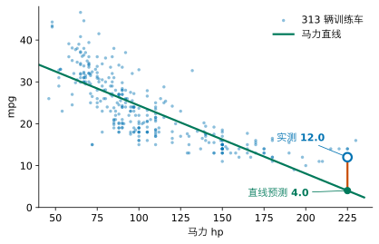
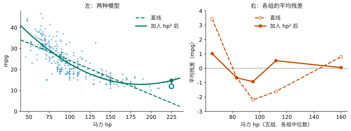
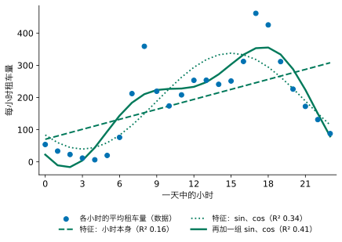
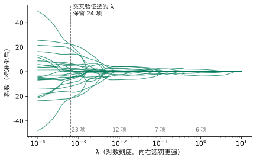
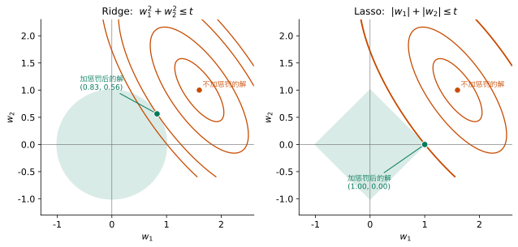
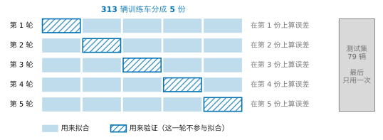
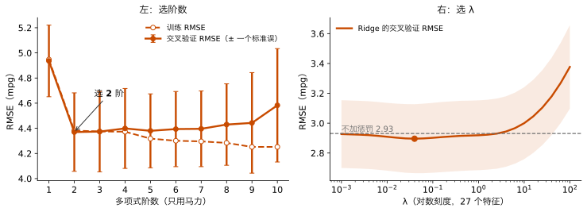
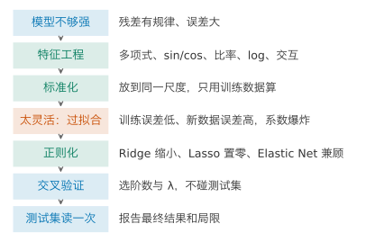

## 1. 动机：上一讲的模型哪里不够

上一讲我们走完了一遍五步：说清问题，选一个线性模型，用 MSE 定义好坏，用正规方程求解，再拿没见过的车检验。本讲还是同一类问题，同一批 392 辆车，313 辆训练车和 79 辆测试车的划分也不变。我们要做的，是检验之后的下一步：**发现模型哪里不够，并把它改好。**

先看一辆车。测试集里马力最大的是一辆 1973 年的车，225 hp，重 4951 磅。上一讲只用马力得到的直线是

$$
\textcolor{#00795A}{\hat y}=40.61-0.1626\,\textcolor{#0072B2}{x},
$$

$x$ 是马力。请先在心里估一下：这条线会给这辆车预测多少 mpg？

::: {.callout-note collapse="true" title="展开答案"}
直线预测 4.0 mpg，实测是 12.0 mpg，低了 8.0。这条线在 79 辆测试车上的典型误差（测试 RMSE）是 4.71，这辆车的误差约为它的 1.7 倍。
:::

{fig-alt="马力对 mpg 的散点图，一条下降直线，右下角一辆车的预测远低于实测"}

一辆车猜错，可能只是运气不好。要判断是不是模型本身有问题，得看误差有没有规律。在读下一段之前，请先看着这张图想一想：问题出在哪？出在五步中的哪一步？

把训练车按马力从小到大分成数量相同的五组，算每组的平均残差（实测减预测）：+3.43、−0.65、−2.19、−1.61、+0.80。两头为正、中间为负：直线在马力很小和很大的车上系统性地猜低，在中间猜高。这不是噪声，是规律。点的走势是弯的，而直线只能用一个斜率走到底。

所以毛病不在损失，也不在求解：给定直线这种形式，正规方程已经找到了最好的那一条。毛病在**模型**，它能表示的形状太少了。这就是本讲的起点：怎样让模型变强？变强之后，又会出现什么新问题？

这节课结束时，遇到一个“模型不够强”的回归问题，你应能先从证据里看出问题出在哪，再提出改法：用特征工程让模型看见原来看不见的结构；先把特征放到同一尺度；模型太灵活时用正则化把它压住；用交叉验证而不是测试集来决定它该有多灵活。

颜色约定不变：蓝色是数据，绿色是模型，红色是误差。

## 2. 模型：用特征工程让模型变强

上一节发现，直线模型能表示的形状太少。本节的问题是：在不放弃线性模型和正规方程的前提下，怎样让它画出弯的线？

上一讲的模型对第 $i$ 辆车计算 $\hat y_i=w_0+w_1x_i$：它只会把喂给它的列乘上权重再相加。请先想一想：只用这样的加权和，有没有办法画出一条弯的线？提示：模型只在乎“加权和”这个形式，并不在乎被加权的是哪些列。

::: {.callout-note collapse="true" title="展开答案"}
可以自己造一列。给每辆车多算一列 $x_i^2$，当作第二个特征，加权和就能弯起来。
:::

给每辆车多算一列 $x_i^2$，当作第二个特征：

$$
\textcolor{#00795A}{\hat y_i}=\textcolor{#00795A}{w_0}+\textcolor{#00795A}{w_1}\textcolor{#0072B2}{x_i}+\textcolor{#00795A}{w_2}\textcolor{#0072B2}{x_i^2}.
$$

对马力 $x$ 来说，这是一条抛物线，可以弯；对参数来说，它仍是加权和。线性模型的“线性”，指的是**对参数线性**。数据矩阵只是多了一列：

$$
\textcolor{#0072B2}{\mathbf X}=\begin{pmatrix}1&x_1&x_1^2\\ 1&x_2&x_2^2\\ \vdots&\vdots&\vdots\\ 1&x_n&x_n^2\end{pmatrix}\quad(n\times3),
$$

损失还是 MSE，正规方程 $\mathbf X^T\mathbf X\,\mathbf w=\mathbf X^T\mathbf y$ 照用。由原有的量计算出新的特征，称为**特征变换**，也叫**特征工程**；用 $x,x^2,\dots,x^d$ 作特征，称为 $d$ 阶**多项式特征**。

在 313 辆训练车上解出来，曲线是 $\hat y=58.21−0.4845\,x+0.00129\,x^2$。

| 模型 | 训练 RMSE（mpg） | 测试 RMSE（mpg） |
|---|---:|---:|
| 直线（马力） | 4.95 | 4.71 |
| 加入马力的平方 | 4.38 | 4.29 |

两份数据上的误差都下降了。五组的平均残差变成 +1.02、−0.66、−0.93、+0.53、+0.05：最大的一组从 3.43 降到 1.02。弯曲没有被完全消除，但大部分已经被表示出来。

{fig-alt="左图散点与直线、抛物线；右图两条平均残差折线"}

**多个输入时的多项式。**只有马力一个输入时，2 阶多项式的列是 $x$ 和 $x^2$。有两个输入时，例如马力 $x_{i1}$ 和重量 $x_{i2}$，2 阶多项式要列出所有次数不超过 2 的乘积：

$$
\textcolor{#0072B2}{x_{i1}},\quad \textcolor{#0072B2}{x_{i2}},\quad \textcolor{#0072B2}{x_{i1}^2},\quad \textcolor{#0072B2}{x_{i1}x_{i2}},\quad \textcolor{#0072B2}{x_{i2}^2}.
$$

其中 $x_{i1}x_{i2}$ 是两个输入的乘积，称为**交互项**：有了它，马力对油耗的作用可以随重量而变。输入一多，列数增长得很快：六个特征的 2 阶多项式（不含常数列）有 6 个一次项、6 个平方项和 15 个两两乘积，共 27 列；3 阶时有 83 列。列越多，模型越灵活，后面会看到，这既是好处，也是麻烦。

**不只是平方。**多项式只是特征工程的一种。真正有用的特征，常常来自对问题本身的理解。下面三种情况，请先想一想：你会造什么特征？

1. 预测每小时的共享单车租车量，手里有“一天中的第几个小时”（0 到 23）。
2. 预测一个街区的房价，手里有每户平均房间数、每户平均卧室数。
3. 预测油耗，手里有车重。

::: {.callout-note collapse="true" title="展开参考答案"}
**1. 周期量用 sin、cos。**把小时直接当一个数，模型会认为 23 点和 0 点相差 23，而它们其实相邻；一条直线也画不出早晚两个高峰。把小时 $h$ 变成 $\sin(2\pi h/24)$ 和 $\cos(2\pi h/24)$ 两列，一天就首尾相接成一个圆。在华盛顿共享单车的 17379 条逐小时记录上，只用小时本身，测试 R² 是 0.16；换成 sin、cos，是 0.34；再加一组周期减半的 $\sin(4\pi h/24)$、$\cos(4\pi h/24)$，是 0.41。同样的道理适用于月份、星期、风向、角度。

**2. 比率常常比原来的量更有意义。**在加州 20640 个街区的数据里，每户平均卧室数与房价几乎无关（相关系数 −0.05）；换成“卧室占房间的比例”，相关系数变成 −0.26，明显为负：同样多的房间，卧室占得越多，价格越低。原来的两列里都有这个信息，但它藏在两列的比值里，加权和表示不出“除以”。人口除以面积得到人口密度，花费除以人数得到人均花费，都是同一类想法。

**3. 有时变换的是目标。**油耗的物理更接近“每英里耗多少油”，而 mpg 是它的倒数。把目标换成每百英里耗油的加仑数 $100/y$，它与车重的相关系数是 0.88，比 mpg 与车重的 −0.84 更接近一条直线；用它拟合再换算回 mpg，测试 RMSE 从 4.21 降到 4.08。
:::

{fig-alt="24 个小时的平均租车量与三条拟合曲线"}

还有几种常见的变换，各说一句。跨越几个数量级、作用是“翻倍”而不是“加一”的量（收入、人口、房价），常取**对数**。一个特征的作用随另一个特征变化时，也可以只加入两者的乘积，也就是上面的交互项，而不必加入全部 2 阶项。类别（产地、天气）不能直接当数用，可以为每个类别造一列 0 或 1，称为**指示变量**。

这些例子背后是同一条原则：**特征工程是把对问题的理解写成新的列。**模型只会做加权和，它看不见的结构，要由我们变换成它看得见的形式。

特征变多以后，马上会遇到一个实际问题：这些列的大小相差太远了。下一节处理它。

## 3. 标准化：把特征放到同一尺度

上一节造出了新特征。本节的问题是：这些特征的数值范围相差几个数量级，会带来什么麻烦，怎样处理？

看看训练车上几列的范围：马力 46 到 230，马力的平方 2116 到 52900，重量 1613 到 5140。如果做 7 阶多项式，马力的 7 次方可以达到约 $3.4\times10^{16}$。

这会带来两个麻烦。

**系数的大小由单位决定。**上一节的二次模型，原始单位下两个系数是 −0.4845 和 0.00129。$x^2$ 的系数看起来小得可以忽略，但那只是因为 $x^2$ 本身动辄上万。上一讲读系数时已经遇到过这个问题：系数的单位是“mpg 除以该特征的单位”，不同特征的系数不能直接比较大小。

**数值计算变差。**各列的数量级相差太大时，$\mathbf X^T\mathbf X$ 里的数从个位到 $10^{30}$ 以上都有，计算机的有限精度会让解变得不可靠（上一讲 Advanced Study 1 的条件数说的就是这件事）。

办法是**标准化**：每个特征减去它的平均值，再除以它的标准差，

$$
\textcolor{#0072B2}{z_{ij}}=\frac{\textcolor{#0072B2}{x_{ij}}-\bar x_j}{s_j},
$$

$\bar x_j$、$s_j$ 是第 $j$ 个特征的平均值和标准差。标准化后，每个特征的均值为 0、标准差为 1，系数表示“这个特征变化一个标准差，预测变化多少”。同一个二次模型，标准化后两个系数是 −18.52 和 12.51：平方项的作用和一次项同样大，只是原来的单位把它藏起来了。标准化不改变预测，只改变读数的单位。

有一条规则要从一开始就记住：**平均值和标准差只用训练数据计算**，再原样用到测试数据上。测试车不能参与任何从数据里算出来的东西，否则它就不再是“没有见过的车”。

标准化不是一种特征，但做特征工程时总要一起做。本讲后面还会两次用到它。

现在模型可以随意变强了：多项式可以加到任意阶，特征可以造任意多。是不是越多越好？

## 4. 复杂度：越多越强吗

前两节让模型变强了。本节的问题是：继续加，比如把多项式的阶数一路加上去，会怎样？我们在一个很小的数据集上把现象看清楚。

回到上一讲课堂上用过的十辆车（训练集的前 10 行），马力是 110、92、97、150、64、190、62、110、115、110。其中 110 hp 出现了三次，所以只有 8 个不同的马力值。用这十辆车拟合 1 阶到 7 阶的多项式（特征已标准化），再拿 79 辆测试车检验。阶数越高，参数越多，能表示的曲线越多，我们说模型的**复杂度**越高。

在拖动之前，请先预测：阶数从 1 加到 7，在这十辆车上的误差会怎样变？在 79 辆新车上呢？系数呢？



把各阶数的结果列在一起（“训练”是这十辆车上的 RMSE，“测试”是 79 辆测试车上的 RMSE，单位都是 mpg）：

| 阶数 | 1 | 2 | 3 | 4 | 5 | 6 | 7 |
|---|---:|---:|---:|---:|---:|---:|---:|
| 训练 | 4.61 | 3.43 | 3.41 | 3.39 | 2.08 | 2.03 | 1.89 |
| 测试 | 4.59 | 4.67 | 4.52 | 5.88 | 276.3 | 68.66 | 7512 |
| 最大系数 | 5.45 | 22.30 | 47.10 | 340.0 | $8.2\times10^{4}$ | $2.5\times10^{5}$ | $8.7\times10^{6}$ |

训练误差一路下降。到 7 阶时，曲线经过每个马力值上的平均 mpg，剩下的 1.89 来自那三辆 110 hp 的车（mpg 分别是 18.6、25 和 17）：同一个马力上，任何曲线只能给出一个预测。测试误差却在 4 阶之后急剧变大，7 阶时超过 7000：曲线为了穿过每一个点而上下摆动，在十辆车的马力范围之外（小于 62 hp 或大于 190 hp）冲向极端的数值。

模型在训练数据上很好、在新数据上很差，是因为它把训练数据里的偶然性也当作规律学了进去，这称为**过拟合**。反过来，模型太简单，连训练数据中的主要结构都抓不住，称为**欠拟合**，开场那条直线就是一例。

**训练误差只会随复杂度下降，不能用来判断复杂度是否合适。**

现在请看系数那一行，并想一想：系数为什么会变得这么大？它和过拟合是什么关系？

::: {.callout-note collapse="true" title="展开答案"}
1 阶时最大的系数约 5.45，7 阶时约 $8.7\times10^{6}$（特征都已标准化，所以这不是单位造成的）。为了让曲线穿过十个点，模型找到一组巨大的正负系数，让它们在这十辆车上恰好互相抵消。一离开这十辆车，抵消就失效，预测冲向极端。**系数爆炸是过拟合的征兆。**
:::

这里留下两个问题。第一，系数爆炸是过拟合的征兆，能不能直接管住系数？第二，到底多复杂才合适，用什么来判断？接下来三节回答第一个，Section 8 回答第二个。

## 5. 损失：用 Ridge 压住系数

上一节看到，过拟合时系数会爆炸。本节的问题是：能否在求解时直接不让系数变得那么大？

先诊断。上一讲的损失只衡量预测有多贴近训练数据。对它来说，一组巨大的、互相抵消的系数和一组温和的系数没有任何区别，只要贴得近就行。在十辆车上，前者贴得更近，于是被选中。问题出在五步中的**损失**：它只关心贴合，从不过问系数有多大。

请先想一想：如果你来改这个损失，会怎样改？

一个自然的改法是：在损失里加上一项，系数越大，这一项越大，

$$
\textcolor{#C84B00}{J_\lambda(\mathbf w)}=\sum_{i=1}^{n}\bigl(\textcolor{#0072B2}{y_i}-\textcolor{#00795A}{\hat y_i}\bigr)^2+\lambda\sum_{j=1}^{p}\textcolor{#00795A}{w_j}^2 .
$$

第一项要求贴近数据，第二项要求系数小，两者此消彼长。$\lambda\ge0$ 决定第二项的分量：$\lambda=0$ 就是上一讲的最小二乘；$\lambda$ 越大，越宁可贴得差一点，也要把系数压小。在损失里加入惩罚项的做法称为**正则化**，这个具体的形式称为 **Ridge 回归**，$\sum_jw_j^2$ 也记作 $\|\mathbf w\|^2$。$\lambda$ 不是从数据里解出来的，而是求解之前由我们给定的，这样的量称为**超参数**。

三点约定：

1. 误差项用平方和而不是平均，这样 $\lambda$ 的数值与 scikit-learn 中 `Ridge(alpha=...)` 的 `alpha` 一致。最小点的位置只差 $\lambda$ 的刻度。
2. 截距 $w_0$ 不受惩罚。它只决定整体高低，压缩它没有意义。
3. 特征先标准化。惩罚对所有系数一视同仁：如果一个特征以磅为单位、另一个以千磅为单位，后者的系数大一千倍，就会被不公平地重罚。不标准化，惩罚的是单位，而不是复杂度。这是 Section 3 的标准化第一次被再次用到。

**求解：一个特征时。**只有一个标准化特征 $x$ 时，$\sum_ix_i=0$，截距的解就是 $\bar y$，只需对 $w$ 求导：

$$
\frac{dJ_\lambda}{dw}=-2\sum_i x_i\,(y_i-\bar y-w x_i)+2\lambda w=0
\;\Longrightarrow\;
w=\frac{\sum_i x_i(y_i-\bar y)}{\sum_i x_i^2+\lambda}.
$$

和上一讲的最小二乘斜率 $\sum_i x_i(y_i-\bar y)/\sum_i x_i^2$ 对照：分子不变，分母多了 $\lambda$。标准化之后 $\sum_ix_i^2=n$，所以 Ridge 的斜率正好是最小二乘斜率乘以 $n/(n+\lambda)$：$\lambda$ 越大，斜率越被压向 0，但不会恰好为 0。十辆车上只用马力，最小二乘斜率是 -5.45；取 $\lambda=n=10$，斜率减半为 -2.73。

**求解：多个特征时。**把标准化后的特征（不含常数列）排成 $n\times p$ 的矩阵 $\mathbf X$，目标减去平均值后记为 $\mathbf y$。与上一讲同样的求导，多出的一项 $\lambda\mathbf w^T\mathbf w$ 的梯度是 $2\lambda\mathbf w$，令梯度为零：

$$
\bigl(\mathbf X^T\mathbf X+\lambda\mathbf I\bigr)\,\mathbf w=\mathbf X^T\mathbf y ,
\qquad
\mathbf w=\bigl(\mathbf X^T\mathbf X+\lambda\mathbf I\bigr)^{-1}\mathbf X^T\mathbf y ,
$$

$\mathbf I$ 是 $p\times p$ 的单位矩阵。这就是正规方程在对角线上加了 $\lambda$。上一讲说过，特征几乎相关时 $\mathbf X^T\mathbf X$ 接近不可逆；只要 $\lambda>0$，$\mathbf X^T\mathbf X+\lambda\mathbf I$ 总是可逆的，即使特征比样本还多。为什么，见 Advanced Study 1。

**回到十辆车。**下面的组件用同样的十辆车、同样的坐标轴，阶数固定为 7，最左端 $\lambda=0$ 就是上一节那条剧烈摆动的曲线。请先预测：$\lambda$ 从 0 开始增大，曲线和系数会怎样？一直增大下去呢？



$\lambda$ 稍大于 0，曲线立刻平静下来：$\lambda=0.01$ 时，系数的大小 $\|\mathbf w\|$ 从 $1.4\times10^{7}$ 降到 18.42，测试 RMSE 从 7512 降到 4.36。代价是训练 RMSE 从 1.89 升到 3.43：模型不再穿过每一个点。$\lambda$ 继续增大，曲线越来越平，到 $\lambda=1000$ 时几乎是一条水平线，训练和测试 RMSE 都升到 6.99 和 6.96：压过了头，又回到欠拟合。$\lambda$ 是一个可以连续调节的复杂度旋钮。

**一个真实规模的例子。**十辆车是极端情形。换一个更常见的情形：用全部六个特征的 2 阶多项式，也就是六个特征加上它们的平方和两两乘积，共 27 个特征，在 313 辆训练车上拟合。不加惩罚时，最大的系数（标准化后）是 56.7；Ridge 取 $\lambda\approx0.0398$（Section 8 说明这个值怎样选出），最大系数降到 14.9。

Ridge 把每个系数都压小，但一个也不去掉。27 个特征里，真的每个都需要吗？

## 6. 损失的另一种惩罚：Lasso

上一节用平方和惩罚系数。本节的问题是：惩罚一定要用平方吗？换一种惩罚，会得到什么不同的模型？

把平方换成绝对值：

$$
\textcolor{#C84B00}{J_\lambda(\mathbf w)}=\frac{1}{2n}\sum_{i=1}^{n}\bigl(\textcolor{#0072B2}{y_i}-\textcolor{#00795A}{\hat y_i}\bigr)^2+\lambda\sum_{j=1}^{p}\bigl|\textcolor{#00795A}{w_j}\bigr| .
$$

这称为 **Lasso 回归**，$\sum_j|w_j|$ 也记作 $\|\mathbf w\|_1$。误差项前的 $1/(2n)$ 是 scikit-learn 中 `Lasso` 的写法，所以 Lasso 的 $\lambda$ 与 Ridge 的刻度不同，数值不能直接比较。特征同样要先标准化，理由与 Ridge 相同。

看起来只改了一个符号，结果却很不一样：当 $\lambda$ 足够大时，一部分系数**恰好等于 0**，而不只是接近 0。大部分系数为零的解称为**稀疏**解。系数为零，等于把这个特征从模型里去掉，所以 Lasso 在压缩的同时顺便挑选了特征。在上一节的 27 个特征上逐步加大 $\lambda$：

| λ | 0.0001 | 0.001 | 0.01 | 0.1 | 1 | 10 |
|---|---:|---:|---:|---:|---:|---:|
| 非零系数个数 | 27 | 23 | 12 | 7 | 6 | 0 |

{fig-alt="27 条系数随 lambda 变化的曲线，逐条归零"}

**为什么绝对值会产生零。**一个直观的解释来自几何。惩罚形式的问题，等价于在“系数不能太大”的约束下最小化误差：Ridge 要求 $w_1^2+w_2^2\le t$，允许的范围是圆；Lasso 要求 $|w_1|+|w_2|\le t$，允许的范围是一个菱形，顶点落在坐标轴上。误差的等高线是一圈圈椭圆，从不加惩罚的解向外扩，第一次碰到允许范围的那一点就是解。圆的边界处处光滑，碰到的点一般不在坐标轴上；菱形的顶点突出，等高线往往先碰到顶点，而顶点处有一个系数恰好为 0。

{fig-alt="两幅图：椭圆等高线分别与圆和菱形相切"}

**求解。**绝对值在 0 处有尖角，不可导，Lasso 不能像 Ridge 那样令导数为零写出一个公式。它没有闭式解，要用迭代算法一步步逼近；scikit-learn 用的是坐标下降法，起点见 Advanced Study 3。对使用者来说，调用方式与 Ridge 相同。

| | Ridge | Lasso |
|---|---|---|
| 惩罚 | 系数平方和 $\|\mathbf w\|^2$ | 系数绝对值之和 $\|\mathbf w\|_1$ |
| 对系数的作用 | 全部缩小，不为零 | 缩小，一部分恰好为零 |
| 求解 | 闭式解 | 无闭式解，迭代求解 |

两种惩罚各有长处：Ridge 稳定，Lasso 简洁。能不能两样都要？

## 7. 两种惩罚一起：Elastic Net

把两种惩罚加在一起：

$$
\textcolor{#C84B00}{J(\mathbf w)}=\text{误差项}+\lambda_1\|\mathbf w\|_1+\lambda_2\|\mathbf w\|^2 ,
$$

称为 **Elastic Net**。它既能把一部分系数压成零，又在高度相关的特征之间比 Lasso 稳定。代价是多了一个超参数。scikit-learn 中是 `ElasticNet`，用法与前两者相同，本讲不展开。

到这里，我们手上有了好几个旋钮：多项式的阶数、$\lambda$、用哪一种惩罚。它们都决定模型有多灵活。最后一个问题：用什么来决定这些旋钮的位置？

## 8. 验证：用交叉验证决定多灵活

Section 4 留下的第二个问题是：到底多复杂才合适，用什么来判断？现在旋钮更多了：阶数、$\lambda$、惩罚的种类。本节给出判断的方法。

先排除两个答案。训练误差不行，Section 4 已经说明它只会随复杂度下降。那用测试集呢？把每个候选都在测试车上算一遍，取最好的？

请先想一想：这样做有什么问题？

::: {.callout-note collapse="true" title="展开答案"}
挑选本身也是一种拟合。试了很多候选，选测试 RMSE 最小的那个，被选中的候选表现好，有一部分原因是运气：79 辆测试车的偶然性恰好对它有利。测试车的信息因此进入了选择，它们就不再是“没有见过的车”，读出来的测试 RMSE 会偏乐观。前面 Section 4、5 的互动里显示测试 RMSE，是为了让你看见现象，不是用来挑选的。
:::

上一讲把“用没有参与拟合的车检查模型”叫作验证，所用的数据是测试集。从本讲起，三份数据各有专门的职责：

- **训练集**：用来求解参数。
- **验证集**：用来比较、挑选方案，例如挑阶数和 $\lambda$。它不参与求解参数，但参与选择。
- **测试集**：所有选择都做完以后，只用一次，报告最终结果。

最简单的做法是从 313 辆训练车里再分出一份，例如 20%，作为验证集。问题是，几十辆车的验证集，结果本身就会随分法晃动。用五种不同的随机分法，各比较一次 1 阶、2 阶、6 阶的验证 RMSE：

| 分法 | 1 阶 | 2 阶 | 6 阶 |
|---|---:|---:|---:|
| 第 1 种 | 4.50 | 3.43 | 3.31 |
| 第 2 种 | 4.72 | 3.71 | 4.05 |
| 第 3 种 | 5.21 | 4.78 | 4.69 |
| 第 4 种 | 5.02 | 4.68 | 4.73 |
| 第 5 种 | 4.69 | 4.38 | 4.27 |

同一个模型，换一种分法，验证 RMSE 可以相差超过 1 mpg；2 阶与 6 阶谁好，也随分法而变。只靠一次划分来挑，结论不可靠。

**K 折交叉验证**让每辆训练车都轮流当一次验证车：把 313 辆车分成 $K$ 份，每一轮用其中 $K-1$ 份拟合、在剩下的 1 份上算 RMSE；轮完 $K$ 轮，取 $K$ 个 RMSE 的平均，称为**交叉验证 RMSE**。$K$ 个结果之间的离散程度说明这个平均值有多可靠：它们的标准差除以 $\sqrt K$，称为**标准误**。本讲取 $K=5$。

{fig-alt="五行方块示意图，每行一个阴影方块代表验证份，右侧灰色方块为测试集"}

用它来定两个旋钮。

{fig-alt="两栏图：交叉验证 RMSE 随阶数和随 lambda 的变化"}

**选阶数。**只用马力，从 1 阶到 2 阶，交叉验证 RMSE 由 4.94 降到 4.37，改善明显，2 阶也是最低的。更高的阶数在 4.37 到 4.58 之间，不再改善，到 10 阶已明显回升，而训练 RMSE 却一直在降。即使某个更高阶数碰巧略低，只要差距小于一个标准误（这里约 0.31），数据也分不出谁更好，这时取最简单的。我们选 2 阶。

**选 λ。**27 个特征上，Ridge 的交叉验证 RMSE 在 $\lambda\approx0.0398$ 处最小，为 2.90；不加惩罚时是 2.93。Lasso 的交叉验证选出 $\lambda\approx0.000631$，保留 24 个特征，交叉验证 RMSE 2.92。注意，交叉验证按预测误差挑，挑出来的不是最稀疏的模型；更看重简洁时可以取更大的 $\lambda$，这是一个需要说明理由的决定。

**最后，测试集读一次。**

| 方法 | 交叉验证 RMSE | 测试 RMSE |
|---|---:|---:|
| 马力，2 阶 | 4.37 | 4.29 |
| 27 个特征，不加惩罚 | 2.93 | 2.72 |
| 27 个特征，Ridge | 2.90 | 2.64 |
| 27 个特征，Lasso | 2.92 | 2.66 |

如实地说，在 313 辆车上，三种 27 特征模型的差距都小于一个标准误。正则化在这里的收益不大，因为 313 辆车对 27 个参数来说已经算多。正则化什么时候真正值得？从 313 辆训练车中随机抽出 40 辆或 80 辆来拟合（λ 由这些车内部的 5 折交叉验证选出），在同样的 79 辆测试车上检验，重复 60 次：

| 方法（27 个特征） | 40 辆 | 80 辆 | 313 辆 |
|---|---:|---:|---:|
| 不加惩罚 | 7.48 | 3.51 | 2.72 |
| Ridge | 3.15 | 2.89 | 2.64 |
| Lasso | 3.24 | 2.89 | 2.61 |

表中是测试 RMSE（mpg），40 辆和 80 辆是 60 次重复的中位数，313 辆只有一次。

只有 40 辆车时，不加惩罚的测试 RMSE 中位数是 7.48，Ridge 是 3.15，Lasso 是 3.24；80 辆时不加惩罚 3.51，Ridge 2.89。参数个数不变，数据越少，正则化越值。

交叉验证的代价是计算量：每个候选要拟合 $K$ 次。换来的是每辆训练车都参与了验证，选择不依赖一次偶然的划分，测试集也一直保持干净。

## 9. 实现：用 scikit-learn 完成

前面每一步，scikit-learn 都有对应的工具。下面按本讲的顺序一步一步写，每一步对应一节。数据读取与划分和上一讲相同，`X_train`、`y_train` 是六个特征的 313 辆训练车，`X_test`、`y_test` 是 79 辆测试车。

**第一步，特征工程（Section 2）：**加入平方项和两两乘积。

```python
poly = PolynomialFeatures(2, include_bias=False)
X_train2 = poly.fit_transform(X_train)
X_test2 = poly.transform(X_test)
```

**第二步，标准化（Section 3）：**平均值和标准差只用训练车计算（`fit_transform`），再原样用到测试车上（`transform`）。

```python
scaler = StandardScaler()
X_train2 = scaler.fit_transform(X_train2)
X_test2 = scaler.transform(X_test2)
```

**第三步，Ridge 加交叉验证（Section 5、8）：**给出 26 个候选 $\lambda$，`RidgeCV` 对每个做一次 5 折交叉验证，选 RMSE 最小的，再用全部训练车拟合。

```python
lambdas = np.logspace(-3, 2, 26)          # 0.001 到 100
model = RidgeCV(alphas=lambdas, cv=5, scoring="neg_root_mean_squared_error")
model.fit(X_train2, y_train)
print(model.alpha_)                       # 选出的 λ
```

**第四步，测试集读一次（Section 8）：**

```python
pred = model.predict(X_test2)
print(mean_squared_error(y_test, pred) ** 0.5)
```

两次输出约为 0.0398 和 2.64，与上一节一致。把 `RidgeCV` 换成 `LassoCV` 就是 Lasso。

注意第二步：测试车只用了 `transform`，从没参与计算平均值和标准差。这就是 Section 3 那条规则在代码里的样子，也是标准化第二次被再次用到。

## 10. 一页回顾

如果只读一页，读这里。

{fig-alt="七个步骤的竖向流程图"}

| 你看到的问题 | 可以做什么 | 用什么证据判断 |
|---|---|---|
| 残差有规律（例如两头正、中间负） | 特征工程：多项式、sin/cos、比率、对数、交互项、指示变量 | 残差的规律变弱，交叉验证 RMSE 下降 |
| 特征的尺度相差悬殊 | 标准化，平均值与标准差只用训练数据算 | 系数可以比较；惩罚公平 |
| 训练误差低、新数据误差高，系数巨大 | 降低复杂度，或正则化：Ridge 缩小，Lasso 置零，Elastic Net 兼顾 | 交叉验证 RMSE |
| 不知道阶数、λ 取多少 | K 折交叉验证，差距在波动之内时取简单的 | 交叉验证 RMSE 与标准误 |
| 所有选择都做完了 | 在测试集上读一次 | 测试 RMSE，连同它的局限一起报告 |

## 11. 总结与局限

回到开场那辆车：测试集里马力最大的车，225 hp，实测 12.0 mpg。

| 模型 | 预测（mpg） | 误差（mpg） |
|---|---:|---:|
| 马力直线 | 4.0 | −8.0 |
| 加入马力的平方（交叉验证选出的 2 阶） | 14.8 | +2.8 |

误差从 8.0 降到 2.8。更重要的是，这一次我们说得出这个改进凭什么可信：问题是从残差的规律里发现的；改法针对的是模型这一步；2 阶是在训练车内部用交叉验证选出的；测试集只在最后读了一次。

**迁移题。**一栋办公楼记录了三年里每天的平均室外气温和当天的用电量，想预测明天的用电量。天冷时要供暖，天热时要制冷，气温适中时用电最少。请不做计算，回答：只用气温的一条直线会出什么问题，你会从什么证据看出来？你会造什么特征？要不要正则化？用什么选阶数或 λ？测试集在什么时候打开？

::: {.callout-note collapse="true" title="参考回答"}
用电量随气温先降后升，呈 U 形；直线只能单调，残差按气温分组会两头为正、中间为负。加入气温的平方，2 阶多项式就能表示 U 形；也可以分别造“低于 18°C 的度数”和“高于 22°C 的度数”两个特征，各自对应供暖和制冷。特征不多、数据有上千天时，正则化的收益可能不大，但标准化照做。先留出一部分日子作测试集，在其余日子上用 K 折交叉验证比较方案，差距在波动之内时取简单的；全部选择做完后，才在测试集上读一次。有一处要小心：这是按时间排列的数据，随机分折会让模型在验证时“看到”前后相邻的日子，更稳妥的做法是用较早的日子拟合、较晚的日子验证和测试。
:::

**这个方法在哪里不可信。**

1. **交叉验证仍在同一批车里。**它比单次划分可靠，但所有车都来自 1970 到 1982 年的同一份记录。而且，在同一份数据上反复比较越来越多的方案，被选中的方案的交叉验证结果也会偏乐观，这和用测试集挑选是同一个问题，只是程度较轻。
2. **特征要靠人想到。**平方项是看了残差才加的，sin、cos 和比率来自对问题的理解。没有想到的结构，模型看不见；特征一多，靠人工逐个设计也越来越难。
3. **正则化后的系数不能照字面读。**Ridge 和 Lasso 有意把系数压小，换来稳定和更好的预测，但系数不再是“其余特征不变时的平均变化”。相关的特征之间问题更明显：把训练车重抽 500 次，六个特征下马力系数的 95% 范围（标准化后），不加惩罚时是 −1.43 到 +1.13，Ridge 时是 −1.50 到 +0.71，变窄了但仍跨过 0；Lasso 在每次重抽中把各特征压成 0 的比例是 气缸数 54%，排量 66%，马力 49%，重量 0%，加速度 40%，年份 0%，留下谁换一批数据就可能变。“Lasso 去掉了某个特征”不等于“这个特征与油耗无关”。
4. **“更好”有边界。**本讲数据上，不加惩罚与正则化之间的交叉验证差距在一个标准误之内。只有在数据少、参数多时，正则化的优势才清楚。结论要连同数据量和波动一起说。

还有一个问题，这里没有解决：所有的变换都要人先想到，再写成新的一列。能不能让模型自己从数据中找出合适的表示？

**回到开头的承诺。**现在，面对一个模型不够强的回归问题，你可以：从残差的规律里看出问题出在模型；用特征工程把对问题的理解写成新的列；先把特征标准化；在模型太灵活、系数爆炸时，用 Ridge、Lasso 或 Elastic Net 修改损失把它压住；用交叉验证而不是训练误差或测试集来决定阶数和 $\lambda$；并说清楚这些选择在哪里不可信。

**30 秒反馈。**读完这一讲，请扫码留下匿名反馈或问题：哪里没看懂、哪里讲得太快，都对改进有用。

{fig-align="center" width="160px" fig-alt="反馈二维码"}

*以下是 Advanced Study，不影响主线，每个 Study 可以单独阅读。MPS311 鼓励选读，MPS439 应完成 Study 1。*

---

## Advanced Study 1：Ridge 的解为什么总存在、并且更稳定

这里回答 Section 5 留下的问题：为什么只要 $\lambda>0$，$\mathbf X^T\mathbf X+\lambda\mathbf I$ 总是可逆？它怎样改善数值稳定性？

**推导。**沿用 Section 5 的记号：$\mathbf X$ 是标准化后的 $n\times p$ 特征矩阵（不含常数列），$\mathbf y$ 已减去平均值，截距等于原始目标的平均值。展开目标：

$$
J_\lambda(\mathbf w)=\mathbf y^T\mathbf y-2\mathbf w^T\mathbf X^T\mathbf y+\mathbf w^T\bigl(\mathbf X^T\mathbf X+\lambda\mathbf I\bigr)\mathbf w .
$$

用上一讲附录 A 的两条求导恒等式（$\mathbf X^T\mathbf X+\lambda\mathbf I$ 是对称矩阵），梯度为 $-2\mathbf X^T\mathbf y+2(\mathbf X^T\mathbf X+\lambda\mathbf I)\mathbf w$，令其为零即得 Section 5 的方程。

**为什么总可逆。**对任意非零向量 $\mathbf v$，

$$
\mathbf v^T\bigl(\mathbf X^T\mathbf X+\lambda\mathbf I\bigr)\mathbf v=\|\mathbf X\mathbf v\|^2+\lambda\|\mathbf v\|^2>0 ,
$$

第一项不小于 0，第二项在 $\lambda>0$ 时严格大于 0。如果矩阵不可逆，就存在非零 $\mathbf v$ 使矩阵乘 $\mathbf v$ 等于零向量，上式会等于 0，矛盾。同一个不等式还说明 $J_\lambda$ 是严格开口向上的碗，最低点唯一。最小二乘只在 $\mathbf X$ 各列线性无关时才有唯一解；Ridge 去掉了这个条件，所以特征比样本还多时也有唯一解。

**条件数怎样变。**$\mathbf X^T\mathbf X$ 是对称矩阵，可以分解为若干方向上的拉伸，各方向的拉伸倍数称为**特征值**，记为 $\mu_1\ge\dots\ge\mu_p\ge0$。同一个方向上，$\mathbf X^T\mathbf X+\lambda\mathbf I$ 的拉伸倍数是 $\mu_k+\lambda$，所以它的条件数是

$$
\kappa_\lambda=\frac{\mu_1+\lambda}{\mu_p+\lambda}.
$$

$\mu_p$ 接近 0 时，最小二乘的条件数巨大；加上 $\lambda$ 后，分母至少是 $\lambda$。在 27 个标准化特征上，$\mathbf X^T\mathbf X$ 的条件数约为 $1.3\times10^{6}$；$\lambda=0.1$ 时约为 59900，$\lambda=1$ 时约为 6260，$\lambda=10$ 时约为 630.0。Ridge 用一点偏差换来了一个稳定得多的问题。

**练习。**（1）对只有一个标准化特征的情形，验证上面的通式退化为 Section 5 的 $w=\sum_ix_i(y_i-\bar y)/(n+\lambda)$。（2）用特征值说明：$\lambda\to\infty$ 时 $\mathbf w\to\mathbf 0$。

## Advanced Study 2：自己实现 Ridge

用 numpy 实现 Section 5 的闭式解，在 27 个特征上与 scikit-learn 对照：

```python
poly = PolynomialFeatures(2, include_bias=False).fit(X_train)
scaler = StandardScaler().fit(poly.transform(X_train))
Z = scaler.transform(poly.transform(X_train))      # 313 x 27，已标准化
yc = y_train - y_train.mean()

lam = 0.1
w = np.linalg.solve(Z.T @ Z + lam * np.eye(27), Z.T @ yc)
print(np.abs(w - Ridge(alpha=lam).fit(Z, y_train).coef_).max())   # 应接近 0
```

接下来请自己做：

1. 让 `lam` 取 `np.logspace(-3, 3, 13)`，对每个值算 $\|\mathbf w\|$，画出它随 $\lambda$ 的变化（横轴取对数）。
2. 对同样的 `lam`，用 `np.linalg.cond` 算 `Z.T @ Z + lam * np.eye(27)` 的条件数，与 Advanced Study 1 的数字对照。
3. 不标准化，直接用 `poly.transform(X_train)` 做同样的计算，比较条件数，并用 Section 3 和 Section 5 的约定解释差别。

## Advanced Study 3：开放问题

下面五个问题本讲没有展开，每个给出一个起点。

1. **惩罚与约束。**Section 6 的几何解释用的是约束形式：在 $\|\mathbf w\|^2\le t$ 下最小化误差。它与惩罚形式 $\text{误差}+\lambda\|\mathbf w\|^2$ 是什么关系？起点：对约束问题写出**拉格朗日函数**，与 $J_\lambda$ 对照；每个 $t$ 对应怎样的 $\lambda$？
2. **坐标下降与软阈值。**Lasso 没有闭式解，但如果每次只改一个系数、其余固定，这个一维问题有解。起点：对 $\frac12(z-w)^2+\lambda|w|$，分 $w>0$、$w<0$、$w=0$ 讨论，最优解是什么？为什么它会把小的 $z$ 直接变成 0？
3. **偏差与方差。**Section 4 的十辆车实验可以重复很多次，每次抽另外十辆车。对某个固定马力，高阶模型的预测平均起来准不准？每次相差多大？起点：把测试误差的期望拆成“平均预测离真值多远”和“预测本身晃动多大”两部分，再加上无法预测的噪声。
4. **交叉验证里的标准化。**Section 9 的代码先用全部 313 辆训练车算好平均值和标准差，再做交叉验证。严格地说，每一轮的验证份也参与了这次计算。这会让交叉验证结果偏乐观吗？在本讲数据上影响有多大？起点：查阅 scikit-learn 的 `make_pipeline`，它能让每一轮只用该轮的拟合份做标准化，比较两种做法选出的 $\lambda$。
5. **取简单的规则。**Section 8 说“差距在波动之内时取简单的”。写成一条可执行的规则：在交叉验证 RMSE 不超过“最小值加一个标准误”的方案里，取最简单的。用它选 Ridge 的 $\lambda$（越大越简单），结果会怎样？
