## Last week's line meets a new car

::: {.stage}
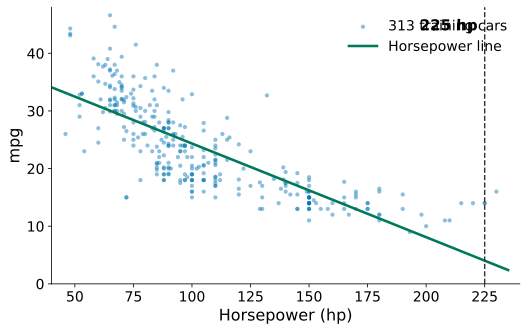{.fig .fig-s2 fig-alt="313 training cars, horsepower against mpg, with last week's straight line and a dashed vertical line at 225 hp"}

::: {.ask}
<small>Guess first</small>
The most powerful test car has 225 hp. What will the line predict? How close will it be?
:::

::: {.scan}
{fig-alt="QR code for today's live page"}
<b>Scan now</b>
votes, questions, feedback
:::
:::

::: {.notes}
约 2 分钟。先请大家扫右下角（或右屏）的二维码，页面整节课开着。上一讲的马力直线（w = −0.1626，b = 40.61），313 辆训练车。这辆车按规则选出：测试集里马力最大的那辆（1973 年，4951 磅），在看预测之前定下。请学生说出猜测，不评价，下一页揭示。
:::

## [Problem:]{.stg} Bad luck, or a pattern?

::: {.stage}
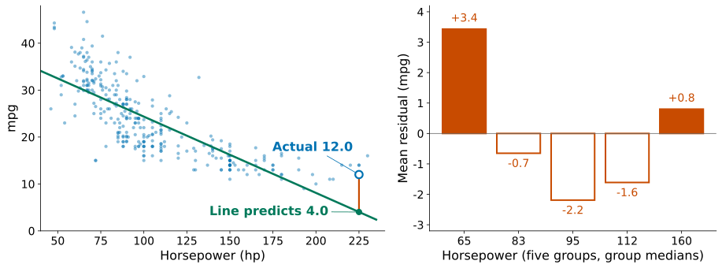{.fig .fig-s3 fig-alt="Left: the line predicts 4.0 mpg for a car that measured 12.0. Right: mean residuals in five horsepower groups, positive at both ends and negative in the middle"}

::: {.ask .vote}
<small>Vote on your phone</small>
The line's errors follow a pattern. Which step is at fault?

::: {.opts}
<span><b>A</b>the loss (squared error)</span>
<span><b>B</b>the solving (normal equation)</span>
<span><b>C</b>the model (a straight line)</span>
:::
:::
:::

::: {.notes}
约 3.5 分钟。投票（右屏 Bad luck, or a pattern? → Open，30 秒，先不显示结果）；分歧大时让邻座讨论一分钟再 Vote again（本讲只在这一题这样做），再 Reveal；请选 A 或 B 的同学说理由。揭示：直线预测 4.0，实测 12.0，差 8 mpg，约为测试 RMSE 4.71 的 1.7 倍。一辆车错可能是运气，所以看右图：训练车按马力分五组，平均残差 +3.4、−0.7、−2.2、−1.6、+0.8，两头正、中间负，是规律不是噪声。停下来问：毛病在问题、模型、损失、求解、检验中的哪一步？答案在下一页开头。
:::

## What you will be able to do

::: {.stage .tight}
::: {.muted .center}
Not the loss, not the solving: the model (a straight line) is too simple.
:::

::: {.say .xl}
When a model is not strong enough, you will **see where the problem is** and know how to fix it, without fooling yourself.
:::

::: {.flow .four}
<div><span>1</span>Make it stronger</div>
<div><span>2</span>It becomes too strong</div>
<div><span>3</span>Hold it down</div>
<div><span>4</span>Decide how strong</div>
:::
:::

::: {.notes}
约 1 分钟。先口头回答上一页：不是损失，也不是求解（给定直线，正规方程已经找到最好的那条），毛病在模型，它能画的形状太少。能力承诺；念出四步路线，后面每段开头回到它。
:::

## [Model:]{.stg} The model only adds up columns. How can it bend?

::: {.stage}
::: {.two .side}
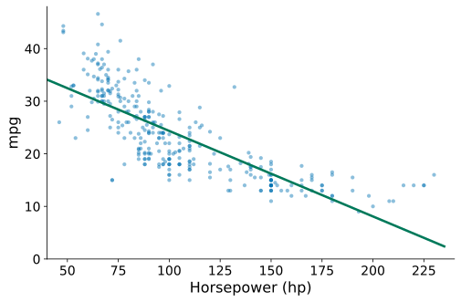{.fig fig-alt="Training cars, horsepower against mpg: the points curve, the straight line does not"}

::: {}
::: {.formula .m2}
$$
\textcolor{#00795A}{\hat y_i}=\textcolor{#00795A}{w_0}\cdot\textcolor{#0072B2}{1}+\textcolor{#00795A}{w_1}\cdot\textcolor{#0072B2}{x_i}
$$
:::

::: {.ask}
<small>Your turn</small>
Keep the weighted sum. What could you feed it so the line bends?
:::
:::
:::
:::

::: {.notes}
约 2 分钟，让学生自己想出来。先指图：点是弯的，线是直的。再指公式：模型只会把列乘权重再加起来，它不在乎列是什么。问：保留加权和不变，喂给它什么能让线弯？等答案，多半有人说“加一个平方”。只在冷场时提示：除了 1 和 x，还能自己造一列吗？答案在下一页。
:::

## [Model:]{.stg} Feature engineering: build new columns

::: {.stage}
::: {.two .side}
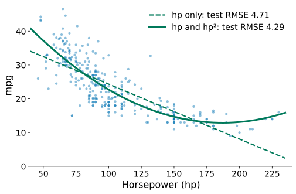{.fig fig-alt="Training cars with the straight line (dashed) and the curve after adding horsepower squared (solid), with their test RMSE"}

::: {}
::: {.formula .m2}
$$
\textcolor{#00795A}{\hat y_i}=\textcolor{#00795A}{w_0}+\textcolor{#00795A}{w_1}\textcolor{#0072B2}{x_i}+\textcolor{#00795A}{w_2}\,\textcolor{#0072B2}{x_i^2}
$$
:::

::: {.say}
**Feature engineering**: make new input columns from the ones you have. Adding hp² is one way.
:::
:::
:::
:::

::: {.notes}
约 2.5 分钟。先只念标题，问一句：模型只会做加权和，怎么画弯？再指公式：多算一列 x²。点名：这就叫特征工程，用已有的量造新的列。口头补一句（页面不写）：模型对参数仍是线性的，数据矩阵多一列，正规方程照用。结果：测试 RMSE 4.71 → 4.29。强调“加平方只是其中一种造法”，下一页看别的。
:::

## [Model:]{.stg} Which column would you build?

::: {.stage .tight}
::: {.say}
Good features come from **how the problem works**. Here are three problems and their raw data.
:::

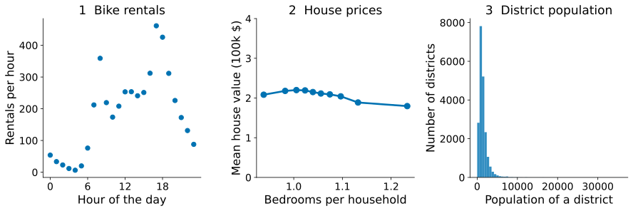{.fig .fig-s6 fig-alt="Three panels of raw data: bike rentals by hour of the day, mean house value against bedrooms per household, and a histogram of district population"}

::: {.ask}
<small>Discuss</small>
For each one: what new column would you add, and why?
:::
:::

::: {.notes}
约 2.5 分钟，教师带学生讨论，页面不给答案。1 单车租车量随一天中的小时变化（华盛顿的真实逐小时数据）。2 加州房价：每户卧室数和房价几乎没有关系，手里还有每户房间数。3 加州各街区人口，绝大多数挤在左边。可以先让同桌说 30 秒，再收答案写在黑板上。只在冷场时提示：1 23 点和 0 点相差多远？2 两列之间什么关系可能更重要？3 有的街区几十人，有的几万人，怎样让它们可比？
:::

## [Model:]{.stg} Build the column the problem needs

::: {.stage}
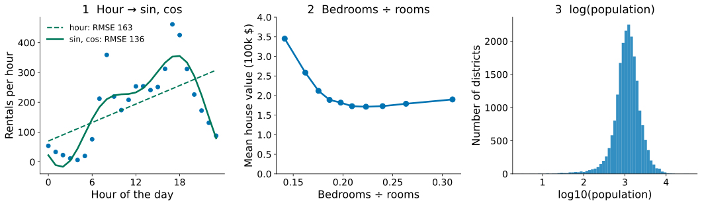{.fig .fig-s7a fig-alt="Three answers: bike rentals fitted with sin and cos of the hour; mean house value falling with bedrooms divided by rooms; district population spread out after a log"}

::: {.rows .tiny}
<div><span class="n">cycle</span><div><b>Hour → sin, cos</b><p>23:00 and 0:00 become neighbours</p></div></div>
<div><span class="n">ratio</span><div><b>Bedrooms ÷ rooms</b><p>a weighted sum cannot divide; you can</p></div></div>
<div><span class="n">range</span><div><b>log(population)</b><p>a few huge values no longer squeeze the rest</p></div></div>
:::
:::

::: {.notes}
约 2 分钟，对照黑板上学生的答案逐个揭示，每个只说一句。1 单车（华盛顿真实逐小时数据）：小时当一个数，23 点和 0 点相差 23；sin、cos 让一天首尾相接，测试 RMSE 163 → 136（两组 sin、cos）。早 8 点的高峰仍没画出来。2 加州：每户卧室数与房价几乎无关（−0.05），卧室占房间的比例明显下降（−0.26）；信息藏在比值里。人口除以面积得到密度是同一类想法。3 人口从几个人到三万多，取对数后铺开；收入、房价这类“翻倍”的量常取对数。
:::

## [Model:]{.stg} No idea which column? Use powers of x

::: {.stage}
::: {.two .side}
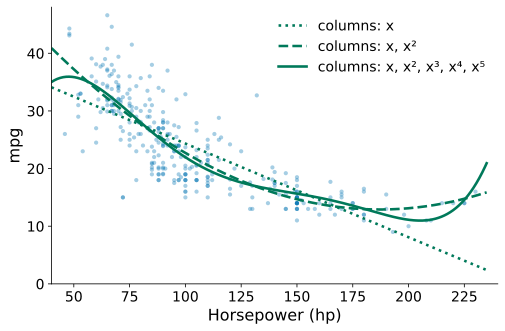{.fig fig-alt="Training cars with polynomial fits of degree 1, 2 and 5"}

::: {}
::: {.say}
**Polynomial features** (powers of&nbsp;x) are one special case of feature engineering: a general recipe when the problem gives no better idea.
:::

::: {.ask .vote}
<small>Vote on your phone</small>
How many powers of hp should we add?

::: {.opts}
<span><b>A</b>just a few (2 or 3)</span>
<span><b>B</b>as many as we can</span>
:::
:::
:::
:::
:::

::: {.notes}
约 2 分钟。投票（右屏 No idea which column? Use powers of x → Open，30 秒，再 Reveal），不评对错，请选 B 的同学说一句理由，结果留到第 12 页检验。前三个例子都来自对问题的理解；没有这样的理解时，多项式是通用办法。强调：多项式是特征工程的一个特例，不等于特征工程。投票：加几次方？多数人会选“越多越好”，记下比例，第 12 页检验它。
:::

## [Model:]{.stg} Powers with several inputs

::: {.stage}
::: {.formula .m1}
$$
\text{two inputs }(\textcolor{#0072B2}{x_1}=\text{hp},\ \textcolor{#0072B2}{x_2}=\text{weight})\text{, degree 2:}\quad \textcolor{#0072B2}{x_1},\ \textcolor{#0072B2}{x_2},\ \textcolor{#0072B2}{x_1^2},\ \boxed{\textcolor{#0072B2}{x_1x_2}},\ \textcolor{#0072B2}{x_2^2}
$$
:::

::: {.say .center}
The product $x_1x_2$ is an **interaction term**: the effect of horsepower can change with weight.
:::

::: {.rows .tiny}
<div><span class="n">6 inputs</span><div><b>degree 2: 6 + 6 + 15 = 27 columns</b><p>cylinders, displacement, hp, weight, acceleration, model year</p></div></div>
<div><span class="n">6 inputs</span><div><b>degree 3: 83 columns</b></div></div>
:::
:::

::: {.notes}
约 1.5 分钟。把单输入的 x、x² 推广到两个输入：所有次数不超过 2 的乘积。框出交互项：马力的作用可以随重量而变（上一讲见过马力和重量一起进模型）。列数涨得很快：六个特征 2 阶有 6 个一次项、6 个平方、15 个两两乘积，共 27 列；3 阶 83 列。这 27 列后面还会用到。列越多越灵活，这正是下一段要检验的。
:::

## [Model:]{.stg} Standardisation: put the columns on one scale

::: {.stage .tight}
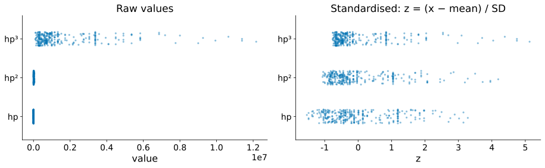{.fig .fig-s11 fig-alt="Left: raw values of hp, hp squared and hp cubed on one axis, with hp squashed near zero. Right: the same three columns after standardisation, all on a similar scale"}

::: {.two .even}
::: {.formula .m2}
$$
\textcolor{#0072B2}{z}=\frac{\textcolor{#0072B2}{x}-\bar x}{s}
$$
:::

::: {.say}
**Standardisation** (often loosely called normalisation). $\bar x$: mean, $s$: standard deviation of the column, both from the **training cars only**.
:::
:::
:::

::: {.notes}
约 2.5 分钟。左图：hp 在 46 到 230，hp² 到五万多，hp³ 到一千多万，放在一根轴上 hp 被压成一个点。右图：每列减去平均值、除以标准差后，三列都在 −2 到 3 附近。定义 x̄ 是这一列的平均值，s 是这一列的标准差。为什么重要：不标准化时，系数大小由单位决定（上一讲读系数时见过），数值计算也会变差；后面加惩罚时还要再用到它。规则：平均值和标准差只用训练车算。
:::

## [Test:]{.stg} Is a more flexible model always better?

::: {.stage .top}
::: {.muted .center}
Your vote: a few powers, or as many as we can? Watch the test error.
:::



::: {.muted .center}
**Underfitting**: too simple for the pattern. **Overfitting**: fits the ten cars' noise, fails on new cars.
:::
:::

::: {.notes}
约 3.5 分钟。回答“加几次方”那个快问。这十辆车就是上一讲课堂上拖线的十辆（只有 8 个不同马力，110 hp 有三辆）。先让学生预测：阶数从 1 加到 7，训练误差、测试误差、系数各会怎样？再一格一格拖。下方是系数柱（对数刻度，每格 10 倍，实心正、空心负），7 阶时系数到百万量级。灰色空心圆是 79 辆测试车。
:::

## [Loss:]{.stg} The loss only rewards fit

::: {.stage .tight}
| Degree | 1 | 2 | 3 | 4 | 5 | 6 | 7 |
|---|---:|---:|---:|---:|---:|---:|---:|
| Training RMSE (10 cars) | 4.61 | 3.43 | 3.41 | 3.39 | 2.08 | 2.03 | 1.89 |
| Test RMSE (79 cars) | 4.59 | 4.67 | 4.52 | 5.88 | 276 | 68.7 | 7512 |
| Largest coefficient | 5.5 | 22 | 47 | 340 | 8.2×10⁴ | 2.5×10⁵ | 8.7×10⁶ |

::: {.two .even}
::: {.formula .m2}
$$
\textcolor{#C84B00}{J(\mathbf w)}=\sum_{i=1}^{n}\bigl(\textcolor{#0072B2}{y_i}-\textcolor{#00795A}{\hat y_i}\bigr)^2
$$
:::

::: {.ask}
<small>Your turn</small>
The loss never looks at coefficient size. How would you change it?
:::
:::
:::

::: {.notes}
约 2 分钟。读最后一行：特征已标准化，所以不是单位造成的。巨大的正负系数互相抵消才凑出贴合，离开这十辆车就失效：系数爆炸是过拟合的征兆。指公式：损失只看贴合，从不过问系数有多大。停下来让学生提改法，期待“系数大就罚”。
:::

## [Loss:]{.stg} Ridge: also penalise large coefficients

::: {.stage}
::: {.formula .m1}
$$
\textcolor{#C84B00}{J_\lambda(\mathbf w)}=\sum_{i=1}^{n}\bigl(\textcolor{#0072B2}{y_i}-\textcolor{#00795A}{\hat y_i}\bigr)^2+\lambda\sum_{j=1}^{p}\textcolor{#00795A}{w_j}^2
$$
:::

::: {.say .center}
$p$ is the number of coefficients. $\lambda$ is a **hyperparameter**: we choose it before solving. $\lambda=0$ is last week's least squares; larger $\lambda$, smaller coefficients.
:::

::: {.muted .center}
Standardise first, otherwise the penalty punishes units, not complexity.
:::
:::

::: {.notes}
约 2 分钟。第一项贴近数据，第二项要系数小，此消彼长。命名：正则化、Ridge 回归、超参数。最后一行回扣第 11 页的标准化：以磅和千磅为单位，系数差一千倍，会被不公平地重罚。截距不罚、解的形式（正规方程对角线加 λ）只口头一句，推导在 Note 第 5 节和 Advanced Study 1。
:::

## Ridge on the ten cars

::: {.stage .top}

:::

::: {.notes}
约 2.5 分钟。同样十辆车、同样坐标和系数柱，阶数固定为 7；最左端 λ = 0 就是刚才乱摆的曲线。先让学生预测，再拖。λ = 0.01：‖w‖ 从 1.4×10⁷ 降到 18，测试 RMSE 从 7512 降到 4.36，训练 RMSE 从 1.89 升到 3.43。拖到 λ = 1000：几乎水平线，训练 6.99、测试 6.96，欠拟合。收一句：λ 是可以连续调的复杂度旋钮。
:::

## [Loss:]{.stg} Ridge shrinks, but keeps every coefficient

::: {.stage}
::: {.formula .m1}
$$
\textcolor{#C84B00}{J_\lambda(\mathbf w)}=\sum_{i=1}^{n}\bigl(\textcolor{#0072B2}{y_i}-\textcolor{#00795A}{\hat y_i}\bigr)^2+\boxed{\lambda\sum_{j=1}^{p}\textcolor{#00795A}{w_j}^{\,2}}
$$
:::

::: {.say .center}
At every $\lambda$ on the slider, all **7** coefficients stay non-zero. Look at the boxed penalty.
:::

::: {.ask .vote}
<small>Vote on your phone</small>
Which penalty could make some coefficients exactly zero?

::: {.opts}
<span><b>A</b>none: penalties only shrink</span>
<span><b>B</b>sum of |w| instead of w²</span>
<span><b>C</b>sum of w⁴ instead of w²</span>
:::
:::
:::

::: {.notes}
约 2 分钟。投票（右屏 Ridge shrinks, but keeps every coefficient → Open，30 秒，先不显示结果，再 Reveal）；请选 C 的同学说理由（w⁴ 对小系数罚得更轻，更不会压到零），下一页给答案 B。指刚才的系数柱：λ 再大，七根柱子都还在，只是变矮。请学生盯着方框里的惩罚项：它是平方。问：能不能换一种惩罚，让不需要的系数直接变成 0？期待有人说“绝对值”。
:::

## [Loss:]{.stg} Lasso: absolute values instead of squares

::: {.stage .tight}
::: {.formula .m2}
$$
\textcolor{#C84B00}{J_\lambda(\mathbf w)}=\sum_{i=1}^{n}\bigl(\textcolor{#0072B2}{y_i}-\textcolor{#00795A}{\hat y_i}\bigr)^2+\lambda\sum_{j=1}^{p}\bigl|\textcolor{#00795A}{w_j}\bigr|
$$
:::

| λ (scikit-learn alpha; ten cars, degree 7) | 0 | 0.001 | 0.01 | 0.1 | 1 |
|---|---:|---:|---:|---:|---:|
| Non-zero coefficients (of 7) | 7 | 4 | 3 | 2 | 1 |

::: {.say .center}
**Lasso** sets some coefficients **exactly to zero**. Both penalties together: **Elastic Net**.
:::
:::

::: {.notes}
约 2 分钟。把方框里的平方换成绝对值，得到 Lasso。同样十辆车 7 阶：λ 从 0 加到 1，非零系数从 7 个降到 1 个；系数为零就是把那一列去掉，所以 Lasso 压缩的同时顺便挑了特征。页面上的形式与 Ridge 对齐，只换了惩罚；scikit-learn 的 Lasso 在误差项前多一个 1/(2n)，所以表中的 λ 是 scikit-learn 的 alpha，不能和 Ridge 的直接比较。Elastic Net 一句话：两种惩罚一起，兼顾稳定和稀疏，多一个超参数。没有闭式解、几何图都在 Note 第 6、7 节。
:::

## [Test:]{.stg} How flexible should the model be?

::: {.stage}
::: {.two .f19}
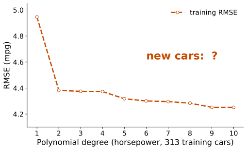{.fig fig-alt="Training RMSE keeps falling as the polynomial degree rises; error on new cars is a question mark"}

::: {}
::: {.say}
Our dials: the **degree**, **λ**, and **which penalty**.
:::

::: {.say}
Training error always says "more".
:::
:::
:::

::: {.ask}
<small>Your turn</small>
We may not choose on the test cars. What could we compare the settings on instead?
:::
:::

::: {.notes}
约 1.5 分钟。图：313 辆训练车上，训练 RMSE 随阶数一路下降，它永远偏爱更复杂；新车上会怎样，是问号。停下来问：能不能把每个设置都在测试车上试一遍，留最好的？先说清为什么不能在测试车上挑（挑选也是拟合，测试车就不算新车了），再问：那用什么来比？期待“从训练车里再留出一份”。答案在下一页。
:::

## [Test:]{.stg} Choosing is fitting too

::: {.stage}
::: {.rows .compact}
<div><span class="n">train</span><div><b>Training set</b><p>solves for the parameters</p></div></div>
<div><span class="n">valid</span><div><b>Validation set</b><p>compares and chooses: the degree, λ</p></div></div>
<div><span class="n">test</span><div><b>Test set</b><p>used once, after every choice is made</p></div></div>
:::

::: {.muted .center}
One validation split wobbles: degree 2 scored 3.43 on one split and 4.78 on another.
:::
:::

::: {.notes}
约 1.5 分钟。先回答上一页：挑选也是拟合，被选中的方案有一部分是运气，测试车的信息会漏进选择。所以从训练车里再留一份来比较，这就是验证集；从这一讲起“验证”专指挑选用的数据，最后一次检查叫测试。但只留一份会晃：五种随机分法里，2 阶的验证 RMSE 从 3.43 到 4.78。怎么办？下一页。
:::

## [Test:]{.stg} Cross-validation: every training car validates once

::: {.stage}
::: {.two .f20}
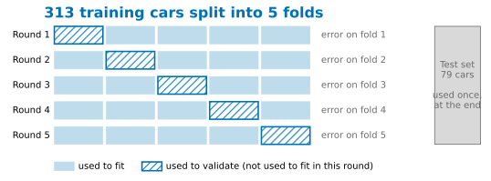{.fig fig-alt="Five rounds: the 313 training cars split into five folds, each fold used once for validation; the test set stays aside"}

::: {}
::: {.formula .m2}
$$
\text{CV RMSE}=\frac{1}{K}\sum_{k=1}^{K}\text{RMSE}_k
$$
:::

::: {.say}
**Cross-validation**: split the training cars into $K$ folds. $\text{RMSE}_k$ is the error on fold $k$ after fitting on the others.
:::
:::
:::
:::

::: {.notes}
约 1.5 分钟。K 折：每轮用 K−1 份拟合、剩下 1 份算 RMSE，K 轮取平均就是公式；每辆训练车都恰好验证一次，结果不依赖一次偶然的划分。本讲 K = 5。K 个结果的标准差除以 √K 是标准误，下一页图上的竖线。测试集始终不参与。
:::

## [Test:]{.stg} Cross-validation chooses degree 2

::: {.stage}
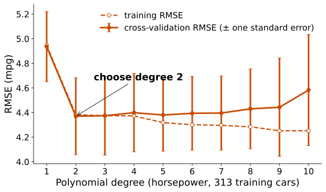{.fig .fig-s21 fig-alt="Cross-validation RMSE by polynomial degree, lowest at degree 2, while training RMSE keeps falling"}

::: {.say .center}
Choose degree **2** by cross-validation. Then open the test set, **once**: 4.29.
:::
:::

::: {.notes}
约 2 分钟。交叉验证 RMSE：1 阶 4.94，2 阶 4.37 最低，之后不再改善，10 阶 4.58；训练 RMSE 却一直降。即使某个更高阶碰巧略低，差距小于一个标准误也取简单的。λ 用同样的办法选（RidgeCV）。最后才读测试集一次：2 阶 4.29。
:::

## [Test:]{.stg} When is regularisation worth it?

::: {.stage}
::: {.say}
The degree 2 polynomial of all six inputs (cylinders, displacement, hp, weight, acceleration, model year): **27 columns**. Fit it on only some of the training cars, choose λ by cross-validation, and test on the same 79 cars.
:::

| Training cars | 40 | 80 | 313 |
|---|---:|---:|---:|
| No penalty | 7.48 | 3.51 | 2.72 |
| Ridge | 3.15 | 2.89 | 2.64 |

::: {.say .center}
Fewer cars, bigger gain.
:::
:::

::: {.notes}
约 1.5 分钟。表中是测试 RMSE；40 辆和 80 辆是随机抽 60 次的中位数，313 辆只有一次。参数个数不变，数据越少，正则化越值；313 辆时差距在一个标准误之内，如实说。
:::

## Today in code

::: {.stage}
```python
poly = PolynomialFeatures(2, include_bias=False)      # feature engineering
X_train2 = poly.fit_transform(X_train)
X_test2 = poly.transform(X_test)

scaler = StandardScaler()                             # standardise: fit on training cars only
X_train2 = scaler.fit_transform(X_train2)
X_test2 = scaler.transform(X_test2)

model = RidgeCV(alphas=np.logspace(-3, 2, 26), cv=5,  # 26 values of λ, 0.001 to 100; 5-fold CV picks one
                scoring="neg_root_mean_squared_error")
model.fit(X_train2, y_train)

pred = model.predict(X_test2)                         # the test set, once
print(mean_squared_error(y_test, pred) ** 0.5)
```

::: {.muted .small}
You will build this step by step in Lab 3.
:::
:::

::: {.notes}
约 1 分钟。每一块对应今天的一段，不讲语法。指出 fit_transform 与 transform：测试车只用 transform，从不参与平均值和标准差。这里用的是上一页的 27 列；输出 λ ≈ 0.04，测试 RMSE 2.64。换成 LassoCV 就是 Lasso。
:::

## Back to the car

::: {.stage}
::: {.bars}
<div class="base"><div class="lab">Measured</div><div class="bar" style="width:50%"></div><div class="v">12.0</div></div>
<div><div class="lab">Straight line</div><div class="bar" style="width:16.8%"></div><div class="v">4.0</div></div>
<div><div class="lab">With hp², degree chosen by CV</div><div class="bar" style="width:61.5%"></div><div class="v">14.8</div></div>
:::

::: {.rows .compact}
<div><span class="n">1</span><div><b>Cross-validation still uses the same batch of 1970s cars</b><p>and choosing among many options on it is optimistic too</p></div></div>
<div><span class="n">2</span><div><b>Regularised coefficients cannot be read at face value</b><p>Lasso's choice among correlated features changes with the data</p></div></div>
:::
:::

::: {.notes}
约 2 分钟。回扣开场：直线 4.0，二次 14.8，实测 12.0，误差从 8.0 降到 2.8。这一次说得出凭什么信：问题从残差规律发现，改法针对模型，2 阶在训练车内部用交叉验证选出，测试集只读一次。两条局限：交叉验证仍在同一批数据，反复挑也会偏乐观；正则化后的系数有偏，Lasso 在相关特征里留谁换一批数据就会变（重抽 500 次，马力被压成零约一半）。不预告下一讲。
:::

## What you can do now {.final-slide}

::: {.takeaway}
::: {.rows .tiny .chain}
<div><span class="n">see it</span><div><b>Residuals show a pattern</b><p>the model is not strong enough</p></div></div>
<div><span class="n">build</span><div><b>Feature engineering</b><p>cycles, ratios, logs; powers of x when unsure</p></div></div>
<div><span class="n">scale</span><div><b>Standardise</b><p>mean and SD from the training cars only</p></div></div>
<div><span class="n">watch</span><div><b>Overfitting</b><p>low training error, high error on new data, huge coefficients</p></div></div>
<div><span class="n">hold</span><div><b>Regularise</b><p>Ridge shrinks, Lasso sets to zero, Elastic Net does both</p></div></div>
<div><span class="n">choose</span><div><b>Cross-validation</b><p>degree and λ, without the test set</p></div></div>
<div><span class="n">report</span><div><b>Test set, once</b><p>with its limits</p></div></div>
:::

::: {.qr}
{fig-alt="QR code for today's live page"}
<b>Feedback</b>
<p>After class: Lab 3</p>
:::
:::

::: {.notes}
约 1.5 分钟，课堂最终停在这一页。沿着七行把整条链念一遍。答疑和扫码都在这里。课后 Lab 3，不预告下一讲。
:::
