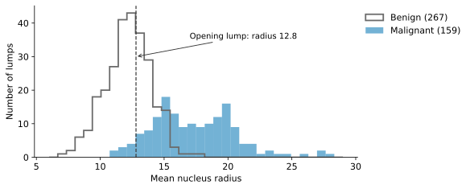
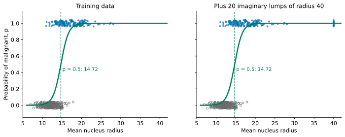
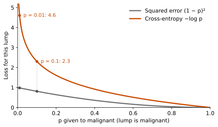
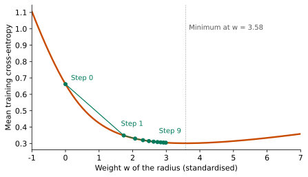
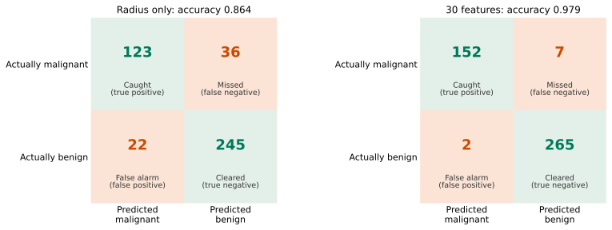
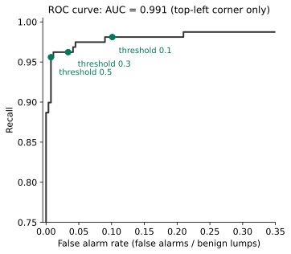
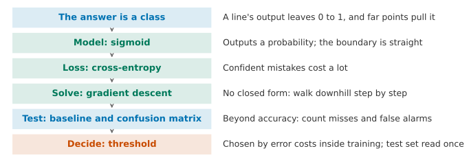

## 1. Motivation: When the Answer Is a Category

In the last two lessons, the question was always "predict a number": how many mpg does a car do? Many real problems do not ask for a number. They ask for a decision. Is this email spam? Will this loan default? Which digit is written in this image? The answer is one of a small number of **classes**, and this kind of problem is called **classification**. When there are only two classes, it is called **binary classification**.

The example in this lesson comes from medical diagnosis. Suppose a lump is found in a breast. A doctor takes a few cells with a fine needle and then measures the size, texture and shape of the cell nuclei in a microscope image. We have records for 569 lumps. Each lump has 30 measurements and a result from a pathology test: malignant (212 lumps) or benign (357 lumps). Malignant is the class we want to find, so we label it 1. Benign is labelled 0.

We start with one measurement only: the **mean nucleus radius** (from now on we call it the radius; it is measured in length units on the image). One lump has a radius of 12.8. Should we be worried about it?

We split the data 3:1 into a training set (426 lumps) and a test set (143 lumps). We also do one extra thing here, called **stratify**: we make the share of malignant lumps the same in both parts (about 37% in each). When there are only a few classes, a random split can put too many or too few lumps of one class into the test set. Stratifying prevents this. As in the last lesson, we keep the test set until the very end and use it only once.

{fig-alt="Two histograms: benign lumps are mostly between radius 10 and 14, malignant lumps are mostly between 14 and 22, and the two overlap a lot between 12 and 16"}

The two classes overlap a lot between 12 and 16. At a radius of 12.8, most lumps are benign, but some are malignant. So the question "is this lump malignant?" has no certain answer. A better answer is **how likely it is to be malignant**, and then we make a decision based on that likelihood.

First, think: using only the tools from the last two lessons, what would you do?

::: {.callout-note collapse="true" title="Show answer"}
The most direct approach is to treat the labels 0 and 1 as numbers and fit a straight line with linear regression. Then we call a lump malignant if its predicted value is above 0.5. The next section does exactly this and shows what goes wrong.
:::

**By the end of this lesson, you should be able to:** handle a problem whose answer is a class by making the model output a probability rather than a class; explain how this model is trained; compare it with the simplest baseline first, and then count how many of each of the two kinds of error it makes; choose the cut-off for a decision from the cost of each error; and report on the test set only once. We follow the five steps again. The model, the loss and the solution each change once, and the testing step gains one extra part: the decision.

## 2. Model: Why a Straight Line Fails

Before looking for a new method, let us try the tool from Lesson 2. We treat the labels 0 and 1 as numbers and fit a straight line. In the widget below you can drag the line yourself, or let the least-squares line find it for you.



Try it yourself first. Is there a straight line that stays close to both rows of points and never leaves 0 to 1? What does the least-squares line do? And what happens when you add the imaginary lumps?

::: {.callout-note collapse="true" title="Show answer"}
There is no such line. To stay close to both rows, the line needs a slope, and a line with a slope sooner or later leaves 0 to 1. On the training set, the least-squares line predicts values from −0.33 to 1.76, and 16% of the lumps fall outside 0 to 1. "The chance of malignant is 1.76" has no meaning.

The problem grows when we add 20 imaginary lumps with a radius of 40. They are much larger than every real lump and are malignant beyond doubt, so they should not change where things start to look suspicious. But the line flattens to get closer to them, and the cut at 0.5 moves from 15.38 to 17.42. Some lumps that were called malignant are now called benign.
:::

The trouble is not that the line fits badly. It is the **shape** of a straight line: its output can be any number. What we really want is a number we can read as "how likely is this lump to be malignant", that is, a **probability** between 0 and 1.

### 2.1 Find a Function That Turns the Line into a Probability

The line is not useless. $z = wx + b$ gives each lump a score, and a larger score means more likely malignant. The only missing step is to turn that score into a probability. So we keep the line and look for a **squashing function** that turns any $z$ into a number between 0 and 1.

Before searching, we should be clear about what it must do. Make your own list first.

::: {.callout-note collapse="true" title="Show a sample answer"}
1. Its output is always between 0 and 1, so that it can be read as a probability.
2. The larger $z$, the larger the output (more malignant-looking, higher probability).
3. At $z = 0$ the output is 0.5, which means "not sure". Away from 0 it becomes surer, and points far away only push it closer to 0 or 1.
4. It is smooth everywhere: a small change in the parameters gives a small change in the output. Later we tune the parameters step by step, so this one is essential.
:::

The widget below offers three candidates. On the left is the function itself; on the right is the curve the model then draws over the data.



Try each one first. Which requirement does each candidate break?

::: {.callout-note collapse="true" title="Show answer"}
**Clipping** (anything below 0 becomes 0, anything above 1 becomes 1) meets requirements 1 and 2, but it has sharp corners, so it is not smooth (requirement 4). At $z = 0$ it gives 0, not 0.5, and beyond the corners it jumps to exactly 0 or 1, so it cannot say how sure it is (requirement 3). And the line in the middle is still fitted by least squares, so far points still pull it. The **step** (output 1 if $z > 0$, otherwise 0) has only two values, so it cannot say how sure it is (requirement 3), and a small change in the parameters either changes nothing or makes the output jump (requirement 4). Only the **S-shaped** curve meets all four.
:::

The most common function that meets all four requirements is

$$
\textcolor{#00795A}{p} = \sigma(z) = \frac{1}{1+e^{-z}} ,
$$

called the **sigmoid**. We can check each requirement. $e^{-z}$ is always positive, so $p$ is between 0 and 1. The larger $z$, the smaller $e^{-z}$, so the larger $p$. At $z = 0$ we have $e^{0} = 1$, so $p = 0.5$. When $z$ is very large, $p$ is close to 1, and when $z$ is very negative, $p$ is close to 0. It can be differentiated everywhere. We read $p$ as "the probability, according to the model, that this lump is malignant".

The model "a straight line, then the sigmoid" is called **logistic regression**. Its name contains "regression", but it is used for classification: what it regresses is a probability. Now let us go back and test requirement 3.

{fig-alt="Two plots with almost the same S-shaped curve; the boundary is at 14.72 in both"}

After adding the 20 far lumps, the boundary is still at 14.72. The reason is that the model already gives these lumps a probability close to 1, so they no longer ask the curve to change.

When there are several features, the linear combination is the multiple linear model of Lesson 2, except that the intercept $w_0$ is now written separately as $b$: $z = w_1x_1 + w_2x_2 + \dots + w_dx_d + b = \mathbf w^\top\mathbf x + b$. Everything else stays the same.

The symbols in this lesson, compared with earlier lessons:

| Symbol | Meaning in this lesson | Earlier lessons |
|---|---|---|
| $p$ | the probability the model gives to malignant | Lessons 2 and 3 used $p$ for the number of features |
| $d$ | the number of features | the $p$ of Lessons 2 and 3 |
| $n$ | the number of samples | the same |
| $z$ | the linear part $\mathbf w^\top\mathbf x + b$, a score | in Lesson 3, $z$ was a standardised value |
| $\mathbf w$, $b$ | weights and intercept | Lesson 2 wrote the intercept as $w_0$ inside $\mathbf w$ |
| $t$ | the threshold (Section 7) | new |
| `C` | sklearn's penalty parameter; smaller means a stronger penalty | works the opposite way to $\lambda$ in Lesson 3 |

By default, `LogisticRegression` in scikit-learn also adds a small Ridge style penalty to the loss (Lesson 3). All the numbers in this lesson use this default setting. We explain what it does in Section 6.

## 3. Reading the Model: The Decision Boundary

With two features, we can draw each lump as a point on a plane. The widget below uses two features: the radius and the texture (the standard deviation of the grey levels in the nucleus image). Both have been standardised (Lesson 3). Drag the three sliders to change $w_1$, $w_2$ and $b$.



First, look: what shape is the green line? What does each of $w_1$, $w_2$ and $b$ control?

::: {.callout-note collapse="true" title="Show answer"}
However you drag the sliders, the green line is always a straight line. When you change $w_1$ or $w_2$, the line turns and its direction changes. When you change $b$, the line shifts. If you scale $w_1$, $w_2$ and $b$ up by the same factor, the line stays in the same place, but the green change from one side to the other becomes steeper.
:::

The green line is called the **decision boundary**. Lumps on one side are called malignant, and lumps on the other side are called benign. Why must it be a straight line? Because $p = 0.5$ corresponds exactly to $z = 0$:

$$
p \ge 0.5 \iff z = w_1x_1 + w_2x_2 + b \ge 0 .
$$

$w_1x_1 + w_2x_2 + b = 0$ is a straight line on the plane. With $d$ features, it is a flat surface in $d$-dimensional space (a hyperplane). So the boundary of logistic regression is always "straight", and in Section 9 this becomes one of its limits.

The value $z$ also has a meaning of its own. From $p = \sigma(z)$ we can solve for $z$:

$$
z = \log\frac{p}{1-p} .
$$

$\frac{p}{1-p}$ is the "odds of malignant against benign", and $z$ is its logarithm, called the **log-odds**. So logistic regression uses a linear model to predict the log-odds: when $x_1$ increases by 1, the log-odds increase by $w_1$.

## 4. Loss: Why Not Use Squared Error

We now have a model. The next step is to define which values of $w$ and $b$ count as good. Lesson 2 used the mean squared error. We could use it here too, with an error of $(y-p)^2$ for each lump. Let us see how it treats mistakes.

Suppose a lump is in fact malignant ($y = 1$), and the model gives different values of $p$:

| $p$ given by the model | 0.9 | 0.5 | 0.1 | 0.01 | 0.0001 |
|---|---:|---:|---:|---:|---:|
| Squared error $(1-p)^2$ | 0.01 | 0.25 | 0.81 | 0.98 | 1.00 |

$p = 0.01$ means the model is almost sure the lump is benign, so this is a very confident mistake. $p = 0.1$ is a less confident mistake. Squared error gives them almost the same penalty (0.98 and 0.81), and however wrong the model is, the penalty is never more than 1.

First, think: how can we make a very confident mistake cost much more?

::: {.callout-note collapse="true" title="Show answer"}
We need a penalty that grows quickly as $p$ gets close to 0, and goes to infinity as $p \to 0$. The logarithm has exactly this property: $-\log p$ is 0 when $p = 1$, grows as $p$ gets smaller, and goes to infinity as $p \to 0$.
:::

When the lump is in fact malignant, the penalty is $-\log p$. When the lump is in fact benign, the probability the model gives to "benign" is $1-p$, so the penalty is $-\log(1-p)$. We combine the two cases into one formula and take the average over all samples:

$$
\textcolor{#C84B00}{L(\mathbf w, b)} = -\frac{1}{n}\sum_{i=1}^{n}\Big[\, y_i \log p_i + (1-y_i)\log(1-p_i) \Big],\qquad p_i = \sigma(\mathbf w^\top\mathbf x_i + b).
$$

When $y_i = 1$, the second term is 0, and only $-\log p_i$ is left. When $y_i = 0$, the first term is 0, and only $-\log(1-p_i)$ is left. This loss is called **cross-entropy**, and it is also called log loss.

| $p$ given by the model | 0.9 | 0.5 | 0.1 | 0.01 | 0.0001 |
|---|---:|---:|---:|---:|---:|
| Squared error | 0.01 | 0.25 | 0.81 | 0.98 | 1.00 |
| Cross-entropy $-\log p$ | 0.11 | 0.69 | 2.30 | 4.61 | 9.21 |

{fig-alt="Two falling curves: the squared error is never above 1, while the cross-entropy rises sharply as p gets close to 0"}

There is another way to read it. $-\log p_i$ is the negative logarithm of "the probability the model gives to the true answer". A small cross-entropy means the model gives a high probability to the true answer. Advanced Study 3 looks at this idea again.

## 5. Solving: No More Normal Equation

In Lesson 2, we solved linear regression by setting the derivative of the loss with respect to the parameters to 0. This gave the normal equation, which found the answer in one step. Let us try the same here and take the derivative with respect to $w_j$ (the derivation is in Advanced Study 1):

$$
\frac{\partial L}{\partial w_j} = \frac{1}{n}\sum_{i=1}^{n}(p_i-y_i)\,x_{ij} .
$$

Here $x_{ij}$ is the $j$th feature of the $i$th lump, and $p_i$ is the probability of malignant that the model gives it. Now we set this to 0. The difficulty is that $p_i = \sigma(\mathbf w^\top\mathbf x_i + b)$. Because $\mathbf w$ sits inside the sigmoid, we cannot get $\mathbf w$ on its own, as we did with the normal equation. **There is no closed-form solution.**

The figure below uses only one feature (the standardised radius). It fixes $b$ at its best value and plots the cross-entropy as $w$ changes.

{fig-alt="A curve that falls and then rises slowly. Green dots move along the curve from the upper left towards the lowest point, with smaller and smaller steps"}

Think first: if we cannot solve for the answer, how can we reach the lowest point step by step?

::: {.callout-note collapse="true" title="Show answer"}
Stand at the current $w$ and look at which way the curve goes down. Move a little in that direction, then look again and move again. If the slope is steep, move more. Near the bottom of the valley the slope becomes flat, so you move less.
:::

This method is called **gradient descent**. The derivative (called the **gradient** when there are several parameters) points uphill, so we move in the opposite direction:

$$
w_j \leftarrow w_j-\eta\,\frac{\partial L}{\partial w_j} = w_j-\eta\,\frac{1}{n}\sum_{i=1}^{n}(p_i-y_i)\,x_{ij} .
$$

$\eta$ is the size of each step, and it is called the **learning rate**. Here is how to read the gradient. For each sample, take "predicted probability minus true label", multiply it by the sample's input, and then average. If a sample is predicted well, $p_i-y_i$ is close to 0, so it hardly moves the parameters.

Figure F5 uses $\eta = 5$ and starts from $w = 0$. The first step already reaches 1.73. After that the slope becomes gentler and the steps become smaller, and after 9 steps we are at 2.99. The cross-entropy has only one valley (in mathematics it is called a **convex** function). So if the step size is suitable, we will reach the lowest point if we keep going.

scikit-learn uses a faster iterative method than this (the default is called `lbfgs`), but the idea is the same. It starts from a starting point and improves again and again until it can no longer improve. It takes at most `max_iter` steps (100 by default). If it stops before it reaches the bottom, it gives a `ConvergenceWarning`. There are two common reasons for this. The features may have very different scales (standardisation from Lesson 3 fixes this). Or there may be many features and not enough steps (increase `max_iter`).

## 6. Checking: Accuracy Can Fool You

Now we can train the model, and the next step is to check it. The test set must wait until the end, so what do we check with now? We use cross-validation from Lesson 3. We split the 426 training samples into 5 parts. Each time, we train on 4 parts and predict the remaining part. After one full round, every sample has a prediction made "when it was not used for training". In scikit-learn this is called `cross_val_predict`. Before splitting, we shuffle the order of the samples. This stops the order of the original data (for example, by collection date) from making one part very unusual. All the numbers below come from these predictions.

With the radius as the only feature, and calling a lump malignant if $p \ge 0.5$, the **accuracy** (the proportion of correct predictions) is 0.864.

Think first: is 0.864 good?

::: {.callout-note collapse="true" title="Show answer"}
First we need something to compare with. The most naive method ignores every feature and always guesses the more common class in the training set, which is "benign". Its accuracy is 267 / 426 = 0.627. So 0.864 is better, but not by as much as it first seems. Also, accuracy does not tell us what kind of mistakes the wrong predictions are.
:::

"Always guess the most common class" is called the **majority baseline**. Every classifier should first be compared with it. The more unbalanced the classes are, the higher its accuracy. If 1% of people have a disease, "always guess healthy" has an accuracy of 99%, but it never finds a single patient.

### 6.1 The Confusion Matrix

A binary classifier can make two kinds of mistake. It can call a malignant lump benign (a **missed cancer**), or call a benign lump malignant (a **false alarm**). We count the right and wrong predictions separately by actual class and predicted class, and put them in a 2×2 table. This table is called a **confusion matrix**.

{fig-alt="Two two-by-two tables. The left one has 36 missed cancers and 22 false alarms; the right one has 7 missed cancers and 2 false alarms"}

Each of the four cells has a name (we call malignant "positive"):

- **True positive** (TP): actually malignant, predicted malignant. 123 in the left table.
- **False negative** (FN): actually malignant, predicted benign. This is a missed cancer. 36 in the left table.
- **False positive** (FP): actually benign, predicted malignant. This is a false alarm. 22 in the left table.
- **True negative** (TN): actually benign, predicted benign. 245 in the left table.

From these four numbers we can work out two common proportions:

$$
\text{recall} = \frac{TP}{TP+FN} = \frac{123}{159} = 0.774, \qquad
\text{precision} = \frac{TP}{TP+FP} = \frac{123}{145} = 0.848 .
$$

**Recall** answers this question: of all the malignant lumps, how many did we find? **Precision** answers this one: of the lumps we called malignant, how many really are malignant? With only the radius, we missed 36 of the 159 malignant lumps, so the recall is only 0.774.

Think first: how could we miss fewer?

::: {.callout-note collapse="true" title="Show answer"}
There are two directions. One is to make the model itself better, for example by using more features. The other is to keep the model but lower the bar for calling a lump malignant, for example calling it malignant if $p \ge 0.3$. We look at the first direction now and leave the second for the next section.
:::

### 6.2 Using All 30 Features

The 30 measurements have very different scales. The radius is between 7 and 28, the area is between 143 and 2501, and the smoothness is between 0.05 and 0.16. If we fit the model directly, `lbfgs` cannot reach the bottom within the default 100 steps, so it gives a `ConvergenceWarning`. If we standardise first, as in Lesson 3 (computing the mean and standard deviation from the training set only), the problem goes away.

After standardisation, the default penalty is also fair. scikit-learn controls it with the parameter `C`, and `C` works the opposite way to $\lambda$ from Lesson 3: the smaller `C` is, the stronger the penalty (roughly $1/\lambda$; the exact conversion differs by a constant factor, see Advanced Study 2). On the breast lumps we always use the default `C = 1`.

With 30 features, the cross-validated accuracy is 0.979. Missed cancers fall from 36 to 7, and false alarms fall from 22 to 2 (Figure F6, right). The recall is 0.956 and the precision is 0.987.

## 7. Deciding: The Threshold Is a Choice

So far we have always called a lump malignant if $p \ge 0.5$. The previous section left a second way to miss fewer cancers: keep the model, and move this line at 0.5.

What is it in a picture? Place each training lump on the horizontal axis at the $z$ the model gives it; the S curve squashes $z$ into a probability $p$. "$p \ge 0.5$" is a height on the curve, and it matches one vertical line on the horizontal axis: to the right of that line, a lump is called malignant. In the widget below you can drag the height; the vertical line moves left or right with it, and misclassified lumps get an orange ring.



Drag it first. If you run a clinic and a missed cancer is the worst outcome, which way should the line move? What do you gain, and what do you pay?

::: {.callout-note collapse="true" title="Show answer"}
To the left. As the line moves left, malignant lumps that were on its left (blue dots with an orange ring) move to the right side, so fewer cancers are missed. But more benign lumps (grey circles) are also pulled in, so there are more false alarms. A missed cancer may mean a patient misses treatment; a false alarm costs one more check and a few anxious days. A missed cancer costs far more, so moving the line left is worth it.
:::

This line is called the **threshold**. It is not part of the model. It is a choice we make when we decide. Here are the numbers at three thresholds (30 features, cross-validated probabilities on the training set):

| Threshold | Missed cancers (FN) | False alarms (FP) | Recall | Precision | Accuracy |
|---:|---:|---:|---:|---:|---:|
| 0.5 | 7 | 2 | 0.956 | 0.987 | 0.979 |
| 0.3 | 6 | 9 | 0.962 | 0.944 | 0.965 |
| 0.1 | 3 | 27 | 0.981 | 0.852 | 0.930 |

If missed cancers matter most, choose 0.1: missed cancers drop from 7 to 3, and the price is that false alarms rise from 2 to 27. Notice that accuracy falls from 0.979 to 0.930. Accuracy counts both kinds of error as equally bad, but here they are not.

The threshold is set by the **cost of each mistake**, and different problems choose in opposite directions. In cancer screening a missed cancer costs a lot, so the threshold goes down. In a spam filter, sending an important email to the spam folder (a false alarm) is worse than letting one spam email through, so the threshold goes up. The same model can use different thresholds in different settings.

### 7.1 The ROC Curve

For each threshold, we plot one point: the "false alarm rate" (the number of false alarms divided by the total number of benign lumps) against the recall. As the threshold goes from 1 down to 0, these points join into a curve. This is the **ROC curve** (**receiver operating characteristic** curve). It shows every threshold in one plot. The closer the curve is to the top left corner, the more malignant lumps we can find while making very few false alarms.

{fig-alt="A curve close to the top left corner, with the thresholds 0.5, 0.3 and 0.1 marked"}

The area under the curve is called the **AUC** (**area under the curve**). In this example it is 0.991. There is an intuitive way to read it. Pick one malignant lump and one benign lump at random. The AUC is the chance that the model gives the malignant one the higher probability. A value of 0.5 is the same as random guessing, and 1 means the two classes are completely separated. AUC measures how well the model puts the two classes in order, and it does not depend on which threshold we choose. When we use the model in practice, we still need to choose a threshold.

### 7.2 Reading the Test Set Once

We chose the threshold 0.1 inside the training set. All the choices are now made, so only now do we open the test set. We standardise and fit using all 426 training samples, compute probabilities for the 143 test samples, and decide using 0.1.

The test set has 53 malignant lumps, and there are 0 missed cancers. It has 90 benign lumps, and there are 11 false alarms. The accuracy is 0.923. For comparison, a threshold of 0.5 would give 2 missed cancers, 0 false alarms and an accuracy of 0.986. But that is not the option we chose. We use it only to show the trade: 11 more false alarms in exchange for 2 fewer missed cancers.

## 8. More Than Two Classes: Handwritten Digits

Many classification problems have more than two classes. Assignment 2 asks you to recognise handwritten digits from 0 to 9 (MNIST), which is 10 classes. Here we use the course's MNIST subset to see how logistic regression extends: 10,000 handwritten digits taken once from MNIST. Each image has 28×28 = 784 pixels, and each pixel is a grey value from 0 to 255. We split them with stratification in the same way: 7500 for training and 2500 for testing.

**Model.** Each class has its own set of weights. These give 10 scores $z_0, \dots, z_9$, and a larger score means the image looks more like that class. Now we need not one probability but 10, and they must add up to 1.

Think first: how can we turn 10 scores, which may be positive or negative, into 10 positive numbers that add up to 1, so that a larger score gives a larger probability?

::: {.callout-note collapse="true" title="Show answer"}
Two steps. First make every score positive while keeping their order: take $e^{z_k}$. Then divide by their sum, so that they add up to 1.
:::

Written out:

$$
p_k = \frac{e^{z_k}}{e^{z_0} + e^{z_1} + \dots + e^{z_9}} .
$$

This function is called **softmax**, and with two classes it is the sigmoid. The prediction is the class with the highest probability. The loss is still the cross-entropy: for each image, the penalty is $-\log(\text{the probability given to the true digit})$. scikit-learn's `LogisticRegression` does this automatically when there are several classes. You need to watch three points. First, divide the pixel values by 255 so that they lie between 0 and 1 (this works like standardising). Second, with 784 features and 10 classes, the default 100 steps are not enough, so raise `max_iter` to 1000. Third, each class has 784 weights and there are not many images, so noise in the images can pull the weights around; we add a little regularisation (Lesson 3). The parameter `C` of `LogisticRegression` sets how strong it is: the smaller $C$, the stronger the regularisation, and the default is 1. As we chose λ in Lesson 3, we use 5-fold cross-validation on the training set to choose from 1, 0.3, 0.1, 0.03 and 0.01: 0.1 is best (0.901, against 0.889 for the default 1), and it is not at either end.

```python
import urllib.request                        # to download a file
import numpy as np
from sklearn.model_selection import train_test_split
from sklearn.linear_model import LogisticRegression

DATA_URL = "https://raw.githubusercontent.com/wayXing/mps311-439-course-materials/main/lecture-slids/lessons/data/mnist10k.npz"
urllib.request.urlretrieve(DATA_URL, "mnist10k.npz")   # the course MNIST subset, about 1.6 MB
mnist = np.load("mnist10k.npz")              # the file holds two arrays, X and y
X_digits = mnist["X"] / 255                  # 784 pixels per image, scaled to 0 to 1
y_digits = mnist["y"]                        # the digit, 0 to 9
X_digits_train, X_digits_test, y_digits_train, y_digits_test = train_test_split(
    X_digits, y_digits, test_size=0.25, random_state=0, stratify=y_digits)   # 7500 to train, 2500 to test
digit_model = LogisticRegression(max_iter=1000, C=0.1) # more steps; C = 0.1 chosen by cross-validation
digit_model.fit(X_digits_train, y_digits_train)        # softmax and cross-entropy happen inside
print(digit_model.score(X_digits_test, y_digits_test)) # accuracy on the test images
```

Assignment 2 uses the whole of MNIST (60,000 training images). The method is the same: divide by 255 and increase `max_iter`.

**Checking.** The majority baseline (always guess the most common digit in the training set, which is 1) has a test accuracy of only 0.114. Logistic regression has a test accuracy of 0.908 (0.902 with the default $C = 1$). The confusion matrix is now 10×10. The rows are the actual digits, the columns are the predicted digits, and everything off the diagonal is a mistake.

{fig-alt="On the left, a ten-by-ten matrix with a dark green diagonal; top right, ten handwritten digit images; bottom right, ten red and blue 28 by 28 weight images; the image for 0 has a dark blue patch in the middle and a red ring around it"}

The most common mistake is reading a 9 as a 4, which happens 13 times; next come reading a 9 as a 7 (12 times) and a 4 as a 9 (11 times). A 9 closed at the top, a 4 open at the top and a 7 with a hook can look very alike. The images on the right lay out each class's 784 weights by pixel position. The redder a weight, the more ink at that position raises $z$ for this class; the bluer, the more it lowers $z$. The image for digit 0 has a dark blue patch in the middle and a red ring around it, which is the shape of a 0: an image with ink in the middle does not look like a 0. The weight images show where the model looks. Regularisation is what makes them readable: with the default $C = 1$, the weights are pulled around by noise in the training images, and the picture is scattered red and blue dots.

## 9. The Limit of a Straight Boundary

Section 3 said that the boundary of logistic regression is always straight. What if the two classes cannot be separated by a straight line?

{fig-alt="On the left, a cluster of points is surrounded by a ring of points; on the right, the two classes form two separate groups along the horizontal axis"}

This is the old trick from Lesson 3: when the model is not enough, make new features. Once we add "distance from the centre", $\sqrt{x_1^2 + x_2^2}$, to the model, the boundary is straight in the new feature. Back in the original plane, it is a circle. But this only works if we think of this feature first.

## 10. Implementation: Doing It with scikit-learn

Below we write the code step by step, in the same order as this lesson. The code uses only the most basic style, and each step matches one section.

**Step 1: read the data and stratify the split (Section 1).**

```python
from sklearn.datasets import load_breast_cancer
from sklearn.model_selection import train_test_split

data = load_breast_cancer()                  # 569 lumps, 30 measurements each
X = data.data                                # the 30 features
y = 1 - data.target                          # sklearn uses 0 = malignant; we want 1 = malignant
X_train, X_test, y_train, y_test = train_test_split(
    X, y, test_size=0.25, random_state=0, stratify=y)   # keep the same share of malignant in both parts
```

**Step 2: standardise (Section 6.2).**

```python
from sklearn.preprocessing import StandardScaler

scaler = StandardScaler()                    # mean and standard deviation from training data only
X_train_s = scaler.fit_transform(X_train)    # learn them and scale the training set
X_test_s = scaler.transform(X_test)          # scale the test set the same way
```

**Step 3: cross-validated probabilities and the confusion matrix (Section 6).**

```python
from sklearn.linear_model import LogisticRegression
from sklearn.model_selection import KFold, cross_val_predict
from sklearn.metrics import confusion_matrix

model = LogisticRegression()                 # sigmoid model, trained with cross-entropy
kf = KFold(5, shuffle=True, random_state=0)  # 5 folds; shuffle first, because the rows may be in some order
prob_both = cross_val_predict(model, X_train_s, y_train, cv=kf, method="predict_proba")  # each row predicted by a model that did not see it
prob = prob_both[:, 1]                       # column 1 is the probability of malignant
pred = (prob >= 0.5).astype(int)             # threshold 0.5: 1 = malignant, 0 = benign
print(confusion_matrix(y_train, pred, labels=[1, 0]))   # rows: actual malignant, actual benign
```

The output is `[[152 7] [2 265]]`. The first row is the actually malignant lumps: 152 found and 7 missed cancers. The second row is the actually benign lumps: 2 false alarms and 265 cleared. `labels=[1, 0]` puts malignant first, so the order matches Figure F6.

**Step 4: after choosing the threshold, read the test set once (Section 7).**

```python
model.fit(X_train_s, y_train)                # train on all 426 training lumps
prob_both_test = model.predict_proba(X_test_s)   # two columns: benign, malignant
prob_test = prob_both_test[:, 1]             # column 1 is the probability of malignant
pred_test = (prob_test >= 0.1).astype(int)   # the threshold chosen inside the training set
print(confusion_matrix(y_test, pred_test, labels=[1, 0]))   # read the test set once
```

The output is `[[53 0] [11 79]]`. Note that `model.predict` always uses 0.5 as the threshold. If you want a different threshold, make the decision yourself from `predict_proba`, as we do here.

## 11. One-Page Review

If you read only one page, read this one.

{fig-alt="A vertical flowchart with six steps"}

| The problem you see | What you can do | What evidence to use |
|---|---|---|
| The answer is a class, not a number | Output a probability: logistic regression, $p = \sigma(\mathbf w^\top\mathbf x + b)$ | The output is between 0 and 1, and distant points do not pull the boundary |
| We need to define which parameters are good | Cross-entropy: a confident mistake gets a very heavy penalty | The cross-entropy on the training set goes down |
| There is no closed-form solution | Gradient descent or another iterative method; if it does not converge, standardise first, then increase `max_iter` | `ConvergenceWarning` no longer appears |
| We do not know whether the model is good | Compare with the majority baseline first, then look at the confusion matrix, recall and precision | Cross-validated predictions inside the training set |
| The two kinds of error have different costs | Choose the threshold by cost inside the training set; ROC shows all thresholds | The numbers of missed cancers and false alarms; read the test set only once |
| There are more than two classes | softmax, a 10×10 confusion matrix | Compare with the majority baseline, and see which two classes are confused most often |

## 12. Summary and Limitations

Let us go back to the lump from the start of the lesson: radius 12.8, and the pathology result was malignant. The test set also has a smaller lump with radius 11.4, which is also malignant.

| Lump | Approach | Probability of "malignant" | Threshold 0.5 | Threshold 0.1 |
|---|---|---:|---|---|
| Radius 12.8 (opening) | Radius only | 0.122 | Called benign (missed cancer) | Called malignant (found) |
| Radius 12.8 (opening) | 30 features | 0.116 | Called benign (missed cancer) | Called malignant (found) |
| Radius 11.4 | Radius only | 0.034 | Called benign (missed cancer) | Called benign (missed cancer) |
| Radius 11.4 | 30 features | > 0.999 | Called malignant (found) | Called malignant (found) |

The opening question was: should this lump worry us? Our answer is no longer "look at whether the radius is large". Instead, we use the 30 measurements to give a probability of malignant. Then we decide with the threshold 0.1, which we chose inside the training set because missed cancers matter most. Each of the two lumps shows one thing. For the lump with radius 11.4, the radius alone would almost never make us suspicious. The other 29 measurements make the model almost certain that it is malignant: this is what a better model does. For the opening lump, both models give only about 0.12 (0.122 and 0.116), so both would miss it at 0.5. Lowering the threshold finds it again: this is what deciding by cost does. Why can we trust this decision? Because we chose the threshold inside the training set, according to the cost of each error, and we read the test set only once.

**Transfer question.** A bank uses a customer's income, debts, repayment history and similar data to predict whether a loan will default. About 5% of loans default. Without doing any calculation, answer these questions. Roughly what is the accuracy of the majority baseline? What does each of the four cells of the confusion matrix mean? Which costs more: missing a customer who will default, or refusing a customer who will not default? Which way should the threshold move? On which data should you choose the threshold?

::: {.callout-note collapse="true" title="Show a sample answer"}
If you always guess "no default", the accuracy is about 95%, so an accuracy of 95% tells us very little. The positive class is "default". A true positive is a defaulter we find. A false negative is a defaulter we miss. A false positive is a good customer wrongly flagged as a defaulter. A true negative is a good customer who gets the loan as normal. Missing a defaulter loses the money that was lent, while refusing a good customer loses the interest income. The first is usually larger, so the threshold should move down. But if there are too many false alarms and the bank refuses many good customers, its business also suffers. So we need to estimate both costs before we choose. Choose the threshold inside the training set, using cross-validated probabilities, and read the test set only once at the very end.
:::

**Where this method cannot be trusted.**

1. **The probability cannot always be read literally.** When the model says 0.116, it does not mean that 11.6% of such lumps are really malignant. The default penalty and the correlations between features can both push the probability too high or too low. The method that checks and corrects probabilities is called **calibration**. We did not do it in this lesson.
2. **The threshold depends on the costs, and people set the costs.** In this lesson we said "missed cancers matter most" and chose 0.1. If a missed cancer costs 5 times as much as a false alarm, or 50 times as much, we get different thresholds. This is a medical and ethical judgement, and the data cannot answer it.
3. **The numbers come from 569 samples from one hospital.** Cross-validation can only be trusted within this set of samples. With a different hospital or a different microscope, the distribution of the measurements may change, and the threshold may need to be chosen again.
4. **The boundary is straight.** The ring data in Section 9 shows that when a plane cannot separate the two classes, logistic regression cannot help, unless we first think of a suitable feature.

**Back to the promise at the start.** Now, when the answer to a problem is a class, you can do the following. You can make the model output a probability instead of a class. You can explain the model of logistic regression, the cross-entropy loss and how it is solved iteratively. You can compare with the majority baseline first, and then use the confusion matrix to see how many of each kind of error there are. You can choose the threshold inside the training set according to the cost of each error, and report on the test set only once. You can also extend the same thinking to more than two classes.

**30-second feedback.** When you finish this lesson, scan the code to leave anonymous feedback or a question. It helps us to know which parts were unclear or too fast.

{fig-align="center" width="160px" fig-alt="Feedback QR code"}

*The Advanced Studies below are not part of the main line, and each can be read on its own. MPS311 students are encouraged to read them; MPS439 students should complete Study 1 and Study 2.*

---

## Advanced Study 1: Deriving the Gradient from Cross-Entropy

The goal is to derive the formula from Section 5:

$$
\frac{\partial L}{\partial w_j} = \frac{1}{n}\sum_{i=1}^{n}(p_i-y_i)\,x_{ij} .
$$

**Step 1: the derivative of the sigmoid.** $\sigma(z) = (1+e^{-z})^{-1}$. Differentiate it with respect to $z$:

$$
\sigma'(z) = \frac{e^{-z}}{(1+e^{-z})^2} = \frac{1}{1+e^{-z}}\cdot\frac{e^{-z}}{1+e^{-z}} = \sigma(z)\,\big(1-\sigma(z)\big).
$$

The last step uses $\frac{e^{-z}}{1+e^{-z}} = 1-\frac{1}{1+e^{-z}}$.

**Step 2: differentiate the loss of one sample with respect to $z$.** Write $\ell = -\big[y\log p + (1-y)\log(1-p)\big]$, with $p = \sigma(z)$. By the chain rule:

$$
\frac{\partial \ell}{\partial z} = -\Big[\frac{y}{p}-\frac{1-y}{1-p}\Big]\cdot p(1-p) = -\big[y(1-p)-(1-y)p\big] = p-y .
$$

The factor $p(1-p)$ cancels exactly with the denominators, so the result is very simple.

**Step 3: differentiate with respect to $w_j$.** $z = \sum_j w_jx_j + b$, so $\frac{\partial z}{\partial w_j} = x_j$ and $\frac{\partial z}{\partial b} = 1$. Then take the average over the $n$ samples:

$$
\frac{\partial L}{\partial w_j} = \frac{1}{n}\sum_{i=1}^{n}(p_i-y_i)\,x_{ij},\qquad \frac{\partial L}{\partial b} = \frac{1}{n}\sum_{i=1}^{n}(p_i-y_i).
$$

In matrix form: $\nabla_{\mathbf w}L = \frac{1}{n}X^\top(\mathbf p-\mathbf y)$. Compare this with Lesson 2. The gradient of the mean squared error $\frac{1}{n}\|X\mathbf w-\mathbf y\|^2$ is $\frac{2}{n}X^\top(X\mathbf w-\mathbf y)$, which is also "prediction minus truth, times the input". The only difference is the prediction: in linear regression it is $X\mathbf w$, and in logistic regression it is $\sigma(X\mathbf w + b)$.

**Why setting the gradient to 0 does not give a solution.** In linear regression, the gradient is linear in $\mathbf w$. Setting it to 0 gives a system of linear equations, which is the normal equation. Here $\mathbf p = \sigma(X\mathbf w + b)$ is nonlinear in $\mathbf w$. So setting the gradient to 0 gives a system of nonlinear equations, which usually has no closed-form solution.

**Why there is only one valley (optional).** If we differentiate once more, we get the matrix of second derivatives $\frac{1}{n}X^\top S X$. Here $S$ is a diagonal matrix with diagonal entries $p_i(1-p_i) > 0$. For any vector $\mathbf v$, $\mathbf v^\top X^\top S X\mathbf v = \sum_i p_i(1-p_i)(\mathbf x_i^\top\mathbf v)^2 \ge 0$. So cross-entropy is a convex function, and gradient descent cannot get stuck in some other local minimum.

## Advanced Study 2: Implementing Gradient Descent Yourself

Use the gradient from Advanced Study 1 to write your own gradient descent, and compare it with scikit-learn. Use the standardised `X_train_s` and `y_train` from Section 10.

By default, scikit-learn adds a small Ridge-style penalty (Section 2.1, 6.2). To get matching results, your version must add the same penalty. With the default setting `C = 1`, this is the same as adding $\frac{1}{2n}\|\mathbf w\|^2$ to the cross-entropy. So the gradient gets an extra term $\frac{1}{n}\mathbf w$ ($b$ is not penalised). In general, scikit-learn minimises $\frac12\|\mathbf w\|^2 + C\sum_i(\text{cross-entropy of sample } i)$. Written the Lesson 3 Ridge way (sum of errors plus $\lambda\|\mathbf w\|^2$), this is $\lambda = \frac{1}{2C}$: that is the constant factor mentioned in Section 6.2.

```python
import numpy as np

n, d = X_train_s.shape                       # 426 lumps, 30 features
w = np.zeros(d)                              # start from all weights 0
b = 0.0
lr = 0.5                                     # learning rate
for step in range(5000):
    z = X_train_s @ w + b                    # linear part for every lump
    p = 1 / (1 + np.exp(-z))                 # sigmoid: probability of malignant
    grad_w = X_train_s.T @ (p - y_train) / n + w / n   # cross-entropy gradient plus the penalty term
    grad_b = np.mean(p - y_train)            # gradient for the intercept (no penalty)
    w = w - lr * grad_w                      # one step downhill
    b = b - lr * grad_b
```

Compare it with scikit-learn at its default setting:

```python
ref = LogisticRegression().fit(X_train_s, y_train)   # default: C = 1
print(np.abs(w - ref.coef_[0]).max())        # largest difference between the two sets of weights
```

The largest difference between the two sets of weights is about 0.016 (the largest weight is about 1.24). The difference comes from the stopping rule of scikit-learn: it stops when the improvement becomes small enough.

Now try the following yourself:

1. Every 100 steps, record the cross-entropy on the training set, and plot how it changes with the number of steps. Does it always go down?
2. Change the learning rate to 0.05 and to 5, and compare the curves. What happens when it is too small, and what happens when it is too large?
3. Remove almost all of the penalty. In your own version, delete `+ w / n`. In scikit-learn, use `LogisticRegression(C=1e6, max_iter=10000)` (a larger `C` means a weaker penalty, so a very large `C` means almost no penalty). What does the largest weight become (scikit-learn gives about 260)? Its accuracy on the training set is 1.0: with 30 features, the two classes can be separated perfectly on the training set. If they can be separated perfectly, how can the cross-entropy keep getting smaller? How is this related to the exploding coefficients in Lesson 3?

## Advanced Study 3: Open Questions

This lesson does not develop the following four questions. Each comes with a starting point.

1. **Where cross-entropy comes from.** Treat $p_i$ as the probability that "this sample is malignant". Then the probability of seeing exactly this set of training samples is $\prod_i p_i^{y_i}(1-p_i)^{1-y_i}$. Making it as large as possible is called **maximum likelihood estimation**. Starting point: take the logarithm, then the negative, and compare the result with cross-entropy.
2. **Calibration.** Among the samples where the model says 0.2, are 20% really malignant? Starting point: group the cross-validated probabilities into 0 to 0.1, 0.1 to 0.2, and so on. For each group, compute the actual share of malignant samples, and plot it against the mean probability on the horizontal axis. Look up `sklearn.calibration.calibration_curve`.
3. **Class imbalance and `class_weight`.** `LogisticRegression(class_weight="balanced")` gives each sample of the smaller class more weight in the loss. In what ways is it the same as "lowering the threshold", and in what ways is it different? Starting point: on the data in this lesson, compare the numbers of missed cancers and false alarms for the two approaches.
4. **Reading AUC as a ranking.** Section 7.1 says that AUC is "the chance that, if we pick one malignant and one benign sample at random, the malignant one has the higher probability". Starting point: using the cross-validated probabilities, count the share of all (malignant, benign) pairs in which the malignant sample has the higher probability. Compare it with the result of `roc_auc_score`.
