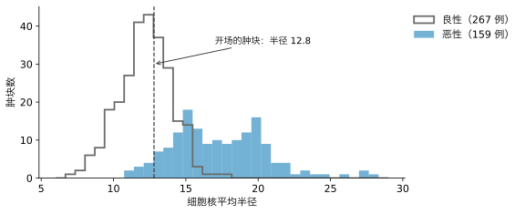
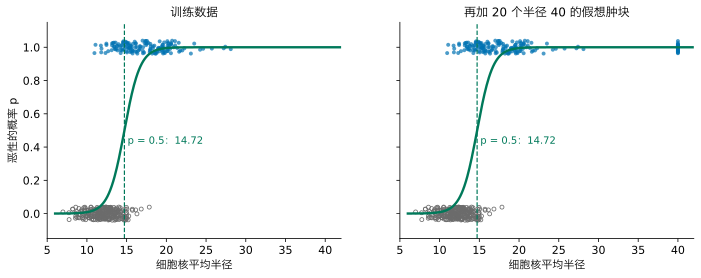
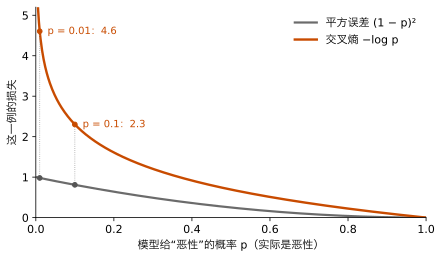
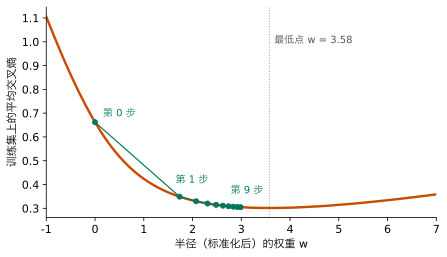
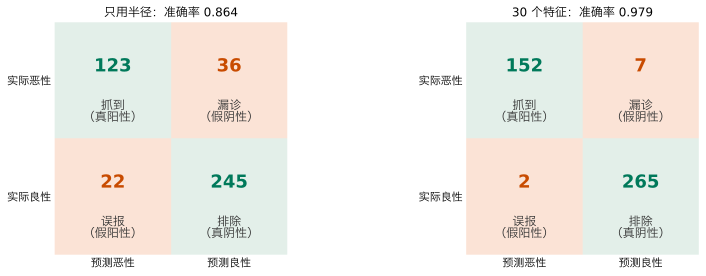
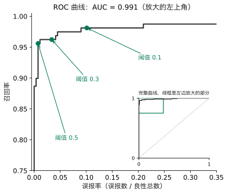
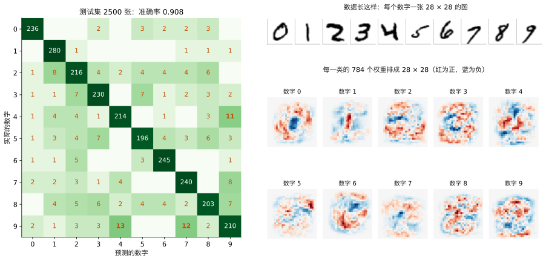
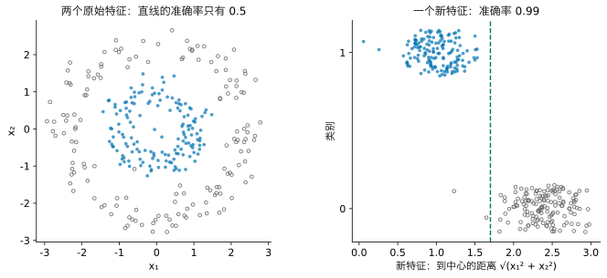
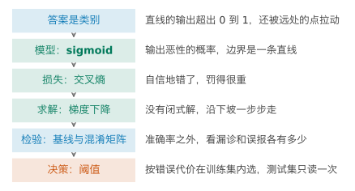

## 1. 动机：答案变成了类别

前两讲的问题都是“预测一个数”：一辆车的油耗是多少 mpg。很多现实问题要的不是一个数，而是一个判断：这封邮件是不是垃圾邮件？这笔贷款会不会违约？这张图上的手写数字是几？答案是有限几个**类别**中的一个，这类问题叫**分类**（classification）。只有两个类别时，叫**二分类**。

本讲的例子来自医学诊断。乳腺上发现一个肿块，医生用细针抽取少量细胞，在显微镜图像上测量细胞核的大小、纹理、形状。我们有 569 个肿块的记录，每个有 30 个测量值，以及病理检查得出的结论：恶性（212 个）或良性（357 个）。我们把要找的那一类，恶性，记为 1，良性记为 0。

先只看一个测量值：**细胞核平均半径**（下文简称半径，单位是图像上的长度单位）。有一个肿块的半径是 12.8。它该让人担心吗？

数据按 3:1 分成训练集（426 个）和测试集（143 个）。这里多做了一件事，叫**分层**（stratify）：让两部分里恶性的比例相同（都约为 37%）。类别不多时，随机划分可能让某一类在测试集里偏多或偏少，分层避免了这一点。测试集和上一讲一样，留到最后只读一次。

{fig-alt="两组直方图，良性集中在半径 10 到 14，恶性集中在 14 到 22，在 12 到 16 之间有大片重叠"}

两类在 12 到 16 之间大片重叠。半径 12.8 处，良性多，但也有恶性。所以“这个肿块是不是恶性”没有一个确定的答案，更合理的回答是：**它是恶性的可能性有多大**，再根据这个可能性做决定。

请先想一想：只用前两讲的工具，你会怎么做？

::: {.callout-note collapse="true" title="展开答案"}
最直接的做法是把标签 0 和 1 当作一个数，用线性回归拟合一条直线，再把预测值大于 0.5 的判为恶性。下一节就这样做，看看会出什么问题。
:::

**本讲之后你能做到：**遇到答案是类别的问题时，让模型输出概率而不是直接给类别；说清它怎样训练；先和最简单的基线比，再看两种错误各有多少；按错误的代价选定判断的门槛，并只用测试集报告一次。下面沿着五步走：模型、损失、求解各改一次，检验时多出一步“决策”。

## 2. 模型：直线为什么不行

先别急着找新方法，用 Lesson 2 的工具试一试：把标签 0 和 1 当作一个数，拟合一条直线。下面的组件里，你可以自己拖动直线，也可以让最小二乘直线替你找。



请先自己试：有没有一条直线，既贴近上下两排点，又不跑出 0 到 1？最小二乘直线怎样？加入假想肿块后又怎样？

::: {.callout-note collapse="true" title="展开答案"}
找不到。直线要贴近两排点，就必须有坡度，而有坡度的直线迟早会跑出 0 到 1。最小二乘直线在训练集上的预测从 −0.33 到 1.76，16% 的肿块落在 0 到 1 之外，“恶性的可能性是 1.76”没有意义。

加入 20 个半径为 40 的假想肿块后，问题更明显。它们远大于所有真实肿块，显然是恶性，本来不该改变“从哪里开始可疑”的判断。可是直线为了贴近它们而变平，按 0.5 切开的位置从 15.38 挪到了 17.42，原来判为恶性的一些肿块现在被判成良性。
:::

问题不在拟合得不够好，而在**直线这个形状**：它的输出可以是任何数。我们真正想要的，是一个能读成“有多大可能是恶性”的数，也就是 0 到 1 之间的**概率**。

### 2.1 找一个函数，把直线压成概率

直线本身并非一无是处：$z = wx + b$ 给每个肿块一个分数，分数越大越像恶性。缺的只是把这个分数变成概率的最后一步。所以我们保留直线，再找一个**压缩函数**，把任何 $z$ 变成 0 到 1 之间的数。

去找之前，先想清楚它应该满足什么。请先自己列几条。

::: {.callout-note collapse="true" title="展开参考答案"}
1. 输出总在 0 到 1 之间，才能读成概率；
2. $z$ 越大，输出越大（越像恶性，概率越高）；
3. $z = 0$ 时输出 0.5，也就是“拿不准”；远离 0 时越来越确定，离得再远也只是更接近 0 或 1；
4. 处处平滑：参数改一点，输出也只改一点。后面要一步一步地调参数，这一条必不可少。
:::

下面的组件给出三个候选，左边是函数本身，右边是用它之后模型在数据上画出的曲线。



请先逐个试：三个候选各违反了哪条要求？

::: {.callout-note collapse="true" title="展开答案"}
**截断**（小于 0 的变成 0，大于 1 的变成 1）满足第 1、2 条，但两端有折角，不平滑（违反第 4 条）；它在 $z = 0$ 时输出 0 而不是 0.5，折角之外又一下子变成 0 或 1，说不出“有多确定”（违反第 3 条）；而且中间那条直线仍要靠最小二乘去拟合，远处的点照样拉动它。**阶跃**（$z > 0$ 就输出 1，否则 0）只有 0 和 1 两个值，说不出“有多确定”（违反第 3 条），参数改一点输出要么不变、要么突然跳（违反第 4 条）。只有 **S 形**曲线四条都满足。
:::

满足这四条、最常用的函数是

$$
\textcolor{#00795A}{p} = \sigma(z) = \frac{1}{1+e^{-z}} ,
$$

叫 **sigmoid**。可以逐条核对：$e^{-z}$ 总是正数，所以 $p$ 在 0 和 1 之间；$z$ 越大，$e^{-z}$ 越小，$p$ 越大；$z = 0$ 时 $e^{0} = 1$，$p = 0.5$；$z$ 很大时 $p$ 接近 1，很负时接近 0；它处处可导。$p$ 读作“模型认为这个肿块是恶性的概率”。

“直线，再经过 sigmoid”这个模型叫 **logistic regression**。名字里有 regression，但它做的是分类：它回归的是概率。现在回头检验第 3 条要求：

{fig-alt="两幅图，S 形曲线几乎相同，边界都在 14.72"}

加入 20 个远处的肿块后，边界仍在 14.72。原因是：对这些肿块，模型已经给出了接近 1 的概率，它们不再要求曲线改变。

有多个特征时，线性组合就是 Lesson 2 的多元线性模型，只是把截距 $w_0$ 单独写成 $b$：$z = w_1x_1 + w_2x_2 + \dots + w_dx_d + b = \mathbf w^\top\mathbf x + b$，其余不变。

本讲用到的记号，与前几讲对照：

| 记号 | 本讲的意思 | 前几讲 |
|---|---|---|
| $p$ | 模型给“恶性”的概率 | Lesson 2、3 用 $p$ 表示特征个数 |
| $d$ | 特征个数 | Lesson 2、3 里的 $p$ |
| $n$ | 样本个数 | 相同 |
| $z$ | 线性部分 $\mathbf w^\top\mathbf x + b$，即分数 | Lesson 3 的 $z$ 表示标准化后的值 |
| $\mathbf w$、$b$ | 权重与截距 | Lesson 2 把截距记作 $w_0$，并入 $\mathbf w$ |
| $t$ | 阈值（Section 7） | 新出现 |
| `C` | sklearn 的惩罚强度参数，越小惩罚越强 | 作用与 Lesson 3 的 $\lambda$ 相反 |

scikit-learn 的 `LogisticRegression` 默认还在损失里加了一点 Ridge 式的惩罚（Lesson 3）。本讲的数字都用这个默认设置，它的作用在 Section 6 再说。

## 3. 模型的读法：决策边界

两个特征时，可以把每个肿块画在平面上。下面的组件用半径和纹理（细胞核图像灰度的标准差）两个特征，都已标准化（Lesson 3）。拖动三个滑块，改变 $w_1$、$w_2$、$b$。



请先观察：绿线是什么形状？$w_1$、$w_2$ 和 $b$ 分别管什么？

::: {.callout-note collapse="true" title="展开答案"}
不管怎样拖，绿线始终是一条直线。改变 $w_1$、$w_2$ 时，线绕着转，方向改变；改变 $b$ 时，线平移。把 $w_1$、$w_2$、$b$ 按同一比例放大，线的位置不变，但绿色的过渡变得更陡。
:::

绿线叫**决策边界**：线的一侧判为恶性，另一侧判为良性。它为什么一定是直线？因为 $p = 0.5$ 恰好对应 $z = 0$：

$$
p \ge 0.5 \iff z = w_1x_1 + w_2x_2 + b \ge 0 .
$$

$w_1x_1 + w_2x_2 + b = 0$ 是平面上的一条直线。有 $d$ 个特征时，它是 $d$ 维空间里的一个平面（超平面）。所以 logistic regression 的边界总是“直的”，这一点在 Section 9 会成为它的局限。

$z$ 本身也有含义。由 $p = \sigma(z)$ 可以解出

$$
z = \log\frac{p}{1-p} .
$$

$\frac{p}{1-p}$ 是“恶性对良性的赔率”，$z$ 是它的对数，叫 **log-odds**。所以 logistic regression 是在用线性模型预测 log-odds：$x_1$ 增加 1，log-odds 增加 $w_1$。

## 4. 损失：为什么不用平方误差

模型有了，下一步是定义什么样的 $w$、$b$ 算好。Lesson 2 用平均平方误差。这里也可以用：每个肿块的误差是 $(y-p)^2$。看看它怎样对待错误。

假设一个肿块实际是恶性（$y = 1$），模型给出不同的 $p$：

| 模型给出的 $p$ | 0.9 | 0.5 | 0.1 | 0.01 | 0.0001 |
|---|---:|---:|---:|---:|---:|
| 平方误差 $(1-p)^2$ | 0.01 | 0.25 | 0.81 | 0.98 | 1.00 |

$p = 0.01$ 意味着模型几乎肯定它是良性，这是很自信的错误；$p = 0.1$ 是不太自信的错误。平方误差对两者罚得差不多（0.98 和 0.81），而且再错也最多罚 1。

请先想：怎样让很自信的错误付出大得多的代价？

::: {.callout-note collapse="true" title="展开答案"}
让罚分在 $p$ 接近 0 时迅速变大，$p \to 0$ 时趋于无穷。对数正好有这个性质：$-\log p$ 在 $p = 1$ 时为 0，$p$ 越小越大，$p \to 0$ 时趋于无穷。
:::

实际是恶性时，罚 $-\log p$；实际是良性时，模型给“良性”的概率是 $1-p$，罚 $-\log(1-p)$。两种情况合成一个式子，对所有样本取平均：

$$
\textcolor{#C84B00}{L(\mathbf w, b)} = -\frac{1}{n}\sum_{i=1}^{n}\Big[\, y_i \log p_i + (1-y_i)\log(1-p_i) \Big],\qquad p_i = \sigma(\mathbf w^\top\mathbf x_i + b).
$$

$y_i = 1$ 时第二项为 0，只剩 $-\log p_i$；$y_i = 0$ 时第一项为 0，只剩 $-\log(1-p_i)$。这个损失叫**交叉熵**（cross-entropy），也叫 log loss。

| 模型给出的 $p$ | 0.9 | 0.5 | 0.1 | 0.01 | 0.0001 |
|---|---:|---:|---:|---:|---:|
| 平方误差 | 0.01 | 0.25 | 0.81 | 0.98 | 1.00 |
| 交叉熵 $-\log p$ | 0.11 | 0.69 | 2.30 | 4.61 | 9.21 |

{fig-alt="两条下降曲线，平方误差最大为 1，交叉熵在 p 接近 0 时急剧上升"}

还有一种读法：$-\log p_i$ 是“模型给真实答案的概率”取负对数。交叉熵小，就是模型给真实答案的概率大。Advanced Study 3 会从这个角度再看一次。

## 5. 求解：没有正规方程了

Lesson 2 求解线性回归时，令损失对参数的导数为 0，得到正规方程，一步算出答案。这里照做，对 $w_j$ 求导（推导见 Advanced Study 1）：

$$
\frac{\partial L}{\partial w_j} = \frac{1}{n}\sum_{i=1}^{n}(p_i-y_i)\,x_{ij} .
$$

其中 $x_{ij}$ 是第 $i$ 个肿块的第 $j$ 个特征，$p_i$ 是模型给它的恶性概率。令它为 0，困难在于 $p_i = \sigma(\mathbf w^\top\mathbf x_i + b)$：$\mathbf w$ 藏在 sigmoid 里面，没法像正规方程那样把 $\mathbf w$ 单独解出来。**没有闭式解。**

下图只看一个特征（标准化后的半径），把 $b$ 固定在最好的值，画出交叉熵随 $w$ 的变化。

{fig-alt="一条先降后缓升的曲线，绿点从左上沿曲线向最低点移动，步子越来越小"}

请先想：解不出来时，怎样一步步走到最低点？

::: {.callout-note collapse="true" title="展开答案"}
站在当前的 $w$，看曲线往哪边下降，就往那边挪一点，再看，再挪。坡越陡，挪得越多；接近谷底，坡变平，挪得就少。
:::

这个办法叫**梯度下降**（gradient descent）。导数（多个参数时是**梯度**）指向上坡的方向，所以沿它的反方向走：

$$
w_j \leftarrow w_j-\eta\,\frac{\partial L}{\partial w_j} = w_j-\eta\,\frac{1}{n}\sum_{i=1}^{n}(p_i-y_i)\,x_{ij} .
$$

$\eta$ 是每一步的大小，叫**学习率**。梯度的形式很好读：每个样本的“预测概率减真实标签”，乘以它的输入，再平均。预测得准的样本，$p_i-y_i$ 接近 0，几乎不推动参数。

图 F5 用 $\eta = 5$，从 $w = 0$ 出发，第一步就走到 1.73，之后坡变缓，步子越来越小，9 步后到 2.99。交叉熵只有一个谷底（数学上叫**凸**函数），所以只要步子合适，一直走下去就会到达最低点。

scikit-learn 用的是比这更快的迭代方法（默认叫 `lbfgs`），思路相同：从一个起点出发，反复改进，直到改不动为止。它最多走 `max_iter` 步（默认 100 步）。没走到底就停下时，会给出 `ConvergenceWarning`。常见原因有两个：特征的尺度相差太大（Lesson 3 的标准化可以解决），或者特征很多、步数不够（把 `max_iter` 调大）。

## 6. 检验：准确率会骗人

模型能训练了，下一步是检验。测试集要留到最后，那么现在用什么检验？用 Lesson 3 的交叉验证：把 426 个训练样本分成 5 份，每次用 4 份训练、对剩下 1 份做预测，轮完一圈，每个样本都得到一个“它没参与训练时”的预测。scikit-learn 里这叫 `cross_val_predict`。分份之前先把样本顺序打乱，以免原数据的排列方式（例如按采集时间）让某一份特别偏。下面的数字都来自这样的预测。

只用半径一个特征，按 $p \ge 0.5$ 判为恶性，**准确率**（判对的比例）是 0.864。

请先想：0.864 算好吗？

::: {.callout-note collapse="true" title="展开答案"}
要先有比较的对象。最笨的办法是不看任何特征，永远猜训练集里多的那一类，也就是“良性”。它的准确率是 267 / 426 = 0.627。0.864 比它好，但好得没有第一眼看上去那么多。而且准确率没有告诉我们：错的那些是哪一种错？
:::

“永远猜多数类”叫**多数类基线**（majority baseline）。任何分类器都应先和它比。类别越不平衡，它的准确率越高：如果一种病的患病率是 1%，“永远猜健康”的准确率就是 99%，却一个病人也找不到。

### 6.1 混淆矩阵

二分类有两种错法：把恶性判成良性（**漏诊**），把良性判成恶性（**误报**）。把判对、判错按实际类别和预测类别分开数，排成一张 2×2 的表，叫**混淆矩阵**（confusion matrix）。

{fig-alt="两张二乘二表格，左边漏诊 36 误报 22，右边漏诊 7 误报 2"}

四个格子各有名字（把恶性叫“阳性”）：

- **真阳性**（TP）：实际恶性，判为恶性。左图 123 个。
- **假阴性**（FN）：实际恶性，判为良性，即漏诊。左图 36 个。
- **假阳性**（FP）：实际良性，判为恶性，即误报。左图 22 个。
- **真阴性**（TN）：实际良性，判为良性。左图 245 个。

由这四个数可以算两个常用的比例：

$$
\text{召回率（recall）} = \frac{TP}{TP+FN} = \frac{123}{159} = 0.774, \qquad
\text{精确率（precision）} = \frac{TP}{TP+FP} = \frac{123}{145} = 0.848 .
$$

**召回率**回答：所有恶性的里面，找到了多少？**精确率**回答：判为恶性的里面，有多少真是恶性？只用半径时，159 个恶性里漏掉了 36 个，召回率只有 0.774。

请先想：怎样才能少漏一些？

::: {.callout-note collapse="true" title="展开答案"}
有两个方向。一是让模型本身更好，例如多用几个特征；二是不改模型，降低判为恶性的门槛，例如 $p \ge 0.3$ 就判为恶性。先看第一个方向，第二个留到下一节。
:::

### 6.2 用全部 30 个特征

30 个测量值的尺度相差很大：半径在 7 到 28 之间，面积在 143 到 2501 之间，光滑度在 0.05 到 0.16 之间。直接拟合，`lbfgs` 在默认的 100 步内走不到底，会给出 `ConvergenceWarning`。按 Lesson 3 的做法先标准化（平均值和标准差只用训练集算），问题就消失了。

标准化之后，那个默认的惩罚也公平了。scikit-learn 用参数 `C` 控制它，作用与 Lesson 3 的 $\lambda$ 相反：`C` 越小，惩罚越强（大致相当于 $1/\lambda$，具体换算差一个常数因子，见 Advanced Study 2）。乳腺肿块上一直用默认的 `C = 1`。

用 30 个特征，交叉验证的准确率是 0.979，漏诊从 36 个降到 7 个，误报从 22 个降到 2 个（图 F6 右）。召回率 0.956，精确率 0.987。

## 7. 决策：阈值是一个选择

到目前为止，我们一直用 $p \ge 0.5$ 判为恶性。上一节留下的第二种办法是：不改模型，改这条 0.5 的线。

它在图上是什么？把每个训练肿块按模型算出的 $z$ 摆在横轴上，S 形曲线把 $z$ 压成概率 $p$。$p \ge 0.5$ 就是曲线上的一个高度，它对应横轴上的一条竖线：竖线右边判为恶性。下面的组件里，你可以拖动这个高度，竖线会跟着左右移动，被判错的肿块画上橙圈。



请先拖一拖：如果你是医院，漏诊是最糟的结果，竖线该往哪边推？推过去，得到什么、付出什么？

::: {.callout-note collapse="true" title="展开答案"}
往左推。竖线左移，原来在线左边的恶性肿块（橙圈蓝点）被划到右边，漏诊变少；但也有更多良性肿块（灰圈）被划进来，误报变多。漏诊一个恶性肿块，病人可能错过治疗；误报一个良性肿块，代价是多做一次检查和几天的焦虑。漏诊的代价大得多，所以值得往左推。
:::

这条线叫**阈值**（threshold）。它不是模型的一部分，是我们做决定时的选择。三个阈值下的数字（30 个特征，训练集的交叉验证概率）：

| 阈值 | 漏诊（FN） | 误报（FP） | 召回率 | 精确率 | 准确率 |
|---:|---:|---:|---:|---:|---:|
| 0.5 | 7 | 2 | 0.956 | 0.987 | 0.979 |
| 0.3 | 6 | 9 | 0.962 | 0.944 | 0.965 |
| 0.1 | 3 | 27 | 0.981 | 0.852 | 0.930 |

漏诊优先，就选 0.1：漏诊从 7 个降到 3 个，代价是误报从 2 个增加到 27 个。注意准确率反而从 0.979 降到 0.930。准确率把两种错误当成一样重，而这里它们不一样重。

阈值由**错误代价**决定，不同的问题选法相反。癌症筛查，漏诊代价大，阈值调低；垃圾邮件过滤，把一封重要邮件误判为垃圾（误报）比漏过一封垃圾邮件更糟，阈值调高。同一个模型，用在不同的场景，阈值可以不同。

### 7.1 ROC 曲线

把每个阈值下的“误报率”（误报数除以良性总数）和召回率画成一个点，阈值从 1 降到 0，这些点连成一条曲线，叫 **ROC 曲线**。它把所有阈值放在一张图上：曲线越贴近左上角，说明可以在误报很少的同时找到大部分恶性。

{fig-alt="一条贴近左上角的曲线，标出阈值 0.5、0.3、0.1 三个点"}

曲线下的面积叫 **AUC**，本例是 0.991。它有一个直观的读法：随机抽一个恶性和一个良性，模型给恶性那个的概率更高的可能性。0.5 等于瞎猜，1 是完全分开。AUC 衡量的是模型把两类排开的能力，与选哪个阈值无关；真正用的时候，仍要选一个阈值。

### 7.2 在测试集上读一次

阈值 0.1 是在训练集内部选的。所有选择都做完了，现在才打开测试集：用全部 426 个训练样本标准化并拟合，对 143 个测试样本算概率，按 0.1 判断。

测试集里 53 个恶性，漏诊 0 个；90 个良性，误报 11 个。准确率 0.923。作为对照，如果按 0.5 判断，会漏诊 2 个、误报 0 个、准确率 0.986，但这个数字不是我们选定的方案，只用来说明代价：多了 11 次误报，换来少漏 2 个恶性。

## 8. 不止两类：手写数字

很多分类问题不止两类。作业 2 要识别 0 到 9 的手写数字（MNIST），是 10 类。这里用课程准备的 MNIST 子集看看 logistic regression 怎样推广：从 MNIST 里固定取出的 1 万张手写数字，每张 28×28 = 784 个像素，每个像素是 0 到 255 的灰度值。按同样的方式分层划分，训练 7500 张，测试 2500 张。

**模型。**每一类各有一组权重，算出 10 个分数 $z_0, \dots, z_9$，分数越大越像那一类。现在要的不是一个概率，而是 10 个概率，而且加起来要等于 1。

请先想：怎样把 10 个可正可负的分数变成 10 个加起来为 1 的正数，并且分数越大、概率越大？

::: {.callout-note collapse="true" title="展开答案"}
两步。先让每个分数变成正数，并保持大小顺序：取 $e^{z_k}$。再除以它们的总和，让它们加起来为 1。
:::

写出来就是

$$
p_k = \frac{e^{z_k}}{e^{z_0} + e^{z_1} + \dots + e^{z_9}} .
$$

这个函数叫 **softmax**，两类时它就是 sigmoid。预测取概率最大的那一类。损失仍是交叉熵：对每张图，罚 $-\log(\text{给真实数字的概率})$。scikit-learn 的 `LogisticRegression` 遇到多类会自动这样做，只需要注意三点：像素值先除以 255，缩放到 0 到 1 之间（作用和标准化一样）；784 个特征、10 类，默认的 100 步不够，把 `max_iter` 调到 1000；784 个权重一类、样本又不算多，权重容易被噪声带偏，所以加一点正则化（Lesson 3）。`LogisticRegression` 的参数 `C` 管正则化的强弱：$C$ 越小，正则化越强，默认是 1。和 Lesson 3 选 λ 一样，在训练集上做 5 折交叉验证，从 1、0.3、0.1、0.03、0.01 里选：0.1 最好（0.901，默认的 1 是 0.889），而且不在两端。

```python
import urllib.request                        # to download a file
import numpy as np
from sklearn.model_selection import train_test_split
from sklearn.linear_model import LogisticRegression

DATA_URL = "https://raw.githubusercontent.com/wayXing/mps311-439-course-materials/main/lecture-slids/lessons/data/mnist10k.npz"
urllib.request.urlretrieve(DATA_URL, "mnist10k.npz")   # the course MNIST subset, about 1.6 MB
mnist = np.load("mnist10k.npz")              # the file holds two arrays, X and y
X_digits = mnist["X"] / 255                  # 784 pixels per image, scaled to 0 to 1
y_digits = mnist["y"]                        # the digit, 0 to 9
X_digits_train, X_digits_test, y_digits_train, y_digits_test = train_test_split(
    X_digits, y_digits, test_size=0.25, random_state=0, stratify=y_digits)   # 7500 to train, 2500 to test
digit_model = LogisticRegression(max_iter=1000, C=0.1) # more steps; C = 0.1 chosen by cross-validation
digit_model.fit(X_digits_train, y_digits_train)        # softmax and cross-entropy happen inside
print(digit_model.score(X_digits_test, y_digits_test)) # accuracy on the test images
```

作业 2 用全部 MNIST（6 万张训练图），做法相同：除以 255，`max_iter` 调大。

**检验。**多数类基线（永远猜训练集里最多的数字，即 1）的测试准确率只有 0.114。Logistic regression 的测试准确率是 0.908（默认 $C = 1$ 时是 0.902）。混淆矩阵变成 10×10：行是实际数字，列是预测数字，对角线以外是错误。

{fig-alt="左边是十乘十的矩阵，对角线深绿；右上是十张手写数字原图，右下是十张 28 乘 28 的红蓝权重图，数字 0 的图中间一块深蓝、外面一圈红"}

最常见的错误是把 9 认成 4，有 13 次；其次是 9 认成 7（12 次）、4 认成 9（11 次）：上面闭合的 9、上面开口的 4 和带钩的 7，写起来很像。右边的图把每一类的 784 个权重按像素位置排开：某个位置有墨水时，那里的权重越红，这一类的 $z$ 越大；越蓝，$z$ 越小。数字 0 的图中间是一块深蓝，外面一圈红，正是一个“0”的形状：中间有墨水的图不太像 0。权重图告诉我们模型在“看”哪里。正则化让这些图变得清楚：默认的 $C = 1$ 时，权重被训练图里的噪声带偏，图上全是零碎的红蓝点。

## 9. 直线边界的局限

Section 3 说过，logistic regression 的边界总是直的。如果两类的分布本身不是一条直线能分开的呢？

{fig-alt="左图一个点团被一圈点包围；右图两类在横轴上分成左右两堆"}

这是 Lesson 3 的老办法：模型不够用时，造新特征。“到中心的距离” $\sqrt{x_1^2 + x_2^2}$ 写进模型后，边界在新特征上是直的，回到原来的平面上就是一个圆。前提是，我们得先想到这个特征。

## 10. 实现：用 scikit-learn 完成

下面按本讲的顺序一步一步写。代码只用最基础的写法，每一步对应一节。

**第一步，读数据并分层划分（Section 1）：**

```python
from sklearn.datasets import load_breast_cancer
from sklearn.model_selection import train_test_split

data = load_breast_cancer()                  # 569 lumps, 30 measurements each
X = data.data                                # the 30 features
y = 1 - data.target                          # sklearn uses 0 = malignant; we want 1 = malignant
X_train, X_test, y_train, y_test = train_test_split(
    X, y, test_size=0.25, random_state=0, stratify=y)   # keep the same share of malignant in both parts
```

**第二步，标准化（Section 6.2）：**

```python
from sklearn.preprocessing import StandardScaler

scaler = StandardScaler()                    # mean and standard deviation from training data only
X_train_s = scaler.fit_transform(X_train)    # learn them and scale the training set
X_test_s = scaler.transform(X_test)          # scale the test set the same way
```

**第三步，交叉验证的概率与混淆矩阵（Section 6）：**

```python
from sklearn.linear_model import LogisticRegression
from sklearn.model_selection import KFold, cross_val_predict
from sklearn.metrics import confusion_matrix

model = LogisticRegression()                 # sigmoid model, trained with cross-entropy
kf = KFold(5, shuffle=True, random_state=0)  # 5 folds; shuffle first, because the rows may be in some order
prob_both = cross_val_predict(model, X_train_s, y_train, cv=kf, method="predict_proba")  # each row predicted by a model that did not see it
prob = prob_both[:, 1]                       # column 1 is the probability of malignant
pred = (prob >= 0.5).astype(int)             # threshold 0.5: 1 = malignant, 0 = benign
print(confusion_matrix(y_train, pred, labels=[1, 0]))   # rows: actual malignant, actual benign
```

输出是 `[[152 7] [2 265]]`：第一行是实际恶性（抓到 152、漏诊 7），第二行是实际良性（误报 2、排除 265）。`labels=[1, 0]` 让恶性排在前面，与图 F6 的排法一致。

**第四步，选定阈值后，在测试集上读一次（Section 7）：**

```python
model.fit(X_train_s, y_train)                # train on all 426 training lumps
prob_both_test = model.predict_proba(X_test_s)   # two columns: benign, malignant
prob_test = prob_both_test[:, 1]             # column 1 is the probability of malignant
pred_test = (prob_test >= 0.1).astype(int)   # the threshold chosen inside the training set
print(confusion_matrix(y_test, pred_test, labels=[1, 0]))   # read the test set once
```

输出是 `[[53 0] [11 79]]`。注意 `model.predict` 总是用 0.5 作阈值，要用别的阈值，就像这里一样从 `predict_proba` 自己判断。

## 11. 一页回顾

如果只读一页，读这里。

{fig-alt="六个步骤的竖向流程图"}

| 你看到的问题 | 可以做什么 | 用什么证据判断 |
|---|---|---|
| 答案是类别，不是一个数 | 输出概率：logistic regression，$p = \sigma(\mathbf w^\top\mathbf x + b)$ | 输出在 0 到 1 之间，边界不被远处的点拉动 |
| 需要定义什么样的参数算好 | 交叉熵：自信的错误罚得很重 | 训练集上的交叉熵下降 |
| 没有闭式解 | 梯度下降或其他迭代方法；不收敛时先标准化，再加大 `max_iter` | 不再出现 `ConvergenceWarning` |
| 不知道模型好不好 | 先和多数类基线比，再看混淆矩阵、召回率、精确率 | 训练集内的交叉验证预测 |
| 两种错误代价不同 | 在训练集内按代价选阈值；ROC 看全部阈值 | 漏诊数与误报数；测试集只读一次 |
| 不止两类 | softmax，10×10 混淆矩阵 | 与多数类基线比较，看哪两类最常混淆 |

## 12. 总结与局限

回到开场那个肿块：半径 12.8，病理结论是恶性。测试集里还有一个更小的肿块，半径 11.4，也是恶性。

| 肿块 | 方案 | 给“恶性”的概率 | 阈值 0.5 | 阈值 0.1 |
|---|---|---:|---|---|
| 半径 12.8（开场） | 只用半径 | 0.122 | 判为良性（漏诊） | 判为恶性（找到） |
| 半径 12.8（开场） | 30 个特征 | 0.116 | 判为良性（漏诊） | 判为恶性（找到） |
| 半径 11.4 | 只用半径 | 0.034 | 判为良性（漏诊） | 判为良性（漏诊） |
| 半径 11.4 | 30 个特征 | > 0.999 | 判为恶性（找到） | 判为恶性（找到） |

开场问的是：这个肿块该让人担心吗？现在的回答不再是看半径大不大，而是：用 30 个测量值给出恶性的概率，再按“漏诊优先”在训练集内选定的阈值 0.1 做决定。两个肿块各说明了一件事。半径 11.4 的那个，只看半径几乎不可能怀疑它，其余 29 个测量值让模型几乎肯定它是恶性：这是改进模型的作用。开场那个，两个模型都只给了约 0.12（0.122 和 0.116），按 0.5 都会漏掉，是降低阈值把它找了回来：这是按代价做决策的作用。这个决定可信的依据是：阈值是在训练集内部、按错误代价选出的；测试集只读了一次。

**迁移题。**一家银行用客户的收入、负债、还款记录等预测一笔贷款会不会违约，违约的约占 5%。请不做计算，回答：多数类基线的准确率大约是多少？混淆矩阵的四个格子各是什么意思？漏掉一个会违约的客户和拒绝一个不会违约的客户，哪种代价更大，阈值应往哪边调？阈值在哪份数据上选？

::: {.callout-note collapse="true" title="参考回答"}
永远猜“不违约”，准确率约 95%，所以 95% 的准确率说明不了什么。阳性是“违约”：真阳性是找到的违约者，假阴性是漏掉的违约者，假阳性是被误判为会违约的好客户，真阴性是正常放贷的好客户。漏掉一个违约者会损失本金，拒绝一个好客户损失的是利息收入，通常前者更大，阈值应调低；但如果误报太多、拒绝了大量好客户，银行的业务也会受损，需要把两种代价都估出来再选。阈值在训练集内部用交叉验证的概率选，测试集只在最后读一次。
:::

**这个方法在哪里不可信。**

1. **概率不一定可以照字面读。**模型说 0.116，不代表这样的肿块里真的有 11.6% 是恶性。默认的惩罚、特征之间的相关，都会让概率偏高或偏低。检查和修正概率的方法叫**校准**（calibration），本讲没有做。
2. **阈值依赖代价，而代价是人定的。**本讲说“漏诊优先”，选了 0.1；把漏诊的代价定为误报的 5 倍还是 50 倍，选出的阈值不同。这是医学和伦理的判断，不是数据能回答的。
3. **数字来自一家医院的 569 个样本。**交叉验证只在这批样本内部可信。换一家医院、换一种显微镜，测量值的分布可能变，阈值也可能要重选。
4. **边界是直的。**Section 9 的环形数据说明，两类不能用一个平面分开时，logistic regression 帮不上忙，除非我们先想到合适的特征。

**回到开头的承诺。**现在，面对一个答案是类别的问题，你可以：让模型输出概率而不是直接给类别；说清 logistic regression 的模型、交叉熵损失和迭代求解；先和多数类基线比较，再用混淆矩阵看两种错误各有多少；按错误代价在训练集内选阈值，并只在测试集上报告一次；把同样的思路推广到多类。

**30 秒反馈。**读完这一讲，请扫码留下匿名反馈或问题：哪里没看懂、哪里讲得太快，都对改进有用。

{fig-align="center" width="160px" fig-alt="反馈二维码"}

*以下是 Advanced Study，不影响主线，每个 Study 可以单独阅读。MPS311 鼓励选读，MPS439 应完成 Study 1 和 Study 2。*

---

## Advanced Study 1：由交叉熵推出梯度

目标是推出 Section 5 的式子

$$
\frac{\partial L}{\partial w_j} = \frac{1}{n}\sum_{i=1}^{n}(p_i-y_i)\,x_{ij} .
$$

**第一步，sigmoid 的导数。**$\sigma(z) = (1+e^{-z})^{-1}$，对 $z$ 求导：

$$
\sigma'(z) = \frac{e^{-z}}{(1+e^{-z})^2} = \frac{1}{1+e^{-z}}\cdot\frac{e^{-z}}{1+e^{-z}} = \sigma(z)\,\big(1-\sigma(z)\big).
$$

最后一步用了 $\frac{e^{-z}}{1+e^{-z}} = 1-\frac{1}{1+e^{-z}}$。

**第二步，一个样本的损失对 $z$ 求导。**记 $\ell = -\big[y\log p + (1-y)\log(1-p)\big]$，$p = \sigma(z)$。由链式法则：

$$
\frac{\partial \ell}{\partial z} = -\Big[\frac{y}{p}-\frac{1-y}{1-p}\Big]\cdot p(1-p) = -\big[y(1-p)-(1-y)p\big] = p-y .
$$

$p(1-p)$ 正好与分母约掉，结果非常简单。

**第三步，对 $w_j$ 求导。**$z = \sum_j w_jx_j + b$，所以 $\frac{\partial z}{\partial w_j} = x_j$，$\frac{\partial z}{\partial b} = 1$。再对 $n$ 个样本取平均：

$$
\frac{\partial L}{\partial w_j} = \frac{1}{n}\sum_{i=1}^{n}(p_i-y_i)\,x_{ij},\qquad \frac{\partial L}{\partial b} = \frac{1}{n}\sum_{i=1}^{n}(p_i-y_i).
$$

写成矩阵形式：$\nabla_{\mathbf w}L = \frac{1}{n}X^\top(\mathbf p-\mathbf y)$。对照 Lesson 2：平均平方误差 $\frac{1}{n}\|X\mathbf w-\mathbf y\|^2$ 的梯度是 $\frac{2}{n}X^\top(X\mathbf w-\mathbf y)$，也是“预测减真实，乘以输入”。区别只在预测：线性回归是 $X\mathbf w$，logistic regression 是 $\sigma(X\mathbf w + b)$。

**为什么令梯度为 0 解不出来。**线性回归的梯度对 $\mathbf w$ 是线性的，令它为 0 得到线性方程组，也就是正规方程。这里 $\mathbf p = \sigma(X\mathbf w + b)$ 对 $\mathbf w$ 是非线性的，令梯度为 0 得到的是非线性方程组，一般没有闭式解。

**为什么只有一个谷底（选读）。**再求一次导，可以得到二阶导数矩阵 $\frac{1}{n}X^\top S X$，其中 $S$ 是对角矩阵，对角元 $p_i(1-p_i) > 0$。对任意向量 $\mathbf v$，$\mathbf v^\top X^\top S X\mathbf v = \sum_i p_i(1-p_i)(\mathbf x_i^\top\mathbf v)^2 \ge 0$，所以交叉熵是凸函数，梯度下降不会困在别的局部最低点。

## Advanced Study 2：自己实现梯度下降

用 Advanced Study 1 的梯度，自己写梯度下降，与 scikit-learn 对照。数据用第 10 节标准化后的 `X_train_s`、`y_train`。

scikit-learn 默认带一点 Ridge 式的惩罚（Section 2.1、6.2），要对得上，自己的版本也得加上同一个惩罚。默认设置 `C = 1` 时，它相当于在交叉熵后面加上 $\frac{1}{2n}\|\mathbf w\|^2$，梯度因此多出一项 $\frac{1}{n}\mathbf w$（$b$ 不受惩罚）。一般地，scikit-learn 最小化的是 $\frac12\|\mathbf w\|^2 + C\sum_i(\text{第 } i \text{ 个样本的交叉熵})$；换成 Lesson 3 Ridge 的写法（误差之和加 $\lambda\|\mathbf w\|^2$），就是 $\lambda = \frac{1}{2C}$，这就是 Section 6.2 说的那个常数因子。

```python
import numpy as np

n, d = X_train_s.shape                       # 426 lumps, 30 features
w = np.zeros(d)                              # start from all weights 0
b = 0.0
lr = 0.5                                     # learning rate
for step in range(5000):
    z = X_train_s @ w + b                    # linear part for every lump
    p = 1 / (1 + np.exp(-z))                 # sigmoid: probability of malignant
    grad_w = X_train_s.T @ (p - y_train) / n + w / n   # cross-entropy gradient plus the penalty term
    grad_b = np.mean(p - y_train)            # gradient for the intercept (no penalty)
    w = w - lr * grad_w                      # one step downhill
    b = b - lr * grad_b
```

与默认设置的 scikit-learn 比较：

```python
ref = LogisticRegression().fit(X_train_s, y_train)   # default: C = 1
print(np.abs(w - ref.coef_[0]).max())        # largest difference between the two sets of weights
```

两组权重最大相差约 0.016（最大的权重约 1.24）。差别来自 scikit-learn 的停止规则：它在改进足够小时就停下。

接下来请自己做：

1. 每 100 步记一次训练集上的交叉熵，画出它随步数的变化。它是否一直下降？
2. 把学习率换成 0.05 和 5，比较曲线。太小和太大各会怎样？
3. 几乎去掉惩罚：自己的版本删掉 `+ w / n`，scikit-learn 用 `LogisticRegression(C=1e6, max_iter=10000)`（`C` 越大惩罚越弱，`C` 很大就是惩罚几乎为 0）。最大的权重会变成多少（scikit-learn 给出约 260）？它在训练集上的准确率是 1.0：30 个特征下，两类在训练集上可以完全分开。既然能完全分开，交叉熵怎样才能一直变小？这和 Lesson 3 的系数爆炸有什么关系？

## Advanced Study 3：开放问题

下面四个问题本讲没有展开，每个给出一个起点。

1. **交叉熵从哪里来。**把 $p_i$ 当作“这个样本是恶性”的概率，整批训练样本恰好出现的概率是 $\prod_i p_i^{y_i}(1-p_i)^{1-y_i}$。让它最大，叫**最大似然估计**。起点：取对数，再取负号，与交叉熵对照。
2. **校准。**模型说 0.2 的那些样本里，真的有 20% 是恶性吗？起点：把交叉验证概率按 0 到 0.1、0.1 到 0.2……分组，每组算实际恶性的比例，画在横轴为平均概率的图上。查阅 `sklearn.calibration.calibration_curve`。
3. **类别不平衡与 `class_weight`。**`LogisticRegression(class_weight="balanced")` 让少数类的每个样本在损失里占更大的分量。它和“降低阈值”有什么相同、有什么不同？起点：在本讲数据上比较两种做法的漏诊数和误报数。
4. **AUC 的排序读法。**Section 7.1 说 AUC 是“随机抽一个恶性和一个良性，恶性那个概率更高的可能性”。起点：用交叉验证概率，数一数所有（恶性，良性）对里恶性概率更高的比例，与 `roc_auc_score` 的结果对照。
