## A lump with radius 12.8. Should we worry?

::: {.stage}
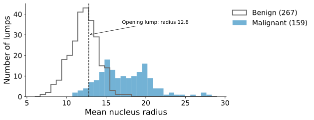{.fig .fig-f1 fig-alt="Histograms of mean nucleus radius for 267 benign and 159 malignant training lumps; they overlap between 12 and 16; a dashed line marks the opening lump at 12.8"}

::: {.ask}
<small>Guess first</small>
Benign or malignant? How sure are you?
:::
:::

::: {.notes}
约 1.5 分钟。数据：569 个乳腺肿块，细针穿刺后在显微镜图像上测细胞核，30 个测量值；病理结论 212 恶性、357 良性。只看一个：细胞核平均半径。分层划分 3:1（两部分恶性比例相同，约 37%），这张图是 426 个训练肿块。让学生猜，并说出有多确定。要点：12.8 处良性多，但也有恶性，没有一刀切的答案。不揭示病理结论，留到结尾。
:::

## [Problem:]{.stg} The answer is a class, not a number

::: {.stage}
::: {.flow .four}
<div><span>spam?</span>yes / no</div>
<div><span>loan?</span>repay / default</div>
<div><span>digit?</span>0, 1, …, 9</div>
<div><span>lump?</span>malignant / benign</div>
:::

::: {.say .center}
**Classification.** Two classes: **1** = the one we look for (malignant), **0** = the other.
:::
:::

::: {.notes}
约 1 分钟。前两讲预测一个数，现在预测一个类别。点名 classification、二分类。正类是我们要找的那一类，这里是恶性，后面的召回率都围着它算。
:::

## What you will be able to do

::: {.stage .tight}
::: {.say .xl}
When the answer is a class, you will **build a model** for it, train it, **check it fairly**, and **turn it into a decision**.
:::

::: {.flow .four}
<div><span>1</span>Model</div>
<div><span>2</span>Loss and solve</div>
<div><span>3</span>Test</div>
<div><span>4</span>Decide</div>
:::
:::

::: {.notes}
约 1 分钟。能力承诺，不点出方法（先让学生在下一页自己试出直线不行）。五步不重讲，只在模型、损失、求解各改一次，检验时多一步决策。念出四段路线。
:::

## [Model:]{.stg} Try the Lesson 2 tool: fit a straight line to 0 and 1

::: {.stage .top}

:::

::: {.notes}
约 3.5 分钟，让学生自己试出“不行”。先请一位学生说怎么拖：能不能让直线既贴近两排点、又不跑出红色区域？拖几次就会发现：有坡度就会跑出 0 到 1，没坡度就贴不近。点“最小二乘直线”：16% 的肿块落在 0 到 1 之外（−0.33 到 1.76），“恶性的可能性 1.76”没有意义。再勾选 20 个半径 40 的假想肿块（真实最大 28.1），再点最小二乘：切开的位置从 15.38 挪到 17.42，最容易判断的肿块反而把边界拉走了。停下来问：问题出在哪？期待：不是拟合得不好，是直线这个形状。
:::

## [Model:]{.stg} What do we actually want?

::: {.stage}
::: {.say .xl .center}
A number we can read as a **probability**: between 0 and 1.
:::

::: {.ask}
<small>Your turn</small>
Keep the line as a score $z=wx+b$. What would a function that squashes any $z$ into 0 to 1 need to do?
:::
:::

::: {.notes}
约 2 分钟。引导学生用概率的思路：直线不是没用，它给每个肿块一个分数 z，越大越像恶性；缺的是把分数变成概率。请学生说出要求，板书四条：输出在 0 到 1；z 越大输出越大；z = 0 时 0.5（拿不准），越远越确定；平滑，参数改一点输出也只改一点（后面要一步步调参数）。下一页拿候选来检验。
:::

## [Model:]{.stg} Find a squashing function

::: {.stage .top}

:::

::: {.notes}
约 3 分钟。三个候选逐个点，每个都问“它违反了哪条要求？”。截断：在 0 到 1 之间了，但中间还是那条直线，远处的点照样拉动，两端有折角。阶跃：只有 0 和 1，说不出有多确定，参数改一点要么不变要么跳，没法一步步调。S 形：四条都满足。这一步就是把答案逆向找出来：先定要求，再挑工具。
:::

## [Model:]{.stg} Line + sigmoid = logistic regression

::: {.stage .tight}
::: {.formula .m2}
$$
z = wx + b,\qquad \textcolor{#00795A}{p}=\sigma(z)=\frac{1}{1+e^{-z}}
$$
:::

::: {.two .wide}
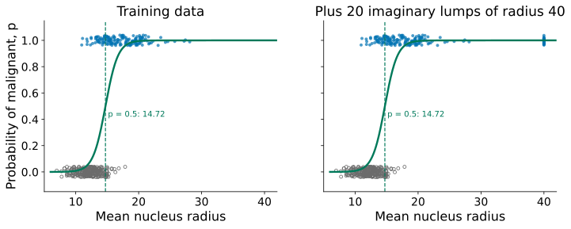{.fig fig-alt="The same data with a logistic regression probability curve; with the 20 far lumps added, the p = 0.5 point stays at 14.72"}

::: {.say}
Far lumps no longer move the boundary: **14.72** both times.
:::
:::
:::

::: {.notes}
约 2 分钟。点名 sigmoid 和 logistic regression：名字里有 regression，回归的是概率。逐条对一下要求：e^(−z) 总为正，所以在 0 和 1 之间；z 越大 p 越大；z = 0 时 p = 0.5。回头检验：加 20 个远处的肿块，边界仍在 14.72，因为模型已经给它们接近 1 的概率，它们不再要求曲线改变。多个特征时 z = wᵀx + b。sklearn 默认带一点 Ridge 式惩罚，Test 段再说。
:::

## [Model:]{.stg} Two features: what shape is the boundary?

::: {.stage .top}

:::

::: {.notes}
约 2.5 分钟。现场拖滑块。先问：绿线是什么形状？w₁、w₂、b 各管什么？只动 w₁、w₂：线转；只动 b：线平移；三者同比例放大：线不动，过渡变陡。可拖到接近拟合值 w₁ = 3.2、w₂ = 0.75、b = −0.68，看准确率升到最高附近。答案在下一页。
:::

## [Model:]{.stg} The decision boundary is a straight line

::: {.stage}
::: {.two .side}
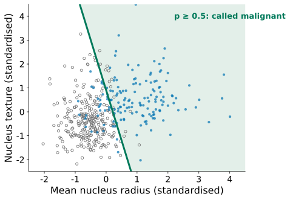{.fig fig-alt="Two standardised features with the fitted logistic regression; the region p at least 0.5 is shaded and its edge is a straight green line"}

::: {.formula .m3}
$$
p \ge 0.5 \iff w_1x_1 + w_2x_2 + b \ge 0
$$
:::
:::

::: {.say .center}
The edge is a line; with $d$ features, a flat plane: the **decision boundary**.
:::
:::

::: {.notes}
约 1.5 分钟。p = 0.5 恰好对应 z = 0，所以边界一定是直的；图是拟合好的模型（w₁ = 3.16、w₂ = 0.75、b = −0.68）。这一点是它的局限：两类不能被一条直线分开时就帮不上忙（Note Section 9 的环形数据）。口头一句 log-odds：z = log(p/(1−p))，p/(1−p) 是恶性对良性的赔率，x₁ 增加 1，log-odds 增加 w₁。不展开，细节在 Note。
:::

## [Loss:]{.stg} Is squared error harsh enough?

::: {.stage}
::: {.two .side}
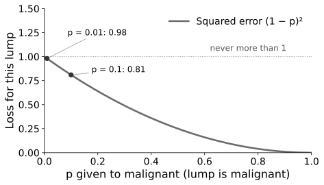{.fig fig-alt="Squared error (1 − p) squared against p for a malignant lump; at p = 0.1 it is 0.81, at p = 0.01 it is 0.98, never above 1"}

::: {.ask}
<small>Your turn</small>
A confident mistake ($p=0.01$) costs about the same as $p=0.1$. What should the curve do?
:::
:::
:::

::: {.notes}
约 1.5 分钟。实际是恶性，模型给 p。平方误差最多罚 1：p = 0.01（很自信地错了）0.98，p = 0.1 0.81，差不多。问：曲线应该怎样？期待：p 越接近 0 罚得越重，趋于无穷；有人会想到对数。
:::

## [Loss:]{.stg} Cross-entropy: a confident mistake costs a lot

::: {.stage .tight}
::: {.formula .m2}
$$
\textcolor{#C84B00}{L}=-\frac{1}{n}\sum_{i=1}^{n}\big[y_i\log p_i+(1-y_i)\log(1-p_i)\big]
$$
:::

::: {.two .side}
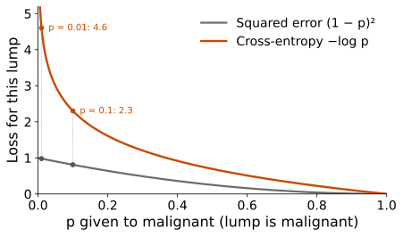{.fig fig-alt="Squared error and cross-entropy against p for a malignant lump; cross-entropy rises sharply as p goes to 0: 2.3 at 0.1 and 4.6 at 0.01"}

::: {.say}
Malignant: pay $-\log p$. Benign: pay $-\log(1-p)$. **Cross-entropy.**
:::
:::
:::

::: {.notes}
约 2 分钟。点名 cross-entropy（也叫 log loss）。y=1 时第二项为 0，只剩 −log p；y=0 时只剩 −log(1−p)。数字：p = 0.1 罚 2.30，0.01 罚 4.61，0.0001 罚 9.21。另一种读法：−log p 是“模型给真实答案的概率”取负对数。
:::

## [Solve:]{.stg} No normal equation this time

::: {.stage}
::: {.two .side}
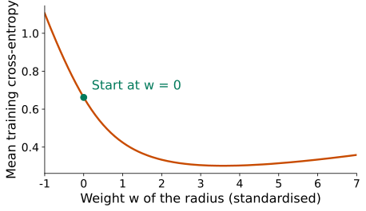{.fig fig-alt="Mean training cross-entropy against the weight of the standardised radius, a smooth valley; a green dot marks the start at w = 0"}

::: {.ask}
<small>Your turn</small>
There is no formula for the bottom. You start at $w=0$. How do you get there?
:::
:::
:::

::: {.notes}
约 2 分钟。导数 (1/n)Σ(p_i − y_i)x_ij 令为 0 解不出来，因为 w 藏在 sigmoid 里（只口头说，推导在 Note 的 Advanced Study 1）。图：一个特征（标准化半径），b 固定在最好的值。问：从 w = 0 出发怎样走到谷底？期待：往下坡方向挪一点，再看。不假设学生做过 Lesson 2 的 Advanced。
:::

## [Solve:]{.stg} Gradient descent: step downhill, again and again

::: {.stage}
::: {.two .side}
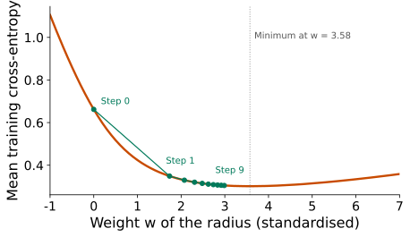{.fig fig-alt="The same valley with ten green steps from w = 0; the first step reaches 1.73, later steps get shorter, step 9 is at 2.99; the minimum is at 3.58"}

::: {}
::: {.formula .m2}
$$
w_j \leftarrow w_j-\eta\,\frac{\partial L}{\partial w_j}
$$
:::

::: {.say}
Steep: big step. Near the bottom: small steps. $\eta$ = **learning rate**.
:::
:::
:::
:::

::: {.notes}
约 2 分钟。点名 gradient descent 和 learning rate。梯度的读法：每个样本“预测概率减真实标签”乘以输入再平均，预测准的样本几乎不推动参数。图用 η = 5：第一步到 1.73，之后变小，9 步后 2.99，最低点 3.58。交叉熵只有一个谷底（凸），步子合适就能到底。sklearn 默认 lbfgs，思路相同，最多 max_iter = 100 步；没走到底会出 ConvergenceWarning。
:::

## [Test:]{.stg} Accuracy 0.864. Is that good?

::: {.stage}
::: {.say .xl .center}
Radius only, threshold 0.5, cross-validated: **0.864**
:::

::: {.say .center}
<small>**Test** here means checking the model with cross-validation on the training set. The test set itself is read once, at the end.</small>
:::

::: {.ask}
<small>Your turn</small>
Good compared with what?
:::
:::

::: {.notes}
约 1 分钟。测试集留到最后，所以检验用 Lesson 3 的交叉验证：5 折，每个样本得到“它没参与训练时”的预测（cross_val_predict，分份前先打乱）。期待有人说“和瞎猜比”。
:::

## [Test:]{.stg} Always guess benign: 0.627

::: {.stage}
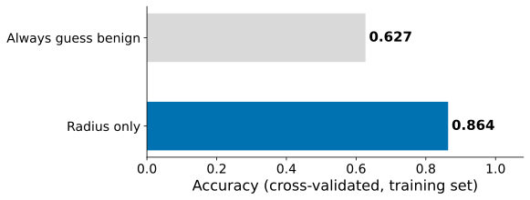{.fig .fig-s16 fig-alt="Bar chart of accuracy: always guess benign 0.627, radius only 0.864"}

::: {.say .center}
Never looking at the lump already scores 0.627: the **majority baseline**.
:::
:::

::: {.notes}
约 1 分钟。267/426 = 0.627。0.864 比它好，但没有第一眼看上去那么多。患病率 1% 时“永远猜健康”有 0.99。类别越不平衡，这个基线越高，单看准确率说明不了什么。下一页看错在哪里。
:::

## [Test:]{.stg} Confusion matrix: which mistakes?

::: {.stage}
::: {.two .side}
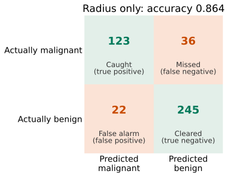{.fig fig-alt="Confusion matrix for radius only: 123 caught, 36 missed, 22 false alarms, 245 cleared"}

::: {}
::: {.formula .m3}
$$
\text{recall}=\frac{TP}{TP+FN}=0.774
$$
$$
\text{precision}=\frac{TP}{TP+FP}=0.848
$$
:::

::: {.ask}
<small>Your turn</small>
36 cancers missed. How could we miss fewer?
:::
:::
:::
:::

::: {.notes}
约 2.5 分钟。点名 confusion matrix 和四个格子：真阳性、假阴性（漏诊）、假阳性（误报）、真阴性。召回率 123/159：恶性里找到多少；精确率 123/145：判为恶性的里面有多少真是。问怎样少漏：学生会给两种答案，多用特征，或者降低门槛。先接住第一种，第二种留到 Decide 段。
:::

## [Test:]{.stg} Use all 30 measurements

::: {.stage}
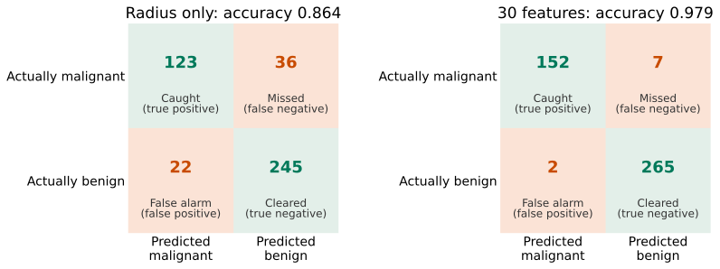{.fig .fig-f6 fig-alt="Two confusion matrices: radius only misses 36 and has 22 false alarms; 30 features miss 7 and have 2 false alarms"}

::: {.say .center}
Missed cancers: **36 → 7**. The 30 measurements are standardised first: their scales differ a lot (Lesson 3).<br><small>Lowering the threshold is the other way to miss fewer: next section.</small>
:::
:::

::: {.notes}
约 2 分钟。30 个测量值尺度相差大（半径 7 到 28，面积 143 到 2501），直接拟合会出 ConvergenceWarning，先按 Lesson 3 标准化。口头一句：sklearn 用 C 控制默认惩罚，C 越小惩罚越强，大致相当于 λ 的倒数，本讲一直用默认 C = 1。准确率 0.979，召回率 0.956，精确率 0.987。
:::

## [Decide:]{.stg} Where would you put the threshold? <small>(30 features)</small>

::: {.stage .top}

:::

::: {.notes}
约 3.5 分钟。先解释图：横轴是模型的 z，S 曲线把它压成概率，阈值是曲线上的一个高度，对应一条竖线，竖线右边判为恶性。橙圈是判错的点。问：你是医院，漏诊最糟，竖线往哪边推？拖给学生看：往左推，橙圈蓝点（漏诊）变少，橙圈灰点（误报）变多。0.5：漏 7 误报 2；0.3：漏 6 误报 9；0.1：漏 3 误报 27。点名 threshold：不是模型的一部分，是我们做决定时的选择。
:::

## [Decide:]{.stg} Three thresholds, side by side

::: {.stage .bigtab}
| threshold | missed cancers | false alarms | recall | precision |
|---:|---:|---:|---:|---:|
| 0.5 | 7 | 2 | 0.956 | 0.987 |
| 0.3 | 6 | 9 | 0.962 | 0.944 |
| 0.1 | **3** | 27 | **0.981** | 0.852 |

::: {.ask}
<small>Your turn</small>
A hospital says a missed cancer is far worse than a false alarm. Which threshold, and what does it cost?
:::
:::

::: {.notes}
约 1.5 分钟。426 个训练肿块，概率来自 5 折交叉验证。阈值降低：漏诊减少，误报增加。医院把漏诊看得更重：选 0.1，漏诊从 7 降到 3，代价是误报从 2 升到 27。阈值是在训练集内选的，测试集还没碰。
:::

## [Decide:]{.stg} The cost of each mistake decides

::: {.stage}
::: {.two .even}
::: {.tile .txt}
**Cancer screening**

A missed cancer is worse → **lower** the threshold
:::

::: {.tile .txt}
**Spam filter**

Losing a real email is worse → **raise** the threshold
:::
:::

::: {.say .center}
Same model, different **threshold**: it is a decision, not part of the model.
:::
:::

::: {.notes}
约 1 分钟。点名 threshold 与 error cost。同一个模型，不同场景阈值不同。回到上一页：漏诊优先，选 0.1，漏诊 7 → 3，误报 2 → 27。
:::

## [Decide:]{.stg} ROC: every threshold on one curve

::: {.stage}
::: {.two .side}
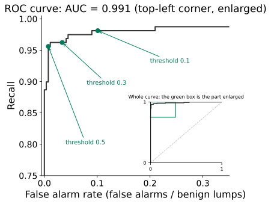{.fig fig-alt="ROC curve, top-left corner only, AUC 0.991, with the thresholds 0.5, 0.3 and 0.1 marked"}

::: {.say}
Each threshold is one point: false alarm rate against recall. This is the **ROC curve**; the area under it is the **AUC** (0.991).
:::
:::
:::

::: {.notes}
约 1 分钟。越贴左上越好。AUC 的读法：随机抽一个恶性一个良性，恶性那个概率更高的可能性；0.5 是瞎猜，1 是完全分开。AUC 不替你选阈值。细节在 Note Section 7.1。
:::

## [Decide:]{.stg} Now, and only now, the test set

::: {.stage}
::: {.say .xl .center}
Threshold **0.1**, chosen inside the training set.
:::

| Test set (143 lumps) | Missed | False alarms |
|---|---:|---:|
| Threshold 0.1 | **0** of 53 | 11 of 90 |
:::

::: {.notes}
约 1.5 分钟。所有选择都做完了才打开测试集，只读一次，接 Lesson 3。准确率 0.923。若按 0.5 会漏 2、误报 0，只用来说明代价：多 11 次检查，多找到 2 个恶性；不能看了测试集再改阈值。
:::

## More than two classes: handwritten digits

::: {.stage}
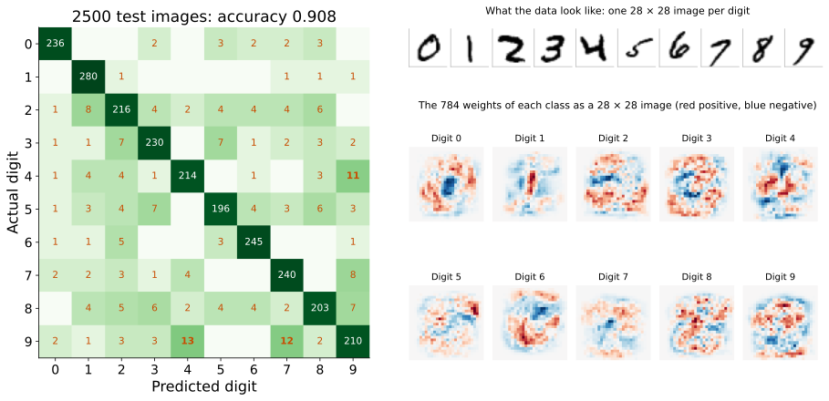{.fig .fig-f7 fig-alt="Left: a 10 by 10 confusion matrix on 2500 test digits of the MNIST subset, accuracy 0.908, most common error 9 read as 4 (13 times). Right: ten 28 by 28 red and blue weight images, one per digit; the 0 has a blue centre and a red ring"}

::: {.say .center}
10 scores → **softmax** $p_k = e^{z_k} / (e^{z_0} + \dots + e^{z_9})$. Baseline 0.114; model **0.908**.<br><small>Code: pixels / 255, `max_iter=1000`, `C=0.1` by cross-validation. A smaller C means a stronger penalty (the opposite of λ).</small>
:::
:::

::: {.notes}
约 2 分钟。课程的 MNIST 子集：1 万张 28×28（7500 训练、2500 测试）。每一类一组权重，softmax 把 10 个分数变成加起来为 1 的概率，两类时就是 sigmoid。代码一样，只要像素除以 255、max_iter 调到 1000；784 个权重一类，加一点正则化（Lesson 3）：C 越小越强，交叉验证在 1 到 0.01 里选出 0.1（0.901，默认 C = 1 是 0.889）。10×10 混淆矩阵：行实际、列预测，最多的错误把 9 认成 4（13 次）。权重图：数字 0 中间蓝、外圈红；默认 C = 1 时这些图全是噪点。作业 2 第 1 节用全部 MNIST 做同样的事。
:::

## Today in code

::: {.stage}
```python
scaler = StandardScaler()                            # mean and SD: training lumps only
X_train_s = scaler.fit_transform(X_train)            # learn and scale
X_test_s = scaler.transform(X_test)                  # same scaling for the test lumps

model = LogisticRegression()                         # sigmoid + cross-entropy
kf = KFold(5, shuffle=True, random_state=0)          # 5 folds inside the training set
prob_both = cross_val_predict(model, X_train_s, y_train, cv=kf,
                              method="predict_proba")  # unseen by its model
prob = prob_both[:, 1]                               # probability of malignant
pred = (prob >= 0.1).astype(int)                     # our threshold
print(confusion_matrix(y_train, pred, labels=[1, 0]))  # inside training

model.fit(X_train_s, y_train)                        # train on all training lumps
prob_test = model.predict_proba(X_test_s)[:, 1]      # the test set, once
pred_test = (prob_test >= 0.1).astype(int)           # the same threshold
print(confusion_matrix(y_test, pred_test, labels=[1, 0]))
```
:::

::: {.notes}
约 1 分钟。每一块对应今天的一段，不讲语法。model.predict 总用 0.5，要别的阈值就从 predict_proba 自己判断。y 写成 1 − data.target，因为 sklearn 把恶性记为 0。Lab 4 会一步步做。
:::

## Back to the opening lump

::: {.stage}
| Lump | Model | P(malignant) | At 0.5 | At 0.1 |
|---|---|---:|---|---|
| radius 12.8 (opening) | radius only | 0.122 | missed | found |
| radius 12.8 (opening) | 30 features | 0.116 | missed | found |
| radius 11.4 (another test lump) | radius only | 0.034 | missed | missed |
| radius 11.4 (another test lump) | 30 features | > 0.999 | found | found |

::: {.say .center}
11.4: found by a **better model**. 12.8: found by a **better decision**.
:::
:::

::: {.notes}
约 1 分钟。揭示开场：12.8 的肿块是恶性。另一个测试肿块半径 11.4 也是恶性：只看半径几乎不会怀疑，30 个测量值让模型几乎肯定，这是改进模型。开场那个两种模型都约 0.12，按 0.5 都漏，降到 0.1 找回来，这是按代价决策。局限（口头）：概率未校准；代价是人定的；数据来自一家医院；边界是直的。
:::

## What you can do now {.final-slide}

::: {.takeaway}
::: {.rows .tiny .chain}
<div><span class="n">see it</span><div><b>The answer is a class</b><p>a straight line leaves 0 to 1 and is pulled by far points</p></div></div>
<div><span class="n">model</span><div><b>Squash the line: sigmoid</b><p>a probability; the boundary is straight</p></div></div>
<div><span class="n">loss</span><div><b>Cross-entropy</b><p>confident mistakes cost a lot</p></div></div>
<div><span class="n">solve</span><div><b>Gradient descent</b><p>no closed form; standardise so the steps behave, raise max_iter</p></div></div>
<div><span class="n">test</span><div><b>Baseline, confusion matrix</b><p>recall and precision, not only accuracy</p></div></div>
<div><span class="n">decide</span><div><b>Threshold</b><p>by the cost of each mistake, inside training; test set once</p></div></div>
:::

::: {.qr}
{fig-alt="Feedback QR code for Lesson 4"}
<b>30-second feedback</b>
<p>After class: Lab 4</p>
:::
:::

::: {.notes}
约 1.5 分钟，课堂最终停在这一页。沿着六行把整条链念一遍。答疑和扫码都在这里。课后 Lab 4，不预告下一讲。
:::
