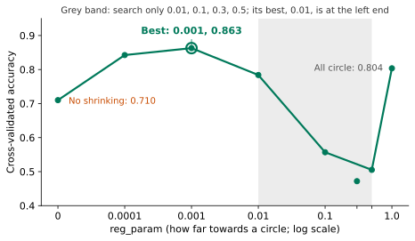
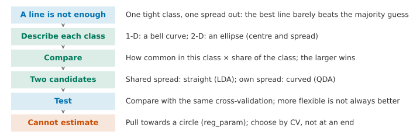

## 1. Motivation: One Straight Line Is Not Enough

In Lesson 4, logistic regression gave us a probability, and we then made a decision with a threshold. Its boundary is always a straight line (or a flat plane when there are several features). At the end of that lesson we noted a limit: if no straight line can separate the two classes, we first have to think of a suitable new feature.

Below is a two-dimensional dataset with two features, $x_1$ and $x_2$. The blue points are class 1, and there are 120 of them. The grey open circles are class 0, and there are 240 of them. Start with the tools you already have. In the widget, drag the line and see whether you can separate the two classes.



Try it yourself first. How well can the best line do? And what about the line that logistic regression finds?

::: {.callout-note collapse="true" title="Show answer"}
Wherever you drag it, the line does a poor job. The line from logistic regression has an accuracy of 0.722. If we always guess class 0, we already get 240 / 360 = 0.667. So the line is only a little better than guessing.
:::

Yet by eye the difference between the classes is plain to see. Class 1 sits in a tight group in the middle, while class 0 is spread out widely and surrounds it on every side. A line cannot capture this, because logistic regression learns only one boundary. It cares only about which side of the line a point is on. It does not care what the points of each class look like.

When we met ring-shaped data in Lesson 4, we built a new feature: the distance to the centre. First, think: could we do the same here? What would we need to know first?

::: {.callout-note collapse="true" title="Show answer"}
We could try, but we would need to guess two things correctly. What shape should the new feature have (a circle, or a tilted ellipse)? And where is the centre? In this dataset the group of class 1 points is tilted, so both its centre and its amount of tilt have to be estimated first. We cannot guess them accurately by eye. With more features, we could not guess from a picture at all.
:::

So what we want is this: **instead of guessing a feature ourselves, let the data in each class tell us what that class looks like.** Turn the question around. If we know where the points of each class usually fall, and how widely they spread, can we ask directly: **which class is more likely to have produced this point?**

**By the end of this lesson, you should be able to:** handle a classification problem by first describing each class with a centre and a spread, and then using these to work out the probability that a point belongs to each class. You should be able to state what the two candidates on this path assume (both classes share one spread, or each class has its own), and explain why one gives a straight boundary and the other a curved one. You should be able to compare them with logistic regression under the same cross-validation. When there are many features and few samples, you should know that the spread cannot be estimated well, correct it with shrinkage, and check that the chosen parameter is not at either end of the search range.

## 2. Start in One Dimension: Draw a Bell Curve for Each Class

Let us go back to the case with only one feature. We use the breast lump data from Lesson 4 and look only at the mean nucleus radius (from now on, the radius). The split is the same as before: the training set has 426 lumps, and 159 of them are malignant.

We want a description that meets two needs. It should describe a class with only a few numbers. And for any radius, it should tell us how common that radius is in the class.

First, think: could the histogram itself serve as this description?

::: {.callout-note collapse="true" title="Show answer"}
A histogram has to store the height of every bar, which means dozens of numbers. Its shape also changes with the width of the bars. And a radius that lands in an empty bar would be described as "never seen in this class", although the sample has only missed it by chance. We want a smooth curve that is fixed by a few numbers.
:::

We need at least two numbers. One says where the **centre** of the class is, and we use the mean $\mu$. The other says **how widely it spreads**, and we use the standard deviation $\sigma$. For malignant lumps, the radius has a mean of 17.35 and a standard deviation of 3.26. For benign lumps, the mean is 12.17 and the standard deviation is 1.79. The most common smooth curve that depends only on these two numbers is a bell curve:

$$
f(x) = \frac{1}{\sqrt{2\pi}\,\sigma}\exp\!\Big(-\frac{(x-\mu)^2}{2\sigma^2}\Big).
$$

This curve is the density of the **normal distribution**. Here is how to read it. The further $x$ is from the centre $\mu$, the lower the curve. The larger $\sigma$ is, the lower and wider the curve. The total area under the curve is 1, so the height of the curve at a point tells us how common it is for a lump of this class to fall near there.

{fig-alt="The grey bell curve for benign lumps is tall and narrow with its centre at 12; the blue curve for malignant lumps is low and wide with its centre at 17; at 12.8 the grey curve has height 0.211 and the blue curve has height 0.046"}

The lump from the opening of Lesson 4 has a radius of 12.8. Under the benign curve, the height there is 0.211. Under the malignant curve, it is 0.046.

First, think: the benign height is about 4.6 times the malignant height. Can we say directly that "this lump is 4.6 times as likely to be benign as malignant"?

::: {.callout-note collapse="true" title="Show answer"}
Not yet. The height only tells us how common this radius would be if the lump were malignant. It ignores how many lumps are malignant in the first place. Imagine a very rare disease, where only 1 lump in 1000 is malignant. Even if a radius is more common among malignant lumps, the lump in front of us is still most likely benign. So we also have to multiply by the share of each class.
:::

In the training set, benign lumps make up a share of 0.627 and malignant lumps 0.373. Multiply each height by its share:

- benign: $0.627 \times 0.211 = 0.132$;
- malignant: $0.373 \times 0.046 = 0.017$.

These two numbers tell us how common it is, among all lumps, to be in this class and also have a radius near 12.8. Together they cover every lump with a radius near 12.8, so the probability of malignant is

$$
\frac{0.017}{0.017 + 0.132} = 0.114 .
$$

In general, write $\pi_k$ for the share of class $k$ and $f_k$ for its bell curve:

$$
\textcolor{#00795A}{P(\text{class }1 \mid x)} = \frac{\pi_1 f_1(x)}{\pi_1 f_1(x) + \pi_0 f_0(x)} .
$$

When there are more than two classes, the denominator adds up all of them: $P(\text{class }k \mid x) = \dfrac{\pi_k f_k(x)}{\sum_j \pi_j f_j(x)}$, and we predict the class with the largest probability. This is called **Bayes' rule**. $\pi_k$ is our estimate for class $k$ before we see $x$, and it is called the **prior probability** (prior). The left-hand side is our estimate after we see $x$, and it is called the **posterior probability** (posterior). We move from one to the other by asking how common $x$ is within this class.

In Lesson 4, logistic regression with the radius alone gave this lump a probability of 0.122 of being malignant. The two numbers are close, but they come from very different routes. Logistic regression learns directly which side is malignant. Here we first describe what benign and malignant lumps each look like, and then we compare.

**Where is the boundary?** We predict the class with the larger "height times share", so the boundary is where the two are equal. In this example it is at a radius of 15.11 (the logistic boundary in Lesson 4 was at 14.72). There is also an interesting effect. The malignant curve is wider than the benign one, so as we move to the left, the benign curve falls faster. Below a radius of 4.76, malignant wins again. So there are actually two cut points here. We never reach the second one, because 4.76 is far below 6.98, the smallest radius in the training set. **When the two classes spread differently, the boundary is not a single cut.** This is exactly what the two-dimensional data in Section 1 needs.

## 3. Two Dimensions: The Bell Curve Becomes an Ellipse

Now we return to the two-dimensional data from Section 1. To describe a class, we still need a centre and a spread.

The **centre** is the mean of each feature, written as a vector. The centre of class 1 is $\boldsymbol\mu_1 = (0.04,\ 0.10)$, and the centre of class 0 is $\boldsymbol\mu_0 = (1.03,\ 0.57)$.

The **spread** needs one more piece of information. Two standard deviations tell us how widely the points spread along $x_1$ and along $x_2$. But they cannot tell us whether the two features change together: do points with a large $x_1$ also tend to have a large $x_2$? We describe this with the **covariance**:

$$
\operatorname{cov}(x_1, x_2) = \frac{1}{n-1}\sum_{i=1}^{n}(x_{i1}-\mu_1)(x_{i2}-\mu_2).
$$

If the two features tend to be large together and small together, most products are positive, so the covariance is positive. If one tends to be large when the other is small, the covariance is negative. If they are unrelated, it is close to 0. We put the two variances (the squares of the standard deviations) and the covariance into one matrix. This is called the **covariance matrix**, written $\Sigma$:

$$
\Sigma_1 = \begin{pmatrix}0.40 & 0.14\\ 0.14 & 0.30\end{pmatrix},\qquad
\Sigma_0 = \begin{pmatrix}2.26 & -0.62\\ -0.62 & 1.52\end{pmatrix}.
$$

The diagonal holds the two variances, and the off-diagonal entries hold the covariance. Class 1 has small variances, so its points are packed tightly. Class 0 has large variances, so its points are spread out.

In two dimensions, the one-dimensional bell curve becomes a "hill". Seen from above, its contour lines are rings of ellipses. The ellipses are centred at $\boldsymbol\mu$, and $\Sigma$ sets their shape, size and tilt. When the covariance is positive, the ellipse tilts up to the right. The formula is

$$
f(\mathbf x) = \frac{1}{2\pi\sqrt{\det\Sigma}}\exp\!\Big(-\tfrac12(\mathbf x-\boldsymbol\mu)^\top\Sigma^{-1}(\mathbf x-\boldsymbol\mu)\Big).
$$

With $d$ features, the $2\pi$ in the denominator becomes $(2\pi)^{d/2}$, and everything else stays the same. You do not need to memorise it. You only need to understand one part: $(\mathbf x-\boldsymbol\mu)^\top\Sigma^{-1}(\mathbf x-\boldsymbol\mu)$ is the distance from $\mathbf x$ to the centre, measured with this class's own spread. Points on the same ellipse have the same distance, so the hill has the same height there. In one dimension, this distance is $\frac{(x-\mu)^2}{\sigma^2}$.

The decision rule is exactly the same as in one dimension: compare $\pi_1 f_1(\mathbf x)$ with $\pi_0 f_0(\mathbf x)$. The widget below draws each class as ellipses, and you can place the black point anywhere.



First, look at where the black point starts. It is more common in class 1 (0.108 against 0.081), so why is it assigned to class 0? Then drag it to the centre of class 1, and then to the bottom right, far from all the points. Which class wins in each place?

::: {.callout-note collapse="true" title="Show answer"}
At the starting position, the hill for class 1 is higher. But class 1 makes up only 1/3 of the data and class 0 makes up 2/3. After multiplying by the shares, we get 0.036 against 0.054, so class 0 wins, and the probability of class 1 is 0.401. At the centre of class 1, its hill is tall and sharp, so even after multiplying by 1/3 it wins easily. At the bottom right, far from all the points, both hills are very low. But class 1 is packed tightly, so its hill falls much faster away from its centre. Class 0 is spread out, so its hill falls slowly, and class 0 wins. This is exactly what a straight line cannot do. The decision depends not only on which side a point is on. It also depends on how far the point is from each centre, measured with each class's own spread, and on how many points each class has in the first place.
:::

## 4. Two Candidates: One Shared Spread, or One Spread per Class

To use this rule, we have to estimate the centre and the covariance matrix of each class from the data. For the centre there is no real choice: we use the average. For the spread, though, there are two candidates:

1. **Both classes use one shared spread.** We assume the two classes have the same shape, size and direction, and differ only in their centres. We take a weighted average of the two class covariances, with weights given by the number of samples in each class. This gives one shared $\Sigma$. There are fewer numbers to estimate this way.
2. **Each class has its own spread.** Each class uses its own matrix, $\Sigma_1$ or $\Sigma_0$. This is more flexible, but there are twice as many numbers to estimate.

The widget below switches between the two candidates.



Switch back and forth a few times first. What shape is the green boundary in each case? Which one has the higher accuracy?

::: {.callout-note collapse="true" title="Show answer"}
With one shared spread, the boundary is a straight line and the accuracy is 0.719. This is almost the same as the 0.722 of logistic regression. With one spread per class, the boundary becomes an ellipse around the tighter class, and the accuracy is 0.867.
:::

The first candidate is called **Linear Discriminant Analysis** (**LDA**). The word "linear" in the name means that the boundary is straight. The second is called **Quadratic Discriminant Analysis** (**QDA**). Its boundary comes from a quadratic equation, so it can be an ellipse, a hyperbola or a parabola.

Why does one shared spread always give a straight line? Because the two hills then have exactly the same shape. When we compare $\pi_1 f_1$ with $\pi_0 f_0$, the term with $\mathbf x^\top\Sigma^{-1}\mathbf x$ in the exponent is the same on both sides. It cancels when we subtract, and only terms of first order in $\mathbf x$ are left. So the boundary is a straight line. With one spread per class, the second-order terms on the two sides are different. They do not cancel, so the boundary bends. Advanced Study 1 gives the derivation.

Look at where the bend comes from. In Lesson 4, a curved boundary needed a new feature first, namely "the distance to the centre". Here we built no new features at all. The bend comes from a fact we estimated from the data: the two classes are spread out differently.

## 5. Test: Compare the Methods on Real Data

The two-dimensional example was made by hand, and it fits the assumption "each class is an ellipse" perfectly. What happens on real data? We go back to all 30 features of the breast lumps. We use the same split and the same 5-fold cross-validation as in Lesson 4, and compare three methods.

```python
from sklearn.discriminant_analysis import LinearDiscriminantAnalysis, QuadraticDiscriminantAnalysis
from sklearn.model_selection import cross_val_score

lda = LinearDiscriminantAnalysis()           # one shared spread: straight boundary
qda = QuadraticDiscriminantAnalysis()        # one spread per class: curved boundary
print(cross_val_score(lda, X_train_s, y_train, cv=kf).mean())   # average accuracy over the 5 folds
print(cross_val_score(qda, X_train_s, y_train, cv=kf).mean())
```

Here `X_train_s`, `y_train` and `kf` are the same as in Lesson 4, Section 10. Without shrinkage, standardisation makes no difference to LDA or QDA, because they measure distance using each class's own spread. We keep it only so that all methods get the same input as logistic regression. The shrinkage in Section 6 will change this.

{fig-alt="The left panel shows accuracies of 0.979, 0.960 and 0.958 for the three methods, with a baseline of 0.627. The right panel shows 31, 526 and 991 numbers to estimate, with a red dashed line at 426 training lumps"}

Logistic regression scores 0.979, LDA 0.960 and QDA 0.958.

Think first: QDA is the most flexible method, and it was also the best on the data from Section 1. Why is it the worst here?

::: {.callout-note collapse="true" title="Show answer"}
There are at least two reasons.

The first is that there are too many numbers to estimate. With 30 features, one covariance matrix has $30 \times 31 / 2 = 465$ different numbers. QDA has one matrix per class, and with the two centres and the shares this makes 991 numbers in total. LDA uses one shared matrix, so it needs 526. Logistic regression needs only 31. But there are only 426 training lumps, and only 159 of them are malignant. Without enough data, the estimated spreads are unstable. Here scikit-learn also gives a warning: the covariance matrix of one class is "not full rank". This is because radius, perimeter and area almost fix one another. So in some directions the ellipse is squashed until it has almost no thickness.

The second is that the assumption may be wrong. Both LDA and QDA assume that each class is one elliptical hill. Real measurements are not always like this. For example, the distribution of area leans strongly to one side. The further the assumption is from the data, the less we can trust the probabilities it gives.
:::

The gap in missed cancers is even bigger. Logistic regression misses 7, QDA misses 9 and LDA misses 17. As we saw in Lesson 4, a missed cancer costs far more than a false alarm. So here LDA's 0.960 is worse than the number suggests.

The lesson is not "which method is better". It is this: **more flexible does not mean better; it depends on whether the assumption fits the data, and whether there is enough data to estimate the numbers the method needs.** The name of a method does not promise a result. We have to compare methods under the same cross-validation.

## 6. More Dimensions: The Spread Can No Longer Be Estimated

Take the handwritten digits from Lesson 4, Section 8 (the MNIST subset). Each image has 28×28 = 784 pixels, there are 10 classes, and the training set has 7500 images, with 680 to 851 per class. We first divide the pixels by 255.

In 784 dimensions, one covariance matrix has $784 \times 785 / 2 = 307{,}720$ numbers, but each class has only about 750 images. And the problem is not only the count.

{fig-alt="Ten blurry average digits, and 0 to 9 can be recognised; on the right, a 28 by 28 image with a ring of blue in the middle and a large light red area all around"}

The left of the figure shows the centre of each class, and we can already make out the shapes of 0 to 9. The right shows the standard deviation of each pixel for the digit 0. The pixels in the large light red area around the edge are 0 in every training image of a 0, so their spread is 0. Every class has 245 to 361 pixels like this.

A spread of 0 means that the ellipse of this class is flattened in these directions, so it has zero thickness. Suppose a new 0 has even a tiny bit of ink in one of these positions. Measured with this class's spread, it is then infinitely far from the centre, and the height of the hill there is 0. If we cross-validate QDA with its default settings, scikit-learn gives a warning (the covariance matrix of a class is not full rank), and the accuracy is only 0.710. Under the same 5-fold cross-validation, the logistic regression from Lesson 4 (with $C = 0.1$) scores 0.901.

You may ask: the shared spread that LDA has to estimate also has 307,720 numbers, which is more than the 7500 images. Why does LDA give no warning (cross-validation 0.833)? The reason is that the default LDA in scikit-learn does not invert the spread. It compares the classes only in the directions where the data really varies. QDA, however, has to invert a separate spread for each class and compute its "volume" (the determinant). Each class has only about 750 images, and in many directions the thickness is 0, so the inversion goes wrong.

Think first: in Lesson 3, what did we do when there was not enough data and the estimates were unstable?

::: {.callout-note collapse="true" title="Show answer"}
We used regularisation: we pulled the things we estimate a little towards a simple shape. Ridge pulls the coefficients towards 0. Here we want to pull the spread of each class towards some shape, so that the flattened directions get some thickness back.
:::

Towards which shape? There are three candidates:

1. **Towards the spread shared by all classes** (that is, towards LDA). But 121 pixels are 0 in every training image, so the shared spread has no thickness in those directions either.
2. **Keep only each pixel's own variance and drop the covariances** (the ellipse no longer tilts). But a pixel that is always 0 within a class still has a variance of 0.
3. **Towards a circle**: the same spread in every direction, with no tilt, and nothing to estimate from the data. It has thickness in every direction.

Only the third one guarantees thickness in every direction, so we choose it.

In practice, we mix each class's own covariance matrix with a "circle" (the identity matrix $I$) in a fixed proportion:

$$
\Sigma_k(r) = (1-r)\,\Sigma_k + r\,I,\qquad 0 \le r \le 1 .
$$

The identity matrix is a circle of radius 1. So before shrinkage, all features need to be on similar scales. The MNIST pixels have already been divided by 255, so they lie between 0 and 1. The breast lump features have to be standardised first. With $r = 0$ we get the original QDA. With $r = 1$, every class is a circle of the same size, and only the centres differ. The decision then becomes "which centre is closer, taking the shares into account". For $r$ between the two, each spread is pulled part of the way towards a circle. This method is called **shrinkage**. The widget below shows what it does on the two-dimensional data from Section 1.



As you drag $r$, the ellipses become rounder and the curved boundary becomes straighter. At $r = 1$ it is a straight line. On this two-dimensional data, the spread was already estimated well, so shrinkage only lowers the accuracy (from 0.867 to 0.697). Shrinkage helps when the spread cannot be estimated well.

In scikit-learn this $r$ is called `reg_param`. It is a hyperparameter, like λ in Lesson 3, and we choose it by cross-validation:

```python
from sklearn.model_selection import cross_val_score

for r in [0, 0.0001, 0.001, 0.01, 0.1, 0.5, 1]:   # values of reg_param to try
    qda = QuadraticDiscriminantAnalysis(reg_param=r)               # pull each spread towards a circle by r
    score = cross_val_score(qda, X_digits_train, y_digits_train, cv=kf).mean()   # 5-fold accuracy
    print(r, score)
```

{fig-alt="A curve: 0.710 with no shrinkage, the highest value 0.863 at 0.001, a drop to about 0.5 at 0.1 and 0.5, and a return to 0.804 at 1"}

Without shrinkage the accuracy is 0.710. A very small amount of shrinkage (0.0001) makes it jump to 0.843. The best value is 0.001, with an accuracy of 0.863. With more shrinkage than that, the spreads are pulled too close to circles and lose the real shape of each class, so the accuracy drops again. Between 0.1 and 0.5 it is only about 0.5. At $r = 1$, every class is a circle of the same size, the decision becomes "which centre is closer", and the accuracy returns to 0.804. Why it falls so low in the middle has to do with the pixel spreads all being very small (far below the circle's radius of 1). We do not go into this here. What matters is that the best value is still the one chosen by cross-validation.

**The chosen value must not sit at either end of the search range.** Suppose we had tried only 0.01, 0.1, 0.3 and 0.5 (the grey region in the figure). The best of these is 0.01, which is right at the left end. We cannot stop there, because the true best value may be below 0.01 and we never tried it. The rule is this: if the best value is at an end, extend the range on that side and choose again. Repeat until the best value is inside the range. The range above goes from 0 to 1, and the best value, 0.001, is inside it, so we can trust it.

Only after every choice has been made do we open the test set, and we read it once. We fit QDA with `reg_param = 0.001` on all 7500 training images, and the test accuracy is 0.861. For comparison, LDA scores 0.832 and the logistic regression from Lesson 4 scores 0.908. Shrinkage makes QDA usable (from 0.710 to about 0.86), and it is also better than LDA. But on 784 pixels it is still worse than logistic regression. Each class has about 300,000 numbers for its spread, and 750 images cannot estimate them well, even after shrinkage. A question to think about: could we first make the 784 numbers of each image fewer, and then hand them to QDA?

## 7. Implementation: Doing It with scikit-learn

The first three steps (reading the data, the stratified split and standardisation) are exactly the same as in Lesson 4, Section 10. We carry on from there.

**Step 1: compute the probability for the opening lump by hand (Section 2).**

```python
from scipy.stats import norm

radius = X_train[:, 0]                       # column 0 is the mean radius
mean_mal = radius[y_train == 1].mean()       # centre of the malignant class
sd_mal = radius[y_train == 1].std(ddof=1)    # spread of the malignant class
mean_ben = radius[y_train == 0].mean()       # centre of the benign class
sd_ben = radius[y_train == 0].std(ddof=1)    # spread of the benign class
share_mal = (y_train == 1).mean()            # prior: share of malignant lumps
share_ben = (y_train == 0).mean()            # prior: share of benign lumps

x = X_test[47, 0]                            # the opening lump, radius 12.8
top = share_mal * norm.pdf(x, mean_mal, sd_mal)          # share times height, malignant
bottom = top + share_ben * norm.pdf(x, mean_ben, sd_ben) # plus share times height, benign
print(top / bottom)                          # Bayes' rule: probability of malignant
```

The output is 0.114. With `ddof=1`, the standard deviation divides by $n-1$, which is what scikit-learn does too.

**Step 2: compare the three methods with the same cross-validation (Section 5).** Use the code in Section 5, and add `LogisticRegression()` from Lesson 4.

**Step 3: choose `reg_param` on the MNIST subset, then read the test set once (Section 6).**

```python
qda = QuadraticDiscriminantAnalysis(reg_param=0.001)  # the value chosen by cross-validation
qda.fit(X_digits_train, y_digits_train)               # train on all training images
print(qda.score(X_digits_test, y_digits_test))        # the test set, read once
```

The output is 0.861. Variables such as `X_digits_train` are the same as in Lesson 4, Section 8 (the MNIST subset, with the pixels already divided by 255).

## 8. One-Page Review

If you read only one page, read this one.

{fig-alt="A vertical flowchart with six steps"}

| What you see | What you can do | What evidence to use |
|---|---|---|
| A straight line cannot separate the classes, but one class is very tight and the other is loose | First describe each class: its centre (the mean) and its spread (the standard deviation, or the covariance matrix in two dimensions) | Whether the bell curve or ellipse fits the points of each class |
| How to turn the descriptions into a decision | Bayes' rule: compare "how common the point is within this class" times "the share of this class" | The computed probability; a comparison with logistic regression |
| How to estimate the spread | One shared spread (LDA, straight boundary) or one spread per class (QDA, curved boundary) | Accuracy and the two kinds of error under the same cross-validation |
| Many dimensions and few samples, so the spread cannot be estimated | Shrinkage towards a circle: `reg_param` | The cross-validation curve; the best value is not at either end of the search range |

## 9. Summary and Limitations

Let us go back to the two-dimensional data from the start. Three methods give three boundaries:

{fig-alt="Three panels: logistic regression and LDA both draw one slanted line, with accuracies 0.722 and 0.719; QDA draws an ellipse around the blue points, with accuracy 0.867"}

Logistic regression and LDA both draw a straight line, and their accuracies are almost the same. QDA draws an ellipse, and its accuracy is 0.867. The difference is not about which method is cleverer. It comes from what each method assumes about the shape of each class. Logistic regression does not describe the classes at all and only learns the boundary. LDA assumes that the two classes have the same shape. QDA allows the two classes to have different shapes. At the start we asked: can we ask directly which class was more likely to produce this point? The answer is yes. We describe each class first, and then compare them with Bayes' rule. The price is that we must estimate more numbers, and when there is not enough data we need shrinkage.

**Transfer question.** An online shop wants to decide whether a review is one of the fake reviews. It has two features: the number of words in the review, and how many days ago the account was registered. For genuine reviews, both features spread widely. Most fake reviews are very short and come from very new accounts, so they crowd tightly into one corner. Without doing any calculation, answer these questions. Which boundary do you expect to fit better, the one from LDA or the one from QDA, and why? Suppose we add 200 more features about word choice, but there are only 300 fake reviews. What problem will QDA run into, and what can we do about it? How should the parameter be chosen?

::: {.callout-note collapse="true" title="Suggested answer"}
One class is tight and the other is loose, like the data in Section 1, so the curved boundary of QDA fits better. LDA assumes that the two classes have the same shape, so it can only draw a straight line. With 202 features, the covariance matrix of each class has 202 × 203 / 2 = 20503 numbers. There are only 300 fake reviews, so the spread cannot be estimated. QDA will warn that the matrix is not full rank, and the results will be poor. The fix is shrinkage (`reg_param`). Choose it by cross-validation inside the training set, and check that the best value is not at either end of the search range. Another option is LDA or logistic regression, because they need far fewer numbers. Finally, read the test set only once.
:::

**Where this method cannot be trusted.**

1. **The ellipse is an assumption.** Suppose the points of a class bend into a banana shape, or split into two groups far apart. For example, people write the digit 7 in two ways, with or without a bar across the middle. One ellipse cannot describe such a class, so the computed probability will be wrong.
2. **The probabilities are still not calibrated.** If the model says 0.114, it does not mean that 11.4% of such lumps are really malignant. The share $\pi_k$ comes from the training set. At another hospital, the share of malignant lumps may be different, and then the probabilities must change too.
3. **Many dimensions need shrinkage.** Cross-validation decides how much to shrink, so the choice can be trusted only within this data. On a different dataset, `reg_param` may need to be chosen again.
4. **The data decides which method is best.** On the breast lumps, logistic regression is best. On the MNIST pixels, shrinkage makes QDA usable and better than LDA, but logistic regression is still the best. This lesson gives no rule for when to use which method. It only gives a way to compare them.

**Back to the promise at the start.** Now you have one more way to approach a classification problem. You can describe each class by its centre and spread, and use Bayes' rule to compute the probability that a point belongs to each class. You can explain how the assumptions of LDA and QDA differ, and why one boundary is straight and the other is curved. You can compare them with logistic regression under the same cross-validation. When the spread cannot be estimated, you can use `reg_param` for shrinkage, and check that the chosen value is not at either end of the range.

**30-second feedback.** When you finish this lesson, scan the code to leave anonymous feedback or a question. It helps us to know which parts were unclear or too fast.

{fig-align="center" width="160px" fig-alt="Feedback QR code"}

*The Advanced Studies below are not part of the main line, and each can be read on its own. MPS311 students are encouraged to read them. MPS439 students have one main task, which is required: Advanced A of Lab 5. It builds on Study 2 here but shrinks with r = 0.5, so its self-check values differ from the ones on this page. The other Studies are optional.*

---

## Advanced Study 1: Why the Boundary Is Straight with a Shared Spread

We can compare the two classes by taking logarithms and subtracting. Define

$$
g(\mathbf x) = \log\big(\pi_1 f_1(\mathbf x)\big) - \log\big(\pi_0 f_0(\mathbf x)\big),
$$

If $g(\mathbf x) \ge 0$, we predict class 1, and $g(\mathbf x) = 0$ is the boundary. Now substitute the density in two dimensions (or in $d$ dimensions in general):

$$
\log f_k(\mathbf x) = -\tfrac12(\mathbf x-\boldsymbol\mu_k)^\top\Sigma_k^{-1}(\mathbf x-\boldsymbol\mu_k) - \tfrac12\log\det\Sigma_k + \text{constant}.
$$

**Shared spread, $\Sigma_1 = \Sigma_0 = \Sigma$.** Expand the quadratic form:

$$
(\mathbf x-\boldsymbol\mu_k)^\top\Sigma^{-1}(\mathbf x-\boldsymbol\mu_k) = \mathbf x^\top\Sigma^{-1}\mathbf x - 2\boldsymbol\mu_k^\top\Sigma^{-1}\mathbf x + \boldsymbol\mu_k^\top\Sigma^{-1}\boldsymbol\mu_k .
$$

The first term $\mathbf x^\top\Sigma^{-1}\mathbf x$ does not depend on $k$, and neither does $\log\det\Sigma$. So both cancel when we subtract, and what remains is

$$
g(\mathbf x) = \underbrace{(\boldsymbol\mu_1-\boldsymbol\mu_0)^\top\Sigma^{-1}}_{\mathbf w^\top}\,\mathbf x \;\underbrace{-\;\tfrac12\boldsymbol\mu_1^\top\Sigma^{-1}\boldsymbol\mu_1 + \tfrac12\boldsymbol\mu_0^\top\Sigma^{-1}\boldsymbol\mu_0 + \log\frac{\pi_1}{\pi_0}}_{b} .
$$

So $g(\mathbf x) = \mathbf w^\top\mathbf x + b$ is a linear function of $\mathbf x$, and the boundary $g = 0$ is a straight line (a hyperplane). This has exactly the same form as logistic regression. Also, because $P(\text{class }1\mid\mathbf x) = \frac{1}{1+e^{-g}}$, the posterior probability of LDA is a sigmoid too. The only difference is where $\mathbf w$ and $b$ come from. Logistic regression fits them directly with cross-entropy. LDA computes them from the centres, the shared spread and the shares.

**One spread per class.** Now $\mathbf x^\top\Sigma_1^{-1}\mathbf x$ and $\mathbf x^\top\Sigma_0^{-1}\mathbf x$ are no longer the same. After subtracting, the term $-\tfrac12\mathbf x^\top(\Sigma_1^{-1}-\Sigma_0^{-1})\mathbf x$ remains. So $g$ is a quadratic function of $\mathbf x$, and the boundary is a quadratic curve.

**Exercises.**

1. In one dimension, set $g(x) = 0$ and write down the quadratic equation that the QDA boundary satisfies. Substitute the means, standard deviations and shares from Section 2, and check that the two roots are about 15.11 and 4.76.
2. Suppose the two shares are equal ($\pi_1 = \pi_0$), the spread is shared, and $\Sigma = I$. What is the LDA boundary? (Hint: the perpendicular bisector of the line joining the two centres.)

## Advanced Study 2: A Gaussian Classifier with Only numpy

Use the standardised `X_train_s`, `y_train` and `X_test_s` from Lesson 4, Section 10. For each class, estimate the centre, the covariance matrix (with shrinkage towards a circle, $r = 0.1$) and the share. Then, for each test sample, compare $\log\big(\pi_k f_k(\mathbf x)\big)$ across the classes. We compute the logarithms directly, because multiplying very small numbers causes problems. The constant $-\frac d2\log 2\pi$ is the same for every class, so it does not affect the comparison, and we leave it out.

```python
import numpy as np

r = 0.1                                          # how far to pull each spread towards a circle
d = X_train_s.shape[1]                           # 30 features
X_ben = X_train_s[y_train == 0]                  # training lumps of class 0
X_mal = X_train_s[y_train == 1]                  # training lumps of class 1

S_ben = (1 - r) * np.cov(X_ben.T) + r * np.eye(d)    # shrunk spread of class 0
S_mal = (1 - r) * np.cov(X_mal.T) + r * np.eye(d)    # shrunk spread of class 1
diff_ben = X_test_s - X_ben.mean(axis=0)         # each test lump minus the centre of class 0
diff_mal = X_test_s - X_mal.mean(axis=0)         # each test lump minus the centre of class 1
dist_ben = np.sum(diff_ben @ np.linalg.inv(S_ben) * diff_ben, axis=1)   # squared distance, measured by the class's own spread
dist_mal = np.sum(diff_mal @ np.linalg.inv(S_mal) * diff_mal, axis=1)
log_ben = -0.5 * dist_ben - 0.5 * np.linalg.slogdet(S_ben)[1] + np.log(len(X_ben) / len(X_train_s))   # log of share times height
log_mal = -0.5 * dist_mal - 0.5 * np.linalg.slogdet(S_mal)[1] + np.log(len(X_mal) / len(X_train_s))
mine = (log_mal > log_ben).astype(int)          # 1 when malignant wins
```

Compare it with scikit-learn:

```python
ref = QuadraticDiscriminantAnalysis(reg_param=0.1).fit(X_train_s, y_train)
print((mine != ref.predict(X_test_s)).sum())     # number of test lumps on which the two disagree
```

The result is 0. The predictions agree on all 143 test lumps, and both accuracies are 0.951. This is because `reg_param` in scikit-learn is exactly shrinkage towards the identity matrix. Along each eigen-direction of the covariance matrix, it replaces each variance $\lambda$ with $(1-r)\lambda + r$. This is the same as $(1-r)\Sigma + rI$.

Now try the following yourself:

1. Change `r` to 0, and repeat the steps on the MNIST subset (`X_digits_train`, 784 dimensions). What happens to `np.linalg.inv`? What does `slogdet` give? How is this related to the warning in Section 6?
2. Change the two classes to use one shared spread (a weighted average of the two covariance matrices, weighted by the number of samples). Compare the predictions with those of `LinearDiscriminantAnalysis()`.
3. Write a version for 10 classes (the MNIST subset), and compare it with `QuadraticDiscriminantAnalysis(reg_param=0.001)`. The extension task C of Assignment 2 asks you to do the same on MNIST.

## Advanced Study 3: Open Questions

This lesson does not develop the following five questions. Each comes with a starting point.

1. **LDA is also a projection.** Last year, this lesson taught LDA from another angle. Find a direction, and project the points onto that line, so that the two centres are as far apart as possible and each class is as tight as possible (Fisher's discriminant). Starting point: compare $\mathbf w = \Sigma^{-1}(\boldsymbol\mu_1-\boldsymbol\mu_0)$ from Advanced Study 1 with Fisher's direction. Look up `transform` and `n_components` in `LinearDiscriminantAnalysis`.
2. **Naive Bayes.** Suppose we assume that, within each class, the features are uncorrelated (so the covariance matrix has values only on the diagonal). Then the number of values to estimate drops from 465 to 30. This is called naive Bayes, and it is often used for spam filtering. Starting point: use `sklearn.naive_bayes.GaussianNB`, and compare it with LDA and QDA on the breast lumps. In what way is it similar to `reg_param`?
3. **A class with more than one group.** If a class is made of several groups, we can describe it by adding several ellipses together (a Gaussian mixture model). Starting point: make a two-dimensional dataset by hand in which class 1 is two groups, and see how the QDA boundary fails. Look up `sklearn.mixture.GaussianMixture`.
4. **What to shrink towards.** Section 6 showed why, on the MNIST subset, pulling only towards the shared spread is not enough (that means pulling towards LDA; if we shrink all the way, QDA becomes LDA). On other data the shared spread may not be flat, so this candidate may do better, and you can also pull a little towards both. Starting point: write out $(1-a)\Sigma_k + a\,\Sigma_{\text{shared}}$ yourself, choose $a$ by cross-validation on digits, and compare it with `reg_param`. This idea is called regularised discriminant analysis.
5. **What if the shares change.** In the training set, 37% of the lumps are malignant. Suppose that at a screening centre only 1% are malignant. How does the posterior probability change? Starting point: use `QuadraticDiscriminantAnalysis(priors=[0.99, 0.01])`, see what the probability of the opening lump becomes, and compare this with "lowering the threshold" from Lesson 4.
