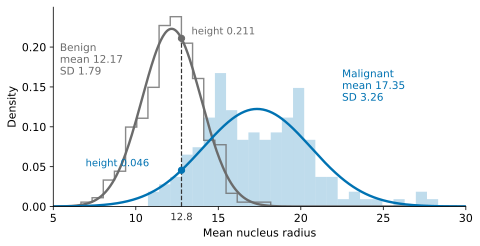
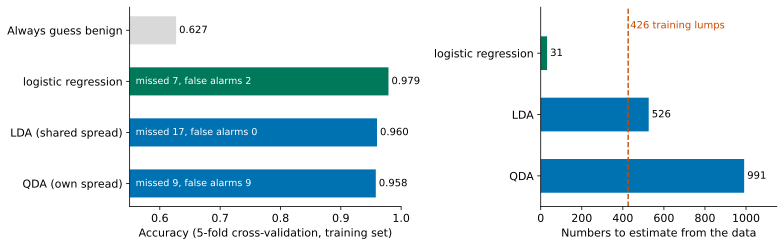
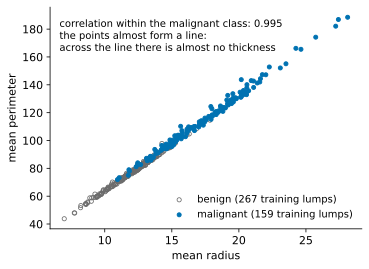
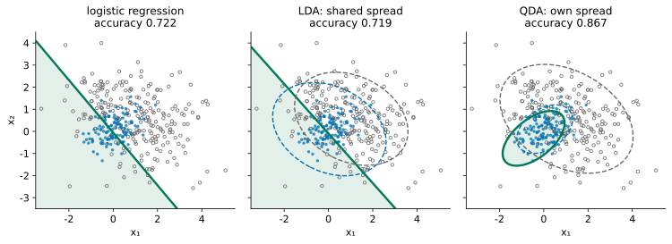

## 1. Problem: One Straight Line Is Not Enough

In Lesson 4, logistic regression gave us a probability, and a threshold turned it into a decision. Its boundary is always a straight line (a flat plane when there are more features). We ended that lesson with a limit: if no straight line can separate the two classes, we first have to invent a suitable new feature.

Below is a two-dimensional dataset with features $x_1$ and $x_2$. The 120 blue points are class 1; the 240 grey open circles are class 0. Start with the tools you already have: drag the line in the widget and see whether you can separate the classes.



Try it first. How well can the best line do? And the line that logistic regression finds?

::: {.callout-note collapse="true" title="Show answer"}
Wherever you put it, the line does badly. The logistic regression line reaches an accuracy of 0.722, while always guessing class 0 already gives 240 / 360 = 0.667. The line is only a little better than guessing.
:::

Yet the difference between the classes is obvious to the eye. Class 1 sits in a tight group in the middle; class 0 is spread widely and surrounds it on every side. A line cannot capture this, because logistic regression learns only a boundary. It cares which side of the line a point falls on, not what the points of each class look like.

For the ring-shaped data in Lesson 4, the fix was a new feature: the distance to the centre. Could we do the same here? What would we need to know first?

::: {.callout-note collapse="true" title="Show answer"}
We could try, but we would have to guess two things correctly: the shape of the new feature (a circle? a tilted ellipse?) and where its centre is. Here the class 1 group is tilted, so its centre and its tilt would both have to be estimated first, and the eye cannot do that accurately. With more features, there would be no picture to guess from at all.
:::

So we try a different route: **use the data to describe what each class looks like, then use those descriptions to decide which class a new point belongs to.** In this dataset the two classes spread very differently, but in another dataset they might spread in much the same way. When we describe the spread, we can let the classes share one description or give each class its own. Which is better depends on the assumption behind it, and on whether there is enough data to estimate it.

This route still follows the five steps we have used since Lesson 2: **problem, model, loss, solution, test**. The step that changes most is the **model**. A model is an assumption about the data. Last lesson's assumption was that, given the features, the probability of class 1 changes with them along an S-shaped curve. This lesson makes a different assumption: it says how the data of each class is generated. Once that assumption is fixed, everything else follows from it: how we decide, which numbers we must estimate, which loss we use and how we solve it. And when a test exposes a problem, we go back to one of these steps to fix it.

**By the end of this lesson, you should be able to:** take a classification problem and, besides learning a boundary directly, attack it from a different assumption: first assume how the data of each class is generated, then follow that assumption through to a decision rule, a loss and a solution. Given a new dataset, you should be able to judge from what the data looks like and how much of it there is whether the assumption holds up and whether it should be simpler or more flexible, and to choose between assumptions using evidence. When results are poor, you should be able to tell whether the assumption itself is wrong or the data is too thin to support it, and so know which step to go back to.

## 2. Model: Assume Each Class Is a Bell Curve (One Feature First)

Start with a single feature. We use the breast lumps from Lesson 4 and look only at the mean nucleus radius (just "the radius" from now on). The split is the same as before: 426 training lumps, 159 of them malignant.

We want a description of a class that does two things: it uses only a few numbers, and for any radius it tells us how common that radius is in the class.

First, think: could the histogram itself be that description?

::: {.callout-note collapse="true" title="Show answer"}
A histogram has to store the height of every bar, which is dozens of numbers. Its shape changes with the bar width. And a radius that falls in an empty bar would be reported as "never seen in this class", when the sample simply happened to miss it. We want a smooth curve fixed by a few numbers.
:::

Two numbers will do as a start: where the class is **centred**, given by the mean $\mu$, and how **widely it spreads**, given by the standard deviation $\sigma$. For now we take each class's own sample standard deviation. The malignant radii have mean 17.35 and standard deviation 3.26; the benign radii have mean 12.17 and standard deviation 1.79. We first use these two curves to learn how to compute class probabilities; Section 5 then compares a shared spread with one spread per class. A smooth curve fixed by just these two numbers is the bell curve:

$$
f(x) = \frac{1}{\sqrt{2\pi}\,\sigma}\exp\!\Big(-\frac{(x-\mu)^2}{2\sigma^2}\Big).
$$

This is the density of the **normal distribution**. The further $x$ is from the centre $\mu$, the lower the curve; the larger $\sigma$, the lower and wider it is. The total area under the curve is 1. Note that the height is a **probability density**, not the probability that the radius is exactly $x$: for a narrow interval of width $\Delta x$ around $x$, the probability of landing in it is roughly the height times $\Delta x$.

{fig-alt="The grey bell curve for benign lumps is tall and narrow with its centre at 12; the blue curve for malignant lumps is low and wide with its centre at 17; at 12.8 the grey curve has height 0.211 and the blue curve has height 0.046"}

**This step is an assumption.** The histograms are not perfect bells, and we do not know how the radius is really distributed. Write $Y$ for the class (1 for malignant, 0 for benign). Saying "the radius in class $k$ follows a bell curve with centre $\mu_k$ and spread $\sigma_k$, and a lump belongs to class $k$ with probability $P(Y=k)$" is a claim about how the data was produced: first a lump is assigned to a class with these probabilities, then its radius is drawn from that class's bell curve. That claim is the **model** of this lesson.

Compare it with last lesson. There the model assumed $P(\text{malignant}\mid x)=\dfrac{1}{1+e^{-(wx+b)}}$: it says how the probability of malignant changes with the radius, and nothing about how the radius itself is distributed. This lesson's model says one thing more: what the data of each class looks like. Because such a model can "generate" a batch of imaginary lumps, it is called a **generative model**; a model like last lesson's, which writes down the class probability directly, is called a **discriminative model**.

The numbers a model needs from the data are its **parameters**: here $\mu_k$, $\sigma_k$ and $P(Y=k)$ for each class. Above we simply used the means, the sample standard deviations and the fraction of each class in the training set. Why those choices? That is a question for the loss and solution steps, and Section 6 answers it. First, let us see how the model makes a decision.

## 3. From Model to Decision: Bayes' Rule

The curve answers one question: **if a lump belongs to a given class, how common is this radius within that class?** Classification asks the reverse: **having seen the radius, what is the probability that the lump belongs to each class?** Let us turn one question into the other with actual numbers.

The lump from the opening of Lesson 4 has radius 12.8. The benign curve is 0.211 high there; the malignant curve is 0.046 high.

First, think: the benign height is about 4.6 times the malignant height. Can we say "this lump is 4.6 times as likely to be benign as malignant"?

::: {.callout-note collapse="true" title="Show answer"}
No. Suppose there are 100,000 lumps and only 10 of them are malignant. Even with the same two curves, benign lumps vastly outnumber malignant ones, so the lumps with radius near 12.8 also come overwhelmingly from the benign class, and the ratio of benign to malignant among them is far more than 4.6 to 1. The curve heights only compare how common this radius is **within** each class. To reverse the direction and ask which class a lump belongs to, we also need to know how many lumps each class had to begin with.
:::

**How do we reverse the direction?** That is exactly what **Bayes' rule** does. You have probably met it in its general form:

$$
P(A\mid B)=\frac{P(B\mid A)\,P(A)}{P(B)}.
$$

The vertical bar reads "given that". To use it here, we only need to say what $A$ and $B$ are in our problem:

| In the formula | In our problem |
|---|---|
| $A$ | the lump is malignant: $Y=1$ |
| $B$ | its radius is near 12.8: $X\approx 12.8$ |
| $P(A\mid B)$ | the probability of malignant once we have seen the radius: the answer we want |
| $P(B\mid A)$ | the probability of a radius near 12.8 if the lump is malignant: read from the malignant curve |
| $P(A)$ | the probability that a lump is malignant before we look at its radius: $P(Y=1)$ |
| $P(B)$ | the probability that a lump has a radius near 12.8, whatever its class |

Substituting:

$$
P(Y=1\mid X\approx 12.8)=\frac{P(X\approx 12.8\mid Y=1)\,P(Y=1)}{P(X\approx 12.8)}.
$$

What is the denominator? A lump with radius near 12.8 is either malignant or benign, so the two parts together make up all of them:

$$
P(X\approx 12.8)=P(X\approx 12.8\mid Y=1)\,P(Y=1)+P(X\approx 12.8\mid Y=0)\,P(Y=0).
$$

The numerator is "malignant and radius near 12.8"; the denominator is "radius near 12.8" for any lump; their ratio is the fraction of malignant lumps among those near 12.8. This also answers the question above: comparing what the curves give, $P(X\approx 12.8\mid Y)$, is not enough. We also have to multiply by $P(Y)$, how common each class is to begin with.

**Back to the curves and the data.** One thing is left: how do we read $P(X\approx 12.8\mid Y=k)$ off a curve? Take a very narrow interval around 12.8. The probability of landing in it is roughly the curve height times the interval width. Every term in the numerator and the denominator carries the same width, so it cancels and only the curve heights remain. Writing $f_k(x)$ for the height of class $k$'s curve at $x$, we get

$$
P(Y=1\mid X=x)=\frac{P(Y=1)\,f_1(x)}{P(Y=1)\,f_1(x)+P(Y=0)\,f_0(x)}.
$$

With the numbers from the training set:

| | $P(Y=k)$ (fraction in the training set) | $f_k(12.8)$ (curve height) | product |
|---|---:|---:|---:|
| benign ($Y=0$) | 0.627 | 0.211 | 0.132 |
| malignant ($Y=1$) | 0.373 | 0.046 | 0.017 |

The probability of malignant is $0.017/(0.017+0.132)\approx$ **0.114**. So the expected ratio of benign to malignant is about 7.8 to 1, not the 4.6 to 1 of the curve heights.

$P(Y=k)$ is called the **prior probability** (prior): our estimate for each class before we see the radius. $P(Y=k\mid X=x)$ is the **posterior probability** (posterior): our estimate after we see it. Here the fraction of each class in the training set stands in for $P(Y=k)$; if the training data was sampled with different proportions from the population we care about, we cannot use it like this.

We will write $P(Y=k)$ many times from now on, so we shorten it to $\pi_k=P(Y=k)$. With more than two classes, the denominator sums over all of them:

$$
P(Y=k\mid X=x)=\frac{\pi_k f_k(x)}{\sum_j\pi_j f_j(x)}.
$$

This is the common rule for deciding about a new point. LDA and QDA both use it; they differ in what the model assumes about the densities $f_k(x)$ (Section 5).

In Lesson 4, logistic regression on the radius alone gave this lump a probability of 0.122 of being malignant. The two numbers are close, but they come from very different routes: logistic regression learns directly which side is malignant, while here we first describe what benign and malignant lumps each look like, and then compare.

**Where is the boundary?** We predict the class with the larger "$P(Y)$ times height", so the boundary is where the two are equal: here at a radius of 15.11 (the logistic boundary in Lesson 4 was at 14.72). There is a curious twist. The malignant curve is wider than the benign one, so moving left, the benign curve falls faster, and below a radius of 4.76 malignant wins again. There are really two cut points, though we never reach the second, since 4.76 is far below the smallest training radius, 6.98. **When the classes spread differently, the boundary is not a single cut.** That is exactly what the two-dimensional data in Section 1 needs.

## 4. Model in Two Dimensions: The Bell Curve Becomes an Ellipse

Back to the two-dimensional data from Section 1. A class is still described by a centre and a spread.

The **centre** is the mean of each feature, written as a vector: $\boldsymbol\mu_1 = (0.04,\ 0.10)$ for class 1 and $\boldsymbol\mu_0 = (1.03,\ 0.57)$ for class 0.

The **spread** needs one more piece of information. Two standard deviations say how widely the points spread along $x_1$ and along $x_2$, but not whether the features move together: do points with a large $x_1$ also tend to have a large $x_2$? That is measured by the **covariance**:

$$
\operatorname{cov}(x_1, x_2) = \frac{1}{n-1}\sum_{i=1}^{n}(x_{i1}-\mu_1)(x_{i2}-\mu_2).
$$

If the features tend to be large together and small together, most products are positive and the covariance is positive; if one tends to be large when the other is small, it is negative; if they are unrelated, it is close to 0. Putting the two variances (the squared standard deviations) and the covariance into one matrix gives the **covariance matrix** $\Sigma$:

$$
\Sigma_1 = \begin{pmatrix}0.40 & 0.14\\ 0.14 & 0.30\end{pmatrix},\qquad
\Sigma_0 = \begin{pmatrix}2.26 & -0.62\\ -0.62 & 1.52\end{pmatrix}.
$$

The diagonal holds the variances, the off-diagonal entries the covariance. Class 1 has small variances and is packed tightly; class 0 has large ones and is spread out.

In two dimensions the bell curve becomes a "hill". Seen from above, its contour lines are rings of ellipses, centred at $\boldsymbol\mu$, with shape, size and tilt set by $\Sigma$; a positive covariance tilts the ellipse up to the right. The formula is

$$
f(\mathbf x) = \frac{1}{2\pi\sqrt{\det\Sigma}}\exp\!\Big(-\tfrac12(\mathbf x-\boldsymbol\mu)^\top\Sigma^{-1}(\mathbf x-\boldsymbol\mu)\Big).
$$

With $d$ features, the $2\pi$ in the denominator becomes $(2\pi)^{d/2}$ and nothing else changes. You need not memorise it. Just read one part: $(\mathbf x-\boldsymbol\mu)^\top\Sigma^{-1}(\mathbf x-\boldsymbol\mu)$ is the distance from $\mathbf x$ to the centre, measured with the class's own spread. Points on the same ellipse are equally far away, so the hill has the same height there. In one dimension this distance is $\frac{(x-\mu)^2}{\sigma^2}$.

In two dimensions, then, the model assumes that the points of each class are generated by a hill centred at $\boldsymbol\mu_k$ whose shape is set by $\Sigma_k$. There are more parameters to estimate: 2 numbers for each centre, 3 for each spread (two variances and one covariance), plus the class probabilities $P(Y=k)$.

The decision rule is exactly as in one dimension: compare $\pi_1 f_1(\mathbf x)$ with $\pi_0 f_0(\mathbf x)$. The widget below draws each class as ellipses, and you can put the black point anywhere.



Look first at where the black point starts. It is more common in class 1 (0.108 against 0.081), so why is it assigned to class 0? Then drag it to the centre of class 1, and to the bottom right, far from all the points. Which class wins each time?

::: {.callout-note collapse="true" title="Show answer"}
At the start, the class 1 hill is higher, but class 1 makes up only 1/3 of the data and class 0 makes up 2/3. After multiplying by $P(Y=k)$ we get 0.036 against 0.054, so class 0 wins, and the probability of class 1 is 0.401. At the centre of class 1, its hill is tall and sharp, so even after multiplying by 1/3 it wins easily. Far away at the bottom right, both hills are very low; but class 1 is tight, so its hill drops much faster away from its centre, while class 0 is spread out and drops slowly, so class 0 wins. A straight line cannot do this. The decision depends not just on which side a point is on, but on how far it is from each centre, measured with each class's own spread, and on how many points each class has to begin with.
:::

## 5. Two Versions of the Model: One Shared Spread, or One per Class

We now know how $\pi_k$ and the densities lead to a decision. But the model still has one decision open: each class has its own centre, but does each also have its own spread? This is not a computational detail; it is another assumption about the data.

When would we assume a shared spread? When the classes differ mainly in **where** they sit rather than in their **shape**. Think of the same instrument measuring two groups of samples: the size and direction of the measurement noise are about the same for both groups, and the groups differ only in being shifted up or down. Then one shared spread is a sensible description of the data, not just a shortcut.

So first try the simpler assumption: **all classes share one spread**. We estimate a single covariance matrix $\Sigma$ from how the points of every class scatter around their own centre. It describes one common shape, size and direction, while the centres can still differ. There are fewer parameters, so with limited data the estimate may be more stable. This model is called **Linear Discriminant Analysis** (LDA).

If the classes really spread very differently, though, a shared description may not fit. The second version relaxes the assumption: **each class has its own spread**, so we estimate $\Sigma_1$ and $\Sigma_0$ separately. This is more flexible, but each class's data now has to support more parameters on its own. This model is called **Quadratic Discriminant Analysis** (QDA). The two curves in Section 2 used different standard deviations, so that one-dimensional calculation was already making the QDA assumption about the spread; Bayes' rule itself applies to both models.

Each assumption has a cost. A shared spread may describe the data wrongly (if the classes really have different shapes); separate spreads mean estimating more numbers from less data. Which one fits better is a question for the test (Section 7). LDA also has a second origin: without assuming any bell shape, look for one direction along which the two classes, once projected onto it, are as well separated as possible. The result is the same straight line (Advanced Study 3, Fisher's approach).

The widget below switches between the two versions.



Switch back and forth a few times first. What shape is the green boundary each time? Which version is more accurate?

::: {.callout-note collapse="true" title="Show answer"}
With one shared spread, the boundary is a straight line and the accuracy is 0.719, almost the same as logistic regression's 0.722. With one spread per class, the boundary becomes an ellipse around the tighter class, and the accuracy is 0.867.
:::

The "linear" in LDA means its boundary is given by a first-order equation. QDA's boundary is given by a second-order equation, so it can be an ellipse, a hyperbola or a parabola, depending on the estimated parameters.

Why does a shared spread give a straight line? Compare the two classes' $\pi_k$ times density, take logarithms and subtract. With a shared spread, the second-order term $\mathbf x^\top\Sigma^{-1}\mathbf x$ is the same for both classes and cancels, leaving only first-order terms in $\mathbf x$, so the boundary is given by a first-order equation. With separate spreads the second-order terms generally do not cancel, and the boundary can bend. Advanced Study 2 gives the full derivation.

This hand-made data really does have two very differently spread classes, so QDA's flexibility pays off here. That does not mean it always wins: if the true spreads are similar, or each class has few samples, LDA's simplification may serve better. Section 7 compares them on real data; first, let us see how the parameters come from the data.

## 6. Loss and Solution: Getting the Parameters from the Data

The model is now fixed: each class is a bell-shaped hill, with a shared spread or one per class. One thing remains: what values should the centres, spreads and class probabilities $\pi_k$ take? So far we have simply used the means, covariances and the fraction of each class in the training set. That may feel like common sense, but the five steps ask us to say it properly: **what makes a set of parameters good (the loss), and how we find it (the solution).**

**Loss.** Last lesson, cross-entropy had a simple reading: for each sample, look at the probability the model gives to the true answer, $p$, and pay $-\log p$. We follow the same idea here, so the first question is: how likely does this model make what we actually observed for one training sample?

First, the notation. Training sample $i$ has features $\mathbf x_i$ and class $y_i$ (1 for malignant, 0 for benign). The model has two ingredients: $\pi_k=P(Y=k)$, the probability that a lump belongs to class $k$ (Section 3), and $f_k(\mathbf x)$, the height of class $k$'s hill at $\mathbf x$, which is the "curve height" (density) of Section 3. Writing the subscript as $y_i$ means "take the class this sample belongs to": $\pi_{y_i}$ is the probability of its own class, and $f_{y_i}(\mathbf x_i)$ is the height of its own class's hill at the point where it sits. For example, if sample $i$ is a malignant lump, $y_i=1$ and these two numbers are $\pi_1$ and $f_1(\mathbf x_i)$.

- **Why $\pi$ times height?** Under the model of Section 2, a sample is produced in two steps: first its class is picked with probabilities $\pi_k$, then its features are drawn from that class's hill. So the chance of "this sample is in class $y_i$ and its features fall near $\mathbf x_i$" is the product of the two steps: $\pi_{y_i}\, f_{y_i}(\mathbf x_i)$. This is exactly the numerator of Bayes' rule in Section 3 ("malignant and radius near 12.8").
- **Why multiply across samples?** The samples do not affect one another, so the chance of seeing the whole training set is the product of the chances of the individual samples. Good parameters should make this product large: they should make the data we actually saw look typical, not rare.
- **Why take logarithms?** A product of hundreds of small numbers becomes too small for a computer to store. The logarithm turns the product into a sum, which is easy to work with, and the largest product still gives the largest logarithm, so the chosen parameters do not change. Add a minus sign and divide by $n$, and just as last lesson we have an average loss where smaller is better:

$$
L=-\frac{1}{n}\sum_{i=1}^{n}\log\big(\pi_{y_i}\,f_{y_i}(\mathbf x_i)\big).
$$

Minimising $L$ means choosing the parameters under which the training data is most likely. This is called **maximum likelihood estimation**.

First, think: how is this loss related to last lesson's cross-entropy?

::: {.callout-note collapse="true" title="Show answer"}
They have the same form: the probability the model gives to what really happened, as a negative logarithm, averaged. Cross-entropy is $-\frac1n\sum_i\log P(y_i\mid\mathbf x_i)$; it only asks how much probability the model gives to the true **class**. This lesson's model also describes the features themselves, so its loss asks how likely the model makes the **features and the class** together. Neither loss was picked by taste; each follows directly from its model.
:::

**Solution.** Last lesson, cross-entropy had to be walked down step by step with gradient descent. Here things are much easier: setting the derivatives to zero gives the answer directly, and the answer is exactly the numbers we have been using.

| Parameter | Value that minimises the loss |
|---|---|
| Class probability $\pi_k=P(Y=k)$ | the fraction of training samples in class $k$, $n_k/n$ |
| Centre $\boldsymbol\mu_k$ | the mean of the training samples in class $k$ |
| Spread $\Sigma_k$ (QDA, one per class) | the covariance of class $k$'s training samples around their own centre |
| Spread $\Sigma$ (LDA, shared) | the covariance of all samples around their own class centres, pooled together: a weighted average of the class covariances, weighted by class size |

Advanced Study 1 gives the derivation. Maximum likelihood divides the covariance by $n_k$; scikit-learn's QDA and numpy's `np.cov` divide by $n_k-1$. With many samples the difference is tiny.

The table also tells us something we will need later. The loss splits into one piece per class, so in QDA each class's spread is estimated **only from that class's own data**, whereas LDA's shared spread is estimated from all the data together. When data is scarce and there are many features, this difference decides whether the method works.

| Five steps | Last lesson: logistic regression | This lesson: LDA, QDA |
|---|---|---|
| Model (assumption) | the probability of malignant changes with the features along an S-curve | each class is a bell-shaped hill, times its class probability $\pi_k$ |
| Decision | read the probability off directly | compute the probability with Bayes' rule |
| Loss | cross-entropy: average of $-\log P(y\mid\mathbf x)$ | average of $-\log\big(\pi_y f_y(\mathbf x)\big)$ |
| Solution | gradient descent, step by step | computed directly: class fractions, means, covariances |
| Test | cross-validation inside the training set | the same |

## 7. Test: Compare the Methods on Real Data

The two-dimensional example was made by hand and fits the assumption "each class is an ellipse" perfectly. What happens on real data? We return to all 30 features of the breast lumps, with the same split and the same 5-fold cross-validation as in Lesson 4, and compare three methods.

```python
from sklearn.discriminant_analysis import LinearDiscriminantAnalysis, QuadraticDiscriminantAnalysis
from sklearn.model_selection import cross_val_score

lda = LinearDiscriminantAnalysis()           # one shared spread: straight boundary
qda = QuadraticDiscriminantAnalysis()        # one spread per class: curved boundary
print(cross_val_score(lda, X_train_s, y_train, cv=kf).mean())   # average accuracy over the 5 folds
print(cross_val_score(qda, X_train_s, y_train, cv=kf).mean())
```

Here `X_train_s`, `y_train` and `kf` are the same as in Lesson 4, Section 10. Without shrinkage, standardisation makes no difference to LDA or QDA, because they measure distance with each class's own spread; we keep it only so that every method gets the same input as logistic regression. The shrinkage in Section 8 changes this. You do not need to open last lesson's files: Section 9 gives complete code, starting from loading the data, that you can run as it is.

{fig-alt="The left panel shows accuracies of 0.979, 0.960 and 0.958 for the three methods, with a baseline of 0.627. The right panel shows 31, 526 and 991 numbers to estimate, with a red dashed line at 426 training lumps"}

Logistic regression scores 0.979, LDA 0.960 and QDA 0.958.

First, think: QDA is the most flexible method, and it was the best on the data in Section 1. Why is it the worst here?

::: {.callout-note collapse="true" title="Show answer"}
There are at least two reasons.

First, there are too many numbers to estimate. With 30 features, one covariance matrix has $30 \times 31 / 2 = 465$ distinct numbers. QDA has one per class, which with the two centres and the class probabilities makes 991 numbers; LDA shares one matrix and needs 526; logistic regression needs only 31. Yet there are only 426 training lumps, and only 159 of them are malignant. With too little data, the estimated spreads are unstable. scikit-learn even warns that one class's covariance matrix is "not full rank": radius, perimeter and area almost determine one another, so in some directions the ellipse is squashed until it has almost no thickness.

Second, the assumption may not hold. Both LDA and QDA assume each class is one elliptical hill. Real measurements need not look like that; the distribution of area, for instance, is clearly lopsided. The further the assumption is from the data, the less we can trust the probabilities it produces.
:::

The gap in missed cancers is larger still: logistic regression misses 7, QDA 9 and LDA 17. As Lesson 4 showed, a missed cancer costs far more than a false alarm, so LDA's 0.960 is worse here than it looks.

The conclusion is not "this method is better". It is this: **more flexible does not mean better; what matters is whether the assumption fits the data, and whether there is enough data to estimate what the method needs.** A method's name promises nothing; compare methods under the same cross-validation.

The two reasons point back to two different steps. "The assumption may not hold" points to the **model**: if a bell-shaped hill is the wrong description, only a different model will help. "Too many numbers to estimate" points to the **solution**: the model may be fine, but the estimates of Section 6 need enough data, and without it the estimated spreads cannot be trusted. The next section deals with this second problem on the same data.

## 8. Back to the Solution: When the Spread Cannot Be Estimated Reliably

In Section 7, QDA warned that one class's covariance matrix was "not full rank". Let us go back to the solution step and see why the spread is hard to estimate here.

With 30 features, one class's covariance matrix has 465 distinct numbers, but the malignant class has only 159 training lumps. And the count is not the whole story. Here are two of the features:

{fig-alt="A scatter plot of mean perimeter against mean radius; grey open circles (benign) at the lower left and blue dots (malignant) at the upper right, all hugging one straight line"}

Mean radius and mean perimeter almost determine each other (the perimeter is roughly 2π times the radius). Within the malignant class their correlation is 0.995, and the points nearly form a line; mean area behaves the same way (correlation 0.989 with the radius). In the language of Section 4, this class's ellipse has almost no thickness in the direction across that line.

The same is true with all 30 features (standardised) at once. In the malignant class's covariance matrix, the widest direction has a variance of about 11 and the flattest only about 0.0002, a ratio of more than sixty thousand; in the benign class the flattest direction has a variance of only about 0.00003.

The extreme case makes this easier to see. If the perimeter were **exactly** a fixed multiple of the radius, then along the direction "perimeter minus that multiple of the radius" every point would have the same value, and the variance in that direction would be exactly 0. The covariance matrix would then be **singular**: it would have no inverse. The bell-shaped density in Section 4 needs $\Sigma_k^{-1}$ and the determinant, so with a singular matrix that formula simply cannot be used. Real data stops just short of this extreme: the matrix can still be inverted, but the result is extremely sensitive to tiny changes in the data, so the estimated spread cannot be trusted. That is what scikit-learn's "not full rank" warning is about; newer versions of scikit-learn stop with an error instead.

First, think: in Lesson 3, what did we do when there was not enough data and the estimates were unstable?

::: {.callout-note collapse="true" title="Show answer"}
Regularisation: pull what we estimate a little towards a simple shape. Ridge pulls the coefficients towards 0. Here we want to pull each class's spread towards some shape, so that the flattened directions get some thickness back.

Notice what is being changed. The model is still "each class is a bell-shaped hill"; what changes is how its parameters are estimated from the data. The estimates of Section 6 listen only to the data; shrinkage adds a pull towards a simple shape on top of the data, the same idea as Ridge adding a penalty to the loss.
:::

Towards which shape? There are three candidates:

1. **Towards the spread shared by all classes** (that is, towards LDA). But radius, perimeter and area lie almost on a line in both classes, so the shared spread has almost no thickness in that direction either.
2. **Keep each feature's own variance and drop the covariances** (the ellipse no longer tilts). After standardisation every feature has a variance of about 1, so the matrix becomes invertible; but the real tilt, radius and perimeter growing together, is thrown away entirely. This approach has its own name, naive Bayes (Advanced Study 5).
3. **Pull part of the way towards a circle.** A circle has thickness in every direction and needs nothing estimated from the data; pulling only part of the way keeps some of the original tilt, and how far to pull can be tuned.

We choose the third, which is also what scikit-learn's QDA does. On other data either of the first two might suit better; each makes a different assumption.

In practice, we mix each class's own covariance matrix with a "circle" (the identity matrix $I$) in a fixed proportion:

$$
\Sigma_k(r) = (1-r)\,\Sigma_k + r\,I,\qquad 0 \le r \le 1 .
$$

The identity matrix has variance 1 in every direction and no covariance; in two dimensions its contours are circles. Because the target of the shrinkage depends on the scale of the features, all features have to be on one scale first: here the breast lump features are standardised, so each has a variance of about 1, matching the size of the circle.

$r = 0$ is the original QDA. At $r = 1$ every class is a circle of the same size and only the centres differ, so the decision becomes "which centre is closer, taking $\pi_k$ into account". For $r$ in between, each spread is pulled part of the way towards a circle. This is called **shrinkage**. The widget below shows what it does on the two-dimensional data from Section 1.



As you drag $r$, the ellipses become more and more like the same circle; in this example the boundary straightens, and at $r = 1$ it is a straight line. On this two-dimensional data the spreads were estimated well to begin with, so shrinkage only lowers the accuracy (from 0.867 to 0.697). Shrinkage helps when the spread cannot be estimated well.

In scikit-learn this $r$ is called `reg_param`. It is a hyperparameter, and like λ in Lesson 3 we choose it by cross-validation:

```python
for r in [0.0001, 0.001, 0.01, 0.02, 0.05, 0.1, 0.2, 0.3, 0.5, 1]:   # values of reg_param to try
    qda = QuadraticDiscriminantAnalysis(reg_param=r)                   # pull each spread towards a circle by r
    score = cross_val_score(qda, X_train_s, y_train, cv=kf).mean()     # 5-fold accuracy
    print(r, score)
```

Here `X_train_s` is the standardised training data from Section 7.

{fig-alt="A curve: 0.958 with no shrinkage, highest at 0.05 with 0.969, above 0.965 from 0.05 to 0.5, dropping to 0.927 at 1; LDA dashed line at 0.960 and logistic regression dashed line at 0.979"}

Without shrinkage the accuracy is 0.958. A very small amount of shrinkage moves it up and down a little (0.962 at 0.0001, 0.955 at 0.001). The best value is 0.05, at 0.969, and everything from 0.05 to 0.5 lies between 0.965 and 0.969. At $r = 1$ every class is a circle of the same size, the real shape of each class is lost, and the accuracy falls to 0.927.

We should be honest about this. 0.969 is only about one percentage point above the unshrunk 0.958, while the accuracy itself moves by about two points from one fold to another (the standard deviation over the 5 folds is about 0.02). So on this data, the improvement from shrinkage is not certain. What it does do, for certain, is give every class's spread some thickness in every direction, so QDA can be computed reliably. The less reliably the spread can be estimated (more features, fewer samples per class), the more shrinkage matters.

**The chosen value must not sit at either end of the search range.** Suppose we had tried only 0.1, 0.2 and 0.3 (the grey region). The best of these, 0.1 (0.967), is at the left end. We cannot stop there: the true best value may lie below 0.1, and we never tried it. The rule: if the best value is at an end, extend the range on that side and choose again, until the best value is no longer at an end. Extending to the left does indeed find 0.05. The range above runs from 0.0001 to 1, and the best value, 0.05, is not at either end, so we can trust it.

Only after every choice has been made do we open the test set, and we read it once. QDA with `reg_param = 0.05`, fitted on all the training lumps, has a test accuracy of 0.958 (0.937 without shrinkage). For comparison, LDA scores 0.951 and last lesson's logistic regression (threshold 0.5) 0.986. Shrinkage makes QDA reliable and slightly better than LDA, but on this data it still falls short of logistic regression: 465 spread numbers per class cannot be estimated well from one or two hundred lumps, even with shrinkage.

## 9. Implementation with scikit-learn

The reasoning is all in the sections above; here we only call scikit-learn. Run the two blocks one after the other; you do not need any other file.

**Breast lumps: LDA and QDA (Section 7).** Without shrinkage, LDA and QDA measure distance with each class's own spread, so no standardisation is needed.

```python
from sklearn.datasets import load_breast_cancer
from sklearn.model_selection import train_test_split, KFold, cross_val_score
from sklearn.discriminant_analysis import LinearDiscriminantAnalysis, QuadraticDiscriminantAnalysis

data = load_breast_cancer()                        # 569 lumps, 30 measurements each
X = data.data                                      # the 30 measurements
y = 1 - data.target                                # 1 = malignant, 0 = benign
X_train, X_test, y_train, y_test = train_test_split(
    X, y, test_size=0.25, random_state=0, stratify=y)   # the same split as Lesson 4
kf = KFold(5, shuffle=True, random_state=0)        # the same 5 folds as Lesson 4

lda = LinearDiscriminantAnalysis()                 # one shared spread
qda = QuadraticDiscriminantAnalysis()              # one spread per class
score_lda = cross_val_score(lda, X_train, y_train, cv=kf).mean()   # average accuracy over the 5 folds
score_qda = cross_val_score(qda, X_train, y_train, cv=kf).mean()
print(score_lda)
print(score_qda)
```

The output is 0.960 and 0.958 (QDA warns that a matrix is "not full rank"; Section 8 explains why). On scikit-learn 1.8 or newer, the QDA line prints `nan` instead: the fit fails, for the same reason. Logistic regression's 0.979 comes from last lesson, so we do not rerun it here.

**Shrinkage: choose `reg_param`, read the test set once (Section 8).** Shrinkage needs all features on one scale, so this block standardises first.

```python
from sklearn.preprocessing import StandardScaler

scaler = StandardScaler()                          # one scale for all 30 measurements
X_train_s = scaler.fit_transform(X_train)          # learn mean and SD from the training lumps, and scale
X_test_s = scaler.transform(X_test)                # scale the test lumps the same way

for r in [0.0001, 0.001, 0.01, 0.02, 0.05, 0.1, 0.2, 0.3, 0.5, 1]:   # values of reg_param to try
    qda = QuadraticDiscriminantAnalysis(reg_param=r)                   # pull each spread towards a circle by r
    score = cross_val_score(qda, X_train_s, y_train, cv=kf).mean()
    print(r, score)

qda = QuadraticDiscriminantAnalysis(reg_param=0.05)   # the value chosen above
qda.fit(X_train_s, y_train)                           # train on all training lumps
print(qda.score(X_test_s, y_test))                    # the test set, read once
```

0.05 is best (0.969) and is not at either end; the test accuracy is 0.958. The search starts at 0.0001: we have already seen the unshrunk result (0) in Section 7, and newer versions of scikit-learn stop with an error at 0.

## 10. One-Page Review

If you read only one page, read this one.

| Step | What this lesson did | Evidence used |
|---|---|---|
| Problem | a straight line cannot separate the classes, yet one class is tight and the other loose | the best line is only a little better than guessing the majority class |
| Model (assumption) | each class is a bell-shaped hill (a bell curve in one dimension, an ellipse in two), times its class probability $P(Y=k)$; decisions come from Bayes' rule | whether the bell curves or ellipses fit each class's points |
| Two versions of the model | one shared spread (LDA, straight boundary) or one spread per class (QDA, curved boundary) | accuracy and both kinds of error under the same cross-validation |
| Loss | make the training data as likely as possible: the average of $-\log\big(\pi_y f_y(\mathbf x)\big)$ | — |
| Solution | computed directly: class fractions, means, covariances | — |
| Test → back to the solution | features almost determine one another and samples are few, so the spread is unreliable: shrink towards a circle with `reg_param` | the cross-validation curve; the best value is not at either end of the range |

## 11. Summary and Limitations

Back to the two-dimensional data from the start. Three methods give three boundaries:

{fig-alt="Three panels: logistic regression and LDA both draw one slanted line, with accuracies 0.722 and 0.719; QDA draws an ellipse around the blue points, with accuracy 0.867"}

Logistic regression and LDA both draw a straight line, with almost the same accuracy; QDA draws an ellipse and reaches 0.867. The difference is not that one method is cleverer. It lies in what each assumes about the shape of each class: logistic regression does not describe the classes at all and learns only a boundary; LDA assumes the two classes have the same shape; QDA lets them differ. We began by asking whether we could ask directly which class was more likely to have produced a point. We can: describe each class first, then compare with Bayes' rule. The price is more numbers to estimate, and shrinkage when the data is not enough.

**Transfer question.** An online shop wants to tell whether a review is fake. It has two features: the number of words in the review, and how many days ago the account was registered. Genuine reviews spread widely on both; most fake reviews are very short and come from very new accounts, so they crowd into one corner. Without calculating anything: would you expect LDA or QDA to give the better boundary, and why? If we add 200 features about word choice but have only 300 fake reviews, what problem will QDA run into, and what can we do? How should the parameter be chosen?

::: {.callout-note collapse="true" title="Suggested answer"}
One class is tight and the other loose, as in Section 1, so QDA's curved boundary fits better; LDA assumes the classes have the same shape and can only draw a straight line. With 202 features, each class's covariance matrix has 202 × 203 / 2 = 20503 numbers, and with only 300 fake reviews the spread cannot be estimated: QDA will warn that the matrix is not full rank, and the results will be poor. The fix is shrinkage (`reg_param`), chosen by cross-validation inside the training set, checking that the best value is not at either end of the range; alternatively use LDA or logistic regression, which need far fewer numbers. Read the test set only once, at the end.
:::

**Where this method cannot be trusted.**

1. **The ellipse is an assumption.** If a class bends into a banana shape, or splits into two groups far apart (say, one disease that really comes in two subtypes, each forming its own cluster), one ellipse cannot describe it and the computed probabilities will be wrong. This is the model assumption of Sections 2 and 4; if it is wrong, no amount of care in the loss and solution can rescue it.
2. **The probabilities are still not calibrated.** A model output of 0.114 does not mean that 11.4% of such lumps really are malignant. The class probabilities $\pi_k$ come from the training set; at another hospital with a different proportion of malignant lumps, the probabilities must change too.
3. **Many features call for shrinkage.** Cross-validation decides how much to shrink, and that choice can only be trusted within this data; on another dataset `reg_param` may need choosing again. On the breast lumps, the gain from shrinkage is smaller than the variation from one fold to another.
4. **The data decides which method is best.** On the hand-made two-dimensional data QDA is best; on the breast lumps logistic regression is best, and shrinkage makes QDA reliable and slightly better than LDA but still behind it. This lesson gives no rule for when to use which method, only a way to compare them.

**Back to the promise at the start.** The opening data could not be split well by any straight line; a different assumption, describing how each class's data is generated, solved it. That is the route you now have: given a classification problem, you can approach it from "how is the data generated?" and follow that assumption to a decision, a loss and a solution. The breast lumps show that this route is not always better: whether the assumption holds and whether it should be simple or flexible depend on what the data looks like and how much of it there is, and the same cross-validation decides. When results are poor, first tell whether the assumption is wrong or the data is too thin to support it, then go back to the matching step.

**30-second feedback.** When you finish this lesson, scan the code to leave anonymous feedback or a question. It helps us to know which parts were unclear or too fast.

{fig-align="center" width="160px" fig-alt="Feedback QR code"}

*The Advanced Studies below are not part of the main line, and each can be read on its own. MPS311 students are encouraged to read them. MPS439 students have one required main task: Advanced A of Lab 5. It builds on Study 4 here but shrinks with r = 0.5, so its self-check values differ from the ones on this page. The other Studies are optional.*

---

## Advanced Study 1: Maximum Likelihood, and Why the Answers Are Means, Variances and Shares

The loss of Section 6 splits apart:

$$
L=-\frac1n\sum_{i=1}^n\log\big(\pi_{y_i}f_{y_i}(\mathbf x_i)\big)
=\underbrace{-\frac1n\sum_{i=1}^n\log\pi_{y_i}}_{\text{class probabilities only}}
\;\underbrace{-\;\frac1n\sum_{k}\sum_{i:\,y_i=k}\log f_k(\mathbf x_i)}_{\text{class }k\text{'s piece involves only its own }\boldsymbol\mu_k,\ \Sigma_k}.
$$

The logarithm turns a product into a sum, so the loss falls into independent pieces, and each can be minimised on its own.

**Shares.** With two classes, write $\pi_1=p$ and $\pi_0=1-p$, with $n_1$ samples in class 1 and $n_0$ in class 0. The first piece is $-\frac1n\big(n_1\log p+n_0\log(1-p)\big)$. Differentiate with respect to $p$ and set it to zero:

$$
-\frac1n\Big(\frac{n_1}{p}-\frac{n_0}{1-p}\Big)=0
\quad\Longrightarrow\quad
p=\frac{n_1}{n_1+n_0}=\frac{n_1}{n}.
$$

This piece looks just like last lesson's cross-entropy, except that there each sample had its own $p_i$, while here all samples share one $p$.

**Centre and variance in one dimension.** For class $k$'s piece, substitute the one-dimensional bell curve, writing the variance as $v=\sigma^2$:

$$
-\log f_k(x_i)=\tfrac12\log(2\pi)+\tfrac12\log v+\frac{(x_i-\mu)^2}{2v}.
$$

Differentiate with respect to $\mu$; only the last term involves it:

$$
\sum_{i:\,y_i=k}\frac{-(x_i-\mu)}{v}=0
\quad\Longrightarrow\quad
\mu=\frac1{n_k}\sum_{i:\,y_i=k}x_i ,
$$

which is exactly the class mean. Now differentiate with respect to $v$:

$$
\sum_{i:\,y_i=k}\Big(\frac1{2v}-\frac{(x_i-\mu)^2}{2v^2}\Big)=0
\quad\Longrightarrow\quad
v=\frac1{n_k}\sum_{i:\,y_i=k}(x_i-\mu)^2 ,
$$

which is exactly the variance of the class around its own mean (dividing by $n_k$).

**Several dimensions.** The same steps (differentiating with respect to vectors and matrices) give: $\boldsymbol\mu_k$ is the mean vector of class $k$, and $\Sigma_k=\frac1{n_k}\sum_{i:\,y_i=k}(\mathbf x_i-\boldsymbol\mu_k)(\mathbf x_i-\boldsymbol\mu_k)^\top$. We give only the result here; the matrix calculus is in Bishop, *Pattern Recognition and Machine Learning*, Section 2.3.4.

**Shared spread (LDA).** When all classes use the same $\Sigma$, every class's piece contains that same $\Sigma$, so the pieces must be minimised together, giving

$$
\Sigma=\frac1n\sum_k\sum_{i:\,y_i=k}(\mathbf x_i-\boldsymbol\mu_k)(\mathbf x_i-\boldsymbol\mu_k)^\top=\sum_k\frac{n_k}{n}\,\Sigma_k ,
$$

the class covariances averaged with weights given by class size.

**A comparison.** The posterior probabilities of LDA and of logistic regression are both "a linear function inside a sigmoid" (Advanced Study 2). So why do they give different $\mathbf w$ on the same data? Because their losses differ. Logistic regression minimises only $-\log P(y\mid\mathbf x)$ and ignores how the features themselves are distributed; LDA minimises $-\log\big(\pi_yf_y(\mathbf x)\big)$, which also asks the bell-shaped hills to fit the features. When the bell-shaped assumption is right, LDA uses more information and often needs less data to estimate well; when it is wrong, that extra "information" leads it astray.

**Exercises.**

1. Using the radius data of Section 2, compute $\mu$ and $v$ for the malignant class with the formulas above, and compare them with `radius[y_train == 1].mean()` and `radius[y_train == 1].var(ddof=0)`.
2. With three classes, the loss for the class probabilities is $-\frac1n\sum_k n_k\log\pi_k$, subject to $\pi_1+\pi_2+\pi_3=1$. Use a Lagrange multiplier to show that the answer is still $\pi_k=n_k/n$.

## Advanced Study 2: Why the Boundary Is Straight with a Shared Spread

We can compare the two classes by taking logarithms and subtracting. Define

$$
g(\mathbf x) = \log\big(\pi_1 f_1(\mathbf x)\big) - \log\big(\pi_0 f_0(\mathbf x)\big),
$$

We predict class 1 when $g(\mathbf x) \ge 0$, and $g(\mathbf x) = 0$ is the boundary. Substitute the density in two dimensions (or in $d$ dimensions in general):

$$
\log f_k(\mathbf x) = -\tfrac12(\mathbf x-\boldsymbol\mu_k)^\top\Sigma_k^{-1}(\mathbf x-\boldsymbol\mu_k) - \tfrac12\log\det\Sigma_k + \text{constant}.
$$

**Shared spread, $\Sigma_1 = \Sigma_0 = \Sigma$.** Expand the quadratic form:

$$
(\mathbf x-\boldsymbol\mu_k)^\top\Sigma^{-1}(\mathbf x-\boldsymbol\mu_k) = \mathbf x^\top\Sigma^{-1}\mathbf x - 2\boldsymbol\mu_k^\top\Sigma^{-1}\mathbf x + \boldsymbol\mu_k^\top\Sigma^{-1}\boldsymbol\mu_k .
$$

The first term $\mathbf x^\top\Sigma^{-1}\mathbf x$ does not depend on $k$, and neither does $\log\det\Sigma$, so both cancel when we subtract, leaving

$$
g(\mathbf x) = \underbrace{(\boldsymbol\mu_1-\boldsymbol\mu_0)^\top\Sigma^{-1}}_{\mathbf w^\top}\,\mathbf x \;\underbrace{-\;\tfrac12\boldsymbol\mu_1^\top\Sigma^{-1}\boldsymbol\mu_1 + \tfrac12\boldsymbol\mu_0^\top\Sigma^{-1}\boldsymbol\mu_0 + \log\frac{\pi_1}{\pi_0}}_{b} .
$$

So $g(\mathbf x) = \mathbf w^\top\mathbf x + b$ is a linear function of $\mathbf x$, and the boundary $g = 0$ is a straight line (a hyperplane). This is exactly the form of logistic regression; and since $P(\text{class }1\mid\mathbf x) = \frac{1}{1+e^{-g}}$, LDA's posterior probability is a sigmoid too. The only difference is where $\mathbf w$ and $b$ come from: logistic regression fits them directly with cross-entropy, while LDA computes them from the centres, the shared spread and the shares. The two have different losses; see the comparison at the end of Advanced Study 1.

**One spread per class.** Now $\mathbf x^\top\Sigma_1^{-1}\mathbf x$ and $\mathbf x^\top\Sigma_0^{-1}\mathbf x$ are no longer equal. After subtracting, $-\tfrac12\mathbf x^\top(\Sigma_1^{-1}-\Sigma_0^{-1})\mathbf x$ remains, so $g$ is a quadratic function of $\mathbf x$ and the boundary is a quadratic curve.

**Exercises.**

1. In one dimension, set $g(x) = 0$ and write down the quadratic equation the QDA boundary satisfies. Substitute the means, standard deviations and class probabilities from Sections 2 and 3, and check that the two roots are about 15.11 and 4.76.
2. Suppose the class probabilities are equal ($\pi_1 = \pi_0$), the spread is shared, and $\Sigma = I$. What is the LDA boundary? (Hint: the perpendicular bisector of the segment joining the two centres.)

## Advanced Study 3: Fisher's Approach, Deriving LDA from a One-Dimensional Projection

Section 5 mentioned a second origin for LDA. Last year this lesson started from here. In 1936 Fisher assumed no bell shape at all and asked a single question: **can we project all the points onto one line, turning them into one dimension, so that the two classes are as well separated as possible along it?** This route can also be read in the five steps.

**Model.** Choose a direction $\mathbf w$ and turn each point into one number, $z=\mathbf w^\top\mathbf x$, its projection onto that direction. To decide, cut the line at one point.

**Objective.** After projection, each class has a mean, $\tilde\mu_k=\mathbf w^\top\boldsymbol\mu_k$. We want two things:

- the two class means far apart: $(\tilde\mu_1-\tilde\mu_0)^2=\big(\mathbf w^\top(\boldsymbol\mu_1-\boldsymbol\mu_0)\big)^2$ as large as possible;
- each class tightly packed: $\tilde s_k^2=\sum_{i:\,y_i=k}(z_i-\tilde\mu_k)^2$ as small as possible.

The first alone is not enough: doubling $\mathbf w$ makes the distance four times as large without improving anything. So we look at the ratio of the two. This is **Fisher's criterion**:

$$
J(\mathbf w)=\frac{(\tilde\mu_1-\tilde\mu_0)^2}{\tilde s_0^2+\tilde s_1^2}.
$$

Scaling $\mathbf w$ scales numerator and denominator by the same factor, so $J$ depends only on the direction. We maximise $J$ (equivalently, minimise $-J$ as a loss).

**In matrix form.** Let

$$
S_W=\sum_{k}\sum_{i:\,y_i=k}(\mathbf x_i-\boldsymbol\mu_k)(\mathbf x_i-\boldsymbol\mu_k)^\top,\qquad
S_B=(\boldsymbol\mu_1-\boldsymbol\mu_0)(\boldsymbol\mu_1-\boldsymbol\mu_0)^\top .
$$

Since $z_i-\tilde\mu_k=\mathbf w^\top(\mathbf x_i-\boldsymbol\mu_k)$, we have $\tilde s_0^2+\tilde s_1^2=\mathbf w^\top S_W\mathbf w$, and likewise the numerator is $\mathbf w^\top S_B\mathbf w$. So

$$
J(\mathbf w)=\frac{\mathbf w^\top S_B\mathbf w}{\mathbf w^\top S_W\mathbf w}.
$$

**Solution.** Call the numerator $a$ and the denominator $b$. Differentiate with respect to $\mathbf w$ and set the result to zero:

$$
\frac{2S_B\mathbf w\cdot b-2S_W\mathbf w\cdot a}{b^2}=\mathbf 0
\quad\Longrightarrow\quad
S_W\mathbf w=\frac ab\,S_B\mathbf w .
$$

On the right, $S_B\mathbf w=(\boldsymbol\mu_1-\boldsymbol\mu_0)\big((\boldsymbol\mu_1-\boldsymbol\mu_0)^\top\mathbf w\big)$, and the bracket is just a number, so $S_B\mathbf w$ always points along $\boldsymbol\mu_1-\boldsymbol\mu_0$. Multiply both sides by $S_W^{-1}$ and use the fact that only the direction matters:

$$
\mathbf w\;\propto\;S_W^{-1}(\boldsymbol\mu_1-\boldsymbol\mu_0).
$$

Read it as: point from one class centre to the other, then correct for the within-class spread, relying less on directions in which the classes are widely scattered.

**It is the same line as LDA.** In Advanced Study 1, LDA's shared spread is $\Sigma=\frac1nS_W$; in Advanced Study 2, LDA's direction is $\mathbf w=\Sigma^{-1}(\boldsymbol\mu_1-\boldsymbol\mu_0)$. The two differ only by the factor $n$, so they point the same way. Two completely different routes, one assuming each class is a bell-shaped hill with a shared spread and deciding with Bayes' rule, the other assuming no distribution at all and asking only for "far apart between classes, tight within classes", arrive at the same direction. This also answers the question "why share a spread?": even if you do not believe the bell-shaped assumption, LDA with a shared spread is still the line along which the two classes separate best after projection.

**Where they differ.** Fisher gives only the direction: it does not say where to cut the line, and it gives no probabilities. The bell-shaped assumption supplies both: the cut includes $\log(\pi_1/\pi_0)$ (the $b$ in Advanced Study 2), so the more unequal $\pi_1$ and $\pi_0$, the further the cut moves towards the smaller class.

**Exercises.**

1. On the two-dimensional data of Section 1, or on any two features of the breast lumps, compute $S_W^{-1}(\boldsymbol\mu_1-\boldsymbol\mu_0)$ with numpy and compare it with `LinearDiscriminantAnalysis().fit(...).coef_`. Do the two vectors differ only by a factor?
2. Use $\boldsymbol\mu_1-\boldsymbol\mu_0$ alone (without $S_W^{-1}$) as the direction. After projection, do the two classes overlap more or less? Draw histograms along both directions and compare.
3. With more than two classes, Fisher's approach gives several directions, so the data can be projected onto two dimensions and plotted. Starting point: `LinearDiscriminantAnalysis(n_components=2).fit_transform` on the iris data (`load_iris`, the very data Fisher used in 1936), plotting its three classes in two dimensions.

## Advanced Study 4: A Gaussian Classifier with Only numpy

Use the standardised `X_train_s`, `y_train` and `X_test_s` from Lesson 4, Section 10. For each class, estimate the centre, the covariance matrix (shrunk towards a circle with $r = 0.1$) and the class probability. Then, for each test sample, compare $\log\big(\pi_k f_k(\mathbf x)\big)$ across the classes. We work with logarithms directly to avoid multiplying very small numbers, and leave out the constant $-\frac d2\log 2\pi$, which is the same for every class and does not affect the comparison.

```python
import numpy as np

r = 0.1                                          # how far to pull each spread towards a circle
d = X_train_s.shape[1]                           # 30 features
X_ben = X_train_s[y_train == 0]                  # training lumps of class 0
X_mal = X_train_s[y_train == 1]                  # training lumps of class 1

S_ben = (1 - r) * np.cov(X_ben.T) + r * np.eye(d)    # shrunk spread of class 0
S_mal = (1 - r) * np.cov(X_mal.T) + r * np.eye(d)    # shrunk spread of class 1
diff_ben = X_test_s - X_ben.mean(axis=0)         # each test lump minus the centre of class 0
diff_mal = X_test_s - X_mal.mean(axis=0)         # each test lump minus the centre of class 1
dist_ben = np.sum(diff_ben @ np.linalg.inv(S_ben) * diff_ben, axis=1)   # squared distance, measured by the class's own spread
dist_mal = np.sum(diff_mal @ np.linalg.inv(S_mal) * diff_mal, axis=1)
log_ben = -0.5 * dist_ben - 0.5 * np.linalg.slogdet(S_ben)[1] + np.log(len(X_ben) / len(X_train_s))   # log of P(Y) times height
log_mal = -0.5 * dist_mal - 0.5 * np.linalg.slogdet(S_mal)[1] + np.log(len(X_mal) / len(X_train_s))
mine = (log_mal > log_ben).astype(int)          # 1 when malignant wins
```

Compare it with scikit-learn:

```python
ref = QuadraticDiscriminantAnalysis(reg_param=0.1).fit(X_train_s, y_train)
print((mine != ref.predict(X_test_s)).sum())     # number of test lumps on which the two disagree
```

The result is 0: the predictions agree on all 143 test lumps, and both accuracies are 0.951. `reg_param` in scikit-learn is exactly shrinkage towards the identity matrix: along each eigen-direction of the covariance matrix it replaces each variance $\lambda$ with $(1-r)\lambda + r$, which is the same as $(1-r)\Sigma + rI$.

Now try these yourself:

1. Change `r` to 0 and repeat. Look at the smallest few values of `np.linalg.eigvalsh(np.cov(X_mal.T))`. What do `np.linalg.inv` and `slogdet` give? How does this relate to the "not full rank" warning in Section 8? Then change `r` to 0.05 and compare with `QuadraticDiscriminantAnalysis(reg_param=0.05)`.
2. Make the two classes share one spread (a weighted average of the two covariance matrices, weighted by the number of samples), and compare the predictions with `LinearDiscriminantAnalysis()`.
3. Write a multi-class version and compare it with `QuadraticDiscriminantAnalysis()` on the iris data (`load_iris`, 3 classes) or the wine data (`load_wine`, 3 classes).

## Advanced Study 5: Open Questions

This lesson does not develop the following five questions. Each comes with a starting point.

1. **Projection with more than two classes.** Advanced Study 3 handled only two classes. With $K$ classes, Fisher's approach gives at most $K-1$ directions and comes down to solving $S_B\mathbf w=\lambda S_W\mathbf w$ (a generalised eigenvalue problem). Starting point: write down $S_B$ for several classes, and look up `transform`, `n_components` and `explained_variance_ratio_` in `LinearDiscriminantAnalysis`.
2. **Naive Bayes.** Suppose that within each class the features are assumed uncorrelated (the covariance matrix has values only on the diagonal). The number of values to estimate then drops from 465 to 30. This is called naive Bayes, and it is often used for spam filtering. Starting point: compare `sklearn.naive_bayes.GaussianNB` with LDA and QDA on the breast lumps. In what way is it like `reg_param`?
3. **A class with more than one group.** If a class is made of several groups, we can describe it by adding several ellipses together (a Gaussian mixture model). Starting point: make a two-dimensional dataset in which class 1 is two groups, see how the QDA boundary fails, and look up `sklearn.mixture.GaussianMixture`.
4. **What to shrink towards.** Section 8 compared three directions for shrinkage and chose the circle. Shrinking towards the shared spread (all the way, QDA becomes LDA) runs into the same "almost no thickness" direction on the breast lumps, but on other data the shared spread need not be flat, so this candidate may do better, and you can also pull a little towards both. Starting point: write out $(1-a)\Sigma_k + a\,\Sigma_{\text{shared}}$ yourself, choose $a$ by cross-validation on the breast lumps, and compare it with `reg_param`. This idea is called regularised discriminant analysis.
5. **What if the class probabilities change?** In the training set, 37% of the lumps are malignant. Suppose that at a screening centre only 1% are. How does the posterior probability change? Starting point: use `QuadraticDiscriminantAnalysis(priors=[0.99, 0.01])`, see what probability the opening lump now gets, and compare this with "lowering the threshold" from Lesson 4.
