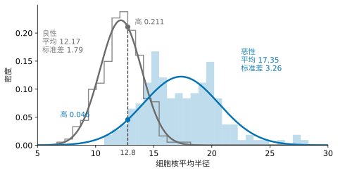
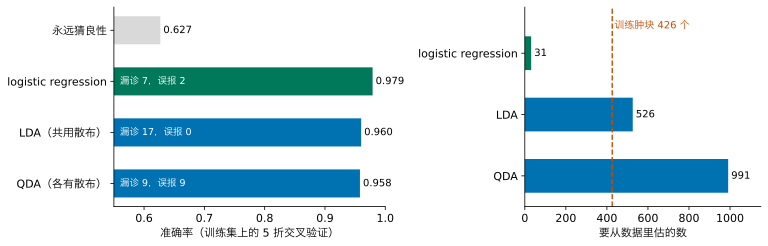
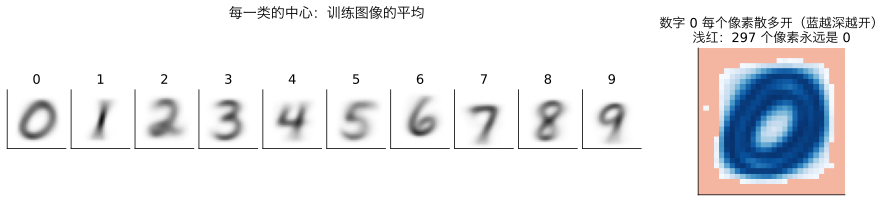
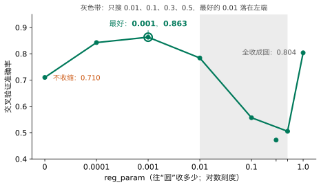
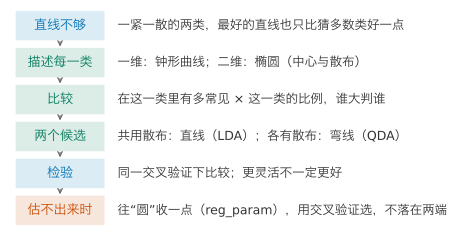
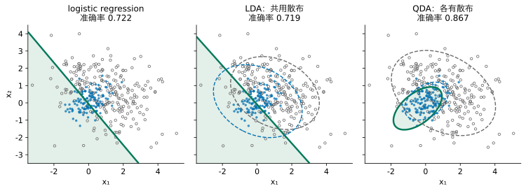

## 1. 动机：一条直线不够

上一讲的 logistic regression 输出一个概率，再按阈值做决定。它的边界总是一条直线（多个特征时是一个平面）。上一讲最后说过：如果两类不能被一条直线分开，就得先想到一个合适的新特征。

下面是一份二维数据，两个特征记为 $x_1$、$x_2$。蓝点是类 1，共 120 个；灰色空心圆是类 0，共 240 个。先用你已有的工具试一试：在组件里拖动直线，看看能不能把两类分开。



请先自己试：最好的直线能做到多少？logistic regression 找到的直线又怎样？

::: {.callout-note collapse="true" title="展开答案"}
怎么拖都分不好。logistic regression 找到的直线，准确率是 0.722；而“永远猜类 0”就有 240 / 360 = 0.667。直线只比瞎猜好一点。
:::

可是用眼睛看，两类的区别很清楚：类 1 紧紧聚在中间，类 0 散得很开，从四面八方包住它。直线抓不住这种区别，因为 logistic regression 只学一条边界：它只关心“线的哪一边”，不关心每一类的点长什么样。

上一讲遇到环形数据时，办法是造一个新特征“到中心的距离”。请先想：这里也能这样做吗？要做，得先知道什么？

::: {.callout-note collapse="true" title="展开答案"}
可以试，但得先猜对两件事：新特征该是什么形状（圆？斜着的椭圆？），中心在哪里。这份数据里类 1 的那一团是斜的，中心和斜的程度都要先估出来，凭眼睛猜不准；特征再多一些，就根本没法看着图去猜。
:::

所以我们想要的是：**不用自己猜特征，让每一类的数据自己告诉我们它长什么样。**反过来想：如果知道每一类的点通常落在哪里、散得多开，能不能直接问：**这个点更像是哪一类生出来的？**

**本讲之后你能做到：**遇到分类问题时，先用中心和散布描述每一类，再据此算出一个点属于各类的概率；说出这条路上的两个候选（两类共用散布，或各有散布）各假设了什么、边界为什么一直一弯；在同一份交叉验证下，把它们和 logistic regression 比较；维数多、样本少时，知道散布会估不出来，会用收缩修正，并检查选出的参数不在搜索范围的两端。

## 2. 先在一维试：给每一类画一条钟形曲线

先回到只有一个特征的情形。上一讲的乳腺肿块数据，只看细胞核平均半径（下文简称半径），划分与上一讲相同：训练集 426 个肿块，其中恶性 159 个。

我们要的描述有两个要求：用很少几个数就能说清一类；给任何一个半径，都能说出它在这一类里有多常见。

请先想：直方图本身能不能当这个描述？

::: {.callout-note collapse="true" title="展开答案"}
直方图要记下每根柱子的高度，几十个数；柱子画多宽，形状就跟着变；落在空柱子里的半径，会被说成“这一类里从不出现”，其实只是样本没碰上。我们想要一条平滑的曲线，只由几个数决定。
:::

最少需要两个数：这一类的**中心**在哪里，用平均值 $\mu$；它**散得多开**，用标准差 $\sigma$。恶性肿块的半径平均 17.35、标准差 3.26；良性平均 12.17、标准差 1.79。最常用的、只由这两个数决定的平滑曲线，是一条钟形曲线：

$$
f(x) = \frac{1}{\sqrt{2\pi}\,\sigma}\exp\!\Big(-\frac{(x-\mu)^2}{2\sigma^2}\Big).
$$

这条曲线叫**正态分布**（normal distribution）的密度。读法很简单：$x$ 离中心 $\mu$ 越远，曲线越低；$\sigma$ 越大，曲线越矮越宽。曲线下的总面积是 1，所以某处曲线的高度说的是：这一类的肿块落在这附近，有多常见。

{fig-alt="良性的灰色钟形曲线又高又窄，中心在 12；恶性的蓝色曲线矮而宽，中心在 17；在 12.8 处灰线高 0.211，蓝线高 0.046"}

上一讲开场的那个肿块，半径 12.8。在良性曲线下，那里的高度是 0.211；在恶性曲线下是 0.046。

请先想：良性的高度大约是恶性的 4.6 倍。能不能直接说“它是良性的可能性是恶性的 4.6 倍”？

::: {.callout-note collapse="true" title="展开答案"}
还不能。高度只说明“如果它是恶性，长成这样有多常见”，没有考虑恶性本来有多少。设想一种病极罕见，1000 个肿块里只有 1 个恶性：即使某个半径在恶性里更常见，碰到的这一个肿块仍然多半是良性。所以还要乘上每一类本来占的比例。
:::

训练集里良性占 0.627，恶性占 0.373。把高度乘上比例：

- 良性：$0.627 \times 0.211 = 0.132$；
- 恶性：$0.373 \times 0.046 = 0.017$。

这两个数说的是：在所有肿块里，“是这一类、并且半径在 12.8 附近”有多常见。两者相加是“半径在 12.8 附近”的全部，所以恶性的概率是

$$
\frac{0.017}{0.017 + 0.132} = 0.114 .
$$

写成一般形式，记类 $k$ 的比例为 $\pi_k$、钟形曲线为 $f_k$：

$$
\textcolor{#00795A}{P(\text{类 }1 \mid x)} = \frac{\pi_1 f_1(x)}{\pi_1 f_1(x) + \pi_0 f_0(x)} .
$$

类别不止两个时，分母把所有类加起来：$P(\text{类 }k \mid x) = \dfrac{\pi_k f_k(x)}{\sum_j \pi_j f_j(x)}$，判为概率最大的那一类。这叫**贝叶斯公式**（Bayes' rule）。$\pi_k$ 是看到 $x$ 之前对类 $k$ 的估计，叫**先验概率**（prior）；左边是看到 $x$ 之后的估计，叫**后验概率**（posterior）。两者之间，靠“在这一类里 $x$ 有多常见”来更新。

上一讲只用半径的 logistic regression，给这个肿块的恶性概率是 0.122。两个数很接近，来路却完全不同：logistic regression 直接学“哪一边是恶性”；这里先分别描述良性、恶性各长什么样，再比较。

**边界在哪里？**谁的“高度乘比例”大就判谁，两者相等的地方就是边界。本例在半径 15.11 处（上一讲 logistic 的边界在 14.72）。还有一个有趣的现象：恶性的曲线比良性宽，往左走，良性曲线降得更快，到半径 4.76 以下恶性又会胜出。所以这里其实有两个切点，只是 4.76 远小于训练集里最小的半径 6.98，碰不到。**两类散得不一样时，边界不只是一刀。**这正是第 1 节那份二维数据需要的东西。

## 3. 二维：钟形曲线变成椭圆

现在回到第 1 节的二维数据。描述一类，仍然要中心和散布。

**中心**是每个特征各自的平均值，排成一个向量：类 1 的中心是 $\boldsymbol\mu_1 = (0.04,\ 0.10)$，类 0 的是 $\boldsymbol\mu_0 = (1.03,\ 0.57)$。

**散布**要多说一件事。只给两个标准差，说的是“沿 $x_1$ 散多开、沿 $x_2$ 散多开”，却说不出两个特征是否一起变：$x_1$ 大的点，$x_2$ 是否也偏大？这用**协方差**（covariance）描述：

$$
\operatorname{cov}(x_1, x_2) = \frac{1}{n-1}\sum_{i=1}^{n}(x_{i1}-\mu_1)(x_{i2}-\mu_2).
$$

两个特征一起偏大、一起偏小，乘积多为正，协方差为正；一个大另一个小，协方差为负；互不相干，接近 0。把两个方差（标准差的平方）和协方差排成一个矩阵，叫**协方差矩阵**，记作 $\Sigma$：

$$
\Sigma_1 = \begin{pmatrix}0.40 & 0.14\\ 0.14 & 0.30\end{pmatrix},\qquad
\Sigma_0 = \begin{pmatrix}2.26 & -0.62\\ -0.62 & 1.52\end{pmatrix}.
$$

对角线是两个方差，非对角线是协方差。类 1 的方差小，散得紧；类 0 的方差大，散得开。

一维的钟形曲线到了二维，是一座“小山”，从上往下看，等高线是一圈圈椭圆。椭圆的中心是 $\boldsymbol\mu$，形状、大小和倾斜方向由 $\Sigma$ 决定：协方差为正，椭圆向右上倾斜。它的公式是

$$
f(\mathbf x) = \frac{1}{2\pi\sqrt{\det\Sigma}}\exp\!\Big(-\tfrac12(\mathbf x-\boldsymbol\mu)^\top\Sigma^{-1}(\mathbf x-\boldsymbol\mu)\Big).
$$

有 $d$ 个特征时，分母里的 $2\pi$ 换成 $(2\pi)^{d/2}$，其余不变。不必记它。只需读懂一处：$(\mathbf x-\boldsymbol\mu)^\top\Sigma^{-1}(\mathbf x-\boldsymbol\mu)$ 是“用这一类自己的散布量出来的、$\mathbf x$ 到中心的距离”。同一个椭圆上的点，这个距离相等，小山的高度也相等。一维时它就是 $\frac{(x-\mu)^2}{\sigma^2}$。

判断的规则和一维完全一样：比较 $\pi_1 f_1(\mathbf x)$ 和 $\pi_0 f_0(\mathbf x)$。下面的组件把每一类画成椭圆，你可以把黑点放到任何位置。



请先看黑点一开始的位置：它在类 1 里更常见（0.108 对 0.081），为什么却判为类 0？再把它拖到类 1 的中心、拖到右下角远离所有点的地方，各是哪一类胜出？

::: {.callout-note collapse="true" title="展开答案"}
一开始的位置，类 1 的小山更高，但类 1 只占 1/3，类 0 占 2/3：乘上比例后是 0.036 对 0.054，类 0 胜出，类 1 的概率是 0.401。在类 1 的中心，类 1 的小山又高又尖，乘上 1/3 仍然大胜。右下角远离所有点时，两座小山都很低；但类 1 散得紧，离开中心后降得快得多，类 0 散得开，降得慢，所以类 0 胜出。这正是直线做不到的：判断依据不只是“在哪一边”，还有“离各自的中心有多远，按各自的散布来量”，以及每一类本来有多少。
:::

## 4. 两个候选：共用散布，还是各有散布

要用这条规则，得从数据里估出每一类的中心和协方差矩阵。中心没什么可选的，用平均值。散布却有两个候选：

1. **两类共用一个散布。**假设两类形状、大小、方向都一样，只是中心不同。把两类各自的协方差按样本数加权平均，得到一个共用的 $\Sigma$。这样要估的数少一些。
2. **每类有自己的散布。**各用各的 $\Sigma_1$、$\Sigma_0$。更灵活，但要估的数多一倍。

下面的组件在两个候选之间切换。



请先切换几次：两种情况下，绿色边界各是什么形状？哪个准确率高？

::: {.callout-note collapse="true" title="展开答案"}
共用散布时，边界是一条直线，准确率 0.719，和 logistic regression 的 0.722 几乎一样。各有散布时，边界变成一个椭圆，围住紧的那一类，准确率 0.867。
:::

第一个候选叫**线性判别分析**（Linear Discriminant Analysis，**LDA**），名字里的“线性”就是边界是直的。第二个叫**二次判别分析**（Quadratic Discriminant Analysis，**QDA**），边界由一个二次方程给出，可以是椭圆、双曲线或抛物线。

为什么共用散布就一定是直线？两类的“小山”形状完全相同，比较 $\pi_1 f_1$ 和 $\pi_0 f_0$ 时，指数里含 $\mathbf x^\top\Sigma^{-1}\mathbf x$ 的那一项在两边一样，相减后消掉，只剩 $\mathbf x$ 的一次项，所以边界是直线。各有散布时，两边的二次项不同，消不掉，边界就弯了。推导见 Advanced Study 1。

注意边界是怎么弯起来的。上一讲要让边界变弯，得先想到“到中心的距离”这个新特征。这里我们没有造任何特征：弯曲来自“两类散得不一样”这个从数据里估出来的事实。

## 5. 检验：在真实数据上比一比

二维的例子是手造的，正好符合“每一类是一个椭圆”的假设。真实数据上会怎样？回到乳腺肿块的全部 30 个特征，与上一讲同一个划分、同一个 5 折交叉验证，比较三种方法。

```python
from sklearn.discriminant_analysis import LinearDiscriminantAnalysis, QuadraticDiscriminantAnalysis
from sklearn.model_selection import cross_val_score

lda = LinearDiscriminantAnalysis()           # one shared spread: straight boundary
qda = QuadraticDiscriminantAnalysis()        # one spread per class: curved boundary
print(cross_val_score(lda, X_train_s, y_train, cv=kf).mean())   # average accuracy over the 5 folds
print(cross_val_score(qda, X_train_s, y_train, cv=kf).mean())
```

这里的 `X_train_s`、`y_train`、`kf` 与上一讲第 10 节相同。不收缩时，标准化对 LDA、QDA 没有影响（它们用每一类自己的散布来量距离），保留它只是为了和 logistic regression 用同一份输入。第 6 节的收缩会改变这一点。

{fig-alt="左图三种方法准确率 0.979、0.960、0.958，基线 0.627；右图要估的数 31、526、991，红色虚线标出 426 个训练肿块"}

logistic regression 0.979，LDA 0.960，QDA 0.958。

请先想：QDA 最灵活，在第 1 节的数据上也最好。为什么在这里反而最差？

::: {.callout-note collapse="true" title="展开答案"}
至少有两个原因。

一是要估的数太多。30 个特征时，一个协方差矩阵有 $30 \times 31 / 2 = 465$ 个不同的数。QDA 每类一个，加上两个中心和比例，共 991 个；LDA 共用一个，是 526 个；logistic regression 只有 31 个。而训练肿块只有 426 个，恶性的只有 159 个。数据不够，估出来的散布就不稳。scikit-learn 在这里还给出一条警告：某一类的协方差矩阵“不满秩”。半径、周长、面积几乎由彼此决定，椭圆在某些方向上被压得几乎没有厚度。

二是假设不一定对。LDA 和 QDA 都假设每一类是一座椭圆形的小山。真实的测量值未必如此，例如面积的分布明显偏向一侧。假设越偏离数据，按假设算出的概率就越不可靠。
:::

漏诊的差别更大：logistic regression 漏 7 个，QDA 漏 9 个，LDA 漏 17 个。上一讲说过，漏诊的代价远大于误报，所以 LDA 的 0.960 在这里比数字看上去更差。

结论不是“哪种方法更好”，而是：**更灵活不等于更好，要看假设是否合乎数据、数据够不够估出它要的数。**方法的名字不保证结果，要在同一份交叉验证下比。

## 6. 维数更多：散布估不出来了

上一讲第 8 节的手写数字（MNIST 子集）：28×28 = 784 个像素，10 类，训练集 7500 张，每类 680 到 851 张。像素先除以 255。

在 784 维里，一个协方差矩阵有 $784 \times 785 / 2 = 307{,}720$ 个数，而每类只有约 750 张图。问题还不只在数量。

{fig-alt="十个模糊的平均数字图，认得出 0 到 9；右边一张 28 乘 28 的图，中间一圈蓝色，四周一大片浅红"}

图的左边是每一类的中心，已经能认出 0 到 9 的轮廓。右边是数字 0 的每个像素的标准差：四周一大片浅红的像素，在所有 0 的训练图像里都是 0，散布为 0。每一类都有 245 到 361 个这样的像素。

散布为 0，意味着这一类的椭圆在这些方向上被压扁，厚度为 0。一张新的 0，只要在这些位置有一点点墨水，按这一类的散布来量，它离中心就是无穷远，小山的高度是 0。用默认设置的 QDA 去做交叉验证，scikit-learn 给出警告（某类的协方差矩阵不满秩），准确率只有 0.710；同一个 5 折交叉验证下，上一讲的 logistic regression（$C = 0.1$）是 0.901。

你可能会问：LDA 要估的共用散布也有 307,720 个数，比 7500 张图还多，为什么它没出警告（交叉验证 0.833）？因为 scikit-learn 的 LDA 默认不去求散布的逆，而是只在数据真正有变化的方向里比较各类；QDA 却要为每一类单独求一个散布的逆和它的“体积”（行列式），每类只有约 750 张图，很多方向上厚度为 0，求逆这一步就出问题。

请先想：Lesson 3 遇到“数据不够、估出来的东西不稳”时，是怎么办的？

::: {.callout-note collapse="true" title="展开答案"}
正则化：把要估的东西往一个简单的形状拉一点。Ridge 把系数往 0 拉。这里要把每一类的散布往某个形状拉，让被压扁的方向重新有厚度。
:::

往什么形状拉？有三个候选：

1. **往各类共用的散布拉**（也就是往 LDA 拉）。可是有 121 个像素在所有训练图像里都是 0，共用的散布在这些方向上同样没有厚度。
2. **只保留每个像素自己的方差，去掉协方差**（椭圆不再倾斜）。可是一类里恒为 0 的像素，方差仍是 0。
3. **往一个圆拉**：各方向散得一样、不倾斜、不用从数据里估。它在每个方向上都有厚度。

只有第三个保证每个方向都有厚度，所以选它。

具体做法是把每一类自己的协方差矩阵和一个“圆”（单位矩阵 $I$）按比例混合：

$$
\Sigma_k(r) = (1-r)\,\Sigma_k + r\,I,\qquad 0 \le r \le 1 .
$$

单位矩阵是一个半径为 1 的圆，所以收缩之前，各个特征要在相近的尺度上：MNIST 的像素都已除以 255，落在 0 到 1；乳腺肿块要先标准化。$r = 0$ 就是原来的 QDA；$r = 1$ 时每一类都是同样大小的圆，只剩中心不同，判断就变成“离哪个中心近、再考虑比例”。$r$ 在两者之间，散布往圆收一部分。这种做法叫**收缩**（shrinkage）。下面的组件在第 1 节的二维数据上演示它做了什么。



拖动 $r$ 可以看到：椭圆越来越圆，弯曲的边界越来越直，$r = 1$ 时变成一条直线。在这份二维数据上，散布本来就估得准，收缩只会让准确率下降（从 0.867 降到 0.697）。收缩有用的地方，是散布估不准的时候。

scikit-learn 里这个 $r$ 叫 `reg_param`。它是一个超参数，和 Lesson 3 的 λ 一样，用交叉验证来选：

```python
from sklearn.model_selection import cross_val_score

for r in [0, 0.0001, 0.001, 0.01, 0.1, 0.5, 1]:   # values of reg_param to try
    qda = QuadraticDiscriminantAnalysis(reg_param=r)               # pull each spread towards a circle by r
    score = cross_val_score(qda, X_digits_train, y_digits_train, cv=kf).mean()   # 5-fold accuracy
    print(r, score)
```

{fig-alt="一条曲线：不收缩 0.710，0.001 处最高 0.863，到 0.1 和 0.5 掉到 0.5 左右，1 处又回到 0.804"}

不收缩时 0.710；收一点点（0.0001）就跳到 0.843；最好的是 0.001，准确率 0.863；再往上收，散布被拉得太圆，丢掉了每一类真实的形状，准确率又降下来，0.1 到 0.5 之间只有 0.5 左右。到 $r = 1$，每一类都是同样大小的圆，判断变成“离哪个中心近”，又回到 0.804。中间这一段为什么掉得这么低，和像素的散布都很小（远小于圆的半径 1）有关，本讲不细究；重要的是，最好的值仍是交叉验证选出来的那个。

**选出的值不能落在搜索范围的两端。**假设我们只试了 0.01、0.1、0.3、0.5（图中灰色区域），最好的是 0.01，正好在左端。这时不能停：真正最好的值可能在 0.01 以下，只是我们没试。规则是：最好的值落在端点，就把范围往那一侧扩大，再选一次，直到最好的值在范围中间。上面的范围从 0 到 1，最好的 0.001 在中间，可以放心。

所有选择都做完了，才打开测试集，只读一次：`reg_param = 0.001` 的 QDA，在全部 7500 张训练图像上拟合，测试准确率 0.861。作为对照，LDA 是 0.832，上一讲的 logistic regression 是 0.908。收缩让 QDA 能用了（从 0.710 到 0.86 左右），也比 LDA 好；但在 784 个像素上，它仍不如 logistic regression：每一类 30 万个散布的数，750 张图即使收缩之后也估不太准。留一个问题给你：能不能先把每张图的 784 个数变少，再交给 QDA？

## 7. 实现：用 scikit-learn 完成

前三步（读数据、分层划分、标准化）与上一讲第 10 节完全相同，这里接着写。

**第一步，手算开场肿块的概率（Section 2）：**

```python
from scipy.stats import norm

radius = X_train[:, 0]                       # column 0 is the mean radius
mean_mal = radius[y_train == 1].mean()       # centre of the malignant class
sd_mal = radius[y_train == 1].std(ddof=1)    # spread of the malignant class
mean_ben = radius[y_train == 0].mean()       # centre of the benign class
sd_ben = radius[y_train == 0].std(ddof=1)    # spread of the benign class
share_mal = (y_train == 1).mean()            # prior: share of malignant lumps
share_ben = (y_train == 0).mean()            # prior: share of benign lumps

x = X_test[47, 0]                            # the opening lump, radius 12.8
top = share_mal * norm.pdf(x, mean_mal, sd_mal)          # share times height, malignant
bottom = top + share_ben * norm.pdf(x, mean_ben, sd_ben) # plus share times height, benign
print(top / bottom)                          # Bayes' rule: probability of malignant
```

输出 0.114。`ddof=1` 让标准差除以 $n-1$，与 scikit-learn 的做法一致。

**第二步，同一交叉验证比较三种方法（Section 5）：**见第 5 节的代码，再加上上一讲的 `LogisticRegression()`。

**第三步，MNIST 子集上选 `reg_param`，测试集读一次（第 6 节）：**

```python
qda = QuadraticDiscriminantAnalysis(reg_param=0.001)  # the value chosen by cross-validation
qda.fit(X_digits_train, y_digits_train)               # train on all training images
print(qda.score(X_digits_test, y_digits_test))        # the test set, read once
```

输出 0.861。`X_digits_train` 等变量与上一讲第 8 节相同（MNIST 子集，像素已除以 255）。

## 8. 一页回顾

如果只读一页，读这里。

{fig-alt="六个步骤的竖向流程图"}

| 你看到的问题 | 可以做什么 | 用什么证据判断 |
|---|---|---|
| 直线分不开，两类却明显一紧一散 | 先描述每一类：中心（平均值）和散布（标准差，二维时是协方差矩阵） | 钟形曲线或椭圆是否贴合每一类的点 |
| 怎样由描述得到判断 | 贝叶斯公式：比较“这一类里有多常见”乘以“这一类的比例” | 算出的概率；与 logistic regression 的对照 |
| 散布怎样估 | 共用一个（LDA，边界是直线）或各有一个（QDA，边界弯曲） | 同一份交叉验证下的准确率和两种错误 |
| 维数多、样本少，散布估不出来 | 往“圆”收缩：`reg_param` | 交叉验证曲线；最好的值不在搜索范围两端 |

## 9. 总结与局限

回到开场那份二维数据。三种方法，三条边界：

{fig-alt="三幅图：logistic 与 LDA 都是一条斜线，准确率 0.722 和 0.719；QDA 是一个围住蓝点的椭圆，准确率 0.867"}

logistic regression 和 LDA 都画出一条直线，准确率几乎一样；QDA 画出一个椭圆，准确率 0.867。差别不在“谁更聪明”，而在它们对每一类长什么样的假设：logistic regression 不描述每一类，只学边界；LDA 假设两类形状相同；QDA 允许两类形状不同。开场的问题“能不能直接问这个点更像哪一类生出来的”，答案是能：先描述每一类，再用贝叶斯公式比较。代价是要估更多的数，数据不够时要收缩。

**迁移题。**一家网店要判断一条评论是不是刷出来的假评论，手里有两个特征：评论的字数、账号注册的天数。真评论的字数和天数都散得很开；假评论大多字数很少、账号很新，紧紧挤在一角。请不做计算回答：你预计 LDA 和 QDA 谁的边界更合适，为什么？如果再加 200 个关于用词的特征、而假评论只有 300 条，QDA 会遇到什么问题，怎么办？参数怎么选？

::: {.callout-note collapse="true" title="参考回答"}
两类一紧一散，与第 1 节的数据相似，QDA 的弯曲边界更合适；LDA 假设两类形状相同，只能画直线。加到 202 个特征后，每类的协方差矩阵有 202 × 203 / 2 = 20503 个数，假评论只有 300 条，散布估不出来，QDA 会给出“不满秩”的警告、结果很差。办法是收缩（`reg_param`），在训练集内用交叉验证选它，并检查最好的值不在搜索范围两端；也可以改用 LDA 或 logistic regression，它们要估的数少得多。最后在测试集上只读一次。
:::

**这个方法在哪里不可信。**

1. **椭圆是假设。**如果一类的点弯成香蕉形，或者分成相隔很远的两团（例如手写的 7 有带横杠和不带横杠两种写法），一个椭圆描述不了它，算出的概率就是错的。
2. **概率仍未校准。**模型说 0.114，不代表这样的肿块里真有 11.4% 是恶性。比例 $\pi_k$ 来自训练集，换一家医院、恶性的比例不同，概率也要跟着变。
3. **维数多时要靠收缩。**收多少由交叉验证决定，只在这批数据内部可信；`reg_param` 换一份数据可能要重选。
4. **数据决定谁好。**乳腺肿块上 logistic regression 最好；MNIST 像素上收缩让 QDA 能用、也胜过 LDA，但仍是 logistic regression 最好。本讲没有给出“什么时候用哪种”的规则，只给出了比较的方法。

**回到开头的承诺。**现在，面对一个分类问题，你多了一条路：用中心和散布描述每一类，用贝叶斯公式算出一个点属于各类的概率；说清 LDA 与 QDA 的假设差别，以及边界为什么一直一弯；在同一份交叉验证下与 logistic regression 比较；散布估不出来时用 `reg_param` 收缩，并检查选出的值不在范围两端。

**30 秒反馈。**读完这一讲，请扫码留下匿名反馈或问题：哪里没看懂、哪里讲得太快，都对改进有用。

{fig-align="center" width="160px" fig-alt="反馈二维码"}

*以下是 Advanced Study，不影响主线，每个 Study 可以单独阅读。MPS311 鼓励选读。MPS439 的必做是一项深度主任务：Lab 5 的 Advanced A，它以本页 Study 2 为基础，但收缩用 r = 0.5，自检值与这里不同；其余 Study 选读。*

---

## Advanced Study 1：共用散布时，边界为什么是直线

两类的比较可以写成取对数之后相减。定义

$$
g(\mathbf x) = \log\big(\pi_1 f_1(\mathbf x)\big) - \log\big(\pi_0 f_0(\mathbf x)\big),
$$

$g(\mathbf x) \ge 0$ 判为类 1，$g(\mathbf x) = 0$ 就是边界。代入二维（一般是 $d$ 维）的密度：

$$
\log f_k(\mathbf x) = -\tfrac12(\mathbf x-\boldsymbol\mu_k)^\top\Sigma_k^{-1}(\mathbf x-\boldsymbol\mu_k) - \tfrac12\log\det\Sigma_k + \text{常数}.
$$

**共用散布，$\Sigma_1 = \Sigma_0 = \Sigma$。**把二次型展开：

$$
(\mathbf x-\boldsymbol\mu_k)^\top\Sigma^{-1}(\mathbf x-\boldsymbol\mu_k) = \mathbf x^\top\Sigma^{-1}\mathbf x - 2\boldsymbol\mu_k^\top\Sigma^{-1}\mathbf x + \boldsymbol\mu_k^\top\Sigma^{-1}\boldsymbol\mu_k .
$$

第一项 $\mathbf x^\top\Sigma^{-1}\mathbf x$ 与 $k$ 无关，$\log\det\Sigma$ 也一样，相减时都消掉，剩下

$$
g(\mathbf x) = \underbrace{(\boldsymbol\mu_1-\boldsymbol\mu_0)^\top\Sigma^{-1}}_{\mathbf w^\top}\,\mathbf x \;\underbrace{-\;\tfrac12\boldsymbol\mu_1^\top\Sigma^{-1}\boldsymbol\mu_1 + \tfrac12\boldsymbol\mu_0^\top\Sigma^{-1}\boldsymbol\mu_0 + \log\frac{\pi_1}{\pi_0}}_{b} .
$$

$g(\mathbf x) = \mathbf w^\top\mathbf x + b$，是 $\mathbf x$ 的一次函数，边界 $g = 0$ 是直线（超平面）。它和 logistic regression 的形式一模一样：再由 $P(\text{类 }1\mid\mathbf x) = \frac{1}{1+e^{-g}}$ 可知，LDA 的后验概率也是一个 sigmoid。区别只在 $\mathbf w$、$b$ 怎么来：logistic regression 用交叉熵直接拟合；LDA 由中心、共用散布和比例算出来。

**各有散布。**$\mathbf x^\top\Sigma_1^{-1}\mathbf x$ 与 $\mathbf x^\top\Sigma_0^{-1}\mathbf x$ 不再相同，相减后剩下 $-\tfrac12\mathbf x^\top(\Sigma_1^{-1}-\Sigma_0^{-1})\mathbf x$，$g$ 是 $\mathbf x$ 的二次函数，边界是二次曲线。

**练习。**

1. 一维时，令 $g(x) = 0$，写出 QDA 边界满足的二次方程。代入第 2 节的平均值、标准差和比例，验证两个根约为 15.11 和 4.76。
2. 两类比例相等（$\pi_1 = \pi_0$）、共用散布且 $\Sigma = I$ 时，LDA 的边界是什么？（提示：两个中心连线的垂直平分线。）

## Advanced Study 2：只用 numpy 写一个高斯分类器

用上一讲第 10 节标准化后的 `X_train_s`、`y_train`、`X_test_s`。对每一类估出中心、协方差矩阵（往圆收缩 $r = 0.1$）和比例，再比较每个测试样本的 $\log\big(\pi_k f_k(\mathbf x)\big)$。为了避免很小的数相乘，直接算对数；所有类共有的常数 $-\frac d2\log 2\pi$ 不影响比较，省去。

```python
import numpy as np

r = 0.1                                          # how far to pull each spread towards a circle
d = X_train_s.shape[1]                           # 30 features
X_ben = X_train_s[y_train == 0]                  # training lumps of class 0
X_mal = X_train_s[y_train == 1]                  # training lumps of class 1

S_ben = (1 - r) * np.cov(X_ben.T) + r * np.eye(d)    # shrunk spread of class 0
S_mal = (1 - r) * np.cov(X_mal.T) + r * np.eye(d)    # shrunk spread of class 1
diff_ben = X_test_s - X_ben.mean(axis=0)         # each test lump minus the centre of class 0
diff_mal = X_test_s - X_mal.mean(axis=0)         # each test lump minus the centre of class 1
dist_ben = np.sum(diff_ben @ np.linalg.inv(S_ben) * diff_ben, axis=1)   # squared distance, measured by the class's own spread
dist_mal = np.sum(diff_mal @ np.linalg.inv(S_mal) * diff_mal, axis=1)
log_ben = -0.5 * dist_ben - 0.5 * np.linalg.slogdet(S_ben)[1] + np.log(len(X_ben) / len(X_train_s))   # log of share times height
log_mal = -0.5 * dist_mal - 0.5 * np.linalg.slogdet(S_mal)[1] + np.log(len(X_mal) / len(X_train_s))
mine = (log_mal > log_ben).astype(int)          # 1 when malignant wins
```

与 scikit-learn 对照：

```python
ref = QuadraticDiscriminantAnalysis(reg_param=0.1).fit(X_train_s, y_train)
print((mine != ref.predict(X_test_s)).sum())     # number of test lumps on which the two disagree
```

结果是 0：143 个测试肿块的预测完全一致，准确率都是 0.951。scikit-learn 的 `reg_param` 正是“往单位矩阵收缩”：它在协方差矩阵的特征方向上，把每个方差 $\lambda$ 换成 $(1-r)\lambda + r$，与 $(1-r)\Sigma + rI$ 相同。

接下来请自己做：

1. 把 `r` 改成 0，在 MNIST 子集（`X_digits_train`，784 维）上照做。`np.linalg.inv` 会怎样？`slogdet` 给出什么？这与第 6 节的警告有什么关系？
2. 把两类改成共用一个散布（按样本数加权平均两个协方差矩阵），与 `LinearDiscriminantAnalysis()` 的预测对照。
3. 写成 10 类的版本（MNIST 子集），与 `QuadraticDiscriminantAnalysis(reg_param=0.001)` 对照。作业 2 的附加题 C 要在 MNIST 上做同样的事。

## Advanced Study 3：开放问题

下面五个问题本讲没有展开，每个给出一个起点。

1. **LDA 也是一种投影。**去年这一讲从另一个角度讲 LDA：找一个方向，把点投影到这条线上，让两类的中心尽量分开、每一类自己尽量紧（Fisher 判别）。起点：比较 Advanced Study 1 里的 $\mathbf w = \Sigma^{-1}(\boldsymbol\mu_1-\boldsymbol\mu_0)$ 与 Fisher 的方向；查阅 `LinearDiscriminantAnalysis` 的 `transform` 和 `n_components`。
2. **朴素贝叶斯。**如果假设每一类里各个特征互不相关（协方差矩阵只有对角线），要估的数从 465 降到 30。这叫 naive Bayes，常用于垃圾邮件过滤。起点：`sklearn.naive_bayes.GaussianNB`，在乳腺肿块上与 LDA、QDA 比较。它和 `reg_param` 有什么相似之处？
3. **一类不止一团。**如果一类由几团组成，可以用几个椭圆叠加来描述它（高斯混合模型）。起点：手造一份“类 1 是两团”的二维数据，看 QDA 的边界怎样失败；查阅 `sklearn.mixture.GaussianMixture`。
4. **往哪里收。**第 6 节说明了 MNIST 上为什么不能只往共用的散布收（也就是往 LDA 收，收到底 QDA 就变成 LDA）。在别的数据上，共用的散布未必是平的，这个候选可能更好，也可以两者都收一点。起点：自己写出 $(1-a)\Sigma_k + a\,\Sigma_{\text{共用}}$，在 digits 上用交叉验证选 $a$，与 `reg_param` 比较。这个思路叫 regularised discriminant analysis。
5. **比例换了怎么办。**训练集里恶性占 37%，如果一家筛查中心里恶性只占 1%，后验概率怎样变？起点：`QuadraticDiscriminantAnalysis(priors=[0.99, 0.01])`，看开场肿块的概率变成多少，并与上一讲“调低阈值”的做法比较。
