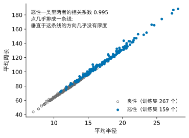
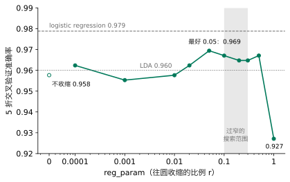

## 1. 问题：一条直线不够

上一讲的 logistic regression 输出一个概率，再按阈值做决定。它的边界总是一条直线（多个特征时是一个平面）。上一讲最后说过：如果两类不能被一条直线分开，就得先想到一个合适的新特征。

下面是一份二维数据，两个特征记为 $x_1$、$x_2$。蓝点是类 1，共 120 个；灰色空心圆是类 0，共 240 个。先用你已有的工具试一试：在组件里拖动直线，看看能不能把两类分开。



请先自己试：最好的直线能做到多少？logistic regression 找到的直线又怎样？

::: {.callout-note collapse="true" title="展开答案"}
怎么拖都分不好。logistic regression 找到的直线，准确率是 0.722；而“永远猜类 0”就有 240 / 360 = 0.667。直线只比瞎猜好一点。
:::

可是用眼睛看，两类的区别很清楚：类 1 紧紧聚在中间，类 0 散得很开，从四面八方包住它。直线抓不住这种区别，因为 logistic regression 只学一条边界：它只关心“线的哪一边”，不关心每一类的点长什么样。

上一讲遇到环形数据时，办法是造一个新特征“到中心的距离”。请先想：这里也能这样做吗？要做，得先知道什么？

::: {.callout-note collapse="true" title="展开答案"}
可以试，但得先猜对两件事：新特征该是什么形状（圆？斜着的椭圆？），中心在哪里。这份数据里类 1 的那一团是斜的，中心和斜的程度都要先估出来，凭眼睛猜不准；特征再多一些，就根本没法看着图去猜。
:::

所以我们想试另一条路：**先用数据描述每一类长什么样，再用这些描述判断一个新点属于哪一类。**这份数据中两类散布差别很大；但换一份数据，两类也可能散得差不多。描述散布时，可以让各类共用一套，也可以让各类分别估计。哪种选择更好，要看它的假设和数据是否足以支持估计。

这条路仍然走 Lesson 2 以来的五步：**问题、模型、损失、求解、检验**。变化最大的是**模型**。模型就是我们对数据作的假设。上一讲的假设是：已知特征时，属于类 1 的概率随特征按 S 形变化。这一讲换一个假设：每一类的数据是怎样生出来的。假设一旦定下来，怎样判断、要估哪些数、用什么损失、怎样求解，都跟着它走；检验暴露出问题时，也要回到其中某一步去改。

**本讲之后你能做到：**拿到一个分类问题，除了直接学一条边界，你还能换一个假设去解它：先假设每一类的数据是怎样生出来的，再由这个假设一路得到判断规则、损失和解法。面对一份新数据，你能根据数据的样子和数据量，判断这个假设是否站得住、该假设得简单一些还是灵活一些，并用证据在几种假设之间作选择；结果不好时，你能分清是假设本身不对，还是数据不够支撑它，从而知道该回到哪一步去改。

## 2. 模型：假设每一类是一条钟形曲线（先看一维）

先回到只有一个特征的情形。上一讲的乳腺肿块数据，只看细胞核平均半径（下文简称半径），划分与上一讲相同：训练集 426 个肿块，其中恶性 159 个。

我们要的描述有两个要求：用很少几个数就能说清一类；给任何一个半径，都能说出它在这一类里有多常见。

请先想：直方图本身能不能当这个描述？

::: {.callout-note collapse="true" title="展开答案"}
直方图要记下每根柱子的高度，几十个数；柱子画多宽，形状就跟着变；落在空柱子里的半径，会被说成“这一类里从不出现”，其实只是样本没碰上。我们想要一条平滑的曲线，只由几个数决定。
:::

先用两个数描述一类：这一类的**中心**在哪里，用平均值 $\mu$；它**散得多开**，用标准差 $\sigma$。这里先分别使用两类的样本标准差：恶性肿块的半径平均 17.35、标准差 3.26；良性平均 12.17、标准差 1.79。我们先用这两条已有的曲线学习如何计算类别概率；第 5 节再比较共用散布和各自散布。只由这两个数决定的一种平滑曲线，是一条钟形曲线：

$$
f(x) = \frac{1}{\sqrt{2\pi}\,\sigma}\exp\!\Big(-\frac{(x-\mu)^2}{2\sigma^2}\Big).
$$

这条曲线叫**正态分布**（normal distribution）的密度。$x$ 离中心 $\mu$ 越远，曲线越低；$\sigma$ 越大，曲线越矮越宽。曲线下的总面积是 1。注意，曲线的高度是**概率密度**，不是半径恰好等于 $x$ 的概率：对于 $x$ 附近一个很窄、宽度为 $\Delta x$ 的区间，落入该区间的概率近似为曲线高度乘以 $\Delta x$。

{fig-alt="良性的灰色钟形曲线又高又窄，中心在 12；恶性的蓝色曲线矮而宽，中心在 17；在 12.8 处灰线高 0.211，蓝线高 0.046"}

**这一步是在做假设。**图里的直方图并不完全是钟形，我们也不知道半径真正怎样分布。说“类 $k$ 的半径服从一条钟形曲线，中心 $\mu_k$、散布 $\sigma_k$；一个肿块属于类 $k$ 的概率是 $P(Y=k)$”（$Y$ 表示类别，1 为恶性、0 为良性），就是在假设数据是这样生出来的：先按这个概率决定一个肿块属于哪一类，再从这一类的钟形曲线里取出它的半径。这句话就是本讲的**模型**。

和上一讲比一比。上一讲的模型假设 $P(\text{恶性}\mid x)=\dfrac{1}{1+e^{-(wx+b)}}$：只说已知半径时恶性的概率怎样变，不说半径本身怎样分布。这一讲的模型多说了一件事：每一类的数据长什么样。按这样的模型可以“生成”出一批假想的肿块，所以它叫**生成模型**（generative model）；上一讲那样直接写出类别概率的，叫**判别模型**（discriminative model）。

模型里要从数据定下来的数叫**参数**：每一类的 $\mu_k$、$\sigma_k$ 和 $P(Y=k)$。上面直接用了平均值、样本标准差和训练集里各类的占比；为什么这样取，是五步里“损失”和“求解”的问题，第 6 节回答。先看这个模型怎样用来判断。

## 3. 有了模型，怎样判断：贝叶斯公式

曲线回答的是：**已知肿块属于某一类，这个半径在该类中有多常见？**分类要回答的方向相反：**已经看到半径，这个肿块属于哪一类的概率是多少？**下面用具体数字把前一个问题转成后一个问题。

上一讲开场的那个肿块，半径 12.8。在良性曲线下，那里的高度是 0.211；在恶性曲线下是 0.046。

请先想：良性的高度大约是恶性的 4.6 倍。能不能直接说“它是良性的可能性是恶性的 4.6 倍”？

::: {.callout-note collapse="true" title="展开答案"}
不能。假设有 100,000 个肿块，其中只有 10 个恶性。即使两类的曲线形状不变，良性肿块本来就多得多；半径在 12.8 附近的肿块也会主要来自良性类，良性与恶性的数量比远大于 4.6 : 1。曲线高度只比较各类**内部**这个半径有多常见；要反过来判断一个肿块属于哪一类，还要考虑各类原来有多少。
:::

**怎样把方向反过来？**这正是**贝叶斯公式**（Bayes' rule）做的事。你可能见过它的一般写法：

$$
P(A\mid B)=\frac{P(B\mid A)\,P(A)}{P(B)}.
$$

竖线读作“在已知……的条件下”。用到我们的问题上，只要说清 $A$ 和 $B$ 各是什么：

| 公式里 | 在我们的问题里 |
|---|---|
| $A$ | 肿块是恶性的：$Y=1$ |
| $B$ | 它的半径在 12.8 附近：$X\approx 12.8$ |
| $P(A\mid B)$ | 看到半径以后，恶性的概率：这就是我们要的答案 |
| $P(B\mid A)$ | 已知是恶性，半径落在 12.8 附近的概率：来自恶性的那条曲线 |
| $P(A)$ | 还没看半径时，一个肿块是恶性的概率：$P(Y=1)$ |
| $P(B)$ | 不管是哪一类，一个肿块半径落在 12.8 附近的概率 |

代进去：

$$
P(Y=1\mid X\approx 12.8)=\frac{P(X\approx 12.8\mid Y=1)\,P(Y=1)}{P(X\approx 12.8)}.
$$

分母怎么算？半径在 12.8 附近的肿块，要么是恶性，要么是良性，两部分加起来就是全部：

$$
P(X\approx 12.8)=P(X\approx 12.8\mid Y=1)\,P(Y=1)+P(X\approx 12.8\mid Y=0)\,P(Y=0).
$$

分子是“恶性且半径在附近”，分母是“所有半径在附近”，相除就是附近的肿块里恶性占多少。这也回答了上面的问题：只比曲线给出的 $P(X\approx 12.8\mid Y)$ 不够，还要乘上 $P(Y)$，也就是每一类本来有多常见。

**回到曲线和数据。**还剩一件事：$P(X\approx 12.8\mid Y=k)$ 怎样从曲线读出来？在 12.8 附近取一个很窄的区间，落进去的概率约等于曲线高度乘区间宽度。分子、分母里每一项都乘着同一个宽度，约掉之后只剩曲线高度。把类 $k$ 那条曲线在 $x$ 处的高度记作 $f_k(x)$，就得到：

$$
P(Y=1\mid X=x)=\frac{P(Y=1)\,f_1(x)}{P(Y=1)\,f_1(x)+P(Y=0)\,f_0(x)}.
$$

代入训练集的数字：

| | $P(Y=k)$（训练集中的占比） | $f_k(12.8)$（曲线高度） | 两者相乘 |
|---|---:|---:|---:|
| 良性（$Y=0$） | 0.627 | 0.211 | 0.132 |
| 恶性（$Y=1$） | 0.373 | 0.046 | 0.017 |

恶性的概率是 $0.017/(0.017+0.132)\approx$ **0.114**。所以良性与恶性的预计数量之比约为 7.8 : 1，不是曲线高度的 4.6 : 1。

$P(Y=k)$ 叫**先验概率**（prior），是看到半径之前对类别的估计；$P(Y=k\mid X=x)$ 叫**后验概率**（posterior），是看到半径之后的估计。这里用训练集里各类的占比估计 $P(Y=k)$；如果训练集的抽样比例与目标人群不同，就不能直接这样用。

后面要反复写 $P(Y=k)$，简写成 $\pi_k=P(Y=k)$。若不止两类，就把分母里所有类加起来：

$$
P(Y=k\mid X=x)=\frac{\pi_k f_k(x)}{\sum_j\pi_j f_j(x)}.
$$

这个式子是后面判断新点的共同规则：LDA 和 QDA 都使用它，区别在于模型对各类的密度 $f_k(x)$ 作了什么假设（第 5 节）。

上一讲只用半径的 logistic regression，给这个肿块的恶性概率是 0.122。两个数很接近，来路却完全不同：logistic regression 直接学“哪一边是恶性”；这里先分别描述良性、恶性各长什么样，再比较。

**边界在哪里？**谁的“高度乘比例”大就判谁，两者相等的地方就是边界。本例在半径 15.11 处（上一讲 logistic 的边界在 14.72）。还有一个有趣的现象：恶性的曲线比良性宽，往左走，良性曲线降得更快，到半径 4.76 以下恶性又会胜出。所以这里其实有两个切点，只是 4.76 远小于训练集里最小的半径 6.98，碰不到。**两类散得不一样时，边界不只是一刀。**这正是第 1 节那份二维数据需要的东西。

## 4. 模型（二维）：钟形曲线变成椭圆

现在回到第 1 节的二维数据。描述一类，仍然要中心和散布。

**中心**是每个特征各自的平均值，排成一个向量：类 1 的中心是 $\boldsymbol\mu_1 = (0.04,\ 0.10)$，类 0 的是 $\boldsymbol\mu_0 = (1.03,\ 0.57)$。

**散布**要多说一件事。只给两个标准差，说的是“沿 $x_1$ 散多开、沿 $x_2$ 散多开”，却说不出两个特征是否一起变：$x_1$ 大的点，$x_2$ 是否也偏大？这用**协方差**（covariance）描述：

$$
\operatorname{cov}(x_1, x_2) = \frac{1}{n-1}\sum_{i=1}^{n}(x_{i1}-\mu_1)(x_{i2}-\mu_2).
$$

两个特征一起偏大、一起偏小，乘积多为正，协方差为正；一个大另一个小，协方差为负；互不相干，接近 0。把两个方差（标准差的平方）和协方差排成一个矩阵，叫**协方差矩阵**，记作 $\Sigma$：

$$
\Sigma_1 = \begin{pmatrix}0.40 & 0.14\\ 0.14 & 0.30\end{pmatrix},\qquad
\Sigma_0 = \begin{pmatrix}2.26 & -0.62\\ -0.62 & 1.52\end{pmatrix}.
$$

对角线是两个方差，非对角线是协方差。类 1 的方差小，散得紧；类 0 的方差大，散得开。

一维的钟形曲线到了二维，是一座“小山”，从上往下看，等高线是一圈圈椭圆。椭圆的中心是 $\boldsymbol\mu$，形状、大小和倾斜方向由 $\Sigma$ 决定：协方差为正，椭圆向右上倾斜。它的公式是

$$
f(\mathbf x) = \frac{1}{2\pi\sqrt{\det\Sigma}}\exp\!\Big(-\tfrac12(\mathbf x-\boldsymbol\mu)^\top\Sigma^{-1}(\mathbf x-\boldsymbol\mu)\Big).
$$

有 $d$ 个特征时，分母里的 $2\pi$ 换成 $(2\pi)^{d/2}$，其余不变。不必记它。只需读懂一处：$(\mathbf x-\boldsymbol\mu)^\top\Sigma^{-1}(\mathbf x-\boldsymbol\mu)$ 是“用这一类自己的散布量出来的、$\mathbf x$ 到中心的距离”。同一个椭圆上的点，这个距离相等，小山的高度也相等。一维时它就是 $\frac{(x-\mu)^2}{\sigma^2}$。

二维时，模型的假设变成：每一类的点由一座以 $\boldsymbol\mu_k$ 为中心、形状由 $\Sigma_k$ 决定的小山生出来。要估的参数也随之变多：每一类的中心是 2 个数，散布是 3 个数（两个方差、一个协方差），再加上比例。

判断的规则和一维完全一样：比较 $\pi_1 f_1(\mathbf x)$ 和 $\pi_0 f_0(\mathbf x)$。下面的组件把每一类画成椭圆，你可以把黑点放到任何位置。



请先看黑点一开始的位置：它在类 1 里更常见（0.108 对 0.081），为什么却判为类 0？再把它拖到类 1 的中心、拖到右下角远离所有点的地方，各是哪一类胜出？

::: {.callout-note collapse="true" title="展开答案"}
一开始的位置，类 1 的小山更高，但类 1 只占 1/3，类 0 占 2/3：乘上比例后是 0.036 对 0.054，类 0 胜出，类 1 的概率是 0.401。在类 1 的中心，类 1 的小山又高又尖，乘上 1/3 仍然大胜。右下角远离所有点时，两座小山都很低；但类 1 散得紧，离开中心后降得快得多，类 0 散得开，降得慢，所以类 0 胜出。这正是直线做不到的：判断依据不只是“在哪一边”，还有“离各自的中心有多远，按各自的散布来量”，以及每一类本来有多少。
:::

## 5. 模型的两种假设：共用散布，还是各有散布

前面已经知道怎样用类别比例和密度作判断。但模型还差一个决定：每一类有自己的中心，散布是否也各不相同？这不是计算上的细节，而是对数据的又一个假设。

什么时候会想到“共用”？当两类的差别主要在**位置**、而不在**形状**的时候。例如用同一台仪器测两组样品，测量误差的大小和方向对两组差不多，两组只是整体偏大或偏小。这时共用一套散布是对数据的合理描述，不只是为了省事。

先试一个简单假设：**各类共用一个散布**。用各类围绕各自中心的偏离共同估计一个协方差矩阵 $\Sigma$；它描述同一套形状、大小和方向，但各类中心仍可不同。这样参数较少，数据有限时估计可能更稳定。这个模型叫**线性判别分析**（Linear Discriminant Analysis，LDA）。

但如果各类实际散布差别很大，共用的描述可能不合适。第二个候选放宽假设：**每类有自己的散布**，分别估计 $\Sigma_1$ 和 $\Sigma_0$。它更灵活，却需要每类的数据分别支持更多参数。这个模型叫**二次判别分析**（Quadratic Discriminant Analysis，QDA）。第 2 节的两条曲线用了不同的标准差，因此那个一维计算采用的是 QDA 的散布假设；贝叶斯公式本身对两个模型都适用。

两种假设各有代价：共用散布可能描述得不对（两类形状确实不同）；各有散布则要从更少的数据里估更多的数。哪种更合适，交给检验（第 7 节）。LDA 还有另一个来路：不假设钟形，只找一个方向，让两类投影到这个方向上以后分得最开，结果是同一条直线（Advanced Study 3，Fisher 的做法）。

下面的组件在两个候选之间切换。



请先切换几次：两种情况下，绿色边界各是什么形状？哪个准确率高？

::: {.callout-note collapse="true" title="展开答案"}
共用散布时，边界是一条直线，准确率 0.719，和 logistic regression 的 0.722 几乎一样。各有散布时，边界变成一个椭圆，围住紧的那一类，准确率 0.867。
:::

LDA 名字里的“线性”指边界由一次方程给出；QDA 的边界由二次方程给出，可以是椭圆、双曲线或抛物线，具体形状取决于估计出的参数。

为什么共用散布得到直线？比较两类的比例乘密度，取对数后相减。共用散布时，含 $\mathbf x^\top\Sigma^{-1}\mathbf x$ 的二次项在两类中相同，因而抵消；剩下关于 $\mathbf x$ 的一次项，边界由一次方程给出。各有散布时二次项一般不再抵消，边界可以是曲线。完整推导见 Advanced Study 2。

这份手造数据的两类散布确实差别很大，因此 QDA 的灵活性在这里有用；这不是说它总会胜出。若真实散布相近，或者每类样本太少，LDA 共用散布的简化可能更有利。第 7 节在真实数据上比较；先看参数怎样从数据得到。

## 6. 损失与求解：参数怎样从数据得到

到这里，模型已经定了：每一类是一座钟形的小山，散布共用或各有。还剩一件事：小山的中心、散布和类别比例取多少？前面直接用了平均值、协方差和训练集里的比例。这像是常识，但五步要求说清楚：**什么样的参数算好（损失），怎样找到它（求解）**。

**损失。**上一讲的交叉熵有一种读法：对每个样本，看模型给真实答案的概率 $p$，罚 $-\log p$。这里照同样的思路，先问：这个模型给一个训练样本的真实情况多大的可能性？

先把记号说清楚。第 $i$ 个训练样本的特征是 $\mathbf x_i$，类别是 $y_i$（1 为恶性，0 为良性）。模型有两样东西：$\pi_k$ 是类 $k$ 在全体中占的比例；$f_k(\mathbf x)$ 是类 $k$ 那座小山在 $\mathbf x$ 处的高度，也就是第 3 节的“曲线高度”（密度）。下标写成 $y_i$，意思是“取这个样本所属的那一类”：$\pi_{y_i}$ 是它所属那一类的比例，$f_{y_i}(\mathbf x_i)$ 是它所属那一类的小山在它所在位置的高度。例如样本 $i$ 是恶性肿块，$y_i=1$，这两个数就是 $\pi_1$ 和 $f_1(\mathbf x_i)$。

- **为什么是比例乘高度。**按第 2 节的模型，一个样本是分两步生出来的：先按比例选出类别，再从这一类的小山里取出特征。所以“这个样本属于类 $y_i$，并且特征落在 $\mathbf x_i$ 附近”的可能性，是两步相乘：$\pi_{y_i}\, f_{y_i}(\mathbf x_i)$。第 3 节贝叶斯公式的分子就是这个乘积（“恶性且半径在附近”）。
- **为什么样本之间相乘。**样本之间互不影响，整份训练数据一起出现的可能性，就是每个样本的可能性乘起来。好的参数应当让这个乘积大：让我们真正看到的数据显得常见，而不是罕见。
- **为什么取对数。**几百个很小的数乘起来，小到计算机几乎存不下；取对数把乘积变成和，好算，而且乘积最大的地方对数也最大，选出的参数不变。再加负号、除以 $n$，就和上一讲一样，成了“越小越好”的平均损失：

$$
L=-\frac{1}{n}\sum_{i=1}^{n}\log\big(\pi_{y_i}\,f_{y_i}(\mathbf x_i)\big).
$$

最小化 $L$，就是挑一组让训练数据最可能出现的参数。这种做法叫**最大似然估计**（maximum likelihood estimation）。

请先想：这个损失和上一讲的交叉熵有什么关系？

::: {.callout-note collapse="true" title="展开答案"}
形式一样，都是“模型给真实情况的概率，取负对数，再平均”。上一讲的交叉熵是 $-\frac1n\sum_i\log P(y_i\mid\mathbf x_i)$，只问模型给真实**类别**的概率有多大；这里的模型还描述了特征本身，所以损失问的是模型给**特征和类别**的可能性有多大。两讲的损失都不是凭感觉挑的，而是从模型直接得到的。
:::

**求解。**上一讲的交叉熵要靠梯度下降一步步走到谷底。这里简单得多：令导数为 0 就能直接解出来，解正是我们一直在用的那些数。

| 参数 | 让损失最小的值 |
|---|---|
| 类别比例 $\pi_k$ | 类 $k$ 在训练集中的比例 $n_k/n$ |
| 中心 $\boldsymbol\mu_k$ | 类 $k$ 的训练样本的平均值 |
| 散布 $\Sigma_k$（QDA，各有） | 类 $k$ 的训练样本围绕自己中心的协方差 |
| 散布 $\Sigma$（LDA，共用） | 各类围绕各自中心的偏离合在一起算出的协方差，即各类协方差按样本数加权平均 |

推导见 Advanced Study 1。最大似然给出的协方差除以 $n_k$；scikit-learn 的 QDA 和 numpy 的 `np.cov` 除以 $n_k-1$，样本多时两者差别很小。

这张表还说明了一件后面要用到的事：损失可以拆成每一类各管一块，所以 QDA 里每一类的散布**只能由这一类自己的数据**估出来；LDA 共用散布，所有数据一起估同一套。数据少、维数多时，这个差别决定成败。

| 五步 | 上一讲：logistic regression | 本讲：LDA、QDA |
|---|---|---|
| 模型（假设） | 恶性的概率随特征按 S 形变化 | 每一类是一座钟形小山，再乘类别比例 |
| 判断 | 直接读出概率 | 由贝叶斯公式算出概率 |
| 损失 | 交叉熵：$-\log P(y\mid\mathbf x)$ 的平均 | $-\log\big(\pi_y f_y(\mathbf x)\big)$ 的平均 |
| 求解 | 梯度下降，一步步走 | 直接算出：比例、平均值、协方差 |
| 检验 | 训练集内交叉验证 | 同上 |

## 7. 检验：在真实数据上比一比

二维的例子是手造的，正好符合“每一类是一个椭圆”的假设。真实数据上会怎样？回到乳腺肿块的全部 30 个特征，与上一讲同一个划分、同一个 5 折交叉验证，比较三种方法。

```python
from sklearn.discriminant_analysis import LinearDiscriminantAnalysis, QuadraticDiscriminantAnalysis
from sklearn.model_selection import cross_val_score

lda = LinearDiscriminantAnalysis()           # one shared spread: straight boundary
qda = QuadraticDiscriminantAnalysis()        # one spread per class: curved boundary
print(cross_val_score(lda, X_train_s, y_train, cv=kf).mean())   # average accuracy over the 5 folds
print(cross_val_score(qda, X_train_s, y_train, cv=kf).mean())
```

这里的 `X_train_s`、`y_train`、`kf` 与上一讲第 10 节相同。不收缩时，标准化对 LDA、QDA 没有影响（它们用每一类自己的散布来量距离），保留它只是为了和 logistic regression 用同一份输入。第 8 节的收缩会改变这一点。不用打开上一讲的文件：第 9 节给出了从读数据开始、可以直接运行的完整代码。

{fig-alt="左图三种方法准确率 0.979、0.960、0.958，基线 0.627；右图要估的数 31、526、991，红色虚线标出 426 个训练肿块"}

logistic regression 0.979，LDA 0.960，QDA 0.958。

请先想：QDA 最灵活，在第 1 节的数据上也最好。为什么在这里反而最差？

::: {.callout-note collapse="true" title="展开答案"}
至少有两个原因。

一是要估的数太多。30 个特征时，一个协方差矩阵有 $30 \times 31 / 2 = 465$ 个不同的数。QDA 每类一个，加上两个中心和比例，共 991 个；LDA 共用一个，是 526 个；logistic regression 只有 31 个。而训练肿块只有 426 个，恶性的只有 159 个。数据不够，估出来的散布就不稳。scikit-learn 在这里还给出一条警告：某一类的协方差矩阵“不满秩”。半径、周长、面积几乎由彼此决定，椭圆在某些方向上被压得几乎没有厚度。

二是假设不一定对。LDA 和 QDA 都假设每一类是一座椭圆形的小山。真实的测量值未必如此，例如面积的分布明显偏向一侧。假设越偏离数据，按假设算出的概率就越不可靠。
:::

漏诊的差别更大：logistic regression 漏 7 个，QDA 漏 9 个，LDA 漏 17 个。上一讲说过，漏诊的代价远大于误报，所以 LDA 的 0.960 在这里比数字看上去更差。

结论不是“哪种方法更好”，而是：**更灵活不等于更好，要看假设是否合乎数据、数据够不够估出它要的数。**方法的名字不保证结果，要在同一份交叉验证下比。

两个原因各指回五步中的一步。“假设不一定对”指回**模型**：钟形小山描述得不对，只能换模型。“要估的数太多”指回**求解**：模型也许没错，但第 6 节的估计需要足够的数据，数据不够，估出来的散布就不可信。下一节就在这份数据上处理第二种情况。

## 8. 回到求解：散布估不稳

第 7 节里，QDA 在乳腺肿块上给出一条警告：某一类的协方差矩阵“不满秩”。现在回到求解这一步，看看散布为什么估不好。

30 个特征时，一类的协方差矩阵有 465 个不同的数，恶性一类却只有 159 个训练肿块。问题还不只在数量。下图是其中两个特征：

{fig-alt="散点图：横轴平均半径，纵轴平均周长；灰色空心圆（良性）在左下，蓝色实心点（恶性）在右上，全部紧贴一条斜线"}

平均半径和平均周长几乎由彼此决定（周长大约是 2π 乘半径），在恶性一类里相关系数是 0.995，点几乎排成一条线；平均面积也一样（与半径的相关系数 0.989）。用第 4 节的话说：这一类的椭圆在垂直于这条线的方向上几乎没有厚度。

把 30 个特征（先标准化）放在一起看也是这样：恶性一类的协方差矩阵，最宽的方向方差约 11，最扁的方向只有约 0.0002，相差六万多倍；良性一类最扁的方向只有约 0.00003。

极端情况更容易看清。如果周长**恰好**是半径的固定倍数，那么沿“周长减去这个倍数乘半径”的方向，所有点的值都一样，方差恰好为 0。这时协方差矩阵是**奇异矩阵**，没有逆矩阵。第 4 节的高斯密度公式需要 $\Sigma_k^{-1}$，也需要行列式：矩阵不可逆时，那个普通公式就不能直接使用。真实数据离这个极端只差一点点：矩阵还能求逆，但结果对数据里很小的变动都极其敏感，估出来的散布不可信。scikit-learn 的“不满秩”警告说的就是这件事；新版 scikit-learn 遇到这种情况会直接报错。

请先想：Lesson 3 遇到“数据不够、估出来的东西不稳”时，是怎么办的？

::: {.callout-note collapse="true" title="展开答案"}
正则化：把要估的东西往一个简单的形状拉一点。Ridge 把系数往 0 拉。这里要把每一类的散布往某个形状拉，让被压扁的方向重新有厚度。

注意这一步改的是什么：模型仍然是“每一类一座钟形小山”，改的是参数怎样从数据估出来。第 6 节的估计只听数据的；收缩在数据之外再加一点“偏向简单形状”的要求，和 Ridge 在损失里加惩罚是同一个想法。
:::

往什么形状拉？有三个候选：

1. **往各类共用的散布拉**（也就是往 LDA 拉）。可是半径、周长、面积在两类里都几乎排成一条线，共用的散布在那个方向上同样没有厚度。
2. **只保留每个特征自己的方差，去掉协方差**（椭圆不再倾斜）。标准化之后每个特征的方差都约为 1，矩阵可逆了；可是半径和周长“一起变大”这个真实存在的倾斜，也被整个扔掉了。这种做法另有名字，叫朴素贝叶斯（Advanced Study 5）。
3. **往一个圆拉一部分**：圆在每个方向上都有厚度，不用从数据里估；只拉一部分，原来的倾斜还留着一些，拉多少可以调。

这里选择第三种做法，scikit-learn 的 QDA 用的也是它。其他数据中，前两个候选也可能更合适，它们各自作出了不同的假设。

具体做法是把每一类自己的协方差矩阵和一个“圆”（单位矩阵 $I$）按比例混合：

$$
\Sigma_k(r) = (1-r)\,\Sigma_k + r\,I,\qquad 0 \le r \le 1 .
$$

单位矩阵表示各方向的方差都是 1、协方差为 0；二维的等密度轮廓是圆。收缩目标依赖特征尺度，所以要先把各特征放到同一尺度上：乳腺肿块在这里先标准化，每个特征的方差都约为 1，和圆的大小相称。

$r = 0$ 就是原来的 QDA；$r = 1$ 时每一类都是同样大小的圆，只剩中心不同，判断就变成“离哪个中心近、再考虑比例”。$r$ 在两者之间，散布往圆收一部分。这种做法叫**收缩**（shrinkage）。下面的组件在第 1 节的二维数据上演示它做了什么。



拖动 $r$ 可以看到：椭圆逐渐接近同一个圆；在这个例子里边界趋于直线，$r = 1$ 时成为一条直线。在这份二维数据上，散布本来就估得准，收缩只会让准确率下降（从 0.867 降到 0.697）。收缩有用的地方，是散布估不准的时候。

scikit-learn 里这个 $r$ 叫 `reg_param`。它是一个超参数，和 Lesson 3 的 λ 一样，用交叉验证来选：

```python
for r in [0.0001, 0.001, 0.01, 0.02, 0.05, 0.1, 0.2, 0.3, 0.5, 1]:   # values of reg_param to try
    qda = QuadraticDiscriminantAnalysis(reg_param=r)                   # pull each spread towards a circle by r
    score = cross_val_score(qda, X_train_s, y_train, cv=kf).mean()     # 5-fold accuracy
    print(r, score)
```

这里的 `X_train_s` 是第 7 节标准化后的训练肿块。

{fig-alt="一条曲线：不收缩 0.958，0.05 处最高 0.969，0.05 到 0.5 都在 0.965 以上，到 1 掉到 0.927；LDA 虚线 0.960，logistic regression 虚线 0.979"}

不收缩时 0.958。往圆收一点点，准确率有升有降（0.0001 是 0.962，0.001 是 0.955）；最好的是 0.05，准确率 0.969；从 0.05 到 0.5 都在 0.965 到 0.969 之间；收到 $r = 1$，每一类都是同样大小的圆，丢掉了每一类真实的形状，掉到 0.927。

要照实说：0.969 和不收缩的 0.958 只差约 1 个百分点，而换一折，准确率本身就会上下波动约 2 个百分点（5 折准确率的标准差约 0.02）。所以在这份数据上，收缩带来的提高并不确定。它确定做到的，是让每一类的散布在每个方向上都有厚度，QDA 可以稳定地算下去。散布估得越不稳（特征越多、每类样本越少），收缩的作用越大。

**选出的值不能落在搜索范围的两端。**假设我们只试了 0.1、0.2、0.3（图中灰色区域），最好的是 0.1（0.967），正好在左端。这时不能停：真正最好的值可能在 0.1 以下，只是我们没试。规则是：最好的值落在端点，就把范围往那一侧扩大，再选一次，直到最好的值不在两端。往左扩大以后，果然找到了 0.05。上面的范围从 0.0001 到 1，最好的 0.05 不在两端，可以放心。

所有选择都做完了，才打开测试集，只读一次：`reg_param = 0.05` 的 QDA，在全部训练肿块上拟合，测试准确率 0.958（不收缩是 0.937）。作为对照，LDA 是 0.951，上一讲的 logistic regression（阈值 0.5）是 0.986。收缩让 QDA 稳定了，也略好于 LDA，但在这份数据上仍不如 logistic regression：每一类 465 个散布的数，一两百个肿块即使收缩之后也估不太准。

## 9. 实现：用 scikit-learn 完成

道理都在前面各节，这里只调用 scikit-learn。两段代码接着运行，不需要打开别的文件。

**乳腺肿块：LDA 与 QDA（第 7 节）。**不收缩时，LDA、QDA 用每一类自己的散布量距离，不需要标准化。

```python
from sklearn.datasets import load_breast_cancer
from sklearn.model_selection import train_test_split, KFold, cross_val_score
from sklearn.discriminant_analysis import LinearDiscriminantAnalysis, QuadraticDiscriminantAnalysis

data = load_breast_cancer()                        # 569 lumps, 30 measurements each
X = data.data                                      # the 30 measurements
y = 1 - data.target                                # 1 = malignant, 0 = benign
X_train, X_test, y_train, y_test = train_test_split(
    X, y, test_size=0.25, random_state=0, stratify=y)   # the same split as Lesson 4
kf = KFold(5, shuffle=True, random_state=0)        # the same 5 folds as Lesson 4

lda = LinearDiscriminantAnalysis()                 # one shared spread
qda = QuadraticDiscriminantAnalysis()              # one spread per class
score_lda = cross_val_score(lda, X_train, y_train, cv=kf).mean()   # average accuracy over the 5 folds
score_qda = cross_val_score(qda, X_train, y_train, cv=kf).mean()
print(score_lda)
print(score_qda)
```

输出 0.960 和 0.958（QDA 会给出“不满秩”的警告，第 7 节解释过）。在 scikit-learn 1.8 及以上，QDA 这一行会打印 `nan`：拟合失败，原因见第 8 节。logistic regression 的 0.979 是上一讲的结果，这里不再重跑。

**收缩：选 `reg_param`，测试集只读一次（第 8 节）。**收缩要求各特征在同一尺度上，所以这一段先标准化。

```python
from sklearn.preprocessing import StandardScaler

scaler = StandardScaler()                          # one scale for all 30 measurements
X_train_s = scaler.fit_transform(X_train)          # learn mean and SD from the training lumps, and scale
X_test_s = scaler.transform(X_test)                # scale the test lumps the same way

for r in [0.0001, 0.001, 0.01, 0.02, 0.05, 0.1, 0.2, 0.3, 0.5, 1]:   # values of reg_param to try
    qda = QuadraticDiscriminantAnalysis(reg_param=r)                   # pull each spread towards a circle by r
    score = cross_val_score(qda, X_train_s, y_train, cv=kf).mean()
    print(r, score)

qda = QuadraticDiscriminantAnalysis(reg_param=0.05)   # the value chosen above
qda.fit(X_train_s, y_train)                           # train on all training lumps
print(qda.score(X_test_s, y_test))                    # the test set, read once
```

0.05 最好（0.969），不在两端；测试准确率 0.958。这里从 0.0001 开始试：不收缩（0）的结果第 7 节已经看过，新版 scikit-learn 在 0 处会直接报错。

## 10. 一页回顾

如果只读一页，读这里。

| 五步 | 本讲做了什么 | 用什么证据判断 |
|---|---|---|
| 问题 | 直线分不开，两类却明显一紧一散 | 最好的直线只比猜多数类好一点 |
| 模型（假设） | 每一类是一座钟形小山（一维是钟形曲线，二维是椭圆），再乘类别比例；判断用贝叶斯公式 | 钟形曲线或椭圆是否贴合每一类的点 |
| 模型的两个版本 | 共用一个散布（LDA，边界是直线）或各有一个（QDA，边界弯曲） | 同一份交叉验证下的准确率和两种错误 |
| 损失 | 让训练数据最可能出现：$-\log\big(\pi_y f_y(\mathbf x)\big)$ 的平均 | — |
| 求解 | 直接算出：比例、平均值、协方差 | — |
| 检验 → 回到求解 | 特征几乎互相决定、样本又少，散布估不稳：往“圆”收缩，`reg_param` | 交叉验证曲线；最好的值不在搜索范围两端 |

## 11. 总结与局限

回到开场那份二维数据。三种方法，三条边界：

{fig-alt="三幅图：logistic 与 LDA 都是一条斜线，准确率 0.722 和 0.719；QDA 是一个围住蓝点的椭圆，准确率 0.867"}

logistic regression 和 LDA 都画出一条直线，准确率几乎一样；QDA 画出一个椭圆，准确率 0.867。差别不在“谁更聪明”，而在它们对每一类长什么样的假设：logistic regression 不描述每一类，只学边界；LDA 假设两类形状相同；QDA 允许两类形状不同。开场的问题“能不能直接问这个点更像哪一类生出来的”，答案是能：先描述每一类，再用贝叶斯公式比较。代价是要估更多的数，数据不够时要收缩。

**迁移题。**一家网店要判断一条评论是不是刷出来的假评论，手里有两个特征：评论的字数、账号注册的天数。真评论的字数和天数都散得很开；假评论大多字数很少、账号很新，紧紧挤在一角。请不做计算回答：你预计 LDA 和 QDA 谁的边界更合适，为什么？如果再加 200 个关于用词的特征、而假评论只有 300 条，QDA 会遇到什么问题，怎么办？参数怎么选？

::: {.callout-note collapse="true" title="参考回答"}
两类一紧一散，与第 1 节的数据相似，QDA 的弯曲边界更合适；LDA 假设两类形状相同，只能画直线。加到 202 个特征后，每类的协方差矩阵有 202 × 203 / 2 = 20503 个数，假评论只有 300 条，散布估不出来，QDA 会给出“不满秩”的警告、结果很差。办法是收缩（`reg_param`），在训练集内用交叉验证选它，并检查最好的值不在搜索范围两端；也可以改用 LDA 或 logistic regression，它们要估的数少得多。最后在测试集上只读一次。
:::

**这个方法在哪里不可信。**

1. **椭圆是假设。**如果一类的点弯成香蕉形，或者分成相隔很远的两团（例如同一种病其实有两种亚型，各自聚成一团），一个椭圆描述不了它，算出的概率就是错的。这是第 2、4 节的模型假设；假设错了，后面的损失和求解再准也救不回来。
2. **概率仍未校准。**模型说 0.114，不代表这样的肿块里真有 11.4% 是恶性。比例 $\pi_k$ 来自训练集，换一家医院、恶性的比例不同，概率也要跟着变。
3. **维数多时要靠收缩。**收多少由交叉验证决定，只在这批数据内部可信；`reg_param` 换一份数据可能要重选。在乳腺肿块上，收缩带来的提高比换一折的波动还小。
4. **数据决定谁好。**手造的二维数据上 QDA 最好；乳腺肿块上 logistic regression 最好，收缩让 QDA 稳定、略胜 LDA，但仍不如它。本讲没有给出“什么时候用哪种”的规则，只给出了比较的方法。

**回到开头的承诺。**开场那份数据，直线怎么也分不好；换一个假设，先描述每一类的数据怎样生出来，问题就解开了。这就是你现在多出的一条路：拿到一个分类问题，可以从“数据怎样生出来”这个角度去解，一路得到判断、损失和解法。乳腺肿块又说明，这条路不总是更好：假设是否站得住、该简单还是灵活，要看数据的样子和数据量，由同一份交叉验证来决定；结果不好时，先分清是假设不对，还是数据不够支撑它，再回到相应的一步去改。

**30 秒反馈。**读完这一讲，请扫码留下匿名反馈或问题：哪里没看懂、哪里讲得太快，都对改进有用。

{fig-align="center" width="160px" fig-alt="反馈二维码"}

*以下是 Advanced Study，不影响主线，每个 Study 可以单独阅读。MPS311 鼓励选读。MPS439 的必做是一项深度主任务：Lab 5 的 Advanced A，它以本页 Study 4 为基础，但收缩用 r = 0.5，自检值与这里不同；其余 Study 选读。*

---

## Advanced Study 1：最大似然，为什么解是平均值、方差和比例

第 6 节的损失可以拆开：

$$
L=-\frac1n\sum_{i=1}^n\log\big(\pi_{y_i}f_{y_i}(\mathbf x_i)\big)
=\underbrace{-\frac1n\sum_{i=1}^n\log\pi_{y_i}}_{\text{只含比例}}
\;\underbrace{-\;\frac1n\sum_{k}\sum_{i:\,y_i=k}\log f_k(\mathbf x_i)}_{\text{类 }k\text{ 的一块只含自己的 }\boldsymbol\mu_k,\ \Sigma_k}.
$$

对数把乘积变成和，损失拆成互不相干的几块，每一块可以分别求最小。

**比例。**两类时记 $\pi_1=p$、$\pi_0=1-p$，类 1 有 $n_1$ 个样本，类 0 有 $n_0$ 个。第一块是 $-\frac1n\big(n_1\log p+n_0\log(1-p)\big)$。对 $p$ 求导并令其为 0：

$$
-\frac1n\Big(\frac{n_1}{p}-\frac{n_0}{1-p}\Big)=0
\quad\Longrightarrow\quad
p=\frac{n_1}{n_1+n_0}=\frac{n_1}{n}.
$$

这一块和上一讲的交叉熵长得一样，只是交叉熵里每个样本有自己的 $p_i$，这里所有样本共用一个 $p$。

**一维的中心和方差。**类 $k$ 的那一块，代入一维钟形曲线，记方差 $v=\sigma^2$：

$$
-\log f_k(x_i)=\tfrac12\log(2\pi)+\tfrac12\log v+\frac{(x_i-\mu)^2}{2v}.
$$

对 $\mu$ 求导，只有最后一项含 $\mu$：

$$
\sum_{i:\,y_i=k}\frac{-(x_i-\mu)}{v}=0
\quad\Longrightarrow\quad
\mu=\frac1{n_k}\sum_{i:\,y_i=k}x_i ,
$$

正是这一类的平均值。再对 $v$ 求导：

$$
\sum_{i:\,y_i=k}\Big(\frac1{2v}-\frac{(x_i-\mu)^2}{2v^2}\Big)=0
\quad\Longrightarrow\quad
v=\frac1{n_k}\sum_{i:\,y_i=k}(x_i-\mu)^2 ,
$$

正是这一类围绕自己平均值的方差（除以 $n_k$）。

**多维。**同样的步骤（对向量和矩阵求导）给出：$\boldsymbol\mu_k$ 是类 $k$ 的平均向量，$\Sigma_k=\frac1{n_k}\sum_{i:\,y_i=k}(\mathbf x_i-\boldsymbol\mu_k)(\mathbf x_i-\boldsymbol\mu_k)^\top$。这里只给结果；矩阵求导的步骤见 Bishop《Pattern Recognition and Machine Learning》第 2.3.4 节。

**共用散布（LDA）。**所有类用同一个 $\Sigma$ 时，各类的那几块都含这同一个 $\Sigma$，要一起求最小，得到

$$
\Sigma=\frac1n\sum_k\sum_{i:\,y_i=k}(\mathbf x_i-\boldsymbol\mu_k)(\mathbf x_i-\boldsymbol\mu_k)^\top=\sum_k\frac{n_k}{n}\,\Sigma_k ,
$$

即各类的协方差按样本数加权平均。

**一个对照。**LDA 和 logistic regression 的后验概率都是“一次函数套 sigmoid”（Advanced Study 2），为什么在同一份数据上给出的 $\mathbf w$ 不同？因为损失不同。logistic regression 只最小化 $-\log P(y\mid\mathbf x)$，不管特征本身怎样分布；LDA 最小化 $-\log\big(\pi_yf_y(\mathbf x)\big)$，还要求钟形小山贴合特征。钟形假设对的时候，LDA 用上了更多信息，往往用更少的数据就能估好；假设不对的时候，这些“信息”反而把它带偏。

**练习。**

1. 用第 2 节的半径数据，按本节的公式算恶性一类的 $\mu$ 和 $v$，与 `radius[y_train == 1].mean()`、`radius[y_train == 1].var(ddof=0)` 对照。
2. 有三类时，比例的损失是 $-\frac1n\sum_k n_k\log\pi_k$，约束 $\pi_1+\pi_2+\pi_3=1$。用拉格朗日乘子证明解仍是 $\pi_k=n_k/n$。

## Advanced Study 2：共用散布时，边界为什么是直线

两类的比较可以写成取对数之后相减。定义

$$
g(\mathbf x) = \log\big(\pi_1 f_1(\mathbf x)\big) - \log\big(\pi_0 f_0(\mathbf x)\big),
$$

$g(\mathbf x) \ge 0$ 判为类 1，$g(\mathbf x) = 0$ 就是边界。代入二维（一般是 $d$ 维）的密度：

$$
\log f_k(\mathbf x) = -\tfrac12(\mathbf x-\boldsymbol\mu_k)^\top\Sigma_k^{-1}(\mathbf x-\boldsymbol\mu_k) - \tfrac12\log\det\Sigma_k + \text{常数}.
$$

**共用散布，$\Sigma_1 = \Sigma_0 = \Sigma$。**把二次型展开：

$$
(\mathbf x-\boldsymbol\mu_k)^\top\Sigma^{-1}(\mathbf x-\boldsymbol\mu_k) = \mathbf x^\top\Sigma^{-1}\mathbf x - 2\boldsymbol\mu_k^\top\Sigma^{-1}\mathbf x + \boldsymbol\mu_k^\top\Sigma^{-1}\boldsymbol\mu_k .
$$

第一项 $\mathbf x^\top\Sigma^{-1}\mathbf x$ 与 $k$ 无关，$\log\det\Sigma$ 也一样，相减时都消掉，剩下

$$
g(\mathbf x) = \underbrace{(\boldsymbol\mu_1-\boldsymbol\mu_0)^\top\Sigma^{-1}}_{\mathbf w^\top}\,\mathbf x \;\underbrace{-\;\tfrac12\boldsymbol\mu_1^\top\Sigma^{-1}\boldsymbol\mu_1 + \tfrac12\boldsymbol\mu_0^\top\Sigma^{-1}\boldsymbol\mu_0 + \log\frac{\pi_1}{\pi_0}}_{b} .
$$

$g(\mathbf x) = \mathbf w^\top\mathbf x + b$，是 $\mathbf x$ 的一次函数，边界 $g = 0$ 是直线（超平面）。它和 logistic regression 的形式一模一样：再由 $P(\text{类 }1\mid\mathbf x) = \frac{1}{1+e^{-g}}$ 可知，LDA 的后验概率也是一个 sigmoid。区别只在 $\mathbf w$、$b$ 怎么来：logistic regression 用交叉熵直接拟合；LDA 由中心、共用散布和比例算出来。两者的损失不同，见 Advanced Study 1 末尾的对照。

**各有散布。**$\mathbf x^\top\Sigma_1^{-1}\mathbf x$ 与 $\mathbf x^\top\Sigma_0^{-1}\mathbf x$ 不再相同，相减后剩下 $-\tfrac12\mathbf x^\top(\Sigma_1^{-1}-\Sigma_0^{-1})\mathbf x$，$g$ 是 $\mathbf x$ 的二次函数，边界是二次曲线。

**练习。**

1. 一维时，令 $g(x) = 0$，写出 QDA 边界满足的二次方程。代入第 2 节的平均值、标准差和比例，验证两个根约为 15.11 和 4.76。
2. 两类比例相等（$\pi_1 = \pi_0$）、共用散布且 $\Sigma = I$ 时，LDA 的边界是什么？（提示：两个中心连线的垂直平分线。）

## Advanced Study 3：Fisher 的做法，从一维投影推出 LDA

第 5 节说 LDA 还有另一个来路。去年这一讲就是从这里讲起的。1936 年，Fisher 没有假设任何钟形，只问了一个问题：**能不能把所有点投影到一条直线上，变成一维，让两类在这条线上分得最开？**这条路同样可以按五步读。

**模型。**选一个方向 $\mathbf w$，把每个点变成一个数 $z=\mathbf w^\top\mathbf x$，也就是它在这个方向上的投影。判断时在这条线上切一刀。

**目标。**投影之后，两类各有一个平均：$\tilde\mu_k=\mathbf w^\top\boldsymbol\mu_k$。我们想要两件事：

- 两类的平均离得远：$(\tilde\mu_1-\tilde\mu_0)^2=\big(\mathbf w^\top(\boldsymbol\mu_1-\boldsymbol\mu_0)\big)^2$ 越大越好；
- 每一类自己挤得紧：$\tilde s_k^2=\sum_{i:\,y_i=k}(z_i-\tilde\mu_k)^2$ 越小越好。

只要第一件不行：把 $\mathbf w$ 放大一倍，距离就大四倍，什么也没改善。所以看两者的比值，这就是 **Fisher 准则**：

$$
J(\mathbf w)=\frac{(\tilde\mu_1-\tilde\mu_0)^2}{\tilde s_0^2+\tilde s_1^2}.
$$

$\mathbf w$ 放大多少倍，分子分母同样变大，$J$ 不变，所以 $J$ 只看方向。要最大化 $J$（也可以把 $-J$ 当作损失来最小化）。

**写成矩阵。**令

$$
S_W=\sum_{k}\sum_{i:\,y_i=k}(\mathbf x_i-\boldsymbol\mu_k)(\mathbf x_i-\boldsymbol\mu_k)^\top,\qquad
S_B=(\boldsymbol\mu_1-\boldsymbol\mu_0)(\boldsymbol\mu_1-\boldsymbol\mu_0)^\top .
$$

因为 $z_i-\tilde\mu_k=\mathbf w^\top(\mathbf x_i-\boldsymbol\mu_k)$，有 $\tilde s_0^2+\tilde s_1^2=\mathbf w^\top S_W\mathbf w$；同理分子是 $\mathbf w^\top S_B\mathbf w$。于是

$$
J(\mathbf w)=\frac{\mathbf w^\top S_B\mathbf w}{\mathbf w^\top S_W\mathbf w}.
$$

**求解。**记分子为 $a$、分母为 $b$。对 $\mathbf w$ 求导并令其为 0：

$$
\frac{2S_B\mathbf w\cdot b-2S_W\mathbf w\cdot a}{b^2}=\mathbf 0
\quad\Longrightarrow\quad
S_W\mathbf w=\frac ab\,S_B\mathbf w .
$$

右边 $S_B\mathbf w=(\boldsymbol\mu_1-\boldsymbol\mu_0)\big((\boldsymbol\mu_1-\boldsymbol\mu_0)^\top\mathbf w\big)$，括号里是一个数，所以 $S_B\mathbf w$ 总是沿 $\boldsymbol\mu_1-\boldsymbol\mu_0$ 的方向。两边乘 $S_W^{-1}$，再利用“只看方向、倍数无关”：

$$
\mathbf w\;\propto\;S_W^{-1}(\boldsymbol\mu_1-\boldsymbol\mu_0).
$$

读法：从一类的中心指向另一类的中心，再按类内的散布修正。哪个方向上类内散得开，就少依赖那个方向。

**和 LDA 是同一条线。**Advanced Study 1 里，LDA 的共用散布是 $\Sigma=\frac1nS_W$；Advanced Study 2 里，LDA 的方向是 $\mathbf w=\Sigma^{-1}(\boldsymbol\mu_1-\boldsymbol\mu_0)$。两者只差一个倍数 $n$，方向相同。这是两条完全不同的路：一条假设每一类是共用散布的钟形小山，用贝叶斯公式判断；另一条什么分布都不假设，只要求投影后“类间远、类内紧”。它们走到了同一个方向。这也回答了“为什么要共用散布”：即使不相信钟形假设，共用散布的 LDA 仍是让两类投影后最好分开的那条线。

**差别在哪里。**Fisher 只给出方向，没有说刀切在线上哪一点，也没有给出概率。钟形假设把这两件都补上了：切点里含有 $\log(\pi_1/\pi_0)$（Advanced Study 2 中的 $b$），两类比例越悬殊，切点越往少数类那边挪。

**练习。**

1. 在第 1 节的二维数据或乳腺肿块的任意两个特征上，用 numpy 算 $S_W^{-1}(\boldsymbol\mu_1-\boldsymbol\mu_0)$，与 `LinearDiscriminantAnalysis().fit(...).coef_` 比较：两个向量是否只差一个倍数？
2. 只用 $\boldsymbol\mu_1-\boldsymbol\mu_0$（不乘 $S_W^{-1}$）作为方向，投影后两类重叠得多还是少？画出两个方向上的直方图对照。
3. 两类以上时，Fisher 的做法给出多个方向，可以把数据投影到二维来画。起点：`LinearDiscriminantAnalysis(n_components=2).fit_transform`，在鸢尾花数据（`load_iris`，Fisher 1936 年用的正是这份数据）上把 3 类画到二维。

## Advanced Study 4：只用 numpy 写一个高斯分类器

用上一讲第 10 节标准化后的 `X_train_s`、`y_train`、`X_test_s`。对每一类估出中心、协方差矩阵（往圆收缩 $r = 0.1$）和比例，再比较每个测试样本的 $\log\big(\pi_k f_k(\mathbf x)\big)$。为了避免很小的数相乘，直接算对数；所有类共有的常数 $-\frac d2\log 2\pi$ 不影响比较，省去。

```python
import numpy as np

r = 0.1                                          # how far to pull each spread towards a circle
d = X_train_s.shape[1]                           # 30 features
X_ben = X_train_s[y_train == 0]                  # training lumps of class 0
X_mal = X_train_s[y_train == 1]                  # training lumps of class 1

S_ben = (1 - r) * np.cov(X_ben.T) + r * np.eye(d)    # shrunk spread of class 0
S_mal = (1 - r) * np.cov(X_mal.T) + r * np.eye(d)    # shrunk spread of class 1
diff_ben = X_test_s - X_ben.mean(axis=0)         # each test lump minus the centre of class 0
diff_mal = X_test_s - X_mal.mean(axis=0)         # each test lump minus the centre of class 1
dist_ben = np.sum(diff_ben @ np.linalg.inv(S_ben) * diff_ben, axis=1)   # squared distance, measured by the class's own spread
dist_mal = np.sum(diff_mal @ np.linalg.inv(S_mal) * diff_mal, axis=1)
log_ben = -0.5 * dist_ben - 0.5 * np.linalg.slogdet(S_ben)[1] + np.log(len(X_ben) / len(X_train_s))   # log of P(Y) times height
log_mal = -0.5 * dist_mal - 0.5 * np.linalg.slogdet(S_mal)[1] + np.log(len(X_mal) / len(X_train_s))
mine = (log_mal > log_ben).astype(int)          # 1 when malignant wins
```

与 scikit-learn 对照：

```python
ref = QuadraticDiscriminantAnalysis(reg_param=0.1).fit(X_train_s, y_train)
print((mine != ref.predict(X_test_s)).sum())     # number of test lumps on which the two disagree
```

结果是 0：143 个测试肿块的预测完全一致，准确率都是 0.951。scikit-learn 的 `reg_param` 正是“往单位矩阵收缩”：它在协方差矩阵的特征方向上，把每个方差 $\lambda$ 换成 $(1-r)\lambda + r$，与 $(1-r)\Sigma + rI$ 相同。

接下来请自己做：

1. 把 `r` 改成 0 照做。看一看 `np.linalg.eigvalsh(np.cov(X_mal.T))` 最小的几个值，`np.linalg.inv` 和 `slogdet` 给出什么？这与第 8 节的“不满秩”警告有什么关系？再把 `r` 改成 0.05，与 `QuadraticDiscriminantAnalysis(reg_param=0.05)` 对照。
2. 把两类改成共用一个散布（按样本数加权平均两个协方差矩阵），与 `LinearDiscriminantAnalysis()` 的预测对照。
3. 写成多类的版本，在鸢尾花（`load_iris`，3 类）或红酒（`load_wine`，3 类）上与 `QuadraticDiscriminantAnalysis()` 对照。

## Advanced Study 5：开放问题

下面五个问题本讲没有展开，每个给出一个起点。

1. **两类以上的投影。**Advanced Study 3 只做了两类。$K$ 类时，Fisher 的做法最多给出 $K-1$ 个方向，归结为求解 $S_B\mathbf w=\lambda S_W\mathbf w$（广义特征值问题）。起点：写出多类时的 $S_B$；查阅 `LinearDiscriminantAnalysis` 的 `transform`、`n_components` 和 `explained_variance_ratio_`。
2. **朴素贝叶斯。**如果假设每一类里各个特征互不相关（协方差矩阵只有对角线），要估的数从 465 降到 30。这叫 naive Bayes，常用于垃圾邮件过滤。起点：`sklearn.naive_bayes.GaussianNB`，在乳腺肿块上与 LDA、QDA 比较。它和 `reg_param` 有什么相似之处？
3. **一类不止一团。**如果一类由几团组成，可以用几个椭圆叠加来描述它（高斯混合模型）。起点：手造一份“类 1 是两团”的二维数据，看 QDA 的边界怎样失败；查阅 `sklearn.mixture.GaussianMixture`。
4. **往哪里收。**第 8 节比较了三个收缩方向，选了往圆收。往共用的散布收（收到底 QDA 就变成 LDA）在乳腺肿块上同样会遇到“几乎没有厚度”的方向，但在别的数据上，共用的散布未必是扁的，这个候选可能更好，也可以两者都收一点。起点：自己写出 $(1-a)\Sigma_k + a\,\Sigma_{\text{共用}}$，在乳腺肿块上用交叉验证选 $a$，与 `reg_param` 比较。这个思路叫 regularised discriminant analysis。
5. **比例换了怎么办。**训练集里恶性占 37%，如果一家筛查中心里恶性只占 1%，后验概率怎样变？起点：`QuadraticDiscriminantAnalysis(priors=[0.99, 0.01])`，看开场肿块的概率变成多少，并与上一讲“调低阈值”的做法比较。
