## Two classes. Can a straight line split them?

::: {.stage .top}


::: {.scan}
{fig-alt="QR code for today's live page"}
<b>Scan now</b>
votes, questions, feedback
:::
:::

::: {.notes}
约 3 分钟。先请大家扫右下角（或右屏）的二维码，页面整节课开着。让学生自己试出“不行”。请一位学生指挥拖两个滑块：方向和位置，绿色一侧判为类 1，橙圈是判错的点。拖几次后问：最好能到多少？再点按钮：logistic regression 的直线 0.722，而永远猜类 0 就有 0.667。
:::

## What you will be able to do

::: {.stage .tight}
::: {.say .xl}
Solve a classification problem from a **different assumption**: how each class's data is generated. Judge whether that assumption holds, and when it fails, go back to the **right step**.
:::

::: {.flow}
<div><span>1</span>Problem</div>
<div><span>2</span>Model</div>
<div><span>3</span>Loss</div>
<div><span>4</span>Solution</div>
<div><span>5</span>Test</div>
:::
:::

::: {.notes}
约 1 分钟。新承诺：不是“学会 LDA、QDA”，而是换一个假设解同一类问题，并判断假设站不站得住。念五步，强调本讲变化最大的是“模型”：模型就是假设。上一讲假设概率随特征按 S 形变；这一讲假设每一类的数据怎样生出来。
:::

## [Problem:]{.stg} The line ignores what each class looks like

::: {.stage}
::: {.two .side}
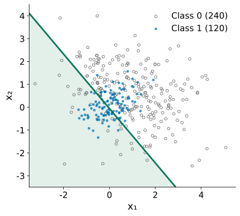{.fig fig-alt="The two classes with the logistic regression line: class 1 is a tight blob, class 0 is spread all around it; the line cuts through both"}

::: {}
::: {.ask}
<small>Your turn</small>
Last week's fix for the ring: invent a feature. What would you have to guess first?
:::

::: {.say}
Another route: let each class **describe itself**, then ask which class more likely produced the point.
:::
:::
:::
:::

::: {.notes}
约 2 分钟。类 1 紧紧一团，类 0 散得很开包住它；logistic 只管“线的哪一边”。上一讲环形数据靠“到中心的距离”。期待：要先猜特征的形状和中心；这里的团是斜的；特征一多就没法看图猜。然后把问题反过来：先描述每一类，再比较。
:::

## [Model:]{.stg} One feature first: what describes a class?

::: {.stage}
::: {.two .side}
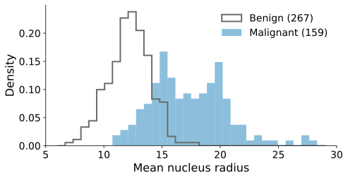{.fig fig-alt="Histograms of mean nucleus radius for 267 benign and 159 malignant training lumps"}

::: {.ask}
<small>Your turn</small>
We want a few numbers that say how common any radius is in a class. Is the histogram itself good enough?
:::
:::
:::

::: {.notes}
约 1.5 分钟。回到 Lesson 4 的乳腺肿块，只看半径，同一划分。期待：直方图要记几十个柱高；柱宽一变形状就变；空柱会说“从不出现”。想要：一条只由几个数决定的平滑曲线。
:::

## [Model:]{.stg} Smooth, set by a few numbers: a bell curve

::: {.stage .tight}
::: {.formula .m2}
$$
f(x) = \frac{1}{\sqrt{2\pi}\,\sigma}\exp\!\Big(-\frac{(x-\mu)^2}{2\sigma^2}\Big)
$$
:::

::: {.two .wide}
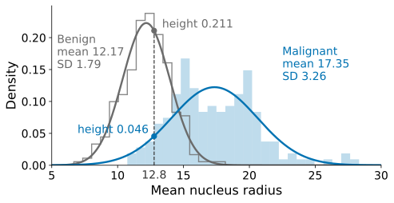{.fig fig-alt="The same histograms with two bell curves: benign mean 12.17, SD 1.79, tall and narrow; malignant mean 17.35, SD 3.26, low and wide; at radius 12.8 the benign curve is 0.211 high and the malignant 0.046"}

::: {.say}
Mean $\mu$ and SD $\sigma$ fix it: the **normal distribution**.
:::
:::
:::

::: {.notes}
约 1.5 分钟。点名正态分布。读法：离中心越远越低；σ 越大越矮越宽；总面积是 1，高度是密度，说的是“这一类的肿块落在这附近有多常见”。虚线是 Lesson 4 开场那个半径 12.8 的肿块：良性曲线高 0.211，恶性高 0.046。
:::

## [Model:]{.stg} The model is an assumption: how each lump is generated

::: {.stage}
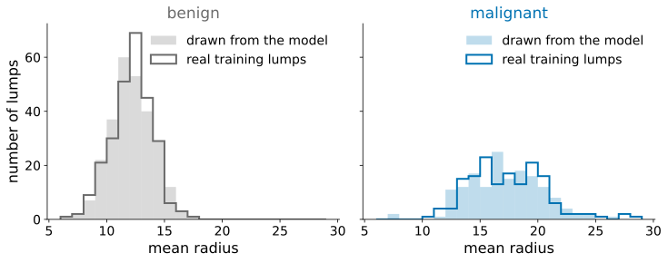{.fig fig-alt="Two panels, benign and malignant: the histogram of real training radii drawn as an outline, and a shaded histogram of the same number of imaginary lumps drawn from each class's bell curve; the two match closely"}

::: {.say .center}
① pick a class: malignant with probability $P(Y=1)$ ② draw the radius from its bell curve. A **generative** model. <small>(Lesson 4 was **discriminative**: it only said how the chance of malignant changes with the radius.)</small>
:::
:::

::: {.notes}
约 2.5 分钟。这一步是在做假设：我们不知道半径真正怎样分布，说“每一类是一条钟形曲线，再加上类别比例”，就是假设数据这样生出来。图：阴影是按模型抽出的同样多个假想肿块，轮廓是真实训练肿块；按模型能“造”数据，所以叫生成模型。上一讲的模型只说概率怎样随半径变，不说半径本身怎样分布，叫判别模型。模型里要从数据定下来的数（μ、σ、π）叫参数；为什么取平均值、标准差和比例，到“损失、求解”再回答。
:::

## [Model:]{.stg} Benign is 4.6 times higher here. So 4.6 times more likely?

::: {.stage}
{.fig .fig-f1s fig-alt="The two bell curves; at radius 12.8 the benign curve is 0.211 high and the malignant curve 0.046"}

::: {.ask .vote}
<small>Vote on your phone</small>
Benign: 63% of lumps, curve 4.6× higher at 12.8. Benign is…

::: {.opts}
<span><b>A</b>exactly 4.6 times as likely</span>
<span><b>B</b>more than 4.6 times</span>
<span><b>C</b>less than 4.6 times</span>
:::
:::
:::

::: {.notes}
约 2.5 分钟。有了模型，怎样判断一个肿块？投票（右屏 share-matters → Open，30 秒，先不显示结果）。分歧大时让邻座讨论一分钟再 Vote again，再 Reveal。请选 A 的说理由，再请选 B 的说：还要看每一类本来有多少。答案在下一页。
:::

## [Model:]{.stg} Bayes' rule: the one you have seen

::: {.stage .tight}
::: {.formula .m2}
$$
P(A\mid B)=\frac{P(B\mid A)\,P(A)}{P(B)}
$$
:::

::: {.v3table}
| In the formula | In our problem |
|---|---|
| $A$ | the lump is malignant: $Y=1$ |
| $B$ | its radius is near 12.8: $X\approx 12.8$ |
| $P(B\mid A)$ | from the malignant curve |
| $P(A)$ | malignant before we see the radius: $P(Y=1)$ |
:::

::: {.formula .m2}
$$
P(B)=P(B\mid Y=1)\,P(Y=1)+P(B\mid Y=0)\,P(Y=0)
$$
:::

::: {.say .center}
<small>Bottom: lumps near 12.8 are either malignant or benign.</small>
:::
:::

::: {.notes}
约 2.5 分钟。先写出学生熟悉的公式，问：在我们的问题里 A 和 B 各是什么？对照表逐项代入：P(A|B) 就是我们要的“看到半径以后恶性的概率”；P(B|A) 来自恶性那条曲线；P(A) 是没看半径时恶性的概率。分母：半径在附近的肿块，要么是恶性要么是良性，两部分相加。回答投票：只比曲线高度 P(X|Y) 不够，还要乘 P(Y)。口头反例：10 万个里只有 10 个恶性，只比高度一定错。
:::

## [Model:]{.stg} Bayes' rule with our curves

::: {.stage .tight}
::: {.formula .m2}
$$
P(Y=1\mid x)=\frac{P(Y=1)\,f_1(x)}{P(Y=1)\,f_1(x)+P(Y=0)\,f_0(x)}
$$
:::

| | $P(Y=k)$ | $f_k(12.8)$ (curve height) | product |
|---|---:|---:|---:|
| benign ($Y=0$) | 0.627 | 0.211 | 0.132 |
| malignant ($Y=1$) | 0.373 | 0.046 | 0.017 |

::: {.say .center}
Malignant: $0.017/(0.017+0.132) \approx$ **0.114** (7.8 : 1, not 4.6 : 1). <small>From now on: $\pi_k = P(Y=k)$.</small>
:::
:::

::: {.notes}
约 2 分钟。P(X≈12.8 | Y=k) 怎样从曲线读出：很窄区间里，概率约等于曲线高度乘宽度；分子分母每一项都乘同一个宽度，约掉后只剩曲线高度 f_k(x)。P(Y=k) 就是训练集里各类的占比。算出 0.114，比值约 7.8:1，不是高度的 4.6:1。点名先验 P(Y=k)、后验 P(Y=k|x)。最后点出简写 π_k，后面写损失要用。与 logistic 的 0.122 接近，但来路不同。
:::

## [Model:]{.stg} Two features: the bell becomes an ellipse

::: {.stage}
::: {.two .side}
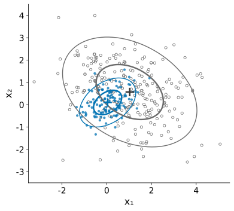{.fig fig-alt="The two-feature data with each class drawn as two nested ellipses around its centre; class 1's ellipse is small and tilted up to the right, class 0's is large and tilted down to the right"}

::: {}
::: {.formula .m3}
$$
\Sigma_1 = \begin{pmatrix}0.40 & 0.14\\ 0.14 & 0.30\end{pmatrix}
$$
$$
\Sigma_0 = \begin{pmatrix}2.26 & -0.62\\ -0.62 & 1.52\end{pmatrix}
$$
:::

::: {.say}
Two SDs cannot say the blob is **tilted**. Off-diagonal: the **covariance**. Together: the **covariance matrix** $\Sigma$.
:::
:::
:::
:::

::: {.notes}
约 2 分钟（先口头问：每个特征一个平均值、一个标准差，够说明这团是斜的吗？）。中心是两个平均值。协方差：一起偏大为正，一大一小为负；对角线是方差。二维的钟形是一座小山，等高线是椭圆。模型的假设变成：每一类的点由一座中心 μₖ、形状 Σₖ 的小山生出来；要估的参数变多（每类中心 2 个、散布 3 个，再加比例）。
:::

## [Model:]{.stg} Place a point: which hill is higher, after multiplying by $P(Y)$?

::: {.stage .top}

:::

::: {.notes}
约 2.5 分钟。现场操作。黑点起始位置：类 1 的小山更高（0.108 对 0.081），但乘上比例 1/3 对 2/3 后类 0 胜出，概率 0.401。再拖到类 1 中心（大胜）、拖到右下角远处（两座都低，但类 1 散得紧、降得快，类 0 胜）。直线做不到：按各自的散布量距离，再看每一类本来有多少。
:::

## [Model:]{.stg} One more assumption: one shared spread, or one per class?

::: {.stage}
::: {.two .side .v2compare}
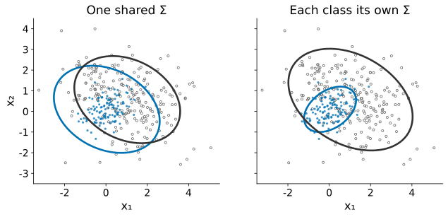{.fig fig-alt="Two candidate descriptions: same spread at different class centres, or a separate spread for each class."}

::: {.v2reading}
<div><span class="v2label">ONE SHARED SPREAD</span><b>Classes differ in where, not in shape</b><p>Fewer numbers to estimate.</p></div>
<div><span class="v2label">ONE SPREAD PER CLASS</span><b>Shapes may differ</b><p>Each class must estimate its own.</p></div>
:::
:::

::: {.ask .vote}
<small>Vote on your phone</small>
Both classes share one spread. The boundary is…

::: {.opts}
<span><b>A</b>a straight line</span>
<span><b>B</b>a curve around one class</span>
<span><b>C</b>depends on the data</span>
:::
:::
:::

::: {.notes}
约 2 分钟。模型还差一个决定，这不是计算细节，而是又一个假设。什么时候会想到共用：两类差在位置、不在形状，例如同一台仪器测两组样品，误差的大小和方向差不多。共用：所有数据一起估一个散布，参数少；各有：允许形状不同，但每一类自己估一整套。投票（shared-spread-boundary），答案在下一页切换时揭示。
:::

## [Model:]{.stg} Shared spread or one per class?

::: {.stage .top}


:::

::: {.notes}
约 2.5 分钟。切换两个按钮。共用：直线，0.719，与 logistic 0.722 几乎一样，点名 LDA。各有：椭圆，围住紧的那一类，0.867，点名 QDA。为什么共用就直：比较两类的对数，共用散布时二次项相同、相减抵消，剩一次项（推导在 Note Advanced Study 2）。提醒课后看 Fisher：不假设钟形，只要投影后两类分得最开，走到的是同一条线，这也回答了“为什么要有 LDA”。
:::

## [Loss:]{.stg} How likely does the model make the training data?

::: {.stage .tight}
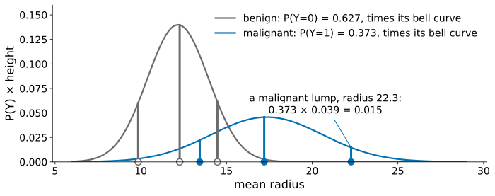{.fig fig-alt="The two bell curves, each multiplied by its class share; six training lumps sit on the axis, each with a bar up to its own class's curve; one malignant lump at radius 22.3 is labelled 0.373 times 0.039 equals 0.015"}

::: {.formula .m2}
$$
L=-\frac{1}{n}\sum_{i=1}^{n}\log\big(\pi_{y_i}\,f_{y_i}(\mathbf x_i)\big)
$$
:::

::: {.say .center}
Each lump $i$ (class $y_i$): $P(Y)$ **× height** of its own class. All lumps: **multiply**. Then $-\log$ and average. <small>Same reading as cross-entropy.</small>
:::
:::

::: {.notes}
约 3 分钟。先说记号：第 i 个训练肿块的特征 xᵢ、类别 yᵢ；π_{yᵢ} 是它所属那一类的比例，f_{yᵢ}(xᵢ) 是它所属那一类的小山在它所在位置的高度。为什么乘：模型先选类别、再取特征，两步相乘，正是贝叶斯的分子（“恶性且半径在附近”）。为什么样本之间相乘：互不影响。为什么取对数：几百个小数相乘存不下，取对数变成和，最大值的位置不变；加负号、取平均，就是越小越好的损失。点名最大似然。对照上一讲：交叉熵也是“模型给真实情况的概率取负对数”，只是那里只给类别，这里连特征一起给。
:::

## [Solution:]{.stg} No gradient descent: the answer is the averages

::: {.stage .tight}
::: {.v3table}
| Parameter | Value that minimises the loss |
|---|---|
| $\pi_k = P(Y=k)$ | fraction of training lumps in class $k$ |
| centre $\boldsymbol\mu_k$ | mean of class $k$ |
| spread $\Sigma_k$ (QDA) | covariance of class $k$ around its own centre |
| spread $\Sigma$ (LDA) | class covariances averaged, weighted by class size |
:::

::: {.say .center}
Lesson 4: walk downhill step by step. Here: set the derivative to 0 and the answer comes out **directly**.
:::

::: {.note-pointer}
The derivation: Note Advanced Study 1.
:::
:::

::: {.notes}
约 2 分钟。前面一直“直接用”平均值、标准差、比例，这一页说明它们正是让损失最小的值。对照上一讲：交叉熵要梯度下降，这里令导数为 0 就解出来。再说一件后面要用的事：损失拆成每一类一块，所以 QDA 里每一类的散布只能由这一类自己的数据估出来；LDA 用所有数据一起估。最大似然除以 n，sklearn 除以 n−1，样本多时差别很小（不展开）。
:::

## [Test:]{.stg} Real data: 30 measurements of each lump

::: {.stage}
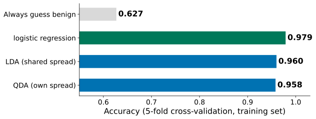{.fig .fig-s3 fig-alt="Bar chart of cross-validated accuracy on the breast cancer training set: always guess benign 0.627, logistic regression 0.979, LDA 0.960, QDA 0.958"}

::: {.ask}
<small>Your turn</small>
QDA is the most flexible, and it won on the toy data (0.867 against 0.719). Why is it last here?
:::
:::

::: {.notes}
约 2 分钟。与 Lesson 4 同一划分、同一个 5 折交叉验证。QDA 还给出警告：某一类的协方差矩阵不满秩。让学生猜原因，答案下一页。
:::

## [Test:]{.stg} Two reasons, two steps to go back to

::: {.stage}
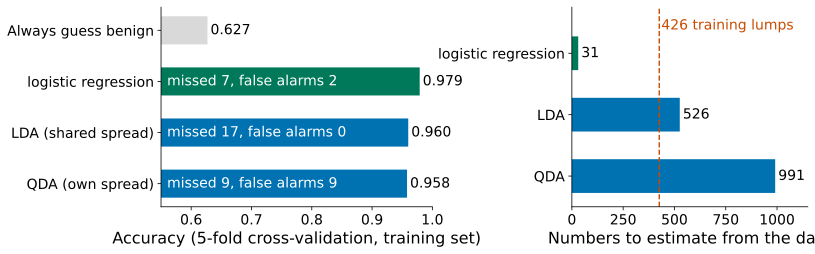{.fig .fig-f2 fig-alt="Left: accuracy with missed cancers and false alarms: logistic 0.979 (7 missed, 2 false alarms), LDA 0.960 (17, 0), QDA 0.958 (9, 9). Right: numbers to estimate: 31, 526 and 991, against 426 training lumps"}

::: {.say .center}
**991** numbers from **426** lumps → the **solution** step. The bell shape may be wrong → the **model** step.
:::
:::

::: {.notes}
约 2 分钟。30 个特征时一个协方差矩阵有 465 个数；QDA 共 991，LDA 526，logistic 31。两个原因各指回一步：要估的数太多，指回求解（模型也许没错，但估不准）；假设未必对（面积分布偏向一侧），指回模型。漏诊：LDA 17、QDA 9、logistic 7。接下来处理“求解”这一个。
:::

## [Solution:]{.stg} Back to the solution: no thickness across the line

::: {.stage}
::: {.two .side .v3fig}
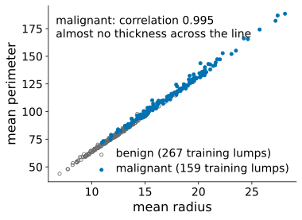{.fig fig-alt="Scatter of mean perimeter against mean radius for the training lumps; benign grey open circles and malignant blue dots all hug one straight line; correlation 0.995 within the malignant class"}

::: {.ask .vote}
<small>Vote on your phone</small>
Radius and perimeter lie on a line. Pull each spread towards…

::: {.opts}
<span><b>A</b>the shared spread</span>
<span><b>B</b>its diagonal only</span>
<span><b>C</b>a circle</span>
:::
:::
:::

::: {.say .center}
No thickness across the line → $\Sigma_k$ almost has **no inverse** → QDA warns “not full rank”.
:::
:::

::: {.notes}
约 3 分钟。周长约等于 2π 乘半径，恶性一类相关系数 0.995，点几乎排成一条线：垂直于这条线的方向几乎没有厚度。极端情况：周长恰好是半径的固定倍数，那个方向方差为 0，矩阵奇异，没有逆；钟形公式要逆和行列式，算不下去。真实数据只差一点点，逆极不稳定；新版 sklearn 直接报错。先问 Lesson 3 的办法：正则化，往简单形状拉。投票（shrink-target）。揭示：A 共用散布同样没有厚度（两类都排成线）；B 只留对角线能求逆，但把真实的倾斜整个扔掉（朴素贝叶斯，Note 开放问题）；C 往圆拉一部分，倾斜还留一些，拉多少可调，sklearn 用的就是它。强调：模型没变，改的是怎样估参数，和 Ridge 同一个想法。
:::

## [Solution:]{.stg} Pull each spread towards a circle: $(1-r)\,\Sigma_k + r\,I$

::: {.stage .top}

:::

::: {.notes}
约 2 分钟。点名 shrinkage，sklearn 叫 reg_param。拖 r：椭圆变圆，弯边界变直，r = 1 时是直线（还要考虑类别比例）。这份二维数据的散布本来估得准，所以收缩只会降低准确率（0.867 → 0.697）；收缩有用的是散布估不准的时候。前提：特征在同一尺度上，所以乳腺肿块先标准化（每个特征方差约 1，和圆相称）。
:::

## [Solution:]{.stg} Choose reg_param by CV, then test once

::: {.stage}
::: {.two .side .v3fig}
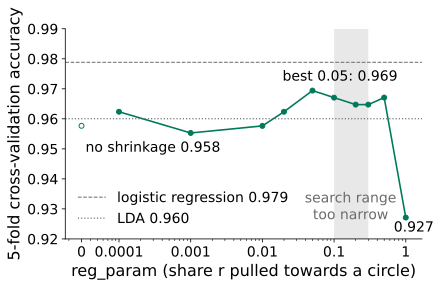{.fig fig-alt="Cross-validated accuracy of QDA on the breast lumps against reg_param on a log scale: 0.958 with no shrinking, best 0.969 at 0.05, 0.965 to 0.969 from 0.05 to 0.5, 0.927 at 1; dashed lines for LDA 0.960 and logistic regression 0.979; a grey band from 0.1 to 0.3 marks a search range that is too narrow"}

::: {}
::: {.say}
Best **0.05**, not at an end. Only about 1 point above no shrinkage: less than the fold-to-fold noise.
:::

::: {.v3table}
| Test set, read once | Accuracy |
|---|---:|
| Shrunk QDA (0.05) | 0.958 |
| LDA | 0.951 |
| Logistic regression | **0.986** |
:::
:::
:::
:::

::: {.notes}
约 2.5 分钟。和 Lesson 3 的 λ 一样用交叉验证选。0.0001 是 0.962、0.001 是 0.955，有升有降；0.05 最好 0.969；0.05 到 0.5 都在 0.965 以上；r = 1 全是同样的圆，丢掉形状，0.927。照实说：比不收缩只高约 1 个百分点，换一折的波动约 2 个百分点，提高并不确定；确定的是 QDA 能稳定算下去。灰色区域：如果只试 0.1 到 0.3，最好的 0.1 在左端，不能停，往左扩才找到 0.05。所有选择做完才读测试集：收缩 QDA 0.958（不收缩 0.937），LDA 0.951，logistic（阈值 0.5）0.986。数据决定谁好。
:::

## Today in code

::: {.stage}
```python
lda = LinearDiscriminantAnalysis()                    # one shared spread
qda = QuadraticDiscriminantAnalysis()                 # one spread per class
print(cross_val_score(lda, X_train, y_train, cv=kf).mean())   # same 5 folds as Lesson 4
print(cross_val_score(qda, X_train, y_train, cv=kf).mean())

X_train_s = StandardScaler().fit_transform(X_train)   # shrinking needs one scale
for r in [0.0001, 0.001, 0.01, 0.05, 0.1, 0.5, 1]:   # values of reg_param to try
    qda = QuadraticDiscriminantAnalysis(reg_param=r)  # pull each spread towards a circle
    print(r, cross_val_score(qda, X_train_s, y_train, cv=kf).mean())
```

::: {.note-pointer}
Complete code from loading the data, plus the test set: Note Section 9.
:::
:::

::: {.notes}
约 0.5 分钟。每一块对应今天的一段，不讲语法。完整的、能直接运行的代码在 Note 第 9 节，不用打开上一讲的文件。新版 sklearn 的默认 QDA 在乳腺肿块上可能报错，所以调参从 0.0001 开始。
:::

## Back to the opening data

::: {.stage}
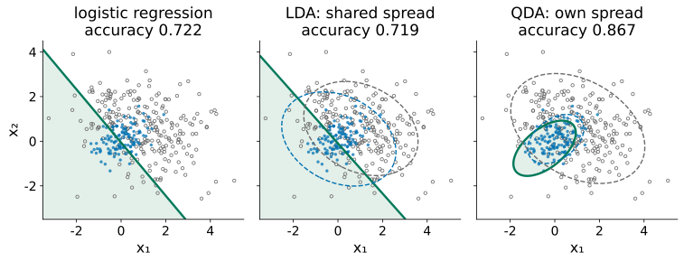{.fig .fig-f6 fig-alt="Three panels of the opening data: logistic regression and LDA both draw a straight line (accuracy 0.722 and 0.719); QDA draws an ellipse around class 1 (0.867)"}

::: {.say .center}
Same data, three assumptions, three boundaries. The ellipse is an **assumption**: a banana-shaped class breaks it.
:::

::: {.note-pointer}
In the Note, not in class: maximum likelihood derivation (Study 1), Fisher's projection (Study 3), a Gaussian classifier in numpy (Study 4).
:::
:::

::: {.notes}
约 1 分钟。logistic 不描述每一类；LDA 假设两类形状相同；QDA 允许不同。局限（口头）：椭圆是假设，香蕉形或分成几团就描述错；概率未校准，比例换了概率也变；收缩多少只在这批数据内可信；没有“什么时候用哪种”的规则，只有比较的方法。提醒课后读 Note 里课上没讲的三项。
:::

## What you can do now {.final-slide}

::: {.takeaway}
::: {.rows .tiny .chain}
<div><span class="n">problem</span><div><b>A line is not enough</b><p>one class tight, one spread out</p></div></div>
<div><span class="n">model</span><div><b>Assume how data is generated</b><p>a bell per class, and P(Y=k)</p></div></div>
<div><span class="n">decide</span><div><b>Bayes' rule</b><p>P(Y) × height; the larger wins</p></div></div>
<div><span class="n">loss</span><div><b>Make the data likely</b><p>−log of P(Y) × height</p></div></div>
<div><span class="n">solution</span><div><b>Means and covariances</b><p>shared (LDA) or one per class (QDA)</p></div></div>
<div><span class="n">test</span><div><b>Same cross-validation</b><p>too little data: back to the solution, shrink</p></div></div>
:::

::: {.qr}
{fig-alt="QR code for today's live page"}
<b>Feedback</b>
<p>After class: Lab 5</p>
:::
:::

::: {.notes}
约 0.5 分钟，课堂最终停在这一页。沿六行把五步念一遍，兑现开场承诺：换一个假设解分类问题，并知道出了问题回到哪一步。答疑和扫码都在这里。课后 Lab 5，不预告下一讲。
:::
