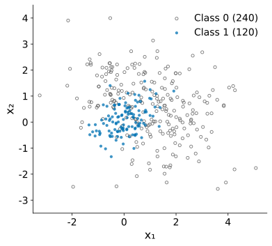
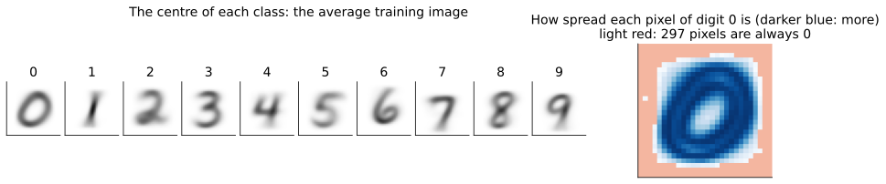
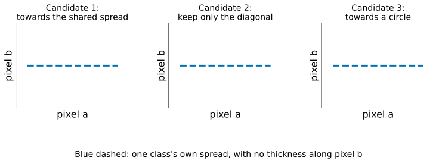
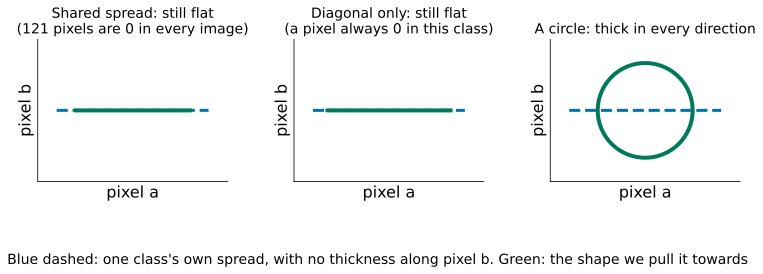
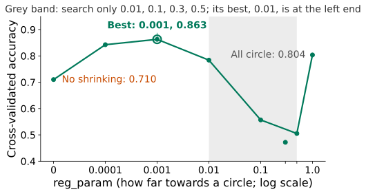

## Two classes. Can a straight line split them?

::: {.stage .top}


::: {.scan}
{fig-alt="QR code for today's live page"}
<b>Scan now</b>
votes, questions, feedback
:::
:::

::: {.notes}
约 3.5 分钟。先请大家扫右下角（或右屏）的二维码，页面整节课开着。让学生自己试出“不行”。二维手造数据：蓝点类 1（120 个），灰圈类 0（240 个）。请一位学生指挥拖两个滑块：方向和位置，绿色一侧判为类 1，橙圈是判错的点。拖几次后问：最好能到多少？再点按钮：logistic regression 的直线 0.722，而永远猜类 0 就有 0.667。只比瞎猜好一点。
:::

## [Problem:]{.stg} The line ignores what each class looks like

::: {.stage}
::: {.two .side}
{.fig fig-alt="The two classes with the logistic regression line: class 1 is a tight blob, class 0 is spread all around it; the line cuts through both"}

::: {.ask}
<small>Your turn</small>
Last week's fix for the ring: invent a feature. What would you have to guess first?
:::
:::
:::

::: {.notes}
约 2 分钟。用眼睛看区别很清楚：类 1 紧紧一团，类 0 散得很开，包住它。logistic 只学一条边界，只管“线的哪一边”。上一讲环形数据靠“到中心的距离”。期待：要先猜特征的形状（圆、斜椭圆）和中心在哪；这里的团是斜的、中心不在原点；特征一多就没法看图猜。
:::

## [Problem:]{.stg} What we want

::: {.stage}
::: {.say .xl .center}
No guessing features: let each class **describe itself**.
:::

::: {.ask}
<small>Your turn</small>
If we knew where each class's points usually fall and how spread out they are, could we ask: which class more likely produced this point?
:::
:::

::: {.notes}
约 1 分钟。把问题反过来：不直接学边界，先描述每一类，再比较。让学生说出“可以”，以及要描述什么：中心、散多开。
:::

## What you will be able to do

::: {.stage .tight}
::: {.say .xl}
**Describe** each class, **compare** a point against each description, choose how to **estimate the spread**, and **fix it** when there is too little data.
:::

::: {.flow .four}
<div><span>1</span>Describe</div>
<div><span>2</span>Compare</div>
<div><span>3</span>Two candidates</div>
<div><span>4</span>Test and shrink</div>
:::
:::

::: {.notes}
约 1 分钟。能力承诺，念出四段路线。五步里改的是“模型”：模型从“一条边界”变成“每一类的描述”；检验仍用 Lesson 4 的交叉验证。
:::

## [Describe:]{.stg} One feature first: what describes a class?

::: {.stage}
::: {.two .side}
{.fig fig-alt="Histograms of mean nucleus radius for 267 benign and 159 malignant training lumps"}

::: {.ask}
<small>Your turn</small>
We want a few numbers that say how common any radius is in a class. Is the histogram itself good enough?
:::
:::
:::

::: {.notes}
约 1.5 分钟。回到 Lesson 4 的乳腺肿块，只看半径，同一划分。期待：直方图要记几十个柱高；柱宽一变形状就变；空柱会说“从不出现”。想要：一条只由几个数决定的平滑曲线。
:::

## [Describe:]{.stg} Smooth, set by a few numbers: a bell curve

::: {.stage .tight}
::: {.formula .m2}
$$
f(x) = \frac{1}{\sqrt{2\pi}\,\sigma}\exp\!\Big(-\frac{(x-\mu)^2}{2\sigma^2}\Big)
$$
:::

::: {.two .wide}
{.fig fig-alt="The same histograms with two bell curves: benign mean 12.17, SD 1.79, tall and narrow; malignant mean 17.35, SD 3.26, low and wide; at radius 12.8 the benign curve is 0.211 high and the malignant 0.046"}

::: {.say}
Mean $\mu$ and SD $\sigma$ fix it: the **normal distribution**.
:::
:::
:::

::: {.notes}
约 1.5 分钟。点名正态分布。读法：离中心越远越低；σ 越大越矮越宽；总面积是 1，高度说的是“这一类的肿块落在这附近有多常见”。虚线是 Lesson 4 开场那个半径 12.8 的肿块：良性曲线高 0.211，恶性高 0.046。
:::

## [Compare:]{.stg} Benign is 4.6 times higher here. So 4.6 times more likely?

::: {.stage}
{.fig .fig-f1s fig-alt="The two bell curves; at radius 12.8 the benign curve is 0.211 high and the malignant curve 0.046"}

::: {.ask .vote}
<small>Vote on your phone</small>
Benign: 63% of lumps, curve 4.6× higher at 12.8. Benign is…

::: {.opts}
<span><b>A</b>exactly 4.6 times as likely</span>
<span><b>B</b>more than 4.6 times</span>
<span><b>C</b>less than 4.6 times</span>
:::
:::
:::

::: {.notes}
约 2.5 分钟。投票（右屏 Compare: Benign is 4.6 times higher → Open，30 秒，先不显示结果）。分歧大时让邻座讨论一分钟再 Vote again（本讲只在这一题这样做），再 Reveal。请选 A 的说理由，再请选 B 的说：还要看每一类本来有多少，良性占 0.627，所以比 4.6 倍更多（下一页：0.132 对 0.017，约 7.8 倍）。高度只说“如果它是恶性，长成这样有多常见”。追问：如果 1000 个肿块里只有 1 个恶性，高度还是全部吗？
:::

## [Compare:]{.stg} Multiply by the share: Bayes' rule

::: {.stage .tight}
::: {.formula .m2}
$$
\textcolor{#00795A}{P(\text{class }1 \mid x)} = \frac{\pi_1 f_1(x)}{\pi_1 f_1(x) + \pi_0 f_0(x)}
$$
:::

| | share $\pi$ | height $f$ | share × height |
|---|---:|---:|---:|
| benign | 0.627 | 0.211 | 0.132 |
| malignant | 0.373 | 0.046 | 0.017 |

::: {.say .center}
P(malignant) = 0.017 / (0.017 + 0.132) = **0.114**. Logistic regression: 0.122.
:::
:::

::: {.notes}
约 2 分钟。点名 Bayes' rule，先验 prior（看到 x 之前的比例）、后验 posterior。两个数接近，来路完全不同：logistic 直接学哪一边是恶性；这里先描述每一类再比较。边界：两边相等处，半径 15.11；恶性曲线更宽，所以 4.76 以下又是恶性，只是数据里没有那么小的。多类时分母把所有类加起来。
:::

## [Describe:]{.stg} Two features: each class is a tilted blob

::: {.stage}
::: {.two .side}
{.fig fig-alt="The two-feature data alone: class 1 is a tight blob tilted up to the right, class 0 a wide cloud"}

::: {.ask}
<small>Your turn</small>
A mean and an SD for $x_1$, and the same for $x_2$. Is that enough to say the blob is tilted?
:::
:::
:::

::: {.notes}
约 1 分钟。期待：不够，两个 SD 只说沿 x₁、沿 x₂ 各散多开；还要说 x₁ 大时 x₂ 是否也偏大。答案下一页。
:::

## [Describe:]{.stg} Two features: the bell becomes an ellipse

::: {.stage}
::: {.two .side}
{.fig fig-alt="The two-feature data with each class drawn as two nested ellipses around its centre; class 1's ellipse is small and tilted up to the right, class 0's is large and tilted down to the right"}

::: {}
::: {.formula .m3}
$$
\Sigma_1 = \begin{pmatrix}0.40 & 0.14\\ 0.14 & 0.30\end{pmatrix}
$$
$$
\Sigma_0 = \begin{pmatrix}2.26 & -0.62\\ -0.62 & 1.52\end{pmatrix}
$$
:::

::: {.say}
Diagonal: each feature's variance. Off-diagonal: the **covariance**, do $x_1$ and $x_2$ move together? Together: the **covariance matrix** $\Sigma$.
:::
:::
:::
:::

::: {.notes}
约 2 分钟。中心是两个平均值。散布多一件事：两个特征是否一起变，点名 covariance：一起偏大为正，一大一小为负。对角线是方差，非对角线是协方差。协方差为正，椭圆向右上斜。二维的钟形是一座小山，等高线是椭圆；公式在 Note，课上只说“用这一类自己的散布量出来的距离”。
:::

## [Compare:]{.stg} Place a point: which hill is higher, after the share?

::: {.stage .top}

:::

::: {.notes}
约 3 分钟。现场操作。黑点起始位置：类 1 的小山更高（0.108 对 0.081），但乘上比例 1/3 对 2/3 后类 0 胜出，概率 0.401。再拖到类 1 中心（大胜）、拖到右下角远处（两座都低，但类 1 散得紧、降得快，类 0 胜）。这正是直线做不到的：按各自的散布量距离。
:::

## [Two candidates:]{.stg} How do we estimate each spread?

::: {.stage}
{.fig .fig-s6 fig-alt="Left: both classes drawn with one shared ellipse shape at their two centres. Right: each class drawn with its own ellipse, small for class 1 and large for class 0"}

::: {.ask .vote}
<small>Vote on your phone</small>
Both classes share one spread. The boundary is…

::: {.opts}
<span><b>A</b>a straight line</span>
<span><b>B</b>a curve around one class</span>
<span><b>C</b>depends on the data</span>
:::
:::
:::

::: {.notes}
约 1.5 分钟。投票（右屏 Two candidates: How do we estimate each spread? → Open，30 秒，先不显示结果，再 Reveal）。请选 B 或 C 的同学说理由，下一页按按钮揭晓（答案 A）；再口头问右边各有一个 Σ 时呢。中心用平均值没什么可选，散布有两个候选：左边共用一个 Σ（要估的数少），右边每类自己的 Σ（更灵活，要估的协方差多一倍）。让学生先预测边界形状，下一页切换验证。
:::

## [Two candidates:]{.stg} Shared spread or one per class?

::: {.stage .top}

:::

::: {.notes}
约 3 分钟。切换两个按钮。共用：边界是直线，0.719，与 logistic 0.722 几乎一样，点名 LDA（Linear Discriminant Analysis）。各有：边界是椭圆，围住紧的那一类，0.867，点名 QDA（Quadratic）。为什么共用就直：两座小山形状一样，比较时二次项相减抵消（推导在 Note Advanced Study 1）。强调：弯曲来自“两类散得不一样”这个数据里的事实，我们没有造任何特征。
:::

## [Test:]{.stg} Real data: 30 measurements of each lump

::: {.stage}
{.fig .fig-s3 fig-alt="Bar chart of cross-validated accuracy on the breast cancer training set: always guess benign 0.627, logistic regression 0.979, LDA 0.960, QDA 0.958"}

::: {.say .center}
<small>**LDA** (linear discriminant analysis): one shared spread, straight boundary. **QDA** (quadratic): one spread per class, curved boundary. **Test** here means 5-fold cross-validation on the training set; the test set comes last.</small>
:::

::: {.ask}
<small>Your turn</small>
QDA is the most flexible, and it won on the toy data (0.867 against 0.719). Why is it last here?
:::
:::

::: {.notes}
约 2 分钟。与 Lesson 4 同一划分、同一个 5 折交叉验证、同样标准化。QDA 还给出警告：某一类的协方差矩阵不满秩（半径、周长、面积几乎由彼此决定）。让学生猜原因，答案下一页。
:::

## [Test:]{.stg} More flexible needs more data

::: {.stage}
{.fig .fig-f2 fig-alt="Left: accuracy with missed cancers and false alarms: logistic 0.979 (7 missed, 2 false alarms), LDA 0.960 (17, 0), QDA 0.958 (9, 9). Right: numbers to estimate: 31, 526 and 991, against 426 training lumps"}

::: {.say .center}
QDA estimates **991** numbers from **426** lumps. The method's name is no guarantee: compare.
:::
:::

::: {.notes}
约 2 分钟。一个 30×30 协方差矩阵有 465 个不同的数；QDA 两个加中心和比例共 991，LDA 526，logistic 31。第二个原因：假设每一类是椭圆小山，真实测量未必如此（面积明显偏向一侧）。漏诊：LDA 17 个，比 logistic 的 7 个多得多，Lesson 4 说过漏诊代价大。
:::

## [Shrink:]{.stg} 784 pixels, about 750 images per class

::: {.stage}
{.fig .fig-f3 fig-alt="The average training image of each digit 0 to 9 in the MNIST subset, and a map of how spread each pixel of digit 0 is, with 297 pixels that are always 0 in light red"}

::: {.ask}
<small>Your turn</small>
Cross-validated: QDA **0.710**; logistic regression 0.901 (Lesson 4, C = 0.1). In Lesson 3, what did we do when estimates were unstable?
:::
:::

::: {.notes}
约 2.5 分钟。MNIST 子集：每类一个协方差矩阵有 307,720 个数，每类只有约 750 张图。更糟的是：每一类都有 245 到 361 个像素永远是 0（图右浅红），散布为 0，椭圆在这些方向上没有厚度；新图在那里有一点墨水，离中心就是无穷远。sklearn 只给警告（LinAlgWarning），结果很差。两个数都是同一 5 折交叉验证。若有学生问 LDA（共用散布也有 30 万个数）：sklearn 的 LDA 默认不求散布的逆，只在数据有变化的方向里比较，所以没事（0.833）；QDA 要为每类求逆。期待：正则化，往简单的形状拉。
:::

## [Shrink:]{.stg} Regularise: pull each spread towards which shape?

::: {.stage}
{.fig .fig-s5 .fig-s5q fig-alt="Three sketches over two pixels, each showing a class's own spread as a flat dashed line, titled with the three candidates: towards the shared spread, keep only the diagonal, towards a circle"}

::: {.ask .vote}
<small>Vote on your phone</small>
Pixels that are 0 in every digit: pull each spread towards…

::: {.opts}
<span><b>A</b>the shared spread</span>
<span><b>B</b>its diagonal only</span>
<span><b>C</b>a circle</span>
:::
:::
:::

::: {.notes}
约 2 分钟。投票（右屏 Shrink: Regularise → Open，30 秒，先不显示结果，再 Reveal）。请选 A 和 B 的各说一句理由，下一页揭晓（答案 C）。先让学生判断。提示：MNIST 子集里有 121 个像素在所有训练图像里都是 0；一类里有 245 到 361 个像素恒为 0。
:::

## [Shrink:]{.stg} Only the circle has thickness everywhere

::: {.stage}
{.fig .fig-s5 fig-alt="Three sketches over two pixels: a class's own spread is a flat dashed line; pulling towards the shared spread keeps it flat; keeping only the diagonal keeps it flat; pulling towards a circle gives thickness in every direction"}

::: {.say .center}
Only the circle helps everywhere. The circle is the **identity matrix** $I$.
:::
:::

::: {.notes}
约 1.5 分钟。三个候选：往共用散布收（往 LDA 收），但 121 个像素在所有训练图像里都是 0，共用的散布也平；只留对角线（去掉协方差），一类里恒为 0 的像素方差仍是 0；往圆收，不用估，每个方向都有厚度。选圆。I 是单位矩阵：各方向方差为 1、不倾斜。Σ_k 是第 k 类自己的协方差矩阵。
:::

## [Shrink:]{.stg} Pull each spread towards a circle: $(1-r)\,\Sigma_k + r\,I$

::: {.stage .top}

:::

::: {.notes}
约 2.5 分钟。点名 shrinkage，sklearn 叫 reg_param。拖 r：椭圆变圆，弯边界变直，r = 1 时是直线（只剩中心，离哪个近判哪个）。这份二维数据的散布本来估得准，所以收缩只会降低准确率（0.867 → 0.697）；收缩有用的地方是散布估不准的时候。前提：特征尺度相近（MNIST 除以 255，乳腺肿块先标准化），因为圆的半径是 1。
:::

## [Shrink:]{.stg} Choose reg_param by cross-validation

::: {.stage}
::: {.two .side}
{.fig fig-alt="Cross-validated accuracy of QDA on the MNIST subset against reg_param on a log scale: 0.710 with no shrinking, 0.863 at 0.001, about 0.5 at 0.1 and 0.5, 0.804 at 1; a grey band marks a search from 0.01 to 0.5 whose best value 0.01 sits at its left end"}

::: {.say}
Best: **0.001**. If the best value sits at an **end** of your range, widen the range and search again.<br><small>At 0 (no shrinking), the flat directions break QDA (0.710). At 1, every class is the same circle: only the nearest class average counts (0.804).</small>
:::
:::
:::

::: {.notes}
约 2 分钟。和 Lesson 3 的 λ 一样，用交叉验证选。收一点点（0.0001）就到 0.843，0.001 最好 0.863，再收就丢掉形状（0.1 到 0.5 只有 0.5 左右）；r = 1 全是圆，判断变成离哪个中心近，回到 0.804。中间为什么掉这么低不细究。灰色区域：如果只试 0.01 到 0.5，最好的 0.01 在左端，不能停，真正最好的在外面（0.001）。作业 2 第 2 节要求同一条规则。
:::

## [Shrink:]{.stg} Now, and only now, the test set

::: {.stage}
| MNIST subset, test set (2500 images) | Accuracy |
|---|---:|
| Logistic regression (Lesson 4) | **0.908** |
| QDA, reg_param = 0.001 | 0.861 |
| LDA | 0.832 |

::: {.say .center}
Shrinking makes QDA usable (cross-validation 0.710 → test 0.861) and better than LDA, but on 784 pixels logistic regression still wins. **The data decide.**
:::
:::

::: {.notes}
约 1 分钟。所有选择做完才读测试集，只读一次。每类 30 万个散布的数，750 张图即使收缩也估不太准（不预告后面的方法）。哪种方法好取决于数据，所以要在同一份交叉验证下比较。
:::

## Today in code

::: {.stage}
```python
lda = LinearDiscriminantAnalysis()                    # one shared spread: straight boundary
qda = QuadraticDiscriminantAnalysis()                 # one spread per class: curved boundary
print(cross_val_score(lda, X_train_s, y_train, cv=kf).mean())   # same 5 folds as Lesson 4
print(cross_val_score(qda, X_train_s, y_train, cv=kf).mean())

for r in [0, 0.0001, 0.001, 0.01, 0.1, 0.5, 1]:       # values of reg_param to try
    qda = QuadraticDiscriminantAnalysis(reg_param=r)  # pull each spread towards a circle
    print(r, cross_val_score(qda, X_digits_train, y_digits_train, cv=kf).mean())

qda = QuadraticDiscriminantAnalysis(reg_param=0.001)  # chosen inside the training set
qda.fit(X_digits_train, y_digits_train)               # train on all training images
print(qda.score(X_digits_test, y_digits_test))        # the test set, once
```
:::

::: {.notes}
约 1 分钟。每一块对应今天的一段，不讲语法。kf 和 X_train_s 与 Lesson 4 相同；MNIST 子集的像素已除以 255。Lab 5 会一步步做，还会手算开场肿块的 0.114。
:::

## Back to the opening data

::: {.stage}
{.fig .fig-f6 fig-alt="Three panels of the opening data: logistic regression and LDA both draw a straight line (accuracy 0.722 and 0.719); QDA draws an ellipse around class 1 (0.867)"}

::: {.say .center}
Three methods, three **assumptions** about what each class looks like.
:::
:::

::: {.notes}
约 1.5 分钟。logistic 不描述每一类；LDA 假设两类形状相同；QDA 允许不同。局限（口头）：椭圆是假设，香蕉形或分成几团就描述错；概率未校准，比例换了概率也变；维数多要靠收缩，收多少靠交叉验证；没有“什么时候用哪种”的规则，只有比较的方法。
:::

## What you can do now {.final-slide}

::: {.takeaway}
::: {.rows .tiny .chain}
<div><span class="n">see it</span><div><b>A line is not enough</b><p>one class tight, one spread out</p></div></div>
<div><span class="n">describe</span><div><b>Centre and spread</b><p>a bell curve; in 2-D an ellipse</p></div></div>
<div><span class="n">compare</span><div><b>Bayes' rule</b><p>height × share; the larger wins</p></div></div>
<div><span class="n">candidates</span><div><b>LDA or QDA</b><p>shared spread: straight; own spread: curved</p></div></div>
<div><span class="n">test</span><div><b>Same cross-validation</b><p>more flexible needs more data</p></div></div>
<div><span class="n">shrink</span><div><b>reg_param</b><p>towards a circle; choose by CV, not at an end</p></div></div>
:::

::: {.qr}
{fig-alt="QR code for today's live page"}
<b>Feedback</b>
<p>After class: Lab 5</p>
:::
:::

::: {.notes}
约 1.5 分钟，课堂最终停在这一页。沿六行把整条链念一遍。答疑和扫码都在这里。课后 Lab 5，不预告下一讲。
:::
