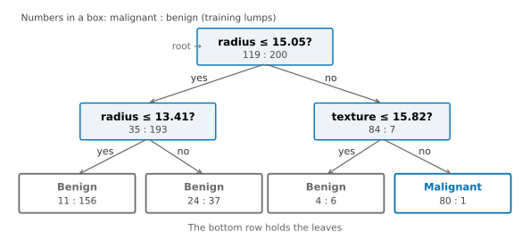
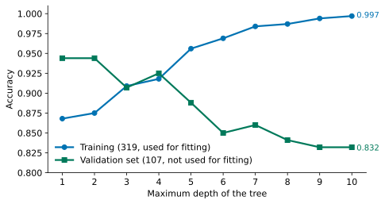
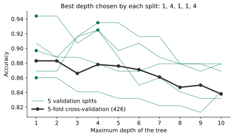
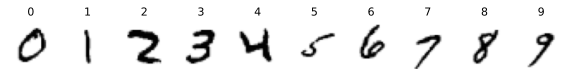
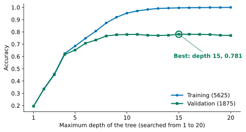
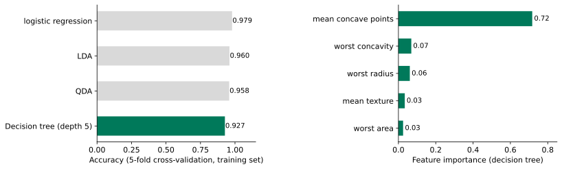
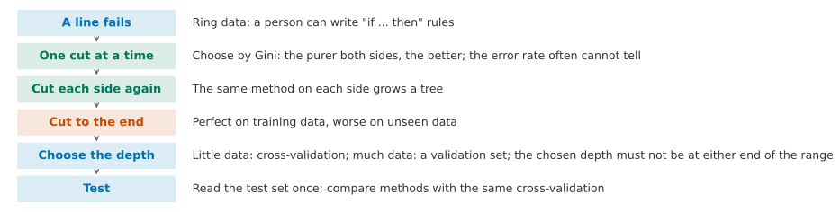
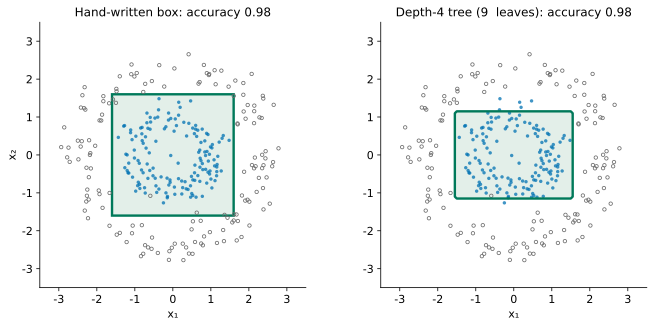

## 1. Motivation: A Line Fails, but a Person Can Write Rules

At the end of Lesson 4 we met the ring data. Class 1 sits together in the middle, and class 0 forms a ring around it. Logistic regression can only draw a straight line, so its accuracy is 0.50, no better than guessing. In Lesson 5, QDA could draw an ellipse, but only by assuming that each class is shaped like an oval hill.

Let us look at the problem another way. Suppose you had to write a rule for this data yourself. What would you write? In the widget below, each of the four sliders moves one cut line. Points inside the box are predicted as class 1.



Try it yourself first. Can you write a rule with an accuracy above 0.95? What does it look like?

::: {.callout-note collapse="true" title="Show answer"}
Drag all four lines to about ±1.6. The rule is then: "if −1.6 < x₁ < 1.6 and −1.6 < x₂ < 1.6, predict class 1; otherwise predict class 0". Its accuracy is 0.983. The rule uses only four yes-or-no questions, and each question looks at one feature only.
:::

Many decisions in everyday life already take this form. If it is raining, take an umbrella. If your temperature is above 38 degrees and you have a cough, go and get tested. Rules like these can be read and explained in plain words. They also do not need the two classes to be separated by a straight line.

Writing the rules by hand has two problems, though. With many features, a person cannot see where to cut. With many cut lines, nobody can drag them one by one. What we want is this: **let the machine find these rules for itself, one cut at a time.**

**By the end of this lesson, you should be able to:** write and read a chain of "if ... then ..." rules for a classification problem; explain how the machine chooses each cut automatically, and why it uses Gini rather than the error rate; see that a tree grown all the way down memorises the training set; use data that took no part in fitting (a validation set) to choose the depth of the tree, draw the training and validation curves, and check that the chosen depth is not at either end of the search range; say when to use a validation set and when to use cross-validation.

## 2. One Cut at a Time: What Makes a Cut Good

Start with a single cut. We choose one feature and one cut point, and this splits the points into two sides. Each side predicts its majority class. A good cut makes each side as "pure" as possible: one side is almost all class 1, and the other is almost all class 0.

So we need a number that measures how "mixed" a group of points is. First, think: how would you define it?

::: {.callout-note collapse="true" title="Show answer"}
The most direct idea: on this side we predict the majority class, so what fraction of points do we get wrong? This is called the **error rate**. Another idea: draw two points at random from this side (the same point may be drawn twice). How likely is it that their classes differ? This is 0 when every point is in one class, and it is largest when the two classes are half and half.
:::

We can write both candidates as formulas. Let $p$ be the fraction of class 1 on one side:

$$
\text{error rate} = \min(p,\ 1-p), \qquad \text{Gini} = 1 - p^2 - (1-p)^2 = 2p(1-p).
$$

The second is called the **Gini impurity**. Both are 0 when $p = 0$ or $1$ (completely pure), and both are largest when $p = 0.5$. After a cut, the two sides usually hold different numbers of points, so we take an average weighted by the number of points. If the left side has $n_L$ points and the right side has $n_R$ points, the score of the cut is $\frac{n_L}{n}\,\text{left value} + \frac{n_R}{n}\,\text{right value}$. A smaller score is better.

The two candidates look similar. When would they choose differently? Below is one node with 100 points. Twenty blue points are packed into a stretch in the middle, and 80 grey points are spread all over. Drag the cut line and watch the two curves.



Drag it around first. Where is the error rate lowest? And where is Gini lowest?

::: {.callout-note collapse="true" title="Show answer"}
The error rate stays at 0.200 everywhere and never moves. The reason is that, wherever we cut, grey points are the majority on both sides. So both sides predict grey, and the mistakes are always the same 20 blue points. Gini does change. It is lowest when we cut at 5.75 (0.271, compared with 0.320 before the cut). At that point the right side holds 38 points that are all grey. The left side keeps the 20 blue points and 42 grey points for the next cut to sort out. The error rate cannot see that the cut has produced a pure piece, but Gini can.
:::

So we choose Gini. The decision tree in scikit-learn uses it by default. Another common candidate is **entropy**, $-p\log p-(1-p)\log(1-p)$. Its shape is very close to Gini, and it usually picks the same cut point.

**Working it out on real data.** We use the breast lump data with two features: the mean nucleus radius and the mean texture. As in Lesson 3, we split 107 of the 426 training lumps off as a **validation set**, which is not used for fitting. We fit with the other 319 only (Section 3 will use the validation set). Of these 319, 119 are malignant. Before any cut, $p = 119/319 = 0.373$, and Gini is $2 \times 0.373 \times 0.627 = 0.468$. The machine tries every possible cut point on both features. The best cut is "radius ≤ 15.05":

| | Malignant | Benign | Fraction of class 1, $p$ | Gini |
|---|---:|---:|---:|---:|
| Radius ≤ 15.05 | 35 | 193 | 0.154 | 0.260 |
| Radius > 15.05 | 84 | 7 | 0.923 | 0.142 |

The weighted average is $\frac{228}{319} \times 0.260 + \frac{91}{319} \times 0.142 = 0.226$, which is less than half of the 0.468 before the cut. This is what "the best cut" means: among all candidate cut points, it is the one with the smallest weighted Gini.

## 3. Cut Each Side Again: Growing a Tree

After one cut, the left side still contains 35 malignant lumps, and the right side still contains 7 benign ones. The natural next step is to find the best cut on each side, using the same method. If we keep doing this, we grow a **decision tree**.

{fig-alt="A tree with two levels: the root asks whether the radius is at most 15.05; on the left it then asks whether the radius is at most 13.41, and on the right whether the texture is at most 15.82; of the four leaves, only the rightmost predicts malignant"}

A few names. The question at the top is the **root**. Each question is a **node**. A node that asks no further questions is a **leaf**, and a leaf predicts the majority class of the training samples that land in it. The number of questions on the path from the root to the furthest leaf is the **depth** of the tree.

To read a tree, start at the root and walk down. Take a lump with radius 16 and texture 20. Is the radius ≤ 15.05? No, so go right. Is the texture ≤ 15.82? No, so go right again. The lump lands in the rightmost leaf and is predicted malignant. Each leaf matches a rectangle in the plane. This is because every question has the form "is this feature less than this number?", so the cut lines can only be horizontal or vertical.

In the widget below, drag the maximum depth and watch the plane being cut into more and more rectangles.



First drag it to the greatest depth, then tick "Show the validation lumps". The tree of depth 10 gets almost every fitting point right. How does it do on the 107 points that were not used for fitting?

::: {.callout-note collapse="true" title="Show answer"}
At depth 10 the tree has 41 leaves, and its accuracy on the fitting points is 0.997. Many of the small rectangles exist only to put one or two points on the correct side. On the validation points, the accuracy is only 0.832, which is lower than at depth 1 (0.944). Those small rectangles are of no use on points the tree has not seen.
:::

## 4. Splitting All the Way Down: The Tree Memorises the Training Set

If a leaf still holds points from both classes, we can always make one more cut. If we keep cutting, every leaf ends up with only one class, and the training accuracy reaches 1.00. In this example, a tree with no depth limit grows to depth 11 and has 42 leaves.

{fig-alt="The blue line rises steadily from 0.868 to 0.997. The green line falls from 0.944 to 0.832. The two lines cross near depth 3 and then move further apart"}

The blue line climbs almost to 1. The green line is highest at depths 1 and 2, and after that it mostly falls (with a small rise at depth 4). This is the same thing we saw with polynomial degree in Lesson 3. The more flexible the model, the more closely it can follow chance patterns in the training data. This is **overfitting**. The depth controls how flexible a tree is: a tree of depth 1 has only 2 leaves, while a tree of depth 10 has 41.

So we need to limit the depth. In scikit-learn we do this with `DecisionTreeClassifier(max_depth=...)`. `max_depth` is a hyperparameter. The question is: how should we choose it?

## 5. Choosing the Depth: Back to the Validation Set of Lesson 3

The evidence we need is how well the model does on data it has not seen. We keep the test set for the very end and look at it only once, so we cannot use it for choosing. In Lesson 3 we used cross-validation: split the training set into 5 parts, fit on 4 of them, evaluate on the remaining 1, and rotate.

First, do a quick count. Assignment 2 has 50,000 training images, and we want to choose from 20 depths. With 5-fold cross-validation, how many trees do we need to fit in total?

::: {.callout-note collapse="true" title="Show answer"}
Each depth needs 5 trees, so 20 depths need 100 trees, and each tree is fitted on 40,000 images. With a neural network (Assignment 2, Section 4), one training run takes several minutes, so 100 runs would be far too slow.
:::

What we want is to fit each candidate only once, without touching the test set. Lesson 3 already gave the way: split one validation set off the training set, once. It is not used for fitting; we use it only to compare and choose. The 107 lumps of Sections 2 to 4 are one. Lesson 3 also showed the price: with a few dozen cars, the result moved with the split, so we used cross-validation there. Here are the two ways side by side:

1. **Cross-validation**: we fit 5 times for each depth. Every point is used for evaluation once, so the result is stable.
2. **Validation set**: we fit only once for each depth. But the result depends on which points happen to land in the validation set.

In this lesson's validation set, we split the 426 training lumps 3:1 with stratification: 319 are used for fitting, and 107 form the validation set.

```python
from sklearn.model_selection import train_test_split

X_fit, X_val, y_fit, y_val = train_test_split(
    X_train, y_train, test_size=0.25, random_state=0, stratify=y_train)   # 319 to fit, 107 to validate
```

The test set is untouched. As in Lesson 3, the data has three parts, and each has its own job: the fitting part, the validation part, and the test part.

The wobble Lesson 3 saw on the cars appears on trees too. The figure below splits the same 426 lumps in 5 different ways (changing only `random_state`) and draws one validation curve for each split:

{fig-alt="The five thin green lines go up and down and differ a lot from each other. The black line is steady and is highest at depths 1 and 2"}

The 5 splits pick best depths of 1, 4, 1, 1 and 4, so the choice depends on luck. Cross-validation gives a steady curve, and its best depths are 1 and 2 (both 0.883). With only 107 points, one validation set does not tell us much. Here the best depth sits at the lower end of the search range. But the depth cannot be less than 1, so we cannot extend the range any lower. On this two-feature data, one cut is enough.

So each way has its own place: **use cross-validation when you have little data, and a single validation split when you have a lot.** With more data, the validation set is also larger, so luck matters less. Cross-validation, on the other hand, needs several times more fits, and that is slow on large data. Assignment 2 has 50,000 training images, so we use a validation set there.

## 6. Choosing the Depth on a Validation Set: Handwritten Digits

Assignment 2 uses MNIST: handwritten digits of 28 × 28 pixels. Here we use the MNIST subset (10,000 images) loaded in Section 8 of Lesson 4: 7500 training images, which we split 3:1 into 5625 for fitting and 1875 for validation.

{fig-alt="Ten handwritten digits of 28 by 28 pixels, one each of 0 to 9"}

7500 images is still not large, and cross-validation would run fine. Here we first practise the method Assignment 2 needs, and then compare it once with cross-validation. We try depths from 1 to 20:

{fig-alt="Both lines rise from about 0.2. The blue line reaches 1.0 at depth 20. The green line rises to about 0.78 by depth 10 and then moves between 0.77 and 0.78, with its highest value, 0.781, at depth 15"}

```python
from sklearn.tree import DecisionTreeClassifier             # the decision tree

X_digits_fit, X_digits_val, y_digits_fit, y_digits_val = train_test_split(
    X_digits_train, y_digits_train, test_size=0.25, random_state=0, stratify=y_digits_train)   # 5625 to fit, 1875 to validate
for depth in range(1, 21):                                   # depths 1 to 20
    tree = DecisionTreeClassifier(max_depth=depth, random_state=0)   # a tree that stops at this depth
    tree.fit(X_digits_fit, y_digits_fit)                     # fit on the fitting part only
    print(depth, tree.score(X_digits_fit, y_digits_fit), tree.score(X_digits_val, y_digits_val))   # training and validation accuracy
```

Validation accuracy is highest at depth 15, with 0.781 (depth 16 also gives 0.781, and we take the shallower one). From depth 10 on, however, the validation accuracy only moves between 0.77 and 0.78: the highest and lowest values differ by about 0.01 (about 20 of the 1875 images). For comparison, 5-fold cross-validation on all 7500 images picks depth 10 (0.784). The two methods pick different depths, but both lie on the same plateau, where every depth gives about the same accuracy. Without a limit, the tree on this data grows to depth 22.

**The chosen value must not sit at either end of the search range** (the rule from Lesson 5). 15 is in the middle of 1 to 20, so we can trust it. If we had tried only 1 to 8, the best would be 8, right at the end of the range. In that case we would extend the range upwards and choose again.

Once the depth is chosen, we look at the test set only once: the tree of depth 15 has a test accuracy of 0.776, close to its validation accuracy of 0.781. The validation set and the test set are both images that were not used for fitting, so a difference of a few tenths of a percentage point between them is normal. For comparison, logistic regression in Lesson 4 scored 0.908. The tree here was fitted on 5625 images. After the validation set has chosen the hyperparameter, we could also combine the fitting part and the validation part and fit once more. Assignment 2 does not ask you to do this.

`random_state=0` makes the results repeatable. When several cut points are equally good, the tree picks one of them at random.

## 7. 30 Features: Comparing with Earlier Lessons

We now return to all 30 features of the breast lump data. 426 lumps is not many, so following the conclusion of Section 5 we choose the depth by cross-validation. We use the same 5 folds as in Lessons 4 and 5.

{fig-alt="Left panel: logistic 0.979, LDA 0.960, QDA 0.958, decision tree 0.927. Right panel: mean concave points has importance 0.72, and all the others are below 0.07"}

The best depth for the decision tree is 5, with an accuracy of 0.927. This is lower than logistic regression (0.979), LDA (0.960) and QDA (0.958). Even in 30 dimensions, the edges of the boxes can only be horizontal or vertical (axis-aligned). For this data, a tilted plane fits better.

The strength of a tree lies elsewhere: we can read it. `tree.feature_importances_` gives how much each feature reduced the Gini in total across the tree (the values add up to 1). Here mean concave points takes 0.72. Most of the tree's decisions rest on how many dents there are in the edge of the cell nucleus.

## 8. Implementation: Doing It in scikit-learn

We load the data and split it into a training set and a test set in the same way as in Lesson 4: Section 10 for the lumps and Section 8 for the MNIST subset. A tree does not need standardisation. Each question compares one feature with one number, so the scale of a feature does not change where the cut falls.

**Step 1: split a validation set off the training set (Section 5).** The code is in Section 5. The split for the MNIST subset is in Section 6.

**Step 2: choose the depth on the validation set (Section 6).** The loop is in Section 6.

**Step 3: read the test set once (Section 6).**

```python
tree = DecisionTreeClassifier(max_depth=15, random_state=0)  # the depth chosen on the validation set
tree.fit(X_digits_fit, y_digits_fit)                         # the same fitting part
print(tree.score(X_digits_test, y_digits_test))              # the test set, read once
```

The output is 0.776.

**Choosing the depth for the breast lumps by cross-validation (Section 7).**

```python
from sklearn.model_selection import cross_val_score, KFold  # cross-validation, as in Lesson 3

kf = KFold(5, shuffle=True, random_state=0)                 # the same 5 folds as Lessons 4 and 5

for depth in range(1, 11):                                   # depths 1 to 10
    tree = DecisionTreeClassifier(max_depth=depth, random_state=0)   # a tree that stops at this depth
    scores = cross_val_score(tree, X_train, y_train, cv=kf)  # the same 5 folds as Lessons 4 and 5
    print(depth, scores.mean())                              # average accuracy over the folds
```

Depth 5 gives the highest score (0.927). `kf` is the same as in Section 10 of Lesson 4. A tree does not need standardisation, so here we use `X_train` directly.

## 9. The Lesson on One Page

If you only read one page, read this one.

{fig-alt="A vertical flow chart with six steps"}

| The problem you see | What you can do | What evidence to use |
|---|---|---|
| No straight line separates the classes, but you can write "if ... then ..." rules | A decision tree: a chain of yes/no questions, each about one feature | The accuracy of the rules; the map of rectangular regions |
| How to choose a cut automatically | Try every cut point, and keep the one with the smallest weighted Gini | Gini notices "this cut made a pure piece" better than the error rate does |
| The tree keeps growing deeper | Limit `max_depth` | Two curves: training accuracy and validation accuracy |
| Choosing the depth without touching the test set | Little data: cross-validation; plenty of data: a validation set | The best depth is not at either end of the search range; the test set is read once |

## 10. Summary and Limitations

Let us go back to the ring data from the start of the lesson. In Section 1 you drew a box by hand. Now we let the machine make the cuts itself:

{fig-alt="Two plots of the ring data: on the left, a square encloses the inner ring, with accuracy 0.98; on the right, a rectangular region of similar shape, with accuracy 0.98"}

The tree of depth 4 has 9 leaves and an accuracy of 0.98. This is as good as the box drawn by hand, and the tree found it on its own. At the start we asked whether a machine could write rules like this by itself. The answer is yes. It makes one cut at a time, and each cut is the one that lowers Gini the most. It stops growing at a suitable depth, and we choose that depth on data that was not used for fitting.

**Transfer question.** A bank uses two features to judge whether a loan will go into default: annual income and existing debt. The loan officers have a rule of thumb: "the risk is high if income is below 20,000, or if debt is more than half of income". Answer without doing any calculation. The rule has two conditions. Which one can be written directly as one question in a tree, and which one cannot? What would you do about the one that cannot? The bank has 2 million past records. Would you use a validation set or cross-validation to choose the depth? If the chosen depth is the largest one you tried, what would you do next?

::: {.callout-note collapse="true" title="Suggested answer"}
Yes. The root node asks "income < 20,000?". If yes, predict high risk. If no, ask "debt > half of income?". However, the second question uses two features at once (the ratio of debt to income), and each question in a tree looks at only one feature. So you have two choices. You can first build a new feature, "debt / income", and then depth 2 is enough. Or you can keep only the two original features, and then the tree has to approximate this sloping line with many small horizontal or vertical (axis-aligned) steps, so it needs a much greater depth. Two million records is a lot, so use a validation set. It is cheap, and the validation set itself is large, so the result is stable. If the best depth is the largest one you tried, a deeper tree might be even better. So extend the range upwards and choose again. Read the test set once, at the very end.
:::

**Where this method cannot be trusted.**

1. **The boundary can only be horizontal or vertical.** Each question looks at one feature. If the two classes are separated along a sloping line, the tree needs many small steps to approximate it, so it becomes deep and is prone to overfitting. On the 30 features of the breast lumps, it does worse than logistic regression.
2. **A tree is sensitive to the training samples.** With a different set of training samples, the root node may use a different feature (Advanced Study 2). When you read a tree, do not treat every cut point as a firm conclusion.
3. **A small validation set cannot be trusted.** With a validation set of 107 lumps, the chosen depth jumps between 1 and 4. If you have little data, use cross-validation.
4. **Feature importance only tells you what this one tree used.** Suppose two features are highly correlated (for example, radius and perimeter). If the tree uses one of them, the importance of the other will be close to 0. This does not mean the other feature has nothing to do with being malignant.

**Back to what we promised at the start.** Given a classification problem, you can now do the following. You can write and read a chain of "if ... then ..." rules. You can explain how the machine uses Gini to choose one cut after another, and why it does not use the error rate. You can see that a deep tree scores full marks on the training set but gets worse on validation data. You can choose `max_depth` on a validation set, draw the two curves, and check that the chosen depth is not at either end. You can decide between a validation set and cross-validation based on how much data you have. And you read the test set only once.

**30-second feedback.** Now that you have finished this lesson, please scan the code to leave anonymous feedback or questions. It helps us improve to know which parts were unclear and which parts went too fast.

{fig-align="center" width="160px" fig-alt="Feedback QR code"}

*The Advanced Studies below are not part of the main thread, and you can read each one on its own. MPS311 students are encouraged to read them. MPS439 students have one main task, which is required: Advanced A of Lab 6. It builds on Study 1 here but works on the node to the left of the root, so its self-check values differ from the ones on this page. The other Studies are optional.*

---

## Advanced Study 1: Finding the Best Cut Yourself

Section 2 said that the machine tries every possible cut point. Here you do this yourself for one feature: the mean radius of the 319 lumps used for fitting.

The candidate cut points are the midpoints between each pair of neighbouring distinct values (scikit-learn chooses them in the same way). For each cut point, count how many malignant and how many benign lumps fall on each side. Then compute the weighted Gini, and keep the smallest one.

```python
import numpy as np

radius = X_fit[:, 0]                                  # mean radius of the 319 fitting lumps
values = np.unique(radius)                            # the distinct values, sorted
cuts = (values[:-1] + values[1:]) / 2                 # candidate cuts: midpoints between neighbours
best_cut = None
best_score = 1.0
for c in cuts:
    left = y_fit[radius <= c]                         # labels on the left of the cut
    right = y_fit[radius > c]                         # labels on the right
    p_left = left.mean()                              # share of malignant on the left
    p_right = right.mean()                            # share of malignant on the right
    gini_left = 2 * p_left * (1 - p_left)
    gini_right = 2 * p_right * (1 - p_right)
    score = (len(left) * gini_left + len(right) * gini_right) / len(y_fit)   # weighted Gini of this cut
    if score < best_score:
        best_score = score
        best_cut = c
print(best_cut, best_score)
```

The output is 15.045 and 0.226 (written as 15.05 in Section 2). This matches the table in Section 2. Now compare it with scikit-learn:

```python
stump = DecisionTreeClassifier(max_depth=1, random_state=0)   # a tree with one cut
stump.fit(X_fit[:, [0, 1]], y_fit)                    # two features: radius and texture
print(stump.tree_.feature[0], stump.tree_.threshold[0])   # which feature (0 = radius) and where
```

The output is `0` and `15.045...`. Feature 0 is the radius, and the cut point is the same.

Now try the following yourself:

1. Do the same for texture (column 1). What is the weighted Gini of its best cut? Why did the root node choose radius rather than texture?
2. Replace Gini with the error rate, and find the best cut point again. Do the two choose the same cut? What about on the hand-made node in Section 2?
3. Use entropy $-p\log_2 p-(1-p)\log_2(1-p)$ instead (note that when $p = 0$, we count $0\log 0$ as 0), and compare again.

## Advanced Study 2: How Stable Is a Tree?

Every cut point in a tree depends on the training data. If the data changes, how much does the tree change? One way to find out is **sampling with replacement**. We draw 426 times at random from the 426 training lumps, and the same lump can be drawn more than once. This gives a new set of training data that is "roughly the same" as the original.

```python
rng = np.random.default_rng(0)                        # fixed random numbers, so the result repeats
for k in range(10):
    idx = rng.integers(0, len(y_train), len(y_train)) # 426 row numbers, drawn with replacement
    tree = DecisionTreeClassifier(max_depth=3, random_state=0)   # a small tree
    tree.fit(X_train[idx], y_train[idx])              # fit on this sample
    print(k, tree.tree_.feature[0], round(tree.tree_.threshold[0], 3))   # the feature and cut at the root
```

Across the 10 draws, the root node used 3 different features: "mean concave points" 6 times, "worst perimeter" 3 times, and "worst concave points" once. Even the first question changes, and the questions further down change even more.

Now try the following yourself:

1. Set `max_depth` to 1, and then to no limit. Draw 10 samples for each, and compare the accuracy of each tree on the 107 validation lumps. Which depth gives more spread-out results?
2. Suppose the 10 trees vote, and the majority decides. Is the accuracy higher than that of a single tree? This is the starting point of the random forest in question 1 of Advanced Study 3.

## Advanced Study 3: Open Questions

This lesson does not develop the following four questions. Each comes with a starting point.

1. **Random forests.** Advanced Study 2 showed that a single tree is unstable. Suppose we grow many trees. Each tree uses its own sample drawn with replacement, and each cut is chosen from only a few randomly selected features. At the end, the trees vote. What happens? Starting point: use `sklearn.ensemble.RandomForestClassifier`, and compare its cross-validation accuracy on the breast lumps with a single tree and with logistic regression.
2. **Pruning.** This lesson limits the size of a tree with `max_depth`. Another way is to grow the tree in full first, and then cut off the branches that do little. Starting point: use `DecisionTreeClassifier(ccp_alpha=...)`, choose `ccp_alpha` by cross-validation (there are only 426 lumps), and compare this with choosing `max_depth`.
3. **Regression trees.** Suppose we want to predict a number (such as fuel consumption in Lesson 2). What goes in each leaf? How do we measure whether a cut is good? Starting point: use `DecisionTreeRegressor`, and replace Gini with the squared error.
4. **Sloping cuts.** Each question looks at one feature, so the boundary is horizontal or vertical. What happens if we first build a new feature (for example $x_1 + x_2$) and then give it to the tree? Starting point: compare the two on a two-dimensional dataset whose classes are separated along a sloping line.
