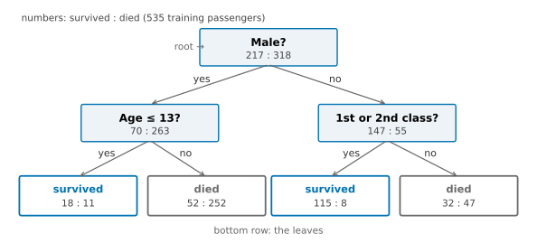
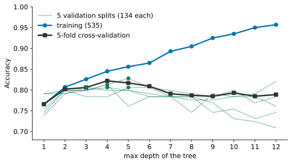
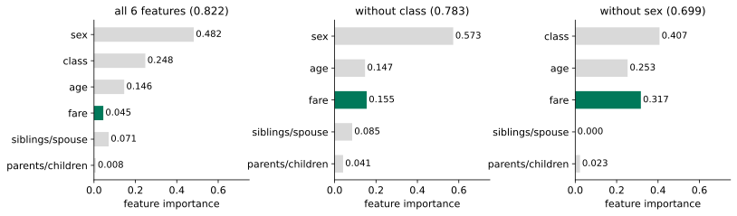

## 1. Problem: One Cut Is Not Enough

Logistic regression classifies with a straight line: one side of the line is predicted as label 1, the other side as label 0. Put another way, a line makes **one cut** through the plane and separates a "yes" side from a "no" side.

Below is a hand-made data set with four clusters of points. The lower-left and upper-right clusters have label 0, and the upper-left and lower-right clusters have label 1. First drag the first cut (a vertical line). Each side predicts its majority label.



Try it yourself first: how well can one cut do? What about a sloping line?

::: {.callout-note collapse="true" title="Show answer"}
Wherever you put the vertical line, the accuracy on these 160 points stays around 0.5 (the best is 0.544). Each side contains one cluster of label 0 and one cluster of label 1, so a majority vote always gets one cluster wrong. A sloping line does no better: the best line that logistic regression finds reaches only 0.51. One cut cannot separate this data.
:::

## 2. Inspiration: If One Cut Is Not Enough, Cut Again

One cut divides the plane into two parts, and each part still contains both labels. A natural idea is to cut each part again. Tick "one more cut on each side" in the figure, then drag one horizontal line in the left part and one in the right part.

::: {.callout-note collapse="true" title="Show answer"}
The first cut is near $x_1 = 2.5$. The left part is cut again near $x_2 = 2.5$, and so is the right part. Each of the four pieces now holds one cluster, and the accuracy is 0.988. Three cuts separate this data, and each cut looks at only one feature.
:::

Written in order, the three cuts form a chain of yes-or-no questions:

> Is $x_1 \le 2.5$? If yes: is $x_2 \le 2.5$? If yes, predict label 0; if no, predict label 1. If no: is $x_2 \le 2.5$? If yes, predict label 1; if no, predict label 0.

People often decide in the same way. A bank officer looking at a loan first asks "Is the yearly income below 20,000?" If yes, the loan is high risk. If no, the next question is "Is the existing debt more than half of the income?" Emergency triage also asks one question at a time, and the answer decides which question comes next.

When the Titanic sank in 1912, crew members loaded people into the lifeboats, reportedly following the rule "women and children first". This is also a chain of yes-or-no questions: is the passenger a woman? If not, is the passenger a child? Whether the rule was actually followed, and how closely, is something the passenger list can tell us.

We take "one question after another" as the model itself, and let the machine find from data which questions to ask and where to cut. The path ahead is as follows. We state the model and define the loss, then find a way to solve it. After that we test the result, read what the model has learned, and say where it cannot be trusted.

## 3. Model: A Chain of Questions, Each Looking at One Feature

As a model, this makes two assumptions:

1. Each question looks at **one** feature and asks whether it is below some number. The answer decides which way to go, and then the next question is asked.
2. After the last question, the samples that end up in the same place have fixed proportions of each label. To predict, we choose the majority label in those proportions.

This model is called a **decision tree**. Every question has the form "is this feature below this number?", so the plane is cut into axis-aligned rectangles, and each rectangle corresponds to one sequence of answers. The rectangles come out of the cuts; they are not a shape we look for first.

The passenger list has 891 people, and 714 of them have a recorded age. This lesson uses only these 714. Each passenger has 6 features: passenger class (1st, 2nd or 3rd), sex (1 for female, 0 for male) and age. Next come the number of siblings and spouses travelling with them and the number of parents and children travelling with them. The last is the fare. We predict whether the passenger survived (1) or died (0). The data is split 3:1 with stratification: 535 passengers for training and 179 held out for testing. Of the training passengers, 217 survived, which is a proportion of 0.406.

The figure below shows a tree with two levels of questions, grown by the machine on these 535 passengers.

{fig-alt="A tree with two levels: the root asks whether the passenger is male; males are then asked whether age is at most 13, and females are asked whether they travel in first or second class. Of the four leaves, boys aged 13 or under and women in first or second class are predicted to survive."}

A few names. The question at the top is the **root**. Each question is a **node**. A node that asks no further question is a **leaf**, and a leaf predicts the majority label of the training samples that fall into it. The number of questions from the root to the furthest leaf is the **depth** of the tree.

To read a tree, start at the root and walk down. Take a 40-year-old man. Is the passenger male? Yes, so go left. Is the age ≤ 13? No, so go right. In the leaf we reach, only 52 of 304 people survived, so the prediction is died.

This tree is almost "women and children first". The machine chose sex as the first question by itself, and for males the next question is about age. It also found one more thing: for females the question is about passenger class, and among the 79 third-class women only 32 survived.

The proportion in a leaf is a probability. The second assumption says the proportion of each label in a leaf is fixed, and this proportion is the probability that the tree gives. In the leaf for first- and second-class women, 115 of 123 people survived. For a new passenger who falls into this leaf, the tree gives a survival probability of $115/123 = 0.935$. From left to right, the survival proportions in the four leaves are 0.621, 0.171, 0.935 and 0.405. In scikit-learn, `predict_proba` returns this number, as it does for logistic regression. Predicting with a 0.5 threshold is the same as predicting the majority label, and as in logistic regression you can choose a different threshold. This tree can give only four different probabilities, one for each leaf.

With the model fixed, two things remain: which feature and which number each cut uses (Sections 4 and 5), and how many levels of questions to ask (Section 6).

## 4. Loss: How Good Is One Cut?

Consider one cut first. We choose a feature and a cut point, and split the points into two sides. By the second assumption of the model, each side gives one proportion. Let $p$ be the proportion of label 1 on one side. A good cut makes both sides as "pure" as possible: one side almost all label 1, the other almost all label 0.

We need one number that measures how wrong a side is when its points are given the proportion $p$. The squared error of linear regression and the cross-entropy of logistic regression can both be used. On one side, every point has a true label of 0 or 1, and the model gives all of them the same $p$:

- The squared error of linear regression. A point with label 1 has error $(1-p)^2$, and a point with label 0 has error $p^2$. Label 1 makes up $p$ of the points and label 0 makes up $1-p$, so the average is
  $$
  p\,(1-p)^2 + (1-p)\,p^2 = p\,(1-p)\,\big[(1-p) + p\big] = p\,(1-p).
  $$
- The cross-entropy of logistic regression. A point with label 1 has loss $-\log p$, and a point with label 0 has loss $-\log(1-p)$, so the average is $-p\log p-(1-p)\log(1-p)$. This expression is called **entropy**.
- The most direct idea: the error rate. If this side predicts its majority label, the proportion of wrong predictions is $\min(p,\ 1-p)$.

Twice the squared error has a name of its own:
$$
\text{Gini} = 2p(1-p) = 1 - p^2 - (1-p)^2,
$$
called **Gini impurity**. Multiplying by 2 does not change which cut is better. The maximum value, reached when the two labels are half and half, becomes 0.5. All three candidates are 0 when $p = 0$ or $1$ (a pure side) and are largest at $p = 0.5$.

After a cut, the two sides have different numbers of points, so we take a weighted average by the number of points. With $n_L$ points on the left and $n_R$ on the right, the score of the cut is $\frac{n_L}{n}\,\text{(left value)} + \frac{n_R}{n}\,\text{(right value)}$, and smaller is better.

The three candidates look similar, so next we check whether they choose different cut points. Here is one node: 100 points, with 20 blue points packed into a middle stretch and 80 grey points spread everywhere. Drag the cut line and watch the two curves.



Try dragging first: where is the error rate lowest? What about Gini?

::: {.callout-note collapse="true" title="Show answer"}
The error rate is 0.200 everywhere and never moves. Wherever you cut, grey points are the majority on both sides, so both sides predict grey, and the wrong predictions are always the same 20 blue points. Gini does change: it is lowest when the cut is at 5.75 (0.271, compared with 0.320 before the cut). Then the right side has 38 points that are all grey, and the left side keeps 20 blue and 42 grey points for the next cut to separate. Only Gini registers that the right side became pure.
:::

We choose Gini, which is also the default in scikit-learn's decision tree. If you switch to entropy (`criterion="entropy"`), the curve has a very similar shape to Gini, and the chosen cut point is usually the same.

Let us compute it once on the passengers. Before any cut, 217 of 535 people survived, so $p = 0.406$ and the Gini is $2 \times 0.406 \times 0.594 = 0.482$. The machine tries every possible cut point of each of the 6 features, and the best cut is by sex:

| | Survived | Died | Proportion survived $p$ | Gini |
|---|---:|---:|---:|---:|
| Male | 70 | 263 | 0.210 | 0.332 |
| Female | 147 | 55 | 0.728 | 0.396 |

The male row lets us check the link made above: at $p = 0.210$, the average squared error $p(1-p) = 0.166$ is half of the Gini 0.332. The weighted average is $\frac{333}{535} \times 0.332 + \frac{202}{535} \times 0.396 = 0.356$, which is lower than 0.482 before the cut. Among all candidate cuts, this one has the smallest weighted Gini.

## 5. Solving: Find the Cuts One at a Time

Now that we have a loss, the next step is to find the tree with the smallest loss. We have met two ways to solve a model. Linear regression uses the normal equation to compute the best coefficients in one step. Logistic regression has no formula, so it walks down the slope of the loss (gradient descent). Neither works for trees.

We cannot try everything. The 6 features on 535 passengers give 291 candidate cut points in total (a feature with k different values has k − 1 cut points; the 6 features together give 291), of which 84 are for age and 193 are for fare. A tree of depth 2 has 3 questions. Each question chooses from 291 cut points, which gives about $291^3 \approx 2.5 \times 10^7$ trees. A tree of depth 3 has 7 questions, which gives about $1.8 \times 10^{17}$ trees.

There is no slope to walk down either. If we move the cut point a little to the right without passing any point, no point changes sides, so the loss does not change at all. When the cut passes a point, the loss suddenly jumps. As the cut point moves, the loss is a staircase, and gradient descent has no direction to follow.

The method is **greedy search**. First find only the best cut for the root node, which is how the table in Section 4 was found. After that cut, find the best cut again on the left side and on the right side separately. Keep going until the depth limit is reached or a side contains only one label. Every step is only "try all cut points and pick the smallest", so it finishes quickly.

Greedy search looks only one step ahead, so sometimes it misses something. Go back to the four clusters in Section 1. Suppose the four clusters have the same number of points. Wherever the first cut is placed, both sides are almost half and half in labels, so the Gini hardly drops. You can see that this cut would let the next cut separate the data, but greedy search cannot. The first cut it picks is useless, and a tree of depth 2 reaches an accuracy of only 0.569 on these points. When the four clusters have different sizes (60, 30, 30, 40), the first cut lowers the Gini a little, so greedy search finds the right direction. On the same fitted points, depth 2 gives 0.963 and depth 3 is fully correct. Real data is rarely this perfectly symmetric, so in practice greedy search is usually good enough.

## 6. Test: What Happens If the Tree Keeps Cutting

As long as a leaf still contains both outcomes, we can always make one more cut. Should we keep cutting? First we use only two features, age and fare, so that the rectangles cut by the tree can be drawn on a plane. Drag the maximum depth and watch.



Try it first: drag the depth from 1 to the far right (no depth limit). How do the rectangles change? What happens to the two accuracies?

::: {.callout-note collapse="true" title="Show answer"}
At depth 2 there are only 4 rectangles, with training accuracy 0.716 and cross-validation accuracy 0.695. As you drag deeper, the rectangles get smaller and smaller, and many of them contain only one or two passengers. Training accuracy rises all the way: it is 0.880 at depth 10 and 0.976 with no depth limit. Cross-validation accuracy goes the other way: it is 0.626 at depth 10 and only 0.604 with no depth limit. The small rectangles are memorising the training passengers, so they stop working on a new set of passengers.
:::

Switch back to all 6 features and the same thing happens. With no depth limit, the tree grows to depth 18 with 127 leaves. Its training accuracy is 0.994, so it classifies almost every training passenger correctly. Under 5-fold cross-validation, however, it scores only 0.779.

{fig-alt="The blue line rises all the way to 0.96. The black line peaks at depth 4 at about 0.82, then falls to about 0.79. The five thin green lines go up and down, and their highest points fall at depths 3, 4 and 5"}

Read the figure first: as the depth goes from 1 to 12, how do training accuracy and cross-validation accuracy each change?

::: {.callout-note collapse="true" title="Show answer"}
Training accuracy rises all the way, from 0.766 to 0.957. Cross-validation accuracy first rises and then falls. It is highest at depth 4 (0.822, with 16 leaves) and stays around 0.79 from depth 7 onwards. The questions added after depth 4 only give single training passengers a leaf of their own, so they do not help on a new set of passengers.
:::

This is the same problem as using too high a degree in polynomial regression. The more flexible the model, the more it fits the chance patterns in the training data. This is called **overfitting**. For a tree, flexibility is controlled by the depth. In scikit-learn this is `DecisionTreeClassifier(max_depth=...)`.

When we choose the depth, the test set must be kept until the end and read only once. There are two ways to choose. One is to hold out a validation set and fit once for each depth. The other is cross-validation: fit 5 times for each depth, so that every point is used once for evaluation. The thin green lines in the figure come from holding out 134 of the 535 passengers as a validation set, with 5 different splits. The depths they select are 4, 5, 4, 3 and 5. The choice depends on which passengers happened to land in the validation set. Cross-validation gives a single curve, with its highest point at depth 4. With 535 passengers the data is small, so we use cross-validation here.

When there is a lot of data, the choice reverses. Assignment 2 has 50,000 training images. Cross-validating 20 depths with 5 folds needs 100 trees. The validation set alone has 10,000 images, so luck is not a worry, and fitting only 20 trees on it is enough. With little data, use cross-validation; with a lot of data, use a validation set. Whichever you use, the chosen depth must not sit at either end of the search range. If it does, a better value may lie outside the range. Depth 4 is in the middle of 1 to 12.

With depth 4 chosen, we read the test set once: 0.810.

## 7. Explain: Reading a Tree

So far, the test only tells us how accurate the tree is. A tree can also show us why it decides as it does. Loan officers and doctors often want exactly this, and it is the reason Section 2 said that rules are easy to read and to follow. There are two ways to read a tree: follow the path of one sample, or ask which features the whole tree relies on.

### 7.1 Why One Passenger Is Predicted to Survive

To keep the reading short, we take a tree of depth 3. Its cross-validation accuracy is 0.806, a little lower than depth 4, but every decision needs only three questions. In the test set there is a third-class woman, aged 24, travelling with two parents or children, with a fare of 16.7. Her path is:

1. Male? No.
2. First or second class? No.
3. Fare ≤ 20.8? Yes.

The leaf she lands in holds 61 training passengers, of whom 31 survived. The tree gives a survival probability of 0.508, so it predicts that she survived. She did survive, but 0.508 is very close to 0.5, so this decision is not stable.

The third question deserves a closer look. Among third-class women, 61 had a fare of at most 20.8, and 0.508 of them survived. The other 18 paid more, and only 1 of them survived (0.056). A high fare in third class is mostly the cost of one ticket covering a large family. The 18 passengers with higher fares had 4.8 relatives travelling with them on average, against 0.9 for the lower fares. One possible explanation is that a third-class passenger with a large family would find it very hard to get everyone onto a lifeboat; this is a guess, because the data do not record it. The data have two columns, siblings and spouses, and parents and children, but not their sum. This tree did not cut on those columns: it read the family size from the fare.

Logistic regression can also classify this passenger. Its reason is that 6 coefficients are each multiplied by one of the 6 standardised features and the results are added up. We can compute what this sum is, but we cannot read the sentences above from it.

### 7.2 Which Features the Whole Tree Relies On

The path of one sample explains only that one sample. To see what the whole tree relies on, we add up the credit of every cut. We measure credit with the loss from Section 4: each cut lowers Gini by some amount, and the more it lowers, the more useful the cut is. Concretely, for a node, take "number of samples × Gini" before the cut, and subtract the "number of samples × Gini" of the two sides after the cut. The difference is the amount this cut removes. We add up the amounts for all the cuts that use the same feature, then divide by the total over all cuts. The result is the **feature importance** of that feature, and the importances of all features add up to 1.

Let us work it out on the two-level tree from Section 3. You can read it straight from the table:

| Node | Feature used | Samples × Gini: before the cut → left + right | Amount removed |
|---|---|---|---:|
| Root: male? | Sex | 258.0 → 110.6 + 80.1 | 67.3 |
| Male: age ≤ 13? | Age | 110.6 → 13.7 + 86.2 | 10.7 |
| Female: first or second class? | Class | 80.1 → 15.0 + 38.1 | 27.0 |

In the first row, 258.0 is $535 \times 0.482$ and 110.6 is $333 \times 0.332$. These are the same numbers as in the table in Section 4. The three cuts remove 105.0 in total. The importance of sex is $67.3/105.0 = 0.641$, class is 0.257, age is 0.102, and the other three features are never used, so their importance is 0. This agrees with `tree.feature_importances_` in scikit-learn.

The depth-4 tree uses more features: sex 0.482, class 0.248, age 0.146, number of siblings and spouses 0.071, fare 0.045, and number of parents and children 0.008.

Importance has a size but no sign, unlike the coefficients of logistic regression. A value of 0.482 only says that the cut on sex is very useful. Whether being female makes survival more likely or less likely has to be read from the paths in the tree. The leaves on the female side have a higher survival rate.

## 8. A Small Investigation: Can We Trust Importance

Suppose we read off these importances and then say: "The fare has an importance of only 0.045, so it has almost no effect on survival." Below we check this claim using the six steps of the assignment marking scheme: observe, idea, action, test, explain, limits. The analysis you do in the assignment is this kind of investigation.

**Observe.** In the depth-4 tree, the importance of the fare is only 0.045, lower than that of the number of siblings. Yet the fares of the three classes are very different. Among training passengers, the median fare is 66.6 in first class, 19.5 in second class and 8.1 in third class. The importance of class is 0.248.

**Idea.** The fare and the class may be saying almost the same thing. Their correlation coefficient is −0.58. If so, once the tree has used class, there is not much left for the fare to add. A low importance then does not mean the fare carries no information. We can check this as follows: remove class and see whether the fare takes over part of its role. Then remove sex as a comparison, because no feature is similar to it.

**Action.** Change one thing at a time: remove one of the 6 features and keep everything else the same, still with a depth-4 tree. First remove the fare, then the class, then sex.

**Test.** Use the same 5 folds (the same `kf`). With all 6 features, the accuracy is 0.822, and the five folds lie between 0.794 and 0.869.

- Remove the fare: 0.809. Four folds go down and one goes up, with changes between −0.028 and +0.009, which is smaller than the differences between folds. This time we cannot say the accuracy changed.
- Remove the class: 0.783, and all five folds go down (−0.009 to −0.075). The importance of the fare rises from 0.045 to 0.155.
- Remove sex: 0.699, and all five folds go down, by 0.056 to 0.187. The importances of class and fare rise to 0.407 and 0.317, but the accuracy is still not recovered.

{fig-alt="Three groups of horizontal bars. With all features, the fare is 0.045. With class removed, the fare rises to 0.155 and the accuracy is 0.783. With sex removed, the fare is 0.317, class is 0.407 and the accuracy is 0.699"}

**Explain.** At each cut the tree picks only the best feature at that moment. Class and fare both describe how wealthy a passenger is. Class is picked first and takes the credit the two share, so the fare keeps only a little. When class is removed, the fare steps in, and the accuracy drops only partly. No other feature can stand in for sex. After it is removed, the importances of the other features all rise, yet the accuracy still drops the most.

**Limits.** What this investigation can say is limited to this data and a tree of this depth. Here the importance of the fare is low because class has already taken most of its information, and removing the fare alone leaves the accuracy almost unchanged. It cannot say that the fare has "no effect", and it cannot say that sex "caused" survival. The data records only who survived, and says nothing about what happened at the lifeboats. Evidence still missing: we tried only depth 4 and one split of the data. There is another way to measure how much one feature affects accuracy, described in Advanced Study 5.

When you read importances, first look for features that say the same thing, because importance only reflects what this one tree used.

## 9. More Than Two Categories: Iris

The Titanic data has only two outcomes. Many problems have more categories. For example, Assignment 2 asks you to recognise the ten digits 0 to 9.

Extending a tree to many categories needs almost no change. A leaf still holds the proportion of each category, we still predict the most common category, and the probability is still the proportion of each category. Only Gini needs to be extended. In its second form, $1-p^2-(1-p)^2$, $p$ and $1-p$ are the proportions of the two categories. With $K$ categories, we again subtract the square of every category's proportion:
$$
\text{Gini} = 1 - \sum_{k=1}^{K} p_k^2 .
$$
It is still 0 when the node is pure and largest when all categories are equally common.

Let us look at the iris data (`load_iris`) once. There are 150 flowers of three species: setosa, versicolor and virginica. For each flower, the length and width of the sepal and the petal were measured. After a stratified 3:1 split, the 112 training flowers contain 37, 37 and 38 flowers of the three species, so the Gini is $1-3\times(1/3)^2\approx 0.667$. The tree of depth 2 grown by the machine is:

> Petal width ≤ 0.80? Yes: setosa (all 37 are setosa). No: petal width ≤ 1.75? Yes: versicolor (36 versicolor, 3 virginica). No: virginica (1 versicolor, 35 virginica).

The first cut produces a completely pure part, and the Gini falls from 0.667 to 0. The right side holds the other two species in roughly equal numbers, so its Gini is 0.5, and the second cut separates them. The middle leaf gives three probabilities: setosa 0, versicolor $36/39 = 0.923$ and virginica $3/39 = 0.077$.

Cross-validation accuracy is highest at depth 2 (0.955). It is 0.947 for deeper trees. Under the same cross-validation, logistic regression also gives 0.947. After choosing depth 2, reading the test set once gives 0.947. The three species are well separated, so two cuts are enough, and we see no clear overfitting on this data.

This tree uses only the petal width, and the importance of the petal length is 0. The correlation coefficient between petal length and petal width is 0.964. With only the petal length and the same depth 2, cross-validation accuracy is still 0.902. This is the same situation as in Section 8: two features say almost the same thing, and the one picked first takes the credit.

## 10. A Number in the Leaf: Regression Tree

So far, the leaf has held the proportion of each category. Suppose we want to predict a number, such as the fuel consumption of a car. We walk the same road again and change only one thing:

- Model: still a series of yes-or-no questions, each looking at one feature. The leaf holds **the average of the samples that fall into this leaf**.
- Loss: the squared error of linear regression. Each cut picks the split point that makes the weighted sum of the squared errors on the two sides smallest.
- Solving: still greedy search.

This is a **regression tree**. In scikit-learn it is `DecisionTreeRegressor`.

Test. We use only one feature (horsepower) to predict fuel consumption. The prediction of the regression tree is a staircase, and each step is one leaf. Drag the depth and watch.



Try it first: drag the depth from 1 to 10. How does the staircase change? What happens to the two RMSE values?

::: {.callout-note collapse="true" title="Show answer"}
At depth 1 there are only two steps, and the cross-validation RMSE is 5.63, worse than a straight line (4.98). At depth 5 (26 steps) the cross-validation RMSE reaches its lowest value, 4.23, and depth 6 is almost the same. The steps follow the curve "more horsepower burns more fuel, and the rise slows down for big engines", which a straight line cannot do. If you drag deeper, the steps become finer and finer and go up and down between neighbouring cars. This is overfitting: the training RMSE keeps falling to 3.36, but the cross-validation RMSE rises to 4.35. The training RMSE cannot fall to 0 because cars with the same horsepower have different fuel consumption, and the tree cannot separate them.
:::

Now switch to all 6 features (cylinders, displacement, horsepower, weight, acceleration time, year), with the same 313 training cars and the same 5 folds. The cross-validation RMSE for depths 1 to 10 is 5.30, 4.31, 3.68, 3.35, **3.22**, 3.26, 3.33, 3.43, 3.51, 3.58. Depth 5 is best, and it is not at either end. Linear regression on the same 5 folds gives 3.56.

Let us read a regression tree of depth 2:

> Displacement ≤ 198.5? Yes: horsepower ≤ 84.5? Yes: predict 32.2 mpg (101 cars). No: 24.6 mpg (75 cars). No: horsepower ≤ 127? Yes: 19.4 mpg (59 cars). No: 14.6 mpg (78 cars).

The four leaves are four kinds of car. Cars with a small engine and low horsepower use the least fuel, and cars with a big engine and high horsepower use the most. In the depth-5 tree, the importance of displacement is 0.667, horsepower 0.178, year 0.096 and weight only 0.049. The correlation coefficient between displacement and weight is 0.93. Displacement was picked first and took the credit the two share, as in Section 8.

## 11. Comparing with the Straight Line

In this lesson we compare the tree with the straight line (logistic regression or linear regression) on five datasets. All of them use the same 5-fold cross-validation:

| Data | Straight line | Tree |
|---|---:|---:|
| Four clusters (60, 30, 30, 40 points), accuracy | 0.487 | 0.975 (depth 3) |
| Titanic, 6 features, accuracy | 0.783 | 0.822 (depth 4) |
| Iris, 4 features, accuracy | 0.947 | 0.955 (depth 2) |
| Breast lumps, 30 features, accuracy | 0.979 | 0.927 (depth 5) |
| Fuel consumption, 6 features, RMSE (smaller is better) | 3.56 | 3.22 (depth 5) |

In the four clusters, the class depends on how two features combine. When $x_1$ is small, a large $x_2$ means class 1, and when $x_1$ is large, it is the other way round. A straight line cannot say "look at one feature first, then at the other", but a tree asks exactly this kind of question. The Titanic has the same kind of combination: among women, the share who survived differs by more than a factor of two between classes. Fuel consumption falls along a curve as horsepower rises, and the steps of a tree can follow the curve. In the breast lumps, the tree is 0.05 behind the straight line. One possible reason is that the two classes are separated along a tilted direction, which a tree can only approximate with horizontal and vertical steps; this lesson does not test that. In the iris data the three species are far apart, so the two methods perform about the same.

Before choosing a tree, check two things. One is whether the relationship is curved or the features combine. The other is whether you need a rule that you can hand to someone else to carry out. A tree does not need standardisation, because each question compares one feature with one number, and the scale does not change where the cut falls.

A single tree is not very stable, and its accuracy is often lower than that of other methods. Combining many trees is a common and strong choice for tabular data. **Bagging** grows many trees, each from a slightly different sample of the data, and then takes a vote or an average. **Gradient boosting** grows trees one after another, and each new tree is built to fix what the previous trees together still get wrong. Common implementations are XGBoost and LightGBM. The combined model is more accurate. The way of reading a reason in a few sentences, as in Section 7, no longer works for it. Advanced Studies 3 and 4 explain why these methods work.

## 12. Implementation: Using scikit-learn

The ideas are in the earlier sections, so this section only shows how to call the code. Assume the training data are already in `X_train` and `y_train`, and `kf` is the same 5-fold split. The Titanic loading and the two lines of preparation are in the data block of Lab 6.

```python
from sklearn.tree import DecisionTreeClassifier
from sklearn.model_selection import cross_val_score

tree = DecisionTreeClassifier(max_depth=4, random_state=0)    # at most 4 questions on any path
scores = cross_val_score(tree, X_train, y_train, cv=kf)      # accuracy on each of the 5 folds
print(scores.mean())                                          # cross-validated accuracy of this depth
tree.fit(X_train, y_train)                                    # grow the tree on all training passengers
print(tree.feature_importances_)                              # how much each feature lowered the Gini
```

On the Titanic, the cross-validated accuracy is 0.822. The importances, in the column order (class, sex, age, siblings and spouses, parents and children, fare), are 0.248, 0.482, 0.146, 0.071, 0.008, 0.045. `random_state=0` makes the result repeatable: when several cut points are equally good, the tree picks one at random.

- To change the depth, change only `max_depth`. Choosing the depth means running the second line once for each of several values of `max_depth`, in the same way as choosing the degree of a polynomial.
- For the three-class iris data, you do not need to change a single line of code.
- To predict a number, replace `DecisionTreeClassifier` with `DecisionTreeRegressor` and add `scoring="neg_root_mean_squared_error"` to the cross-validation. Put a minus sign in front of the result to read off the RMSE.
- To see the shape of the tree, use `sklearn.tree.plot_tree(tree)`. To read the probability for one sample, use `tree.predict_proba`.

## 13. One-Page Review

If you read only one page, read this one. The last column shows the matching step in the assignment marking criteria. The path of this lesson is the same path the assignment asks you to follow.

| Step | What this lesson did | Evidence used to judge | Assignment step |
|---|---|---|---|
| Problem | A straight line is one cut, and one cut cannot separate the four clusters | The accuracy of one cut is about 0.5 | observe |
| Inspiration, model | If one cut is not enough, cut again; a series of yes/no questions that each look at one feature, with the share in each leaf as the probability | After three cuts, 0.988; the passenger tree reads out "women and children first" | idea |
| Loss, solving | Squared error → Gini, cross-entropy → entropy; we cannot try everything and there is no slope, so we use greedy search | First cut 0.482 → 0.356 | action |
| Testing | A deep tree memorises the training set; use cross-validation when data are few and a validation set when data are many; do not land at either end; read the test set once | Training 0.994 against cross-validation 0.779; depth 4 is best | test |
| Explaining | Read the path of one passenger; importance is computed from the drop in Gini | Three questions give the reason; 0.641, 0.257, 0.102 | explain |
| Limits | Importance shows what this one tree used; features that say the same thing take each other's place | Remove class, and fare rises from 0.045 to 0.155 | limits |
| Many classes, regression | For many classes, Gini is only generalised to $1-\sum p_k^2$; putting the mean in a leaf predicts a number | Iris 0.955; fuel consumption RMSE 3.22 against 3.56 | the same path once more |

## 14. Summary and Limits

Back to the opening question: if one cut cannot separate the classes, we keep cutting, and each cut looks at only one feature. Treat this kind of judgement as a model. The share in each leaf gives the probability, and Gini gives the loss. Greedy search gives the solution, and data that took no part in the fitting decide how many levels to cut. The grown tree can also be read: why one sample was judged this way, and what the whole tree mainly relies on. With more classes, only the way of writing Gini changes, and putting the mean in a leaf predicts a number.

**After this lesson you can:** switch to the assumption "a series of yes/no questions that each look at one feature". Use it on a classification or regression problem when you do not want to assume in advance what shape the boundary has. Use it also when you need to give someone a rule that they can follow and that has a stated reason. You let the machine search for the rules one cut at a time. You use data that took no part in the fitting to decide how many levels to ask. You read out why it judged this way and which features it mainly relied on. You can also say where this way of reading, and this assumption, can go wrong.

**Transfer question.** A bank uses two features to decide whether a loan will default: annual income and existing debt. The approver's rule of thumb is "if income is below 20,000, or debt is more than half of income, the risk is high". Answer without calculating: of the two conditions in this rule, which one can be written directly as one question in a tree, and which cannot? What do you do about the one that cannot? The bank has 2 million historical records. Would you use a validation set or cross-validation to choose the depth? In the grown tree, the importance of "existing debt" is close to 0. Can you tell the bank that "debt does not need to be looked at"?

::: {.callout-note collapse="true" title="Suggested answer"}
The first condition, "income < 20,000?", can be the question at the root node. The second condition, "debt > half of income?", uses two features at once (the ratio of debt to income), but a tree question looks at only one feature. So there are two options. You can first build a new feature, "debt / income", and then a depth of 2 is enough. Or you can use only the two original features. Then the tree needs many horizontal and vertical small steps to approximate this tilted line, so it must be much deeper. With 2 million records, use a validation set: it is cheap, and the validation set itself is large, so the result is stable. The importance of debt is close to 0, but you cannot say directly that it need not be looked at. First check whether it says the same thing as a feature the tree already used (for example the "debt / income" you built). Then, as in Section 8, remove one feature and test again.
:::

**Where this method cannot be trusted.**

1. The boundary can only be horizontal and vertical. Each question looks at one feature, so when two classes are separated along a tilted line, the tree needs many small steps to approximate it. This makes it deep and prone to overfitting. On the 30 features of the breast lumps, it is 0.05 lower than logistic regression, and a tilted boundary may be one reason.
2. Greedy search looks only one step ahead. When two cuts are useful only together, as in the four clusters when all four have the same number of points, greedy search cannot find the first cut (Section 5).
3. A tree is sensitive to the training samples. With a different set of training samples, the cut points in the lower levels change (you will see this in the Advanced part of Lab 6). When you read a tree, do not treat every cut point as a firm conclusion.
4. Feature importance shows only what this one tree used. Features that say the same thing take each other's place, so a low importance does not mean no information (Section 8).

**30-second feedback.** After reading this lesson, please scan the code and leave anonymous feedback or a question. Tell us what you did not understand and where we went too fast. All of it helps us improve.

{fig-align="center" width="160px" fig-alt="Feedback QR code"}

*The Advanced Study sections below do not affect the main line, and each Study can be read on its own. MPS311 students are encouraged to read them. For MPS439, the required work is in the Advanced part of Lab 6, and the other Studies are optional.*

---

## Advanced Study 1: Why Gini Can Only Fall After a Cut

In the component of Section 4, the error rate did not move at all, but Gini fell. In Section 6, a tree with no depth limit keeps cutting until it is almost always right. Both facts have the same cause, which lies in the shapes of two curves.

Suppose a node has $n$ points, and class 1 makes up the share $p$. After one cut, the left side has $n_L$ points with class 1 share $p_L$. The right side has $n_R$ points with class 1 share $p_R$. The class 1 points on the left and right add up to the class 1 points of the whole node, so the share before the cut is the weighted average of the two shares:
$$
p = \frac{n_L}{n}\,p_L + \frac{n_R}{n}\,p_R .
$$
Write $w_L = n_L/n$ and $w_R = n_R/n$. Put $g(p) = 2p(1-p)$ into the expression. The Gini before the cut minus the weighted Gini after the cut simplifies to
$$
g(p) - \big[\,w_L\,g(p_L) + w_R\,g(p_R)\,\big] = 2\,w_L\,w_R\,(p_L - p_R)^2 .
$$
The right side is a square times positive numbers, so it is never below 0. It equals 0 only when the two shares are exactly the same. So for any cut where the two shares differ even a little, Gini falls. In a picture, Gini is a parabola that bends downwards, and a chord between two points always lies below the curve. The weighted Gini after the cut lies on the chord, and the Gini before the cut lies on the curve.

Check this with the first cut for passengers in Section 4: $w_L = 333/535$, $w_R = 202/535$, $p_L = 0.210$, $p_R = 0.728$. Putting them in gives $2 \times 0.622 \times 0.378 \times 0.518^2 = 0.126$, which is exactly $0.482-0.356$.

The error rate $\min(p, 1-p)$ is a broken line made of two straight pieces. If $p_L$, $p$ and $p_R$ are all on the same side of 0.5, the error rate is a straight line over this stretch. The chord and the curve then coincide, the weighted average is exactly the same as before the cut, and the drop is 0. In the component of Section 4, blue points make up 0.2 of the 100 points. Wherever the cut falls, grey points are the majority on both sides. All three shares are below 0.5, so the error rate stays at 0.200. On the same cut, Gini falls by $2 \times 0.62 \times 0.38 \times (20/62)^2 = 0.049$, from 0.320 to 0.271.

This also explains the overfitting in Section 6. As long as a leaf still contains both classes, some cut can always lower Gini a little, so the Gini on the training set can fall all the way to 0. The tree never stops by itself, and `max_depth` has to stop it.

Now try it yourself:

1. Use this expression to check the male cut in Section 3 (age ≤ 13): the two sides have 29 and 304 people, with survival shares 0.621 and 0.171. By how much does Gini fall? Compare it with $0.332$ minus the weighted Gini after the cut.
2. According to the expression, when is the drop largest? Think about the $w_L w_R$ term and the $(p_L-p_R)^2$ term separately: is it good to cut so that one side is very small and the other very large?
3. Entropy is also a curve that bends downwards. Without deriving the expression, explain why a cut can only lower entropy as well.

## Advanced Study 2: Where Multi-Class Gini Comes From

Section 4 derived the two-class Gini from squared error, and Section 9 wrote the multi-class $1-\sum_k p_k^2$ directly. Here we connect the two.

With $K$ classes, write the class of each sample as $K$ numbers, each 0 or 1. Put 1 in the $k$-th position if the sample belongs to class $k$, and 0 in the others. The leaf gives each position a predicted value, which is the share of each class, $p_1, \dots, p_K$. The squared error of one sample is the sum of the squared errors in these $K$ positions.

Look at one column at a time. In column $k$, the samples with share $p_k$ are 1 and the rest are 0, and the model gives $p_k$ for all of them. This is exactly the same as the two-class case in Section 4, and the mean squared error of this column is $p_k(1-p_k)$. Adding the $K$ columns:
$$
\sum_{k=1}^{K} p_k(1-p_k) = \sum_{k} p_k - \sum_{k} p_k^2 = 1 - \sum_{k} p_k^2 .
$$
This is the multi-class Gini. With two classes there are two columns, $p(1-p) + (1-p)p = 2p(1-p)$, and the "times 2" in Section 4 comes from these two columns.

Entropy works the same way: the cross-entropy of logistic regression, extended to many classes, is $-\log p_k$ (when the sample belongs to class $k$). Averaged in a leaf, it is $-\sum_k p_k \log p_k$.

Now try it yourself:

1. Compute the Gini of the middle leaf in Section 9 (36 versicolor irises and 3 virginica irises), and compare it with 0.142.
2. With three classes at one third each, Gini is 0.667. What is it with ten classes at one tenth each? As the number of classes grows, does the Gini of the most mixed case get larger or smaller?

## Advanced Study 3: Why Voting by Many Trees Is More Stable

Section 11 mentioned bagging: draw many samples with replacement from the training set, grow one tree on each, and then take the average or the vote.

Look at one passenger. With a different set of training samples, the survival probability that the tree gives her changes (you will see in the Advanced part of Lab 6 that the cut points in the lower levels really do change). Treat this probability as a random number with variance $\sigma^2$. Each of $n$ trees gives one, and we take the average. If the $n$ numbers were unrelated to each other, the variance of the average would be $\sigma^2/n$. But the trees are all drawn from the same training set, so they are related. Let the correlation coefficient between any two trees be $\rho$. The variance of the average is
$$
\operatorname{Var}\!\left(\frac{1}{n}\sum_{i=1}^{n} T_i\right)
= \frac{1}{n^2}\Big[\, n\sigma^2 + n(n-1)\,\rho\,\sigma^2 \,\Big]
= \rho\,\sigma^2 + \frac{1-\rho}{n}\,\sigma^2 .
$$
As trees are added, the second term gets smaller, but the first term $\rho\sigma^2$ does not shrink with $n$. Beyond a certain number of trees, adding more does not help. To be more stable, the trees must be less alike.

A **random forest** is designed for this: at each cut, the best cut is chosen only among a few randomly picked features. Recall Section 8: class and fare say almost the same thing, class is always picked first, and every tree looks very similar. In a random forest, some nodes cannot pick class and must use fare. The trees are then less alike, and $\rho$ becomes smaller.

Averaging can only reduce the wobble. It cannot correct a systematic error that every tree shares. This is why bagging uses trees with no depth limit: a single deep tree has a small systematic error and a large wobble, and the wobble is exactly what averaging handles. On the passengers, a single tree with no depth limit scores 0.779 in cross-validation, and bagging with 25 trees scores 0.800.

Now try it yourself:

1. With $n = 25$, for $\rho = 0.5$ and $\rho = 0.2$, what fraction of the variance of a single tree is the variance of the average?
2. Why does bagging usually not use trees of depth 1? Answer using the two terms of this section.

## Advanced Study 4: Why Fitting Residuals Is Gradient Descent

Section 11 mentioned gradient boosting. The first shallow tree makes a prediction, and the second tree fits how much the first one is still off (the residual: the true value minus the prediction). The two are added together, and then the third tree fits the remaining gap. Now let us see where the word gradient in the name comes from.

Treat the predicted value of every training sample, $f_1, \dots, f_n$, as the parameters to adjust, with the squared error loss $L = \sum_i \frac12 (y_i-f_i)^2$. Take the derivative with respect to the $i$-th predicted value:
$$
\frac{\partial L}{\partial f_i} = -(y_i - f_i).
$$
The negative gradient is exactly the residual $y_i-f_i$. Each step of gradient descent moves a small distance along the negative gradient. Here this means every predicted value moves a little towards its own residual, $f_i \leftarrow f_i + \eta\,(y_i-f_i)$.

The problem is that this step only tells us how to move the training samples, and gives no way to move the prediction for a new sample. So we use a tree to fit the residuals. The tree turns "which samples should move up, and by how much" into a series of yes/no questions. A new sample can also go through these questions to get the amount it should move. In each round we add $\eta$ times this tree, and $\eta$ is the learning rate of gradient descent. scikit-learn uses 0.1 by default and runs 100 rounds.

For classification with cross-entropy as the loss, the derivation is the same. The predicted value is the number before the sigmoid in logistic regression. The negative gradient becomes $y_i-p_i$ (taking the derivative of cross-entropy with respect to it gives exactly this difference). Each tree fits "the true label minus the current probability". XGBoost and LightGBM use the same framework, and add much more on how to grow each tree and how to prevent overfitting.

On fuel consumption, adding trees of depth 2 over three rounds gives training RMSE of 3.91, 3.25 and 2.92 in turn. The cross-validated RMSE of `GradientBoostingRegressor` is 2.85, a single tree of depth 5 gives 3.22, and the straight line gives 3.56.

Now try it yourself:

1. If $\eta = 1$, and every tree has no depth limit and fits the residuals perfectly, what are the residuals on the training set after one round? Is this good?
2. Why does each round use only a shallow tree and take only a small step? What happens in gradient descent when the learning rate is too large?

## Advanced Study 5: What the Two Kinds of Importance Measure

The limits part of Section 8 said that "how much one feature affects accuracy" can be measured in another way. Keep the model fixed, shuffle the values of one feature in the validation set at random, and see how much the accuracy drops. This is called **permutation importance**. The code is in the Advanced part of Lab 6, and here we cover only the idea.

Gini importance records credit at fitting time: each time the tree cuts on this feature, it makes one entry. Permutation importance is measured at judging time. All the other features are still there and only this one is scrambled, and we see how much worse the judgement becomes.

On the passengers, take the same tree of depth 4 (fitted on 401 people and validated on 134). By the drop in Gini, sex is 0.456, class 0.295, age 0.150, fare 0.069. By the drop in accuracy after shuffling, sex is 0.176, class 0.092, age 0.054, fare 0.009. The ratio of class to fare is about 4 times in the first measure and about 10 times in the second. When fare is shuffled, class is still there, so the tree can get almost the same information from class, and its judgement is hardly affected. But the tree did cut on fare a few times while fitting, so Gini importance still gives it credit.

Now try it yourself:

1. If class and fare are shuffled together, does the accuracy drop by more or by less than the sum of shuffling them one at a time? Why?
2. Why does permutation importance use the validation set, and not the 401 people used for fitting?
3. Section 8 "removes a feature and grows a new tree", while permutation importance "keeps the tree and shuffles one feature". How do the questions that the two methods answer differ?

## Advanced Study 6: Open Questions

This lesson did not develop the questions below. Each comes with a starting point.

1. **Pruning.** This lesson limits the size of the tree with `max_depth`. Another way is to grow the tree fully and then cut off the branches that do little. Starting point: the documentation of `DecisionTreeClassifier(ccp_alpha=...)`. What does the cost function of pruning have in common with the regularisation of Ridge and Lasso?
2. **Cutting at a slant.** Each question looks at one feature, so the boundary is horizontal and vertical. What happens if we first build a new feature (for example $x_1 + x_2$) and then give it to the tree? On the Titanic, if there were a feature for the number of relatives travelling together, would the fare question in Section 7.1 be replaced?
3. **When do entropy and Gini choose differently?** Study 1 said that both are curves that bend downwards. They bend by different amounts. At what shares would they prefer different cut points?
