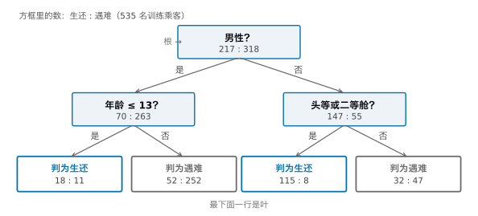
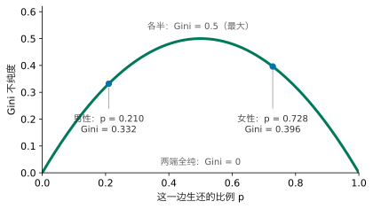
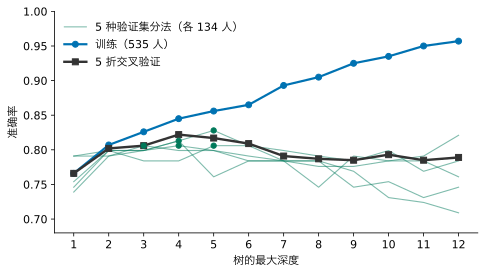
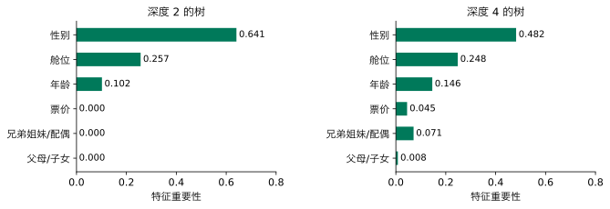
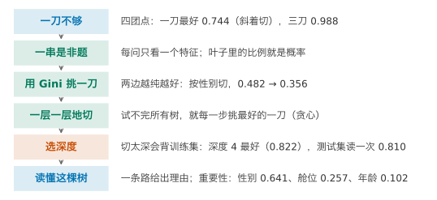

::: {.callout-tip title="怎样读这一讲"}
这份 Note 是全文，不必从头读到尾。只想跟上课、做 Lab 和作业，读第 1 到 7 节和第 11 节（一页回顾）就够了。第 8、9 节把同样的树用到多类和预测一个数上，作业 2 是十类，值得读。第 10 节是代码。Advanced Study 是推导，以及很多棵树合起来（bagging、boosting）。
:::

## 1. 问题：一刀切不开

logistic regression 用一条直线分类：直线的一边判为类 1，另一边判为类 0。换个说法，一条直线就是在平面上**切一刀**，切出“是”和“否”两边。

下面是一份手造的数据：四团点，左下和右上两团是类 0，左上和右下两团是类 1。先拖第一刀：可以平移，也可以转动角度，切开的两边各按多数判断。



请先自己试：一刀最好能做到多少？换成斜线呢？

::: {.callout-note collapse="true" title="展开答案"}
竖着切，不管放在哪里，这 160 个点上的准确率都在 0.5 左右（最好 0.544）：每一边都同时有一团类 0 和一团类 1，按多数判，总有一团判错。斜着切好一些，最好 0.744：把一个角上的那团单独切下来，另一边剩下三团，其中两团是同一类，按多数判，第三团就全判错了。不管怎样切，一刀都切不开这份数据。
:::

## 2. 启发：一刀不够，就再切一刀

一刀把平面分成了两块，每一块里还混着两类。很自然的想法是：在每一块里再切一刀。在下面的组件里，先拖竖线，再在左右两块里各拖一条横线。



::: {.callout-note collapse="true" title="展开答案"}
第一刀切在 $x_1 = 2.5$ 附近，左边再在 $x_2 = 2.5$ 附近切一刀，右边也是。四块各自只剩一团点，准确率 0.988。三刀就把这份数据分开了，而每一刀都只看一个特征。
:::

把这三刀按顺序写下来，就是一串是非题：

> $x_1 \le 2.5$ 吗？是：再问 $x_2 \le 2.5$ 吗？是判类 0，否判类 1。否：再问 $x_2 \le 2.5$ 吗？是判类 1，否判类 0。

人做判断时常常也是这样。银行审批员看一笔贷款，先问“年收入低于 2 万吗？”，是，就判高风险；否，再问“已有负债超过收入的一半吗？”。急诊分诊也是一次只问一个问题，答案决定下一个问题问什么。

1912 年泰坦尼克号沉没时，船员往救生艇上放人，据说按的是“妇女和儿童先上”。这也是一串是非题：是女人吗？不是的话，是孩子吗？这条规则到底执行了没有，执行到什么程度，乘客名单可以回答。

我们把“一问接一问”本身当成模型，让机器从数据里找该问哪些问题、切在哪里。接下来的路是：先把模型写清楚，再定损失、找求解办法、做检验，最后读懂它学到了什么，并说清它在哪里不可信。

## 3. 模型：一串只看一个特征的是非题

写成模型，就是两条假设：

1. 每个问题只看**一个**特征，问它是否小于某个数；答案决定往哪边走，再问下一个问题。
2. 问到最后，落在同一处的样本，各类所占的比例是固定的。判断时，按这个比例里的多数类判。

这样的模型叫**决策树**（decision tree）。每个问题都是“某个特征是否小于某个数”，所以平面被切成一块块横平竖直的矩形，每一块对应一串答案。矩形是切出来的结果。

乘客名单里有 891 人，其中 714 人记了年龄，这一讲只用这 714 人。每人有 6 个特征：舱位等级（1、2、3 等）、性别（女为 1，男为 0）、年龄、同行的兄弟姐妹和配偶数、同行的父母和子女数、票价。要预测的是生还（1）还是遇难（0）。按分层 3:1 划分：535 人训练，179 人留作测试。训练乘客里生还的有 217 人，占 0.406。

下图是机器在这 535 人上长出的一棵问了两层的树。

{fig-alt="一棵两层的树：根节点问是否男性；男性再问年龄是否不超过 13 岁，女性再问是否头等或二等舱；四片叶子里，13 岁及以下的男孩和头等、二等舱的女性判为生还"}

几个名字：最上面的问题叫**根**（root）；每个问题叫一个**节点**（node）；不再往下问的叫**叶**（leaf），叶子按落进来的训练样本的多数类做判断；从根到最远的叶子要问几个问题，叫树的**深度**（depth）。

读一棵树，就是从根往下走。一个 40 岁的男乘客：男性？是，走左边；年龄 ≤ 13？否，走右边；落进的叶子里 304 人只有 52 人生还，判为遇难。

这棵树几乎就是“妇女和儿童先上”：机器自己选了性别做第一个问题，男性这一边再问年龄。它还多看出一件事：女性这一边问的是舱位，三等舱的女性 79 人里只有 32 人生还。

叶子里的比例就是概率。第二条假设说，每片叶子里各类的比例是固定的，这个比例就是树给出的概率。头等、二等舱的女性那片叶子里，123 人有 115 人生还，落进来的新乘客，树给的生还概率是 $115/123 = 0.935$。四片叶子从左到右，生还的比例是 0.621、0.171、0.935、0.405。scikit-learn 里用 `predict_proba` 读出这个数，和 logistic regression 一样；按 0.5 判就是按多数判，也可以像 logistic regression 那样换一个阈值。这棵树只能给出四个不同的概率，有几片叶子就有几个。

模型定了，还剩两件事：每一刀切在哪个特征、哪个数上（第 4、5 节），以及要问几层（第 6 节）。

## 4. 损失：一刀切得好不好

先只看一刀：选一个特征、一个切点，把乘客分成两边。比如按性别切开：男性 333 人里 70 人生还，女性 202 人里 147 人生还。这一刀切得好不好？要给它打一个分，你会怎么打？

请先自己想一想，再往下读。

最先想到的通常是两种办法：数一数判错了几个；或者看两边是不是“纯”，各自几乎只剩一类。

**先试第一种：数判错了几个。**每一边按多数判，判错的个数除以总数，叫**错分率**。下面是一个节点：100 个点，20 个蓝点挤在中间一段，80 个灰点散在各处。拖动切线，看两条曲线。



请先拖一拖：错分率在哪里最低？Gini（绿线，下面就讲）呢？

::: {.callout-note collapse="true" title="展开答案"}
错分率处处都是 0.200，一动不动。不管切在哪里，两边都是灰点占多数，都判为灰色，错的始终是那 20 个蓝点。比如切在 5.75：左边 20 蓝、42 灰，判灰，错 20 个；右边 38 个全是灰，判灰，错 0 个；合起来还是 20/100。

可是切在 5.75 这一刀很有用：右边 38 个已经全是灰的，蓝点全被留在左边，下一刀只要在左边接着切。这一刀没让任何一个点的判法变对，所以数错几个看不出它的好处。绿线（Gini）切在 5.75 时最低（0.271，切之前是 0.320），它看出来了。
:::

**再试第二种：量两边纯不纯。**一个好懂的量法是：从一边随手抽两个人（抽一个，放回去，再抽一个），抽到一个生还、一个遇难的机会有多大？一边全是一类时，这个机会是 0；两类各占一半时最大。

设这一边生还的占 $p$。先抽到生还、再抽到遇难的机会是 $p(1-p)$，先抽到遇难、再抽到生还也是 $(1-p)p$，加起来是
$$
\text{Gini} = 2p(1-p),
$$
叫 **Gini 不纯度**（Gini impurity）。全是一类（$p = 0$ 或 $1$）时为 0，各半（$p = 0.5$）时最大，是 0.5。越小越纯。

{fig-alt="一条开口向下的抛物线，两端为 0，中间 0.5 最高；男性 p = 0.210，Gini 0.332；女性 p = 0.728，Gini 0.396"}

切一刀后有两边，点数不同，所以按点数加权平均：左边 $n_L$ 个点、右边 $n_R$ 个点、一共 $n$ 个时，这一刀的得分是
$$
\frac{n_L}{n}\,\text{Gini}_\text{左} + \frac{n_R}{n}\,\text{Gini}_\text{右},
$$
越小越好。scikit-learn 的决策树默认就用 Gini。

在乘客上算一次。切之前，535 人里生还 217 人，$p = 0.406$，Gini 是 $2 \times 0.406 \times 0.594 = 0.482$。按性别切开：

| | 生还 | 遇难 | 生还的比例 $p$ | Gini |
|---|---:|---:|---:|---:|
| 男性 | 70 | 263 | 0.210 | 0.332 |
| 女性 | 147 | 55 | 0.728 | 0.396 |

加权平均是 $\frac{333}{535} \times 0.332 + \frac{202}{535} \times 0.396 = 0.356$，比切之前的 0.482 低。机器把 6 个特征的每一个可能切点都这样算一遍，加权 Gini 最小的就是按性别这一刀，所以它先问性别。

::: {.callout-note collapse="true" title="展开：Gini 和线性回归的平方误差、logistic regression 的交叉熵"}
一边里每个点的真实标签是 0 或 1，树给它们的都是同一个比例 $p$。用线性回归的平方误差量：类 1 的点错了 $(1-p)^2$，类 0 的点错了 $p^2$，平均下来是
$$
p\,(1-p)^2 + (1-p)\,p^2 = p\,(1-p)\,\big[(1-p) + p\big] = p\,(1-p),
$$
正好是 Gini 的一半。核对：男性 $p = 0.210$ 时，$p(1-p) = 0.166$，是 Gini 0.332 的一半。乘 2 不改变哪一刀更好。

用 logistic regression 的交叉熵量：类 1 的点损失 $-\log p$，类 0 的点损失 $-\log(1-p)$，平均下来是 $-p\log p-(1-p)\log(1-p)$，叫**熵**（entropy）。`DecisionTreeClassifier(criterion="entropy")` 就用它，曲线的形状和 Gini 很像，选出的切点通常也一样。
:::

## 5. 求解：一刀一刀地找

损失有了，下一步是找出损失最小的树。我们学过两种求解办法：线性回归用正规方程一步算出最好的系数；logistic regression 没有公式，就沿着损失的坡往下走（梯度下降）。这两种在树上都用不了。

全试一遍试不完。6 个特征在 535 名乘客上一共有 291 个候选切点（每个特征有几种不同的取值，就有少一个的切点，6 个特征加起来），其中年龄 84 个，票价 193 个。深度 2 的树有 3 个问题，每个问题从 291 个切点里选，约 $291^3 \approx 2.5 \times 10^7$ 种；深度 3 有 7 个问题，约 $1.8 \times 10^{17}$ 种。

也没有坡可走。把切点往右挪一点点，只要没越过任何一个点，两边的点一个不变，损失也一点不变；越过一个点时，损失突然跳一下。损失随切点的变化是一级一级的台阶，梯度下降不知道往哪走。

办法是**贪心**（greedy）。先只找根节点最好的一刀，第 4 节的表就是这样找的。切完之后，在左右两边各自再找最好的一刀，一直做下去，直到深度到了上限，或者一边已经全是一类。每一步只是“试遍切点、挑最小的”，很快就能算完。

贪心每次只看眼前一步，有时会看漏。回到第 1 节的四团点：四团点数一样多时，第一刀不管切在哪里，两边几乎都是两类各半，Gini 几乎降不下来。你能看出先切这一刀、下一刀就能分开，贪心看不出来，它挑出的第一刀没有用处，深度 2 的树在这些点上的准确率只有 0.569。四团点数不一样时（60、30、30、40），第一刀能让 Gini 降一点，贪心就找对了方向，同样在拟合用的点上，深度 2 是 0.963，深度 3 全对。真实数据很少这样完全对称，贪心在实践中通常够用。

## 6. 检验：树切到底会怎样

只要一片叶子里还混着两类，就总能再切一刀。应该一直切下去吗？先只用年龄和票价两个特征，这样树切出的矩形能画在平面上。拖动最大深度看看。



请先拖一拖：深度从 1 拖到最右（不限深度），矩形怎样变？两个准确率呢？

::: {.callout-note collapse="true" title="展开答案"}
深度 2 只有 4 个矩形，训练准确率 0.716，交叉验证 0.695。越往深拖，矩形越切越碎，很多小矩形只框住一两个乘客；训练准确率一路升，深度 10 是 0.880，不限深度是 0.976。交叉验证却往下走：深度 10 是 0.626，不限深度只剩 0.604。那些小矩形是在背训练乘客，换一批乘客就不管用了。
:::

换回全部 6 个特征，现象一样。不限深度时，树长到深度 18、127 片叶子，训练准确率 0.994，几乎每个训练乘客都判对了；用 5 折交叉验证看，却只有 0.779。

{fig-alt="蓝线一路上升到 0.96；黑线在深度 4 最高约 0.82，之后下降到 0.79 附近；五条细绿线高低起伏，各自的最高点落在深度 3、4、5"}

请先读图：深度从 1 加到 12，训练准确率和交叉验证各怎样变？

::: {.callout-note collapse="true" title="展开答案"}
训练准确率一路上升，从 0.766 到 0.957。交叉验证先升后降，深度 4 最高（0.822，16 片叶子），深度 7 以后在 0.79 附近。深度 4 以后加的那些问题，只是在给训练乘客里的个别人单独开一片叶子，换一批乘客就没有用了。
:::

这和多项式回归里阶数太高是同一件事：模型越灵活，越能贴合训练数据里的偶然，这叫**过拟合**。树的灵活程度由深度控制，scikit-learn 里是 `DecisionTreeClassifier(max_depth=...)`。

选深度时，测试集要留到最后只读一次。有两种办法：留一份验证集，每个深度只拟合一次；或者做交叉验证，每个深度拟合 5 次，每个点都当过一次评估。图里的细绿线是从 535 人里留出 134 人做验证集、换 5 种分法的结果，选出的深度是 4、5、4、3、5，取决于哪些乘客碰巧落进了验证集。交叉验证只给一条曲线，深度 4 最高。535 人不算多，这里用交叉验证。

数据多时反过来。作业 2 有 50,000 张训练图，20 个深度做 5 折交叉验证要拟合 100 棵树，而验证集本身也有 10,000 张，不怕运气，用验证集只拟合 20 棵就够了。数据少用交叉验证，数据多用验证集。不管用哪种，选出的深度都不能落在搜索范围的两端：落在端点上，说明更好的值可能在范围外面。深度 4 在 1 到 12 的中间。

选定深度 4 以后，测试集读一次：0.810。

## 7. 解释：读懂一棵树

到这里，检验看的是准不准。树还能让人看见它为什么这样判，审批员和医生要的往往是这个，这也是第 2 节说的规则好读、好执行。一棵树有两种读法：读一个样本走过的路，读整棵树靠哪些特征。

### 7.1 一位乘客为什么判为生还

为了读得短，取一棵深度 3 的树（交叉验证 0.806，比深度 4 低一点，换来每个判断只有三问）。测试集里有一位三等舱的女乘客，24 岁，带着两个父母或子女，票价 16.7。她走过的路是：

1. 男性？否；
2. 头等或二等舱？否；
3. 票价 ≤ 20.8？是。

她落进的叶子里有 61 名训练乘客，31 人生还，树给的生还概率是 0.508，判为生还。她确实生还了，但 0.508 离 0.5 很近，这个判断并不稳。

第三问值得多看一眼。三等舱的女性里，票价不超过 20.8 的 61 人，生还的占 0.508；票价更高的 18 人，只有 1 人生还（0.056）。三等舱的票价高，多半是因为一张票上是一大家子：票价高的那 18 人平均同行 4.8 个亲属，票价低的平均 0.9 个。一种可能的解释是，带着一大家子的三等舱乘客很难一起挤上救生艇（这是推测，数据里没有记录）。数据里有“兄弟姐妹和配偶数”“父母和子女数”两列，但没有两者之和；这棵树没有用这两列切，而是从票价里读出了家庭大小。

logistic regression 也能判这位乘客，它的理由是 6 个系数分别乘上 6 个标准化后的特征，再加起来。这个和是多少可以算出来，但从里面读不出上面这几句话。

### 7.2 整棵树主要靠哪些特征

一个样本的路只说明这一个样本。整棵树靠什么，要把每一刀的功劳加起来。功劳用第 4 节的损失来量：每一刀都让 Gini 下降一些，下降得越多，这一刀越有用。具体地，一个节点上的“样本数 × Gini”，减去切开后两边各自的“样本数 × Gini”，就是这一刀拿走的量。同一个特征的所有切分加起来，再除以全部切分的总和，就是这个特征的**特征重要性**（feature importance），所有特征加起来为 1。

在第 3 节那棵两层的树上算一遍，读表就可以：

| 节点 | 用的特征 | 样本数 × Gini：切之前 → 左 + 右 | 拿走的量 |
|---|---|---|---:|
| 根：男性？ | 性别 | 258.0 → 110.6 + 80.1 | 67.3 |
| 男性：年龄 ≤ 13？ | 年龄 | 110.6 → 13.7 + 86.2 | 10.7 |
| 女性：头等或二等舱？ | 舱位 | 80.1 → 15.0 + 38.1 | 27.0 |

第一行的 258.0 是 $535 \times 0.482$，110.6 是 $333 \times 0.332$，和第 4 节的表是同一组数。三刀一共拿走 105.0。性别的重要性是 $67.3/105.0 = 0.641$，舱位 0.257，年龄 0.102，其余三个特征没被用到，都是 0。这和 scikit-learn 的 `tree.feature_importances_` 一致。

深度 4 的树用到了更多特征：性别 0.482、舱位 0.248、年龄 0.146、兄弟姐妹和配偶数 0.071、票价 0.045、父母和子女数 0.008。

{fig-alt="左：性别 0.641、舱位 0.257、年龄 0.102，其余为 0；右：性别 0.482、舱位 0.248、年龄 0.146、兄弟姐妹/配偶 0.071、票价 0.045、父母/子女 0.008"}

重要性只有大小，没有 logistic regression 系数那样的正负号。0.482 只说明性别这一刀很有用，女性是更容易生还还是更难，要回到树的路上读：女性那一边的叶子生还比例高。

重要性低也不等于没用。深度 4 的树里票价只有 0.045，可是票价和舱位说的差不多：训练乘客里，头等舱票价的中位数是 66.6，三等舱只有 8.1。舱位先被挑中，拿走了两者共有的功劳，票价就只剩一点。拿掉舱位重新长一棵深度 4 的树，票价的重要性升到 0.155。所以读重要性时，先看有没有和它说同一件事的特征。

## 8. 不止两类：鸢尾花

泰坦尼克号只有两类。很多问题有更多类，比如作业 2 要认 0 到 9 十个数字。

推广到多类几乎什么都不用改。叶子里照样放各类的比例，照样按多数类判，概率就是各类的比例。要推广的只有 Gini。它的第二种写法 $1-p^2-(1-p)^2$ 里，$p$ 和 $1-p$ 是两类各自的比例；有 $K$ 类时，照样减去每一类比例的平方：
$$
\text{Gini} = 1 - \sum_{k=1}^{K} p_k^2 .
$$
它仍然是全纯时为 0，各类一样多时最大。

拿鸢尾花数据（`load_iris`）看一次。150 朵花，三个品种：山鸢尾、变色鸢尾、维吉尼亚鸢尾，每朵量了花萼和花瓣的长和宽。分层 3:1 划分后，112 朵训练花里三种各有 37、37、38 朵，Gini 是 $1-3\times(1/3)^2\approx 0.667$。机器长出的深度 2 的树是：

> 花瓣宽度 ≤ 0.80 吗？是：山鸢尾（37 朵全是）。否：花瓣宽度 ≤ 1.75 吗？是：变色鸢尾（36 朵变色、3 朵维吉尼亚）；否：维吉尼亚鸢尾（1 朵变色、35 朵维吉尼亚）。

第一刀切出了一块全纯的，Gini 从 0.667 降到 0；右边剩下的两种各约一半，Gini 是 0.5，第二刀再分。中间那片叶子给出的概率是三个数：山鸢尾 0，变色鸢尾 $36/39 = 0.923$，维吉尼亚鸢尾 $3/39 = 0.077$。

交叉验证在深度 2 最高（0.955），再深是 0.947；同样的交叉验证下，logistic regression 也是 0.947。选定深度 2 之后，测试集读一次：0.947。三种花分得很开，两刀就够了，这份数据上看不到明显的过拟合。

这棵树只用了花瓣宽度，花瓣长度的重要性是 0。两者的相关系数是 0.964，先被挑中的花瓣宽度拿走了功劳，和第 7.2 节的票价一样。

## 9. 叶子里放一个数：回归树

到这里，叶子里放的是各类的比例。如果要预测的是一个数，比如汽车的油耗，同样的路再走一遍，只改一处：

- 模型：仍是一串只看一个特征的是非题；叶子里放**落进这片叶子的样本的平均值**。
- 损失：就是线性回归的平方误差。每一刀选让两边平方误差加权和最小的切点。
- 求解：仍是贪心。

这就是**回归树**（regression tree），scikit-learn 里是 `DecisionTreeRegressor`。

检验。只用一个特征（马力）预测油耗，回归树的预测是一条台阶线，每一级台阶是一片叶子。拖动深度看看。



请先拖一拖：深度从 1 拖到 10，台阶线怎样变？两个 RMSE 呢？

::: {.callout-note collapse="true" title="展开答案"}
深度 1 只有两级台阶，交叉验证 RMSE 5.63，比一条直线（4.98）还差。深度加到 5（26 级台阶），交叉验证 RMSE 降到最低，4.23，深度 6 几乎一样。台阶跟着“马力越大越费油、越大降得越慢”的弯曲走，直线做不到。再往深拖，台阶越来越碎，在相邻几辆车之间上上下下，这就是过拟合：训练 RMSE 一路降到 3.36，交叉验证 RMSE 却升到 4.35。训练 RMSE 降不到 0，是因为马力相同的车油耗不同，树没法把它们分开。
:::

换成全部 6 个特征（气缸数、排量、马力、重量、加速时间、年份），同样的 313 辆训练车、同样的 5 折：深度 1 到 10 的交叉验证 RMSE 是 5.30、4.31、3.68、3.35、**3.22**、3.26、3.33、3.43、3.51、3.58。深度 5 最好，不在两端。线性回归在同样的 5 折上是 3.56。

读一棵深度 2 的回归树：

> 排量 ≤ 198.5 吗？是：马力 ≤ 84.5 吗？是，预测 32.2 mpg（101 辆）；否，24.6 mpg（75 辆）。否：马力 ≤ 127 吗？是，19.4 mpg（59 辆）；否，14.6 mpg（78 辆）。

四片叶子就是四类车，小排量小马力的最省油，大排量大马力的最费油。

## 10. 实现：用 scikit-learn 完成

道理都在前面各节，这里只说怎样调用。假设训练数据已经在 `X_train`、`y_train` 里，`kf` 是同样的 5 折（泰坦尼克号的读入和那两行处理在 Lab 6 的数据块里）。

```python
from sklearn.tree import DecisionTreeClassifier
from sklearn.model_selection import cross_val_score

tree = DecisionTreeClassifier(max_depth=4, random_state=0)    # at most 4 questions on any path
scores = cross_val_score(tree, X_train, y_train, cv=kf)      # accuracy on each of the 5 folds
print(scores.mean())                                          # cross-validated accuracy of this depth
tree.fit(X_train, y_train)                                    # grow the tree on all training passengers
print(tree.feature_importances_)                              # how much each feature lowered the Gini
```

在泰坦尼克号上，交叉验证是 0.822，重要性按列的顺序（舱位、性别、年龄、兄弟姐妹和配偶数、父母和子女数、票价）是 0.248、0.482、0.146、0.071、0.008、0.045。`random_state=0` 让结果可以重复：好几个切点一样好时，树会随机挑一个。

- 换深度，只改 `max_depth`。选深度就是对几个 `max_depth` 各跑一次第二行，选多项式的阶数也是这样做的。
- 三类的鸢尾花，代码一行都不用改。
- 预测一个数，把 `DecisionTreeClassifier` 换成 `DecisionTreeRegressor`，交叉验证加上 `scoring="neg_root_mean_squared_error"`，前面加负号读出 RMSE。
- 想看树的样子，用 `sklearn.tree.plot_tree(tree)`；读一个样本的概率，用 `tree.predict_proba`。

## 11. 一页回顾

如果只读一页，读这里。

{fig-alt="六个步骤的竖向流程图：一刀不够；一串是非题；用 Gini 挑一刀；一层一层地切；选深度；读懂这棵树"}

| 步骤 | 这一讲做了什么 | 证据 |
|---|---|---|
| 问题 | 一条直线就是一刀，四团点一刀切不开 | 一刀最好 0.744（斜着切） |
| 模型 | 一刀不够就再切一刀；一串只看一个特征的是非题，叶子里的比例就是概率 | 三刀之后 0.988；乘客的树读出“妇女和儿童先上” |
| 损失 | 数错几个看不出切出了纯的一块；改量两边纯不纯：Gini $= 2p(1-p)$，按点数加权 | 按性别切：0.482 → 0.356 |
| 求解 | 不能全试、没有坡度，所以贪心：每一步挑最好的一刀 | |
| 检验 | 深树背下训练集；数据少用交叉验证、数据多用验证集；不落在两端；测试集读一次 | 训练 0.994 对交叉验证 0.779；深度 4 最好，测试 0.810 |
| 读懂它 | 读一位乘客的路；重要性从 Gini 的下降算出，低不等于没用 | 三问读出理由；0.641、0.257、0.102；拿掉舱位，票价 0.045 → 0.155 |
| 推广 | 多类只把 Gini 推广成 $1-\sum p_k^2$；叶子放平均值就是回归树 | 鸢尾花 0.955；油耗 RMSE 3.22 对 3.56 |

## 12. 总结与边界

回到开场的问题，一刀切不开，就一刀一刀地切下去，每一刀只看一个特征。把这种判断当成模型，叶子里的比例给出概率和损失（Gini），贪心给出求解，没参与拟合的数据决定切几层。长出的树还能读：一个样本为什么这样判，整棵树主要靠什么。类别多了只换一个 Gini 的写法，叶子里放平均值就能预测一个数。

**本讲之后你能做到：**遇到一个分类或回归问题，如果不想先假设边界是什么形状，或者要交给别人一份能照着执行、说得出理由的规则，你能换成“一串只看一个特征的是非题”这个假设去解：让机器一刀一刀地找规则，用没参与拟合的数据决定问几层，读出它为什么这样判、主要靠哪些特征，并说得出这个读法和这个假设在哪里会出错。

**什么时候用树。**关系是弯的，或者特征之间有组合（同样是女性，舱位不同，生还的比例差了一倍多），或者你要一份能交给别人照着执行、说得出理由的规则，先试树。树不需要标准化：每个问题只比较一个特征和一个数，尺度不影响切在哪里。

**迁移题。**一家银行用两个特征判断贷款会不会违约：年收入和已有负债。审批员的经验是“收入低于 2 万、或者负债超过收入一半的，风险高”。请不做计算回答：这条经验的两个条件，哪一个可以直接写成树的一个问题，哪一个不行？不行的那个怎么办？银行有 200 万条历史记录，你会用验证集还是交叉验证来选深度？长出的树里“已有负债”的重要性接近 0，你能据此告诉银行“负债不用看”吗？

::: {.callout-note collapse="true" title="参考回答"}
第一个条件“收入 < 2 万？”可以直接作为根节点的问题。第二个条件“负债 > 收入的一半？”同时用了两个特征（负债与收入之比），树每个问题只看一个特征，所以要么先造一个新特征“负债 / 收入”，深度 2 就够；要么只用原来的两个特征，树就得用很多横平竖直的小台阶去逼近这条斜线，深度会深得多。200 万条记录很多，用验证集：便宜，而且验证集本身也很大，结果稳。负债的重要性接近 0，不能直接说它不用看：先查它是不是和树已经用了的某个特征说的是同一件事（比如你造的“负债 / 收入”），再像第 7.2 节那样拿掉一个特征、重新长一棵树看一次。
:::

**这个方法在哪里不可信。**

1. 边界只能横平竖直。每个问题只看一个特征，两类沿斜线分开时，树要用很多小台阶去逼近，既深又容易过拟合。乳腺肿块 30 个特征上，它比 logistic regression 低 0.05，斜的边界可能是原因之一。
2. 贪心只看一步。像四团点数一样多的那份数据，要两刀合起来才有用时，贪心找不到第一刀（第 5 节）。
3. 树对训练样本很敏感。换一批训练样本，下面几层的切点会变（Lab 6 的 Advanced 里会看到）。读一棵树时，不要把每个切点都当成定论。
4. 特征重要性只说明这一棵树用了什么。说同一件事的特征会互相顶替，重要性低不等于没有信息（第 7.2 节）。

**30 秒反馈。**读完这一讲，请扫码留下匿名反馈或问题：哪里没看懂、哪里讲得太快，都对改进有用。

{fig-align="center" width="160px" fig-alt="反馈二维码"}

*以下是 Advanced Study，不影响主线，每个 Study 可以单独阅读。MPS311 鼓励选读。MPS439 的必做项见 Lab 6 的 Advanced；其余 Study 选读。*

---

## Advanced Study 1：为什么切一刀，Gini 只会降

第 4 节的组件里，错分率一动不动，Gini 却降了。第 6 节里，树只要不限深度就会一直切到几乎全对。两件事有同一个原因，出在两条曲线的形状上。

设一个节点有 $n$ 个点，类 1 占 $p$。切一刀后，左边 $n_L$ 个点、类 1 占 $p_L$，右边 $n_R$ 个点、类 1 占 $p_R$。左右两边的类 1 加起来就是整个节点的类 1，所以切之前的比例是两边比例的加权平均：
$$
p = \frac{n_L}{n}\,p_L + \frac{n_R}{n}\,p_R .
$$
记 $w_L = n_L/n$、$w_R = n_R/n$。把 $g(p) = 2p(1-p)$ 代进去，切之前的 Gini 减去切之后的加权 Gini，整理后是
$$
g(p) - \big[\,w_L\,g(p_L) + w_R\,g(p_R)\,\big] = 2\,w_L\,w_R\,(p_L - p_R)^2 .
$$
右边是平方乘正数，不会小于 0；只有两边的比例完全一样时才等于 0。所以任何一刀，只要两边的比例有一点不同，Gini 都会降。画成图，Gini 是一条向下弯的抛物线，两点之间的弦总在曲线下方：切之后的加权 Gini 落在弦上，切之前的 Gini 在曲线上。

拿第 4 节乘客的第一刀核对：$w_L = 333/535$，$w_R = 202/535$，$p_L = 0.210$，$p_R = 0.728$，代进去是 $2 \times 0.622 \times 0.378 \times 0.518^2 = 0.126$，正好是 $0.482-0.356$。

错分率 $\min(p, 1-p)$ 是两段直线拼成的折线。只要 $p_L$、$p$、$p_R$ 都在 0.5 的同一边，它在这一段就是直线，弦和曲线重合，加权平均和切之前完全一样，降幅为 0。第 4 节组件里的 100 个点中蓝点占 0.2，不管切在哪里，两边都是灰点多，三个比例都在 0.5 以下，所以错分率停在 0.200。Gini 在同一刀上降了 $2 \times 0.62 \times 0.38 \times (20/62)^2 = 0.049$，从 0.320 到 0.271。

这也说明了第 6 节的过拟合：一片叶子里只要还混着两类，总能找到一刀让 Gini 降一点，训练集上的 Gini 可以一直降到 0。树自己不会停，要靠 `max_depth` 让它停。

接下来请自己做：

1. 用这个式子核对第 3 节男性那一刀（年龄 ≤ 13）：两边 29 人和 304 人，生还比例 0.621 和 0.171。Gini 降了多少？和 $0.332$ 减去切之后的加权 Gini 比一比。
2. 式子说，降幅在什么情况下最大？从 $w_L w_R$ 和 $(p_L-p_R)^2$ 两项分别想：切得一边很小、一边很大，好不好？
3. 熵也是一条向下弯的曲线。不推式子，说明为什么用熵时同样“切一刀只会降”。

## Advanced Study 2：多类的 Gini 从哪里来

第 4 节从平方误差推出了两类的 Gini，第 8 节直接写了多类的 $1-\sum_k p_k^2$。这里把两者接起来。

有 $K$ 类时，把每个样本的类别写成 $K$ 个 0 或 1 的数，属于第 $k$ 类就在第 $k$ 个位置写 1，其余写 0。叶子给每个位置一个预测值，就是各类的比例 $p_1, \dots, p_K$。一个样本的平方误差是这 $K$ 个位置上误差的平方和。

一列一列地看。第 $k$ 列里，比例为 $p_k$ 的样本是 1，其余是 0，模型给的都是 $p_k$。这和第 4 节两类时一模一样，这一列的平均平方误差是 $p_k(1-p_k)$。$K$ 列加起来：
$$
\sum_{k=1}^{K} p_k(1-p_k) = \sum_{k} p_k - \sum_{k} p_k^2 = 1 - \sum_{k} p_k^2 .
$$
这就是多类的 Gini。两类时有两列，$p(1-p) + (1-p)p = 2p(1-p)$，第 4 节里那个“乘 2”就是这两列来的。

熵也一样：logistic regression 的交叉熵推广到多类是 $-\log p_k$（样本属于第 $k$ 类时），在叶子里平均，就是 $-\sum_k p_k \log p_k$。

接下来请自己做：

1. 算第 8 节中间那片叶子（36 朵变色鸢尾、3 朵维吉尼亚鸢尾）的 Gini，和 0.142 对照。
2. 三类各占三分之一时 Gini 是 0.667，十类各占十分之一时是多少？类别越多，“最混”的 Gini 越大还是越小？

## Advanced Study 3：为什么很多棵树投票更稳

一棵树不太稳，准确率也常常不如别的方法。把很多棵树合起来，是表格数据上常用、也很强的一类做法：**bagging** 让很多棵树各自用一批略有不同的数据长出来，再投票或取平均；**gradient boosting** 一棵接一棵地长，每一棵专门修前面几棵加起来还错的部分，常用的实现有 XGBoost、LightGBM。合起来之后准确率高了，但第 7 节那种几句话读出理由的办法也用不上了。下面两个 Study 讲它们为什么有效。

先看 bagging：从训练集里有放回地抽很多批样本，每批长一棵树，再取平均或投票。

只看一位乘客。换一批训练样本，树给她的生还概率就会变（Lab 6 的 Advanced 里会看到，下面几层的切点确实会变）。把这个概率看成一个随机的数，方差是 $\sigma^2$。$n$ 棵树各给一个，取平均。如果这 $n$ 个数互不相关，平均数的方差是 $\sigma^2/n$。但这些树都从同一份训练集里抽样，彼此相关，设任意两棵之间的相关系数是 $\rho$。平均数的方差是
$$
\operatorname{Var}\!\left(\frac{1}{n}\sum_{i=1}^{n} T_i\right)
= \frac{1}{n^2}\Big[\, n\sigma^2 + n(n-1)\,\rho\,\sigma^2 \,\Big]
= \rho\,\sigma^2 + \frac{1-\rho}{n}\,\sigma^2 .
$$
树越多，第二项越小；第一项 $\rho\sigma^2$ 不随 $n$ 减小。树多到一定程度，再加就没有用了；要更稳，得让树和树之间不那么像。

**随机森林**（random forest）就是为这个设计的：每次切分时，只在随机挑出的几个特征里选最好的一刀。回想第 7.2 节：舱位和票价说的差不多，舱位总是先被挑中，每棵树都长得很像。随机森林里，有的节点挑不到舱位，只能用票价，树和树就不那么像了，$\rho$ 变小。

平均只能减小晃动，不能纠正每棵树都有的系统误差。所以 bagging 用的是不限深度的树：单棵深树的系统误差小、晃动大，正好交给平均去处理。在乘客上，单棵不限深度的树交叉验证是 0.779，25 棵的 bagging 是 0.800。

接下来请自己做：

1. $n = 25$ 时，$\rho = 0.5$ 和 $\rho = 0.2$ 两种情况，平均之后的方差各是单棵树的几分之几？
2. 为什么 bagging 一般不用深度 1 的树？用这一节的两项来说。

## Advanced Study 4：为什么拟合残差就是梯度下降

再看 gradient boosting：第一棵浅树先预测，第二棵去拟合第一棵还差多少（残差：真实值减去预测值），两棵加起来，再让第三棵拟合剩下的差距。下面看名字里的 gradient 从哪里来。

把训练集上每个样本的预测值 $f_1, \dots, f_n$ 当成要调的参数，损失是平方误差 $L = \sum_i \frac12 (y_i-f_i)^2$。对第 $i$ 个预测值求导：
$$
\frac{\partial L}{\partial f_i} = -(y_i - f_i).
$$
负梯度正好是残差 $y_i-f_i$。梯度下降每一步沿负梯度走一小步，在这里就是：每个预测值都朝自己的残差挪一点，$f_i \leftarrow f_i + \eta\,(y_i-f_i)$。

问题是，这一步只告诉我们训练样本该怎么挪，新样本的预测没法挪。所以用一棵树去拟合残差：树把“哪些样本该往上挪、挪多少”变成一串是非题，新样本也能走这串问题得到它该挪的量。每一轮加上 $\eta$ 乘这棵树，$\eta$ 就是梯度下降的学习率，scikit-learn 默认 0.1、做 100 轮。

换成分类、损失换成交叉熵，推导一样，预测值是 logistic regression 里 sigmoid 之前的那个数，负梯度变成 $y_i-p_i$（交叉熵对它求导，正好得到这个差），每棵树拟合的是“真实标签减去当前概率”。XGBoost、LightGBM 也是这个框架，只是在怎样长每棵树、怎样防止过拟合上多做了很多。

在油耗上，深度 2 的树接力三轮，训练 RMSE 依次是 3.91、3.25、2.92；`GradientBoostingRegressor` 的交叉验证 RMSE 是 2.85，深度 5 的单棵树 3.22，直线 3.56。

接下来请自己做：

1. 如果 $\eta = 1$，而且每棵树都不限深度、把残差拟合得一点不差，一轮之后训练集上的残差是多少？这样好不好？
2. 为什么每一轮只用浅树、只走一小步？学习率太大时，梯度下降会怎样？

## Advanced Study 5：两种重要性量的是什么

“一个特征对准确率有多大影响”还有另一种量法：模型不动，把验证集里某一个特征的取值随机打乱，看准确率掉多少。这叫**置换重要性**（permutation importance）。代码在 Lab 6 的 Advanced 里，这里只讲道理。

Gini 重要性记的是拟合时的功劳：树每用这个特征切一刀，就记一笔。置换重要性看的是判断的时候：别的特征都在，只有这一个乱了，判断坏了多少。

在乘客上，同一棵深度 4 的树（401 人拟合、134 人验证），按 Gini 的下降，性别 0.456、舱位 0.295、年龄 0.150、票价 0.069；按打乱后准确率掉多少，性别 0.176、舱位 0.092、年龄 0.054、票价 0.009。舱位与票价之比，前一种约 4 倍，后一种约 10 倍。打乱票价时舱位还在，树能从舱位得到差不多的信息，判断几乎不受影响；但树在拟合时确实用票价切过几刀，Gini 重要性照样记了功劳。

接下来请自己做：

1. 如果同时打乱舱位和票价，准确率掉得比分别打乱加起来多还是少？为什么？
2. 置换重要性为什么用验证集，不用拟合用的那 401 人？
3. 第 7.2 节是“拿掉一个特征、重新长一棵树”，置换重要性是“树不变、打乱一个特征”。两者回答的问题有什么不同？

## Advanced Study 6：开放问题

下面几个问题本讲没有展开，每个给出一个起点。

1. **剪枝。**本讲用 `max_depth` 限制树的大小。另一种办法是先长满、再把作用不大的分支剪掉。起点：`DecisionTreeClassifier(ccp_alpha=...)` 的文档；剪枝的代价函数和 Ridge、Lasso 的正则化有什么相似之处？
2. **斜着切。**每个问题只看一个特征，所以边界横平竖直。如果先造一个新特征（例如 $x_1 + x_2$）再交给树，会怎样？泰坦尼克号上，如果有“同行亲属数”这个特征，第 7.1 节票价那一问会不会被换掉？
3. **熵与 Gini 什么时候选得不一样？**Study 1 说两者都是向下弯的曲线。它们弯的程度不同，在什么样的比例下会偏好不同的切点？
