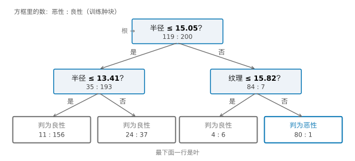
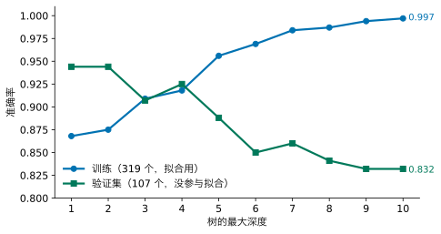
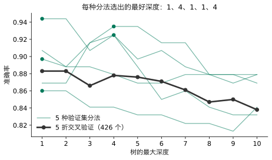
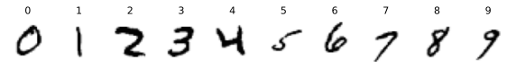
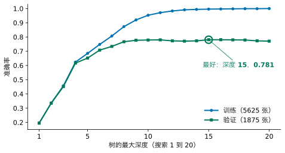
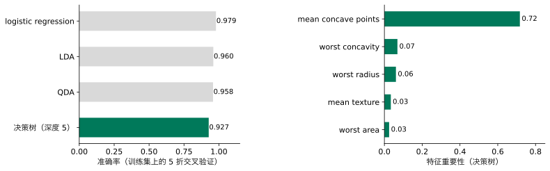
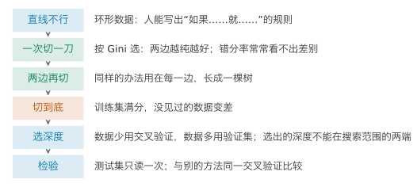
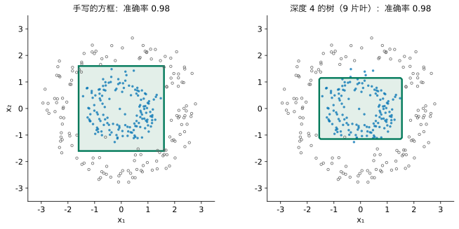

## 1. 动机：直线不行，人却能写出规则

Lesson 4 最后有一份环形数据：类 1 聚在中间，类 0 围成一圈。logistic regression 只能画直线，准确率 0.50，和瞎猜一样。Lesson 5 的 QDA 能画椭圆，但它要假设每一类是一座椭圆形的小山。

换一个角度：如果让你自己给这份数据写一条判断规则，你会怎么写？下面的组件里，四个滑块各控制一条切线，方框里的点判为类 1。



请先自己试：你能写出一条准确率超过 0.95 的规则吗？它长什么样？

::: {.callout-note collapse="true" title="展开答案"}
把四条线都拖到 ±1.6 附近，规则是“如果 −1.6 < x₁ < 1.6 且 −1.6 < x₂ < 1.6，判为类 1；否则判为类 0”，准确率 0.983。这条规则只用了四个“是或否”的问题，每个问题只看一个特征。
:::

很多现实中的判断本来就是这个样子：如果下雨就带伞；如果体温超过 38 度、并且咳嗽，就去做检查。这种规则好读、好解释，也不要求两类能被一条直线分开。

但是自己写有两个问题：特征一多，人就看不出该在哪里切；切线一多，也没法一条条去拖。我们想要的是：**让机器自己一刀一刀地找出这些规则。**

**本讲之后你能做到：**遇到分类问题时，写出、读懂一串“如果……就……”的规则；说明机器怎样自动选每一刀，为什么用 Gini 而不是错分率；看到树长到底会背下训练集；用没参与拟合的数据（验证集）选树的深度，画出训练与验证两条曲线，检查选出的深度不在搜索范围的两端；说出什么时候用验证集、什么时候用交叉验证。

## 2. 一次切一刀：怎样算“切得好”

先只考虑一刀：选一个特征，选一个切点，把点分成两边。每一边按多数类判断。切得好，应该是两边各自尽量“纯”：一边几乎全是类 1，另一边几乎全是类 0。

所以我们要一个数，衡量一群点有多“混”。请先想：你会怎样定义它？

::: {.callout-note collapse="true" title="展开答案"}
最直接的想法：这一边按多数类判，判错的比例是多少。这叫**错分率**。另一个想法：从这一边随便抽两个点（可以抽到同一个），它们类别不同的可能性有多大。全是一类时是 0，两类各半时最大。
:::

两个候选都可以写成式子。设一边里类 1 占 $p$：

$$
\text{错分率} = \min(p,\ 1-p), \qquad \text{Gini} = 1 - p^2 - (1-p)^2 = 2p(1-p).
$$

第二个叫 **Gini 不纯度**（Gini impurity）。两个都在 $p = 0$ 或 $1$（全纯）时为 0，在 $p = 0.5$ 时最大。切一刀之后，两边的点数不同，所以按点数加权平均：左边 $n_L$ 个点、右边 $n_R$ 个点时，这一刀的得分是 $\frac{n_L}{n}\,\text{左边的值} + \frac{n_R}{n}\,\text{右边的值}$，越小越好。

两个候选看起来差不多，什么时候会选得不一样？下面是一个节点：100 个点，20 个蓝点挤在中间一段，80 个灰点散在各处。拖动切线，看两条曲线。



请先拖一拖：错分率在哪里最低？Gini 呢？

::: {.callout-note collapse="true" title="展开答案"}
错分率处处都是 0.200，一动不动。原因是：不管切在哪里，两边都是灰点占多数，都判为灰色，错的始终是那 20 个蓝点。Gini 却会变：切在 5.75 时最低（0.271，切之前是 0.320），这时右边 38 个点全是灰的，左边的 20 个蓝点和 42 个灰点留给下一刀再分。错分率看不见“切出了一块纯的”，Gini 看得见。
:::

所以选 Gini。scikit-learn 的决策树默认就用它。还有一个常用的候选叫**熵**（entropy），$-p\log p-(1-p)\log(1-p)$，形状和 Gini 很像，选出的切点通常也一样。

**在真实数据上算一次。**乳腺肿块，用两个特征：细胞核平均半径和平均纹理。和 Lesson 3 一样，从 426 个训练肿块里分出 107 个作**验证集**，不参与拟合；只用另外 319 个来拟合（验证集第 3 节就会用到）。这 319 个里恶性 119 个。切之前，$p = 119/319 = 0.373$，Gini 是 $2 \times 0.373 \times 0.627 = 0.468$。机器把两个特征的每一个可能切点都试一遍，最好的一刀是“半径 ≤ 15.05”：

| | 恶性 | 良性 | 类 1 的比例 $p$ | Gini |
|---|---:|---:|---:|---:|
| 半径 ≤ 15.05 | 35 | 193 | 0.154 | 0.260 |
| 半径 > 15.05 | 84 | 7 | 0.923 | 0.142 |

加权平均：$\frac{228}{319} \times 0.260 + \frac{91}{319} \times 0.142 = 0.226$，比切之前的 0.468 小了一半多。这就是“最好的一刀”的意思：所有候选切点里，加权 Gini 最小的那个。

## 3. 两边再切：长成一棵树

一刀之后，左边仍然混着 35 个恶性，右边混着 7 个良性。办法很自然：对每一边，再用同样的方法找最好的一刀。一直这样做下去，就长成一棵**决策树**（decision tree）。

{fig-alt="一棵两层的树：根节点问半径是否小于等于 15.05，左边再问半径是否小于等于 13.41，右边问纹理是否小于等于 15.82；四片叶子里只有最右边判为恶性"}

几个名字：最上面的问题叫**根**（root）；每个问题叫一个**节点**（node）；不再往下问的叫**叶**（leaf），叶子按落进来的训练样本的多数类做判断；从根到最远的叶子要问几个问题，叫树的**深度**（depth）。

读一棵树，就是从根往下走。一个半径 16、纹理 20 的肿块：半径 ≤ 15.05？否，走右边；纹理 ≤ 15.82？否，走右边；落进最右边的叶子，判为恶性。每片叶子对应平面上的一个矩形：每个问题都是“某个特征是否小于某个数”，切线只能横平竖直。

下面的组件里，拖动最大深度，看平面怎样被切成越来越多的矩形。



请先拖到最深，再勾选“显示验证集的点”：深度 10 的树在拟合用的点上几乎全对，在那 107 个没参与拟合的点上呢？

::: {.callout-note collapse="true" title="展开答案"}
深度 10 时有 41 片叶子，拟合用的点准确率 0.997，很多小矩形只是为了把某一两个点“框”进正确的一边。换成验证集的点，准确率只有 0.832，比深度 1 时（0.944）还低。那些小矩形在没见过的点上没有用。
:::

## 4. 切到底：背下了训练集

只要一片叶子里还混着两类，就总能再切一刀。一直切下去，每片叶子都只剩一类，训练准确率就是 1.00。本例中，不限深度的树长到深度 11、42 片叶子。

{fig-alt="蓝线从 0.868 一路升到 0.997，绿线从 0.944 降到 0.832，两条线在深度 3 左右交叉后越分越开"}

蓝线一路升到接近 1，绿线在深度 1 到 2 最高，之后总体下降（深度 4 有一点回升）。这和 Lesson 3 的多项式阶数是同一件事：模型越灵活，越能贴合训练数据里的偶然，**过拟合**。树的灵活程度由深度控制：深度 1 只有 2 片叶子，深度 10 有 41 片。

所以要限制深度：scikit-learn 里是 `DecisionTreeClassifier(max_depth=...)`。`max_depth` 是一个超参数。问题是：怎样选它？

## 5. 怎样选深度：回到 Lesson 3 的验证集

我们需要的证据是：模型在没见过的数据上表现怎样。测试集要留到最后只读一次，不能用来选。Lesson 3 的办法是交叉验证：训练集分成 5 份，轮流用 4 份拟合、1 份评估。

请先算一笔账：作业 2 有 50,000 张训练图，要从 20 个深度里选。用 5 折交叉验证，一共要拟合多少棵树？

::: {.callout-note collapse="true" title="展开答案"}
每个深度 5 棵，20 个深度共 100 棵，每棵都要在 40,000 张图上拟合。换成神经网络（作业 2 第 4 节），一次训练就要几分钟，100 次就太慢了。
:::

我们想要：每个候选只拟合一次，又不碰测试集。Lesson 3 已经给过办法：从训练集里一次性分出一块验证集，不参与拟合，只用来比较和选择；第 2 到 4 节用的 107 个肿块就是。Lesson 3 也看到了它的代价：几十辆车的验证集，结果随分法晃动，所以那时用了交叉验证。两个做法放在一起：

1. **交叉验证**：每个深度拟合 5 次；每个点都当过一次评估，结果稳。
2. **验证集**：每个深度只拟合 1 次；但结果取决于哪些点碰巧落进了验证集。

本讲的验证集：426 个训练肿块按 3:1 分层划分，319 个用来拟合，107 个做验证集。

```python
from sklearn.model_selection import train_test_split

X_fit, X_val, y_fit, y_val = train_test_split(
    X_train, y_train, test_size=0.25, random_state=0, stratify=y_train)   # 319 to fit, 107 to validate
```

测试集没有动：和 Lesson 3 一样，数据分成三份，拟合用的、验证用的、测试用的，各有各的职责。

Lesson 3 在汽车数据上看到的晃动，在树上也一样。下图把同样的 426 个肿块换 5 种分法（只改 `random_state`），每种分法各画一条验证曲线：

{fig-alt="五条细绿线高低起伏、彼此相差很大；黑线平稳，在深度 1 和 2 最高"}

5 种分法选出的最好深度是 1、4、1、1、4，取决于运气；交叉验证给出一条平稳的曲线，最好的是深度 1 和 2（都是 0.883）。107 个点太少，一个验证集说明不了多少。这里最好的深度落在搜索范围的下端，但深度不能小于 1，范围已经没法再往下扩：这份二维数据上，一刀就够了。

所以两个做法各有适用的地方：**数据少时用交叉验证，数据多时用单次划分的验证集。**数据多，验证集也大，运气的影响就小了；而交叉验证要多拟合几倍，在大数据上很慢。作业 2 有 50,000 张训练图，就用验证集。

## 6. 在验证集上选深度：手写数字

作业 2 用的是 MNIST：28 × 28 像素的手写数字。这里用 Lesson 4 第 8 节读过的 MNIST 子集（1 万张）：7500 张训练图，再按 3:1 分成 5625 张拟合、1875 张验证。

{fig-alt="十张 28 乘 28 的手写数字，0 到 9 各一张"}

7500 张还不算大，交叉验证也跑得动；这里先练习作业 2 要用的做法，再和交叉验证对照一次。深度从 1 试到 20：

{fig-alt="两条线都从 0.2 左右上升；蓝线到深度 20 时达到 1.0，绿线到深度 10 左右升到 0.78，之后在 0.77 到 0.78 之间起伏，深度 15 最高 0.781"}

```python
from sklearn.tree import DecisionTreeClassifier             # the decision tree

X_digits_fit, X_digits_val, y_digits_fit, y_digits_val = train_test_split(
    X_digits_train, y_digits_train, test_size=0.25, random_state=0, stratify=y_digits_train)   # 5625 to fit, 1875 to validate
for depth in range(1, 21):                                   # depths 1 to 20
    tree = DecisionTreeClassifier(max_depth=depth, random_state=0)   # a tree that stops at this depth
    tree.fit(X_digits_fit, y_digits_fit)                     # fit on the fitting part only
    print(depth, tree.score(X_digits_fit, y_digits_fit), tree.score(X_digits_val, y_digits_val))   # training and validation accuracy
```

验证准确率在深度 15 最高，0.781（深度 16 也是 0.781，取较浅的那个）。不过从深度 10 起，验证准确率一直在 0.77 到 0.78 之间起伏，最高和最低只差约 0.01（1875 张里约 20 张）。作为对照，在全部 7500 张图上做 5 折交叉验证，最好的是深度 10（0.784）。两种办法选的深度不同，但都落在同一段平台上，平台上各个深度的准确率差不多。树在这份数据上不加限制会长到深度 22。

**选出的值不能落在搜索范围的两端**（Lesson 5 的规则）。15 在 1 到 20 的中间，可以放心。如果只试了 1 到 8，最好的就会是 8，正好在端点；这时要把范围往大的一侧扩，再选一次。

选定之后，测试集只读一次：深度 15 的树，测试准确率 0.776，和验证准确率 0.781 很接近。验证集和测试集都是没参与拟合的图，两者差零点几个百分点是正常的上下波动。作为对照，Lesson 4 的 logistic regression 是 0.908。这里的树是用 5625 张图拟合的；验证集选完参数后，也可以把拟合用的和验证用的合在一起重新拟合一次，作业 2 不要求这样做。

`random_state=0` 让结果可以重复：好几个切点一样好时，树会随机挑一个。

## 7. 30 个特征：与前几讲比较

回到乳腺肿块的全部 30 个特征。426 个肿块不算多，所以按第 5 节的结论用交叉验证选深度，用的是与 Lesson 4、5 相同的 5 折。

{fig-alt="左图 logistic 0.979、LDA 0.960、QDA 0.958、决策树 0.927；右图 mean concave points 的重要性 0.72，其余都在 0.07 以下"}

决策树最好的深度是 5，准确率 0.927，低于 logistic regression（0.979）、LDA（0.960）和 QDA（0.958）。矩形的边界在 30 维里仍然只能横平竖直，对这份数据不如一个斜的平面合适。

树的长处在别处：它读得懂。`tree.feature_importances_` 给出每个特征一共帮树降低了多少 Gini（加起来为 1）。这里“平均凹点数”（mean concave points）占了 0.72：树的大部分判断都靠细胞核边缘有多少凹陷。

## 8. 实现：用 scikit-learn 完成

读数据、划分训练集和测试集与 Lesson 4 相同：乳腺肿块见第 10 节，MNIST 子集见第 8 节。树不需要标准化：每个问题只比较一个特征和一个数，尺度不影响切在哪里。

**第一步，从训练集切出验证集（Section 5）：**见第 5 节的代码。MNIST 子集的切法见第 6 节。

**第二步，在验证集上选深度（Section 6）：**见第 6 节的循环。

**第三步，测试集读一次（Section 6）：**

```python
tree = DecisionTreeClassifier(max_depth=15, random_state=0)  # the depth chosen on the validation set
tree.fit(X_digits_fit, y_digits_fit)                         # the same fitting part
print(tree.score(X_digits_test, y_digits_test))              # the test set, read once
```

输出 0.776。

**乳腺肿块用交叉验证选深度（Section 7）：**

```python
from sklearn.model_selection import cross_val_score, KFold  # cross-validation, as in Lesson 3

kf = KFold(5, shuffle=True, random_state=0)                 # the same 5 folds as Lessons 4 and 5

for depth in range(1, 11):                                   # depths 1 to 10
    tree = DecisionTreeClassifier(max_depth=depth, random_state=0)   # a tree that stops at this depth
    scores = cross_val_score(tree, X_train, y_train, cv=kf)  # the same 5 folds as Lessons 4 and 5
    print(depth, scores.mean())                              # average accuracy over the folds
```

深度 5 最高（0.927）。`kf` 与 Lesson 4 第 10 节相同；树不用标准化，所以这里直接用 `X_train`。

## 9. 一页回顾

如果只读一页，读这里。

{fig-alt="六个步骤的竖向流程图"}

| 你看到的问题 | 可以做什么 | 用什么证据判断 |
|---|---|---|
| 直线分不开，但能写出“如果……就……”的规则 | 决策树：一串只看一个特征的是非题 | 规则的准确率；矩形分区图 |
| 怎样自动选一刀 | 试遍所有切点，选加权 Gini 最小的 | Gini 比错分率更能看见“切出了一块纯的” |
| 树越长越深 | 限制 `max_depth` | 训练准确率与验证准确率两条曲线 |
| 选深度又不碰测试集 | 数据少：交叉验证；数据多：验证集 | 最好的深度不在搜索范围两端；测试集只读一次 |

## 10. 总结与局限

回到开场的环形数据。你在第 1 节手写了一个方框；现在让机器自己切：

{fig-alt="两幅环形数据图：左边一个正方形框住里圈，准确率 0.98；右边一个形状相近的矩形区域，准确率 0.98"}

深度 4 的树有 9 片叶子，准确率 0.98，和手写的方框一样好，而且是它自己找到的。开场的问题“能不能让机器自己写这种规则”，答案是能：一次一刀，每一刀选让 Gini 降得最多的，长到合适的深度为止；深度用没参与拟合的数据来选。

**迁移题。**一家银行用两个特征判断贷款会不会违约：年收入和已有负债。审批员的经验是“收入低于 2 万、或者负债超过收入一半的，风险高”。请不做计算回答：这条经验的两个条件，哪一个可以直接写成树的一个问题，哪一个不行？不行的那个怎么办？银行有 200 万条历史记录，你会用验证集还是交叉验证来选深度？如果选出的深度是你试过的最大值，接下来怎么做？

::: {.callout-note collapse="true" title="参考回答"}
能。根节点问“收入 < 2 万？”，是就判高风险；否则再问“负债 > 收入的一半？”。不过第二个问题同时用了两个特征（负债与收入之比），树每个问题只看一个特征，所以要么先造一个新特征“负债 / 收入”，深度 2 就够；要么只用原来的两个特征，树就得用很多横平竖直的小台阶去逼近这条斜线，深度会深得多。200 万条记录很多，用验证集：便宜，而且验证集本身也很大，结果稳。最好的深度落在试过的最大值，说明更深的树可能更好，要把范围往上扩，再选一次。测试集最后只读一次。
:::

**这个方法在哪里不可信。**

1. **边界只能横平竖直。**每个问题只看一个特征，两类沿斜线分开时，树要用很多小台阶去逼近，既深又容易过拟合。乳腺肿块 30 个特征上，它不如 logistic regression。
2. **树对训练样本很敏感。**换一批训练样本，根节点可能换一个特征（Advanced Study 2）。读一棵树时，不要把每个切点都当成定论。
3. **验证集小时不可信。**107 个肿块的验证集，选出的深度在 1 和 4 之间跳。数据少就用交叉验证。
4. **特征重要性只说明这一棵树用了什么。**两个特征高度相关时（例如半径和周长），树用了一个，另一个的重要性就接近 0，并不说明它与恶性无关。

**回到开头的承诺。**现在，面对一个分类问题，你可以：写出、读懂一串“如果……就……”的规则；说明机器怎样用 Gini 一刀一刀地选，以及为什么不用错分率；看到深树在训练集上满分、在验证数据上变差；用验证集选 `max_depth`，画出两条曲线，检查选出的深度不在两端；按数据多少决定用验证集还是交叉验证；测试集只读一次。

**30 秒反馈。**读完这一讲，请扫码留下匿名反馈或问题：哪里没看懂、哪里讲得太快，都对改进有用。

{fig-align="center" width="160px" fig-alt="反馈二维码"}

*以下是 Advanced Study，不影响主线，每个 Study 可以单独阅读。MPS311 鼓励选读。MPS439 的必做是一项深度主任务：Lab 6 的 Advanced A，它以本页 Study 1 为基础，但做的是根节点左边的子节点，自检值与这里不同；其余 Study 选读。*

---

## Advanced Study 1：自己找最好的一刀

第 2 节说，机器把每个可能的切点都试一遍。这里自己做一次，只看一个特征：拟合用的 319 个肿块的平均半径。

候选切点取相邻两个不同取值的中点（scikit-learn 也这样取）。对每个切点，数出两边各有多少恶性、多少良性，算加权 Gini，记下最小的那个。

```python
import numpy as np

radius = X_fit[:, 0]                                  # mean radius of the 319 fitting lumps
values = np.unique(radius)                            # the distinct values, sorted
cuts = (values[:-1] + values[1:]) / 2                 # candidate cuts: midpoints between neighbours
best_cut = None
best_score = 1.0
for c in cuts:
    left = y_fit[radius <= c]                         # labels on the left of the cut
    right = y_fit[radius > c]                         # labels on the right
    p_left = left.mean()                              # share of malignant on the left
    p_right = right.mean()                            # share of malignant on the right
    gini_left = 2 * p_left * (1 - p_left)
    gini_right = 2 * p_right * (1 - p_right)
    score = (len(left) * gini_left + len(right) * gini_right) / len(y_fit)   # weighted Gini of this cut
    if score < best_score:
        best_score = score
        best_cut = c
print(best_cut, best_score)
```

输出 15.045 和 0.226（第 2 节写作 15.05），与第 2 节的表一致。与 scikit-learn 对照：

```python
stump = DecisionTreeClassifier(max_depth=1, random_state=0)   # a tree with one cut
stump.fit(X_fit[:, [0, 1]], y_fit)                    # two features: radius and texture
print(stump.tree_.feature[0], stump.tree_.threshold[0])   # which feature (0 = radius) and where
```

输出 `0` 和 `15.045...`：特征 0 就是半径，切点相同。

接下来请自己做：

1. 对纹理（第 1 列）也做一遍。它最好的一刀的加权 Gini 是多少？为什么根节点选了半径而不是纹理？
2. 把 Gini 换成错分率，再找一次最好的切点。两者选的一样吗？在第 2 节的手造节点上呢？
3. 换成熵 $-p\log_2 p-(1-p)\log_2(1-p)$（注意 $p = 0$ 时 $0\log 0$ 按 0 算），再比较。

## Advanced Study 2：树有多稳定

一棵树的每个切点都依赖训练数据。换一批数据，树会变多少？办法是**有放回地抽样**：从 426 个训练肿块里随机抽 426 次，同一个肿块可以被抽到多次，得到一批“差不多的”训练数据。

```python
rng = np.random.default_rng(0)                        # fixed random numbers, so the result repeats
for k in range(10):
    idx = rng.integers(0, len(y_train), len(y_train)) # 426 row numbers, drawn with replacement
    tree = DecisionTreeClassifier(max_depth=3, random_state=0)   # a small tree
    tree.fit(X_train[idx], y_train[idx])              # fit on this sample
    print(k, tree.tree_.feature[0], round(tree.tree_.threshold[0], 3))   # the feature and cut at the root
```

10 次里，根节点用了 3 个不同的特征：“mean concave points” 6 次，“worst perimeter” 3 次，“worst concave points” 1 次。连第一个问题都会变，下面的问题变得更多。

接下来请自己做：

1. 把 `max_depth` 改成 1 和不限深度，各抽 10 次，比较每次在 107 个验证肿块上的准确率。哪种深度的结果更分散？
2. 如果把 10 棵树的判断投票（多数决），准确率比单棵树高吗？这就是 Advanced Study 3 第 1 题的随机森林的起点。

## Advanced Study 3：开放问题

下面四个问题本讲没有展开，每个给出一个起点。

1. **随机森林。**Advanced Study 2 看到单棵树不稳定。如果种很多棵树，每棵用一批有放回抽样的数据、每次切分只在随机挑出的几个特征里选，最后投票，会怎样？起点：`sklearn.ensemble.RandomForestClassifier`，在乳腺肿块上与单棵树、logistic regression 比较交叉验证准确率。
2. **剪枝。**本讲用 `max_depth` 限制树的大小。另一种办法是先长满、再把作用不大的分支剪掉。起点：`DecisionTreeClassifier(ccp_alpha=...)`，用交叉验证选 `ccp_alpha`（肿块只有 426 个，数据少），与选 `max_depth` 比较。
3. **回归树。**如果要预测的是一个数（Lesson 2 的油耗），叶子里放什么？怎样衡量“切得好”？起点：`DecisionTreeRegressor`，把 Gini 换成平方误差。
4. **斜着切。**每个问题只看一个特征，所以边界横平竖直。如果先造一个新特征（例如 $x_1 + x_2$）再交给树，会怎样？起点：在一份沿斜线分开的二维数据上比较。
