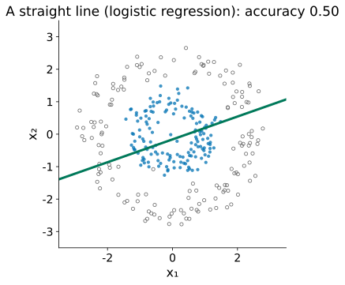
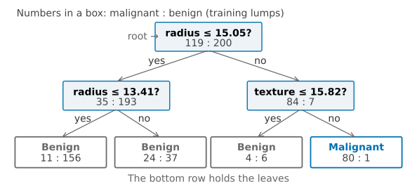
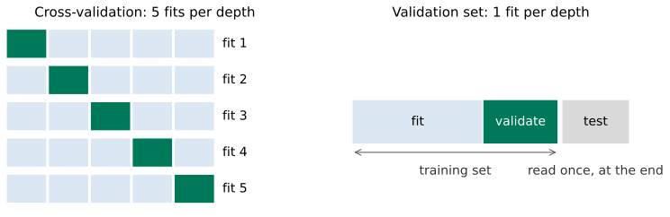
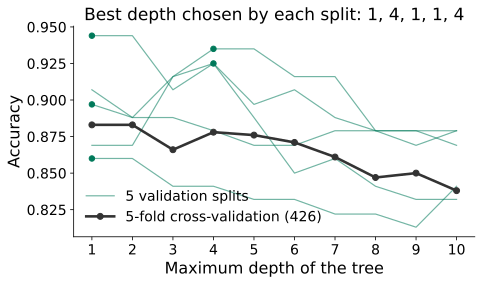
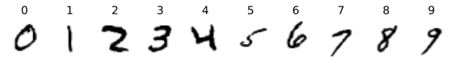
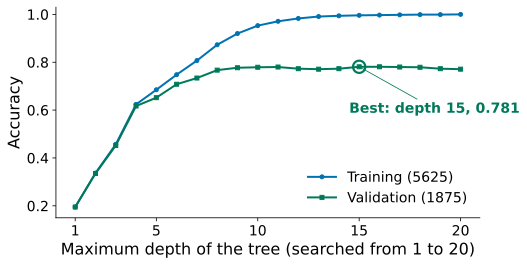
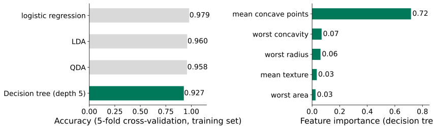
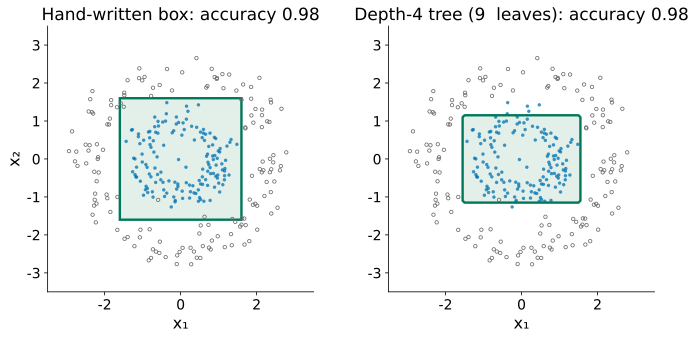

## The ring from Lesson 4: a straight line scores 0.50

::: {.stage}
::: {.two .side}
{.fig .fig-s1 fig-alt="The ring data: blue class 1 points in the middle, grey class 0 points in a ring around them"}

::: {.ask}
<small>Your turn</small>
Forget models for a moment. Write a rule by hand that sorts these points.
:::
:::

::: {.scan}
{fig-alt="QR code for today's live page"}
<b>Scan now</b>
votes, questions, feedback
:::
:::

::: {.notes}
约 1.5 分钟。先请大家扫右下角（或右屏）的二维码，页面整节课开着。Lesson 4 第 9 节的环形数据：logistic 只能画直线，0.50 和瞎猜一样；Lesson 5 的 QDA 要假设每一类是椭圆小山。让学生口头说规则：期待“中间那块是蓝的”“x₁、x₂ 都不太大就是蓝的”。
:::

## Write the rule yourself: four cuts make a box

::: {.stage .top}

:::

::: {.notes}
约 4 分钟。请一位学生指挥四个滑块，其余人看准确率。把四条线拖到 ±1.6 附近：0.983。念出规则：“如果 −1.6 < x₁ < 1.6 且 −1.6 < x₂ < 1.6，判为类 1”。强调：四个是非题，每个只看一个特征。生活里的规则也这样：下雨就带伞；体温超过 38 度且咳嗽就去检查。
:::

## [Problem:]{.stg} What we want

::: {.stage}
::: {.say .xl .center}
Let the machine write these rules: **one cut at a time**.
:::

::: {.ask}
<small>Your turn</small>
With 30 features, why can't we keep dragging lines by hand?
:::
:::

::: {.notes}
约 1 分钟。期待：特征多了看不出在哪切；切线多了拖不过来。机器的办法：每次只选一个特征、一个切点。
:::

## What you will be able to do

::: {.stage .tight}
::: {.say .xl}
**Read and grow** a tree of yes-or-no questions, **stop it** before it memorises, and **choose its depth** without touching the test set.
:::

::: {.flow .four}
<div><span>1</span>One cut</div>
<div><span>2</span>Grow a tree</div>
<div><span>3</span>Stop</div>
<div><span>4</span>Choose the depth</div>
:::
:::

::: {.notes}
约 1 分钟。能力承诺，念出四段路线。改的是五步里的“模型”和“检验”：模型变成一串是非题；选复杂度回到 Lesson 3 的验证集，第一次用单次划分来选。
:::

## [One cut:]{.stg} A good cut leaves both sides pure. How do we score "mixed"?

::: {.stage}
::: {.two .even}
::: {.tile .txt}
**Candidate 1: error rate**

Each side predicts its majority. Share wrong: $\min(p,\,1-p)$
:::

::: {.tile .txt}
**Candidate 2: Gini**

Draw two points from one side. Chance they differ: $2p(1-p)$
:::
:::

::: {.ask .vote}
<small>Vote on your phone</small>
Error rate and Gini: will they always rank the cuts the same?

::: {.opts}
<span><b>A</b>yes, same ranking</span>
<span><b>B</b>no, they can differ</span>
:::
:::
:::

::: {.notes}
约 3 分钟。投票（右屏 One cut: How do we score "mixed" → Open，30 秒，先不显示结果）；分歧大时让邻座讨论一分钟再 Vote again（本讲只在这一题这样做），再 Reveal；请选 A 的同学说理由（两者在纯的时候都是 0），答案留给下一页拖动揭晓：错分率对每一刀都是 0.200，排不出先后，Gini 能排出来。p 是一边里类 1 的比例。先让学生想“怎样衡量混”，常见答案就是错分率；第二个候选：抽两个点类别不同的概率。一刀的得分：两边按点数加权平均，越小越好。下一页让学生自己试。
:::

## [One cut:]{.stg} Drag the cut: which score notices?

::: {.stage .top}

:::

::: {.notes}
约 4 分钟。一个节点 100 个点：20 个蓝点挤在中间。拖动切线：错分率处处 0.200 不动，因为两边都是灰点占多数，错的总是那 20 个蓝点。Gini 在 5.75 最低（0.271，切之前 0.320）：右边 38 个全灰，蓝点留给下一刀。点名 Gini impurity。sklearn 默认用 Gini；熵（entropy）形状相近，Note 里一句。
:::

## [One cut:]{.stg} On the breast lumps (Lessons 4–5): the best first cut

::: {.stage .tight}
| | Malignant | Benign | $p$ | Gini $2p(1-p)$ |
|---|---:|---:|---:|---:|
| before the cut | 119 | 200 | 0.373 | 0.468 |
| radius ≤ 15.05 | 35 | 193 | 0.154 | **?** |
| radius > 15.05 | 84 | 7 | 0.923 | 0.142 |

::: {.ask}
<small>Your turn</small>
Work out the Gini of the left side. Then weight the two sides by 228 and 91 out of 319.
:::
:::

::: {.notes}
约 3 分钟。两个特征：半径、纹理。319 个肿块（426 个训练肿块里分出 107 个作验证集，validation lumps，第 11 页会用到）。给学生一分钟自己算。左边 2×0.154×0.846 = 0.260；加权 (228×0.260 + 91×0.142)/319 = 0.226，比 0.468 小了一半多。机器把两个特征的每个切点都这样试一遍，选加权 Gini 最小的。
:::

## [Grow:]{.stg} Cut each side again: a decision tree

::: {.stage}
{.fig .fig-f1 fig-alt="A depth-2 tree: the root asks radius at most 15.05; the left node asks radius at most 13.41; the right node asks texture at most 15.82; only the rightmost leaf (80 malignant, 1 benign) predicts malignant"}

::: {.say .center}
**Root**, **nodes**, **leaves**. Questions from root to the deepest leaf: the **depth**.
:::
:::

::: {.notes}
约 1.5 分钟。点名 decision tree、root、node、leaf、depth。方框里的数是落进来的训练肿块：恶性 : 良性。叶子按多数类判断。
:::

## [Grow:]{.stg} Read the tree: follow one lump

::: {.stage}
{.fig .fig-f1r fig-alt="The same depth-2 tree"}

::: {.ask}
<small>Your turn</small>
A lump with radius 16 and texture 20. Which leaf does it reach? Write that leaf's box as two inequalities, for example "radius > … and texture > …".
:::
:::

::: {.notes}
约 2 分钟。半径 16 > 15.05 → 否，走右；纹理 20 > 15.82 → 否，走右；最右叶子，判为恶性。这片叶子在平面上是“半径 > 15.05 且纹理 > 15.82”的矩形：每个问题只问一个特征，所以边界横平竖直。下一页的互动就是这些矩形。
:::

## [Stop:]{.stg} Deeper trees, smaller boxes: does it memorise?

::: {.stage .top}


::: {.say .center}
Training climbs, accuracy on the validation lumps (Lesson 3) falls: **overfitting**. Limit the depth: `max_depth`.<br><small>426 training lumps = 319 to fit the tree + 107 in the validation set to check it.</small>
:::
:::

::: {.notes}
约 4 分钟。从深度 1 拖到 10：矩形越切越碎，深度 10 有 41 片叶子，训练准确率 0.997。再勾选 “validation lumps”：验证集的 107 个没参与拟合的肿块，深度 10 只有 0.832，比深度 1 的 0.944 还低。小矩形只为把一两个点框对。点名 overfitting（和 Lesson 3 的多项式阶数同一件事）；解决办法：限制深度，max_depth 是超参数。树长到底：深度 11、42 片叶、训练 1.00。
:::

## [Choose:]{.stg} How do we choose `max_depth`?

::: {.stage}
::: {.say .xl .center}
Assignment 2: **50,000** images, **20** depths to try.
:::

::: {.ask .vote}
<small>Vote on your phone</small>
50,000 images: choose `max_depth` using…

::: {.opts}
<span><b>A</b>5-fold cross-validation</span>
<span><b>B</b>one validation split</span>
<span><b>C</b>the test set</span>
:::
:::
:::

::: {.notes}
约 2 分钟。投票（右屏 Choose: How do we choose max_depth → Open，30 秒，先不显示结果，再 Reveal）；先问选 C 的同学：用测试集选，测试分数还算数吗？再问选 A 的同学：5 折试 20 个深度要拟合几棵树？答案在下一页揭晓：一次验证集划分。期待：100 棵，每棵 4 万张图；第 4 节的神经网络一次就要几分钟。更便宜的办法：Lesson 3 的验证集，我们其实已经在用了，那 107 个肿块。
:::

## [Choose:]{.stg} Back to Lesson 3: cross-validation or one validation split

::: {.stage}
{.fig .fig-s3 fig-alt="Left: five rows of five blocks, a different block held out in each row: cross-validation fits 5 times per depth. Right: one bar split into a fitting part, a validation block and a separate test block: the validation set fits once per depth"}

::: {.say .center}
5-fold CV: 5 fits × 20 depths **= 100 fits**. The **validation set** (Lesson 3): 1 fit per depth, 20 fits. Cheaper, but it depends on which points land in it.
:::
:::

::: {.notes}
约 2 分钟。回顾 Lesson 3 的 validation set（不是新概念）：从训练集里一次性分出，不参与拟合，只用来评估和选择；Lesson 3 因为数据少选了交叉验证，今天数据多，回到单次划分。测试集仍只在最后读一次。三份数据三种职责：拟合、验证、测试。代码一行：train_test_split(X_train, y_train, test_size=0.25, stratify=...)。交叉验证每个点都当过一次评估，结果稳；验证集便宜，但看运气。
:::

## [Choose:]{.stg} With 107 lumps, the validation set is luck

::: {.stage}
::: {.two .side}
{.fig fig-alt="Five thin green validation curves from five different splits, each with a different best depth (1, 4, 1, 1, 4); the black cross-validation curve is steady and highest at depth 1 and 2"}

::: {.say}
Little data: **cross-validation**. Much data: a **validation set**.<br><small>Two features, as on the earlier slides. The fall after depth 2 shows in the cross-validation curve too: the overfitting is real; only the chosen depth is luck. Depth 1 is the lower end of the range, but a tree cannot be shallower than 1: there is nothing further to try.</small>
:::
:::
:::

::: {.notes}
约 3 分钟。同样 426 个肿块换 5 种分法（只改 random_state），选出的最好深度 1、4、1、1、4。交叉验证平稳，深度 1 和 2 并列 0.883；深度 1 已是下界，范围没法再往下扩：这份二维数据上一刀就够。数据多时验证集也大，运气影响小，而交叉验证要多拟合几倍。
:::

## [Choose:]{.stg} MNIST: choose the depth on the validation set

::: {.stage}
{.fig .fig-f4a fig-alt="Ten MNIST digits of 28 by 28 pixels, one each of 0 to 9"}

::: {.two .side}
{.fig fig-alt="MNIST subset: training accuracy rises to 1.0 by depth 20; validation accuracy rises to about 0.78 by depth 10, then moves between 0.77 and 0.78, highest 0.781 at depth 15"}

::: {.say}
Course MNIST subset (10,000 images). Best: depth **15** (0.781), in the middle of 1 to 20; from depth 10 on, all within about 0.01. Test set, once: **0.776**.
:::
:::
:::

::: {.notes}
约 3 分钟。MNIST 子集：7500 张训练图分成 5625 拟合、1875 验证（每张 784 个像素）。深度 15 最高 0.781（16 也是，取浅的）；深度 10 以后都在 0.77 到 0.78 之间，是一段平台。不落在两端：15 在中间；如果只试 1 到 8，最好的 8 就在端点，要往大扩。对照：全部 7500 张做 5 折交叉验证，最好深度 10（0.784），也在这段平台上。测试一次 0.776，和验证的 0.781 差一点是正常波动；logistic 是 0.908。作业 2 第 2 节就是这样选 max_depth，选做图就是这两条曲线。
:::

## [Compare:]{.stg} The tree against Lessons 4–5

::: {.stage}
{.fig .fig-f5 fig-alt="Left: 5-fold cross-validated accuracy: logistic regression 0.979, LDA 0.960, QDA 0.958, decision tree 0.927. Right: feature importance of the tree: mean concave points 0.72, the rest below 0.07"}

::: {.say .center}
All 30 features; tree depth 5, chosen by the same 5-fold CV. Less accurate here, but you can **read** it. **Feature importance**: how much of the tree's total Gini reduction each feature did (they add up to 1). Here one feature does **72%**.
:::
:::

::: {.notes}
约 2 分钟。426 个肿块不多，所以用交叉验证选深度（同 Lesson 4、5 的 5 折），最好深度 5，0.927。边界只能横平竖直，不如斜的平面。feature_importances_：每个特征一共帮树降低了多少 Gini，加起来为 1；平均凹点数占 0.72。注意：两个特征高度相关时，树只用其中一个。
:::

## Today in code

::: {.stage}
```python
X_digits_fit, X_digits_val, y_digits_fit, y_digits_val = train_test_split(
    X_digits_train, y_digits_train, test_size=0.25, random_state=0,
    stratify=y_digits_train)                             # hold out a validation set

for depth in range(1, 21):                               # candidate depths
    tree = DecisionTreeClassifier(max_depth=depth, random_state=0)
    tree.fit(X_digits_fit, y_digits_fit)                 # fit on the fitting part
    print(depth, tree.score(X_digits_fit, y_digits_fit), # training accuracy
          tree.score(X_digits_val, y_digits_val))        # validation accuracy

tree = DecisionTreeClassifier(max_depth=15, random_state=0)  # chosen depth
tree.fit(X_digits_fit, y_digits_fit)
print(tree.score(X_digits_test, y_digits_test))          # the test set, once
```
:::

::: {.notes}
约 1 分钟。每一块对应今天的一段，不讲语法。树不需要标准化：每个问题只比较一个特征和一个数。Lab 6 会在乳腺肿块上手算一刀的 Gini，再在 digits 上用验证集选深度。
:::

## Back to the ring

::: {.stage}
{.fig .fig-f6 fig-alt="Left: the hand-written box, accuracy 0.98. Right: the region found by a depth-4 tree with 9 leaves, accuracy 0.98"}

::: {.say .center}
A depth-4 tree finds the box by itself: **0.98**, 9 leaves.
:::
:::

::: {.notes}
约 1.5 分钟。回扣开场：机器一次一刀、选 Gini 降得最多的，长到合适深度，自己找到了方框。局限（口头）：边界横平竖直；换一批样本根节点都可能变（Note Advanced Study 2）；验证集小时不可信；特征重要性只说明这一棵树用了什么。
:::

## What you can do now {.final-slide}

::: {.takeaway}
::: {.rows .tiny .chain}
<div><span class="n">see it</span><div><b>Rules a person can write</b><p>a straight line fails on the ring</p></div></div>
<div><span class="n">one cut</span><div><b>Gini, not error rate</b><p>it notices a pure block</p></div></div>
<div><span class="n">grow</span><div><b>A decision tree</b><p>cut each side again; boxes in the plane</p></div></div>
<div><span class="n">stop</span><div><b>max_depth</b><p>deep trees memorise the training set</p></div></div>
<div><span class="n">choose</span><div><b>Validation set or CV</b><p>much data: a validation set; the chosen depth must not be at either end of the range</p></div></div>
<div><span class="n">test</span><div><b>Read the test set once</b><p>choose a method by the same CV; then report its test score, once</p></div></div>
:::

::: {.qr}
{fig-alt="QR code for today's live page"}
<b>Feedback</b>
<p>After class: Lab 6</p>
:::
:::

::: {.notes}
约 1.5 分钟，课堂最终停在这一页。沿六行把整条链念一遍。答疑和扫码都在这里。课后 Lab 6，不预告下一讲。
:::
