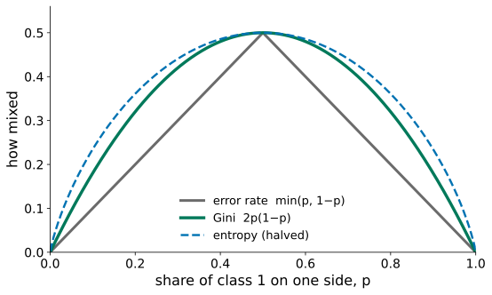
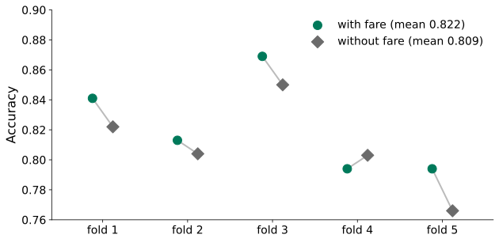
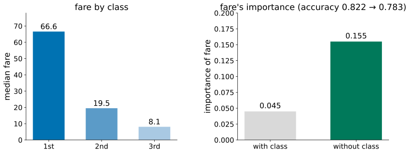
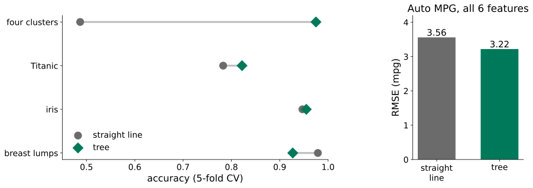

## [Problem:]{.stg} A straight line is one cut. Is one cut enough?

::: {.stage .top}

:::

::: {.scan}
{fig-alt="QR code for today's live page"}
<b>Scan now</b>
votes, questions, feedback
:::

::: {.notes}
约 4 分钟。先请大家扫码，页面整节课开着。logistic regression 用一条直线分类：直线的一边判 1、另一边判 0，就是在平面上切一刀。请一位学生指挥拖竖线：不管放在哪里都在 0.5 左右（最好 0.544），logistic 找到的最好斜线 0.51。问：一刀不够怎么办？等学生说“再切”，再勾选 “one more cut on each side”，左右各拖一条横线到 2.5 附近：0.988。
:::

## What you will be able to do

::: {.stage .tight}
::: {.say .xl}
Grow a tree of yes-or-no questions, choose how deep it goes, and **read why** it decides.
:::

::: {.flow}
<div><span>1</span>Problem</div>
<div><span>2</span>Model</div>
<div><span>3</span>Loss</div>
<div><span>4</span>Solution</div>
<div><span>5</span>Test</div>
:::
:::

::: {.notes}
约 1 分钟。能力承诺：不想先猜边界的形状，或者要一份别人能照着执行、说得出理由的规则时，换成一串是非题这个假设。念五步路线。今天的检验多问两件事：它为什么这样判（解释），这个读法能不能信（边界），就是作业评分标准里的“解释”和“边界”。
:::

## [Problem:]{.stg} Three cuts, one feature each

::: {.stage}
{.fig .fig-v2-s5 fig-alt="Left: the four clusters with three cuts, one vertical and two horizontal, accuracy 0.988. Right: the same three cuts written as a tree of three questions"}
:::

::: {.notes}
约 1 分钟。把上一页的三刀按顺序念成一串是非题：先问 x₁，答案决定下一个问题问什么。每个问题只看一个特征。
:::

## [Problem:]{.stg} People already decide this way

::: {.stage}
{.fig .fig-v2-s1 fig-alt="Two small rule trees. A loan officer: income below 20k? yes, high risk; no, then debt above half of income? yes high risk, no low risk. Lifeboats, 1912: a woman? yes, to the boat; no, then a child? yes, to the boat; no, wait"}

::: {.ask}
<small>Your turn</small>
"Women and children first": was it really followed? How would you check?
:::
:::

::: {.notes}
约 1.5 分钟。审批员、急诊分诊、救生艇：一次只问一个问题。让学生说怎么查：看乘客名单。想法：把一问接一问本身当成模型，让机器从数据里找该问什么、切在哪里。
:::

## [Model:]{.stg} The tree the machine grew on the passenger list

::: {.stage}
{.fig .fig-v2-f1m fig-alt="A depth-2 tree on 535 Titanic passengers: male?; males then age at most 13, females then first or second class. One node is marked one feature, one number; one leaf is marked 115 of 123 survived, a probability of 0.935"}

::: {.ask}
<small>Your turn</small>
What did the machine ask first? Follow a 40-year-old man.
:::
:::

::: {.notes}
约 3.5 分钟。数据：891 人的名单里 714 人有年龄，6 个特征（舱位、性别、年龄、兄弟姐妹/配偶、父母/子女、票价），分层 3:1，535 训练。两条假设（指着红字说）：每个问题只看一个特征和一个数；落在同一片叶子里的人，各类比例固定，按多数判，这个比例就是概率（predict_proba）。点名 decision tree、root、node、leaf、depth。40 岁男人：男性？是；≤ 13？否；304 人里 52 人生还，判遇难。机器自己选了性别做第一问，几乎就是“妇女和儿童先上”；三等舱女性 79 人只有 32 人生还，它多看出了舱位。
:::

## [Loss:]{.stg} A leaf predicts a share $p$. How wrong is it?

::: {.stage}
{.fig .fig-v2-s2b fig-alt="Three curves against the share p: the error rate is a tent, Gini 2p(1-p) and halved entropy are smooth hills; all zero at p = 0 and 1, largest at 0.5"}

::: {.one}
Linear regression's squared error: $p(1-p)^2 + (1-p)\,p^2 = p(1-p)$. Twice that: **Gini** $2p(1-p)$.
:::
:::

::: {.notes}
约 2.5 分钟。一边里每个点的标签是 0 或 1，模型都给 p。先让学生写：类 1 的点错多少？类 0 的呢？再按比例平均，就是这一行推导。乘 2 叫 Gini impurity，不改变哪一刀更好。logistic regression 的交叉熵平均下来是熵（图里除以 2 画在一起）。最直接的想法是错分率 min(p, 1−p)，图里的折线。一刀的得分：两边按点数加权平均，越小越好。
:::

## [Loss:]{.stg} Error rate or Gini: does it matter?

::: {.stage}
::: {.ask .vote}
<small>Vote on your phone</small>
Error rate and Gini: will they always rank the cuts the same?

::: {.opts}
<span><b>A</b>yes, same ranking</span>
<span><b>B</b>no, they can differ</span>
:::
:::
:::

::: {.notes}
约 1 分钟。投票（右屏 Loss: Error rate or Gini → Open，30 秒，先不显示结果）；分歧大时邻座讨论一分钟再 Vote again，再 Reveal。请选 A 的同学说理由。答案在下一页拖动揭晓。
:::

## [Loss:]{.stg} Drag the cut: which score notices?

::: {.stage .top}

:::

::: {.notes}
约 2 分钟。100 个点，20 个蓝点挤在中间。错分率处处 0.200 不动：两边都是灰点多，错的总是那 20 个蓝点。Gini 在 5.75 最低（0.271，切之前 0.320）：右边 38 个全灰。错分率看不出切出了一块纯的，所以选 Gini；sklearn 默认也是它。
:::

## [Loss:]{.stg} The passengers' best first cut

::: {.stage}
{.fig .fig-v2-s7 fig-alt="Three bars of survived and died: all 535 passengers, Gini 0.482; after cutting on sex, males 333 with Gini 0.332 and females 202 with Gini 0.396; weighted 0.356"}
:::

::: {.notes}
约 1.5 分钟。机器把 6 个特征的每个切点都试一遍，按性别这一刀加权 Gini 最小：(333×0.332 + 202×0.396)/535 = 0.356。可以让学生核对桥：男性 p = 0.210，p(1−p) = 0.166，正好是 Gini 的一半。
:::

## [Solution:]{.stg} How do we find the best tree?

::: {.stage}
{.fig .fig-v2-s3 fig-alt="Weighted Gini of a cut on age for 30 men as the cut moves from 0 to 75: a staircase, flat between two ages and jumping when the cut passes a person"}

::: {.ask}
<small>Your turn</small>
Linear regression had a formula; logistic regression walked downhill. Why do both fail here?
:::

::: {.one}
Flat, then a jump: **no slope**. 291 cuts, about $10^{17}$ trees of depth 3 → **greedy**: the best cut for this node, then the same on each side.
:::
:::

::: {.notes}
约 3 分钟。让学生看图说：挪切点只要没越过一个人，两边不变，损失不变；越过时突然跳，没有坡度，梯度下降不知道往哪走。全试也不行：291 个候选切点，深度 3 有 7 个问题，约 1.8×10¹⁷ 种树。办法是贪心：只找这个节点最好的一刀，再在两边各做一遍。代价一句：只看一步，对称的四团点上找不到第一刀（Note 第 5 节）。
:::

## [Test:]{.stg} The tree can keep cutting. Should it?

::: {.stage .top}

:::

::: {.notes}
约 3 分钟。只用年龄和票价两个特征，矩形才画得出来。先问：一直切下去，好不好？请一位学生拖深度：深度 2 训练 0.716、交叉验证 0.695；深度 10 有 114 片叶子，训练 0.880，交叉验证 0.626；拖到最右（不限深度）207 片叶子，训练 0.976，交叉验证只剩 0.604。很多小矩形只框住一两个乘客。点名 overfitting：模型越灵活，越会背下训练数据里的偶然，和多项式阶数太高是同一件事。用 max_depth 控制。
:::

## [Test:]{.stg} How do we choose `max_depth`?

::: {.stage}
::: {.two .side}
{.fig .fig-v2-f2 fig-alt="The same curves plus five thin green lines from five validation splits of 134 passengers; their best depths are 4, 5, 4, 3 and 5"}

::: {.ask .vote}
<small>Vote on your phone</small>
With 50,000 data points, choose `max_depth` using…

::: {.opts}
<span><b>A</b>5-fold cross-validation</span>
<span><b>B</b>one validation split</span>
<span><b>C</b>the test set</span>
:::
:::
:::
:::

::: {.notes}
约 3.5 分钟。换回全部 6 个特征。黑线是交叉验证，深度 4 最高 0.822。细绿线：从 535 人里留 134 人做验证集，换 5 种分法，选出 4、5、4、3、5，看运气；535 人不多，所以这里用交叉验证。投票（右屏 Test: How do we choose max_depth → Open，30 秒，再 Reveal）。选 C：测试分数还算数吗？选 A：20 个深度 × 5 折 = 100 棵树。答案 B：5 万张图时验证集也有 1 万张，不怕运气。数据少用交叉验证，数据多用验证集。深度 4 不在两端；所有选择做完，测试集读一次：0.810。
:::

## [Test:]{.stg} Little data or a lot?

::: {.stage}
::: {.say .xl .center}
535 passengers: **cross-validation**. 50,000 points: **one validation set**: large enough not to depend on luck, and 5 times cheaper.<br>Never at an end of the range. Then read the test set once: **0.810**.
:::
:::

::: {.notes}
约 0.5 分钟。揭晓上一页的投票：答案 B。数据少时一份验证集太小、看运气，用交叉验证；数据多时验证集本身就大，只拟合一次就够。深度 4 在 1 到 12 的中间。所有选择做完，测试集读一次 0.810。
:::

## [Test:]{.stg} Why did the tree say "survived" for her?

::: {.stage}
{.fig .fig-v2-s4 fig-alt="A depth-3 tree. One path is highlighted: not male, not first or second class, fare at most 20.8, ending in a leaf with 31 survived and 30 died"}

::: {.ask}
<small>Your turn</small>
Third-class women with a dearer ticket: 1 of 18 survived. Why would a dear ticket be bad news?
:::
:::

::: {.notes}
约 3 分钟。深度 3 的树（交叉验证 0.806，为了读得短）。测试集里一位三等舱女性，24 岁，带两个父母或子女，票价 16.7：三问后落进 61 人、31 人生还的叶子，概率 0.508，判生还，离 0.5 很近。讨论第三问：三等舱票价高，多半是一张票上一大家子（平均同行 4.8 个亲属，票价低的 0.9 个），一大家子很难一起挤上救生艇。树没有“家庭人数”这个特征，它从票价里读出来了。logistic regression 是 6 个系数乘 6 个数再相加，读不出这几句话。
:::

## [Test:]{.stg} Which features does the whole tree rely on?

::: {.stage}
{.fig .fig-v2-s8 fig-alt="One bar of 105.0, the Gini taken away by the three cuts of the depth-2 tree: sex 67.3, class 27.0, age 10.7; their shares 0.641, 0.257 and 0.102"}

::: {.one}
**Feature importance**: each feature's share of the Gini its cuts took away.
:::
:::

::: {.notes}
约 2.5 分钟。每一刀拿走的量 = 切之前的“样本数 × Gini”减去两边的：根 258.0 → 110.6 + 80.1，拿走 67.3；男性按年龄 10.7；女性按舱位 27.0。同一特征加起来，再除以总和 105.0，就是 feature_importances_，加起来为 1。它只有大小，没有方向：女性更容易生还，要回到树的路上读；logistic regression 的系数有正负号。
:::

## [Test:]{.stg} Fare scores only 0.045. Is it useless?

::: {.stage}
::: {.ask .vote}
<small>Vote on your phone</small>
In the depth-4 tree, fare has importance 0.045. Remove fare and grow the tree again: the accuracy will…

::: {.opts}
<span><b>A</b>barely change</span>
<span><b>B</b>drop clearly</span>
:::
:::
:::

::: {.notes}
约 1 分钟。深度 4 的树里票价的重要性只有 0.045。投票（右屏 Test: Fare scores only 0.045 → Open，30 秒，先不显示结果，再 Reveal）。请两边各说一个理由：选 B 的常说“票价和贫富有关”；选 A 的常说“重要性小就是没用”。答案在下一页。
:::

## [Test:]{.stg} Remove fare: what happens?

::: {.stage}
{.fig .fig-v2-s12 fig-alt="Accuracy in each of the five folds with fare and without fare: means 0.822 and 0.809; four folds a little lower without fare, one a little higher; the folds themselves range from 0.794 to 0.869"}
:::

::: {.notes}
约 1.5 分钟。揭晓投票：平均从 0.822 到 0.809，差 0.013。五折里四折略低、一折略高，每折变化在 −0.028 到 +0.009 之间；可五折本身就从 0.794 到 0.869，相差 0.075。所以几乎不变，答案 A。再问：可票价在三个舱位之间差那么多，它的重要性为什么这么低？
:::

## [Test:]{.stg} Why does fare score so low?

::: {.stage}
{.fig .fig-v2-s13 fig-alt="Left: median fare by class, 66.6, 19.5 and 8.1. Right: the importance of fare is 0.045 with class in the data and 0.155 without class"}

::: {.six}
<span>observe: fare 0.045</span><span>idea: class says the same</span><span>action: remove one feature</span><span>test: same 5 folds</span><span>explain: class was picked first</span><span>limits: this tree only</span>
:::
:::

::: {.notes}
约 2.5 分钟。先看左图：票价和舱位几乎是同一件事（相关 −0.58）。请学生猜：如果把舱位拿掉，票价会怎样？右图：票价的重要性从 0.045 升到 0.155，准确率 0.783。树每一刀只挑当前最好的特征，舱位先被挑中，拿走了两者共有的功劳。所以重要性说明的是这一棵树用了什么；读它之前，先看有没有说同一件事的特征。最后指着六个词：刚才三页就是一次调查，观察（票价 0.045）、想法（它和舱位说同一件事）、行动（拿掉一个特征）、检验（同样的 5 折）、解释、边界。作业要的就是这样一次调查。
:::

## [Model:]{.stg} Three classes: what changes?

::: {.stage}
::: {.two .side}
{.fig .fig-v2-s9 fig-alt="Iris training flowers, petal length against petal width, three species; a cut at petal width 0.80 separates setosa, a cut at 1.75 separates versicolor from virginica"}

::: {.say}
Only Gini:
$$1-\sum_k p_k^2$$
:::
:::
:::

::: {.notes}
约 2 分钟。先问：三类时树要改什么？叶子照样放各类比例、按多数判；只有 Gini 要推广，两类时 1 − p² − (1−p)² 就是 2p(1−p)。鸢尾花 112 朵训练花（37、37、38），Gini 0.667；第一刀花瓣宽度 ≤ 0.80 切出全纯的山鸢尾，第二刀 ≤ 1.75 再分；交叉验证深度 2 最高 0.955。作业 2 的十个数字：代码一行不改。花瓣长度重要性 0，但和宽度相关 0.964：和票价同一件事。
:::

## [Model:]{.stg} Regression tree: a mean in each leaf (horsepower only)

::: {.stage .top}

:::

::: {.notes}
约 2.5 分钟。要预测一个数（汽车的油耗，线性回归用过的那份数据）：叶子放落进来的车的平均值，损失是平方误差，求解仍是贪心，DecisionTreeRegressor。拖深度：深度 1 两级台阶 5.63，比直线 4.98 还差；深度 5 最低 4.23；再深台阶上下乱跳，训练 RMSE 降到 3.36，交叉验证升到 4.35：和乘客平面上的小矩形是同一种过拟合。
:::

## [Test:]{.stg} Where is a tree better than a straight line?

::: {.stage}
{.fig .fig-v2-s10 fig-alt="Dot plot of 5-fold cross-validated accuracy, straight line against tree: four clusters 0.487 and 0.975, Titanic 0.783 and 0.822, iris 0.947 and 0.955, breast lumps 0.979 and 0.927. Auto MPG RMSE: straight line 3.56, tree 3.22"}

::: {.ask}
<small>Your turn</small>
On which data is the tree better, and on which is it worse? What do those data have in common?
:::
:::

::: {.notes}
约 2 分钟。让学生说：四团点、乘客上要“先看一个、再看另一个”（同样是女性，舱位不同，生还比例差一倍多）；油耗随马力弯着下降；乳腺肿块大致沿一个斜面分开，直线一次切对，树要用很多台阶，差 0.05。所以关系弯、特征有组合，或者要一份能执行的规则时，考虑树；树只能横平竖直地切，两类沿斜面分开时就吃亏。树不需要标准化。很多棵树合起来：bagging（每棵用一批略不同的数据，再投票）、gradient boosting（一棵接一棵修误差，XGBoost、LightGBM），准确率高了，但读不出理由了。为什么有效见 Note 的 Advanced 3、4。
:::

## [Test:]{.stg} What these datasets have in common

::: {.stage}
::: {.say .center}
**Tree better** where features combine (four clusters; "woman **and** third class") or the relation bends (Auto MPG).<br>**About the same** on iris: 0.955 against 0.947 is within the fold-to-fold wobble.<br>**Line better** on the breast lumps (0.05). A tree cuts only horizontally and vertically; a tilted boundary may be why.
:::
:::

::: {.notes}
约 1 分钟。揭晓上一页的问题。鸢尾花上的差别在折与折之间的波动以内，不说哪个更好。乳腺肿块那一条是可能的原因，这一讲没有检验，口头说清楚。很多棵树合起来（bagging、gradient boosting、XGBoost）放在这里一句带过。
:::

## Today in code

::: {.stage}
```python
tree = DecisionTreeClassifier(max_depth=4, random_state=0)    # at most 4 questions
print(cross_val_score(tree, X_train, y_train, cv=kf).mean())  # CV accuracy
tree.fit(X_train, y_train)                                    # grow the tree
print(tree.feature_importances_)                              # Gini taken by each feature
```
:::

::: {.notes}
约 1 分钟。四行，每行对应今天一段。三类不用改；预测一个数换成 DecisionTreeRegressor；树不需要标准化。Lab 6 在鸢尾花上动手：长树、看它在哪里出问题、怎么修。
:::

## What you can do now {.final-slide}

::: {.takeaway}
::: {.rows .tiny .chain}
<div><span class="n">problem</span><div><b>One cut is not enough</b><p>cut again, one feature at a time</p></div></div>
<div><span class="n">model</span><div><b>A decision tree</b><p>leaf shares are probabilities</p></div></div>
<div><span class="n">loss</span><div><b>Gini, not error rate</b><p>it notices a pure block</p></div></div>
<div><span class="n">solution</span><div><b>Greedy</b><p>the best cut for this node, then each side</p></div></div>
<div><span class="n">test</span><div><b>Choose max_depth on unseen data</b><p>little data: CV; much data: a validation set; never at an end</p></div></div>
<div><span class="n">test</span><div><b>Read a path and the importance</b><p>why one case, which features overall</p></div></div>
<div><span class="n">test</span><div><b>Check importance before you trust it</b><p>remove a feature and test again</p></div></div>
:::

::: {.qr}
{fig-alt="QR code for today's live page"}
<b>Feedback</b>
<p>After class: Lab 6</p>
:::
:::

::: {.notes}
约 0.5 分钟，课堂停在这一页。沿五步把整条路念一遍；检验的后两行就是作业要的解释和边界。课后 Lab 6，不预告下一讲。
:::
