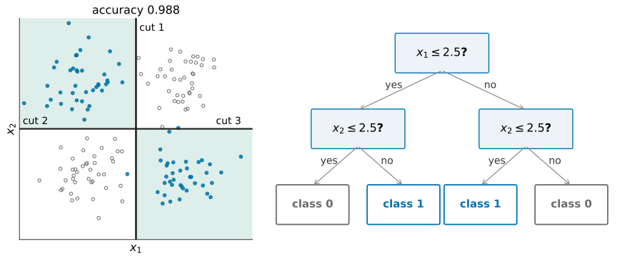
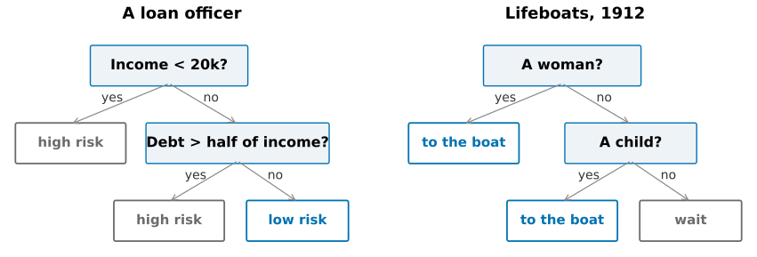
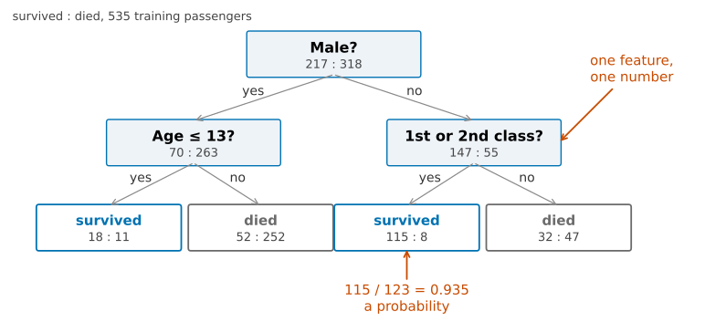
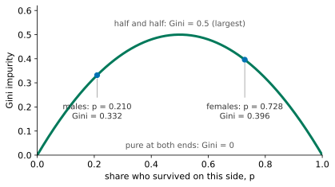
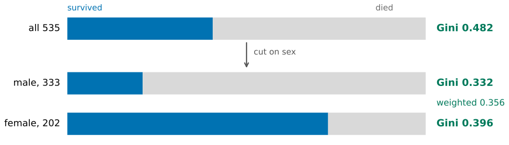
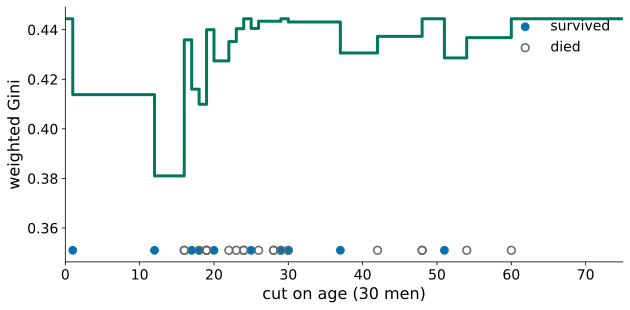
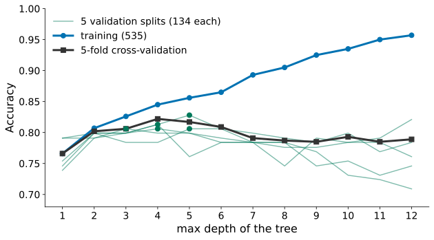
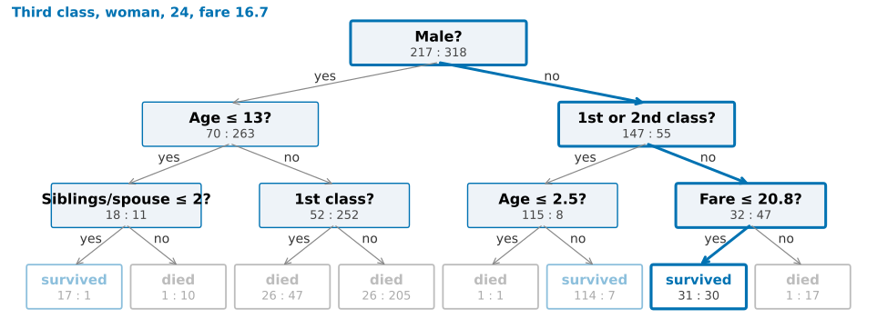
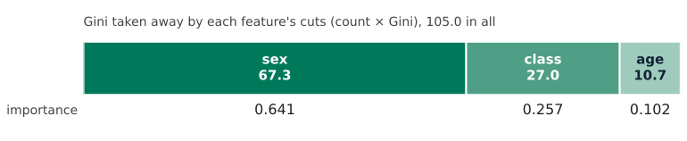
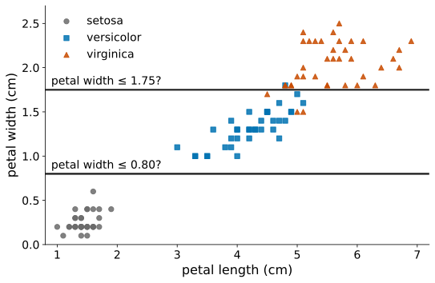

## [Problem:]{.stg} A straight line is one cut. Is one cut enough?

::: {.stage .top}


:::

::: {.scan}
{fig-alt="QR code for today's live page"}
<b>Scan now</b>
votes, questions, feedback
:::

::: {.notes}
约 4 分钟。先请大家扫码，页面整节课开着。logistic regression 用一条直线分类：直线的一边判 1、另一边判 0，就是在平面上切一刀。请一位学生指挥拖竖线：不管放在哪里都在 0.5 左右（最好 0.544）。再转角度斜着切：最好 0.744，只能把一个角上的那团切下来，另一边还混着三团。问：一刀不够怎么办？等学生说“再切”，再勾选 “switch to a chain of yes-or-no questions”，竖线拖到 2.5，左右各拖一条横线到 2.5 附近：0.988。
:::

## What you will be able to do

::: {.stage .tight}
::: {.say .xl}
Grow a tree of yes-or-no questions, choose how deep it goes, and **read** it.
:::

::: {.flow}
<div><span>1</span>Problem</div>
<div><span>2</span>Model</div>
<div><span>3</span>Loss</div>
<div><span>4</span>Solution</div>
<div><span>5</span>Test</div>
:::
:::

::: {.notes}
约 1 分钟。能力承诺：不想先猜边界的形状，或者要一份别人能照着执行的规则时，用一串是非题。念五步路线。
:::

## [Problem:]{.stg} Three cuts, one feature each

::: {.stage}
{.fig .fig-v2-s5 fig-alt="Left: the four clusters with three cuts, one vertical and two horizontal, accuracy 0.988. Right: the same three cuts written as a tree of three questions"}
:::

::: {.notes}
约 1 分钟。把上一页的三刀按顺序念成一串是非题：先问 x₁，答案决定下一个问题问什么。每个问题只看一个特征。
:::

## [Problem:]{.stg} People already decide this way

::: {.stage}
{.fig .fig-v2-s1 fig-alt="Two small rule trees. A loan officer: income below 20k? yes, high risk; no, then debt above half of income? yes high risk, no low risk. Lifeboats, 1912: a woman? yes, to the boat; no, then a child? yes, to the boat; no, wait"}

::: {.ask}
<small>Your turn</small>
"Women and children first": was it really followed? How would you check?
:::
:::

::: {.notes}
约 1.5 分钟。审批员、急诊分诊、救生艇：一次只问一个问题。让学生说怎么查：看乘客名单。想法：把一问接一问本身当成模型，让机器从数据里找该问什么、切在哪里。
:::

## [Model:]{.stg} The tree the machine grew on the passenger list

::: {.stage}
{.fig .fig-v2-f1m fig-alt="A depth-2 tree on 535 Titanic passengers: male?; males then age at most 13, females then first or second class. One node is marked one feature, one number; one leaf is marked 115 of 123 survived, a probability of 0.935"}

::: {.ask}
<small>Your turn</small>
What did the machine ask first? Follow a 40-year-old man.
:::

:::

::: {.notes}
约 3.5 分钟。数据：891 人的名单里 714 人有年龄，6 个特征（舱位、性别、年龄、兄弟姐妹/配偶、父母/子女、票价），分层 3:1，535 训练。两条假设（指着红字说）：每个问题只看一个特征和一个数；落在同一片叶子里的人，各类比例固定，按多数判，这个比例就是概率（predict_proba）。点名 decision tree、root、node、leaf、depth。40 岁男人：男性？是；≤ 13？否；304 人里 52 人生还，判遇难。机器自己选了性别做第一问，几乎就是“妇女和儿童先上”；三等舱女性 79 人只有 32 人生还，它多看出了舱位。
:::

## [Loss:]{.stg} Cut on sex: how good is this cut?

::: {.stage}
::: {.say .xl .center}
Males: **70** survived, **263** died<br>Females: **147** survived, **55** died
:::

::: {.ask}
<small>Your turn</small>
Give this cut a score. How would you score it?
:::
:::

::: {.notes}
约 1.5 分钟。不投票，邻座讨论 30 秒，请两三位说。常见的两种想法：数一数判错了几个；看两边是不是“纯”，各自几乎只剩一类。两种都写在白板上，下面两页各试一种。
:::

## [Loss:]{.stg} Idea 1: count the mistakes

::: {.stage .top}

:::

::: {.notes}
约 2 分钟。错分率：每边按多数判，判错的比例。100 个点，20 个蓝点挤在中间。请一位学生拖：错分率处处 0.200 不动，因为两边都是灰点多、都判灰，错的总是那 20 个蓝点。可是切在 5.75，右边 38 个全是灰的，这一刀其实很有用，下一刀只要在左边接着切。数错几个看不出来。绿线是下一页的量法，它在 5.75 最低。
:::

## [Loss:]{.stg} Idea 2: how mixed is each side?

::: {.stage}
{.fig .fig-v3-gini fig-alt="Gini against p, the share who survived on one side: a hill, 0 at both ends, 0.5 at the middle; males p = 0.210 with Gini 0.332, females p = 0.728 with Gini 0.396"}

::: {.one}
Pick two people from one side at random: chance that one survived and one died $= p(1-p)+(1-p)p =$ **Gini** $2p(1-p)$.
:::
:::

::: {.notes}
约 2 分钟。从一边随手抽两个人（抽一个、放回去、再抽一个），一个生还一个遇难的机会有多大？先让学生说：全是一类时是 0，各半时最大。设这一边生还的占 p：先生还后遇难 p(1−p)，反过来 (1−p)p，加起来 2p(1−p)，叫 Gini impurity，越小越纯。一刀有两边，按点数加权平均，越小越好。sklearn 默认用它。和平方误差、熵的关系在 Note 第 4 节的展开框里，不在课上讲。
:::

## [Loss:]{.stg} The passengers' best first cut

::: {.stage}
{.fig .fig-v2-s7 fig-alt="Three bars of survived and died: all 535 passengers, Gini 0.482; after cutting on sex, males 333 with Gini 0.332 and females 202 with Gini 0.396; weighted 0.356"}
:::

::: {.notes}
约 1.5 分钟。切之前 535 人生还 217，p = 0.406，Gini 0.482。按性别切开：男 p = 0.210，Gini 0.332；女 p = 0.728，Gini 0.396；加权 (333×0.332 + 202×0.396)/535 = 0.356。机器把 6 个特征的每个切点都这样算一遍，性别这一刀最小，所以先问性别。
:::

## [Solution:]{.stg} How do we find the best tree?

::: {.stage}
{.fig .fig-v2-s3 fig-alt="Weighted Gini of a cut on age for 30 men as the cut moves from 0 to 75: a staircase, flat between two ages and jumping when the cut passes a person"}

::: {.one}
291 cuts, about $10^{17}$ trees of depth 3: too many to try. **Greedy**: the best cut for this node, then the same on each side.
:::
:::

::: {.notes}
约 2 分钟。全试不行：291 个候选切点，深度 3 有 7 个问题，约 1.8×10¹⁷ 种树。也没有坡可走：图里挪切点只要没越过一个人，损失不变，越过时突然跳。办法是贪心：只找这个节点最好的一刀，再在两边各做一遍。
:::

## [Test:]{.stg} The tree can keep cutting. Should it?

::: {.stage .top}


:::

::: {.notes}
约 3 分钟。只用年龄和票价两个特征，矩形才画得出来。先问：一直切下去，好不好？请一位学生拖深度：深度 2 训练 0.716、交叉验证 0.695；深度 10 有 114 片叶子，训练 0.880，交叉验证 0.626；拖到最右（不限深度）207 片叶子，训练 0.976，交叉验证只剩 0.604。很多小矩形只框住一两个乘客。点名 overfitting：模型越灵活，越会背下训练数据里的偶然，和多项式阶数太高是同一件事。用 max_depth 控制。
:::

## [Test:]{.stg} How do we choose `max_depth`?

::: {.stage}
::: {.two .side}
{.fig .fig-v2-f2 fig-alt="The same curves plus five thin green lines from five validation splits of 134 passengers; their best depths are 4, 5, 4, 3 and 5"}

::: {.ask .vote}
<small>Vote on your phone</small>
With 50,000 data points, choose `max_depth` using…

::: {.opts}
<span><b>A</b>5-fold cross-validation</span>
<span><b>B</b>one validation split</span>
<span><b>C</b>the test set</span>
:::
:::
:::
:::

::: {.notes}
约 3.5 分钟。换回全部 6 个特征。黑线是交叉验证，深度 4 最高 0.822。细绿线：从 535 人里留 134 人做验证集，换 5 种分法，选出 4、5、4、3、5，看运气；535 人不多，所以这里用交叉验证。投票（右屏 Test: How do we choose max_depth → Open，30 秒，再 Reveal）。选 C：测试分数还算数吗？选 A：20 个深度 × 5 折 = 100 棵树。答案 B：5 万张图时验证集也有 1 万张，不怕运气。数据少用交叉验证，数据多用验证集。深度 4 不在两端；所有选择做完，测试集读一次：0.810。
:::

## [Test:]{.stg} Little data or a lot?

::: {.stage}
::: {.say .xl .center}
535 passengers: **cross-validation**. 50,000 points: **one validation set**: large enough not to depend on luck, and 5 times cheaper.<br>Never at an end of the range. Then read the test set once: **0.810**.
:::
:::

::: {.notes}
约 0.5 分钟。揭晓上一页的投票：答案 B。数据少时一份验证集太小、看运气，用交叉验证；数据多时验证集本身就大，只拟合一次就够。深度 4 在 1 到 12 的中间。所有选择做完，测试集读一次 0.810。
:::

## [Test:]{.stg} Why did the tree say "survived" for her?

::: {.stage}
{.fig .fig-v2-s4 fig-alt="A depth-3 tree. One path is highlighted: not male, not first or second class, fare at most 20.8, ending in a leaf with 31 survived and 30 died"}

::: {.ask}
<small>Think about it</small>
Third-class women with a dearer ticket: 1 of 18 survived. Why would a dear ticket be bad news?
:::

:::

::: {.notes}
约 2.5 分钟。深度 3 的树。测试集里一位三等舱女性，24 岁，票价 16.7：男性？否；头等或二等舱？否；票价 ≤ 20.8？是；落进 61 人、31 人生还的叶子，概率 0.508，判生还，离 0.5 很近。思考题（讨论 1 分钟，不必讲完）：三等舱票价高，多半是一张票上一大家子（平均同行 4.8 个亲属，票价低的 0.9 个），一大家子很难一起挤上救生艇。树从票价里读出了家庭大小。细节在 Note 第 7.1 节。
:::

## [Test:]{.stg} Which features does the whole tree rely on?

::: {.stage}
{.fig .fig-v2-s8 fig-alt="One bar of 105.0, the Gini taken away by the three cuts of the depth-2 tree: sex 67.3, class 27.0, age 10.7; their shares 0.641, 0.257 and 0.102"}

::: {.one}
**Feature importance**: each feature's share of the Gini its cuts took away.
:::
:::

::: {.notes}
约 2 分钟。每一刀让 Gini 降一些：根按性别拿走 67.3，男性按年龄 10.7，女性按舱位 27.0，一共 105.0。同一特征加起来除以总和，就是 feature_importances_：0.641、0.257、0.102，加起来为 1。它只有大小，没有方向。
:::

## [Think about it:]{.stg} Fare scores only 0.045. Is it useless?

::: {.stage}
::: {.ask .vote}
<small>Vote on your phone</small>
In the depth-4 tree, fare has importance 0.045. Remove fare and grow the tree again: the accuracy will…

::: {.opts}
<span><b>A</b>barely change</span>
<span><b>B</b>drop clearly</span>
:::
:::

::: {.fragment .answer-box}
**A, barely changes** (0.822 → 0.809). **But not useless:** class was picked first and took the credit; remove class, and fare rises to 0.155.<br>
Importance shows what this tree used, not what the data contains.
:::
:::

::: {.notes}
约 2 分钟，思考题，可以跳过。投票（右屏 Think about it: Fare scores only 0.045 → Open，30 秒，再 Reveal）。投票揭晓后点一下出答案框。答案 A：拿掉票价，交叉验证从 0.822 到 0.809，五折本身就从 0.794 到 0.869，几乎不变。可票价在三个舱位之间差很多（中位数 66.6、19.5、8.1），重要性为什么这么低？舱位先被挑中，拿走了两者共有的功劳；拿掉舱位，票价的重要性升到 0.155。所以重要性只说明这一棵树用了什么。Note 第 7.2 节有这一段；想在作业里写深一点的同学，Lab 6 课后有一次泰坦尼克号的小调查。
:::

## [Model:]{.stg} Three classes: what changes?

::: {.stage}
::: {.two .side}
{.fig .fig-v2-s9 fig-alt="Iris training flowers, petal length against petal width, three species; a cut at petal width 0.80 separates setosa, a cut at 1.75 separates versicolor from virginica"}

::: {.say}
Only Gini:
$$1-\sum_k p_k^2$$
:::
:::
:::

::: {.notes}
约 2 分钟，不投票。先问：三类时树要改什么？叶子照样放各类的比例、按多数判；只有 Gini 要推广，两类时 1 − p² − (1−p)² 就是 2p(1−p)。鸢尾花 112 朵训练花（37、37、38），Gini 0.667；第一刀花瓣宽度 ≤ 0.80 切出全纯的山鸢尾，第二刀 ≤ 1.75 再分开另两种；交叉验证深度 2 最高 0.955。作业 2 的十个数字也是这样，代码一行不改（下一页）。细节在 Note 第 8 节。
:::

## [Model:]{.stg} A number in each leaf: regression tree

::: {.stage .top}

:::

::: {.notes}
约 2 分钟，不投票，时间紧可以跳过；Lab 和作业都不考。要预测一个数（汽车的油耗，线性回归用过的那份数据）：叶子放落进来的车的平均油耗，损失是平方误差，求解仍是贪心，代码换成 DecisionTreeRegressor。拖深度：深度 1 只有两级台阶，交叉验证 RMSE 5.63，比直线 4.98 还差；深度 5 最低 4.23；再深台阶上下乱跳，训练 RMSE 降到 3.36，交叉验证升到 4.35，和乘客那里切太深是同一种过拟合。细节在 Note 第 9 节。
:::

## Today in code

::: {.stage}
```python
tree = DecisionTreeClassifier(max_depth=4, random_state=0)    # at most 4 questions
print(cross_val_score(tree, X_train, y_train, cv=kf).mean())  # CV accuracy
tree.fit(X_train, y_train)                                    # grow the tree
print(tree.feature_importances_)                              # Gini taken by each feature
```

Ten classes (Assignment 2): **the same code**.
:::

::: {.notes}
约 1 分钟。四行，每行对应今天一段。不止两类时代码一行不用改，作业 2 的十个数字也是。树不需要标准化。Lab 6 在鸢尾花上动手。
:::

## What you can do now {.final-slide}

::: {.takeaway}
::: {.rows .tiny .chain}
<div><span class="n">problem</span><div><b>One cut is not enough</b><p>cut again, one feature at a time</p></div></div>
<div><span class="n">model</span><div><b>A decision tree</b><p>leaf shares are probabilities</p></div></div>
<div><span class="n">loss</span><div><b>Gini</b><p>the purer both sides, the better</p></div></div>
<div><span class="n">solution</span><div><b>Greedy</b><p>the best cut for this node, then each side</p></div></div>
<div><span class="n">test</span><div><b>Choose max_depth on unseen data</b><p>little data: CV; much data: a validation set; never at an end</p></div></div>
<div><span class="n">test</span><div><b>Read a path and the importance</b><p>why one case, which features overall</p></div></div>
:::

::: {.qr}
{fig-alt="QR code for today's live page"}
<b>Feedback</b>
<p>After class: Lab 6</p>
:::
:::

::: {.notes}
约 0.5 分钟，课堂停在这一页。沿五步把整条路念一遍。课后 Lab 6。多类（鸢尾花）和回归树在 Note 第 8、9 节；很多棵树（bagging、boosting）在 Advanced Study 3、4。
:::
