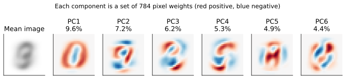
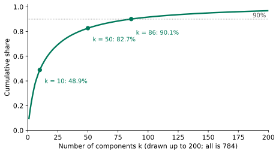
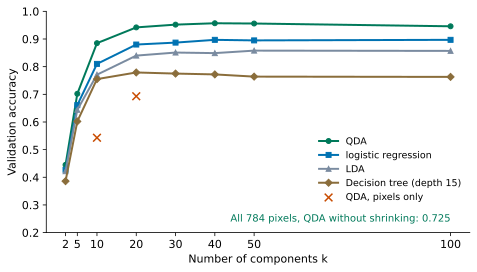
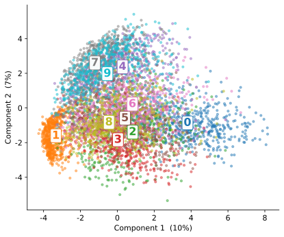
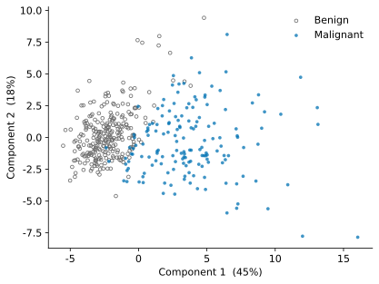
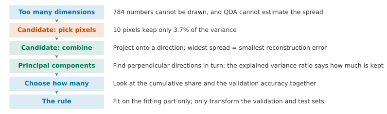

## 1. Motivation: 784 Numbers Are Too Many

In earlier lessons we used the handwritten digits (the MNIST subset, Lesson 4, Section 8). Each image is 28×28 = 784 pixels, so each image is 784 numbers. This causes two problems.

First, we cannot draw the data. When a lump has two features, we can plot it on a flat page and look at it. Nobody can look at 784 features at once.

Second, some methods cannot cope. In Lesson 5, QDA had to estimate a 784×784 covariance matrix (its spread) for every class. Each class has only about 560 images, which is not enough to estimate that spread. On the fitting and validation split from Lesson 6 (5625 fitting images and 1875 validation images), QDA without shrinkage reaches a validation accuracy of only 0.725.

For the first time in this course, we will not predict anything. We look only at the pixels and ignore the labels. We ask a new question: **can we keep most of the information in each image with only a few numbers?** This is called **dimensionality reduction**. It needs no labels, so it is a form of **unsupervised learning**.

We want two things: few new numbers, and little lost information. To begin, we measure "information" with one concrete quantity: how widely the data spread out, which is the variance. If a feature is almost the same on every image, it carries almost no information. A feature needs to spread out if it is to tell different images apart.

**By the end of this lesson, you should be able to:** explain why, for data with many dimensions, we use combinations of features rather than picking a few features; find the direction of widest spread, and explain why it is also the direction with the smallest reconstruction error; read the explained variance ratio, and use it together with validation set accuracy to choose how many numbers to keep; learn PCA on the fitting data only; plot the data on two principal components.

## 2. Candidate One: Keep a Few Pixels

The most direct idea is to pick the most useful few of the 784 pixels and throw the rest away. Which pixels are most useful? By the standard above, we pick the ones that spread most widely across all the images.

Suppose we keep the 10 pixels with the widest spread. The widget below lets you change how many pixels are kept:



Their variances add up to only 3.7% of the total variance of all 784 pixels. We can rebuild an image from them. We copy the 10 kept pixels, and we fill each of the 774 dropped pixels with its own average value in the fitting images. So most of the rebuilt image is a blur of the "average digit". If we train QDA on these 10 numbers, the validation accuracy is 0.543.

Think about this first. We kept 10 numbers, so why do they hold less than 4% of the variance?

::: {.callout-note collapse="true" title="Show answer"}
First, there are many pixels, and each one holds only a small share of the total variance. Ten of them do not add up to much. Second, neighbouring pixels change together. When a pen stroke passes, several pixels next to each other turn dark at the same time. So the 10 chosen pixels repeat a lot of each other's information. Meanwhile, many of the 774 dropped pixels carry information that the 10 do not have, and none of it is kept.
:::

The weakness of picking pixels is that each new number can use only one pixel. We want each new number to use all the pixels.

## 3. Candidate Two: Combinations of Pixels

A number that uses every pixel is a **combination** of the pixels. We give each pixel a weight, multiply each pixel by its weight, and add the results. For example, if every weight is 1/784, the result is "how dark the image is on average". This number uses all 784 pixels.

There are endless ways to choose the weights. Which choice is best? Let us work it out with two features first. Below are 200 points, each with two features. A combination of the two features, $z = u_1x_1 + u_2x_2$ (with $u_1^2+u_2^2=1$), has a picture on the plot. It is the **projection** of each point onto a line in the direction $\mathbf u = (u_1, u_2)$, and $z$ is where the point lands on that line. (In this lesson $z$ is this projected **score**, not the linear part $\mathbf w^\top\mathbf x + b$ of Lesson 4; see the notation table in Lesson 4, Section 2.) Using one number $z$ in place of two numbers means replacing each point with its projection on the line.

How should we judge a direction? Two answers both sound sensible. One is that, after projection, the points should **spread as widely as possible** along the line, so that we keep a lot of variance. The other is that replacing each point with its projection should **lose as little as possible**. We measure the loss by the squared distance from each point to the line, averaged over all points, and call it the **reconstruction error**. In the widget below, turn the line and watch both numbers.



Turn it around first. In which direction is the spread largest? In which direction is the reconstruction error smallest? If we use $x_1$ alone (the direction 0°), which is candidate one, how much do we keep?

::: {.callout-note collapse="true" title="Show answer"}
Both happen in the same direction, at about 31°. There the spread is 3.85, which keeps 89%, and the reconstruction error is at its smallest, 0.49. Using $x_1$ alone (0°) keeps 68%, and using $x_2$ alone (90°) keeps only 32%.

Also, wherever you turn the line, the two bars always add up to 4.34. The reason is Pythagoras' theorem. For each point, the squared distance to the centre equals the square of its position along the line plus its squared distance to the line. The left side adds up to the total spread, which never changes. So "spread as widely as possible" and "lose as little as possible" are the same goal.
:::

The direction with the widest spread is called the **first principal component**.


## 4. The Second Direction, and Principal Component Analysis

One direction keeps 89%, which leaves 11%. If we want a second number, how should we choose the second direction?

We want it to avoid repeating what the first direction has already told us. There are many candidates, so let us compare three on the cloud of points. The first direction is at 31°. For the second, we try 76° (tilted 45° from the first), 90° (which is $x_2$) and 121° (at right angles to the first). For each point, we take its position $z_1$ along the first direction and its position $z_2$ along the second, and work out the correlation between them:

| Second direction | 76° | 90° | 121° (about at right angles) |
|---|---:|---:|---:|
| Correlation with $z_1$ | 0.94 | 0.86 | 0.01 |
| Spread along it | 2.18 | 1.39 | 0.49 |

Think about this first. The 76° direction has the largest spread, so why not choose it?

In the widget below you can turn the second line yourself and watch the correlation change:



::: {.callout-note collapse="true" title="Show answer"}
It says almost the same thing as the first direction. The correlation is 0.94, so once we know $z_1$, we nearly know $z_2$ as well. Its spread is large because it points mostly along the first direction, and the first number has already told us that part. The direction at right angles has almost no correlation with $z_1$ (0.01), so nearly everything it tells us is new. Its spread of 0.49 is exactly the 11% that the first direction did not keep.
:::

So we choose the second direction at right angles to the first. With more dimensions, we carry on in the same way. The second direction is the one with the widest spread among all directions at right angles to the first. The third is at right angles to both of the first two, and again has the widest spread. We keep going, and 784 pixels give at most 784 directions. These directions are called **principal components**, and the whole method is called **principal component analysis** (**PCA**).

In the widget in Section 3, the first direction "keeps 89%". (That is for a cloud of two features. On the 784 pixels, the first principal component keeps only 9.6%, because the variance is spread over many directions.) This share has a name. The share of the total variance kept by one principal component is its **explained variance ratio**. If we add up the ratios of the first $k$ components, we get the **cumulative share**.

Each principal component is a set of 784 weights. We can arrange them back into a 28×28 image and see where the component "looks":

{fig-alt="An average digit image and six 28 by 28 weight images in red and blue, with ratios of 9.6%, 7.2%, 6.2%, 5.3%, 4.9% and 4.4% in turn; the first principal component looks like a red 0 with blue in the middle"}

If an image has a large score on the first principal component, it has a lot of ink where the weights are red and little ink where they are blue. The first principal component looks like a red ring with blue in the middle. An image with a large score looks like a 0. An image with a small (negative) score has little ink on the ring and more ink in the middle, and looks like a 1. The formula for rebuilding an image is

$$
\hat{\mathbf x} = \bar{\mathbf x} + z_1\mathbf u_1 + z_2\mathbf u_2 + \dots + z_k\mathbf u_k ,
$$

In words: start from the average image $\bar{\mathbf x}$, then add each principal component $\mathbf u_j$ multiplied by the image's score $z_j$ on it. If we add only the first $k$ components, we are rebuilding the image from $k$ numbers.

In scikit-learn, we write it like this:

```python
from sklearn.decomposition import PCA

pca = PCA(n_components=10, random_state=0)   # keep 10 components; random_state=0: same result every run
pca.fit(X_digits_fit)                        # learn the directions from the fitting images only
Z_fit = pca.transform(X_digits_fit)          # each image becomes 10 numbers
Z_val = pca.transform(X_digits_val)          # the validation images, with the same directions
print(pca.explained_variance_ratio_)         # share of the total variance kept by each component
```

`X_digits_fit` and `X_digits_val` are the same as in Lesson 6, Section 6. With 784 dimensions, scikit-learn uses a fast algorithm with some randomness to find the components. `random_state=0` makes the result the same every time.

Now go back to the comparison in Section 2. Ten pixels keep 3.7% of the variance, while 10 principal components keep 48.9%.

{fig-alt="Top row: three 28 by 28 digit images, the original 6, the one rebuilt from 10 pixels (almost a grey blur) and the one rebuilt from 10 principal components (you can see it is a 6); bottom row: two red and blue error images, with errors of 56.9 and 25.2; on the right, a bar chart of 3.7% against 48.9%"}

With the same 10 numbers, the principal components keep more than ten times as much, and the rebuilt image is still recognisable as a 6. The error images in the bottom row show what was lost. With only 10 pixels, the whole stroke of the 6 is red, so almost everything is lost. With 10 principal components, most of the stroke has only a thin ring of light red and light blue left; only the top of the stroke is still dark red, because that part was not rebuilt. The **reconstruction error** of an image is the sum of the squares of the 784 numbers in its error image. For this image it falls from 56.9 to 25.2. The "reconstruction error" in Section 3 is this value averaged over all images.

## 5. How Many to Keep: Look at the Images and the Cumulative Share

How many components are enough? We start with two views: the rebuilt images, and the cumulative share.

**Look at the images.** Drag $k$ and find the number of components at which you can first recognise a validation image:



**Look at the cumulative share.**

{fig-alt="A curve that rises and then levels off: 48.9% at k = 10, 82.7% at 50, 90.1% at 86"}

With 10 components we keep 48.9%, with 50 we keep 82.7%, and with 100 we keep 91.7%. To keep 90% we need 86 components, and to keep 95% we need 150. But 90% and 95% are thresholds that people choose. The cumulative share cannot tell us whether 86 or 150 is better. The answer depends on what we do with the data after reducing it.

## 6. How Many to Keep: Look at the Task That Follows

After the reduction, we pass the $k$ numbers to the classifiers from Lessons 4 to 6 and compare them on the validation set:

{fig-alt="The QDA curve is the highest, 0.957 at k = 40; logistic regression is about 0.89, LDA about 0.85 and the decision tree about 0.77; with all 784 pixels QDA reaches only 0.725"}

Look at the figure first. With all 784 dimensions, QDA reaches only 0.725, but with 10 dimensions it reaches 0.885, and with 40 dimensions 0.957. Why does throwing information away make it better?

::: {.callout-note collapse="true" title="Show answer"}
The trouble with QDA (Lesson 5) is that the spread is almost 0 in some directions, so the ellipses get squashed flat. The components are sorted by how widely the data spread along them. So the first few dozen directions we keep all have a wide spread and some thickness, and QDA can estimate them reliably. The directions we throw away are the ones that hardly change and only add noise. This is one of two ways to fix the same problem. The other is the shrinkage from Lesson 5. On this data, PCA does much better. QDA with shrinkage uses all 784 dimensions and reaches a test accuracy of 0.861. If we first reduce to 40 dimensions and then use QDA, the test accuracy is 0.962 (Section 7). PCA has other advantages too: we store fewer numbers for each image, and we can plot the result.
:::

Putting the three views together, the trade-off for k is:

- **Small k**: we store less and can plot the data (k = 2), but we lose more information and accuracy is lower;
- **Large k**: we stay close to the original data, but methods such as QDA, which must estimate the spread, become unreliable again;
- **How to choose**: the cumulative share gives a starting point (for example 90%), and the validation accuracy makes the final decision. As in Lessons 5 and 6, check that the best value is not at either end of the search range.

In this example QDA does best at k = 40 (0.957), which lies in the middle of 10 to 100. The values k = 30 and k = 50 are only 0.001 to 0.005 lower. In Assignment 2, you use the full MNIST and make the same comparison with k = 10, 50 and 100.

## 7. The Rule: Learn PCA Only on the Fitting Part

In the code in Section 4, `fit` used only `X_digits_fit`, and the validation set used only `transform`. Why?

Think about this first. The PCA directions are learned from the data. What would happen if we ran `fit` on all the data, fitting and validation together?

::: {.callout-note collapse="true" title="Show answer"}
The component directions would have "seen" the validation set. The validation set should stand for data the model has never seen. If it takes part in the learning, the validation accuracy is no longer an accuracy "on unseen data". In this example, if we fit PCA (k = 10) on the fitting and validation images together, the validation accuracy of QDA goes from 0.885 to 0.883. That is 4 fewer correct images out of 1875, so this time peeking did not inflate the result, and the difference is negligible. But this is a principle, not a choice we make by looking at the numbers. With less data and more dimensions, peeking inflates the result more, and we cannot know in advance by how much.
:::

This is the same rule as standardisation in Lesson 3 and the validation set in Lesson 6: **anything learned from the data is learned only from the fitting part.** The validation set and the test set only ever use `transform`.

After all the choices are made, we read the test set once. We learn 40 components on the 5625 fitting images and train QDA on them. The test accuracy is 0.962.

## 8. Plotting the Data

Once we reduce to 2 dimensions, we can plot the data. We project the MNIST subset onto the first two components and colour each point by its true digit. The colour is only there to help us look; PCA itself never used the labels:

{fig-alt="A cloud of coloured points: the 1s crowd into a small group at the far left, the 0s are on the right, the 7s, 9s and 4s crowd at the top, and the 2s, 3s, 5s, 6s and 8s crowd in the middle"}

The 1s form a tight group at the far left, and the 0s are on the right. The 7s, 9s and 4s crowd at the top, and the 2s, 3s, 5s, 6s and 8s crowd in the middle. With only two numbers (keeping 17%), we can already see which digits tend to be confused.

**Extension: breast lumps.** We first standardise the 30 measurements (Lesson 3) and then reduce them to 2 dimensions:

{fig-alt="Grey benign points gather on the left, and blue malignant points are spread out on the right"}

The two classes separate roughly into left and right. The 30 weights of the first component are all positive and of similar size. The largest belong to mean concave points and mean concavity, at 0.26 each. So this component is roughly "the sum of all the measurements": it describes how large and how irregular the cell nuclei of the lump are overall. With only these 2 numbers, logistic regression reaches a cross-validation accuracy of 0.953. With all 30 measurements it reaches 0.979.


## 9. Implementation: Doing It in scikit-learn

We use the same split as in Section 6 of Lesson 6 (`X_digits_fit`, `X_digits_val`, `X_digits_test`, the MNIST subset).

**Step 1: learn PCA and look at the shares (Sections 4 and 5).**

```python
import numpy as np
from sklearn.decomposition import PCA

pca = PCA()                                  # keep all 784 components for now
pca.fit(X_digits_fit)                        # learn the directions from the fitting images only
ratios = pca.explained_variance_ratio_       # share of the variance kept by each component
print(ratios[:5])                            # the first five
cum = np.cumsum(ratios)                      # cumulative share: cum[0] is k = 1, cum[9] is k = 10
print(cum[9])                                # k = 10
print(cum[19])                               # k = 20
print(cum[49])                               # k = 50
```

**Step 2: choose k on the validation set (Section 6).**

```python
from sklearn.discriminant_analysis import QuadraticDiscriminantAnalysis

for k in [10, 20, 30, 40, 50, 100]:          # candidate numbers of components
    pca = PCA(n_components=k, random_state=0)   # keep k components
    pca.fit(X_digits_fit)                    # fitting images only
    Z_fit = pca.transform(X_digits_fit)      # k numbers per fitting image
    Z_val = pca.transform(X_digits_val)      # k numbers per validation image
    qda = QuadraticDiscriminantAnalysis()    # one spread per class
    qda.fit(Z_fit, y_digits_fit)             # train on the reduced fitting images
    print(k, qda.score(Z_val, y_digits_val)) # validation accuracy
```

**Step 3: rebuild one image (Section 4).**

```python
pca = PCA(n_components=10, random_state=0)   # 10 components
pca.fit(X_digits_fit)                        # fitting images only
one_image = X_digits_val[5:6]                # one validation image (a 6); [5:6] keeps one row
z = pca.transform(one_image)                 # its 10 numbers
back = pca.inverse_transform(z)              # mean image plus the 10 components times their scores
error = one_image - back                     # what the 10 numbers could not keep
print((error ** 2).sum())                    # reconstruction error of this image: 25.2
image = back.reshape(28, 28)                 # the 784 numbers back as a 28 x 28 image
```

## 10. The Lesson on One Page

If you only read one page, read this one.

{fig-alt="A vertical flow chart with six steps"}

| The problem you see | What you can do | What evidence to use |
|---|---|---|
| Too many dimensions: you cannot plot the data, and methods struggle | Reduce the dimensions: replace the features with a few numbers | The variance kept; the validation accuracy of the task that follows |
| Picking a few features throws away too much | Use combinations of features: project onto a direction | The spread of the projection; the reconstruction error |
| Which direction is best | Widest spread = smallest reconstruction error: the principal components, each at right angles to the ones before | The explained variance ratio |
| How many to keep | The cumulative share gives a starting point; validation accuracy decides k | k is not at either end of the search range |
| How to avoid peeking | `fit` on the fitting part only; only `transform` the validation and test sets | The test set is read once |

## 11. Summary and Limitations

At the start we asked whether a few numbers could keep most of the information. The answer is yes. For MNIST, we can squeeze the 784 numbers down to 86 principal components and still keep 90% of the variance, and with 40 components the digits are still recognisable. QDA even improves, from 0.725 to 0.957 (0.962 on the test set, much better than the 0.861 we got with shrinkage in Lesson 5). With 2 components, we can plot the data. The method uses combinations of pixels. We choose the direction of each combination so that the projection has the widest spread, and this direction also gives the smallest reconstruction error.

**Transfer question.** A supermarket has 5000 customers. For each customer, it records how much of each of 200 products they buy in a month. The supermarket wants to see what groups its customers fall into. Answer without doing any calculation. What makes it hard to plot the data directly? If you use PCA to make a two-dimensional plot, where do the labels come from? Later, the supermarket also wants to predict whether a customer will churn next month. Which data should PCA be fitted on? How would you choose k?

::: {.callout-note collapse="true" title="Model answer"}
You cannot plot 200 features. PCA does not need labels. It learns the directions from the purchase amounts alone, and then you look at the plot to see whether there are natural groups. (The plot can show whether there are groups, but PCA by itself cannot say how many there are.) To predict churn, first split the data into training, validation and test sets. Fit PCA on the fitting part only, and only transform the rest. For k, first use the cumulative share (for example 90%) to get a starting point. Then choose k by the churn-prediction accuracy on the validation set, and check that it is not at either end of the search range. Also, the products are bought in different units (rice by the bag, chewing gum by the stick). So standardise the data before PCA. If you do not, the products with large variance will dominate the principal components.
:::

**Where this method cannot be trusted.**

1. **Large variance does not mean useful.** PCA does not look at the labels. It keeps the directions with a wide spread, and these are not always the directions that separate the classes. Suppose two classes happen to be separated along a direction with very small variance. Then PCA will throw that direction away.
2. **It only finds straight-line directions.** A principal component is a weighted sum of the pixels. If the data lie along a curved "ribbon", straight-line directions describe it poorly.
3. **The scale changes the result.** For the breast lumps, you need to standardise first. Otherwise the area (from a few hundred to over two thousand) will take over the first principal component on its own. The MNIST pixels all have the same scale, so you do not need to standardise them.
4. **Principal components do not always have a clear meaning.** For the breast lumps, the first principal component means "overall size". For MNIST, it roughly means "looks like a 0 or looks like a 1". The later components are patches of red and blue weights, and it is hard to say what they mean.

**Back to what we promised at the start.** Given data with many dimensions, you can now do the following. You can explain why we use combinations of features rather than picking some of them. You can find the direction with the widest spread, and explain why it is also the direction with the smallest reconstruction error. You can read the explained variance ratio and choose k together with the validation accuracy. You fit PCA only on the fitting data. And you can plot the data on two principal components.

**30-second feedback.** Now that you have finished this lesson, please scan the code to leave anonymous feedback or questions. It helps us improve to know which parts were unclear and which parts went too fast.

{fig-align="center" width="160px" fig-alt="Feedback QR code"}

*The Advanced Studies below are not part of the main thread, and you can read each one on its own. MPS311 students are encouraged to read them. MPS439 students have one main task, which is required: Advanced A of Lab 7. It builds on Study 1 here but uses different data (only the images of digit 0), so its self-check values differ from the ones on this page. The other Studies are optional.*

---

## Advanced Study 1: Why the Principal Components Are Eigenvectors of the Covariance Matrix

Suppose the mean has already been subtracted from the data. Write the data as a matrix $X$ with $n$ rows and $d$ columns. The covariance matrix is $S = \frac{1}{n-1}X^\top X$ (it is $d \times d$; you saw the two-dimensional case in Lesson 5). The projection onto a direction $\mathbf u$ (with $\|\mathbf u\| = 1$) is $\mathbf z = X\mathbf u$, and its variance is

$$
\frac{1}{n-1}\mathbf z^\top\mathbf z = \frac{1}{n-1}\mathbf u^\top X^\top X\mathbf u = \mathbf u^\top S\mathbf u .
$$

So the first principal component is the $\mathbf u$ that makes $\mathbf u^\top S\mathbf u$ as large as possible, under the condition $\|\mathbf u\| = 1$.

**Lagrange multiplier.** Let

$$
\mathcal L = \mathbf u^\top S\mathbf u - \lambda(\mathbf u^\top\mathbf u - 1),
$$

and take the derivative with respect to $\mathbf u$ and set it to 0:

$$
2S\mathbf u - 2\lambda\mathbf u = 0 \quad\Longrightarrow\quad S\mathbf u = \lambda\mathbf u .
$$

So $\mathbf u$ must be an **eigenvector** of $S$, and $\lambda$ is the matching **eigenvalue**. The variance of the projection is then $\mathbf u^\top S\mathbf u = \lambda\mathbf u^\top\mathbf u = \lambda$. To make the variance as large as possible, we take the eigenvector that goes with the largest eigenvalue.

**The later principal components.** Now we also require the direction to be at right angles to $\mathbf u_1$. The same derivation gives the eigenvector that goes with the second largest eigenvalue. For a symmetric matrix, eigenvectors with different eigenvalues are always at right angles to each other. So the principal components are the eigenvectors of $S$, sorted from the largest eigenvalue to the smallest. The explained variance ratio of component $j$ is $\lambda_j / \sum_i \lambda_i$.

**Comparing with scikit-learn:**

```python
import numpy as np

S = np.cov(X_digits_fit.T)                   # 784 x 784 covariance matrix of the fitting images
values, vectors = np.linalg.eigh(S)          # eigenvalues (ascending) and eigenvectors (as columns)
order = np.argsort(values)[::-1]             # largest first
values = values[order]
vectors = vectors[:, order]
print(values[0] / values.sum())              # share of the first component
```

The output is 0.0955, the same as `pca.explained_variance_ratio_[0]`. `vectors[:, 0]` is also the same as `pca.components_[0]`, although the sign may be flipped. This is fine, because $\mathbf u$ and $-\mathbf u$ lie on the same line.

**Exercise.** Use the two-dimensional point cloud from Section 3 to check the Pythagoras relation. For any direction, the variance of the projection plus the reconstruction error equals the sum of the variances of the two features. (Hint: this sum equals the trace of $S$, which is the sum of the two eigenvalues.)

## Advanced Study 2: PCA from Scratch with SVD

If we compute the covariance matrix and then decompose it, we first have to build a $d \times d$ matrix. Another way is to apply **singular value decomposition** (SVD) directly to the data after the mean has been subtracted: $X = U\Sigma V^\top$. Substituting this gives $S = \frac{1}{n-1}X^\top X = V\frac{\Sigma^2}{n-1}V^\top$. So the columns of $V$ are the principal components, and each singular value squared, divided by $n-1$, is an eigenvalue.

```python
mean = X_digits_fit.mean(axis=0)             # the mean image
Xc = X_digits_fit - mean                     # centre the fitting images
U, s, Vt = np.linalg.svd(Xc, full_matrices=False)   # rows of Vt are the components
var = s ** 2 / (len(Xc) - 1)                 # variance along each component
print(var[0])                                # compare with pca.explained_variance_[0]
k = 10
Z = (X_digits_val - mean) @ Vt[:k].T         # scores of the validation images on k components
back = mean + Z @ Vt[:k]                     # rebuild them from k numbers
print(((X_digits_val - back) ** 2).sum(axis=1).mean())   # average reconstruction error
```

The first line of output is 5.0389, the same as in scikit-learn. The reconstruction error is 27.05, the same as the value from `inverse_transform`.

Now try the following yourself:

1. Change `k` from 1 to 200, and plot how the reconstruction error changes with $k$. How does this curve relate to the curve of 1 minus the cumulative share?
2. Notice that we subtract the mean of `X_digits_fit`, and we subtract this same mean from the validation images. Suppose you subtracted the validation images' own mean instead. Which rule from Section 7 would this break?

## Advanced Study 3: Open Questions

This lesson does not develop the following four questions. Each comes with a starting point.

1. **To standardise or not.** If you run PCA on the breast lumps without standardising, which feature dominates the first principal component? Starting point: run `PCA(2).fit(X_train)`, and find which feature has the largest weight in `components_[0]`.
2. **Can looking only at variance throw away a useful direction?** Starting point: make two-dimensional data by hand, with two classes separated along a direction of very small variance. Keep only the first principal component, and check the accuracy of logistic regression. Then look up `LinearDiscriminantAnalysis(n_components=...)`. It looks for directions that separate the classes, not directions with a wide spread.
3. **Curved data.** Starting point: use `sklearn.manifold.TSNE` to plot the MNIST subset in two dimensions, and compare the result with the plot in Section 8. On a t-SNE plot, do distances still mean anything?
4. **Compressing images.** A 28×28 image is stored as 784 numbers. With 10 principal components, each image needs only 10 numbers, but you also have to store the mean image and the 10 principal components. How many images do you need to store before this saves space?
