::: {.callout-tip title="How to read this lesson"}
For the lab and the assignment, read Sections 1 to 4, the result at the start of Section 5, and Sections 6 to 10. Section 11 is extra material; read it if you want to see a few more methods. The two-step derivation in Section 5 explains why the answer is what it is, and we recommend reading it. To derive every step yourself, work through Advanced Study 1; for another use of PCA (removing noise from images), read Advanced Study 2. Section 8.8 covers classification after dimensionality reduction, which Section 3 of Assignment 2 needs.
:::

## 1. Problem: Can We Store Fewer Numbers and Still Rebuild the Data?

A handwritten digit image has 28×28 pixels, which is 784 numbers. For a car we measure five numbers: cylinders, displacement, horsepower, weight and acceleration time.

These numbers do not each tell a separate story. When a pen stroke passes, several neighbouring pixels turn dark together, and the four corners of the image are almost white in every image. Cars behave in the same way. The table below gives the correlation between each pair of the five measurements for 392 cars (the Auto MPG data from the UCI repository):

| | Cylinders | Displacement | Horsepower | Weight | Acceleration time |
|---|---:|---:|---:|---:|---:|
| Cylinders | 1 | 0.95 | 0.84 | 0.90 | −0.50 |
| Displacement | 0.95 | 1 | 0.90 | 0.93 | −0.54 |
| Horsepower | 0.84 | 0.90 | 1 | 0.86 | −0.69 |
| Weight | 0.90 | 0.93 | 0.86 | 1 | −0.42 |
| Acceleration time | −0.50 | −0.54 | −0.69 | −0.42 | 1 |

Any two of the first four have a correlation between 0.84 and 0.95: a big car has more cylinders, a larger displacement and more horsepower, and it is also heavier. The numbers repeat each other, so we should be able to store fewer of them.

The question of this lesson is: **if we store only a few numbers for each sample, can we still rebuild it? Which numbers should we store?** This is called **dimensionality reduction**. It looks only at the data itself and uses no labels, so it is a form of **unsupervised learning**.

Once we have learned it, we can use it for three things:

- **Compression:** an image of 784 numbers can be stored as 50 numbers and still be rebuilt well enough to recognise (Section 8.3).
- **Looking at data:** we cannot plot hundreds of measurements, but after reducing them to two numbers we can draw the data on a plane (Section 8.6).
- **Classification after dimensionality reduction:** first reduce the data to a few dozen numbers, then apply a classifier. This is sometimes more accurate than using all the pixels directly (Section 8.8, needed for Assignment 2).

784 numbers are too many to start with, so we first work out the idea when there are only two numbers.

## 2. Inspiration: Keep Only One Number

Below are the height and arm span of 200 people (hand-made data, both in centimetres). The correlation is 0.94. The points crowd along a sloping line, because the two numbers mostly change together in one direction.

If we may use only **one number** to describe each person, which number should we keep? Draw a line and drop each point perpendicularly onto it (the short grey segments). Then each person is left with only their position on the line. Turn the line and watch the two bars:

- Blue bar: how widely the points on the line are spread out along it. We call this the **spread** (the variance of the projection). The points must be spread out, so that we can still tell different people apart.
- Red bar: replace each point by its point on the line, and take the average of the squared distances we lose. We call this the **reconstruction error**.



Try it yourself first: at which direction is the blue bar highest? At which direction is the red bar lowest?

::: {.callout-note collapse="true" title="Show answer"}
Both happen at the same direction, about 46°: the spread is 94.71, which keeps 97%, and the reconstruction error is 2.97. At 0° we keep only the height, which keeps only 48%, and people with the same height but different arm spans can no longer be told apart. Wherever you turn the line, the two bars always add up to 97.68: when one goes up, the other goes down.
:::

From this we see two things:

1. **Drawing a line means projecting the points onto the line**, and each point keeps only its position on the line.
2. **The direction in which the projection is spread out the most is also the direction that loses the least.** The remaining direction, perpendicular to it, is "arm span minus height", and it holds only 3%.

The assumption behind this is that the points crowd near a line. Below we write these two facts as formulas, so that we can compute the best direction directly without turning the line. With 784 numbers there are far too many directions to try by turning, so we have to compute it.

::: {.callout-note collapse="true" title="Why drop perpendicularly, and not vertically or horizontally?"}
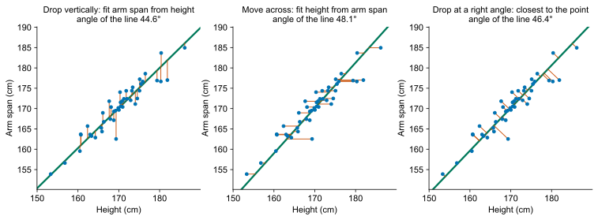{fig-alt="Three scatter plots of height against arm span, each with a green line and short red segments. In the left plot the red segments are vertical; the title says drop vertically, which fits arm span from height, and the line is at 44.6 degrees. In the middle plot the red segments are horizontal; the title says move horizontally, which fits height from arm span, at 48.1 degrees. In the right plot the red segments are perpendicular to the green line; the title says drop perpendicularly, closest to the points, at 46.4 degrees"}

Dropping vertically gives the least squares line that fits arm span from height (44.6°). Moving horizontally gives the line that fits height from arm span (48.1°). Both lines decide in advance which quantity is the "answer". Here there is no answer to predict and the two quantities play equal roles, so we take the point on the line that is closest to each point. The line we get this way is at 46.4°, between the two fitted lines.
:::

## 3. Model: Projection and Its Properties

First we centre the data. We subtract from each measurement its mean $\bar{\mathbf x}$, so the centre of the point cloud moves to the origin. Then the line we draw also passes through the origin, and the formulas that follow become much simpler. **From here on, $\mathbf x$ means the centred data**, and we add the mean back only when we rebuild. Each point $\mathbf x\in\mathbb R^{d\times 1}$ has $d$ numbers ($d = 2$ for height and arm span, 5 for the cars, 784 for handwritten digits).

The model is as follows. Take a direction $\mathbf u\in\mathbb R^{d\times 1}$, store only one number $z$ for each point, and rebuild the point by the point $z\mathbf u$ on the line:
$$
\mathbf x \approx z\,\mathbf u .
$$
The assumption is that the points crowd near a line, and we store 1 number instead of $d$. This model has the following properties.

**① The length of $\mathbf u$ is set to 1.** Since $z\mathbf u = (z/2)(2\mathbf u)$, if we make $\mathbf u$ twice as long and $z$ half as large, we rebuild the same point. $\mathbf u$ only gives a direction, so we require
$$
\mathbf u^\top\mathbf u = 1 .
$$

**② Projection: $z = \mathbf u^\top\mathbf x$.** The number stored for each point is $z = \mathbf u^\top\mathbf x$, which is the length of the point along the direction $\mathbf u$ (in two dimensions it is $\lVert\mathbf x\rVert\cos\alpha$, where $\alpha$ is the angle between the point and the line).

**③ This choice of $z$ loses the least.** Using $\mathbf u^\top\mathbf u = 1$, we check that the part we lose is perpendicular to the line:
$$
\mathbf u^\top(\mathbf x - z\mathbf u) = \mathbf u^\top\mathbf x - z\,\mathbf u^\top\mathbf u = z - z = 0 .
$$
So $z\mathbf u$ is exactly the foot of the perpendicular from the point to the line, which is the point on the line closest to the point. (Seen another way: once $\mathbf u$ is fixed, if we fit $\mathbf x$ using $z$, the least squares solution is also $z = \mathbf u^\top\mathbf x$.)

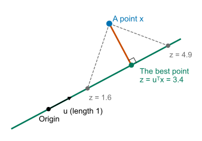{fig-alt="A green line through the origin. At the origin a short black arrow is labelled u, length 1. A blue point lies off the line. On the line there are two grey candidate points, z equals 1.6 and z equals 4.9, each joined to the blue point by a grey dashed line. There is also a green point joined to the blue point by a solid red line, which meets the green line at a right angle, labelled best point z equals u transpose x equals 3.4" width="65%"}

**④ Reconstruction:** $\hat{\mathbf x} = \bar{\mathbf x} + z\mathbf u$ (add the mean back). Example: a person has height 180 and arm span 183, and after centring $\mathbf x = (10.0,\ 12.9)^\top$. Take $\mathbf u = (0.689,\ 0.725)^\top$. Then $z = 0.689\times10.0 + 0.725\times12.9 = 16.2$, and the reconstruction is height 181.2 and arm span 181.9.

**⑤ Several directions: a sum of components.** When one number is not enough, we use $K$ directions $\mathbf u_1,\dots,\mathbf u_K$. Each has length 1, and any two are perpendicular ($\mathbf u_j^\top\mathbf u_k = 0$). Each point stores $K$ numbers, and each is computed on its own: $z_k = \mathbf u_k^\top\mathbf x$. The reconstruction adds the $K$ components together:
$$
\mathbf x \approx z_1\mathbf u_1 + z_2\mathbf u_2 + \dots + z_K\mathbf u_K .
$$
As in ③, the part we lose is perpendicular to every direction. We require the directions to be perpendicular because each direction should tell us something that the other directions have not told us. Also, the reconstruction depends only on the plane spanned by these directions. If we replace them by another set of perpendicular directions in the same plane, we can rebuild exactly as much, so we lose nothing by this choice.

## 4. Loss: Reconstruction Error

Once the direction $\mathbf u$ is fixed, $z$ is fixed too, so how well we rebuild depends only on $\mathbf u$. We take the squared distance between each point and its reconstruction, and add these up:
$$
L(\mathbf u) = \sum_{i=1}^n\lVert\mathbf x_i - z_i\mathbf u\rVert^2,\qquad z_i = \mathbf u^\top\mathbf x_i,\qquad \text{subject to } \mathbf u^\top\mathbf u = 1 .
$$
In the widget, each angle is one $\mathbf u$, and the red bar is $L/(n-1)$. We want to find the $\mathbf u$ that makes $L$ as small as possible.

## 5. Solution: Smallest Error Means Widest Spread

::: {.callout-important title="The result of this section"}
The best direction is the eigenvector of the covariance matrix $S$ with the largest eigenvalue. If we project onto it, the spread that remains is equal to this eigenvalue. To keep $K$ directions, we take the $K$ eigenvectors with the largest eigenvalues, and the reconstruction error is the sum of the eigenvalues we drop. The applications later in this lesson use only these few sentences.
:::

### 5.1 Step One: Error = Total Spread − Variance of the Projection

Start with one point. By property ③, we expand the square (using $\mathbf u^\top\mathbf x = z$ and $\mathbf u^\top\mathbf u = 1$):
$$
\lVert\mathbf x - z\mathbf u\rVert^2 = \mathbf x^\top\mathbf x - 2z\,\mathbf u^\top\mathbf x + z^2\,\mathbf u^\top\mathbf u = \lVert\mathbf x\rVert^2 - z^2 .
$$
The distance of the point from the origin is fixed. So the longer the part that lands on the line, the shorter the part we lose.

Now add this up over all points. Both terms can be written with the same matrix, the **covariance matrix**
$$
S = \frac{1}{n-1}\sum_{i=1}^n\mathbf x_i\mathbf x_i^\top .
$$
It is a $d\times d$ matrix. Its diagonal holds the variance of each quantity, and the entries off the diagonal hold the covariance of each pair. We use the trace $\operatorname{tr}$ (the sum of the diagonal of a matrix, see the appendix):
$$
\begin{aligned}
\sum_i z_i^2 &= \sum_i(\mathbf u^\top\mathbf x_i)(\mathbf x_i^\top\mathbf u) = \mathbf u^\top\Big(\sum_i\mathbf x_i\mathbf x_i^\top\Big)\mathbf u = (n-1)\,\mathbf u^\top S\,\mathbf u ,\\
\sum_i\lVert\mathbf x_i\rVert^2 &= \sum_i\operatorname{tr}\big(\mathbf x_i\mathbf x_i^\top\big) = \operatorname{tr}\Big(\sum_i\mathbf x_i\mathbf x_i^\top\Big) = (n-1)\operatorname{tr}S .
\end{aligned}
$$
Therefore
$$
L(\mathbf u) = (n-1)\big(\operatorname{tr}S - \mathbf u^\top S\,\mathbf u\big).
$$
These are the two bars in the widget. The term $\mathbf u^\top S\mathbf u$ is the variance of the projection $z$ (the blue bar). The term $\operatorname{tr}S$ is the sum of the variances of all the quantities. We call it the **total spread**, and it does not depend on the direction. Because the total spread is fixed, **the smallest reconstruction error is the same as the largest variance of the projection**.

For height and arm span, $S = \begin{pmatrix} 46.52 & 45.82 \\ 45.82 & 51.15 \end{pmatrix}$ and $\operatorname{tr}S = 46.52 + 51.15 = 97.68$. This is exactly the sum of the two bars in the widget.

### 5.2 Step Two: Maximise Under a Constraint, and Get an Eigenvector

The problem is now this: make $\mathbf u^\top S\mathbf u$ as large as possible, subject to $\mathbf u^\top\mathbf u = 1$. We cannot drop the constraint. Without it, multiplying $\mathbf u$ by 2 multiplies $\mathbf u^\top S\mathbf u$ by 4, so the value could grow without limit.

To maximise with an equality constraint, we use **Lagrange multipliers**. We multiply the constraint by a number $\lambda$, subtract it from the objective, then take the derivative with respect to $\mathbf u$ and set it to 0:
$$
\mathcal L(\mathbf u,\lambda) = \mathbf u^\top S\mathbf u - \lambda(\mathbf u^\top\mathbf u - 1),
\qquad
\frac{\partial\mathcal L}{\partial\mathbf u} = 2S\mathbf u - 2\lambda\mathbf u = \mathbf 0
\quad\Longrightarrow\quad
S\mathbf u = \lambda\mathbf u .
$$
In Advanced Study 1 you derive why this method gives the right answer yourself. It is also fine to remember only the result.

Multiply both sides on the left by $\mathbf u^\top$ to get $\mathbf u^\top S\mathbf u = \lambda$. So if we project along this direction, the variance is $\lambda$. There are $d$ directions that satisfy $S\mathbf u = \lambda\mathbf u$. To get the widest spread, we pick the one with the largest $\lambda$. Such a $\mathbf u$ is called an **eigenvector** of $S$, and $\lambda$ is called an **eigenvalue**. When $S$ multiplies the eigenvector, the direction stays the same and the length is scaled by $\lambda$.

For height and arm span, the two eigenvalues of $S$ are 94.71 and 2.96. The eigenvector with the largest eigenvalue is $(0.689,\ 0.725)^\top$, at an angle of 46.4°. This matches what we saw when we turned the line. The average reconstruction error per person is $97.68-94.71 = 2.97$.

### 5.3 More Than One Direction

After we rebuild the points from the first direction, everything left over is perpendicular to it (property ③). So we look for the second direction among the perpendicular directions. The answer is the second eigenvector: among all directions perpendicular to the first, it has the widest spread. We continue in the same way, so **the first $K$ eigenvectors are the best $K$ directions** (Advanced Study 1 proves that picking them one at a time gives the same result as picking a whole set at once).

By property ⑤, the reconstruction error with $K$ directions is the total spread minus the sum of the spreads along those directions:
$$
L = (n-1)\Big(\operatorname{tr}S - \sum_{k=1}^K\lambda_k\Big) = (n-1)\big(\lambda_{K+1} + \dots + \lambda_d\big).
$$
The last step uses $\operatorname{tr}S = \lambda_1 + \dots + \lambda_d$. When $K = d$, nothing is lost and the error is 0. So **the reconstruction error is the sum of the eigenvalues we drop**, and the share we keep is $(\lambda_1 + \dots + \lambda_K)/(\lambda_1 + \dots + \lambda_d)$. The scores on different eigenvectors are also uncorrelated with each other: the second number tells us only things that the first number did not.

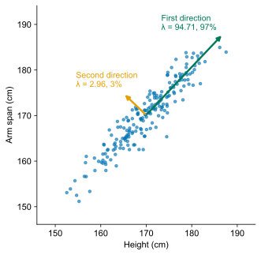{fig-alt="Scatter plot of height against arm span, with two arrows drawn from the centre. The green arrow points to the upper right along the long band of points and is labelled first direction, λ equals 94.71, 97%. The short orange arrow points to the upper left, perpendicular to the green arrow, and is labelled second direction, λ equals 2.96, 3%" width="50%"}

With three quantities, "the points are packed near a plane" looks like this: the first two directions keep 77% and 22%, and the third direction, perpendicular to the plane, has only 1%.

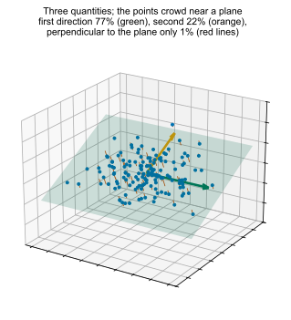{fig-alt="Three-dimensional scatter plot. Blue points lie near a tilted light green plane, and each point has a short red line joining it to the plane. A green arrow and an orange arrow are drawn on the plane. The title says the first direction has 77%, the second 22%, and the direction perpendicular to the plane only 1%" width="62%"}

These directions are called **principal components**, and the first eigenvector is the **first principal component**. The position $z_k$ of a point on a principal component is called its **score**. The whole method is called **principal component analysis** (**PCA**). The share kept by the $k$-th principal component is called its **explained variance ratio**, and the sum over the first $K$ is called the **cumulative share**.

Here is the whole method: subtract the mean; compute the covariance matrix $S$; take the $K$ eigenvectors with the largest eigenvalues; project the points onto them to get the scores.

## 6. Testing: How Good Is the Reduction, and When Does It Fail

To judge how good the reduction is, we look at the share kept and the reconstruction error. For height and arm span, keeping one principal component keeps 97%. On average each person loses about 2.97 cm², which is about 1.7 cm after taking the square root. This is roughly the part that says "how long the arms are compared with the height".

PCA assumes that the points are packed near a line (or a plane of low dimension). Here is a data set that does not satisfy this assumption:

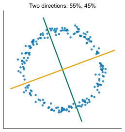{fig-alt="A ring of blue points, with a green line and an orange line crossing at right angles in the middle. The title says the two directions keep 55% and 45%" width="45%"}

Think first: if we keep only the first principal component, how much do we keep?

::: {.callout-note collapse="true" title="Show answer"}
55%. The ring spreads about equally in every direction, so the two eigenvalues are close, and keeping one direction loses almost half. The points lie on a curved shape, but PCA can only find straight directions, so it does not help here. When the two eigenvalues are close, the first principal component is also unstable: a small change in the data can turn its direction a lot, so do not try to read a meaning from it.
:::

There is one more case: the quantities have different units. The cars in the next section run into this problem.

## 7. Application 1: Cars, Five Quantities Telling One Story

We return to the 392 cars from Section 1, with five quantities, so $d = 5$. There is one more column, fuel economy (miles per gallon). We put it aside for now, and PCA does not use it.

Suppose we run PCA on the data as it is. Guess first: what will the first principal component look like?

::: {.callout-note collapse="true" title="Show answer"}
It is almost entirely the car weight: the weight on car weight is 0.993, the others are all close to 0, and one principal component keeps 99.8%. Weight is measured in pounds, and its standard deviation is 849. The standard deviation of cylinders is only 1.7, and that of acceleration time is 2.8. Because the numbers for weight are large, its spread is large, and it outweighs all the other quantities. This 99.8% only reflects the fact that the numbers for weight are large.
:::

The units should not decide the answer. **Standardise first** (from each column, subtract its mean and divide by its standard deviation), and then run PCA:

{fig-alt="Three plots. The left bar chart shows weight at 0.99 and the others close to 0, with the title 99.8%. The centre bar chart shows cylinders 0.47, displacement 0.48, horsepower 0.47, weight 0.46 and acceleration time minus 0.33, with the title 81%. The right scatter plot has the first principal component score on the horizontal axis and fuel economy on the vertical axis; the points fall from left to right, with correlation minus 0.82."}

- **The first principal component keeps 81%.** The first four quantities have almost equal weights (0.46 to 0.48), and acceleration time has −0.33 (a big car needs less time to accelerate). It says "how big and how powerful this car is".
- **The second principal component keeps 14%**. It is mainly acceleration time (0.89), followed by weight (0.35). It says whether a car accelerates slowly compared with other cars of the same size. It is perpendicular to the first principal component, so it describes something the first one does not.
- **Together the two keep 95%.** We replace five numbers with two and lose almost nothing.

Now we bring back fuel economy, which we put aside. The correlation between the "how big is the car" score and fuel economy is −0.82. This is about the same as weight on its own (−0.83), and stronger than horsepower on its own (−0.78). PCA never saw fuel economy. It found the one thing that the five quantities say together, and that thing happens to be the one most closely related to fuel economy.

If the quantities have different units, standardise them before PCA. If they have the same unit and comparable sizes (height and arm span, or the pixels in the next section), you can skip standardising.

## 8. Application 2: Handwritten Digits

### 8.1 An Image Becomes a Row of Numbers

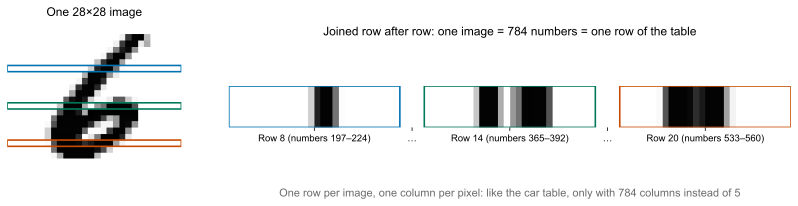{fig-alt="On the left, the pixel image of a handwritten digit 6, with three rows marked by coloured boxes. On the right, these three rows are stretched into long strips: row 8 is numbers 197 to 224, row 14 is numbers 365 to 392, and row 20 is numbers 533 to 560."}

Lay out the 28×28 image one row after another, and an image becomes 784 numbers. With one row per image and one column per pixel, we get a table. It is the same kind of table as the one for the cars, except that it has 784 columns instead of 5. All pixels lie between 0 and 1, so we do not standardise. To centre the data, we subtract the mean image. We put the digit labels aside for now.

Here we use the course's subset of handwritten digits: 10,000 images. We hold out 2,500 as the test set and split the rest 3:1 into 5,625 training images and 1,875 validation images. The principal components are learned from the training images only.

### 8.2 What the Principal Components Look Like

$S$ is now 784×784, and each eigenvector has 784 numbers. These can be arranged back into 28×28, so **each principal component is itself an image**.

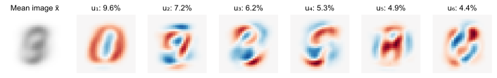{fig-alt="The first panel is a grey, blurred mean digit image. It is followed by six 28 by 28 weight images in red and blue, with ratios 9.6%, 7.2%, 6.2%, 5.3%, 4.9% and 4.4%."}

If an image has a large score on the first principal component, it has a lot of ink where the component is red and little ink where it is blue. The first principal component looks like a red ring. Images with large scores look like 0. Images with small scores have their ink standing upright in the middle, like 1. The first principal component keeps only 9.6%, far below the 97% for height and arm span. The changes across 784 pixels are spread over many directions, so we need to keep more components.

### 8.3 Rebuilding an Image from K Numbers

$$
\hat{\mathbf x} = \bar{\mathbf x} + z_1\mathbf u_1 + z_2\mathbf u_2 + \dots + z_K\mathbf u_K,
\qquad z_k = \mathbf u_k^\top(\mathbf x - \bar{\mathbf x}).
$$
This is the mean image, plus each principal component multiplied by the image's score on it. To store an image, we only need to store its $K$ scores, because the mean image and the principal components are shared by all images.

Drag $K$ and see from how many numbers a validation image (the digit 6) becomes recognisable; the widget also lets you switch to three other validation images:



Guess first: how many numbers do you need before you can tell it is a 6?

::: {.callout-note collapse="true" title="Show answer"}
With 1 or 2 numbers, the reconstruction is still a blur that looks like the mean image. The reconstruction error is 57.7 (the sum of squared differences over the 784 pixels; with the mean image alone it is 58.5). With 10 numbers the error is 25.2, and you can see the rough shape of a 6. With 50 it is 10.9, and the image looks about the same as the original. With 100 it is 6.2. "Recognisable" means that you can say which digit it is. Averaged over the 1,875 validation images, the reconstruction error at $K = 10$, 50 and 100 is 27.0, 9.3 and 4.6.
:::

We can use the training images to check the result of Section 5.3. The total spread is 52.77. The sum of the first 50 eigenvalues is 43.64 (82.7%), so 9.13 is dropped. If we rebuild the training images from 50 principal components, the sum of squared errors divided by $n-1$ is also 9.13.

### 8.4 Another Way to Compress: PCA on One Image Alone

This section is a comparison, and the plots and classification later do not need it. In Section 8.3 the samples are images: each of the 5,625 training images is one row of 784 numbers. The principal components are learned from all the training images and shared by all images.

We can also look at one image alone. Treat its 28 rows as 28 samples, each with 28 numbers, and do the same steps. Subtract the mean row of this image, compute the 28×28 covariance matrix, take the first $K$ eigenvectors, and rebuild each row from $K$ scores. Below are the same four images:



Drag it first: how many numbers per row do you need before you can recognise this 6?

::: {.callout-note collapse="true" title="Show answer"}
At $K = 0$ every row is replaced by the mean row, and you cannot tell what it is; the reconstruction error is 71.3. At $K = 1$ it is 36.5. At $K = 3$ it is 13.2, and you can already recognise a 6. At $K = 5$ it is 3.8, and the image is almost the same as the original. The 28 rows of this image are very similar: the first direction alone keeps 49%, and the first three keep 82%.
:::

The differences between the two methods:

| | 8.3: many images together | 8.4: one image alone |
|---|---|---|
| One sample is | one image (784 numbers) | one row of the image (28 numbers) |
| The principal components are learned from | the 5,625 training images; all images share one set | this one image only; each image has its own set |
| Numbers stored per image | $K$ scores (the components are stored once and shared) | $28 + 56K$: the mean row, $K$ principal components, and the scores of the 28 rows |
| The repetition it uses | different images are similar: they are all handwritten digits | within one image, the rows are similar |
| When a new image arrives | compute its scores with the components already learned | run PCA again on the new image |
| What the scores can be used for | all images have scores in the same set of directions, so we can compare, plot and classify them (Sections 8.6 and 8.8) | each image has different directions, so the scores cannot be compared; they can only compress that image |

Take the same 6. With many images together, we store 50 numbers and the reconstruction error is 10.9. With the image alone, $K = 3$ needs 196 numbers for an error of 13.2, and $K = 5$ needs 308 numbers for an error of 3.8. PCA on one image alone does not need any other image. However, every image has to store its own principal components as well, so it stores more numbers. With many images together, the principal components are stored only once. Shared across all images, they take up almost no space per image, and the scores we get can be compared.

### 8.5 How Many to Keep

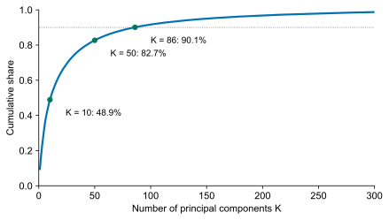{fig-alt="A curve that rises quickly and then flattens, with marks at K equals 10 for 48.9%, 50 for 82.7% and 86 for 90.1%."}

10 principal components keep 48.9%, 50 keep 82.7% and 100 keep 91.7%; keeping 90% needs 86. To choose $K$:

1. Use the cumulative share to set a range, for example 80% to 95%. Here that is from a few dozen to a little over a hundred;
2. Take a few values of $K$ in this range and connect each to the task that comes next (to store images, look at the rebuilt images; to classify, look at the validation accuracy);
3. Choose the one that is best on the validation set and is not at either end of the range. Use the test set only once (Section 8.8).

### 8.6 Plotting It

If we keep only two principal components, each image is a point in the plane:

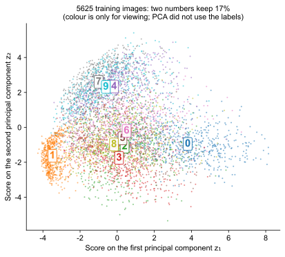{fig-alt="A scatter plot of many small coloured points. The orange points for digit 1 are crowded at the far left, the blue points for 0 are on the right, 7, 9 and 4 are crowded at the top, and 2, 3, 5, 6 and 8 are crowded in the middle."}

Two numbers keep only 16.7%, but the structure is already visible. PCA did not use the labels; the colours by true digit were added after the plot was made. The 1s are crowded at the far left and the 0s are on the right. The 7s, 9s and 4s are at the top, and the 2s, 3s, 5s, 6s and 8s are crowded in the middle. Without looking at the labels, the 1s and 0s are already apart, and you can see at a glance which digits are easily confused.

### 8.7 The Rule: Learn the Principal Components from Training Images Only

The mean image and the covariance matrix are both computed from images, so we may use only the training images to learn them. The validation and test images are only transformed with the directions already learned. This is the same rule as for standardising.

```python
pca = PCA(n_components=50)
pca.fit(X_train)              # learn the mean image and the components from training images only
Z_train = pca.transform(X_train)
Z_val = pca.transform(X_val)  # the same directions, no learning
```

### 8.8 Classifying after Dimensionality Reduction (Needed for Assignment 2)

Section 3 of Assignment 2 asks you to run PCA first and then apply a classifier to the $K$ scores. Here we try it once with logistic regression and QDA, and choose $K$ on the validation set:

| $K$ | 2 | 10 | 20 | 40 | 50 | 100 | 784 (no reduction) |
|---|---:|---:|---:|---:|---:|---:|---:|
| logistic regression | 0.427 | 0.810 | 0.880 | 0.897 | 0.895 | 0.897 | 0.891 |
| QDA | 0.445 | 0.885 | 0.942 | **0.957** | 0.956 | error | error |

- Logistic regression stops improving after $K = 40$.
- QDA cannot run on the 784 pixels. It has to estimate a 784×784 covariance matrix for each class and invert it. However, 128 pixels are 0 in every training image, so the matrix is not invertible, and scikit-learn 1.9 raises an error.
- With 40 principal components, QDA's estimates are stable, and its validation accuracy is 0.957, which is 0.06 higher than logistic regression. **Throwing away information makes it better**: what we throw away are directions that hardly change and only add noise.
- At $K = 100$ it raises an error again. QDA has to estimate a 100×100 covariance matrix for each class (more than 5,000 numbers), but each class has only about 560 training images, so the estimate is not stable. Assignment 2 has 50,000 training images, so it does not have this problem.

We choose $K = 40$ and read the test set only once: 0.962.

## 9. Implementation: Doing It with scikit-learn

Cars (`cars` is a pandas table holding the 392 cars; the units differ, so we standardise first):

```python
from sklearn.preprocessing import StandardScaler
from sklearn.decomposition import PCA

Xs = StandardScaler().fit_transform(cars[["cylinders", "displacement", "horsepower", "weight", "acceleration"]])
pca = PCA().fit(Xs)                       # all five components
print(pca.explained_variance_ratio_)      # share kept by each component
print(pca.components_[0])                 # the five weights of the first component
```

The printed ratios are 0.814, 0.139, 0.027, 0.013 and 0.007. Each row of `components_` is one principal component. An eigenvector with its sign flipped is still an eigenvector, so a whole row of weights may change sign. This does not change how we read its meaning.

Handwritten digits (each row of `X_train` has 784 numbers):

```python
pca = PCA(n_components=50, random_state=0).fit(X_train)   # learn from training images only
Z_val = pca.transform(X_val)              # 50 scores per validation image
X_back = pca.inverse_transform(Z_val)     # rebuild: mean image + scores times components
print(pca.explained_variance_ratio_.sum())
```

`transform` computes the scores $z_k$, and `inverse_transform` computes the reconstruction $\hat{\mathbf x}$. The last line prints 0.827. With 784 dimensions scikit-learn uses a fast method with some randomness, so add `random_state=0` to get the same result every time.

## 10. One-Page Review

If you read only one page, read this one.

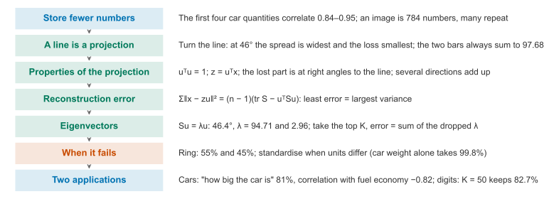{fig-alt="A vertical flow chart of seven steps: store fewer numbers; a line is a projection; properties of the projection; reconstruction error; eigenvectors; when it fails; two applications. Each step has one line of key points and numbers on its right"}

| Step | What this lesson did | Evidence |
|---|---|---|
| Problem | Many of the numbers repeat each other: can we store fewer numbers per sample and still rebuild it? | The first four car measurements have correlations 0.84–0.95 |
| Inspiration | Drawing a line is a projection; the direction with the most spread loses the least | At 46° we keep 97%; the two bars always add up to 97.68 |
| Model | After centring, $\mathbf x\approx z\mathbf u$, $\mathbf u^\top\mathbf u = 1$; the projection is $z = \mathbf u^\top\mathbf x$, and the part we lose is perpendicular to the line; several directions add their components together | |
| Loss | Reconstruction error $\sum_i\lVert\mathbf x_i-z_i\mathbf u\rVert^2$ | |
| Solving | Error $= (n-1)(\operatorname{tr}S-\mathbf u^\top S\mathbf u)$; maximising under the constraint gives $S\mathbf u = \lambda\mathbf u$; take the first $K$ eigenvectors, and the error is the sum of the eigenvalues we drop | 46.4°, $\lambda$ = 94.71, 2.96 |
| Test | Look at the shares and at the reconstruction error; it fails when the points do not lie near a line (the ring) | Ring: 55%, 45% |
| Application | If the units differ, standardise first; an image becomes one row of numbers, rebuilt from $K$ scores; learn only from the training images | Cars: 81%, correlation −0.82 with fuel economy; digits: $K$ = 50 keeps 82.7% |

## 11. Extension: Other Representations (Optional)

PCA gives each sample a new set of numbers. This new set is called a **representation**. Each new number is a weighted sum of the original measurements, and every direction is a straight line. Once you see this, you can use other methods to find a representation, and many of them take one line in scikit-learn. The methods below are all nonlinear. The points do not have to lie near a flat plane. The goal is that points which were close together in the original data stay close together in the new map. These methods are mostly used to draw high-dimensional data as a two-dimensional map, so that we can see what structure the data has.

First, an example where PCA does badly: points in three dimensions that are rolled up into a roll. PCA can only squash it flat, and the roll stays rolled up. Isomap measures distance step by step along the roll, and so it unrolls the roll into a flat sheet.

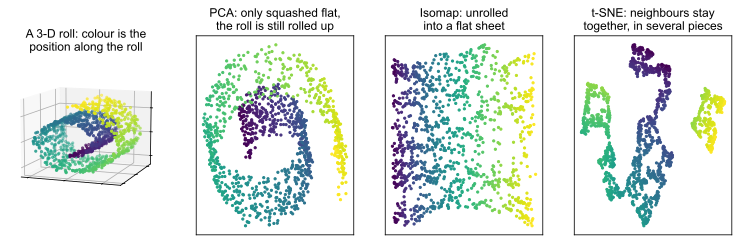{fig-alt="Four plots. The first is a three-dimensional rolled-up point cloud, with colour changing from purple to yellow along the roll. The second, the PCA map in two dimensions, is still a roll, and the inner and outer turns with different colours sit next to each other. The third, the Isomap map in two dimensions, is a rectangle, with colour changing smoothly from left to right. The fourth, the t-SNE map in two dimensions, breaks into several pieces, and inside each piece the colour changes smoothly"}

Next, the handwritten digits. We take the same 2,000 training images and draw one two-dimensional map with each of six methods. The colour is the true digit, but none of the methods used the labels:

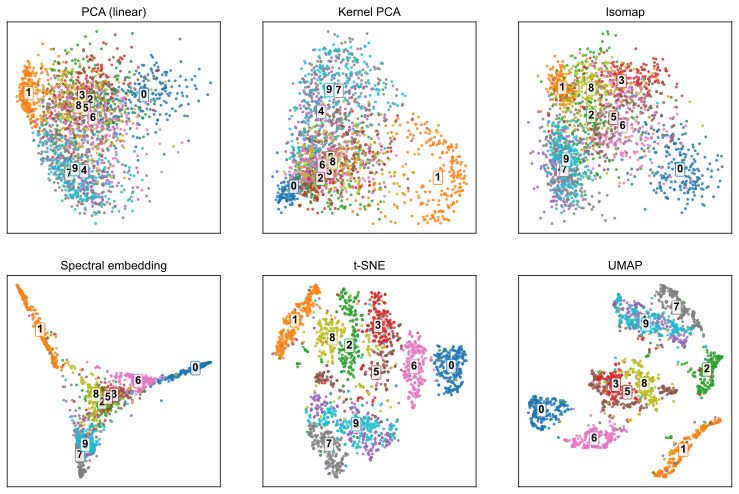{fig-alt="Six scatter plots. Each point is coloured by its true digit, and the digit is written at the centre of each class. In PCA and Kernel PCA most digits are mixed together, and only 0 and 1 are separated. Isomap and Spectral embedding separate more of them. In t-SNE and UMAP most digits form their own cluster; 4, 7 and 9 sit next to each other, and 3, 5 and 8 sit next to each other"}

In the PCA map, most digits are mixed together. In the t-SNE and UMAP maps, most digits form their own cluster, and the digits that are easy to confuse (4, 7, 9 and 3, 5, 8) sit next to each other.

| Method | Call | In one sentence |
|---|---|---|
| Kernel PCA | `KernelPCA(n_components=2, kernel="rbf")` | First move the points into a larger space, then do PCA |
| Isomap | `Isomap(n_components=2, n_neighbors=10)` | Measure distance by walking from neighbour to neighbour, then unroll |
| Spectral embedding | `SpectralEmbedding(n_components=2)` | Join neighbours into a network, then place the points by the shape of the network |
| t-SNE | `TSNE(n_components=2, perplexity=30)` | Keep neighbours as neighbours on the map; the most common method for drawing maps |
| UMAP | `umap.UMAP(n_components=2)` (first `pip install umap-learn`) | A similar idea to t-SNE, and faster on large data |

The first four are all in `sklearn.decomposition` or `sklearn.manifold`. On the 784 pixels, we often first use PCA to reduce to 50 numbers, and then pass these to them:

```python
from sklearn.decomposition import PCA
from sklearn.manifold import TSNE

Z50 = PCA(n_components=50).fit_transform(X)                 # first 50 PCA scores
Z2 = TSNE(n_components=2, random_state=0).fit_transform(Z50)  # then a 2-D map for plotting
```

These methods are mainly for looking at pictures of the data. Unlike PCA, most of them cannot rebuild the images as in Section 8.3. t-SNE also cannot place a new image into a map that is already drawn. On the map, the distances between clusters and the sizes of clusters do not always mean anything, and if you change the random seed, the map changes too. For 2,000 images on a laptop, t-SNE takes about 6 seconds and UMAP about 9 seconds.

## 12. Summary and Limits

Back to the start: most of the 784 numbers repeat each other. If we keep 50, we keep 82.7%, and the rebuilt images can still be recognised. The method projects the points onto the directions with the most spread, because those directions lose the least. These directions are the eigenvectors of the covariance matrix.

After this lesson, you can say what PCA assumes about the shape of the data (it lies near a low-dimensional flat plane). You can say what it minimises (the reconstruction error, which is the same as making the variance of the projection as large as possible), and why the answer is an eigenvector. When the units differ, you standardise first, and you can read out what a principal component means. You choose $K$ from the cumulative share and from the task that comes next. You learn the principal components only from the training part.

Transfer question: a supermarket records how much each of 1,000 customers spent in one year on each of 20 product categories (all in pounds). Should you standardise first? If the 20 weights of the first principal component are all positive and of about the same size, what does it say?

::: {.callout-note collapse="true" title="Suggested answer"}
The units are the same, so you do not have to standardise. However, the categories where people spend more and the spread is larger (fresh food, for example) will dominate the first principal component. If you want every category to count equally, standardise first. A first principal component whose weights are all positive and of about the same size says "how much this customer spends in total". It is the same kind of thing as "how big the person is" for height and arm span, and "how big the car is" for the cars.
:::

Where this method cannot be trusted:

1. It only looks for straight-line directions. If the points lie on a curved shape (the ring in Section 6), PCA cannot help.
2. The scale decides the result. If measurements with different units are not standardised, the one with the largest spread takes over the first principal component (weight for the cars in Section 7).
3. It does not look at the labels. A direction with a large spread is not always useful for classification.
4. Principal components are not always easy to interpret. For the cars, we can read a meaning into the first two. For the 784 pixels, it is hard to say what the 5th or 6th one is looking at.

30-second feedback: after reading this lesson, please scan the code and leave anonymous feedback or a question. Tell us what you did not understand and where we went too fast. All of it helps us improve.

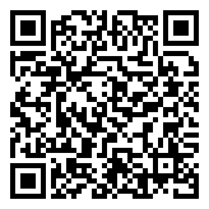{fig-align="center" width="160px" fig-alt="Feedback QR code"}

*The Advanced Study sections below do not affect the main line, and each Study can be read on its own. MPS311 students are encouraged to read them. For MPS439, the required work is in the Advanced part of Lab 7, and the other Studies are optional.*

---

## Advanced Study 1: Derive It Yourself

Section 5 gave the result and the two main steps. Here you derive it yourself. Each step comes with a hint, and the answer is folded away after it. Try the step before you open the answer.

**Step 1: why $z$ is $\mathbf u^\top\mathbf x$.** Fix a direction $\mathbf u$ with $\mathbf u^\top\mathbf u = 1$. Each point keeps a single number $z$. Find the $z$ that makes $\lVert\mathbf x-z\mathbf u\rVert^2$ smallest.

Hint: expand the square into a quadratic in $z$ and differentiate with respect to $z$.

::: {.callout-note collapse="true" title="Answer"}
$\lVert\mathbf x-z\mathbf u\rVert^2 = \mathbf x^\top\mathbf x-2z\,\mathbf u^\top\mathbf x + z^2$. Differentiating with respect to $z$ gives $-2\mathbf u^\top\mathbf x + 2z = 0$, so $z = \mathbf u^\top\mathbf x$. This is property ③ in Section 3: the best $z$ makes the part we lose perpendicular to the line.
:::

**Step 2: write the total error in terms of $S$.** Using the $z_i$ from Step 1, show that $L(\mathbf u) = (n-1)(\operatorname{tr}S-\mathbf u^\top S\mathbf u)$.

Hint: first show that the error of one point is $\lVert\mathbf x\rVert^2-z^2$. Then use $z^2 = \mathbf u^\top\mathbf x\mathbf x^\top\mathbf u$ and $\lVert\mathbf x\rVert^2 = \operatorname{tr}(\mathbf x\mathbf x^\top)$ (see the appendix).

::: {.callout-note collapse="true" title="Answer"}
See Section 5.1 of the main text.
:::

**Step 3: why the Lagrange multiplier is written this way.** We want the largest $\mathbf u^\top S\mathbf u$ under $\mathbf u^\top\mathbf u = 1$. Explain why, at the best $\mathbf u$, the vector $S\mathbf u$ must point in the same direction as $\mathbf u$.

Hint: every $\mathbf u$ that meets the constraint lies on the unit circle. At the best point, moving a little along the circle in either direction cannot make the objective any larger. The gradient of the objective is $2S\mathbf u$, and moving along the circle means moving perpendicular to $\mathbf u$.

::: {.callout-note collapse="true" title="Answer"}
Take a small step $\boldsymbol\delta$ along the circle ($\boldsymbol\delta$ perpendicular to $\mathbf u$). The objective changes by about $2(S\mathbf u)^\top\boldsymbol\delta$. At the best point this is 0 for every $\boldsymbol\delta$ perpendicular to $\mathbf u$, so $S\mathbf u$ has no component perpendicular to $\mathbf u$. Only the part in the direction of $\mathbf u$ is left: $S\mathbf u = \lambda\mathbf u$. This is exactly $\partial\mathcal L/\partial\mathbf u = \mathbf 0$.

In two dimensions we can also set $\mathbf u = (\cos\theta, \sin\theta)^\top$ and differentiate with respect to θ directly. This gives $\tan 2\theta = 2S_{12}/(S_{11}-S_{22}) = -19.8$, so θ = 46.4° or 136.4°:

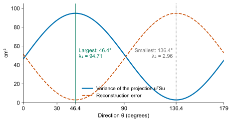{fig-alt="Two sine-shaped curves. The solid blue curve is the variance of the projection, with its maximum 94.71 at 46.4 degrees and its minimum 2.96 at 136.4 degrees; the dashed red curve is the reconstruction error, with the opposite shape"}
:::

**Step 4: the largest eigenvalue gives the global maximum.** There are $d$ directions with $S\mathbf u = \lambda\mathbf u$. Prove that the one with the largest $\lambda$ is the best of all unit vectors.

Hint: a symmetric matrix $S$ has $d$ eigenvectors $\mathbf v_1,\dots,\mathbf v_d$ that are mutually perpendicular and of length 1, with eigenvalues $\lambda_1\ge\dots\ge\lambda_d$ (see the appendix). Write any unit vector as $\mathbf u = \sum_j c_j\mathbf v_j$.

::: {.callout-note collapse="true" title="Answer"}
$\sum_j c_j^2 = 1$, so $\mathbf u^\top S\mathbf u = \sum_j\lambda_jc_j^2 \le \lambda_1$, with equality when $\mathbf u = \mathbf v_1$. A direction perpendicular to $\mathbf v_1$ has $c_1 = 0$, so its maximum is $\lambda_2$, and the second direction is $\mathbf v_2$.
:::

**Step 5: picking one at a time is the same as picking a whole set.** Prove that for any $K$ unit vectors that are perpendicular to each other, $\sum_{k=1}^K\mathbf u_k^\top S\mathbf u_k \le \lambda_1 + \dots + \lambda_K$.

Hint: write the sum as $\sum_j\lambda_jw_j$ with $w_j = \sum_k(\mathbf v_j^\top\mathbf u_k)^2$. What two limits does $w_j$ satisfy?

::: {.callout-note collapse="true" title="Answer"}
$w_j$ is the squared length of the part of $\mathbf v_j$ that falls in the plane spanned by these $K$ directions, so $0\le w_j\le 1$. Swapping the order of the sums gives $\sum_jw_j = \sum_k\lVert\mathbf u_k\rVert^2 = K$. So there are $K$ units of weight in total, and each eigenvalue can take at most one unit. The weighted sum is largest when all the weight goes to the $K$ largest eigenvalues, with equality when $\mathbf u_k = \mathbf v_k$.

At each step, a decision tree also picks the best cut it can find, but this does not guarantee the best whole tree. PCA is different because of these two limits on $w_j$: the directions picked earlier never make the later choices worse.
:::

Two more things to think about: why are the scores on different eigenvectors uncorrelated (the covariance of $z_j$ and $z_k$ is $\mathbf v_j^\top S\mathbf v_k$)? If $\lambda_1 = \lambda_2$, is the first principal component still unique?

## Advanced Study 2: Removing Noise from Images with PCA

Scanned images and blurry photos carry noise. PCA can remove much of it, without knowing what the clean image looks like.

The method is the same as in Section 8.3. We learn the components from the clean training images only. For a noisy image, we compute its scores on the first $K$ components and rebuild it. Below, we add random noise with standard deviation 0.3 to every pixel of the 1,875 validation images. We then rebuild them with different values of $K$ and compare the results with the clean images:

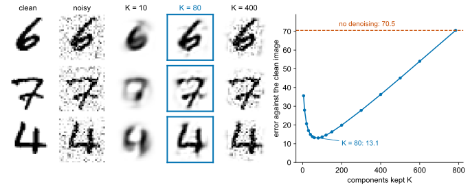{fig-alt="On the left, three rows of handwritten digits 6, 7 and 4, five images per row: the clean image; the noisy image covered in grey dots; K equals 10, blurry; K equals 80, clear strokes on a clean background, outlined in blue; K equals 400, grey dots again. On the right, a curve that falls and then rises, with K from 0 to 784 on the horizontal axis and the error against the clean image on the vertical axis; the lowest point is 13.1 at K equals 80, and at K equals 784 it returns to 70.5, the no-denoising level shown by a dashed red line"}

Without any processing, the noisy images differ from the clean ones by 70.5. Rebuilt from 80 components, they differ by only 13.1, so more than 80% of the noise is gone. If $K$ is too small, the digit itself cannot be rebuilt, as in Section 8.3 (28.0 at $K = 10$). If $K$ is too large, the noise comes back (36.3 at $K = 400$, and 70.5 again at $K = 784$).

Why does this work? The variation of the digits is packed into the first few dozen directions, while the noise is spread evenly over all 784 directions, 0.09 ($0.3^2$) in each. Keeping $K$ directions keeps only $K$ shares of the noise and drops the other $784-K$. The second half of the curve on the right is a straight line with a slope of about 0.09. At the right end, 784 × 0.09 = 70.6, which matches the 70.5 without processing.

```python
pca = PCA(n_components=80).fit(X_train)            # learn the components from clean training images only
rng = np.random.default_rng(0)                     # random numbers for the noise
noisy = X_val + rng.normal(0, 0.3, X_val.shape)    # add noise with standard deviation 0.3 to every pixel
denoised = pca.inverse_transform(pca.transform(noisy))   # scores on the first 80 components, then rebuild
```

Now try these yourself:

1. Raise the noise to a standard deviation of 0.5. Does the best $K$ get larger or smaller? Guess first, then compute. Hint: how much noise does each direction get now?
2. In real denoising there is no clean image to compare with. How would you choose $K$?
3. Flip the validation images upside down and compute the reconstruction error of each image with $K = 50$. Are the errors of the flipped images large? Could this error be used to find images that do not look like handwritten digits? Which digits still look like themselves when flipped?

::: {.callout-note collapse="true" title="Answer to question 1"}
Smaller. Each direction now gets 0.25 of noise, so keeping one more direction costs more. The best $K$ is about 40, with an error of 21.3 (196 without processing). The more noise there is, the fewer components you should keep.
:::

## Advanced Study 3: How a Computer Finds the Components

**Solving for $z$ and $\mathbf u$ in turn.** With $\mathbf u$ fixed, $z_i = \mathbf u^\top\mathbf x_i$. With the $z_i$ fixed, $\sum_i\lVert\mathbf x_i-z_i\mathbf u\rVert^2$ is a least-squares problem in $\mathbf u$. Its solution is $\mathbf u = \sum_i z_i\mathbf x_i/\sum_i z_i^2$, which we then rescale to length 1. On height and arm span, starting from $\mathbf u = (1,\ 0)^\top$, the direction after each round is 44.56°, 46.39°, 46.44°, 46.45°. After three rounds it has reached the first principal component. The 44.56° after the first round is exactly the line from "fitting arm span from height".

**numpy and SVD.** On the 5,625 training images, the first 5 eigenvectors from `np.linalg.eigh(np.cov(X_train.T))` are the same as scikit-learn's `components_` (up to a possible change of sign), with a largest difference of $2\times10^{-15}$. In fact scikit-learn uses the singular value decomposition (SVD). For the centred data matrix $X = U_s\Sigma V^\top$, we have $S = \frac{1}{n-1}X^\top X = V\frac{\Sigma^2}{n-1}V^\top$, so the columns of $V$ are the principal components. In the training images, 128 pixels are 0 in every image, and 135 of the eigenvalues of $S$ are smaller than $10^{-10}$.

Now try these yourself:

1. Show that each round of solving in turn is $\mathbf u\leftarrow S\mathbf u$ followed by rescaling. Use $\mathbf u = \sum_j c_j\mathbf v_j$ to explain why multiplying by $S$ again and again turns $\mathbf u$ towards $\mathbf v_1$. Does a smaller $\lambda_2/\lambda_1$ make it turn faster or slower?
2. Use `np.linalg.svd(..., full_matrices=False)` to write the `fit` and `transform` of PCA, and compare them with scikit-learn.
3. Use $\mathbf u^\top S\mathbf u = \lambda$ to explain why a pixel that is always 0 corresponds to an eigenvalue of 0, and why the QDA in Section 8.8 gives an error on the 784 pixels.

## Appendix: The Mathematics Used in This Lesson

The **trace** of a square matrix $A$ is the sum of the numbers on its diagonal, $\operatorname{tr}A = \sum_k A_{kk}$. It has two properties:

- The trace of a sum is the sum of the traces: $\operatorname{tr}(A + B) = \operatorname{tr}A + \operatorname{tr}B$. So we can swap the order of summing and taking the trace.
- The squared length of a column vector is the trace of its outer product with itself: $\mathbf x^\top\mathbf x = \operatorname{tr}(\mathbf x\mathbf x^\top)$. In two dimensions, with $\mathbf x = (h,\ a)^\top$, we get $\mathbf x\mathbf x^\top = \begin{pmatrix}h^2 & ha\\ ha & a^2\end{pmatrix}$, and the sum of its diagonal, $h^2 + a^2$, is exactly $\mathbf x^\top\mathbf x$.

For centred data, the **covariance matrix** is $S = \frac{1}{n-1}\sum_i\mathbf x_i\mathbf x_i^\top$. In two dimensions,
$$
S = \frac{1}{n-1}\begin{pmatrix}\sum_i h_i^2 & \sum_i h_ia_i \\ \sum_i h_ia_i & \sum_i a_i^2\end{pmatrix}:
$$
the diagonal holds the variances of height and of arm span, and the off-diagonal entries hold their covariance. $S$ is a symmetric matrix. $\operatorname{tr}S$ is the sum of the variances of all the measurements.

If $S\mathbf v = \lambda\mathbf v$ (with $\mathbf v\ne\mathbf 0$), then $\mathbf v$ is called an **eigenvector** of $S$ and $\lambda$ is called an **eigenvalue**. When $S$ multiplies $\mathbf v$, the direction stays the same and the length is only stretched by a factor $\lambda$. A $d\times d$ symmetric matrix has $d$ eigenvectors that are mutually perpendicular and of length 1, and its eigenvalues are all real. The eigenvalues of a covariance matrix are all at least 0, because $\lambda = \mathbf v^\top S\mathbf v$ is a variance. In numpy, compute them with `np.linalg.eigh(S)`.

**Lagrange multipliers** are a standard method for finding a maximum or minimum under an equality constraint. Advanced Study 1 explains why the method is written this way.

