::: {.callout-tip title="怎样读这一讲"}
做 Lab 和作业，读第 1 到 4 节、第 5 节开头的结论，以及第 6 到 10 节；第 11 节是拓展，想多看几种方法时读。第 5 节的两步推导说明答案为什么是那样，建议读。想自己把每一步推出来，做 Advanced Study 1；想看 PCA 的另一个用处（给图去噪），读 Advanced Study 2。第 8.8 节讲降维之后再分类，作业 2 第 3 节要用。
:::

## 1. 问题：少存几个数，还能还原吗

一张手写数字图是 28×28 个像素，也就是 784 个数。一辆车量了五个数：缸数、排量、马力、车重、加速时间。

这些数并不各说各的。一笔写过去，相邻的几个像素一起变黑；图的四角在每张图上几乎都是白的。车也一样，下表是 392 辆车（UCI 的 Auto MPG 数据）五个量两两的相关系数：

| | 缸数 | 排量 | 马力 | 车重 | 加速时间 |
|---|---:|---:|---:|---:|---:|
| 缸数 | 1 | 0.95 | 0.84 | 0.90 | −0.50 |
| 排量 | 0.95 | 1 | 0.90 | 0.93 | −0.54 |
| 马力 | 0.84 | 0.90 | 1 | 0.86 | −0.69 |
| 车重 | 0.90 | 0.93 | 0.86 | 1 | −0.42 |
| 加速时间 | −0.50 | −0.54 | −0.69 | −0.42 | 1 |

前四个两两在 0.84 到 0.95 之间：大车缸多、排量大、马力大、也重。数在重复，就应该能少存一些。

这一讲的问题是：**每个样本只存几个数，还能把它还原出来吗？存哪几个？**这叫**降维**（dimensionality reduction）。它只看数据本身，不用标签，属于**无监督学习**（unsupervised learning）。

学会以后，它能拿来做三件事：

- **压缩：**一张 784 个数的图，存 50 个数就能还原得认得出来（第 8.3 节）。
- **看数据：**几百个量画不出来，降到两个数就能画在平面上（第 8.6 节）。
- **降维后再分类：**先降到几十个数，再用分类器，有时比直接用全部像素更准（第 8.8 节，作业 2 要用）。

784 个数太多，先在只有两个数的时候把道理想清楚。

## 2. 启发：只许留一个数

下面是 200 个人的身高和臂展（手造的数据，单位都是厘米），相关系数 0.94。点沿一条斜线挤着：这两个数主要在一个方向上一起变。

只许用**一个数**描述每个人，怎么留？画一条线，把每个点垂直落到线上（灰色短线），每个人就只剩他在线上的位置。转动这条线，看两根柱子：

- 蓝柱：落到线上的点沿线散得多开，叫**散布**（投影的方差）。散得开，才分得清不同的人。
- 红柱：把每个点换成线上那一点，丢掉的距离平方的平均，叫**还原误差**（reconstruction error）。



请先转一转：蓝柱最高在什么方向？红柱最低在什么方向？

::: {.callout-note collapse="true" title="展开答案"}
两者在同一个方向，约 46°：散布 94.71，留住 97%，还原误差 2.97。0° 时只留下身高，只留住 48%，身高一样、臂展不同的人分不出来了。无论转到哪里，两根柱子加起来都是 97.68：一根变高，另一根就变低。
:::

从这里看出两件事：

1. **画一条线，就是把点投影到线上**，每个点只留它在线上的位置。
2. **投影散得最开的方向，丢掉的也最少。**剩下和它垂直的方向是“臂展减身高”，只占 3%。

背后的假设是：点挤在一条线附近。下面把这两件事写成式子，不用转线就直接算出最好的方向。784 个数时方向多得转不完，非算不可。

::: {.callout-note collapse="true" title="为什么垂直落下去，而不是竖直或水平"}
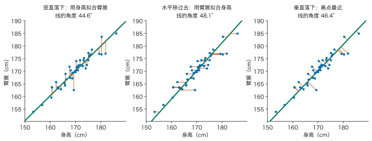{fig-alt="三张身高对臂展的散点图，各有一条绿线和红色短线。左图红线竖直，标题竖直落下用身高拟合臂展，线的角度 44.6 度。中图红线水平，标题水平移过去用臂展拟合身高，48.1 度。右图红线和绿线垂直，标题垂直落下离点最近，46.4 度"}

竖直落下，就是拿身高去拟合臂展的最小二乘线（44.6°）；水平移过去，就是拿臂展去拟合身高（48.1°）。两条线都先认定了谁是“答案”。这里没有答案要预测，两个量地位一样，所以取离点最近的那一点。这样得到的线在 46.4°，在两条拟合线之间。
:::

## 3. 模型：投影和它的性质

先中心化。每个量减去它的平均 $\bar{\mathbf x}$，点云的中心挪到原点，要画的线也就过原点，后面的式子会简单很多。**从这里起，$\mathbf x$ 就指中心化以后的数据**，只在还原时把平均加回来。每个点 $\mathbf x\in\mathbb R^{d\times 1}$ 有 $d$ 个数（身高臂展 $d = 2$，汽车 5，手写数字 784）。

模型是：取一个方向 $\mathbf u\in\mathbb R^{d\times 1}$，每个点只存一个数 $z$，用线上的点 $z\mathbf u$ 还原：
$$
\mathbf x \approx z\,\mathbf u .
$$
假设是点挤在一条线附近，$d$ 个数只存 1 个。这个模型有下面几条性质。

**① $\mathbf u$ 的长度定为 1。**$z\mathbf u = (z/2)(2\mathbf u)$：$\mathbf u$ 拉长一倍、$z$ 缩小一半，还原出的点一样。$\mathbf u$ 只管方向，所以规定
$$
\mathbf u^\top\mathbf u = 1 .
$$

**② 投影：$z = \mathbf u^\top\mathbf x$。**每个点存的数取 $z = \mathbf u^\top\mathbf x$，就是点沿 $\mathbf u$ 方向的长度（二维里是 $\lVert\mathbf x\rVert\cos\alpha$，$\alpha$ 是点和线的夹角）。

**③ 这样取 $z$，丢掉的最少。**用 $\mathbf u^\top\mathbf u = 1$ 验证，丢掉的部分和线垂直：
$$
\mathbf u^\top(\mathbf x - z\mathbf u) = \mathbf u^\top\mathbf x - z\,\mathbf u^\top\mathbf u = z - z = 0 .
$$
所以 $z\mathbf u$ 正是从点垂直落到线上的那个脚，也就是线上离点最近的点。（换个角度看：$\mathbf u$ 定了，用 $z$ 去拟合 $\mathbf x$，最小二乘的解也是 $z = \mathbf u^\top\mathbf x$。）

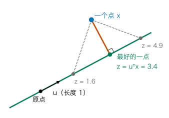{fig-alt="一条过原点的绿线，原点处一个黑色短箭头标着 u 长度 1。线外一个蓝点。线上有两个灰色候选点 z 等于 1.6 和 4.9，各用灰色虚线连到蓝点。还有一个绿色点，用红色实线连到蓝点，红线和绿线成直角，标着最好的一点 z 等于 u 转置 x 等于 3.4" width="65%"}

**④ 还原：**$\hat{\mathbf x} = \bar{\mathbf x} + z\mathbf u$（把平均加回来）。例：一个人身高 180、臂展 183，中心化后 $\mathbf x = (10.0,\ 12.9)^\top$。取 $\mathbf u = (0.689,\ 0.725)^\top$，$z = 0.689\times10.0 + 0.725\times12.9 = 16.2$，还原成身高 181.2、臂展 181.9。

**⑤ 多个方向：分量的叠加。**一个数不够时，用 $K$ 个方向 $\mathbf u_1,\dots,\mathbf u_K$，每个长度为 1、两两垂直（$\mathbf u_j^\top\mathbf u_k = 0$）。每个点存 $K$ 个数，各算各的：$z_k = \mathbf u_k^\top\mathbf x$。还原是 $K$ 个分量加起来：
$$
\mathbf x \approx z_1\mathbf u_1 + z_2\mathbf u_2 + \dots + z_K\mathbf u_K .
$$
同 ③，丢掉的部分和每个方向都垂直。要求垂直，是因为每个方向应该说一件别的方向没说过的事；而且还原只取决于这些方向张成的平面，在同一个平面里换成一组垂直的方向，能还原的一样多，不吃亏。

## 4. 损失：还原误差

方向 $\mathbf u$ 定了，$z$ 就定了，还原得好不好只取决于 $\mathbf u$。用每个点和它的还原值之间的距离平方，加起来：
$$
L(\mathbf u) = \sum_{i=1}^n\lVert\mathbf x_i - z_i\mathbf u\rVert^2,\qquad z_i = \mathbf u^\top\mathbf x_i,\qquad \text{约束 } \mathbf u^\top\mathbf u = 1 .
$$
组件里每个角度就是一个 $\mathbf u$，红柱就是 $L/(n-1)$。要找让 $L$ 最小的 $\mathbf u$。

## 5. 求解：误差最小，就是散得最开

::: {.callout-important title="这一节的结论"}
最好的方向是协方差矩阵 $S$ 的特征向量里，特征值最大的那个；沿它投影，留下的散布就是这个特征值。留 $K$ 个方向时，取特征值最大的 $K$ 个特征向量，还原误差就是丢掉的那些特征值之和。后面的应用只用到这几句。
:::

### 5.1 第一步：误差 = 总散布 − 投影的方差

先看一个点。由性质 ③，展开平方（用 $\mathbf u^\top\mathbf x = z$、$\mathbf u^\top\mathbf u = 1$）：
$$
\lVert\mathbf x - z\mathbf u\rVert^2 = \mathbf x^\top\mathbf x - 2z\,\mathbf u^\top\mathbf x + z^2\,\mathbf u^\top\mathbf u = \lVert\mathbf x\rVert^2 - z^2 .
$$
点离原点的远近是固定的，落到线上的那段越长，丢掉的就越短。

再对所有点加起来。两项都可以写成同一个矩阵，**协方差矩阵**（covariance matrix）
$$
S = \frac{1}{n-1}\sum_{i=1}^n\mathbf x_i\mathbf x_i^\top ,
$$
它是 $d\times d$ 的，对角线是各个量的方差，非对角线是两两的协方差。用迹 $\operatorname{tr}$（矩阵对角线之和，见附录）：
$$
\begin{aligned}
\sum_i z_i^2 &= \sum_i(\mathbf u^\top\mathbf x_i)(\mathbf x_i^\top\mathbf u) = \mathbf u^\top\Big(\sum_i\mathbf x_i\mathbf x_i^\top\Big)\mathbf u = (n-1)\,\mathbf u^\top S\,\mathbf u ,\\
\sum_i\lVert\mathbf x_i\rVert^2 &= \sum_i\operatorname{tr}\big(\mathbf x_i\mathbf x_i^\top\big) = \operatorname{tr}\Big(\sum_i\mathbf x_i\mathbf x_i^\top\Big) = (n-1)\operatorname{tr}S .
\end{aligned}
$$
所以
$$
L(\mathbf u) = (n-1)\big(\operatorname{tr}S - \mathbf u^\top S\,\mathbf u\big).
$$
这就是组件里的两根柱子：$\mathbf u^\top S\mathbf u$ 是投影 $z$ 的方差（蓝柱），$\operatorname{tr}S$ 是各个量的方差之和，叫**总散布**，和方向无关。总散布不变，所以**还原误差最小，就是投影的方差最大**。

身高和臂展：$S = \begin{pmatrix} 46.52 & 45.82 \\ 45.82 & 51.15 \end{pmatrix}$，$\operatorname{tr}S = 46.52 + 51.15 = 97.68$，正是组件里两根柱子之和。

### 5.2 第二步：约束下求最大，得到特征向量

问题变成：在 $\mathbf u^\top\mathbf u = 1$ 下，让 $\mathbf u^\top S\mathbf u$ 最大。约束不能丢：没有它，$\mathbf u$ 乘 2，$\mathbf u^\top S\mathbf u$ 就乘 4，可以无限大。

带等式约束求最大，用**拉格朗日乘子法**（Lagrange multipliers）：把约束乘一个数 $\lambda$ 减进目标，再对 $\mathbf u$ 求导令它为 0：
$$
\mathcal L(\mathbf u,\lambda) = \mathbf u^\top S\mathbf u - \lambda(\mathbf u^\top\mathbf u - 1),
\qquad
\frac{\partial\mathcal L}{\partial\mathbf u} = 2S\mathbf u - 2\lambda\mathbf u = \mathbf 0
\quad\Longrightarrow\quad
S\mathbf u = \lambda\mathbf u .
$$
为什么这样写就对，Advanced Study 1 请你自己推；只记结论也可以。

两边左乘 $\mathbf u^\top$，得 $\mathbf u^\top S\mathbf u = \lambda$：沿这个方向投影，方差就是 $\lambda$。满足 $S\mathbf u = \lambda\mathbf u$ 的方向有 $d$ 个，要散得最开，就挑 $\lambda$ 最大的那个。这样的 $\mathbf u$ 叫 $S$ 的**特征向量**（eigenvector），$\lambda$ 叫**特征值**（eigenvalue）：$S$ 乘它，方向不变，只伸缩 $\lambda$ 倍。

身高和臂展：$S$ 的两个特征值是 94.71 和 2.96，最大的特征向量是 $(0.689,\ 0.725)^\top$，方向 46.4°，和转线看到的一样；平均每人的还原误差是 $97.68-94.71 = 2.97$。

### 5.3 多个方向

用第一个方向还原后，剩下的部分全都和它垂直（性质 ③），所以第二个方向到垂直的方向里找。结果是第二个特征向量：在所有和第一个垂直的方向里，它散得最开。依此类推，**前 $K$ 个特征向量就是最好的 $K$ 个方向**（Advanced Study 1 证明一个一个挑和一次挑一组结果相同）。

由性质 ⑤，$K$ 个方向的还原误差是总散布减去各方向的散布之和：
$$
L = (n-1)\Big(\operatorname{tr}S - \sum_{k=1}^K\lambda_k\Big) = (n-1)\big(\lambda_{K+1} + \dots + \lambda_d\big).
$$
后一步用了 $\operatorname{tr}S = \lambda_1 + \dots + \lambda_d$：$K = d$ 时什么都不丢，误差为 0。所以**还原误差就是丢掉的那些特征值之和**，留住的比例是 $(\lambda_1 + \dots + \lambda_K)/(\lambda_1 + \dots + \lambda_d)$。不同特征向量上的得分还互不相关：第二个数说的全是第一个数没说过的事。

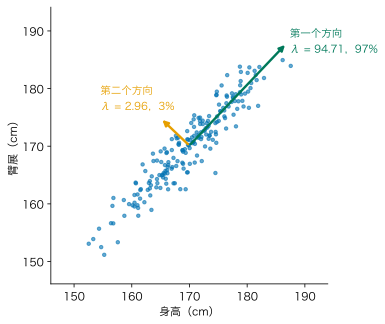{fig-alt="身高对臂展的散点图，从中心画出两个箭头。绿色箭头沿点的长带指向右上，标第一个方向 λ 等于 94.71，97%。橙色短箭头指向左上，和绿箭头垂直，标第二个方向 λ 等于 2.96，3%" width="50%"}

三个量时，“点挤在一个平面附近”是这样的：前两个方向留住 77% 和 22%，垂直于平面的第三个方向只占 1%。

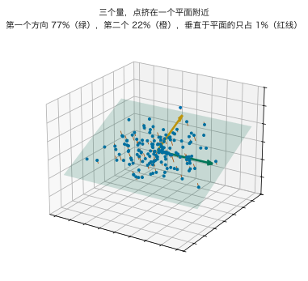{fig-alt="三维散点图，蓝点分布在一块浅绿色倾斜平面附近，每个点有一条红色短线连到平面。平面上画了绿色和橙色两个箭头。标题第一个方向 77%，第二个 22%，垂直于平面的只占 1%" width="62%"}

这些方向叫**主成分**（principal components），第一个特征向量是**第一主成分**。点在主成分上的位置 $z_k$ 叫**得分**（score）。整个做法叫**主成分分析**（principal component analysis，**PCA**）。第 $k$ 个主成分留住的比例叫**解释方差比例**（explained variance ratio），前 $K$ 个加起来叫**累计比例**。

整个方法就是：减去平均；算协方差矩阵 $S$；取特征值最大的 $K$ 个特征向量；把点投影上去，得到得分。

## 6. 检验：降得好不好，什么时候不行

降得好不好，看留住的比例和还原误差。身高和臂展留一个主成分，留住 97%，平均每人丢掉约 2.97 cm²，开方约 1.7 cm，大约就是“手臂相对长不长”那部分。

PCA 的假设是点挤在一条线（或一个低维平面）附近。看一份不满足这个假设的数据：

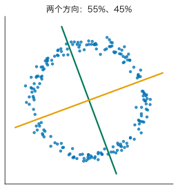{fig-alt="一个由蓝点组成的圆环，中间画了互相垂直的绿线和橙线，标题两个方向 55%、45%" width="45%"}

请先想：只留第一个主成分，能留住多少？

::: {.callout-note collapse="true" title="展开答案"}
55%。环在各个方向上散得差不多，两个特征值接近，留一个就丢掉近一半。点挤在一个弯的形状上，PCA 只能找直线方向，帮不上忙。两个特征值接近时，第一主成分也不稳：数据稍变一点，方向就可能转走，不要去读它的意思。
:::

还有一种情况：量的单位不一样。下一节的汽车就会撞上。

## 7. 应用一：汽车，五个量在说一件事

回到第 1 节的 392 辆车，五个量，$d = 5$。另有一列油耗（每加仑跑几英里），先放在一边，PCA 不用它。

直接做 PCA，请先猜：第一主成分会是什么样？

::: {.callout-note collapse="true" title="展开答案"}
几乎全是车重：权重 0.993，其余都接近 0，一个主成分就留住 99.8%。车重以磅计，标准差 849；缸数的标准差只有 1.7，加速时间 2.8。车重的数大，散布就大，压过了其余所有量。这个 99.8% 只反映车重的数大。
:::

单位不该决定答案。**先标准化**（每一列减去平均、除以标准差），再做 PCA：

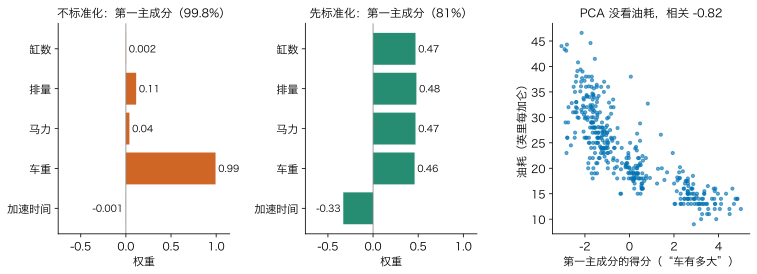{fig-alt="三张图。左边条形图车重 0.99、其余接近 0，标题 99.8%。中间条形图缸数 0.47、排量 0.48、马力 0.47、车重 0.46、加速时间负 0.33，标题 81%。右边散点图横轴第一主成分得分、纵轴油耗，向右下降，相关负 0.82"}

- **第一主成分留住 81%。**前四个量的权重几乎相等（0.46 到 0.48），加速时间是 −0.33（大车加速用的时间短）：“这辆车有多大、多猛”。
- **第二主成分留住 14%**，主要是加速时间（0.89），其次车重（0.35）：同样大小的车，加速慢不慢。它和第一主成分垂直，说的是第一个没说的事。
- **两个加起来 95%。**五个数换成两个，基本不丢。

现在拿出放在一边的油耗：“车有多大”这个得分和油耗的相关系数是 −0.82，和单看车重（−0.83）差不多，比单看马力（−0.78）强。PCA 没看过油耗，找出的是五个量共同在说的那件事，而它正好和油耗关系最紧。

单位不同的量，先标准化再做 PCA；单位相同、大小可比的量（身高和臂展，下一节的像素），可以不标准化。

## 8. 应用二：手写数字

### 8.1 一张图变成一行数

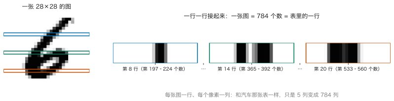{fig-alt="左边是手写数字 6 的像素图，三行用彩色框标出；右边把这三行拉成长条，标出第 8 行是第 197 到 224 个数，第 14 行是第 365 到 392 个数，第 20 行是第 533 到 560 个数"}

把 28×28 的图一行接一行排开，一张图就是 784 个数。每张图一行、每个像素一列，就是一张表，和汽车那张表一样，只是从 5 列变成 784 列。像素都在 0 到 1 之间，不用标准化；中心化就是减去平均图。数字标签先放在一边。

这里用课程的手写数字子集：10,000 张图，留出 2,500 张作测试集，其余按 3:1 分成 5,625 张训练图和 1,875 张验证图。主成分只从训练图里学。

### 8.2 主成分长什么样

$S$ 现在是 784×784，每个特征向量有 784 个数，正好排回 28×28：**每个主成分本身就是一张图**。

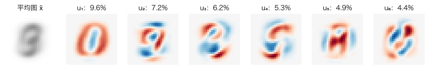{fig-alt="第一张是灰色模糊的平均数字图，后面六张红蓝相间的 28 乘 28 权重图，比例依次是 9.6%、7.2%、6.2%、5.3%、4.9%、4.4%"}

一张图在第一主成分上的得分大，说明它在红色的地方墨水多、蓝色的地方墨水少。第一主成分像一个红色的圈：得分大的图像 0，得分小的图墨水竖在中间，像 1。第一主成分只留住 9.6%，远不如身高臂展的 97%：784 个像素的变化分散在很多方向上，要多留几个。

### 8.3 用 K 个数还原一张图

$$
\hat{\mathbf x} = \bar{\mathbf x} + z_1\mathbf u_1 + z_2\mathbf u_2 + \dots + z_K\mathbf u_K,
\qquad z_k = \mathbf u_k^\top(\mathbf x - \bar{\mathbf x}).
$$
平均图，加上每个主成分乘这张图在它上面的得分。存一张图只要存 $K$ 个得分；平均图和主成分所有图共用。

拖动 $K$，看一张验证图（数字 6）从几个数开始认得出来；组件里还可以换另外三张验证图：



请先猜：要几个数，你才认得出是 6？

::: {.callout-note collapse="true" title="展开答案"}
1 到 2 个数时，还原出来还是一团平均图，还原误差 57.7（784 个像素上差的平方和；只用平均图时 58.4）。10 个数时 25.2，能看出 6 的大致形状；50 个 10.9，和原图看起来差不多；100 个 6.2。“认得出”以你能不能说出它是几为准。对 1,875 张验证图平均，$K = 10$、50、100 时还原误差是 27.0、9.3、4.6。
:::

用训练图核对第 5.3 节的结论：总散布 52.77，前 50 个特征值之和 43.64（82.7%），丢掉的 9.13；用 50 个主成分还原训练图，误差平方和除以 $n-1$，也是 9.13。

### 8.4 换个方式压缩：一张图自己做 PCA

这一节是个对比，后面的画图和分类用不上它。8.3 里的样本是图：5,625 张训练图各占一行，每行 784 个数，主成分从所有训练图里学，所有图共用。

也可以只看一张图。把它的 28 行当作 28 个样本，每行 28 个数，做同样的事：减去这张图的平均行，算 28×28 的协方差矩阵，取前 $K$ 个特征向量，每一行用 $K$ 个得分还原。下面是同样的四张图：



请先拖一拖：每行留几个数，这张 6 就认得出来？

::: {.callout-note collapse="true" title="展开答案"}
$K = 0$ 时每一行都换成平均行，看不出是什么，还原误差 71.3。$K = 1$ 时 36.5，$K = 3$ 时 13.2，已经认得出是 6；$K = 5$ 时 3.8，和原图几乎一样。这张图的 28 行很像：第一个方向就留住 49%，前三个 82%。
:::

两种做法的区别：

| | 8.3：很多张图一起做 | 8.4：一张图自己做 |
|---|---|---|
| 一个样本是 | 一张图（784 个数） | 图里的一行（28 个数） |
| 主成分从哪里学 | 5,625 张训练图，所有图共用一套 | 只用这一张图，每张图各有一套 |
| 每张图要存的数 | $K$ 个得分（主成分存一次，大家共用） | $28 + 56K$ 个：平均行、$K$ 个主成分、28 行的得分 |
| 用到的重复 | 不同的图很像：都是手写数字 | 同一张图里，行和行很像 |
| 来了一张新图 | 用学好的主成分直接算得分 | 要对它重新做一次 PCA |
| 得分能拿来做什么 | 所有图的得分在同一套方向上，可以比较、画图、分类（8.6、8.8 节） | 每张图的方向不同，得分不能拿来比，只能用来压缩这张图 |

同一张 6：很多张图一起做，存 50 个数，还原误差 10.9；一张图自己做，$K = 3$ 要存 196 个数，误差 13.2，$K = 5$ 要存 308 个数，误差 3.8。一张图自己做不需要别的图，但每张图都得把自己的主成分一起存下来，所以存的数多。很多张图一起做，主成分只存一次，平摊到每张图上几乎不占地方，而且得到的得分可以拿来比较。

### 8.5 留几个

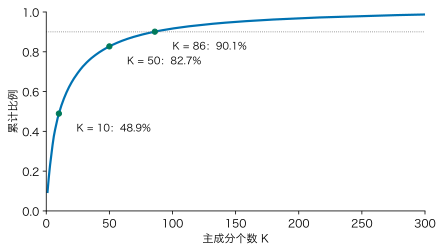{fig-alt="一条先快速上升后变平的曲线，标出 K 等于 10 时 48.9%，50 时 82.7%，86 时 90.1%"}

10 个主成分留住 48.9%，50 个 82.7%，100 个 91.7%；留住 90% 要 86 个。选 $K$ 的做法：

1. 用累计比例定一个范围，比如 80% 到 95%，这里是几十到一百多；
2. 在这个范围里取几个 $K$，接上后面要做的事（存图就看还原的图，分类就看验证集准确率）；
3. 取在验证集上最好、又不在范围两端的那个，测试集只用一次（第 8.8 节）。

### 8.6 画出来

只留两个主成分，每张图就是平面上的一个点：

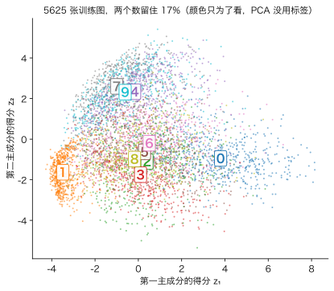{fig-alt="很多彩色小点的散点图，数字 1 的橙色点挤在最左边，0 的蓝色点在右边，7、9、4 挤在上方，2、3、5、6、8 挤在中间"}

两个数只留住 16.7%，但已经看得出结构。PCA 没用标签，颜色是画完才按真实数字上的：1 挤在最左，0 在右边；7、9、4 在上方，2、3、5、6、8 挤在中间。没看标签，1 和 0 已经分开；哪些数字容易混，也一眼可见。

### 8.7 规矩：只从训练图学主成分

平均图和协方差矩阵都由图算出来，学的时候只能用训练图；验证图和测试图只用学到的方向去转换。这和标准化的规矩一样。

```python
pca = PCA(n_components=50)
pca.fit(X_train)              # learn the mean image and the components from training images only
Z_train = pca.transform(X_train)
Z_val = pca.transform(X_val)  # the same directions, no learning
```

### 8.8 降维之后再分类（作业 2 要用）

作业 2 第 3 节要先 PCA，再把分类器用在 $K$ 个得分上。这里用 logistic regression 和 QDA 看一次，$K$ 在验证集上选：

| $K$ | 2 | 10 | 20 | 40 | 50 | 100 | 784（不降维） |
|---|---:|---:|---:|---:|---:|---:|---:|
| logistic regression | 0.427 | 0.810 | 0.880 | 0.897 | 0.895 | 0.897 | 0.891 |
| QDA | 0.445 | 0.885 | 0.942 | **0.957** | 0.956 | 报错 | 报错 |

- logistic regression 在 $K = 40$ 以后不再变好。
- QDA 在 784 个像素上跑不出来：它要为每一类估一个 784×784 的协方差矩阵并求逆，而有 128 个像素在所有训练图上都是 0，矩阵不可逆，scikit-learn 1.9 直接报错。
- 降到 40 个主成分，QDA 估得稳，验证准确率 0.957，比 logistic regression 高 0.06。**丢掉信息，反而更好**：丢掉的是几乎不变、只会添乱的方向。
- $K = 100$ 时又报错：QDA 要为每类估一个 100×100 的协方差矩阵（5,000 多个数），每类却只有约 560 张训练图，估不稳。作业 2 有 50,000 张训练图，没有这个问题。

选出 $K = 40$，测试集只读一次：0.962。

## 9. 实现：用 scikit-learn 完成

汽车（`cars` 是装着 392 辆车的 pandas 表；单位不同，先标准化）：

```python
from sklearn.preprocessing import StandardScaler
from sklearn.decomposition import PCA

Xs = StandardScaler().fit_transform(cars[["cylinders", "displacement", "horsepower", "weight", "acceleration"]])
pca = PCA().fit(Xs)                       # all five components
print(pca.explained_variance_ratio_)      # share kept by each component
print(pca.components_[0])                 # the five weights of the first component
```

输出的比例是 0.814、0.139、0.027、0.013、0.007。`components_` 的每一行是一个主成分。特征向量反过来也是特征向量，所以权重可能整行变号，读意思时不受影响。

手写数字（`X_train` 每行 784 个数）：

```python
pca = PCA(n_components=50, random_state=0).fit(X_train)   # learn from training images only
Z_val = pca.transform(X_val)              # 50 scores per validation image
X_back = pca.inverse_transform(Z_val)     # rebuild: mean image + scores times components
print(pca.explained_variance_ratio_.sum())
```

`transform` 算的是得分 $z_k$，`inverse_transform` 算的是还原 $\hat{\mathbf x}$。最后一行打印 0.827。784 维时 scikit-learn 用了带随机性的快速算法，所以加 `random_state=0`，每次结果才一样。

## 10. 一页回顾

如果只读一页，读这里。

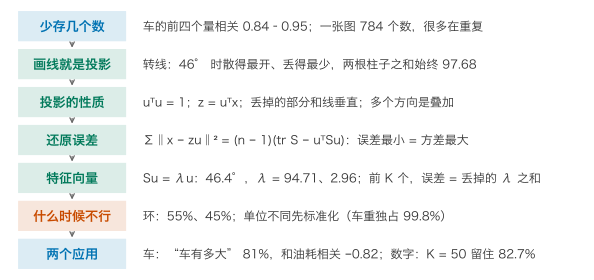{fig-alt="七个步骤的竖向流程图：少存几个数；画线就是投影；投影的性质；还原误差；特征向量；什么时候不行；两个应用。每步右边一行要点和数字"}

| 步骤 | 这一讲做了什么 | 证据 |
|---|---|---|
| 问题 | 很多数在重复：每个样本少存几个数，还能还原吗 | 车的前四个量相关 0.84–0.95 |
| 启发 | 画线就是投影；散得最开的方向，丢得最少 | 46° 时留住 97%；两柱之和始终 97.68 |
| 模型 | 中心化后 $\mathbf x\approx z\mathbf u$，$\mathbf u^\top\mathbf u = 1$；投影 $z = \mathbf u^\top\mathbf x$，丢掉的部分和线垂直；多个方向是分量的叠加 | |
| 损失 | 还原误差 $\sum_i\lVert\mathbf x_i-z_i\mathbf u\rVert^2$ | |
| 求解 | 误差 $= (n-1)(\operatorname{tr}S-\mathbf u^\top S\mathbf u)$；约束下求最大得 $S\mathbf u = \lambda\mathbf u$；取前 $K$ 个特征向量，误差是丢掉的特征值之和 | 46.4°，$\lambda$ = 94.71、2.96 |
| 检验 | 看比例、看还原误差；点不在线附近（环）时不行 | 环：55%、45% |
| 应用 | 单位不同先标准化；图变成一行数，用 $K$ 个得分还原；只从训练图学 | 车：81%，和油耗相关 −0.82；数字：$K$ = 50 留住 82.7% |

## 11. 拓展：别的表示方法（选读）

PCA 给每个样本换了一组新的数，也就是一种**表示**（representation）：新的数是原来各个量的加权和，方向都是直线。明白了这一点，就可以换别的方法来找表示，很多在 scikit-learn 里一行就能调用。下面几种都是非线性的：点不必挤在一个平面附近，目标是让原来挨得近的点，在新的图里仍然挨得近。它们最常用来把高维数据画成二维图，看数据里有什么结构。

先看一个 PCA 做不好的例子：三维空间里卷成一卷的点。PCA 只能把它压扁，卷还卷着；Isomap 沿着卷一步步量距离，把它摊平成一张纸。

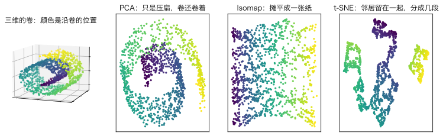{fig-alt="四张图。第一张是三维的卷状点云，颜色从紫到黄沿卷变化。第二张 PCA 的二维图仍是一个卷，内外两圈颜色挨在一起。第三张 Isomap 的二维图是一块长方形，颜色从左到右连续变化。第四张 t-SNE 的二维图分成几段，每段里颜色连续"}

再看手写数字。同样 2,000 张训练图，用六种方法各画一张二维图，颜色是真实数字，方法本身都没用标签：

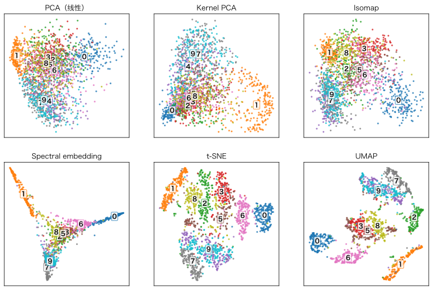{fig-alt="六张散点图，每个点按真实数字上色并在每类中间标出数字。PCA 和 Kernel PCA 里大多数数字混在一起，只有 0 和 1 分开。Isomap 和 Spectral embedding 分开得多一些。t-SNE 和 UMAP 里大多数数字各成一团，4、7、9 挨在一起，3、5、8 挨在一起"}

PCA 的二维图里，大多数数字混在一起；t-SNE 和 UMAP 里，大多数数字各成一团，容易混的 4、7、9 和 3、5、8 挨在一起。

| 方法 | 调用 | 一句话 |
|---|---|---|
| Kernel PCA | `KernelPCA(n_components=2, kernel="rbf")` | 先把点换到一个更大的空间里，再做 PCA |
| Isomap | `Isomap(n_components=2, n_neighbors=10)` | 沿着邻居一步步走过去量距离，再摊平 |
| Spectral embedding | `SpectralEmbedding(n_components=2)` | 把邻居关系连成一张网，按网的形状摆点 |
| t-SNE | `TSNE(n_components=2, perplexity=30)` | 让邻居在图上还是邻居，最常用的画图方法 |
| UMAP | `umap.UMAP(n_components=2)`（先 `pip install umap-learn`） | 想法和 t-SNE 相近，数据大时更快 |

前四种都在 `sklearn.decomposition` 或 `sklearn.manifold` 里。在 784 个像素上，常先用 PCA 降到 50 个数，再交给它们：

```python
from sklearn.decomposition import PCA
from sklearn.manifold import TSNE

Z50 = PCA(n_components=50).fit_transform(X)                 # first 50 PCA scores
Z2 = TSNE(n_components=2, random_state=0).fit_transform(Z50)  # then a 2-D map for plotting
```

这几种方法主要用来看图。和 PCA 比，它们大多不能像第 8.3 节那样把图还原回来；t-SNE 还不能把一张新图放进已经画好的图里；图上团和团之间的距离、团的大小不一定有意义，换一个随机种子，图也会变。2,000 张图在笔记本电脑上，t-SNE 约 6 秒，UMAP 约 9 秒。

## 12. 总结与局限

回到开头：784 个数里大部分在重复，留 50 个就留住 82.7%，还原出来认得出。办法是把点投影到散得最开的方向，那里丢的最少；这些方向是协方差矩阵的特征向量。

本讲之后，你能说出 PCA 假设数据长什么样（挤在一个低维平面附近）、它在最小化什么（还原误差，也就是让投影的方差最大）、答案为什么是特征向量；单位不同时先标准化，读出主成分的意思；用累计比例和后面的任务选 $K$；只从训练部分学主成分。

迁移题：一家超市记录了 1,000 位顾客一年里在 20 类商品上各花了多少钱（单位都是英镑）。要不要先标准化？如果第一主成分的 20 个权重全是正的、大小差不多，它在说什么？

::: {.callout-note collapse="true" title="参考回答"}
单位相同，可以不标准化，但花钱多、散布大的几类（比如生鲜）会主导第一主成分；想让每类商品同样重要，就先标准化。权重全正、大小差不多的第一主成分，说的是“这位顾客总共花多少钱”，和身高臂展的“个子多大”、汽车的“车有多大”是同一种东西。
:::

这个方法在哪里不可信：

1. 只找直线方向。点挤在一个弯的形状上（第 6 节的环），PCA 帮不上忙。
2. 尺度决定结果。单位不同的量不标准化，散布大的量会独占第一主成分（第 7 节的车重）。
3. 它不看标签。散得开的方向不一定对分类有用。
4. 主成分不一定好解释。汽车的前两个读得出意思；784 个像素的第 5、6 个，就很难说它在看什么。

30 秒反馈：读完这一讲，请扫码留下匿名反馈或问题：哪里没看懂、哪里讲得太快，都对改进有用。

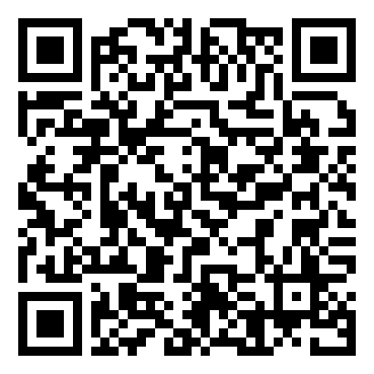{fig-align="center" width="160px" fig-alt="反馈二维码"}

*以下是 Advanced Study，不影响主线，每个 Study 可以单独阅读。MPS311 鼓励选读。MPS439 的必做项见 Lab 7 的 Advanced；其余 Study 选读。*

---

## Advanced Study 1：自己推一遍

正文第 5 节给了结论和两步主干。这里请你自己把它推出来。每一步先给提示，答案折叠在后面，做完再看。

**第 1 步：$z$ 为什么是 $\mathbf u^\top\mathbf x$。** 固定方向 $\mathbf u$（$\mathbf u^\top\mathbf u = 1$），一个点只存一个数 $z$。请找出让 $\lVert\mathbf x-z\mathbf u\rVert^2$ 最小的 $z$。

提示：把平方展开成 $z$ 的二次函数，对 $z$ 求导。

::: {.callout-note collapse="true" title="答案"}
$\lVert\mathbf x-z\mathbf u\rVert^2 = \mathbf x^\top\mathbf x-2z\,\mathbf u^\top\mathbf x + z^2$，对 $z$ 求导得 $-2\mathbf u^\top\mathbf x + 2z = 0$，所以 $z = \mathbf u^\top\mathbf x$。这正是第 3 节的性质 ③：最好的 $z$ 让丢掉的部分和线垂直。
:::

**第 2 步：把总误差写成 $S$。** 用第 1 步的 $z_i$，证明 $L(\mathbf u) = (n-1)(\operatorname{tr}S-\mathbf u^\top S\mathbf u)$。

提示：先证一个点的误差是 $\lVert\mathbf x\rVert^2-z^2$；再用 $z^2 = \mathbf u^\top\mathbf x\mathbf x^\top\mathbf u$ 和 $\lVert\mathbf x\rVert^2 = \operatorname{tr}(\mathbf x\mathbf x^\top)$（附录）。

::: {.callout-note collapse="true" title="答案"}
见正文第 5.1 节。
:::

**第 3 步：为什么拉格朗日乘子这样写。** 在 $\mathbf u^\top\mathbf u = 1$ 下让 $\mathbf u^\top S\mathbf u$ 最大。请说明：在最好的那个 $\mathbf u$ 上，$S\mathbf u$ 一定和 $\mathbf u$ 同向。

提示：满足约束的 $\mathbf u$ 都在单位圆上。在最好的那一点，沿着圆往哪边挪一点，目标都不能再变大。目标的梯度是 $2S\mathbf u$，沿着圆的方向和 $\mathbf u$ 垂直。

::: {.callout-note collapse="true" title="答案"}
沿着圆挪一小步 $\boldsymbol\delta$（$\boldsymbol\delta$ 和 $\mathbf u$ 垂直），目标变化约 $2(S\mathbf u)^\top\boldsymbol\delta$。最好的点上，它对每个垂直于 $\mathbf u$ 的 $\boldsymbol\delta$ 都是 0，所以 $S\mathbf u$ 在垂直方向上没有分量，只剩和 $\mathbf u$ 同向的部分：$S\mathbf u = \lambda\mathbf u$。这正是 $\partial\mathcal L/\partial\mathbf u = \mathbf 0$。

二维时也可以令 $\mathbf u = (\cos\theta, \sin\theta)^\top$，直接对 θ 求导，得 $\tan 2\theta = 2S_{12}/(S_{11}-S_{22}) = -19.8$，θ = 46.4° 或 136.4°：

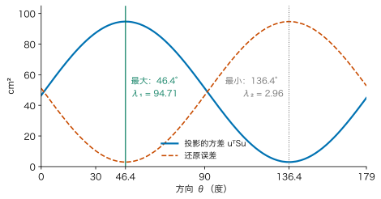{fig-alt="两条正弦形状的曲线，蓝色实线是投影方差，在 46.4 度最大 94.71、在 136.4 度最小 2.96；红色虚线是还原误差，形状相反"}
:::

**第 4 步：最大的特征值就是全局最大。** 满足 $S\mathbf u = \lambda\mathbf u$ 的方向有 $d$ 个。请证明 $\lambda$ 最大的那个就是所有单位向量里最好的。

提示：对称矩阵 $S$ 有 $d$ 个互相垂直、长度为 1 的特征向量 $\mathbf v_1,\dots,\mathbf v_d$，特征值 $\lambda_1\ge\dots\ge\lambda_d$（附录）。把任意单位向量写成 $\mathbf u = \sum_j c_j\mathbf v_j$。

::: {.callout-note collapse="true" title="答案"}
$\sum_j c_j^2 = 1$，于是 $\mathbf u^\top S\mathbf u = \sum_j\lambda_jc_j^2 \le \lambda_1$，$\mathbf u = \mathbf v_1$ 时取等号。和 $\mathbf v_1$ 垂直的方向 $c_1 = 0$，最大是 $\lambda_2$，所以第二个方向是 $\mathbf v_2$。
:::

**第 5 步：一个一个挑，等于一次挑一组。** 证明任意 $K$ 个两两垂直的单位向量，$\sum_{k=1}^K\mathbf u_k^\top S\mathbf u_k \le \lambda_1 + \dots + \lambda_K$。

提示：写成 $\sum_j\lambda_jw_j$，$w_j = \sum_k(\mathbf v_j^\top\mathbf u_k)^2$。看 $w_j$ 有哪两个限制。

::: {.callout-note collapse="true" title="答案"}
$w_j$ 是 $\mathbf v_j$ 落到这 $K$ 个方向张成的平面上那部分的长度平方，所以 $0\le w_j\le 1$；交换求和次序，$\sum_jw_j = \sum_k\lVert\mathbf u_k\rVert^2 = K$。总共 $K$ 份权重，每个特征值最多拿一份，加权和最大就是全给最大的 $K$ 个，取 $\mathbf u_k = \mathbf v_k$ 时等号成立。

决策树每一步也挑当前最好的一刀，却不能保证整棵树最好。PCA 可以，靠的就是 $w_j$ 的这两个限制：前面挑走的方向不会让后面的选择变差。
:::

还可以想一想：不同特征向量上的得分为什么不相关（$z_j$ 和 $z_k$ 的协方差是 $\mathbf v_j^\top S\mathbf v_k$）？如果 $\lambda_1 = \lambda_2$，第一主成分还唯一吗？

## Advanced Study 2：用 PCA 给图去噪

扫描的图、拍糊的照片，都带噪声。PCA 可以去掉一大部分，而且不用知道原图是什么样。

做法和第 8.3 节一样：主成分只从干净的训练图学；拿到一张有噪声的图，算它在前 $K$ 个主成分上的得分，再还原。下面给 1,875 张验证图每个像素都加上标准差 0.3 的随机噪声，再用不同的 $K$ 还原，和原图比：

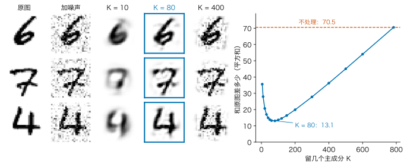{fig-alt="左边三行手写数字 6、7、4，每行五张：原图干净；加噪声后满是灰点；K 等于 10 时模糊；K 等于 80 时笔画清楚、背景干净，用蓝框标出；K 等于 400 时又出现灰点。右边是一条先降后升的曲线，横轴 K 从 0 到 784，纵轴是和原图的差，K 等于 80 时最低 13.1，K 等于 784 时回到不处理的 70.5，用红色虚线标出"}

不处理时，有噪声的图和原图差 70.5。留 80 个主成分还原，只差 13.1，噪声去掉了八成多。$K$ 太小，像第 8.3 节那样，数字本身还原不出来（$K = 10$ 时 28.0）；$K$ 太大，噪声又回来了（$K = 400$ 时 36.3，$K = 784$ 时回到 70.5）。

为什么能去噪：数字的变化挤在前几十个方向上，噪声却平均摊在全部 784 个方向上，每个方向分到 $0.3^2 = 0.09$。留 $K$ 个方向，就只留下 $K$ 份噪声，$784-K$ 份都丢掉了。右图曲线后半段是一条直线，斜率正好约 0.09；右端 784 × 0.09 = 70.6，就是不处理时的 70.5。

```python
pca = PCA(n_components=80).fit(X_train)            # learn the components from clean training images only
rng = np.random.default_rng(0)                     # random numbers for the noise
noisy = X_val + rng.normal(0, 0.3, X_val.shape)    # add noise with standard deviation 0.3 to every pixel
denoised = pca.inverse_transform(pca.transform(noisy))   # scores on the first 80 components, then rebuild
```

接下来请自己做：

1. 把噪声加到标准差 0.5，最好的 $K$ 变大还是变小？先猜，再算。提示：每个方向分到的噪声变成多少？
2. 实际去噪时没有原图可比，怎样选 $K$？
3. 把验证图上下翻转，用 $K = 50$ 算每张图的还原误差。翻转后的图误差大吗？这个误差能不能用来发现“不像手写数字”的图？哪些数字翻转后还像自己？

::: {.callout-note collapse="true" title="第 1 题答案"}
变小。每个方向分到 0.25 份噪声，多留一个方向代价更大，最好的 $K$ 约 40，误差 21.3（不处理时 196）。噪声越大，越要少留。
:::

## Advanced Study 3：电脑怎样算出主成分

**轮流求 $z$ 和 $\mathbf u$。** 固定 $\mathbf u$，$z_i = \mathbf u^\top\mathbf x_i$；固定 $z_i$，$\sum_i\lVert\mathbf x_i-z_i\mathbf u\rVert^2$ 对 $\mathbf u$ 是最小二乘，解是 $\mathbf u = \sum_i z_i\mathbf x_i/\sum_i z_i^2$，再缩放成长度 1。身高臂展上从 $\mathbf u = (1,\ 0)^\top$ 出发，每轮后的方向是 44.56°、46.39°、46.44°、46.45°，三轮就到了第一主成分。第一轮的 44.56° 正是“拿身高拟合臂展”那条线。

**numpy 和 SVD。** 在 5,625 张训练图上，`np.linalg.eigh(np.cov(X_train.T))` 算出的前 5 个特征向量和 scikit-learn 的 `components_` 相同（可能整体变号），最大差 $2\times10^{-15}$。scikit-learn 实际用的是奇异值分解：中心化后的数据矩阵 $X = U_s\Sigma V^\top$，$S = \frac{1}{n-1}X^\top X = V\frac{\Sigma^2}{n-1}V^\top$，$V$ 的列就是主成分。训练图里有 128 个像素在所有图上都是 0，$S$ 的特征值里比 $10^{-10}$ 还小的有 135 个。

接下来请自己做：

1. 说明轮流求的每一轮就是 $\mathbf u\leftarrow S\mathbf u$ 再缩放；用 $\mathbf u = \sum_j c_j\mathbf v_j$ 说明为什么反复乘 $S$ 会转到 $\mathbf v_1$，$\lambda_2/\lambda_1$ 越小转得越快还是越慢？
2. 用 `np.linalg.svd(..., full_matrices=False)` 写出 PCA 的 `fit` 和 `transform`，和 scikit-learn 对照。
3. 用 $\mathbf u^\top S\mathbf u = \lambda$ 说明恒为 0 的像素为什么对应特征值 0，以及第 8.8 节的 QDA 为什么在 784 个像素上报错。

## 附录：这一讲用到的数学

方阵 $A$ 的**迹**是对角线上的数之和，$\operatorname{tr}A = \sum_k A_{kk}$。两条性质：

- 和的迹等于迹的和：$\operatorname{tr}(A + B) = \operatorname{tr}A + \operatorname{tr}B$，所以求和和取迹可以交换次序。
- 列向量的长度平方是它和自己外积的迹：$\mathbf x^\top\mathbf x = \operatorname{tr}(\mathbf x\mathbf x^\top)$。二维时 $\mathbf x = (h,\ a)^\top$，$\mathbf x\mathbf x^\top = \begin{pmatrix}h^2 & ha\\ ha & a^2\end{pmatrix}$，对角线之和 $h^2 + a^2$ 正是 $\mathbf x^\top\mathbf x$。

中心化后的数据，**协方差矩阵**为 $S = \frac{1}{n-1}\sum_i\mathbf x_i\mathbf x_i^\top$。二维时
$$
S = \frac{1}{n-1}\begin{pmatrix}\sum_i h_i^2 & \sum_i h_ia_i \\ \sum_i h_ia_i & \sum_i a_i^2\end{pmatrix}:
$$
对角线是身高、臂展各自的方差，非对角线是两者的协方差。$S$ 是对称矩阵。$\operatorname{tr}S$ 是各个量的方差之和。

若 $S\mathbf v = \lambda\mathbf v$（$\mathbf v\ne\mathbf 0$），$\mathbf v$ 叫 $S$ 的**特征向量**，$\lambda$ 叫**特征值**：$S$ 乘 $\mathbf v$，方向不变，只伸缩 $\lambda$ 倍。$d\times d$ 的对称矩阵有 $d$ 个互相垂直、长度为 1 的特征向量，特征值都是实数；协方差矩阵的特征值都不小于 0，因为 $\lambda = \mathbf v^\top S\mathbf v$ 是一个方差。numpy 里用 `np.linalg.eigh(S)` 算。

**拉格朗日乘子**是带等式约束求最大或最小的固定做法，为什么这样写见 Advanced Study 1。
