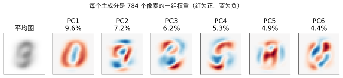
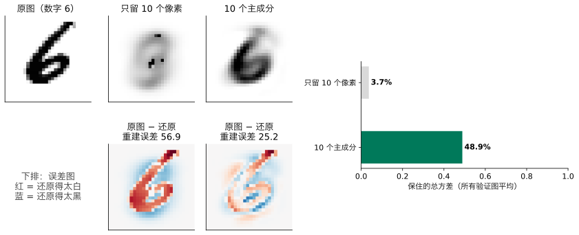
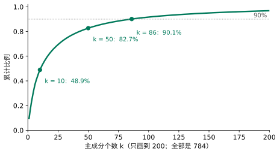
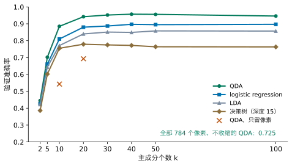
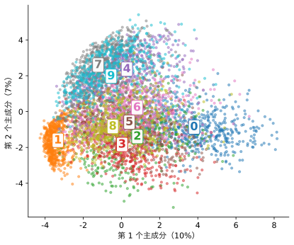
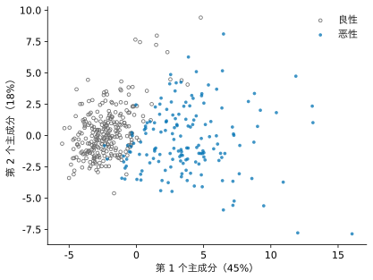
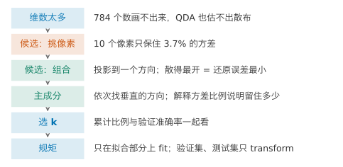
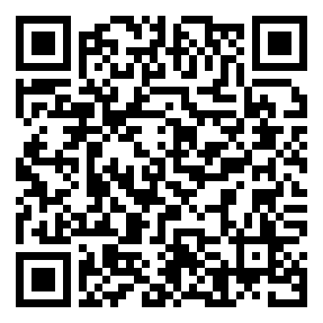

## 1. 动机：784 个数太多了

前几讲的手写数字（MNIST 子集，Lesson 4 第 8 节），每张图 28×28 = 784 个像素，也就是 784 个数。这带来两件麻烦事。

第一，画不出来。一个肿块有两个特征时，可以画在平面上看；784 个特征，人没法看。

第二，有的方法吃不消。Lesson 5 的 QDA 要为每一类估一个 784×784 的散布，每类只有约 560 张图，散布估不出来。在 Lesson 6 的拟合／验证划分上（5625 张拟合、1875 张验证），不收缩的 QDA 验证准确率只有 0.725。

这一讲第一次不预测任何东西。我们只看像素，不看标签，问一个新问题：**能不能用少几个数，留住每张图的大部分信息？**这叫**降维**（dimensionality reduction）。它不需要标签，所以属于**无监督学习**（unsupervised learning）。

我们想要的有两条：新的数要少；丢掉的信息要少。“信息”先用一个具体的量来衡量：数据散得多开，也就是方差。一个特征在所有图上都差不多，它几乎不带信息；散得开，才能把不同的图区分开。

**本讲之后你能做到：**遇到维数很多的数据时，说明为什么用特征的组合而不是挑几个特征；找出散得最开的方向，并说明它也是还原误差最小的方向；读懂解释方差比例，并结合验证集准确率选出要留几个数；只在拟合用的数据上学 PCA；把数据画在两个主成分上。

## 2. 候选一：只留几个像素

最直接的办法：784 个像素里，挑最有用的几个留下，其余丢掉。哪几个最有用？按上面的标准，挑在所有图上散得最开的。

留下散得最开的 10 个像素，算一算。下面的组件可以改留下的个数：



它们的方差加起来，只占 784 个像素总方差的 3.7%。用它们还原一张图：留下的 10 个像素照抄，丢掉的 774 个像素用各自在拟合图像里的平均值填上，所以还原出的图大部分是一团模糊的“平均数字”。拿这 10 个数去训练 QDA，验证准确率是 0.543。

请先想：留了 10 个数，为什么只保住不到 4%？

::: {.callout-note collapse="true" title="展开答案"}
一是像素太多：每个像素只占总方差的一小份，10 个加起来也不多。二是相邻的像素一起变：一笔写过去，旁边几个像素同时变黑。挑出来的 10 个像素彼此有很多重复的信息；而丢掉的 774 个像素里，有不少带着这 10 个没有的信息，却一个也没留下。
:::

挑像素的毛病在于：每个新的数只能用上一个像素。我们想要每个新的数都能用上所有像素。

## 3. 候选二：像素的组合

一个能用上所有像素的数，是像素的**组合**：给每个像素一个权重，乘起来再加。例如所有权重都是 1/784，得到的就是“这张图平均有多黑”，它用上了全部 784 个像素。

权重有无数种取法，哪一种最好？先在两个特征上想清楚。下面是 200 个点，两个特征。两个特征的一个组合 $z = u_1x_1 + u_2x_2$（取 $u_1^2+u_2^2=1$），在图上就是把每个点**投影**到方向 $\mathbf u = (u_1, u_2)$ 的一条线上：$z$ 是点落在线上的位置。用一个数 $z$ 代替两个数，就是把点换成它在线上的投影。（本讲的 $z$ 是投影得到的**得分**，不是 Lesson 4 的线性部分 $\mathbf w^\top\mathbf x + b$；各讲记号见 Lesson 4 第 2 节的对照表。）

怎样评价一个方向？两个说法都合理：投影之后点在线上**散得越开越好**（留住的方差多）；或者，把点换成投影后**丢掉的越少越好**（每个点到线的距离平方，平均起来叫**还原误差**）。下面的组件里转动这条线，同时看两个数。



请先转一转：散布最大在什么方向？还原误差最小在什么方向？只用 $x_1$（方向 0°），也就是候选一，能保住多少？

::: {.callout-note collapse="true" title="展开答案"}
两者在同一个方向：约 31°，散布 3.85，保住 89%；还原误差最小，0.49。只用 $x_1$（0°）保住 68%，只用 $x_2$（90°）只有 32%。

而且无论转到哪里，两根柱子加起来都是 4.34。原因是勾股定理：每个点到中心的距离平方，等于它在线上的那一段的平方，加上它到线的距离平方。左边加起来是固定的总散布，所以“散得最开”和“丢得最少”是同一件事。
:::

散得最开的那个方向，叫**第一主成分**（first principal component）。

## 4. 第二个方向，以及主成分分析

一个方向保住 89%，还剩 11%。要第二个数，第二个方向怎么选？

我们想要它不重复第一个已经说过的。候选有很多，拿三个在点云上比一比：第一个方向是 31°，第二个取 76°（与第一个方向相差 45°）、90°（就是 $x_2$）或 121°（与第一个垂直）。把每个点在第一个方向上的位置 $z_1$ 和在第二个方向上的位置 $z_2$ 放在一起看，算它们的相关系数：

| 第二个方向 | 76° | 90° | 121°（约垂直） |
|---|---:|---:|---:|
| 与 $z_1$ 的相关系数 | 0.94 | 0.86 | 0.01 |
| 沿它的散布 | 2.18 | 1.39 | 0.49 |

请先想：76° 的散布最大，为什么不选它？

下面的组件里可以自己转第二条线，看相关系数怎样变：



::: {.callout-note collapse="true" title="展开答案"}
它和第一个方向几乎说的是同一件事：相关系数 0.94，知道了 $z_1$，就差不多知道了 $z_2$。它的散布大，是因为它大部分沿着第一个方向，那部分信息第一个数已经说过了。垂直的方向与 $z_1$ 几乎不相关（0.01），说的全是新东西：剩下的散布 0.49，正好是第一个方向没保住的那 11%。
:::

所以第二个方向选与第一个垂直的。维数多时照此类推：第二个方向在所有与第一个垂直的方向里找散得最开的；第三个与前两个都垂直，再找散得最开的；一直找下去，784 个像素最多找出 784 个方向。这些方向叫**主成分**（principal components），整个做法叫**主成分分析**（principal component analysis，**PCA**）。

第 3 节的组件里，第一个方向“保住 89%”（那是两个特征的点云；在 784 个像素上，第一个主成分只保住 9.6%，因为方差分散在很多方向上）。这个比例有一个名字：一个主成分保住的方差占总方差的比例，叫**解释方差比例**（explained variance ratio）；前 $k$ 个加起来，叫**累计比例**。

每个主成分是 784 个权重，正好可以排回 28×28 的图，看它在“看”哪里：

{fig-alt="一张平均的数字图，和六张红蓝相间的 28 乘 28 权重图，比例依次是 9.6%、7.2%、6.2%、5.3%、4.9%、4.4%；第一个主成分像一个红色的 0，中间是蓝的"}

一张图在第一个主成分上的得分大，说明它在红色的位置墨水多、蓝色的位置墨水少。第一个主成分像一个红色的圈、中间是蓝的：得分大的图像 0，得分小（负）的图在圈外墨水少、中间墨水多，像 1。还原一张图的式子是

$$
\hat{\mathbf x} = \bar{\mathbf x} + z_1\mathbf u_1 + z_2\mathbf u_2 + \dots + z_k\mathbf u_k ,
$$

平均图 $\bar{\mathbf x}$，加上每个主成分 $\mathbf u_j$ 乘以这张图在它上面的得分 $z_j$。只加前 $k$ 个，就是用 $k$ 个数还原。

scikit-learn 里是这样写的：

```python
from sklearn.decomposition import PCA

pca = PCA(n_components=10, random_state=0)   # keep 10 components; random_state=0: same result every run
pca.fit(X_digits_fit)                        # learn the directions from the fitting images only
Z_fit = pca.transform(X_digits_fit)          # each image becomes 10 numbers
Z_val = pca.transform(X_digits_val)          # the validation images, with the same directions
print(pca.explained_variance_ratio_)         # share of the total variance kept by each component
```

`X_digits_fit`、`X_digits_val` 与 Lesson 6 第 6 节相同。784 维时 scikit-learn 用一个带随机性的快速算法找主成分，`random_state=0` 让每次结果一样。

回到第 2 节的比较：10 个像素保住 3.7%，10 个主成分保住 48.9%。

{fig-alt="上排三张 28 乘 28 的数字图：原图 6、10 个像素还原的（几乎是一团灰）、10 个主成分还原的（看得出是 6）；下排两张红蓝误差图，误差 56.9 对 25.2；右边柱状图 3.7% 对 48.9%"}

同样是 10 个数，主成分留住的多十几倍，还原的图也认得出是 6。下排的误差图把丢掉的部分画了出来：只留 10 个像素时，整个 6 的笔画都是红的，几乎全丢了；用 10 个主成分时，大部分笔画只剩边缘一圈浅红浅蓝，只有顶上那一笔还是深红：这一笔没还原出来。**重建误差**就是误差图上 784 个数的平方和：这张图从 56.9 降到 25.2。第 3 节说的“还原误差”，就是把它对所有图平均。

## 5. 留几个：看图像和累计比例

留几个才够？先从两个角度看：还原出来的图，和累计比例。

**看图像。**拖动 $k$，看一张验证图从几个主成分开始认得出来：



**看累计比例。**

{fig-alt="一条上升后变平的曲线，k = 10 时 48.9%，50 时 82.7%，86 时 90.1%"}

10 个保住 48.9%，50 个 82.7%，100 个 91.7%；要保住 90% 需要 86 个，95% 需要 150 个。可是 90% 和 95% 都是人定的门槛：留 86 个还是 150 个更好，累计比例回答不了。要看降维之后拿来做什么。

## 6. 留几个：看后面要做的事

降维之后，把 $k$ 个数交给 Lesson 4 到 6 的分类器，在验证集上比：

{fig-alt="QDA 的曲线最高，k = 40 时 0.957；logistic 约 0.89，LDA 约 0.85，决策树约 0.77；全部 784 个像素时 QDA 只有 0.725"}

请先看图：QDA 在 784 维时只有 0.725，降到 10 维却有 0.885，40 维 0.957。为什么丢掉信息反而更好？

::: {.callout-note collapse="true" title="展开答案"}
QDA 的麻烦（Lesson 5）是某些方向上散布几乎为 0，椭圆被压扁。主成分是按“散得开”的顺序排的，留下的前几十个方向都散得开、有厚度，QDA 就估得稳。丢掉的，正是那些几乎不变、只会添乱的方向。这和 Lesson 5 的收缩是两种解决同一问题的办法。在这份数据上，PCA 好得多：Lesson 5 收缩后的 QDA 用全部 784 维，测试准确率 0.861；先降到 40 维再用 QDA，测试准确率 0.962（第 7 节）。PCA 还有别的好处：每张图要存的数少了，还能画出来。
:::

三个角度合起来，k 的取舍是：

- **k 小**：存得少、能画出来（k = 2），但丢掉的多，准确率低；
- **k 大**：接近原数据，但 QDA 这类要估散布的方法又会估不稳；
- **怎样选**：累计比例给一个起点（例如 90%），最终用验证集准确率决定，并像 Lesson 5、6 一样检查不落在两端。

本例 QDA 在 k = 40 时最好（0.957），在 10 到 100 的中间；30、50 也只差 0.001 到 0.005。作业 2 用全部 MNIST，比较 k = 10、50、100，做法相同。

## 7. 规矩：只在拟合用的数据上学 PCA

第 4 节的代码里，`fit` 只用了 `X_digits_fit`，验证集只用 `transform`。为什么？

请先想：PCA 的方向是从数据里学出来的。如果在拟合加验证的全部数据上 fit，会怎样？

::: {.callout-note collapse="true" title="展开答案"}
主成分的方向就“见过”验证集了。验证集本该代表没见过的数据，现在它参与了学习，验证准确率就不再是“没见过的数据上”的准确率。本例中，在拟合加验证上 fit PCA（k = 10），QDA 的验证准确率从 0.885 变成 0.883，1875 张图里反而少对了 4 张：这一次偷看没有带来虚高，差别可以忽略。但这是一条原则，不是一个看数字决定的选择：数据越少、维数越多，偷看带来的虚高越大，而且我们事先不知道它有多大。
:::

这和 Lesson 3 的标准化、Lesson 6 的验证集是同一条规矩：**任何从数据里学出来的东西，都只从拟合用的数据里学。**验证集、测试集一律只用 `transform`。

所有选择做完后，测试集读一次：在拟合用的 5625 张图上学 40 个主成分、训练 QDA，测试准确率 0.962。

## 8. 画出来

降到 2 维，就能画。MNIST 子集投到前两个主成分上，按真实数字上色（上色只为了看，PCA 本身没用标签）：

{fig-alt="一团彩色的点，1 在最左边挤成一小团，0 在右边，7、9、4 挤在上方，2、3、5、6、8 挤在中间"}

1 在最左边挤成很紧的一团，0 在右边，7、9、4 挤在上方，2、3、5、6、8 挤在中间。只用两个数（保住 17%），已经能看出哪些数字容易混。

**延展：乳腺肿块。**30 个测量值先标准化（Lesson 3），再降到 2 维：

{fig-alt="灰色的良性点集中在左边，蓝色的恶性点散在右边"}

两类大致左右分开。第一个主成分的 30 个权重全是正的、大小相近（最大的是平均凹点数和平均凹度，各 0.26）：它差不多是“各项测量的总和”，即肿块的细胞核整体有多大、多不规则。只用这 2 个数，logistic regression 的交叉验证准确率是 0.953；用全部 30 个是 0.979。

## 9. 实现：用 scikit-learn 完成

划分与 Lesson 6 第 6 节相同（`X_digits_fit`、`X_digits_val`、`X_digits_test`，MNIST 子集）。

**第一步，学 PCA、看比例（Section 4、5）：**

```python
import numpy as np
from sklearn.decomposition import PCA

pca = PCA()                                  # keep all 784 components for now
pca.fit(X_digits_fit)                        # learn the directions from the fitting images only
ratios = pca.explained_variance_ratio_       # share of the variance kept by each component
print(ratios[:5])                            # the first five
cum = np.cumsum(ratios)                      # cumulative share: cum[0] is k = 1, cum[9] is k = 10
print(cum[9])                                # k = 10
print(cum[19])                               # k = 20
print(cum[49])                               # k = 50
```

**第二步，在验证集上选 k（Section 6）：**

```python
from sklearn.discriminant_analysis import QuadraticDiscriminantAnalysis

for k in [10, 20, 30, 40, 50, 100]:          # candidate numbers of components
    pca = PCA(n_components=k, random_state=0)   # keep k components
    pca.fit(X_digits_fit)                    # fitting images only
    Z_fit = pca.transform(X_digits_fit)      # k numbers per fitting image
    Z_val = pca.transform(X_digits_val)      # k numbers per validation image
    qda = QuadraticDiscriminantAnalysis()    # one spread per class
    qda.fit(Z_fit, y_digits_fit)             # train on the reduced fitting images
    print(k, qda.score(Z_val, y_digits_val)) # validation accuracy
```

**第三步，还原一张图（Section 4）：**

```python
pca = PCA(n_components=10, random_state=0)   # 10 components
pca.fit(X_digits_fit)                        # fitting images only
one_image = X_digits_val[5:6]                # one validation image (a 6); [5:6] keeps one row
z = pca.transform(one_image)                 # its 10 numbers
back = pca.inverse_transform(z)              # mean image plus the 10 components times their scores
error = one_image - back                     # what the 10 numbers could not keep
print((error ** 2).sum())                    # reconstruction error of this image: 25.2
image = back.reshape(28, 28)                 # the 784 numbers back as a 28 x 28 image
```

## 10. 一页回顾

如果只读一页，读这里。

{fig-alt="六个步骤的竖向流程图"}

| 你看到的问题 | 可以做什么 | 用什么证据判断 |
|---|---|---|
| 维数太多：画不出来，方法吃不消 | 降维：用少几个数代替 | 留住的方差；后续任务的验证准确率 |
| 挑几个特征丢得太多 | 用特征的组合：投影到一个方向 | 投影的散布；还原误差 |
| 哪个方向最好 | 散得最开 = 还原误差最小：主成分，依次垂直 | 解释方差比例 |
| 留几个 | 累计比例给起点，验证集准确率定 k | 不落在搜索范围两端 |
| 怎样不偷看 | 只在拟合部分 `fit`，验证集、测试集只 `transform` | 测试集只读一次 |

## 11. 总结与局限

开场的问题“能不能用少几个数留住大部分信息”，答案是能：MNIST 的 784 个数压到 86 个主成分，留住 90% 的方差，压到 40 个也认得出数字；QDA 反而从 0.725 升到 0.957（测试集 0.962，比 Lesson 5 收缩的 0.861 好得多）；压到 2 个，就能画出来。办法是用像素的组合，组合的方向选“投影后散得最开”的那个，它同时也是还原误差最小的。

**迁移题。**一家超市有 5000 位顾客、每人 200 种商品的月购买量，想看看顾客分成哪几类。请不做计算回答：直接画图有什么困难？用 PCA 画成二维图时，标签从哪里来？如果后面还要预测“下个月会不会流失”，PCA 应该在哪份数据上 fit？k 怎么选？

::: {.callout-note collapse="true" title="参考回答"}
200 个特征画不出来。PCA 不需要标签：只用购买量学方向，画出来再看有没有自然的几群（图上能看出有没有几群，但“到底分几类”，PCA 自己回答不了）。要预测流失时，先分出训练、验证、测试，PCA 只在拟合用的那部分上 fit，其余只 transform；k 先看累计比例（例如 90%）定一个起点，再按流失预测在验证集上的准确率选，并检查不在搜索范围两端。另外，各商品的购买量尺度不同（大米按袋、口香糖按条），PCA 之前要先标准化，否则方差大的商品会主导主成分。
:::

**这个方法在哪里不可信。**

1. **方差大不等于有用。**PCA 不看标签，留下的是散得开的方向，不一定是区分类别的方向。如果两类恰好沿一个方差很小的方向分开，PCA 会把它丢掉。
2. **只找直线方向。**主成分是像素的加权和。数据如果沿一条弯曲的“带子”分布，直线方向描述不好。
3. **尺度会改变结果。**乳腺肿块要先标准化，否则面积（几百到两千多）会独占第一主成分。MNIST 的像素尺度相同，可以不标准化。
4. **主成分不一定好解释。**第一主成分在乳腺肿块上是“整体大小”，在 MNIST 上大致是“像 0 还是像 1”；后面的主成分是一团红蓝相间的权重，说不清是什么意思。

**回到开头的承诺。**现在，面对维数很多的数据，你可以：说明为什么用组合而不是挑特征；找出散得最开的方向，并说明它也是还原误差最小的方向；读懂解释方差比例，结合验证集准确率选 k；只在拟合用的数据上 fit PCA；把数据画在两个主成分上。

**30 秒反馈。**读完这一讲，请扫码留下匿名反馈或问题：哪里没看懂、哪里讲得太快，都对改进有用。

{fig-align="center" width="160px" fig-alt="反馈二维码"}

*以下是 Advanced Study，不影响主线，每个 Study 可以单独阅读。MPS311 鼓励选读。MPS439 的必做是一项深度主任务：Lab 7 的 Advanced A，它以本页 Study 1 为基础，但换了数据（只用数字 0 的图），自检值与这里不同；其余 Study 选读。*

---

## Advanced Study 1：主成分为什么是协方差矩阵的特征向量

设数据已减去平均值，$n$ 行、$d$ 列的矩阵记为 $X$，协方差矩阵 $S = \frac{1}{n-1}X^\top X$（$d \times d$，Lesson 5 见过二维的）。方向 $\mathbf u$（$\|\mathbf u\| = 1$）上的投影是 $\mathbf z = X\mathbf u$，它的方差是

$$
\frac{1}{n-1}\mathbf z^\top\mathbf z = \frac{1}{n-1}\mathbf u^\top X^\top X\mathbf u = \mathbf u^\top S\mathbf u .
$$

所以第一主成分是：在 $\|\mathbf u\| = 1$ 的条件下，让 $\mathbf u^\top S\mathbf u$ 最大的 $\mathbf u$。

**拉格朗日乘子。**令

$$
\mathcal L = \mathbf u^\top S\mathbf u - \lambda(\mathbf u^\top\mathbf u - 1),
$$

对 $\mathbf u$ 求导并令其为 0：

$$
2S\mathbf u - 2\lambda\mathbf u = 0 \quad\Longrightarrow\quad S\mathbf u = \lambda\mathbf u .
$$

$\mathbf u$ 必须是 $S$ 的**特征向量**，$\lambda$ 是对应的**特征值**。这时投影的方差 $\mathbf u^\top S\mathbf u = \lambda\mathbf u^\top\mathbf u = \lambda$。要方差最大，就取最大的特征值对应的特征向量。

**后面的主成分。**再要求与 $\mathbf u_1$ 垂直，同样的推导得到第二大的特征值对应的特征向量；对称矩阵不同特征值的特征向量自动互相垂直。所以：主成分就是 $S$ 的特征向量，按特征值从大到小排；第 $j$ 个的解释方差比例是 $\lambda_j / \sum_i \lambda_i$。

**与 scikit-learn 对照：**

```python
import numpy as np

S = np.cov(X_digits_fit.T)                   # 784 x 784 covariance matrix of the fitting images
values, vectors = np.linalg.eigh(S)          # eigenvalues (ascending) and eigenvectors (as columns)
order = np.argsort(values)[::-1]             # largest first
values = values[order]
vectors = vectors[:, order]
print(values[0] / values.sum())              # share of the first component
```

输出 0.0955，与 `pca.explained_variance_ratio_[0]` 相同。`vectors[:, 0]` 与 `pca.components_[0]` 也相同，只是可能差一个负号：$\mathbf u$ 和 $-\mathbf u$ 是同一条线。

**练习。**用第 3 节的二维点云验证勾股定理：对任意方向，投影的方差加还原误差等于两个特征的方差之和。（提示：总和等于 $S$ 的迹，即两个特征值之和。）

## Advanced Study 2：用 SVD 从零实现 PCA

算协方差矩阵再分解，要先形成 $d \times d$ 的矩阵。另一种办法是直接对减去平均后的数据做**奇异值分解**（SVD）：$X = U\Sigma V^\top$。代入 $S = \frac{1}{n-1}X^\top X = V\frac{\Sigma^2}{n-1}V^\top$，所以 $V$ 的列就是主成分，奇异值的平方除以 $n-1$ 就是特征值。

```python
mean = X_digits_fit.mean(axis=0)             # the mean image
Xc = X_digits_fit - mean                     # centre the fitting images
U, s, Vt = np.linalg.svd(Xc, full_matrices=False)   # rows of Vt are the components
var = s ** 2 / (len(Xc) - 1)                 # variance along each component
print(var[0])                                # compare with pca.explained_variance_[0]
k = 10
Z = (X_digits_val - mean) @ Vt[:k].T         # scores of the validation images on k components
back = mean + Z @ Vt[:k]                     # rebuild them from k numbers
print(((X_digits_val - back) ** 2).sum(axis=1).mean())   # average reconstruction error
```

第一行输出 5.0389，与 scikit-learn 相同；还原误差 27.05，与 `inverse_transform` 算出的相同。

接下来请自己做：

1. 把 `k` 从 1 改到 200，画出还原误差随 $k$ 的变化。它和 1 减累计比例的曲线是什么关系？
2. 注意减平均值用的是 `X_digits_fit` 的平均，验证图也减这个平均。如果给验证图减它自己的平均，会违反第 7 节的哪条规矩？

## Advanced Study 3：开放问题

下面四个问题本讲没有展开，每个给出一个起点。

1. **标准化与否。**乳腺肿块不标准化直接做 PCA，第一主成分由哪个特征主导？起点：`PCA(2).fit(X_train)`，看 `components_[0]` 里最大的权重对应哪个特征。
2. **只看方差会丢掉有用的方向吗？**起点：手造两类沿一个方差很小的方向分开的二维数据，比较只留第一主成分后 logistic regression 的准确率。查阅 `LinearDiscriminantAnalysis(n_components=...)`：它找的是“分开两类”的方向，不是“散得开”的方向。
3. **弯曲的数据。**起点：`sklearn.manifold.TSNE` 把 MNIST 子集画成二维，与第 8 节的图比较。t-SNE 的图上，距离还有意义吗？
4. **压缩图像。**一张 28×28 的图存 784 个数；用 10 个主成分只存 10 个数，但还要存平均图和 10 个主成分。一共要存多少张图，才划算？
