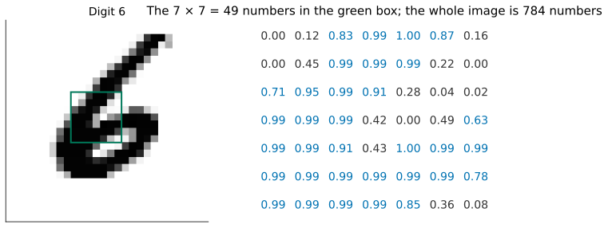
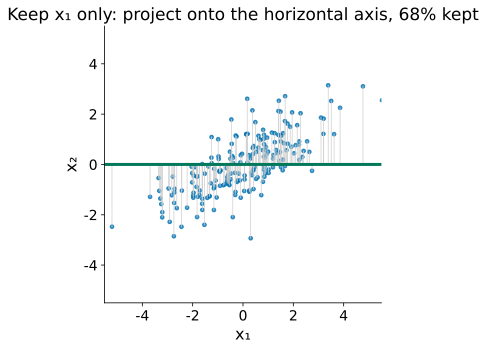
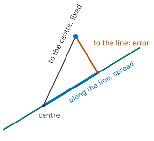
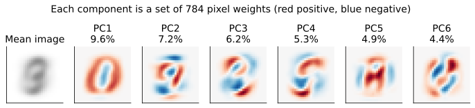
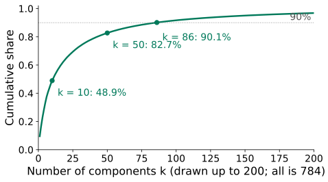
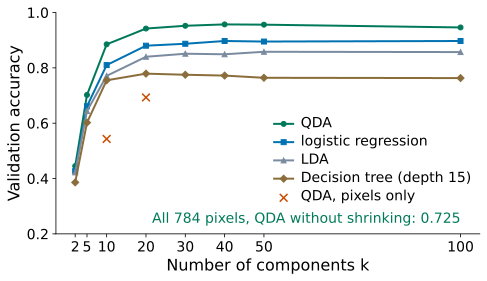
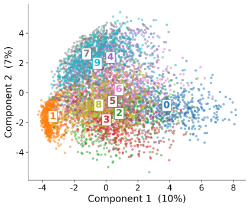
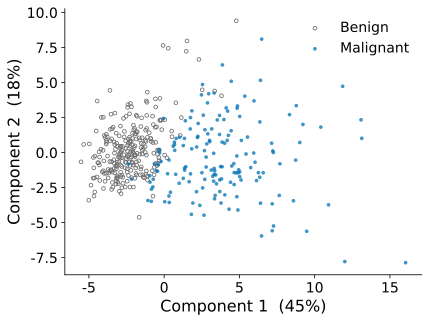

## One image of a digit is 784 numbers

::: {.stage}
{.fig .fig-s1 fig-alt="A handwritten 6 as a 28 by 28 image with a green box in the middle, and the 49 numbers inside the box, between 0 and 1"}

::: {.ask}
<small>Your turn</small>
How would you draw 5625 of these on one page? And QDA on all 784 numbers scores only **0.725** (validation, Lessons 5–6): why?
:::
:::

::: {.notes}
约 1.5 分钟。MNIST 子集一张图 28×28 = 784 个数。画不出来：两个特征才能画在平面上。QDA：Lesson 6 的拟合／验证划分上，不收缩只有 0.725，因为 784×784 的散布估不出来（每类约 560 张图）。今天不预测任何东西，只看像素，不看标签。
:::

## [Problem:]{.stg} What we want

::: {.stage}
::: {.say .xl .center}
**Fewer numbers** per image, **little information lost**.
:::

::: {.ask}
<small>Your turn</small>
How could we measure "information" in a column of numbers? Hint: a pixel that is the same in every image tells us nothing.
:::
:::

::: {.notes}
约 1.5 分钟。期待：看它散得多开，也就是方差。点名 dimensionality reduction（降维），无监督学习：不用标签。
:::

## What you will be able to do

::: {.stage .tight}
::: {.say .xl}
**Compress** many features into a few, **choose** how many to keep, and **draw** the data in two dimensions, without peeking at the validation set.
:::

::: {.flow .four}
<div><span>1</span>Pick pixels?</div>
<div><span>2</span>Combine pixels</div>
<div><span>3</span>Choose k</div>
<div><span>4</span>The rule, and a picture</div>
:::
:::

::: {.notes}
约 1 分钟。能力承诺，念出四段路线。
:::

## [Pick pixels:]{.stg} Keep the pixels that vary most

::: {.stage .top}


::: {.ask}
<small>Your turn</small>
10 of 784 pixels keep only **3.7%** of the variance. Why so little?
:::
:::

::: {.notes}
约 3 分钟。现场拖：10、20、100、200 个像素各保住多少（10 个 3.7%，20 个 7.4%）。候选一：挑散得最开的像素（绿框），其余用平均值填，所以图大部分是一团模糊的平均数字。QDA 在这 10 个像素上 0.543。期待：像素太多，每个只占一小份；相邻像素一起变，挑出来的 10 个彼此重复；丢掉的 774 个里有它们没有的信息。毛病：每个新数只用上一个像素。想要：每个新数用上所有像素。
:::

## [Combine pixels:]{.stg} A weighted sum is a projection

::: {.stage}
::: {.two .side}
{.fig fig-alt="A 2-D cloud of 200 points; each point drops straight down onto the horizontal axis; keeping x1 alone keeps 68% of the spread"}

::: {}
::: {.formula .m3}
$$
z = u_1x_1 + u_2x_2,\qquad u_1^2+u_2^2=1
$$
:::

::: {.muted .center}
$x_1, x_2$: means subtracted. $\mathbf u=(u_1,u_2)$: a direction.
:::

::: {.ask}
<small>Your turn</small>
Keeping $x_1$ alone is one direction. Which would you choose instead, and by what measure?
:::
:::
:::
:::

::: {.notes}
约 2 分钟。先在两个特征上想清楚。像素的组合 = 每个像素一个权重，乘起来加。二维时就是把点投影到一条线上，z 是点在线上的位置。只留 x₁（候选一的二维版）= 投影到横轴，保住 68%。两个合理的标准：投影后散得开；丢掉的少（点到线的距离平方，还原误差）。
:::

## [Combine pixels:]{.stg} Turn the line: spread against error

::: {.stage .top}

:::

::: {.notes}
约 4 分钟。现场转。先请学生猜哪个方向最好，再点“散得最开的方向”：约 31°，散布 3.85，保住 89%；还原误差此时最小，0.49。两根柱子加起来总是 4.34。只看 x₂（90°）只有 32%。
:::

## [Combine pixels:]{.stg} Widest spread = smallest error

::: {.stage}
::: {.two .side}
{.fig .fig-s4 fig-alt="One point, the centre and the green line: the distance to the centre is the hypotenuse (fixed); the part along the line is the spread; the part to the line is the error"}

::: {.say}
Pythagoras, point by point: spread + error is fixed. So the widest-spread direction is also the smallest-error one: the **first principal component**.
:::
:::
:::

::: {.notes}
约 2 分钟。每个点到中心的距离平方 = 在线上那段的平方 + 到线的距离平方；加起来是固定的总散布，所以“散得最开”和“丢得最少”是同一件事。点名 first principal component。
:::

## [Combine pixels:]{.stg} A second number: what should it do?

::: {.stage}
::: {.say .xl .center}
The first direction keeps 89%. We want a second number.
:::

::: {.ask}
<small>Your turn</small>
What should the second number do that the first does not? How could we check it?
:::
:::

::: {.notes}
约 1.5 分钟。期待：不要重复第一个；检查办法：两个数的相关系数，接近 ±1 就是在重复。下一页转第二条线。
:::

## [Combine pixels:]{.stg} Turn a second line: does it repeat the first?

::: {.stage .top}

:::

::: {.notes}
约 3 分钟。起点 76°：散布 2.18 最大，但与第一个数相关 0.94，几乎在说同一件事；转到 90°（x₂）：0.86；转到 121°（约垂直）：相关约为 0（0.01），说的几乎全是新的，散布 0.49 正是没保住的 11%。
:::

## [Combine pixels:]{.stg} Perpendicular, one after another: PCA

::: {.stage}
{.fig .fig-f4 fig-alt="The mean image and the first six principal components of the MNIST subset as 28 by 28 red-blue weight images, keeping 9.6%, 7.2%, 6.2%, 5.3%, 4.9% and 4.4% of the variance"}

::: {.say .center}
Each **principal component** is 784 pixel weights. The share it keeps: the **explained variance ratio**. (On 784 pixels the first keeps 9.6%, not 89%: the variance is spread over many directions.)
:::
:::

::: {.notes}
约 2.5 分钟。点名 principal components、PCA。每个方向与前面的都垂直，在剩下的方向里找散得最开的；784 个像素最多 784 个。第 3 节“保住 89%”就是解释方差比例（那是两个特征的点云；这里第一个主成分只有 9.6%）；前 k 个加起来是累计比例。PC1 像一个红圈、中间蓝：得分大像 0，得分小像 1。还原：平均图 + 每个主成分乘以这张图的得分，只加前 k 个。只用 5625 张拟合图学。
:::

## [Choose k:]{.stg} How many until you can read the digit?

::: {.stage .top}

:::

::: {.notes}
约 4 分钟。拖 k：1、2、5、10、20、50。请学生说从几个开始认得出是 6。右边的误差图：红 = 还原得太白，蓝 = 还原得太黑；k 越大，误差图越淡，这张图的重建误差（784 个差的平方和）从 k = 10 的 25.2 降到 k = 50 的 11.0。换几张图试。对照：10 个像素保住 3.7%，10 个主成分保住 48.9%。
:::

## [Choose k:]{.stg} The cumulative share gives a starting point

::: {.stage}
::: {.two .side}
{.fig fig-alt="Cumulative explained variance of the MNIST subset against k, drawn up to k = 200: 48.9% at k = 10, 82.7% at 50, 90.1% at 86"}

::: {.say}
90% needs 86 components. But **90%** is a threshold we chose. The task should decide.
:::
:::
:::

::: {.notes}
约 1.5 分钟。95% 要 150 个。留 86 个还是 150 个，累计比例回答不了；要看降维之后拿来做什么。
:::

## [Choose k:]{.stg} Let the classifier decide, on the validation set

::: {.stage}
::: {.two .side}
{.fig fig-alt="Validation accuracy against k for QDA, logistic regression, LDA and a depth-15 tree; QDA reaches 0.957 at k = 40; with all 784 pixels it scores 0.725; red crosses show QDA on 10 and 20 pixels"}

::: {.ask}
<small>Your turn</small>
QDA scores 0.725 with all 784 numbers but **0.885** with only 10 components, and 0.957 with 40. How can losing information help?
:::

::: {.say}
<small>Red crosses: QDA on the 10 or 20 most spread-out pixels. Choose k by validation accuracy; the chosen k must not sit at either end of the range.</small>
:::
:::
:::

::: {.notes}
约 3 分钟。期待：主成分按“散得开”排，前几十个方向都有厚度，QDA 估得稳；丢掉的是几乎不变、只会添乱的方向。这和 Lesson 5 的收缩是两种办法；在这份数据上降维好得多：Lesson 5 收缩后的 QDA 用全部 784 维，测试 0.861；先降到 40 维再用 QDA，测试 0.962。累计比例与验证准确率要一起看；作业 2 用 k = 10、50、100 比较。
:::

## [The rule:]{.stg} Learn the directions from which data?

::: {.stage}
::: {.say .xl .center}
`pca.fit(...)` learns the directions **from data**.
:::

::: {.ask}
<small>Your turn</small>
What goes wrong if we fit PCA on the fitting images **and** the validation images together?
:::
:::

::: {.notes}
约 1.5 分钟。期待：方向“见过”验证集，验证准确率不再是没见过的数据上的准确率。
:::

## [The rule:]{.stg} Fit on the fitting part, only transform the rest

::: {.stage}
```python
pca = PCA(n_components=40, random_state=0)   # 40 directions
pca.fit(X_digits_fit)                      # learn them from the fitting images only
Z_fit = pca.transform(X_digits_fit)        # 40 numbers per fitting image
Z_val = pca.transform(X_digits_val)        # the same directions for validation
Z_test = pca.transform(X_digits_test)      # and for the test set, once
```

::: {.say .center}
Same rule as standardising (Lesson 3) and the validation set (Lesson 6). Test set, once (QDA, k = 40): **0.962**.
:::
:::

::: {.notes}
约 1.5 分钟。本例偷看（在拟合加验证上 fit）没有带来虚高（0.885 → 0.883），差别可以忽略；但这是原则：数据越少、维数越多，虚高越大，事先也不知道有多大。作业 2 第 3 节要求的就是这一行：PCA 只在训练集上 fit。
:::

## [A picture:]{.stg} MNIST on two numbers

::: {.stage}
::: {.two .side}
{.fig fig-alt="The 5625 fitting images on the first two components, coloured by digit; 1 sits tightly on the left, 0 on the right, 7, 9 and 4 at the top, 2, 3, 5, 6 and 8 crowd in the middle"}

::: {.say}
Two components keep only **17%**, yet 1 and 0 already sit apart, and 7, 9, 4 group together.
:::
:::
:::

::: {.notes}
约 2 分钟。上色只为了看，PCA 没用标签。1 在最左（PC1 得分小），0 在最右；7、9、4 挤在上方，2、3、5、6、8 挤在中间：哪些数字容易混一眼可见。作业 2 选做题就是这张图（MNIST）。
:::

## [A picture:]{.stg} Breast lumps: 30 measurements on two numbers

::: {.stage}
::: {.two .side}
{.fig fig-alt="426 training lumps on the first two components: benign grey points on the left, malignant blue points spread to the right; the two components keep 63% of the variance"}

::: {.say}
63% kept. Logistic regression on these **2** numbers: 0.953 (all 30: 0.979).
:::
:::
:::

::: {.notes}
约 1.5 分钟。先标准化（面积几百到两千多，不标准化会独占第一主成分）。第一主成分 30 个权重全为正、大小相近：差不多是“整体有多大、多不规则”。
:::

## Today in code

::: {.stage}
```python
pca = PCA()                                  # all 784 components
pca.fit(X_digits_fit)                        # fitting images only
print(pca.explained_variance_ratio_[:5])     # share kept by each of the first five

for k in [10, 20, 30, 40, 50, 100]:          # candidate numbers of components
    pca = PCA(n_components=k, random_state=0)
    pca.fit(X_digits_fit)
    Z_fit = pca.transform(X_digits_fit)      # k numbers per image
    Z_val = pca.transform(X_digits_val)
    qda = QuadraticDiscriminantAnalysis()
    qda.fit(Z_fit, y_digits_fit)
    print(k, qda.score(Z_val, y_digits_val)) # validation accuracy
```
:::

::: {.notes}
约 1 分钟。不讲语法。Lab 7 会一步步做：看比例、还原一张图、在验证集上选 k、测试集读一次。
:::

## Back to the opening question

::: {.stage .bigtab}
| | numbers | variance kept | QDA |
|---|---:|---:|---:|
| all pixels | 784 | 100% | 0.725 |
| 10 pixels | 10 | 3.7% | 0.543 |
| 10 components | 10 | 48.9% | 0.885 |
| 40 components | 40 | 78.9% | **0.957** |

::: {.say .center}
Fewer numbers, little lost: combine, don't pick.
:::
:::

::: {.notes}
约 1 分钟。局限（口头）：方差大不等于对分类有用（PCA 不看标签）；只找直线方向；尺度会改变结果，要先标准化；主成分不一定好解释。
:::

## What you can do now {.final-slide}

::: {.takeaway}
::: {.rows .tiny .chain}
<div><span class="n">see it</span><div><b>Too many numbers</b><p>cannot be drawn; QDA cannot estimate</p></div></div>
<div><span class="n">pick?</span><div><b>Pixels repeat each other</b><p>10 pixels keep 3.7%</p></div></div>
<div><span class="n">combine</span><div><b>Project onto a direction</b><p>widest spread = smallest error</p></div></div>
<div><span class="n">PCA</span><div><b>Principal components</b><p>perpendicular, one after another</p></div></div>
<div><span class="n">choose k</span><div><b>Cumulative share, then validation</b><p>the chosen k must not be at either end of the range</p></div></div>
<div><span class="n">rule</span><div><b>Fit on the fitting part</b><p>only transform validation and test</p></div></div>
:::

::: {.qr}
{fig-alt="Feedback QR code for Lesson 7"}
<b>30-second feedback</b>
<p>After class: Lab 7</p>
:::
:::

::: {.notes}
约 1.5 分钟，课堂最终停在这一页。沿六行把整条链念一遍。答疑和扫码都在这里。课后 Lab 7，不预告下一讲。
:::
