## [Problem:]{.stg} Do we need to store every number?

::: {.stage .top}
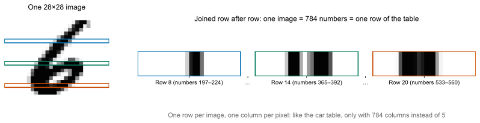{.fig .fig-f6top fig-alt="A handwritten 6 as a 28 by 28 grid of pixels; three rows are pulled out into long strips of numbers"}

::: {.p2row}
<table class="corr">
<tr><th>correlation</th><th>displ.</th><th>hp</th><th>weight</th></tr>
<tr><td>cylinders</td><td class="hi">0.95</td><td class="hi">0.84</td><td class="hi">0.90</td></tr>
<tr><td>displacement</td><td></td><td class="hi">0.90</td><td class="hi">0.93</td></tr>
<tr><td>horsepower</td><td></td><td></td><td class="hi">0.86</td></tr>
</table>

::: {.say}
Many numbers **repeat**. Can we store fewer and still rebuild the data?
:::
:::
:::

::: {.scan}
{fig-alt="QR code for today's live page"}
<b>Scan now</b>
votes, questions, feedback
:::

::: {.notes}
约 3 分钟。先请大家扫码，页面整节课开着。一张手写的 6 是 28×28 = 784 个数；一辆车量了五个数：缸数、排量、马力、车重、加速时间。表里是 392 辆车前四个量两两的相关系数，0.84 到 0.95：大车缸多、排量大、马力大、也重，知道车重就大概知道排量。图里一笔写过去，相邻的像素一起变黑，四角总是白的。数在重复，就应该能少存一些。今天的问题：每个样本只存几个数，还能还原吗？存哪几个？这叫降维，不用标签。用处有三：压缩、把几百个量画出来、降维后再分类（作业 2 要用）。
:::

## What you will be able to do

::: {.stage .tight}
::: {.say .xl}
Use **PCA** to compress data: say what it keeps and why the answer is an **eigenvector**, read what a component means, and choose how many to keep.
:::

::: {.flow .seven}
<div><span>1</span>Problem</div>
<div><span>2</span>Model</div>
<div><span>3</span>Loss</div>
<div><span>4</span>Solution</div>
<div><span>5</span>Test</div>
<div><span>6</span>Application</div>
<div><span>7</span>Extension and limits</div>
:::
:::

::: {.notes}
约 0.5 分钟。能力承诺。念路线：问题、模型、损失、求解、检验、应用，最后是扩展和局限。推导不在课上做，每一步给主干和结论。先在只有两个数的时候把道理想清楚。
:::

## [Problem:]{.stg} Two numbers per person. Keep only one?

::: {.stage}
::: {.two .side}
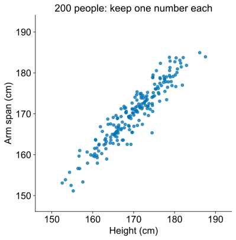{.fig .fig-s1 fig-alt="Scatter plot of height against arm span for 200 people; the points lie along a rising diagonal band"}

::: {.ask .vote}
<small>Vote on your phone</small>
Draw a line and drop each person onto it. Which line keeps the most?

::: {.opts}
<span><b>A</b>horizontal (height only)</span>
<span><b>B</b>vertical (arm span only)</span>
<span><b>C</b>along the cloud</span>
<span><b>D</b>all the same</span>
:::
:::
:::
:::

::: {.notes}
约 1.5 分钟。200 个人的身高和臂展（手造），相关 0.94，点沿一条斜线挤着：两个数主要在一个方向上一起变。只许用一个数描述每个人：画一条线，每个点垂直落到线上，每人只剩他在线上的位置。投票（右屏 Problem: Two numbers per person → Open，30 秒，再 Reveal），下一页揭晓。
:::

## [Problem:]{.stg} Turn the line

::: {.stage .top}

:::

::: {.notes}
约 5 分钟。揭晓投票：答案 C。教师转线。0°：每人只留身高，散布 46.52，丢掉 51.15，只留住 48%，身高一样、臂展不同的人分不出来。90°：只留臂展，反过来。转到 46° 左右（或按 Direction of widest spread）：散布 94.71，丢掉 2.97，留住 97%。请学生看两根柱子：一个高另一个就低，和始终 97.68。学生得出：画一条线就是投影；沿点最长的方向，投影散得最开，丢掉的最少。剩下和它垂直的方向是“臂展减身高”，只占 3%。为什么垂直落下、不竖直或水平，两条最小二乘线不一样，在 Note 第 2 节的折叠框，课上不讲。转出来的，784 个数时方向多得转不完：下面按模型、损失、求解写下来，直接算。
:::

## [Model:]{.stg} Each point is a column of $d$ numbers

::: {.stage}
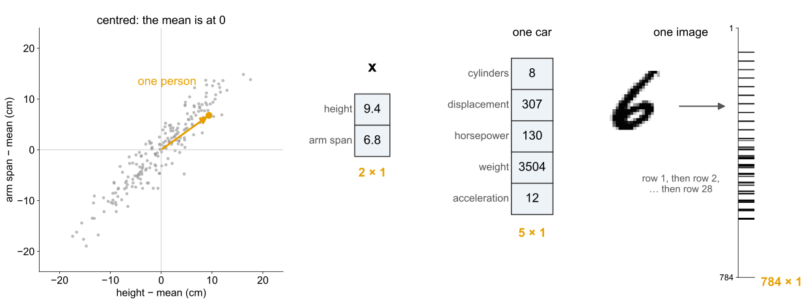{.fig .fig-s2 fig-alt="Left: the 200 centred people as grey points with one person marked by an orange arrow from 0. Right: that person as a column of two numbers, 9.4 and 6.8, labelled 2 by 1; one car as a column of five numbers, labelled 5 by 1; one handwritten 6 as a thin column of 784 grey pixels, labelled 784 by 1"}

::: {.one}
First **centre**: subtract the mean, so the cloud sits at 0. From here on $\mathbf x$ is the centred point, a column of $d$ numbers: $\mathbf x\in\mathbb R^{d\times 1}$.
:::
:::

::: {.notes}
约 2 分钟。先把“一个点”写成数学对象。左图：先中心化，每个量减去它的平均，点云的中心移到 0；从这里起 x 指中心化后的点。圈出的这个人：身高比平均高 9.4，臂展比平均长 6.8，他就是一列两个数，2×1。一辆车是一列五个数，5×1；一张手写的 6，把 28 行一行接一行排成一列，是 784×1。所以 x 是 d×1 的列向量，d 是每个样本有几个数：2、5、784。后面的式子对任何 d 都一样，图只能画 d = 2。
:::

## [Model:]{.stg} A direction is a column of length 1

::: {.stage}
::: {.two .side}
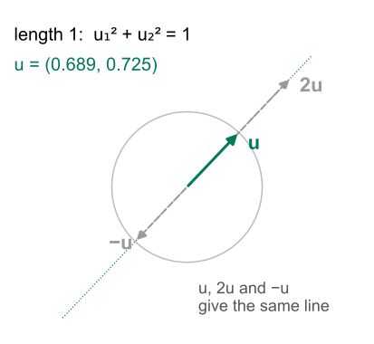{.fig .fig-s3 fig-alt="A unit circle with a green arrow u of length 1 pointing up and to the right at about 46 degrees; grey dashed arrows 2u and minus u lie on the same dotted line"}

::: {.props}
A line through 0 is given by a direction $\mathbf u\in\mathbb R^{d\times 1}$.

$\mathbf u$, $2\mathbf u$ and $-\mathbf u$ draw the **same line**: only the direction matters.

So we fix its length:
$$\mathbf u^\top\mathbf u = u_1^2+\dots+u_d^2 = 1$$
:::
:::
:::

::: {.notes}
约 1.5 分钟。线要过 0（数据已经中心化），一条过 0 的线由一个方向决定，方向也是一个 d×1 的列：u。u、2u、−u 画出来是同一条线，长度不影响线，所以规定长度为 1：uᵀu = u₁² + … + u_d² = 1。转线组件里转到 46.4° 时，u = (0.689, 0.725)，0.689² + 0.725² = 1。规定长度的另一个原因下一页就用到：这样 z 才是点沿线走了多远。
:::

## [Model:]{.stg} Keep one number: $z = \mathbf u^\top\mathbf x$

::: {.stage}
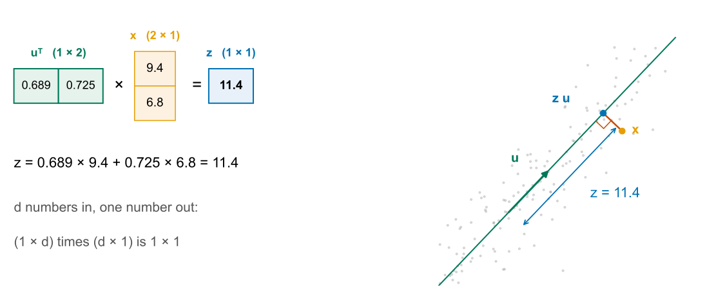{.fig .fig-s4 fig-alt="Left: a green row of two numbers, 0.689 and 0.725, labelled u transpose, 1 by 2, times an orange column 9.4 and 6.8, labelled x, 2 by 1, equals a blue box 11.4, labelled z, 1 by 1. Right: the centred cloud, the green line along u, the orange point x, and the blue point z u on the line where a red segment from x meets the line at a right angle; z = 11.4 is marked along the line"}

::: {.one}
$z$ is how far $\mathbf x$ lies along $\mathbf u$. We rebuild $\mathbf x\approx z\mathbf u$: the **closest point on the line**, and the part we drop (red) is at a right angle.
:::
:::

::: {.notes}
约 2.5 分钟。每个点只存一个数 z。左边是算法：一行（uᵀ，1×2）乘一列（x，2×1）得一个数（1×1）：0.689×9.4 + 0.725×6.8 = 11.4。d 个数进去，一个数出来；d = 784 时也是一行乘一列。右边是几何：z 是 x 沿 u 走了多远；还原成线上的 zu。这个点正是 x 垂直落到线上的点，红线和线成直角，所以它是线上离 x 最近的点，丢掉的就是红线。这就是转线时的灰色短线。为什么取 z = uᵀx 就是最近点：对 z 求导一行就出来，在 Note 第 3 节和 Advanced Study 1 第 1 步。
:::

## [Model:]{.stg} Rebuild from $K$ directions

::: {.stage}
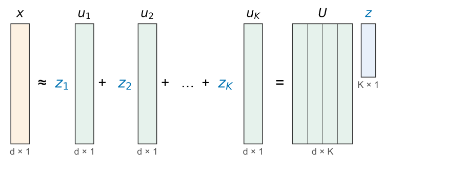{.fig .fig-s5 fig-alt="A tall orange column x, d by 1, is approximately z1 times a green column u1, plus z2 times u2, plus up to zK times uK, each d by 1; this equals a d by K green matrix U times a blue K by 1 column z"}

::: {.one}
**Model:** $\mathbf x \approx z_1\mathbf u_1+\dots+z_K\mathbf u_K = U\mathbf z$, with $z_k=\mathbf u_k^\top\mathbf x$ and the directions at right angles.<br>Store $K$ numbers instead of $d$. **Which directions?** The loss decides.
:::
:::

::: {.notes}
约 1.5 分钟。一个数不够时，用 K 个两两垂直、长度为 1 的方向，各算各的 z_k = u_kᵀx，还原是这些分量加起来。把 K 个方向并排放成一个 d×K 的矩阵 U，K 个得分是一列 z（K×1），还原就是 Uz。每个样本从存 d 个数变成存 K 个数；方向 U 所有样本共用，只存一次。模型到这里定了：剩下的问题是哪些方向最好，下一页用还原误差来量。
:::

## [Loss:]{.stg} How well does a direction rebuild the data?

::: {.stage}
::: {.say}
**Reconstruction error** (the red bar):
$$L(\mathbf u) = \sum_{i=1}^n\lVert\mathbf x_i - z_i\mathbf u\rVert^2 \;=\; (n-1)\big(\operatorname{tr}S - \mathbf u^\top S\,\mathbf u\big)$$
$S = \frac{1}{n-1}\sum_i\mathbf x_i\mathbf x_i^\top$: the **covariance matrix**. $\;\mathbf u^\top S\mathbf u$: the spread along $\mathbf u$ (the blue bar).
:::

::: {.one}
$\operatorname{tr}S$ is fixed, so **smallest error = widest spread**: the two bars.
:::
:::

::: {.notes}
约 2.5 分钟。损失就是还原误差：每个点和它的还原值之间的距离平方，加起来，就是组件里的红柱。给结论，不推：它等于 (n−1) 乘（tr S 减 uᵀSu）。S 是协方差矩阵，对角线是各个量的方差，非对角线是协方差；tr S 是对角线之和，点云的总散布，和方向无关；uᵀSu 是投影的方差，就是蓝柱。问一句：哪一项和方向有关？所以误差最小等于方差最大，两根柱子之和不变就是这个式子。展开的过程在 Note 第 5.1 节。
:::

## [Solution:]{.stg} The direction of widest spread

::: {.stage}
::: {.two .side}
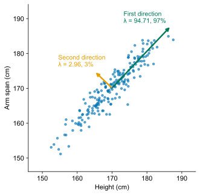{.fig fig-alt="The height and arm span cloud with two arrows from the centre: a green arrow along the band, first direction, lambda 94.71, 97 percent; a short orange arrow at right angles, second direction, lambda 2.96, 3 percent"}

::: {.say}
Widest spread with $\mathbf u^\top\mathbf u = 1$:
$$S\mathbf u = \lambda\mathbf u$$

**Eigenvectors** of $S$; spread $= \lambda$, take the largest. Top $K$: error $=$ the dropped $\lambda$'s.

Here **46.4°**, $\lambda = 94.71,\ 2.96$.

<small>Advanced: derive it yourself (Note, Advanced Study 1).</small>
:::
:::
:::

::: {.notes}
约 4 分钟。这一步最难，给结论，不推。问题：在 uᵀu = 1 下让 uᵀSu 最大。结论：最好的方向满足 Su = λu，也就是 S 的特征向量；左乘 uᵀ 得 uᵀSu = λ，沿它的散布就是特征值，所以取最大的那个。第二个方向和第一个垂直，在剩下的方向里散得最开，就是第二个特征向量；前 K 个特征向量最好，还原误差就是丢掉的特征值之和，留住的比例 λ/Σλ 叫解释方差比例。核对：46.4°，和转线一样；λ = 94.71、2.96，97% 和 3%。点名：主成分、得分、PCA。怎么推（拉格朗日乘子、为什么是全局最大、一个一个挑等于一次挑一组）留给 Advanced，请有兴趣的同学自己推一遍，Note 的 Advanced Study 1 有提示。
:::

## [Test:]{.stg} When does it fail?

::: {.stage}
::: {.two .side}
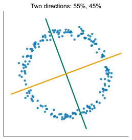{.fig .fig-f4 fig-alt="200 points in a ring with two perpendicular principal directions, keeping 55 percent and 45 percent"}

::: {.ask}
<small>Your turn</small>
A ring of points. Keep one direction: how much does it keep?
:::
:::
:::

::: {.notes}
约 2 分钟，口头。先让学生猜，再揭晓：55% 和 45%，留一个就丢一半。点不挤在任何一条线附近，就没有线可找；PCA 只找直线方向。两个特征值接近时第一主成分也不稳，不要读它的意思。真实数据里点挤在线附近吗？回到开头那张车的表。
:::

## [Application:]{.stg} Back to the cars

::: {.stage}
::: {.two .side}
::: {.say}
392 cars, five quantities. Standard deviations:

<table class="corr">
<tr><td>cylinders</td><td>1.7</td></tr>
<tr><td>displacement</td><td>104.6</td></tr>
<tr><td>horsepower</td><td>38.5</td></tr>
<tr><td>weight (lb)</td><td class="hi">849.4</td></tr>
<tr><td>acceleration (s)</td><td>2.8</td></tr>
</table>
:::

::: {.ask .vote}
<small>Vote on your phone</small>
PCA on the raw car data: the first component is…

::: {.opts}
<span><b>A</b>about all five</span>
<span><b>B</b>mostly weight</span>
<span><b>C</b>mostly horsepower</span>
<span><b>D</b>not sure</span>
:::
:::
:::
:::

::: {.notes}
约 1.5 分钟。392 辆车，五个量。另有一列油耗（每加仑跑几英里），先放在一边，PCA 不用它。投票（右屏 Application: Back to the cars → Open，30 秒，再 Reveal），下一页揭晓。
:::

## [Application:]{.stg} Standardise first

::: {.stage}
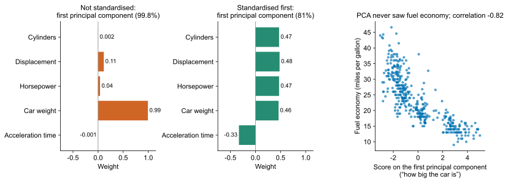{.fig .fig-f5 fig-alt="Three panels. Left: without standardising, the first component is almost only weight, 0.99, keeping 99.8 percent. Middle: after standardising, cylinders 0.47, displacement 0.48, horsepower 0.47, weight 0.46, acceleration minus 0.33, keeping 81 percent. Right: each car's score on the first component against its fuel economy, falling, correlation minus 0.82"}

::: {.one}
Units should not decide the answer. PC1 = **how big the car is** (81%), and it tracks fuel economy ($r = -0.82$) without ever seeing it.
:::
:::

::: {.notes}
约 4.5 分钟。揭晓：答案 B，车重权重 0.993，一个主成分留住 99.8%。车重以磅计，标准差 849，数大散布就大，压过了其余所有量；99.8% 只反映车重的数大。单位不该决定答案：先标准化（减平均、除以标准差）。中图：前四个权重几乎相等，加速时间 −0.33：“车有多大、多猛”，留住 81%；第二主成分主要是加速时间，14%；两个 95%，五个数换两个基本不丢。右图：拿出放在一边的油耗，相关 −0.82，和单看车重 −0.83 差不多。PCA 没看油耗，找出的是五个量共同在说的那件事。单位相同（身高臂展、像素）可以不标准化。
:::

## [Application:]{.stg} An image is a row of 784 numbers

::: {.stage}
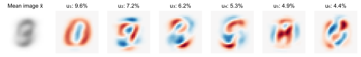{.fig .fig-f67 fig-alt="The mean training image, and the first six principal components as red and blue 28 by 28 weight images, with explained variance ratios 9.6, 7.2, 6.2, 5.3, 4.9 and 4.4 percent"}

::: {.one}
Each image is one row, each pixel one column: the same table as the cars. **Each principal component is itself an image**: red where it adds ink to the mean image, blue where it takes ink away.
:::
:::

::: {.notes}
约 2 分钟。28×28 一行一行接起来是 784 个数；每张图一行、每个像素一列，和车的表一样，只是 5 列变 784 列。像素同单位，不标准化；中心化就是减去平均图。数字标签先放一边。5,625 张训练图。S 是 784×784，每个特征向量 784 个数，排回 28×28 就是一张图：红正蓝负。第一主成分像一个圈，得分大像 0，得分小像 1。它只留住 9.6%，远不如身高臂展的 97%：要多留几个。
:::

## [Application:]{.stg} How many to read the 6?

::: {.stage}
::: {.say .xl}
$$\hat{\mathbf x} = \bar{\mathbf x} + z_1\mathbf u_1 + z_2\mathbf u_2 + \dots + z_K\mathbf u_K$$
:::

::: {.ask .vote}
<small>Vote on your phone</small>
How many components until you can read the 6?

::: {.opts}
<span><b>A</b>2</span>
<span><b>B</b>10</span>
<span><b>C</b>50</span>
<span><b>D</b>200</span>
:::
:::
:::

::: {.notes}
约 1 分钟。还原公式：平均图，加上每个主成分乘这张图在它上面的得分，只加前 K 个。存一张图只要存 K 个得分，平均图和主成分大家共用。投票（右屏 Application: How many to read the 6? → Open，30 秒，再 Reveal），没有唯一答案，下一页拖 K 看。
:::

## [Application:]{.stg} Drag $K$

::: {.stage .top}

:::

::: {.notes}
约 3 分钟。先 K = 0：只有平均图，误差 58.4。K = 2：还是一团，57.7。K = 10：25.2，大致看出 6。K = 20：17.6。K = 50：10.9，和原图差不多。K = 100：6.2。右边误差图，K 越大红蓝越淡，剩下笔画边缘。换一张图看看。“认得出”以说出是几为准。
:::

## [Application:]{.stg} So how many?

::: {.stage}
::: {.two .side}
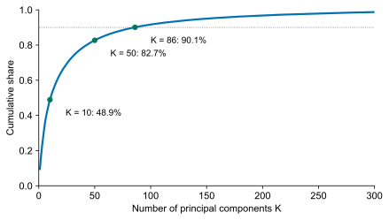{.fig .fig-f8 fig-alt="Cumulative explained variance ratio of the training images against K, up to 300: 48.9 percent at 10, 82.7 percent at 50, 90.1 percent at 86"}

::: {.say}
1. The cumulative share gives a range (90% needs 86).
2. Try a few $K$ in it on the task that follows.
3. Pick the best on the **validation set**, not at an end.
:::
:::
:::

::: {.notes}
约 2 分钟。10 个 48.9%，50 个 82.7%，100 个 91.7%，90% 要 86 个。90% 是人定的门槛，留 50 还是 86 好，累计比例回答不了，要看拿来做什么：存图看还原的图，分类看验证集准确率。分类的例子在后面一页。
:::

## [Application:]{.stg} Two numbers per image

::: {.stage}
::: {.two .side}
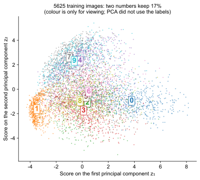{.fig fig-alt="5,625 training images on the first two principal components, coloured by their true digit after the fit: 1 on the far left, 0 on the right, 7, 9 and 4 at the top, the rest in the middle"}

::: {.say}
PCA never saw the labels: colours are added **after**. 1 and 0 already separate.

`pca.fit` on the **training images only**; validation and test only `transform`.
:::
:::
:::

::: {.notes}
约 1.5 分钟，超时先压这一页。两个数只留 16.7%，但看得出结构。先不上色讲一句，再说颜色是画完才按真实数字上的：1 最左，0 右边，7、9、4 上方。规矩：平均图和主成分是从数据学的，只能用训练图学，验证和测试只转换，和标准化同一条规矩。想看更多画图方法（t-SNE、UMAP）在 Note 第 11 节，选读。
:::

## [Application:]{.stg} Does PCA help a classifier?

::: {.stage}
<table class="corr big">
<tr><th>components K</th><th>2</th><th>10</th><th>20</th><th>40</th><th>100</th><th>784 (all pixels)</th></tr>
<tr><td>logistic regression</td><td>0.427</td><td>0.810</td><td>0.880</td><td>0.897</td><td>0.897</td><td>0.891</td></tr>
<tr><td>QDA</td><td>0.445</td><td>0.885</td><td>0.942</td><td class="hi">0.957</td><td>error</td><td>error</td></tr>
</table>

::: {.one}
Fewer numbers, **better** QDA: the dropped directions barely vary and only add noise.<br><small>error: about 560 images per digit are too few to estimate QDA's covariance matrix.</small><br>Choose $K$ on the **validation set**; read the test set once (0.962). Assignment 2 does this.
:::
:::

::: {.notes}
约 3.5 分钟。作业 2 第 3 节要先 PCA，再把分类器用在 K 个得分上。表里是验证集准确率。logistic regression 到 40 个主成分以后不再变好。QDA 在 784 个像素上跑不出来：要为每类估一个 784×784 的协方差矩阵并求逆，128 个像素在所有训练图上都是 0，矩阵不可逆，直接报错。降到 40 个，留下的都是散得开的方向，QDA 估得稳，0.957，比 logistic regression 高 0.06：丢掉信息反而更好。K = 100 又报错：每类只有约 560 张训练图，估不了 100×100 的协方差矩阵（5,000 多个数）；作业 2 有 5 万张训练图，没有这个问题。K 在验证集上选，不在范围两端；测试集只读一次，0.962。
:::

## [Extension:]{.stg} Other ways to find a representation

::: {.stage}
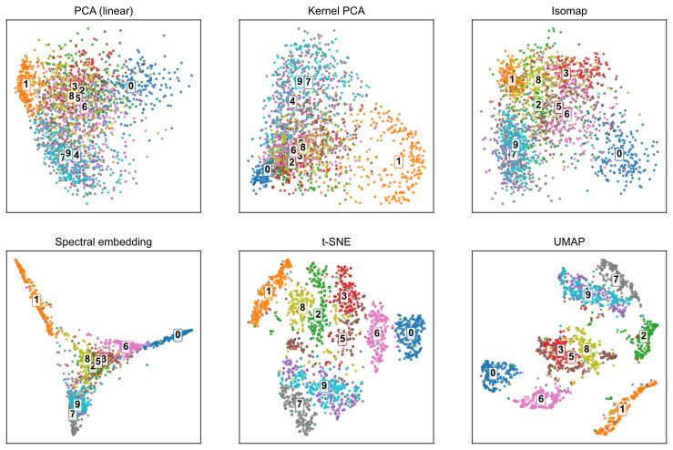{.fig .fig-f16 fig-alt="Six scatter plots of 2,000 training images reduced to two numbers by PCA, Kernel PCA, Isomap, Spectral embedding, t-SNE and UMAP, coloured by digit; in t-SNE and UMAP most digits form their own cluster"}

::: {.one}
Nonlinear methods keep neighbours together, for **plotting**: `KernelPCA`, `Isomap`, `TSNE`, `umap.UMAP`. One line each.
:::
:::

::: {.notes}
约 2 分钟，选读，超时先压这一页。PCA 给每张图换了一组新的数，也就是一种表示。理解了这一点，就可以换别的方法：同样 2,000 张训练图，PCA 的二维图里大多数数字混在一起；t-SNE 和 UMAP 里大多数数字各成一团。它们不要求点挤在平面附近，而是让原来挨得近的点仍然挨得近，主要用来画图看结构。scikit-learn 里一行就能调用（UMAP 要 pip install umap-learn）。它们大多不能还原，t-SNE 不能把新图放进已经画好的图里，团之间的距离不一定有意义。Note 第 11 节有一张三维卷的例子和调用表。
:::

## [Limitations:]{.stg} Where PCA cannot be trusted

::: {.stage}
::: {.rows}
<div><span class="n">1</span><div><b>Straight directions only</b><p>a ring keeps 55% with one direction</p></div></div>
<div><span class="n">2</span><div><b>Scale decides the answer</b><p>raw car data: weight alone takes 99.8%</p></div></div>
<div><span class="n">3</span><div><b>It ignores the labels</b><p>the widest direction is not always the one a classifier needs</p></div></div>
<div><span class="n">4</span><div><b>Not always readable</b><p>“how big the car is” reads well; pixel components 5 and 6 do not</p></div></div>
:::
:::

::: {.notes}
约 1.5 分钟。四条局限：环（检验那页）；车重独占（应用一）；不看标签，一个和类别无关但变化很大的量会被排在前面（今天没有例子，口头说）；主成分不一定好解释。
:::

## Today in code

::: {.stage}
```python
Xs = StandardScaler().fit_transform(cars[cols])          # different units
pca = PCA(n_components=50, random_state=0).fit(X_train)  # training images only
print(pca.explained_variance_ratio_.sum())               # share kept: 0.827
Z_val = pca.transform(X_val)                             # 50 scores per image
X_back = pca.inverse_transform(Z_val)                    # rebuild the images
```
Then fit any classifier on `Z` instead of the 784 pixels.
:::

::: {.notes}
约 0.5 分钟。四行，每行对应今天一段。Lab 7 在手写数字上动手。
:::

## What you can do now {.final-slide}

::: {.takeaway}
::: {.rows .tiny .chain}
<div><span class="n">model</span><div><b>x ≈ z u, z = uᵀx</b><p>keep each point's position on a line</p></div></div>
<div><span class="n">loss</span><div><b>Reconstruction error</b><p>smallest error = widest spread</p></div></div>
<div><span class="n">solution</span><div><b>Eigenvectors of S</b><p>spread = λ; keep the top K, lose the rest of λ</p></div></div>
<div><span class="n">test</span><div><b>Fails on curved shapes</b><p>standardise when units differ</p></div></div>
<div><span class="n">apply</span><div><b>Choose K on the task</b><p>rebuild, plot or classify; learn from training data only</p></div></div>
:::

::: {.qr}
{fig-alt="QR code for today's live page"}
<b>Feedback</b>
<p>After class: Lab 7</p>
:::
:::

::: {.notes}
约 0.5 分钟，课堂停在这一页。沿五行念一遍：模型是投影；损失是还原误差，最小就是散得最开；解是协方差矩阵的特征向量；弯的形状不行、单位不同先标准化；K 按任务在验证集上选，只从训练数据学。完整推导在 Advanced，请自己推。课后 Lab 7。一张图自己做 PCA、别的画图方法、完整推导都在 Note 里。
:::
