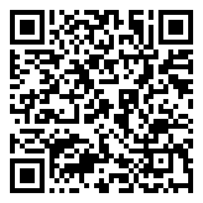

# Lab 8: Finding Groups Without Labels
## MPS311/439 Machine Learning
**Lesson 8 Lab Session | Core duration: 50 minutes**

## What this lab is for

In the lecture we grouped points without looking at any labels, first with K-means and then with hierarchical clustering. Today you do it on the digits:

1. split the digits into 10 groups with K-means, without labels, and look for a bend to choose the number of groups;
2. use the labels afterwards, only to check: a count table and a majority vote;
3. see how much the starting point matters;
4. compare K-means and hierarchical clustering on the two rings of the lecture, then try hierarchical clustering on the digits.

Before each step you will see a question. **Write down your own answer first**, then run the code and compare.

Most code is provided. Your job is to fill the blanks `____`, run the cell, and check your result against the **Success check**. At the end there is a short section on how today's lab helps with **Assignment 2**.

## How to work

1. Open the **Lab workbook** from the course website: it opens in Colab with all the code of this page already in place, so there is nothing to copy (**File → Save a copy in Drive** first). Prefer to build your own? Open a **blank** Colab notebook (**File → New notebook in Drive**) and copy each code block into a cell.
2. Fill in the blanks and run each cell. Cells depend on the cells above, so run them from top to bottom.
3. Write your answers to the **Questions** in a text cell below the code (**+ Text**).
4. Each task has a one-line **Hint** and a folded **Answer**. Try first. Open the Answer only to check your work. If you fall behind, copy the Answer of a task and carry on: every later task still works.
5. Running every cell and matching the Success checks is a complete lab.
6. The **Try with AI** boxes are folded: open one when you finish early, or after class. They follow the four steps below.

### Using AI

The **Try with AI** boxes use an AI assistant for the Python you do not know yet, while you stay in charge of the machine learning. Every box has the same four steps:

1. **You want:** say what you want in machine-learning words (for example, "the within-cluster sum of squares against k").
2. **Tell the AI:** the names of the variables it should use.
3. **Ask:** the request.
4. **Check:** compare the AI's result with a number or shape given on this page. If it does not match, the AI or your question is wrong. Find out which.

## Part 0: Load the digits and reduce them (6 minutes)

**Goal:** the fitting images of Labs 6 and 7, reduced to 50 numbers each with PCA.

### 0.1 Load, split, reduce

Run the cell without changing it.

```python
import numpy as np                                        # numbers and arrays
import matplotlib.pyplot as plt                           # plots
import urllib.request                                     # to download a file
from sklearn.model_selection import train_test_split     # splitting the data
from sklearn.decomposition import PCA                     # Lesson 7
from sklearn.cluster import KMeans, AgglomerativeClustering   # today's methods

DATA_URL = "https://raw.githubusercontent.com/wayXing/mps311-439-course-materials/main/lecture-slids/lessons/data/mnist10k.npz"
urllib.request.urlretrieve(DATA_URL, "mnist10k.npz")      # 10,000 MNIST images, about 1.6 MB
mnist = np.load("mnist10k.npz")                           # the file holds two arrays, X and y
X_digits = mnist["X"] / 255                               # 784 pixels per image (28 x 28), scaled to 0 to 1
y_digits = mnist["y"]                                     # the digit, 0 to 9 (used only to check)
X_digits_train, X_digits_test, y_digits_train, y_digits_test = train_test_split(
    X_digits, y_digits, test_size=0.25, random_state=0, stratify=y_digits)   # the test set of Labs 4 to 7
X_digits_fit, X_digits_val, y_digits_fit, y_digits_val = train_test_split(
    X_digits_train, y_digits_train, test_size=0.25, random_state=0, stratify=y_digits_train)   # the split of Labs 6 and 7
pca = PCA(n_components=50, random_state=0)                # 50 components, as in Assignment 2
pca.fit(X_digits_fit)                                     # fitting images only
Z_fit = pca.transform(X_digits_fit)                       # 50 numbers per fitting image
print(Z_fit.shape)                                        # images, numbers per image
```

**Success check:** `(5625, 50)`.

## Part 1: K-means with 10 groups (15 minutes)

**Goal:** split the 5625 images into 10 groups without using any label, then ask whether the data themselves point to 10.

### 1.1 Fit K-means

**Question first:** K-means needs the number of groups before it starts. How many should we ask for here, and why?

Fill in the number of groups.

```python
km = KMeans(n_clusters=____, n_init=10, random_state=0)  # 10 starting points, keep the best
km.fit(Z_fit)                                             # no labels are passed in
print(round(km.inertia_, 1))                              # within-cluster sum of squares
groups = km.labels_                                       # the group number of every image
print(groups[:10])                                        # the first ten group numbers
```

**Hint:** how many different digits are there?

**Success check:** `169025.6`, then ten group numbers between 0 and 9.

**Question:** in one sentence, what does `km.inertia_` measure?

::: {.callout-note collapse="true" title="Answer"}
```python
km = KMeans(n_clusters=10, n_init=10, random_state=0)
```

10, because there are ten digits. `inertia_` is the within-cluster sum of squares: the squared distance from every image to the centre of its own group, added up.
:::

### 1.2 How many groups?

In the lecture (Note Section 3, end) we chose k by trying several values and plotting the within-cluster sum of squares against k. A larger k always gives a smaller sum, so we look for the **bend (the elbow method)**: the k after which the sum falls much more slowly. The cell below does this twice, side by side: on the three blobs of the lecture (180 points, the same random numbers) and on the digits. The blobs start at k = 1, as in the lecture's plot; the digits start at k = 2, because one group for all 5625 images tells us nothing, and the larger k are slower. The two vertical axes have very different scales (hundreds against hundreds of thousands): what matters is the shape of each curve, not its height.

**Question first:** at which k do you expect the bend of the digits' curve to be?

Run the cell without changing it. It fits K-means 21 times, so it takes about half a minute on Colab.

```python
rng = np.random.default_rng(0)                            # the same random numbers as the lecture
X_points = np.vstack([rng.normal([0, 0], 0.6, (60, 2)),   # blob 1: 60 points around (0, 0)
                      rng.normal([4, 0.5], 0.6, (60, 2)), # blob 2: 60 points around (4, 0.5)
                      rng.normal([2, 3.5], 0.6, (60, 2))])   # blob 3: 60 points around (2, 3.5)
ks_blobs = range(1, 8)                                    # k = 1, 2, ..., 7 for the blobs
inertias_blobs = []                                       # within-cluster sum of squares for each k
for k in ks_blobs:
    km_k = KMeans(n_clusters=k, n_init=10, random_state=0)   # the same settings as 1.1, only k changes
    km_k.fit(X_points)                                    # no labels
    inertias_blobs.append(round(km_k.inertia_, 1))        # keep its within-cluster sum of squares
print("blobs:", inertias_blobs)                           # one number for each k from 1 to 7

ks = range(2, 16)                                         # k = 2, 3, ..., 15 for the digits
inertias = []                                             # within-cluster sum of squares for each k
for k in ks:
    km_k = KMeans(n_clusters=k, n_init=10, random_state=0)   # the same settings as 1.1, only k changes
    km_k.fit(Z_fit)                                       # still no labels
    inertias.append(km_k.inertia_)                        # keep its within-cluster sum of squares
    print(k, round(km_k.inertia_, 1))                     # k, within-cluster sum of squares

fig, axes = plt.subplots(1, 2, figsize=(10, 4))           # two plots side by side
axes[0].plot(ks_blobs, inertias_blobs, marker="o")        # one dot for each k
axes[0].set_title("three blobs (lecture)")
axes[1].plot(ks, inertias, marker="o")                    # one dot for each k
axes[1].set_title("digits")
for ax in axes:
    ax.set_xlabel("number of groups k")
    ax.set_ylabel("within-cluster sum of squares")
plt.show()
```

**Success check:** `blobs: [968.4, 486.2, 127.0, 108.5, 93.0, 77.8, 67.2]`; then 14 lines for the digits, from `2 226671.5` down to `15 155577.4`, with `10 169025.6`, the same as in 1.1; and two falling curves.

**Questions:**

1. At which k is the bend for the three blobs? Is there a clear bend in the digits' curve, like the blobs at k = 3: from that k on, each fall is suddenly much smaller? If so, at which k? (For the digits, compare the fall from k = 9 to 10 with the fall from k = 10 to 11.)
2. Then why do we still use k = 10 for the digits in this lab?

::: {.callout-note collapse="true" title="Answer"}
1. The blobs: at k = 3. The sum falls from 968.4 to 127.0 by k = 3, then only to 108.5 at k = 4, so the elbow method picks 3, the number of blobs. The digits: no clear bend at 10, nor anywhere else. The falls do get smaller (after about k = 5 or 6 the curve is less steep), but slowly, never suddenly, so this does not count as a clear bend. From 9 to 10 it falls by about 3700 (172732.9 to 169025.6), from 10 to 11 by about 3400 (to 165612.4): almost the same.
2. Not because of a bend: because we know the digits have 10 classes (Note Section 3, end), and Assignment 2 uses k = 10. The bend is often hard to see (Note Section 10); then k has to come from what we know about the data or from what we want to do with the groups.
:::

## Part 2: Check the groups with the labels (8 minutes)

**Goal:** use the labels only after clustering, to see how well the groups match the digits.

### 2.1 The count table

**Question first:** the group numbers are arbitrary. Why can we not compare `groups` with `y_digits_fit` directly?

Fill the blank so that each image is counted in its group's row and its **true digit's** column.

```python
table = np.zeros((10, 10), dtype=int)                     # rows: groups, columns: true digits
for i in range(len(groups)):                              # every fitting image
    table[groups[i], ____[i]] += 1                        # add one to its group and its digit
print(table)                                              # the count table
print(table.sum())                                        # every image is counted once
```

**Hint:** write only the variable name that holds the true digits of the fitting images; the `[i]` is already there.

**Success check:** a 10 × 10 table, and `5625`. Its largest number is `443`.

::: {.callout-note collapse="true" title="Answer"}
```python
    table[groups[i], y_digits_fit[i]] += 1
```

K-means might call the group of zeros "group 7"; its numbers carry no meaning, so we count instead.
:::

### 2.2 Majority vote

Run the cell without changing it. Each group guesses its most common digit.

```python
guess = table.argmax(axis=1)                              # the most common digit in each group
correct = table.max(axis=1).sum()                         # images whose digit is their group's guess
order = np.argsort(guess)                                 # list the groups by their guess, to read the table easily
print(guess[order])                                       # the guesses, in that order
print(table[order])                                       # the count table, one row per group, in the same order
print(round(correct / len(groups), 3))                    # majority-vote accuracy
```

**Success check:** the guesses `[0 0 1 1 2 3 4 6 7 8]`, the table with its rows in that order, then `0.576`.

**Question:** (If you are short of time, answer this one after class.) Two digits are not the guess of any group. Which two?

::: {.callout-note collapse="true" title="Answer"}
5 and 9. The digits 0 and 1 each took two groups, so there were not enough groups left: most 5s sit in the groups that guess 3 and 8, and most 9s in the groups that guess 4 and 7.
:::

::: {.callout-tip collapse="true" title="Try with AI (if you finish early, or after class)"}
**You want:** to see the centre of each group as an image.

**Tell the AI:** `km.cluster_centers_` has 10 rows of 50 numbers (in PCA space); `pca.inverse_transform` turns them back into 784 pixels; `guess` holds each group's most common digit.

**Ask:** *"Turn km.cluster_centers_ back into pixels with pca.inverse_transform, and show the 10 rows as 28 × 28 grey images in one row, with 'guess ' plus the group's value of guess as the title."*

**Check:** 10 blurred digits: the average image of each group. There are two 0s and two 1s, and the group whose guess is 4 looks more like a 9, because it mixes 4s, 7s and 9s.
:::

## Part 3: Does the starting point matter? (6 minutes)

**Goal:** run K-means from single starting points and compare.

### 3.1 Five single starts

**Question first:** with only one starting point, will every run stop at the same place?

Run the cell without changing it.

```python
for seed in range(5):                                     # five different starting points
    km1 = KMeans(n_clusters=10, n_init=1, random_state=seed)   # only one start
    km1.fit(Z_fit)                                        # run K-means from that start
    t = np.zeros((10, 10), dtype=int)                     # count table for this run
    for i in range(len(Z_fit)):                           # every fitting image
        t[km1.labels_[i], y_digits_fit[i]] += 1           # add one to its group and its digit
    correct = t.max(axis=1).sum()                         # images whose digit is their group's guess
    print(seed, round(km1.inertia_, 1), round(correct / len(Z_fit), 3))   # seed, within-cluster sum of squares, majority vote
```

**Success check:**

```
0 169033.3 0.586
1 169714.5 0.599
2 169349.4 0.594
3 169025.8 0.576
4 169026.9 0.581
```

On another computer the last digits may differ slightly; compare the five runs with each other, not digit by digit with this table.

**Question:** does the run with the smallest sum also have the highest majority vote?

::: {.callout-note collapse="true" title="Answer"}
No. The run with the smallest sum (169025.8) has the lowest majority vote (0.576), while the run with the largest sum (169714.5) has the highest vote (0.599). K-means makes the groups compact; it does not know about digits, so the most compact grouping is not always the one that matches the digits best.
:::

## Part 4: Hierarchical clustering (15 minutes)

**Goal:** compare K-means and hierarchical clustering on the two rings of the lecture; then try hierarchical clustering on the digits, with two ways of measuring how near two groups are.

### 4.1 Two rings

These are the two rings of the lecture (Note Section 4): 120 points on an inner ring and 200 on an outer ring, made with the same random numbers. The first lines of the cell only make these two rings; then the cell runs K-means and hierarchical clustering, each asked for 2 groups, colours the points by the group each method gives them, and prints the **share recovered**: the majority vote of 2.2, now with 2 groups and 2 rings.

**Question first:** K-means is asked for 2 groups. Will it split the points into the inner and the outer ring, or into a left half and a right half?

Fill the blank with the way of measuring "near" that can follow a ring (write it inside the quotation marks), then run.

```python
# The first lines only make the two rings of the lecture
rng = np.random.default_rng(0)                            # the same random numbers as the lecture
a1 = rng.uniform(0, 2 * np.pi, 120)                       # angles on the inner ring
a2 = rng.uniform(0, 2 * np.pi, 200)                       # angles on the outer ring
r1 = rng.normal(1, 0.12, 120)                             # inner ring: radius about 1
r2 = rng.normal(3, 0.15, 200)                             # outer ring: radius about 3
inner = np.column_stack([r1 * np.cos(a1), r1 * np.sin(a1)])   # (x, y) of each inner point, from its angle and radius
outer = np.column_stack([r2 * np.cos(a2), r2 * np.sin(a2)])   # (x, y) of each outer point
X_rings = np.vstack([inner, outer])                       # 320 points
y_rings = np.r_[np.zeros(120, dtype=int), np.ones(200, dtype=int)]   # 0 = inner ring, 1 = outer ring (only to check)

# K-means
km_rings = KMeans(n_clusters=2, n_init=10, random_state=0)   # 2 groups
g_km = km_rings.fit_predict(X_rings)                      # one group per point, no labels used
t_km = np.zeros((2, 2), dtype=int)                        # count table: rows groups, columns rings
for i in range(len(X_rings)):                             # every point
    t_km[g_km[i], y_rings[i]] += 1                        # add one to its group and its ring
share_km = t_km.max(axis=1).sum() / len(X_rings)          # majority vote, as in 2.2
print("K-means", round(share_km, 3))

# hierarchical clustering
hc_rings = AgglomerativeClustering(n_clusters=2, linkage="____")   # 2 groups; how near two groups are
g_hc = hc_rings.fit_predict(X_rings)                      # one group per point, no labels used
t_hc = np.zeros((2, 2), dtype=int)                        # count table: rows groups, columns rings
for i in range(len(X_rings)):                             # every point
    t_hc[g_hc[i], y_rings[i]] += 1                        # add one to its group and its ring
share_hc = t_hc.max(axis=1).sum() / len(X_rings)          # majority vote, as in 2.2
print("hierarchical", round(share_hc, 3))

fig, axes = plt.subplots(1, 2, figsize=(9, 4.5))          # two plots side by side
axes[0].scatter(X_rings[:, 0], X_rings[:, 1], c=g_km, cmap="coolwarm", s=10)   # colour = K-means group
axes[0].set_title("K-means: " + str(round(100 * share_km, 1)) + "% recovered")
axes[1].scatter(X_rings[:, 0], X_rings[:, 1], c=g_hc, cmap="coolwarm", s=10)   # colour = hierarchical group
axes[1].set_title("hierarchical: " + str(round(100 * share_hc, 1)) + "% recovered")
for ax in axes:
    ax.set_aspect("equal")                                # circles look like circles
plt.show()
```

**Hint:** in scikit-learn, `linkage` is one of `"ward"`, `"complete"`, `"average"` or `"single"`; choose the one the lecture called "nearest points" (Note Section 5).

**Success check:** `K-means 0.625` and `hierarchical 1.0`, the two numbers of the lecture; on the right, each ring has one colour. Note that 0.625 = 200 / 320 is exactly what you would get by calling every point "outer ring": this is why the lecture calls it not much better than guessing.

**Questions:**

1. Look at the left plot. Where is the boundary between the two K-means groups, and what shape is it?
2. Where is the middle of each ring? K-means gives each point to its nearest centre (the centre K-means moves, not the middle of a ring). Use this to explain, in one or two sentences, what kind of group K-means can find, and why it cannot find the two rings.

::: {.callout-note collapse="true" title="Answer"}
```python
hc_rings = AgglomerativeClustering(n_clusters=2, linkage="single")
```

Two halves, not the two rings: K-means recovers only 62.5%, single 100%.

1. A straight line through the middle (here it is tilted, from the upper right to the lower left): each group is half of the inner ring plus half of the outer ring. The points equally far from two centres form a straight line, so K-means can only cut the plane with straight edges.
2. The middle of each ring is the same point, (0, 0). Two groups around the same middle cannot be told apart by "nearest centre": K-means puts its two centres apart and cuts between them. A K-means group is all the points nearer to its own centre than to any other, so it is a lump around one centre. The points on a ring are linked one to the next, not gathered around a centre; single follows that chain.
:::

### 4.2 The digits: Ward and nearest points

**Question first:** will the linkage you chose in 4.1 also do best on the digits?

Run the cell without changing it. It runs hierarchical clustering twice on all 5625 images, once with Ward and once with single; together this takes about half a minute on Colab: it is working, not stuck.

```python
for link in ["ward", "single"]:                           # two ways of measuring how near two groups are
    hc = AgglomerativeClustering(n_clusters=10, linkage=link)
    groups_hc = hc.fit_predict(Z_fit)                     # one group per image
    t = np.zeros((10, 10), dtype=int)                     # count table
    for i in range(len(Z_fit)):                           # every fitting image
        t[groups_hc[i], y_digits_fit[i]] += 1             # add one to its group and its digit
    correct = t.max(axis=1).sum()                         # images whose digit is their group's guess
    print(link, round(correct / len(Z_fit), 3))           # majority-vote accuracy
    print(np.bincount(groups_hc))                         # how many images in each group
```

**Success check:** `ward 0.597`, then `single 0.115` with one group of `5616` images.

**Question:** single found both rings in 4.1 but puts almost every image into one group here. In one or two sentences: what do the two rings have between them that the digits do not?

::: {.callout-note collapse="true" title="Answer"}
No: Ward (0.597) is a little above K-means (0.576 in 2.2), and single is the worst (0.115).

The rings had a clear gap between them, so the chain along each ring never jumped across. The digits have no clear gaps: a few unclear images sit between two digits, and one near pair of points is enough to merge two groups, so the merges chain almost everything together. Single suits groups that are linked one to the next with gaps between them; for lumps without clear gaps, K-means or Ward does better.
:::

::: {.callout-tip collapse="true" title="Try with AI (if you finish early, or after class)"}
**You want:** a dendrogram of a small random sample of the fitting images.

**Tell the AI:** `Z_fit` holds the fitting images; `y_digits_fit` their digits.

**Ask:** *"Pick 40 rows of Z_fit at random with np.random.default_rng(0), compute scipy.cluster.hierarchy.linkage with method='ward', and draw the dendrogram with the true digits as the leaf labels."*

**Check:** 40 leaves; leaves with the same digit tend to sit next to each other, and the last few merges are much higher than the rest.
:::

::: {.callout-tip collapse="true" title="Try with AI (if you finish early, or after class)"}
**You want:** to check that hierarchical clustering still works on a random part of the data, as Assignment 2 needs.

**Tell the AI:** `Z_fit` and `y_digits_fit` are the fitting images and digits.

**Ask:** *"Pick 500 rows at random with np.random.default_rng(0).choice(5625, 500, replace=False), run AgglomerativeClustering(n_clusters=10, linkage='ward') on them, and compute the majority-vote accuracy on those 500 images."*

**Check:** about `0.592`, close to the `0.597` of all 5625 images.
:::

# After class: how today's lab helps with Assignment 2

Assignment 2 (handwritten digits, MNIST) asks about clustering in Section 3 (optional) and in the MPS439 extension task B. **From today you can do both;** for the last question of task B, see also Advanced Study 2 of the Note.

| What you did today | Where it appears in Assignment 2 |
|---|---|
| Part 0 and 1.1: K-means with k = 10 on the data reduced to 50 components (the assignment calls this "k = 50"; here k is the number of groups) | Section 3, Going further: "Run K-means (k = 10, Lesson 8) on the k = 50 data. What digits does each cluster contain?" |
| 2.1: the count table | Extension task B, Table B: "a count table of the 10 K-means clusters against the 10 digits" |
| 2.2: majority vote | Extension task B, Table B: "the accuracy you get if every cluster predicts its most common digit" |
| 4.2: hierarchical clustering on the digits | Extension task B: "run K-means and hierarchical clustering with 10 clusters" |
| The last Try with AI box after 4.2: a random part of the data | Extension task B: "run the hierarchical clustering on only a part of the training set (for example the first 5,000 images)" |
| Not in today's lab: Advanced Study 2, question 4 of the Note (clusters as features) | Extension task B: "Can the cluster result be used as a feature for a classifier? Try it once and write down the result." |

**One thing that is different in the assignment.** With 50,000 images, hierarchical clustering needs about 10 GB of memory, so you must use a part of the training set; K-means can use all of it.

**Reflection** (after class, one or two sentences each):

1. Why does K-means always stop?
2. Why can we not compare the group numbers with the digits directly?
3. When would you choose hierarchical clustering with nearest points over K-means?
4. Why does hierarchical clustering need so much memory?

# Advanced Study

MPS311 students are encouraged to try one. **MPS439 students complete A**, the main task, and record it in the log at the end. Allow about 30 minutes. B and C are extras for everyone.

## A. K-means in numpy, from ten starts

Advanced Study 1 of the Note uses k = 10. Here you use k = 12, so its numbers will not match yours.

**Tasks**

1. Using only numpy, write K-means for `Z_fit` with k = 12: start from 12 images picked at random, then alternate "assign to the nearest centre" and "move each centre to its group's mean" until the centres stop moving. If a group becomes empty, keep its old centre.
2. Run it from 10 starts (`np.random.default_rng(seed)` for seed 0 to 9) and record the within-cluster sum of squares of each.
3. For the best and the worst run, make the count table (12 groups against 10 digits). Which digits get two groups, and which are merged in the worst run? (Inside your loop, append each run's group of every image to a list as well, so you can make the tables afterwards.)

::: {.callout-tip title="Ask AI"}
Ask: *"Why is the mean the point that makes the sum of squared distances to a set of points smallest?"* Check its argument against Advanced Study 1 of the Note.
:::

::: {.callout-note collapse="true" title="Hint"}
`((Z_fit[:, None, :] - centres[None, :, :]) ** 2).sum(axis=2)` gives the squared distance of every image to every centre at once; `.argmin(axis=1)` picks the nearest. `np.allclose(new, centres)` tells you when nothing moves.
:::

**Self-check:** the ten runs stop between about `162656.2` and `164594.3`; `KMeans(n_clusters=12, n_init=10, random_state=0)` gives `162836.0`. Your best start can even beat scikit-learn's: both stop at a local minimum.

## B. How many groups?

Compute `sklearn.metrics.silhouette_score(Z_fit, labels)` for K-means with k from 2 to 15. Which k scores highest? Compare it with the bend (or lack of one) in 1.2.

**Self-check:** k = 2 gives about `0.098`, k = 8 about `0.097` and k = 10 about `0.085`; every score is below `0.1`.

## C. Groups by density

Run `sklearn.cluster.DBSCAN(eps=0.5, min_samples=5)` on `X_rings` from 4.1. How many groups does it find? Try two other values of `eps`.

**Self-check:** write the number of groups and of noise points (label `-1`) for each `eps`.

## Advanced Study log

Copy this into a text cell at the end of your notebook.

> **Investigations done (A, B or C):**
>
> **What I found:**
>
> **How AI helped, and what I had to correct:**
>
> **Self-check result (passed or not):**

<!-- COURSE_FEEDBACK_QR:START -->
---

## 30-second feedback

Scan the code to share anonymous feedback or post a question for this lab. It opens the correct **Lesson 8 lab** record automatically.

{fig-align="center" width="180px"}
<!-- COURSE_FEEDBACK_QR:END -->
