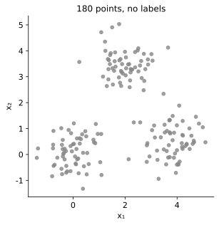
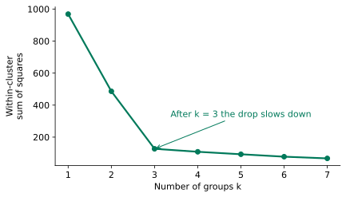
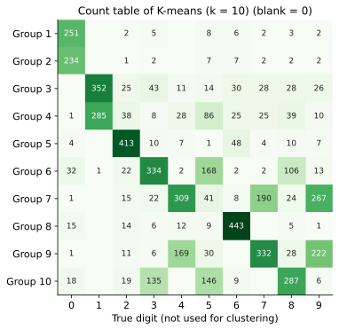
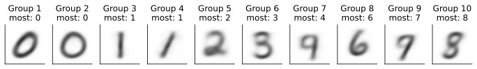
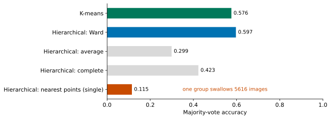
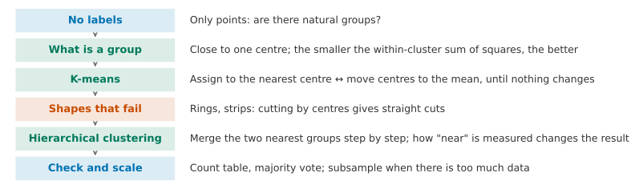

## 1. Motivation: Points but No Labels

In Lesson 7 we ignored the labels for the first time, and we squeezed each digit image into a few numbers. In this lesson we still ignore the labels, but we ask a different question: **does the data fall into a few natural groups, and which group does each point belong to?**

{fig-alt="Grey points that gather into three lumps: one at the bottom left, one at the bottom right and one at the top"}

Look at the plot first. How many groups do you see? If you circled them with a pen, what would you be using to decide?

::: {.callout-note collapse="true" title="Show answer"}
There are three groups: one lump at the bottom left, one at the bottom right and one at the top. You decide because some points sit close together, and there is empty space between them and the other points.
:::

A person can circle the groups at a glance, but only when there are two features and we can draw them. Each handwritten digit image (MNIST) has 784 numbers, so we cannot draw it. A shop's customers may each have hundreds of purchase records, and we cannot draw those either. What we want is this: **a machine that circles groups in the same way, and that still works in many dimensions.** This is called **clustering**. Like the method in Lesson 7, it uses no labels, so it is a form of unsupervised learning.

**By the end of this lesson, you should be able to:**

- explain what the two alternating steps of K-means do, why the method always stops, and why it may stop in a poor place;
- say which shapes make K-means fail, and switch to hierarchical clustering for them;
- explain how the way we measure "how close two groups are" changes the result of hierarchical clustering;
- use a count table and a majority vote to check how many known classes a clustering recovers;
- explain why hierarchical clustering on large data needs a subsample first.

## 2. What Counts as a Group

Before a machine can circle groups, we must say what "a group" means. Think about these two descriptions first:

1. the points in a group are all close to the same **centre**;
2. the points in a group are linked one to the next (each point is close to some other point in the group).

Both descriptions are reasonable, and this lesson uses both. We start with the first one. Each group has a centre, and each point belongs to the centre nearest to it.

How do we judge whether one way of splitting the points is good? We want a single number. It should be small when the points sit tightly around their own centres, and large when the split is a mess. Think of a few candidates first.

::: {.callout-note collapse="true" title="Show answer"}
We could look at how far the furthest point in each group is from its centre. We could add up the distance from each point to its own centre. We could also add up the squares of those distances. The first idea looks at one point only, so a single outlier can make it large. The other two look at every point. This lesson uses the sum of squared distances, for the same reason that Lesson 2 used squared error. For a set of points, the sum of squared distances to a position is smallest when that position is the mean (Advanced Study 1, Question 2). This gives us a ready-made way to find each centre.
:::

Take the squared distance from each point to the centre of its own group, and add them all up. This total is called the **within-cluster sum of squares** (scikit-learn calls it `inertia_`). We want the split with the smallest within-cluster sum of squares.

## 3. When We Do Not Know the Centres: K-means

The difficulty is that the centres and the groups depend on each other. If we knew the centres, we could give each point to its nearest centre. If we knew the groups, we could work out each group's centre as the mean of its points. But we know neither.

Think first: how can we break this chicken-and-egg loop?

::: {.callout-note collapse="true" title="Show answer"}
One way is to try every possible split and pick the one with the smallest within-cluster sum of squares. But there are roughly $3^{180}$ ways to split 180 points into 3 groups, which is far too many to try. Another way is to guess three centres at random, then repeat two steps in turn: assign the points using the centres, then move the centres using the groups. We keep going until nothing changes.
:::

The second way is called **K-means** ($K$ is the number of groups). In the widget below, you can carry it out one step at a time:



Click through a few rounds first. How does the within-cluster sum of squares change? When does it stop? Then click "Try another start" and do it again.

::: {.callout-note collapse="true" title="Show answer"}
With the first start, the sum goes 1851.3 → 130.2 → 127.0. After three rounds the centres stop moving, and all three lumps are found correctly. With the second start, the sum goes 2163.6 → 503.9 → 474.3 → 474.1. It also stops, but in a bad place: two centres crowd into the same lump, and the other two lumps share one centre.
:::

**Why does it always stop?** In the step "① Assign to the nearest centre", each point moves only to a closer centre, so the sum can only fall or stay the same. In the step "② Move centres to the mean", the sum of squared distances from a group's points to their mean is smaller than to any other position, so again the sum can only fall or stay the same. The sum never goes up, it cannot go below 0, and there are only finitely many ways to split the points. So the method must stop.

**Why can it stop in the wrong place?** Each step only moves to a lower value close by. When no nearby move can lower the sum any further, the method stops. There is no promise that this is the lowest value over all possible splits.

Think first: the start affects where the method stops, so what would you do about it?

::: {.callout-note collapse="true" title="Show answer"}
Candidate one: find a way to choose a good start, for example by making the starting centres far apart from each other. Candidate two: run the method from several different starts, compare the within-cluster sum of squares at the end of each run, and keep the smallest. We can use both together. By default, scikit-learn uses one version of candidate one (called k-means++), and it runs 10 times (`n_init=10`).
:::

Here is the code:

```python
from sklearn.cluster import KMeans

km = KMeans(n_clusters=3, n_init=10, random_state=0)   # 3 groups, 10 starting points, keep the best
km.fit(X_points)                             # alternate the two steps until nothing changes
print(km.inertia_)                           # within-cluster sum of squares of the best start
print(km.labels_[:10])                       # the group of the first ten points
```

`X_points` holds the two features of the 180 points. Here the within-cluster sum of squares is 127.0.

**Did it find the right groups?** We made this data ourselves, so we know which lump each point really belongs to. We can use that afterwards as a check. However, we cannot compare the group numbers directly, because K-means numbers its groups in an arbitrary order. Its "group 1" is not necessarily our "lump 1". Instead, for each group we count which lump most of its points come from, and let the group stand for that lump. The share of points that are correct under this rule is called the **majority vote** accuracy. Here it is 99.4%, because only one point was put with a different lump.

**Where does $k$ come from?** K-means needs a person to choose $k$ in advance. If we do not know it, we can try several values of $k$ and plot the within-cluster sum of squares:

{fig-alt="A falling line that drops from 968 to 127 at k = 3 and is almost flat after that"}

A larger $k$ always gives a smaller sum (it is 0 when every point is its own group), so the smallest sum is not the right choice. The usual approach is to look for the "bend", which here is at 3. The digits in Assignment 2 have 10 classes, so there we use $k = 10$.

## 4. Where K-means Fails

For K-means, a group means "points that are close to the same centre". Below are two data sets. A person can see at a glance that each one has two groups. Can K-means find them?



Look only at K-means for now. On the two rings and on the two bands, how much does it recover? Why?

::: {.callout-note collapse="true" title="Show answer"}
On the two rings it recovers only 62.5%, and on the two bands only 51.3%. That is not much better than guessing. K-means gives each point to its nearest centre. The boundary between two centres is a straight line, made of the places that are equally far from both centres. So K-means can only cut the plane into pieces with straight edges. It cuts the two rings across the middle into a left half and a right half, and it cuts the two bands into a left part and a right part. The points on a ring are not "close to the same centre". In fact, the centre of the inner ring and the centre of the outer ring are the same point.
:::

In these two data sets, a group follows the second idea from Section 2: the points are linked one to the next.

## 5. Candidate Two: Start from Each Point and Merge Step by Step

The points on a ring do not sit around one centre. Instead, they are linked one to the next. Think about this first. How could a machine join points that are linked one to the next into one group?

::: {.callout-note collapse="true" title="Show answer"}
We do not guess the centres first. Instead, we work from the bottom up. At the start, every point is a group on its own. At each step, we find the two closest groups and merge them. We keep merging until only one group is left. Points that sit close together get merged early, so the points on a ring are joined one after another along the ring.
:::

This method is called **hierarchical clustering**. Unlike K-means, it does not need us to choose $k$ in advance. We can record the whole merging process and decide at the end how many groups we want. We draw the record as a tree called a **dendrogram**:

{fig-alt="On the left, three blobs of numbered points; on the right, a tree with the 24 numbers along the bottom, where the top two merges are much higher than the ones below"}

The last few merges jump much higher. This tells us that those merges joined groups that were far apart. If we cut across the tree at the jump, we get the natural groups. To get a certain number of groups, we cut at the matching height.

One question is still open: how do we measure **how close two groups are**? Think of two candidates first.

::: {.callout-note collapse="true" title="Show answer"}
One way looks at how close the **nearest points** of the two groups are (single linkage). If any one point of a group is next to the other group, the two groups count as close. The other way looks at how much the **within-cluster sum of squares grows** after the merge (Ward). A small growth means the two groups were already close, and the merged group is still compact. Ward uses the same measure as K-means.
:::

The widget below has the same two data sets, and you can choose any of the three methods. Switch between "Hierarchical: nearest points" and "Hierarchical: Ward", and compare them with "K-means".



::: {.callout-note collapse="true" title="Show answer"}
"Nearest points" recovers 100% on both data sets. The points on a ring are linked one to the next, so following the ring joins them into one group. There is a gap between the two rings, so the rings are only merged at the very end. Ward fails in the same way as K-means (64.7% on the two rings, 53.7% on the two strips), because it also looks for compact blobs.
:::

```python
from sklearn.cluster import AgglomerativeClustering

hc = AgglomerativeClustering(n_clusters=2, linkage="single")   # merge the two nearest groups, measured by their nearest points
labels = hc.fit_predict(X_rings)             # stop when 2 groups are left; one label per point
```

## 6. On MNIST: Are There Ten Groups in 784 Dimensions?

Now we return to the handwritten digits. We take the 5625 fitting images of the MNIST subset (the split from Lesson 6). First we use PCA to reduce them to 50 principal components (Lesson 7; Assignment 2 also uses 50, and they keep 82.7% of the variance). Then we use K-means to split them into 10 groups. To avoid mixing this up with the number of groups $k$, in this lesson we always write "50 principal components". The clustering never looks at the labels.

After the clustering, we can use the labels to check the result. For each group, we count how many images of 0, 1, 2 and so on it holds, and put the numbers in a **count table**.

{fig-alt="A ten by ten table; groups 1 and 2 are both mostly 0, and groups 3 and 4 are both mostly 1; group 7 mixes 4, 9 and 7, and group 9 mixes 7, 9 and 4; group 6 mixes 3, 5 and 8; no group is mostly 5 or 9"}

Read the table first. Which digits have a group almost to themselves? Which digits are mixed together?

::: {.callout-note collapse="true" title="Show answer"}
The digits 2 (413 images) and 6 (443) each have a group almost to themselves. The digits 0 and 1 each take two groups. The 0s split into groups of 251 and 234 images (the more slanted ones and the rounder ones). The 1s split into groups of 352 and 285 images (the straight ones and the slanted ones). That leaves too few groups for the rest: no group is mostly 5 or 9. The digits 4, 7 and 9 are mixed in two groups (group 7 has 309 images of 4, 267 of 9 and 190 of 7). The digits 3, 5 and 8 are mixed in two groups (group 6 has 334 images of 3, 168 of 5 and 106 of 8). The digits that get mixed up are the ones that people write in similar ways.
:::

**Majority vote.** As in Section 3, we let each group guess the digit that appears most often in it, and we count how many guesses are right. K-means recovers 57.6%. The clustering itself uses no labels, so why do we still need a validation set? The reason is that "each group guesses one digit" was fixed using the labels of the fitting images. We want to know whether this split works as well on images it has not seen. We project the validation images onto the same 50 principal components, give each one to its nearest centre, and use the guess for each group that we fixed on the fitting images. This gives 57.7%, almost the same as on the fitting images. The clustering never saw a label, yet it puts nearly 60% of the images in the right place. This is much better than guessing (about 10%). But it is far from ten groups that each match one digit: some digits are written in such similar ways that they do not form ten clear lumps in 784 dimensions.

The centre of each group is the mean of all its images on the 50 principal components. If we turn it back into pixels, we get the **average image** of the group. It is also a 28×28 image:

{fig-alt="Ten blurry average digit images: two 0s (one slanted, one round), two 1s (one straight, one slanted), a 2, a 3, one that is mostly 4 but looks like a 9, a 6, a 7 and an 8"}

The average images also show why the digits get mixed up. The group that is mostly 4 (group 7) has an average image that looks like a 9, because 4, 7 and 9 are all mixed in it.

**A different clustering method.** We take the same 50 principal components and use hierarchical clustering to split them into 10 groups:

{fig-alt="K-means 0.576, Ward 0.597, average 0.299, complete 0.423, single 0.115"}

There are two more ways of measuring how close two groups are. Average takes the mean distance over all pairs of points from the two groups. Complete looks at the two points in the two groups that are farthest apart. Ward does best (59.7%), a little higher than K-means. Single was the best on the two rings, but here it is the worst (11.5%). It links almost all the images in a chain to form one big group (5616 of the 5625 images), and each of the other 9 groups has only one or two images. The reason is that there are no clear gaps between the digits. There are always some unclear images that link two digits together. **No way of measuring is best everywhere.** The right choice depends on the shape of the data.

## 7. What If There Is Too Much Data?

At each step, hierarchical clustering must know which two groups are closest. So it has to store the distance between every pair of points. With $n$ points there are $n(n-1)/2$ pairs:

| Number of points | Number of pairs | Approximate memory |
|---:|---:|---:|
| 5625 (this lesson) | 15.8 million | 0.13 GB |
| 5000 | 12.5 million | 0.1 GB |
| 50,000 (Assignment 2) | 1.25 billion | 10 GB |

Each distance takes 8 bytes. If the number of points grows 10 times, the memory grows 100 times. For 50,000 images we need 10 GB, which an ordinary computer cannot hold.

Think about this first. What can we do?

::: {.callout-note collapse="true" title="Show answer"}
We pick a random part of the points and cluster only those. This is called **subsampling**. If the sample still represents the data well, the groups we find will not be very different. On the MNIST subset, if we take only 500 random images and run Ward hierarchical clustering, the majority vote is 59.2%. This is close to 59.7% with all 5625 images. The hint for Assignment 2 is to take 5000 images, which needs about 0.1 GB. K-means does not need the distance between every pair of points. At each step it only works out the distance from each point to the $k$ centres, so it can use all the data directly.
:::

## 8. Implementation: Doing It in scikit-learn

The data split and the PCA are the same as in Lesson 7. `X_digits_fit` holds the fitting images, and the PCA is fitted on the fitting part only.

**Step 1: reduce to 50 principal components and split into 10 groups with K-means (Section 6):**

```python
import numpy as np
from sklearn.decomposition import PCA
from sklearn.cluster import KMeans

pca = PCA(n_components=50, random_state=0)   # 50 components, as in Assignment 2
pca.fit(X_digits_fit)                        # fitting images only
Z_fit = pca.transform(X_digits_fit)          # 50 numbers per image
km = KMeans(n_clusters=10, n_init=10, random_state=0)   # 10 groups, 10 starting points
km.fit(Z_fit)                                # no labels are used here
groups = km.labels_                          # the group of every fitting image
```

**Step 2: the count table and the majority vote (Section 6):**

```python
table = np.zeros((10, 10), dtype=int)        # rows: groups, columns: true digits
for i in range(len(groups)):
    table[groups[i], y_digits_fit[i]] += 1   # count image i in its group and its digit
guess = table.argmax(axis=1)                 # each group guesses its most common digit
correct = table.max(axis=1).sum()            # images whose digit is their group's guess
print(correct / len(groups))                 # majority-vote accuracy
```

The output is 0.576. The rows of this table come in a different order from the figure in Section 6. This is because K-means numbers its groups in an arbitrary order, and in the figure we sorted the groups by the most common digit in each one.

**Step 3: hierarchical clustering (Sections 5 and 6):**

```python
from sklearn.cluster import AgglomerativeClustering

hc = AgglomerativeClustering(n_clusters=10, linkage="ward")   # merge by the smallest increase in spread
groups_hc = hc.fit_predict(Z_fit)            # one group per image
```

If we run the same count table code on these groups, the majority-vote accuracy is 0.597. When there is too much data, pick a random subset of the rows first and cluster those (Section 7).

## 9. The Lesson on One Page

If you read only one page, read this one.

{fig-alt="A vertical flow chart with six steps"}

| The problem you see | What you can do | What evidence to use |
|---|---|---|
| You only have points, and you want to know if they form natural groups | Clustering: K-means (points close to the same centre) | Within-cluster sum of squares; with labels, a count table as a check afterwards |
| The centres and the groups depend on each other | Alternate the two steps; try several starting points and keep the best (`n_init`) | The within-cluster sum of squares falls step by step, and different starting points stop in different places |
| The groups are rings or long strips | Hierarchical clustering, with the "nearest points" (single) measure | The share of each group recovered after the change of method |
| You do not know which measure to use | Look at the shape of the data, and compare with a count table | On the MNIST subset, Ward 60% and single 12% |
| There is too much data | Use subsampling before hierarchical clustering; K-means can use all of it | Memory grows with the square of the number of points |

## 10. Summary and Limitations

We began with the question "does the data form natural groups?" The answer depends on what we mean by a group. If a group means points close to the same centre, K-means finds the groups by alternating two steps. It recovers 99.4% of the three blobs and nearly 60% of the ten digits (digits that are written in similar ways get mixed together). If a group means points linked one after another in a chain, hierarchical clustering can find rings and bands that K-means cannot find.

**Transfer question.** A website has 200,000 users, and for each user it records 30 numbers about how they use the site. The company wants to split the users into a few types, so that it can send each type different content. Answer without doing any calculation. Would you use K-means or hierarchical clustering? How would you choose $k$? How would you check whether the groups are "right"?

::: {.callout-note collapse="true" title="Suggested answer"}
Hierarchical clustering on 200,000 points needs about 160 GB of memory, so it is not practical. Use K-means first. If needed, reduce the dimensions with PCA first, and standardise the features first so that the habits are on similar scales. Another option is to run hierarchical clustering on a subset of users and see how many groups the dendrogram suggests. To choose $k$, first plot the within-cluster sum of squares against $k$ and look for the bend. Then combine this with the business need, such as how many types the team can handle. There are no labels to check whether the groups are "right". Instead, you can look at what kind of user each centre describes. You can check whether the groups are stable, which means you get similar groups with a different starting point or a different batch of users. You can also check whether sending content by group actually works better.
:::

**Where this method cannot be trusted.**

1. **Someone has to give $k$.** The within-cluster sum of squares always falls as $k$ grows, and the bend is often hard to see. With hierarchical clustering, someone also has to decide where to cut the tree.
2. **The result depends on what counts as a group.** K-means only recognises compact blobs. Single linkage can join two groups into one large group through a "bridge" of points. If you do not know the shape of the data, try several methods.
3. **K-means can stop in a bad place.** Use several starting points (`n_init`), and compare the within-cluster sum of squares.
4. **Without labels, there is no right or wrong.** In this lesson we used the labels to build a count table, but only as a check afterwards. A real clustering task usually has no such labels.
5. **Scale changes distance.** If the features have different units, standardise them first. Otherwise the features with large units decide everything. The limitations from Lesson 7 apply here too.

**Back to the promise at the start.** You now have a set of data with no labels, and you can do the following. You can split it into groups with K-means, and explain why the two alternating steps stop and why we need several starting points. You can see that K-means fails on rings and long strips, and switch to hierarchical clustering with a suitable measure. You can use a count table and a majority vote to check how much of the known classes the clustering recovers. On large data, you can use subsampling first.

**30-second feedback.** Now that you have finished this lesson, please scan the code to leave anonymous feedback or questions. It helps us improve to know which parts were unclear and which parts went too fast.

{fig-align="center" width="160px" fig-alt="Feedback QR code"}

*The Advanced Studies below are not part of the main thread, and you can read each one on its own. MPS311 students are encouraged to read them. MPS439 students have one main task, which is required: Advanced A of Lab 8. It builds on Study 1 here but uses k = 12, so its self-check values differ from the ones on this page. The other Studies are optional.*

---

## Advanced Study 1: Writing K-means in numpy and Comparing Starting Points

Use `Z_fit` from Section 8, which holds 5625 images with 50 principal components. Each run picks 10 images at random as the starting centres. It then alternates the two steps until the centres stop moving.

```python
import numpy as np

k = 10
results = []
for seed in range(10):                                   # ten different starting points
    rng = np.random.default_rng(seed)
    centres = Z_fit[rng.choice(len(Z_fit), k, replace=False)]   # k images picked at random as starting centres
    for step in range(100):
        dist = ((Z_fit[:, None, :] - centres[None, :, :]) ** 2).sum(axis=2)   # squared distance of every image to every centre
        groups = dist.argmin(axis=1)                     # step 1: nearest centre
        new = centres.copy()                             # step 2: move each centre to its group's mean
        for j in range(k):
            members = Z_fit[groups == j]                 # the images in group j
            if len(members) > 0:                         # an empty group keeps its old centre
                new[j] = members.mean(axis=0)
        if np.allclose(new, centres):                    # nothing moves: stop
            break
        centres = new
    inertia = ((Z_fit - centres[groups]) ** 2).sum()     # within-cluster sum of squares
    results.append(inertia)
print(np.round(results, 1))
```

The 10 starting points stop at within-cluster sums of squares between 169340.0 and 171642.8, a difference of about 1.4%. scikit-learn picks its starting points with k-means++ and runs 10 times. It reaches 169025.6, which is a little lower than the best run of our own version (169340.0). So a better way of picking starting points makes bad results less common, but it does not promise the lowest value every time.

Now try the following yourself:

1. Draw a count table for the run with the smallest within-cluster sum of squares and for the run with the largest. In the run with the largest, which digits are merged together, and which are split apart?
2. Prove the claim from Section 3. For a group of points, the sum of squared distances to a position $\mathbf c$, $\sum_i\|\mathbf x_i-\mathbf c\|^2$, is smallest when $\mathbf c$ is the mean. (Hint: take the derivative with respect to $\mathbf c$ and set it to 0.)
3. In the code above, a group that becomes empty keeps its old centre. What other ways could you handle an empty group? What problem does each one have?

## Advanced Study 2: Open Questions

This lesson does not develop the following four questions. Each comes with a starting point.

1. **How to choose k.** The bend is often hard to see. Starting point: look up the silhouette score (`sklearn.metrics.silhouette_score`). Plot it for $k = 2$ to 15 on the three blobs and on the MNIST subset, and compare it with the plot of the within-cluster sum of squares.
2. **Clustering by density.** Can we avoid giving $k$ in advance, and instead link the places where points are packed tightly into groups, treating sparse points as noise? Starting point: try `sklearn.cluster.DBSCAN` on the two rings, and see how `eps` changes the result.
3. **Soft groups.** K-means puts each point in exactly one group. If a point sits between two groups, could we say it belongs 60% to one group and 40% to the other? Starting point: `sklearn.mixture.GaussianMixture`, which describes each group with an ellipse, as in Lesson 5.
4. **Can clusters be used as features?** Extension task B of Assignment 2 asks whether "which group a point belongs to" can be given to a classifier as a new feature. Starting point: turn the K-means group numbers into 10 columns of 0s and 1s, add them to the inputs of logistic regression, and compare the results on the validation set.
