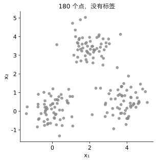
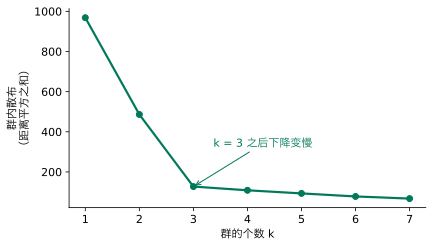
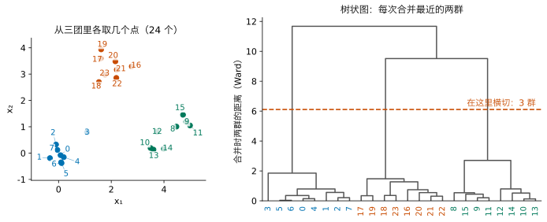
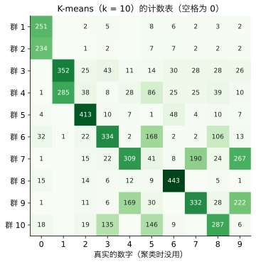
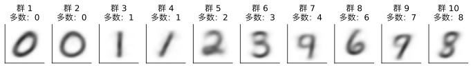
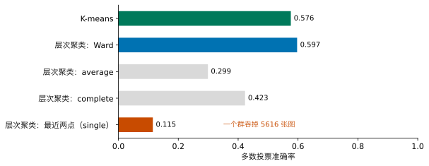
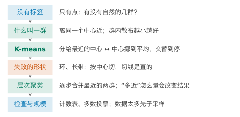

## 1. 动机：只有点，没有标签

Lesson 7 第一次不看标签：把每张数字图压成少几个数。这一讲继续不看标签，换一个问题：**数据里有没有自然的几群？每个点属于哪一群？**

{fig-alt="灰色的点聚成三团：左下、右下、上方"}

请先用眼睛看：有几群？如果让你用笔圈出来，你凭的是什么？

::: {.callout-note collapse="true" title="展开答案"}
三群：左下、右下、上方各一团。凭的是“这些点挤在一起，和别的点之间隔着空白”。
:::

人一眼就能圈出来，但只限于两个特征、画得出来的时候。手写数字（MNIST）每张图有 784 个数，没法画；一家商店的顾客有几百项购买记录，也没法画。我们想要的是：**让机器做同样的圈法，而且在高维里也能用。**这叫**聚类**（clustering）。和 Lesson 7 一样，它不用标签，是无监督学习。

**本讲之后你能做到：**

- 说清 K-means 两步交替在做什么、为什么一定会停、为什么可能停在不好的地方；
- 指出 K-means 在什么形状上失败，并换用层次聚类；
- 说明“两群之间有多近”怎么量会改变层次聚类的结果；
- 用计数表和多数投票，检查聚类找回了多少已知的类别；
- 知道层次聚类在大数据上为什么要先子采样。

## 2. 什么叫“一群”

要让机器圈，先得说清楚“一群”是什么意思。请先想两个说法：

1. 一群点离同一个**中心**近；
2. 一群点一个挨一个地连着（每个点都和群里某个点挨得近）。

两个说法都合理，本讲两个都会用到。先用第一个：每一群有一个中心，每个点属于离它最近的那个中心。

怎样判断一种分法好不好？我们想要一个数：点都紧紧挤在各自中心周围时小，分得乱七八糟时大。请先想几个候选。

::: {.callout-note collapse="true" title="展开答案"}
可以看每群里离中心最远的那个点有多远；可以把每个点到自己中心的距离加起来；也可以把距离的平方加起来。第一个只看一个点，一个离群点就能把它拉大；后两个看所有点。本讲用距离平方之和，原因和 Lesson 2 用平方误差一样：一群点到某个位置的距离平方之和，在这个位置取平均值时最小（Advanced Study 1 第 2 题），中心就有了现成的算法。
:::

每个点到自己那群中心的距离平方，全部加起来，叫**群内散布**（within-cluster sum of squares，sklearn 里叫 `inertia_`）。我们要找群内散布最小的分法。

## 3. 中心不知道，怎么办：K-means

困难在于：中心和分组互相依赖。知道了中心，就能把每个点分给最近的中心；知道了分组，就能算出每群的中心（各点的平均）。可是两样都不知道。

请先想：怎样打破这个“鸡和蛋”的循环？

::: {.callout-note collapse="true" title="展开答案"}
一个办法是把所有分法都试一遍，挑群内散布最小的。可是 180 个点分成 3 群，分法有 $3^{180}$ 种左右，试不完。另一个办法：先随便猜三个中心，然后两步交替：按中心分点，按分组挪中心，一直做到不再变化。
:::

第二个办法叫 **K-means**（$K$ 是群的个数）。下面的组件里，你可以一步一步地做：



请先点几轮：群内散布怎样变？什么时候停下？然后点“换个起点”，再做一遍。

::: {.callout-note collapse="true" title="展开答案"}
第一个起点：散布 1851.3 → 130.2 → 127.0，三轮后中心不再移动，三团都找对了。第二个起点：2163.6 → 503.9 → 474.3 → 474.1，也停了，但停在一个坏地方：两个中心挤在同一团里，另外两团被一个中心包下。
:::

**为什么一定会停？**“分给最近的中心”这一步，每个点换到更近的中心，散布只会变小或不变；“中心挪到平均”这一步，一群点到平均位置的距离平方之和，比到任何别的位置都小，散布也只会变小或不变。散布一直不增加、又不能小于 0，分法又只有有限多种，所以一定会停。

**为什么可能停错？**每一步都只往“附近更低”的地方走，走到附近再也降不下去就停了，不保证是所有分法里最低的。

请先想：既然起点会影响停在哪里，你会怎么办？

::: {.callout-note collapse="true" title="展开答案"}
候选一：想办法挑一个好起点，例如让几个起始中心彼此离得远。候选二：从好几个不同的起点各做一遍，比较停下时的群内散布，留下最小的。两个可以一起用：scikit-learn 默认用候选一的一种挑法（叫 k-means++），并且做 10 遍（`n_init=10`）。
:::

代码是这样的：

```python
from sklearn.cluster import KMeans

km = KMeans(n_clusters=3, n_init=10, random_state=0)   # 3 groups, 10 starting points, keep the best
km.fit(X_points)                             # alternate the two steps until nothing changes
print(km.inertia_)                           # within-cluster sum of squares of the best start
print(km.labels_[:10])                       # the group of the first ten points
```

`X_points` 是那 180 个点的两个特征。这里散布是 127.0。

**找对了没有？**这份数据是我们自己造的，知道每个点真正属于哪一团，可以事后拿来检查。但不能直接比编号：K-means 的群号是随意的，它的“群 1”不一定是我们的“第 1 团”。办法是每一群数一数，里面最多的是哪一团的点，就让这一群代表那一团；按这样算对的点占多少，叫**多数投票**准确率。这里是 99.4%：只有一个点被分到了别的团。

**$k$ 从哪里来？**K-means 要人先给 $k$。如果不知道，可以试几个 $k$，画群内散布：

{fig-alt="一条下降的折线，从 968 降到 3 处的 127，之后几乎平了"}

$k$ 越大散布一定越小（每个点自成一群时为 0），所以不能直接选最小的。常用的看法是找“拐弯”的地方，这里是 3。作业 2 的数字有 10 类，所以用 $k = 10$。

## 4. K-means 在哪里失败

K-means 的“一群”是“离同一个中心近”。下面两份数据，人一眼能看出各是两群，K-means 能找出来吗？



请先只看 K-means：两个环、两条带，它各找回多少？为什么？

::: {.callout-note collapse="true" title="展开答案"}
两个环只找回 62.5%，两条带只有 51.3%，和瞎猜差不多。K-means 把每个点分给最近的中心，两个中心之间的分界是一条直线（离两个中心一样远的地方）。所以它只能把平面切成直边的块：两个环被拦腰切成左右两半，两条带被竖着切成左右两段。环上的点并不“离同一个中心近”：内环的中心和外环的中心是同一个点。
:::

这两份数据的“一群”，是第 2 节的第二个说法：点和点之间一个挨一个地连着。

## 5. 候选二：从每个点开始，逐步合并

环上的点并不围着一个中心，而是一个挨一个地连着。请先想：怎样让机器把“一个挨一个”的点连成一群？

::: {.callout-note collapse="true" title="展开答案"}
不先猜中心，而是从下往上：开始时每个点自成一群；每一步找出最近的两群，把它们合并；一直合并到只剩一群。挨得近的点会先被并到一起，环上的点就会沿着环一个接一个地并起来。
:::

这叫**层次聚类**（hierarchical clustering）。它和 K-means 不同，不需要先定 $k$：可以把合并的全过程都记下来，最后再决定要几群。记录画成一棵**树状图**（dendrogram）：

{fig-alt="左边三团带编号的点；右边一棵树，底部是 24 个编号，最上面两次合并的高度明显比下面的高"}

最后几次合并的高度跳得很高，说明那时合并的是隔得很远的群。在跳跃处横切一刀，就得到自然的几群。要几群，就在相应的高度切。

还有一个问题：**两群之间有多近**，怎么量？请先想两个候选。

::: {.callout-note collapse="true" title="展开答案"}
一种是看两群里**最近的两个点**有多近（single linkage）：只要有一个点挨着，就算近。另一种是看合并之后**群内散布增加多少**（Ward）：增加得少，说明两群本来就离得近、合并后仍然紧凑。Ward 和 K-means 用的是同一个标准。
:::

下面的组件是同样的两份数据，三种方法都可以选。切换“层次聚类：最近的两点”和“层次聚类：Ward”，与 K-means 比较。



::: {.callout-note collapse="true" title="展开答案"}
“最近的两点”在两份数据上都找回 100%：环上的点一个挨一个，沿着环就能连成一群；两环之间有一道空隙，最后才被合并。Ward 和 K-means 一样失败（两个环 64.7%，两条带 53.7%），因为它也在追求“紧凑的一团”。
:::

```python
from sklearn.cluster import AgglomerativeClustering

hc = AgglomerativeClustering(n_clusters=2, linkage="single")   # merge the two nearest groups, measured by their nearest points
labels = hc.fit_predict(X_rings)             # stop when 2 groups are left; one label per point
```

## 6. 在 MNIST 上：784 维里有没有十群

现在回到手写数字：MNIST 子集里拟合用的 5625 张图（Lesson 6 的划分），先用 PCA 降到 50 个主成分（Lesson 7；作业 2 也用 50 个，它们保住 82.7% 的方差），再用 K-means 分成 10 群。为了不和群的个数 $k$ 混淆，这一讲主成分的个数一律写成“50 个主成分”。聚类时完全不看标签。

分完之后，我们可以借标签来检查：每一群里各有多少张 0、1、2……排成一张**计数表**。

{fig-alt="十乘十的表；群 1、2 都以 0 为主，群 3、4 都以 1 为主；群 7 里 4、9、7 混在一起，群 9 里 7、9、4 混在一起；群 6 里 3、5、8 混在一起；没有一群以 5 或 9 为主"}

请先读表：哪些数字几乎独占一群？哪些混在一起？

::: {.callout-note collapse="true" title="展开答案"}
2（413 张）和 6（443 张）几乎各占一群。0 和 1 各占了两群：0 分成 251 张和 234 张两群（斜一点的、圆一点的），1 分成 352 张和 285 张两群（直的、斜的）。剩下的群就不够分了：5 和 9 没有一群以它们为主。4、7、9 混在两群里（群 7：309 张 4、267 张 9、190 张 7），3、5、8 混在两群里（群 6：334 张 3、168 张 5、106 张 8）。容易混的数字，正是写法相近的那几个。
:::

**多数投票。**和第 3 节一样，让每一群都猜它里面最多的那个数字，算一算猜对多少：K-means 找回 57.6%。聚类本身不用标签，那为什么还要验证集？因为“每群猜一个数字”是借拟合图的标签定下的，我们想知道这种分法在没见过的图上是否一样管用：把验证图按同样的 50 个主成分投影、分给最近的中心，再用拟合部分定下的“每群猜几”，是 57.7%，和拟合图几乎一样。聚类一次也没看标签，就能把近六成图片分对，比瞎猜（约一成）好得多；但离十群各自对应一个数字还差得远：有些数字写法太像，在 784 维里并没有分成清楚的十团。

每一群的中心是这一群所有图在 50 个主成分上的平均，还原回像素，就是**这一群的平均图像**，也是一张 28×28 的图：

{fig-alt="十张模糊的平均数字图：两张 0（一斜一圆）、两张 1（一直一斜）、2、3、一张多数是 4 却像 9 的、6、7、8"}

平均图像也说明了为什么会混：多数是 4 的那一群（群 7），平均图像看上去像一个 9，因为 4、7、9 都混在里面。

**换一种聚类方法。**同样的 50 个主成分，层次聚类分成 10 群：

{fig-alt="K-means 0.576，Ward 0.597，average 0.299，complete 0.423，single 0.115"}

另外两种量法：average 看两群所有点对之间距离的平均，complete 看两群里最远的两个点。Ward 最好（59.7%），比 K-means 略高。在两个环上最好的 single，在这里最差（11.5%）：几乎所有图被一条链连成了一个大群（5625 张里的 5616 张），剩下 9 群各只有一两张。原因是数字之间没有清楚的空隙，总有一些写得含糊的图把两类连起来。**没有一种量法处处最好**，要看数据的形状。

## 7. 数据太多怎么办

层次聚类每一步都要知道“哪两群最近”，所以要记住每两个点之间的距离。$n$ 个点有 $n(n-1)/2$ 对：

| 点数 | 距离的对数 | 约要的内存 |
|---:|---:|---:|
| 5625（本讲） | 1580 万 | 0.13 GB |
| 5000 | 1250 万 | 0.1 GB |
| 50,000（作业 2） | 12.5 亿 | 10 GB |

每个距离按 8 个字节算。点数翻 10 倍，内存翻 100 倍。50,000 张图要 10 GB，普通电脑装不下。

请先想：怎么办？

::: {.callout-note collapse="true" title="展开答案"}
随机抽一部分点来做（**子采样**）。只要样本还有代表性，找出的群结构不会差太多。在 MNIST 子集上只随机取 500 张做 Ward 层次聚类，多数投票是 59.2%，和用全部 5625 张的 59.7% 差不多。作业 2 的提示是取 5000 张，约 0.1 GB。K-means 不需要两两距离，每一步只算每个点到 $k$ 个中心的距离，所以能直接用全部数据。
:::

## 8. 实现：用 scikit-learn 完成

划分、PCA 与 Lesson 7 相同（`X_digits_fit` 在拟合部分 fit 的 PCA）。

**第一步，降到 50 个主成分，K-means 分 10 群（第 6 节）：**

```python
import numpy as np
from sklearn.decomposition import PCA
from sklearn.cluster import KMeans

pca = PCA(n_components=50, random_state=0)   # 50 components, as in Assignment 2
pca.fit(X_digits_fit)                        # fitting images only
Z_fit = pca.transform(X_digits_fit)          # 50 numbers per image
km = KMeans(n_clusters=10, n_init=10, random_state=0)   # 10 groups, 10 starting points
km.fit(Z_fit)                                # no labels are used here
groups = km.labels_                          # the group of every fitting image
```

**第二步，计数表和多数投票（第 6 节）：**

```python
table = np.zeros((10, 10), dtype=int)        # rows: groups, columns: true digits
for i in range(len(groups)):
    table[groups[i], y_digits_fit[i]] += 1   # count image i in its group and its digit
guess = table.argmax(axis=1)                 # each group guesses its most common digit
correct = table.max(axis=1).sum()            # images whose digit is their group's guess
print(correct / len(groups))                 # majority-vote accuracy
```

输出 0.576。表的行顺序和第 6 节的图不同：K-means 的群号是随意的，图里按每群最多的数字重新排过。

**第三步，层次聚类（第 5、6 节）：**

```python
from sklearn.cluster import AgglomerativeClustering

hc = AgglomerativeClustering(n_clusters=10, linkage="ward")   # merge by the smallest increase in spread
groups_hc = hc.fit_predict(Z_fit)            # one group per image
```

用同样的计数表代码，多数投票 0.597。数据太多时，先随机取一部分行再做（第 7 节）。

## 9. 一页回顾

如果只读一页，读这里。

{fig-alt="六个步骤的竖向流程图"}

| 你看到的问题 | 可以做什么 | 用什么证据判断 |
|---|---|---|
| 只有点，想知道有没有自然的几群 | 聚类：K-means（离同一个中心近） | 群内散布；有标签时用计数表事后检查 |
| 中心和分组互相依赖 | 两步交替；多个起点取最好（`n_init`） | 散布一步步下降，不同起点停在不同处 |
| 群是环形、长条形 | 层次聚类，量法选“最近的两点” | 换方法后找回的比例 |
| 不知道该用哪种量法 | 看数据的形状，用计数表比较 | MNIST 上 Ward 60%、single 12% |
| 数据太多 | 层次聚类先子采样；K-means 可用全部 | 内存随点数平方增长 |

## 10. 总结与局限

开场的问题“数据里有没有自然的几群”，答案取决于“一群”怎么定义。按“离同一个中心近”，K-means 两步交替就能找出来，三团找回 99.4%，MNIST 的十个数字找回近六成（写法相近的数字会混在一起）；按“一个挨一个地连着”，层次聚类能找出 K-means 找不出的环和带。

**迁移题。**一个网站有 20 万个用户，每人有 30 项使用习惯的数据，想把用户分成几类，好分别推送内容。请不做计算回答：用 K-means 还是层次聚类？$k$ 怎么定？分出来的群“对不对”，用什么检查？

::: {.callout-note collapse="true" title="参考回答"}
20 万个点做层次聚类要约 160 GB 内存，不现实；先用 K-means（必要时先 PCA 降维、先标准化，使各项习惯的尺度相近），或者对一部分用户做层次聚类，看看树状图里有几群。$k$ 先画群内散布随 $k$ 的变化找拐弯处，再结合业务需要（运营能处理几类）。“对不对”没有现成的标签可查：可以看每群的中心像什么样的用户、群是否稳定（换起点或换一批用户是否分得差不多），以及按群推送之后效果有没有变好。
:::

**这个方法在哪里不可信。**

1. **$k$ 要人给。**群内散布总是随 $k$ 下降，拐弯处常常不明显；层次聚类也要人决定在哪里切。
2. **结果取决于“一群”的定义。**K-means 只认紧凑的一团；single 会被一条“桥”连成一个大群。数据的形状不知道时，要多试几种。
3. **K-means 会停在坏地方。**要用多个起点（`n_init`），并比较群内散布。
4. **没有标签时，没有对错。**本讲用标签做的计数表只是事后检查；真实的聚类任务通常没有这样的标签。
5. **尺度会改变距离。**特征的单位不同，要先标准化，否则单位大的特征决定一切（Lesson 7 的局限同样适用）。

**回到开头的承诺。**现在，面对一批没有标签的数据，你可以：用 K-means 分群，说清两步交替为什么会停、为什么要多个起点；看出它在环形、长条形上失败，换用层次聚类并选择量法；用计数表和多数投票检查聚类找回了多少已知类别；在大数据上先子采样。

**30 秒反馈。**读完这一讲，请扫码留下匿名反馈或问题：哪里没看懂、哪里讲得太快，都对改进有用。

{fig-align="center" width="160px" fig-alt="反馈二维码"}

*以下是 Advanced Study，不影响主线，每个 Study 可以单独阅读。MPS311 鼓励选读。MPS439 的必做是一项深度主任务：Lab 8 的 Advanced A，它以本页 Study 1 为基础，但用 k = 12，自检值与这里不同；其余 Study 选读。*

---

## Advanced Study 1：用 numpy 写 K-means，比较不同的起点

用第 8 节的 `Z_fit`（5625 张图、50 个主成分）。每次从随机挑出的 10 张图作为起始中心，交替两步，直到中心不再移动。

```python
import numpy as np

k = 10
results = []
for seed in range(10):                                   # ten different starting points
    rng = np.random.default_rng(seed)
    centres = Z_fit[rng.choice(len(Z_fit), k, replace=False)]   # k images picked at random as starting centres
    for step in range(100):
        dist = ((Z_fit[:, None, :] - centres[None, :, :]) ** 2).sum(axis=2)   # squared distance of every image to every centre
        groups = dist.argmin(axis=1)                     # step 1: nearest centre
        new = centres.copy()                             # step 2: move each centre to its group's mean
        for j in range(k):
            members = Z_fit[groups == j]                 # the images in group j
            if len(members) > 0:                         # an empty group keeps its old centre
                new[j] = members.mean(axis=0)
        if np.allclose(new, centres):                    # nothing moves: stop
            break
        centres = new
    inertia = ((Z_fit - centres[groups]) ** 2).sum()     # within-cluster sum of squares
    results.append(inertia)
print(np.round(results, 1))
```

10 个起点停下的散布从 169340.0 到 171642.8 不等，相差约 1.4%。scikit-learn 用 k-means++ 挑起点、做 10 遍，得到 169025.6，比手写版最好的一次（169340.0）还低一点：挑起点的办法让坏结果少了，但不保证每次都是最低的。

接下来请自己做：

1. 对散布最小和最大的两次，各画一张计数表。散布大的那次，哪些数字被合在一起、哪些被拆开？
2. 证明第 3 节的说法：一群点到某个位置 $\mathbf c$ 的距离平方之和 $\sum_i\|\mathbf x_i-\mathbf c\|^2$，在 $\mathbf c$ 取平均值时最小。（提示：对 $\mathbf c$ 求导令其为 0。）
3. 上面的代码让变空的群保留原来的中心。还有什么别的处理办法？各有什么问题？

## Advanced Study 2：开放问题

下面四个问题本讲没有展开，每个给出一个起点。

1. **怎样选 k。**拐弯处常常不明显。起点：查阅轮廓系数（`sklearn.metrics.silhouette_score`），在三团数据和 MNIST 子集上对 $k = 2$ 到 15 画出来，与群内散布的图比较。
2. **按密度聚类。**能不能不先给 $k$，而是把“点挤得密的地方”连成群，稀疏的点当作噪声？起点：`sklearn.cluster.DBSCAN`，在两个环上试，看 `eps` 怎样影响结果。
3. **软的分群。**K-means 让每个点只属于一群。如果一个点在两群中间，能不能说它“六成属于这群、四成属于那群”？起点：`sklearn.mixture.GaussianMixture`，它用 Lesson 5 的椭圆描述每一群。
4. **聚类能当特征吗？**作业 2 附加题 B 问：能不能把“属于哪一群”当作一个新特征交给分类器？起点：把 K-means 的群号做成 10 个 0/1 列，加到 logistic regression 的输入里，在验证集上比较。
