## [Problem:]{.stg} 5625 handwritten digits, no labels

::: {.stage .top}
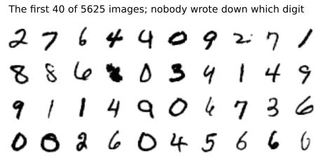{.fig .fig-f0 fig-alt="Forty handwritten digits in four rows of ten, in grey, with no labels"}

::: {.say .narrow}
Can the machine sort them into groups that look alike? A shop asks the same about its customers. This is **clustering**: no labels.
:::

::: {.scan}
{fig-alt="QR code for today's live page"}
<b>Scan now</b>
votes, questions, feedback
:::
:::

::: {.notes}
约 2.5 分钟。先请大家扫码，页面整节课开着。5625 张手写数字，每张 784 个数，没人写下是几。能不能让机器把写法相近的放在一起？一家店的顾客只有购买记录，想分成几类分别推送，也是这个问题。点名 clustering，和 PCA 一样不用标签。784 个数没法画，先在两个数的时候想清楚。
:::

## What you will be able to do

::: {.stage .tight}
::: {.say .xl}
**Group** unlabelled data with K-means and say what it minimises, **see** where it fails, **switch** to hierarchical clustering, and **check** the groups with labels you did not use.
:::

::: {.flow .seven}
<div><span>1</span>Problem</div>
<div><span>2</span>Model</div>
<div><span>3</span>Loss</div>
<div><span>4</span>Solution</div>
<div><span>5</span>Test</div>
<div><span>6</span>Application</div>
<div><span>7</span>Extension and limits</div>
:::
:::

::: {.notes}
约 0.5 分钟。能力承诺，念出路线：问题、模型、损失、求解、检验、应用，最后是扩展和局限。
:::

## [Problem:]{.stg} 180 points, no labels. How many groups?

::: {.stage}
::: {.two .side}
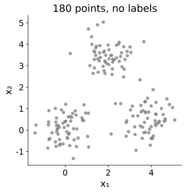{.fig .fig-f1 fig-alt="180 grey points in three clumps: bottom left, bottom right and top"}

::: {.ask}
<small>Your turn</small>
How many groups do you see? If you circled them with a pen, what would you be using?
:::
:::
:::

::: {.notes}
约 1.5 分钟。期待：三群；凭“挤在一起、和别的点之间隔着空白”。由此引出“一群”的两个说法：离同一个中心近；一个挨一个地连着。两个本讲都会用到，先用第一个。
:::

## [Problem:]{.stg} How do we score a grouping?

::: {.stage}
::: {.two .side}
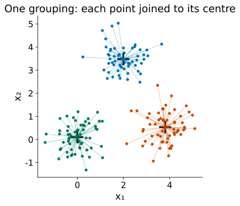{.fig .fig-s2 fig-alt="The 180 points split into three coloured groups, each point joined by a thin line to the cross at its group's centre"}

::: {.ask .vote}
<small>Vote on your phone</small>
One number: small when points hug their centres. Use the…

::: {.opts}
<span><b>A</b>farthest point from its centre</span>
<span><b>B</b>sum of distances</span>
<span><b>C</b>sum of squared distances</span>
:::
:::
:::
:::

::: {.notes}
约 2.5 分钟。投票（右屏“How do we score a grouping?”一行 → Open，30 秒，再 Reveal）。揭晓后请选 A 的同学说理由，再问选 B 的人平方和多给了什么。最远的点只看一个点，一个离群点就能拉大；后两个看所有点。选平方和：和线性回归的平方误差一样，到平均位置的平方和最小，中心就有现成的算法。
:::

## [Problem:]{.stg} Know neither the centres nor the groups. Try it.

::: {.stage .top}


::: {.say}
<small>Know the centres → give each point to the nearest. Know the groups → each centre is their mean. Alternate ① and ②: what does the score do?</small>
:::
:::

::: {.notes}
约 5 分钟。先问鸡和蛋：知道中心就能分点，知道分组就能算中心，两样都不知道怎么办？候选一：试遍所有分法，180 个点分 3 群约 3^180 种，试不完。候选二：先猜中心，两步交替。请学生指挥：点 ①，点 ②，交替。起点 A：1851.3 → 130.2 → 127.0，三轮停下，三团都对。再“换个起点”（B）：2163.6 → 503.9 → 474.3 → 474.1，也停了，但两个中心挤在一团里。学生看到三件事：分数一直降；会停；停在哪里看起点。下面三页把它写成模型、损失、求解。这里先不点名 K-means。
:::

## [Model:]{.stg} One centre per group

::: {.stage}
::: {.two .side}
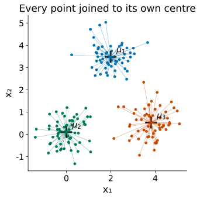{.fig .fig-s2 fig-alt="The 180 points in three colours, each joined to its group's centre, the centres labelled mu 1, mu 2, mu 3"}

::: {.say}
Centres $\boldsymbol\mu_1,\dots,\boldsymbol\mu_k$, each $d\times 1$.<br>Each point has a group number $c_i$.

::: {.eq}
$$\mathbf x_i \approx \boldsymbol\mu_{c_i}$$
:::

Assumption: each group is **a lump around one centre**.<br><small>Points equally far from two centres lie on a straight line, so the cuts between groups are straight (we use this in Test).</small>
:::
:::
:::

::: {.notes}
约 2 分钟。每个点是一列 d 个数（这里 2，手写数字 784）。分 k 群：k 个中心，每个也是 d×1；每个点一个群号 c_i。用它那群的中心代表它。假设：每群是围着一个中心的一团。一条后面要用的性质：离两个中心一样远的点，展开 ‖x−μ₁‖² = ‖x−μ₂‖²，‖x‖² 消掉，剩下对 x 是一次的，所以分界是一条直线（高维里是平面）。推导在 Note 第 3 节。
:::

## [Loss:]{.stg} The score in the widget

::: {.stage}
::: {.formula .big}
$$
W(c,\boldsymbol\mu) = \sum_{i=1}^{n} \lVert\mathbf x_i - \boldsymbol\mu_{c_i}\rVert^2
$$
:::

::: {.say}
**Within-cluster sum of squares** (`inertia_` in scikit-learn): what we lose when each point is replaced by its centre. Smaller is better.<br><small>Squared, as voted: then the best centre is the mean of its points.</small>
:::
:::

::: {.notes}
约 1.5 分钟。损失就是投票选出的那个数，也是组件上方的数。每个点到自己中心的距离平方，加起来。它也是用中心代替每个点时丢掉的东西，和 PCA 的还原误差是同一种量。点名 within-cluster sum of squares，sklearn 里叫 inertia_。
:::

## [Solution:]{.stg} Fix one, solve the other

::: {.stage}
::: {.two .side}
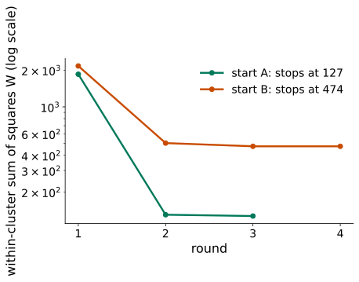{.fig .fig-s1 fig-alt="Within-cluster sum of squares after each round for two starting points, log scale: start A falls to 127, start B stops at 474"}

::: {.say}
Unknowns: all $c_i$ and all $\boldsymbol\mu_j$ ($k^n$ groupings).

**Centres fixed:** $c_i$ = the nearest centre.<br>**Groups fixed:** $\boldsymbol\mu_j$ = the mean of group $j$.

$W$ never goes up, so it **always stops**, but only at a local low: use **many starts**. This is **K-means**.
:::
:::
:::

::: {.notes}
约 3.5 分钟。这一步给主干和结论，不推。未知数两组：n 个群号、k 个中心；一起找要试 k^n 种分法。只找一组时答案现成：中心固定，W 是每个点各自一项，每个点挑最近的中心就最小；群号固定，W 拆成每群的平方和，对 μ_j 求导为 0，得平均。所以固定一组求另一组，轮流做，就是刚才的两个按钮。每步 W 不增、分法有限，所以一定停；只往附近更低走，所以可能停在 474（图里的红线）。办法：多个起点取最好；sklearn 默认用 k-means++ 挑分散的起点、做 10 遍（n_init=10）。这时点名 K-means。为什么平均最好、为什么一定停，Note 的 Advanced Study 1 请学生自己推。
:::

## [Solution:]{.stg} Where does k come from?

::: {.stage}
::: {.two .side}
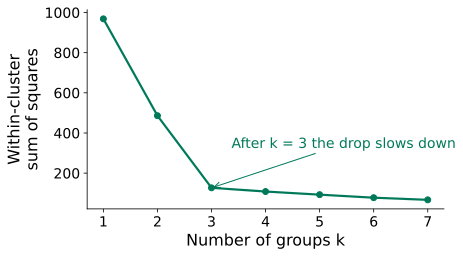{.fig fig-alt="Within-cluster sum of squares against k from 1 to 7: it falls steeply up to k = 3 and slowly after"}

::: {.say}
$k$ is not solved for: we give it. More groups always lower $W$, so look for the **bend**: here $k = 3$. Assignment 2 uses $k = 10$ digits.
:::
:::
:::

::: {.notes}
约 1.5 分钟。每个点自成一群时 W 为 0，所以不能选最小的。找拐弯处（elbow），这里是 3。拐弯常常不明显，这时 k 要从对数据的了解来：数字有 10 类。这一讲 k 是群的个数；PCA 里留几个主成分另外说成“50 个主成分”。
:::

## [Test:]{.stg} Two rings, two strips

::: {.stage .top}


::: {.say}
<small>Share recovered = majority vote: each group counts as right for the true group most of its points come from. Points on a ring are linked one to the next, around no centre.</small>
:::
:::

::: {.notes}
约 3 分钟。先问：K-means 能找出两个环吗？揭晓：两个环 62.5%，两条带 51.3%，和瞎猜差不多（找回比例就是 majority vote，群号是随意的）。为什么：模型那页说过，离两个中心一样远的地方是一条直线，K-means 只能切直边的块；环被拦腰切开，带被竖着切开。模型的假设“围着一个中心的一团”在这里不成立。环上的点一个挨一个地连着：回到第三页的第二个说法。问：怎样让机器顺着这种“连着”分群？期待：从近邻开始一点点连起来。
:::

## [Test:]{.stg} Start alone, merge the nearest

::: {.stage}
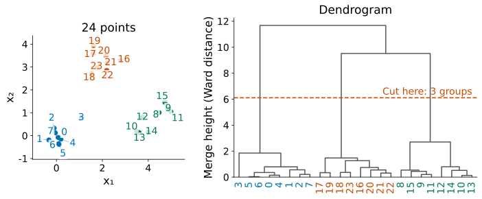{.fig .fig-f3 fig-alt="Left: 24 numbered points from the three blobs. Right: their dendrogram; each horizontal line is a merge at the height of the distance; a red dashed line cuts it into 3 groups"}

::: {.say}
Merging from below: **hierarchical clustering**. Its record is a **dendrogram**: no $k$ needed until we cut it. <small>Height here: how much the spread grows when two groups merge (Ward).</small>
:::
:::

::: {.notes}
约 2.5 分钟。第二个候选：从每个点自成一群开始，每步合并最近的两群。最后几次合并的高度跳得很高，在跳跃处切一刀就是自然的几群。
:::

## [Test:]{.stg} How near are two groups?

::: {.stage}
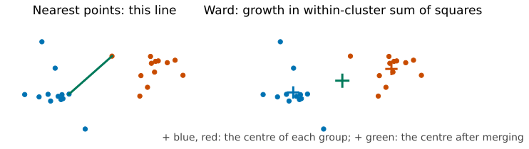{.fig .fig-s3 fig-alt="Two groups of points shown twice: on the left a green line joins their two nearest points; on the right the two group centres and the green centre of the merged group"}

::: {.ask .vote}
<small>Vote on your phone</small>
Two rings: which way of measuring "near" will follow them?

::: {.opts}
<span><b>A</b>nearest two points (single)</span>
<span><b>B</b>Ward (via group centres)</span>
:::
:::
:::

::: {.notes}
约 2.5 分钟。投票（右屏“How near are two groups?”一行 → Open，30 秒，先不显示结果）。分歧大时让邻座讨论一分钟再 Vote again（本讲只在这一题这样做），再 Reveal；请选 B 的同学说为什么。Ward 看合并后群内散布增加多少，和 K-means 同一个标准，追求紧凑的一团。下一页验证。
:::

## [Test:]{.stg} Nearest points follow the shape

::: {.stage .top}

:::

::: {.notes}
约 2.5 分钟。默认显示“最近的两点”：两份数据都 100%。环上的点一个挨一个，沿环连成一群；两环之间有空隙，最后才合并。再点 Ward：64.7%、53.7%，和 K-means 一样失败。代码：AgglomerativeClustering(n_clusters=2, linkage="single")。
:::

## [Application:]{.stg} Back to the digits: 10 groups from 50 components

::: {.stage}
::: {.two .wide4}
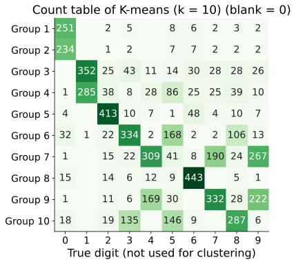{.fig .fig-f4 fig-alt="Count table of 10 K-means groups against the true digit: 2 and 6 nearly fill one group each; 0 and 1 take two groups each; no group is mainly 5 or 9; 4, 7 and 9 mix, and 3, 5 and 8 mix"}

::: {.ask}
<small>Your turn</small>
Labels are used only afterwards, to count. Which digits get a group of their own? Which mix?
:::
:::
:::

::: {.notes}
约 3 分钟。回到开头的 5625 张（拟合 5625、验证 1875、测试 2500 的划分），PCA 降到 50 个主成分（作业 2 也用 50 个，保住 82.7%），K-means k = 10。点名 count table。2、6 各占一群；0、1 各占两群（0 一斜一圆，1 一直一斜），所以 5 和 9 没有自己的群；4、7、9 混，3、5、8 混。写法相近的数字混在一起。
:::

## [Application:]{.stg} Majority vote: how much did the groups find?

::: {.stage}
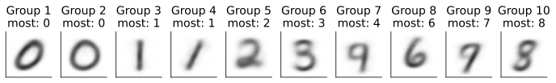{.fig .fig-f5 fig-alt="The average image of each of the ten groups, 28 by 28, titled with its most common digit; two 0s, two 1s, and the group whose majority is 4 looks like a 9"}

::: {.say}
Each group's **average image**, titled with its most common digit. Each group guesses that digit: **57.6%** right, without ever seeing a label.<br><small>New images take the guess of their nearest centre: 57.7% on the validation set.</small>
:::
:::

::: {.notes}
约 2 分钟。图是每群的中心还原回像素，即这一群的平均图像。多数是 4 的那群看起来像 9：4、7、9 混在里面（309、267、190 张）。聚类不用标签；验证集只用来检查“每群猜一个数字”这个分法在没见过的图上是否同样管用：把验证图分给最近的中心，用拟合部分定下的“每群猜几”，57.7%。比瞎猜（一成）好得多，但写法相近的数字分不开。作业 2 附加题 B 就是这张计数表和这个准确率。
:::

## [Application:]{.stg} The best way to measure "near" depends on the data

::: {.stage}
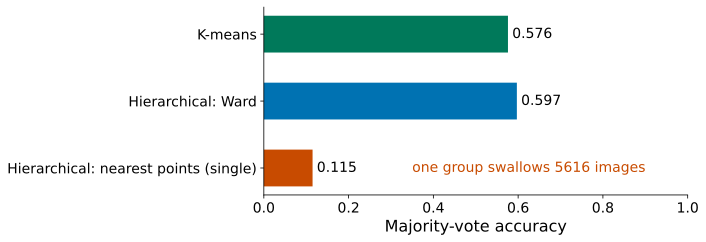{.fig .fig-f6 fig-alt="Majority-vote accuracy on the MNIST subset: K-means 0.576, Ward 0.597, nearest points (single) 0.115 because one group swallows 5616 images"}

::: {.say}
Nearest points (single) won on the rings; on the digits it puts **5616** of 5625 images in one group.
:::
:::

::: {.notes}
约 1.5 分钟。Ward 最好 59.7%，比 K-means 略高。single 只有 11.5%：数字之间没有清楚的空隙，总有写得含糊的图把两类连起来，一条链连成大群。没有一种量法处处最好。
:::

## [Application:]{.stg} Every pair of points

::: {.stage .bigtab}
| points | pairs | memory |
|---:|---:|---:|
| 5625 (today) | 15.8 million | 0.13 GB |
| 50,000 (Assignment 2) | 1.25 billion | 10 GB |

<small>Each distance takes 8 bytes: 15.8 million × 8 bytes ≈ 0.13 GB.</small>

::: {.ask .vote}
<small>Vote on your phone</small>
50,000 images: every pair needs 10 GB. You would…

::: {.opts}
<span><b>A</b>find a bigger machine</span>
<span><b>B</b>cluster a random 5000</span>
<span><b>C</b>use K-means on all</span>
:::
:::
:::

::: {.notes}
约 2 分钟。投票（右屏“Every pair of points”一行 → Open，30 秒，再 Reveal）。这是真实的取舍，B、C 都说得通；请选 A 和选 C 的各说一句。揭晓后口头给证据：Ward 只用随机 500 张，多数投票 59.2%，全部 5625 张是 59.7%，几乎一样；K-means 只算点到 k 个中心的距离，可以用全部数据。n(n−1)/2 对，每个 8 字节；点数翻 10 倍，内存翻 100 倍。随机抽一部分叫 subsample；作业 2 提示 5000 张。
:::

## [Extension:]{.stg} Other ways to find groups

::: {.stage}
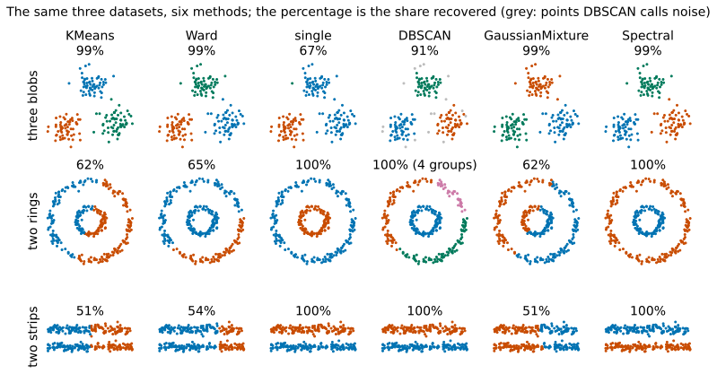{.fig .fig-f8 fig-alt="Three hand-made datasets (three blobs, two rings, two strips) clustered by six methods: KMeans, Ward, single, DBSCAN, GaussianMixture, Spectral. KMeans, Ward and the Gaussian mixture fail on rings and strips; single, DBSCAN and spectral clustering find them"}

::: {.one}
Each method answers "what is a group" differently: `DBSCAN`, `GaussianMixture`, `SpectralClustering`. One line each.
:::
:::

::: {.notes}
约 1 分钟，选讲，超时先压这一页。DBSCAN：挤得密的地方连成一群，不用先给 k，稀疏的点当噪声（灰点）；两个环上它分出 4 群，外环有几处稀，断开了。高斯混合：每群一个椭圆，和 K-means 一样只认一团，环和带都失败。谱聚类：先按谁和谁是邻居重新表示，再分，环和带都找对。single 在三团上只有 67%：两团之间被几个点连了起来。Note 第 12 节有调用表。
:::

## [Limitations:]{.stg} Where clustering cannot be trusted

::: {.stage}
::: {.rows}
<div><span class="n">1</span><div><b>k is given by us</b><p>the bend is often unclear</p></div></div>
<div><span class="n">2</span><div><b>"One group" decides the result</b><p>K-means wants lumps; single follows chains</p></div></div>
<div><span class="n">3</span><div><b>K-means can stop badly</b><p>use many starts</p></div></div>
<div><span class="n">4</span><div><b>Scale changes distance</b><p>standardise columns with different units</p></div></div>
<div><span class="n">5</span><div><b>No labels, no right answer</b><p>today's count table used labels only to check</p></div></div>
:::
:::

::: {.notes}
约 1 分钟。五条局限：k 要人给；结果取决于“一群”的定义（环、MNIST 上的 single）；K-means 会停在坏地方（起点 B）；尺度会改变距离，单位不同要先标准化（Lab 的葡萄酒会看到）；没有标签时没有对错，计数表只是借标签事后检查。
:::

## Today in code

::: {.stage}
```python
pca = PCA(n_components=50, random_state=0)   # 50 components, as in Assignment 2
pca.fit(X_fit)                               # fitting images only
Z_fit = pca.transform(X_fit)

km = KMeans(n_clusters=10, n_init=10, random_state=0)   # 10 starts, keep the best
km.fit(Z_fit)                                # no labels used
print(km.inertia_)                           # within-cluster sum of squares

hc = AgglomerativeClustering(n_clusters=10, linkage="ward")
groups_hc = hc.fit_predict(Z_fit)            # subsample first if there are many rows

table = np.zeros((10, 10), dtype=int)        # groups against true digits
for i in range(len(Z_fit)):
    table[km.labels_[i], y_fit[i]] += 1
print(table.max(axis=1).sum() / len(Z_fit))  # majority-vote accuracy
```
:::

::: {.notes}
约 1 分钟。不讲语法。Lab 8 会用这些代码分葡萄酒、给数字分群、处理太多的图，还要查出 AI 写错的三段代码。
:::

## What you can do now {.final-slide}

::: {.takeaway}
::: {.rows .tiny .chain}
<div><span class="n">problem</span><div><b>Data without labels</b><p>are there natural groups?</p></div></div>
<div><span class="n">model</span><div><b>One centre per group</b><p>each point stands for its centre</p></div></div>
<div><span class="n">loss</span><div><b>Within-cluster sum of squares</b><p>each point to its own centre</p></div></div>
<div><span class="n">solution</span><div><b>K-means</b><p>nearest centre, then mean; always stops; many starts</p></div></div>
<div><span class="n">test</span><div><b>Rings and strips</b><p>straight cuts fail; hierarchical, single follows the shape</p></div></div>
<div><span class="n">apply</span><div><b>Count table, majority vote</b><p>57.6% on the digits; subsample when data are large</p></div></div>
:::

::: {.qr}
{fig-alt="QR code for today's live page"}
<b>Feedback</b>
<p>After class: Lab 8</p>
:::
:::

::: {.notes}
约 0.5 分钟，课堂最终停在这一页。沿六行把整条链念一遍。答疑和扫码都在这里。课后 Lab 8，不预告下一讲。
:::
