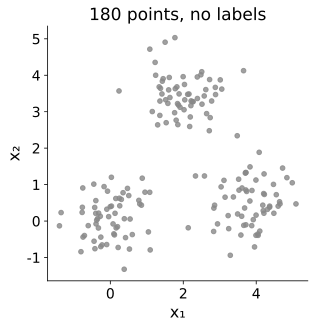
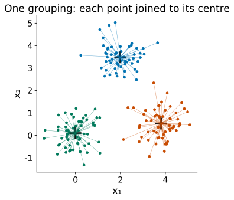
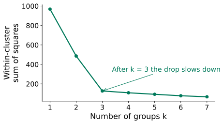
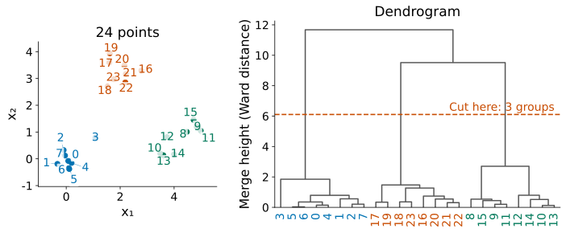
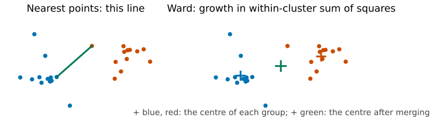
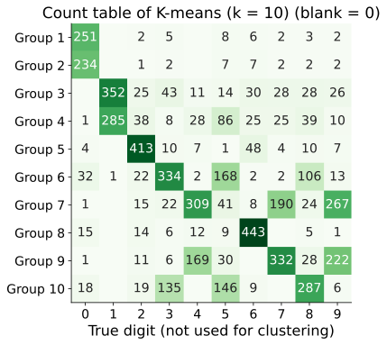
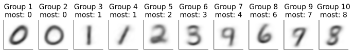
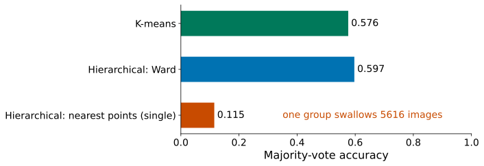

## 180 points, no labels. How many groups?

::: {.stage}
::: {.two .side}
{.fig .fig-f1 fig-alt="180 grey points in three clumps: bottom left, bottom right and top"}

::: {.ask}
<small>Your turn</small>
How many groups do you see? If you circled them with a pen, what would you be using?
:::
:::
:::

::: {.notes}
约 1.5 分钟。期待：三群；凭“挤在一起、和别的点之间隔着空白”。Lesson 7 第一次不看标签，这一讲继续不看标签，换一个问题：有没有自然的几群。
:::

## [Problem:]{.stg} What we want

::: {.stage}
::: {.say .xl .center}
Let the machine circle the groups, also in 784 dimensions where we cannot look: **clustering**.
:::

::: {.ask}
<small>Your turn</small>
Before any method: what makes a set of points "one group"?
:::
:::

::: {.notes}
约 1 分钟。点名 clustering，无监督。期待两个说法：离同一个中心近；一个挨一个地连着。两个本讲都会用到。
:::

## What you will be able to do

::: {.stage .tight}
::: {.say .xl}
**Find** groups with K-means, **see** where it fails, **switch** to hierarchical clustering, and **check** the groups against labels you did not use.
:::

::: {.flow .four}
<div><span>1</span>One centre per group</div>
<div><span>2</span>Where it fails</div>
<div><span>3</span>Merge from below</div>
<div><span>4</span>MNIST, and scale</div>
:::
:::

::: {.notes}
约 1 分钟。能力承诺，念出四段路线。
:::

## [One centre per group:]{.stg} How do we score a grouping?

::: {.stage}
::: {.two .side}
{.fig .fig-s2 fig-alt="The 180 points split into three coloured groups, each point joined by a thin line to the cross at its group's centre"}

::: {.ask}
<small>Your turn</small>
We want one number: small when points hug their centres, large when they do not. Which would you use?
:::
:::
:::

::: {.notes}
约 2 分钟。先用第一个说法：每群一个中心，点属于最近的中心。候选：每群最远的点；距离之和；距离平方之和。最远的点只看一个点，一个离群点就能拉大；后两个看所有点。选平方和：和 Lesson 2 的平方误差一样，到平均位置的平方和最小，中心就有现成的算法。
:::

## [One centre per group:]{.stg} Score a grouping

::: {.stage}
::: {.formula .big}
$$
\text{within-cluster sum of squares} = \sum_{\text{points}} \|\mathbf x - \text{its group's centre}\|^2
$$
:::

::: {.say .center}
Each point belongs to its nearest centre. Smaller is better.
:::
:::

::: {.notes}
约 1 分钟。点名 within-cluster sum of squares，sklearn 里叫 inertia_。
:::

## [One centre per group:]{.stg} Chicken and egg

::: {.stage}
::: {.two .even}
::: {.tile .txt}
**Know the centres?**

Then give each point to its nearest centre.
:::

::: {.tile .txt}
**Know the groups?**

Then each centre is the mean of its points.
:::
:::

::: {.ask}
<small>Your turn</small>
We know neither. How do we start?
:::
:::

::: {.notes}
约 1.5 分钟。候选一：试遍所有分法，180 个点分 3 群约 3^180 种，试不完。候选二：先猜中心，两步交替。下一页动手。
:::

## [One centre per group:]{.stg} Assign, move, repeat

::: {.stage .top}


::: {.say .center}
<small>Each step can only lower the within-cluster sum of squares, so K-means always stops. From start A: 3 rounds, 99.4% of the points back in their blob.</small>
:::
:::

::: {.notes}
约 5 分钟。请学生指挥：点 ①，点 ②，交替。起点 A：1851.3 → 130.2 → 127.0，三轮停下，三团都对：找回 99.4%（每群按其中最多的那团算对，点名 majority vote）。点名 K-means。再“换个起点”（B）：2163.6 → 503.9 → 474.3 → 474.1，也停了，但两个中心挤在一团里。为什么一定停：两步都只会让散布变小或不变，分法有限。为什么停错：只往附近更低走。问：怎么办？期待：挑好起点；多起点取最好。sklearn 默认 k-means++ 挑起点、n_init=10。
:::

## [One centre per group:]{.stg} Where does k come from?

::: {.stage}
::: {.two .side}
{.fig fig-alt="Within-cluster sum of squares against k from 1 to 7: it falls steeply up to k = 3 and slowly after"}

::: {.say}
More groups always lower the within-cluster sum of squares. Look for the **bend**: here k = 3. Assignment 2 uses k = 10 digits.<br><small>In this lesson, k is the number of groups (in Lesson 7 it was the number of components).</small>
:::
:::
:::

::: {.notes}
约 1.5 分钟。每个点自成一群时散布为 0，所以不能选最小的。拐弯处常常不明显，Note Advanced 给了轮廓系数作起点。
:::

## [Where it fails:]{.stg} Two rings, two strips

::: {.stage .top}


::: {.say .center}
Share recovered = majority vote: each group counts as right for the true group most of its points come from.<br><small>The points equally far from two centres form a straight line, so K-means can only cut with straight lines.</small>
:::
:::

::: {.notes}
约 3 分钟。K-means：两个环 62.5%，两条带 51.3%，和瞎猜差不多（找回比例就是 majority vote，群号是随意的）。问为什么。期待：离两个中心一样远的地方是一条直线，K-means 只能切直边的块；环被拦腰切开，带被竖着切开。内环和外环的“中心”是同一个点。
:::

## [Where it fails:]{.stg} The rings are linked, not centred

::: {.stage}
::: {.say .xl .center}
Points on a ring are linked one to the next, around no centre.
:::

::: {.ask}
<small>Your turn</small>
How could the machine build groups that follow such links?
:::
:::

::: {.notes}
约 1.5 分钟。回扣第 2 页的第二个说法“一个挨一个地连着”。期待：从近邻开始一点点连起来：先把最近的点并起来，再并下一对最近的。
:::

## [Merge from below:]{.stg} Start alone, merge the nearest

::: {.stage}
{.fig .fig-f3 fig-alt="Left: 24 numbered points from the three blobs. Right: their dendrogram; each horizontal line is a merge at the height of the distance; a red dashed line cuts it into 3 groups"}

::: {.say .center}
Merging from below: **hierarchical clustering**. Its record is a **dendrogram**: no k needed until we cut it. <small>Height here: Ward's distance (next slide).</small>
:::
:::

::: {.notes}
约 2.5 分钟。第二个说法“一个挨一个地近”：从下往上合并。最后几次合并的高度跳得很高，在跳跃处切一刀就是自然的几群。
:::

## [Merge from below:]{.stg} How near are two groups?

::: {.stage}
{.fig .fig-s3 fig-alt="Two groups of points shown twice: on the left a green line joins their two nearest points; on the right the two group centres and the green centre of the merged group"}

::: {.ask}
<small>Predict</small>
**Nearest points (single)** or **Ward**: which one will follow the rings?
:::
:::

::: {.notes}
约 1.5 分钟。Ward 和 K-means 同一个标准，追求紧凑的一团。让学生先预测，下一页验证。
:::

## [Merge from below:]{.stg} Nearest points follow the shape

::: {.stage .top}

:::

::: {.notes}
约 3 分钟。默认显示“最近的两点”：两份数据都 100%。环上的点一个挨一个，沿环连成一群；两环之间有空隙，最后才合并。再点 Ward：64.7%、53.7%，和 K-means 一样失败。代码：AgglomerativeClustering(n_clusters=2, linkage="single")。
:::

## [MNIST:]{.stg} 10 groups from 50 components, no labels used

::: {.stage}
::: {.two .wide4}
{.fig .fig-f4 fig-alt="Count table of 10 K-means groups against the true digit: 2 and 6 nearly fill one group each; 0 and 1 take two groups each; no group is mainly 5 or 9; 4, 7 and 9 mix, and 3, 5 and 8 mix"}

::: {.ask}
<small>Your turn</small>
Labels are used only afterwards, to count. Which digits get a group of their own? Which mix?
:::
:::
:::

::: {.notes}
约 3 分钟。MNIST 子集拟合用的 5625 张（Lesson 6 的划分），PCA 降到 50 个主成分（作业 2 也用 50 个，保住 82.7%；主成分个数不叫 k，k 是群的个数），K-means k = 10。点名 count table。2、6 各占一群；0、1 各占两群（0 一斜一圆，1 一直一斜），所以 5 和 9 没有自己的群；4、7、9 混，3、5、8 混。写法相近的数字混在一起。
:::

## [MNIST:]{.stg} Majority vote: how much did the groups find?

::: {.stage}
{.fig .fig-f5 fig-alt="The average image of each of the ten groups, 28 by 28, titled with its most common digit; two 0s, two 1s, and the group whose majority is 4 looks like a 9"}

::: {.say .center}
Each group's **average image**, titled with its most common digit. Each group guesses that digit: **57.6%** right, without ever seeing a label. The group marked 4 mixes 4, 9 and 7 (309, 267, 190 images), so its average looks like a 9.<br><small>New images: each takes the guess of its nearest centre. On the validation set: 57.7%.</small>
:::
:::

::: {.notes}
约 2.5 分钟。回到 majority vote。图是每群的中心还原回像素，即这一群的平均图像。多数是 4 的那群看起来像 9：4、7、9 混在里面。聚类不用标签；验证集只用来检查“每群猜一个数字”这个分法在没见过的图上是否同样管用：把验证图分给最近的中心，用拟合部分定下的“每群猜几”，57.7%，和拟合图一样。比瞎猜（一成）好得多，但写法相近的数字分不开。作业 2 附加题 B 就是这张计数表和这个准确率。
:::

## [MNIST:]{.stg} The best way to measure "near" depends on the data

::: {.stage}
{.fig .fig-f6 fig-alt="Majority-vote accuracy on the MNIST subset: K-means 0.576, Ward 0.597, nearest points (single) 0.115 because one group swallows 5616 images"}

::: {.say .center}
Nearest points (single) won on the rings; on MNIST it puts **5616** of 5625 images in one group.
:::
:::

::: {.notes}
约 2 分钟。Ward 最好 59.7%，比 K-means 略高。single 只有 11.5%：数字之间没有清楚的空隙，总有写得含糊的图把两类连起来，一条链连成大群。没有一种量法处处最好。
:::

## [Scale:]{.stg} Every pair of points

::: {.stage .bigtab}
| points | pairs | memory |
|---:|---:|---:|
| 5625 (today) | 15.8 million | 0.13 GB |
| 5000 | 12.5 million | 0.1 GB |
| 50,000 (Assignment 2) | 1.25 billion | 10 GB |

<small>Each distance takes 8 bytes: 15.8 million × 8 bytes ≈ 0.13 GB.</small>

::: {.ask}
<small>Your turn</small>
Hierarchical clustering needs the distance of every pair. What would you do with 50,000 images?
:::
:::

::: {.notes}
约 2 分钟。n(n−1)/2 对，每个 8 字节；点数翻 10 倍，内存翻 100 倍。期待：随机抽一部分（subsample）。MNIST 子集只用 500 张做 Ward，多数投票 59.2%，和全部 5625 张的 59.7% 差不多；作业 2 提示 5000 张。K-means 只算点到 k 个中心的距离，可以用全部数据。
:::

## Today in code

::: {.stage}
```python
pca = PCA(n_components=50, random_state=0)   # 50 components, as in Assignment 2
pca.fit(X_digits_fit)                        # fitting images only
Z_fit = pca.transform(X_digits_fit)

km = KMeans(n_clusters=10, n_init=10, random_state=0)   # 10 starts, keep the best
km.fit(Z_fit)                                # no labels used
print(km.inertia_)                           # within-cluster sum of squares

hc = AgglomerativeClustering(n_clusters=10, linkage="ward")
groups_hc = hc.fit_predict(Z_fit)            # subsample first if there are many rows

table = np.zeros((10, 10), dtype=int)        # groups against true digits
for i in range(len(Z_fit)):
    table[km.labels_[i], y_digits_fit[i]] += 1
print(table.max(axis=1).sum() / len(Z_fit))  # majority-vote accuracy
```
:::

::: {.notes}
约 1 分钟。不讲语法。Lab 8 会一步步做：K-means、计数表、换起点、层次聚类。
:::

## Back to the opening points

::: {.stage}
::: {.say .xl .center}
Three blobs: K-means finds **99.4%**. Rings: nearest points (single) finds **100%**. MNIST: almost **60%**, with no labels.
:::

::: {.say .center}
What counts as "one group" decides which method works.
:::
:::

::: {.notes}
约 1 分钟。局限（口头）：k 要人给；结果取决于“一群”的定义；K-means 会停在坏地方；没有标签时没有对错；尺度会改变距离，要先标准化。
:::

## What you can do now {.final-slide}

::: {.takeaway}
::: {.rows .tiny .chain}
<div><span class="n">see it</span><div><b>Points without labels</b><p>are there natural groups?</p></div></div>
<div><span class="n">measure</span><div><b>Within-cluster sum of squares</b><p>each point to its nearest centre</p></div></div>
<div><span class="n">K-means</span><div><b>Assign, move, repeat</b><p>always stops; use many starts</p></div></div>
<div><span class="n">fails</span><div><b>Rings and strips</b><p>cuts between centres are straight</p></div></div>
<div><span class="n">merge</span><div><b>Hierarchical clustering</b><p>how "near" is measured decides the result</p></div></div>
<div><span class="n">check</span><div><b>Count table, majority vote</b><p>subsample when data are large</p></div></div>
:::

::: {.qr}
{fig-alt="Feedback QR code for Lesson 8"}
<b>30-second feedback</b>
<p>After class: Lab 8</p>
:::
:::

::: {.notes}
约 1.5 分钟，课堂最终停在这一页。沿六行把整条链念一遍。答疑和扫码都在这里。课后 Lab 8，不预告下一讲。
:::
