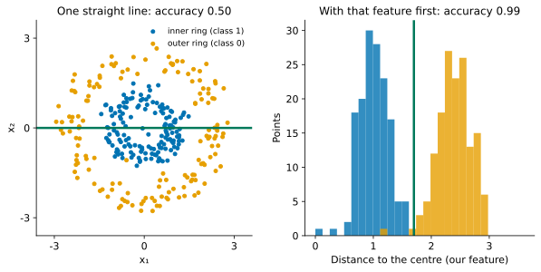
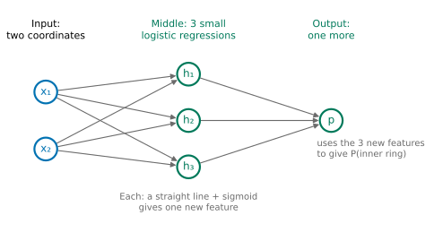
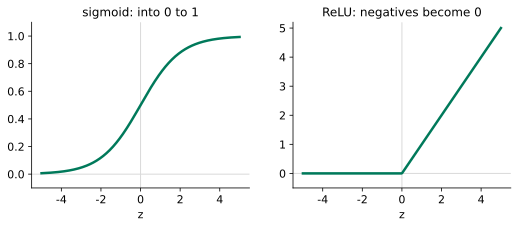
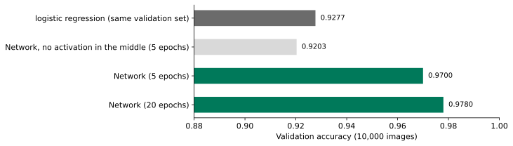
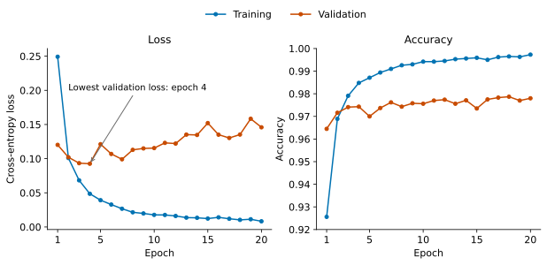
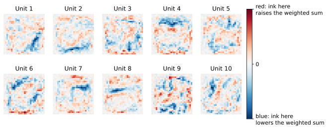
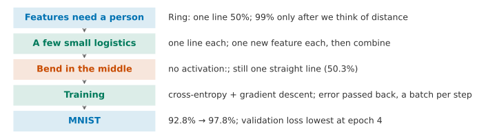

## 1. Motivation: A Person Has to Think of the Features

At the end of Lesson 4 there was a ring-shaped data set: one class in the inner ring, one class in the outer ring. Logistic regression can draw only one straight line. Its accuracy was 50%, no better than a guess. We first thought of a new feature, "distance to the centre", and then gave it to logistic regression. The accuracy was 99%.

{fig-alt="The left plot shows the ring-shaped data and one horizontal straight line, with accuracy 0.50. The right plot shows histograms of the distance to the centre for the two classes, blue on the left and orange on the right, with one vertical line between them and accuracy 0.99"}

Where is the problem? The 99% depended on **a person thinking of this feature first**. The ring data has only two coordinates, so a plot shows the answer. Now take the MNIST data from Assignment 2: each image has 28 × 28 = 784 pixels. Which pixels, combined in which way, tell us "this is a 3"? Nobody can write that down. Lesson 3 also ended with this point: a person has to think of the features.

Think first: if we do not let a person think of the features, what else can we do?

::: {.callout-note collapse="true" title="Show answer"}
Let the model build features from the raw input, and then classify with those features. The question becomes: what "parts" can the model use to build features?
:::

What we want is this: **the model builds its own features, and the person gives only the raw input.** In this lesson we work out the method on the ring data, and then use it on MNIST.

**By the end of this lesson, you should be able to:**

- explain what each hidden unit in a small network does;
- explain why the middle of the network must be non-linear;
- use Keras to train the network from Assignment 2, Section 4, on MNIST;
- read the training and validation curves: which epoch the validation loss and the validation accuracy each point to, and whether the gap between training and validation is growing;
- compare fairly with logistic regression on the same validation set, and know how large the difference from changing the random seed is.

## 2. Ready-Made Parts: Several Logistic Regressions

What parts can the model use to build features? We have only one ready-made part: the logistic regression from Lesson 4. It takes two coordinates and computes a weighted sum $z = w_1x_1 + w_2x_2 + b$ (the same $z$ as in Lesson 4: the linear part, before the sigmoid). Then it squeezes the sum with a sigmoid into a number between 0 and 1. The set $z = 0$ is a straight line, and the number tells us which side of the line the point is on.

One line is not enough. So we use several small logistic regressions: **each gives one new feature** ("which side of line $k$ the point is on"). Then we give these new features to a last logistic regression, which makes the decision.

Try it yourself first. Below are three lines, and each is a small logistic regression. The rule of the machine is this: a point **on the inner side of all three lines** is classed as inner ring.



Drag the sliders. What is the most that one line can do? What about three lines? Which shape of the three lines is best?

::: {.callout-note collapse="true" title="Show answer"}
With one line only, the shaded region can be only a half-plane. However we place it, it cannot cover a whole ring of blue points without covering orange points. Three lines enclose a triangle, which can surround the inner ring. The triangle given by "Show one placement" has accuracy 0.967. The three corners of the triangle either miss some outer-ring points or cover some of them. With more lines, the enclosed shape gets closer to a circle.
:::

These three lines are three new features. The condition "on the inner side of all three lines" can also be computed by the last logistic regression. When all three new features are close to 1, their weighted sum is large, and so the output probability is high.

{fig-alt="On the left, two input circles x1 and x2, each with arrows to three green circles h1, h2 and h3 in the middle. The three green circles connect to the output p on the right"}

## 3. Letting the Machine Place the Lines: Neural Networks

Placing three lines by hand is tiring. On 784 pixels, it cannot be done by hand at all. Can the machine place the lines itself?

Yes. Every weight in the figure (the $w_1$, $w_2$ and $b$ of each line, and the weights of the last logistic regression) is still a number. So we can do what we did in Lesson 4: choose a loss (cross-entropy) and change the weights step by step with gradient descent. The small logistic regressions in the middle are trained together with the last one. The result is called a **neural network**. The middle layer is called the **hidden layer**, because we see only the input and the output and cannot see this layer. Each small logistic regression inside it is called a **unit**.



Look at 1 unit first, and then click 2, 3 and 4 in turn. How does the accuracy change? With 4 units, what do the green lines enclose?

::: {.callout-note collapse="true" title="Show answer"}
1 unit gives 0.69, 2 units give 0.82, 3 units give 0.97 and 4 units give 0.997. With 1 unit there is only one line, and the shaded region is a half-plane. With 3 units the lines enclose a triangle, close to the one we placed by hand. With 4 units they enclose a quadrilateral that surrounds the inner ring almost exactly. We never told the network about "distance to the centre". It used a few lines to enclose the ring by itself.
:::

## 4. Can We Remove the Sigmoid in the Middle: Activation Functions

Each hidden unit computes a weighted sum and then passes it through a sigmoid. This step looks unnecessary. There is a logistic regression at the end anyway, so why not hand the weighted sum straight on? The model would be simpler.

Make a prediction, and then check it with the widget below: click "None", and then click 1 to 4 units in turn.



::: {.callout-note collapse="true" title="Show answer"}
With any number of units, the accuracy is 0.503, and the boundary of the shaded region is only a straight line.
:::

Why? Without the sigmoid, the hidden layer gives $h = W_1x + b_1$, and the output uses $W_2h + b_2$. Substitute one into the other:

$$
W_2(W_1x + b_1) + b_2 = (W_2W_1)\,x + (W_2b_1 + b_2).
$$

This is still "one set of weights times $x$, plus one number", exactly the same as one logistic regression. **A line on top of a line is still a line.** Adding more layers changes nothing. So each unit in the middle must "bend" the sum. The function that does the bending is called the **activation function**.

What properties do we want from it? First, it is not a straight line (otherwise we are back in the case above). Second, we can take its derivative everywhere, or almost everywhere, because training uses gradients. Many functions satisfy both. Two are in common use:

{fig-alt="The left plot shows the sigmoid curve, rising smoothly from 0 to 1. The right plot shows ReLU, which is 0 when z is below 0 and a sloping line when z is above 0"}

- **sigmoid**: the one from Lesson 4, which squeezes a number into the range 0 to 1;
- **ReLU** (rectified linear unit): $\max(0, z)$. Negative numbers become 0, and positive numbers stay the same. It has a corner at 0, and we can take its derivative everywhere else.

In the widget, click "Another bend". This is ReLU: 3 units give 0.977 and 4 units give 0.997, close to sigmoid (0.97 and 0.997). On this data set, the two work equally well. The network in Assignment 2 uses ReLU. Networks with many layers often use ReLU, and the reason is linked to the fact that both ends of the sigmoid are almost flat. We do not check this in this lesson. It is left for Advanced Study 1, Question 2.

## 5. How to Train

Training still uses the three things from Lesson 4: a cross-entropy loss, a gradient, and steps downhill. But there are two new questions.

**New question 1: how do we find the gradient for the weights in a hidden layer?** The weights in the output layer connect directly to the loss, so their gradient is the same as in Lesson 4. The weights in a hidden layer first change the output of the hidden units, and only then change the loss through the output layer. There is one layer in between. There are two candidates:

1. Change each weight by a tiny amount, recompute the loss, and see how much it changed. The network in Assignment 2 has 118,282 weights, so one step would need 118 thousand recomputations.
2. Use the chain rule. First compute the derivative of the loss with respect to the output (as in Lesson 4, this is the predicted probability minus the true label). Then share it out to each hidden unit through the weights of the output layer. Then multiply by the slope of that unit's activation function. This gives the gradient for the weights of that unit. The whole network needs only one pass from back to front.

We pick the second. The error is passed back from the output, layer by layer, so this is called **backpropagation**. Keras does it automatically, so we do not need to write it. The derivation is in Advanced Study 1.

**New question 2: how many images should we look at in each step?** In Lesson 4, every step used all the training data to compute the gradient. The fitting part of MNIST has 50,000 images. Again there are two candidates:

1. Use all 50,000 images in each step: the gradient is accurate, but each step is expensive.
2. Use only a small group of images in each step, for example 32: the gradient is rougher, but each step is cheap, so the same amount of computation allows many more steps.

Let us compare the two by looking at all 50,000 images 5 times. With all images in each step, we take only 5 steps, and the validation accuracy is 0.573. With 32 images per step, we take 7815 steps, and the validation accuracy is 0.970. So we use batches. The small group of images used in each step is called a **batch**. One full pass through all the training data is called an **epoch**. With 32 images per batch, one epoch is 1563 steps.

One last point is the step size. In Lesson 4, a person had to choose the step size: too large and the steps jump about, too small and we hardly move. In Keras, **adam** is commonly used. It is a form of gradient descent that adjusts the step size by itself, and it sets the step size of each weight according to the size of its recent gradients. This lesson only uses it and does not explain it further.

## 6. MNIST: 784 Pixels

Now we return to MNIST in Assignment 2. The split is the same as in Assignment 2. Of the 60,000 training images, the first 50,000 are the fitting part and the last 10,000 are the validation set (Lesson 6). We divide the pixels by 255, so they lie between 0 and 1.

**First we need a baseline to compare with.** In Lesson 4 we used multi-class logistic regression (softmax) on the course's MNIST subset: trained on 7,500 images, it scored 0.908 on the test set. This lesson uses the full MNIST that comes with Keras: the first 50,000 images for fitting and the last 10,000 as the validation set. The same method (default $C = 1$) gives a validation accuracy of 0.9277. It cannot be compared directly with 0.908: there are more than six times as many images to fit on, $C$ is different (Lesson 4 chose 0.1; on the subset the default $C = 1$ gives 0.902), and it is measured on different images (a validation set here, the subset's test set in Lesson 4). In this lesson we compare only with 0.9277.

**The network.** The input is 784 pixels. There are two hidden layers, each with 128 ReLU units. The output layer has 10 units and uses softmax to give the probabilities of the 10 digits. This is the same softmax as in the multi-class case in Lesson 4. The network is exactly the same as the one in Section 4 of Assignment 2.

Let us count the weights. Each unit in the first layer connects to 784 pixels, plus one constant, so $784 \times 128 + 128 = 100{,}480$. The second layer has $128 \times 128 + 128 = 16{,}512$. The output layer has $128 \times 10 + 10 = 1{,}290$. The total is 118,282. Logistic regression has $784 \times 10 + 10 = 7{,}850$.

{fig-alt="Horizontal bar chart: logistic regression 0.9277, the network without the middle activations 0.9203, the network trained for 5 epochs 0.9700, trained for 20 epochs 0.9780"}

After 5 epochs of training, the validation accuracy is 0.9700. This is more than 4 percentage points higher than logistic regression. The number of wrong images falls from 723 to 300.

Predict: if we remove the ReLU from the two middle layers and change nothing else, what happens?

::: {.callout-note collapse="true" title="Show answer"}
The validation accuracy is 0.9203. This is back at the level of logistic regression (even slightly lower). The reason is the same as in Section 4: without activation functions, the three layers stacked together are still one set of weights multiplied by the pixels, plus one number. This is equal to one logistic regression. The extra 110 thousand weights in the network bring nothing new.
:::

## 7. How Long to Train: Training and Validation Curves

How many epochs are enough? The more epochs, the lower the loss on the training set. But what we care about is images the network has not seen. Lesson 6 gave us a method: look at the validation set.

Below, we train the network for 20 epochs. At the end of each epoch, we record the loss and the accuracy on the training set and on the validation set.

{fig-alt="Left plot: the training loss falls from 0.25 all the way to 0.01; the validation loss is lowest at epoch 4, at about 0.09, then rises unevenly to 0.15. Right plot: the training accuracy rises to 0.997 and the validation accuracy stays between 0.97 and 0.98"}

Read the plots: how do the training loss and the validation loss change? And the validation accuracy?

::: {.callout-note collapse="true" title="Show answer"}
The training loss keeps falling, from 0.249 to 0.008, and the training accuracy reaches 0.997. The validation loss is lowest at epoch 4 (0.093), then rises again with ups and downs, and at epoch 20 it is 0.146. The validation accuracy moves up and down a lot (it drops to 0.970 at epoch 5 and is 0.974 at epoch 15), but overall it still rises slowly: 0.9743 at epoch 4 and 0.9780 at epoch 20.
:::

The two validation curves tell different stories. Why? Accuracy only checks whether the digit with the highest probability is the right one. Cross-entropy also checks how much probability was given to the right digit. In the later epochs, the network becomes more and more confident on the training set, and also more and more confident on images it has not seen, including the ones it gets wrong. The wrong images are penalised more and more heavily, so the validation loss rises. At the same time, a net of more than thirty images changed from wrong to right, so the validation accuracy still rose a little. The gap between training and validation keeps growing (accuracy 0.997 against 0.978). This is exactly what "memorising the training set" looks like in Lesson 6: most of the progress on the training set did not carry over to unseen images.

So how many epochs? There is no single answer. We must first say which curve we look at. By the validation loss, we stop at epoch 4. By the validation accuracy, 20 epochs is slightly better. Assignment 2 fixes 20 epochs so that everyone's results can be compared, and so that you can see the disagreement between the two curves in Figure 2. A way to make training stop by itself at the lowest validation loss is in Advanced Study 3, Question 1.

**The same code can give different results.** Before training starts, the weights are drawn at random. Which 32 images go into each batch is also random. If we do not fix this randomness, the same code gives a different result each time it runs. `keras.utils.set_random_seed(0)` fixes it, so the result can be reproduced. Changing the seed is like trying your luck again. Below, we change only the seed and keep everything else the same. The table shows the validation accuracy at epoch 20.

| Seed | 0 | 1 | 2 |
|---|---|---|---|
| Validation accuracy | 0.9780 | 0.9755 | 0.9781 |

The three seeds differ by at most 0.26 percentage points. So when we compare two networks, the gap must be much larger than this before we can say one is better than the other. If the gap is only 0.1 percentage points, it may be only the luck of the seed. In the same way, the rise of 0.37 percentage points in validation accuracy from epoch 4 to epoch 20 is only a little larger than the difference between seeds. The benefit of 16 more epochs of training is not certain.

## 8. What the Hidden Units Learned

Each unit in the first layer has 784 weights. These can be arranged back into 28 × 28 and drawn as an image. Red weights are positive (where the image is bright, the weighted sum of this unit becomes larger), and blue weights are negative.

{fig-alt="Ten small squares, each a red and blue pattern of 28 by 28, with slanted stripes and blocks of red and blue, and none looks like a whole digit"}

Look: do these units look like digits?

::: {.callout-note collapse="true" title="Show answer"}
They do not look like any whole digit. Each unit is sensitive to the light and dark of a few places in the image: some look like a slanted stroke, and some have two opposite colours on the left and right. These are features that the network built by itself. We do not check here how the later layers combine them. They are also hard to read: we cannot say exactly what unit 3 is looking for. This is one cost of a network.
:::


## 9. Implementation: Doing It in Keras

**Read the data and split it as in Assignment 2 (Section 6):**

```python
import numpy as np                           # numbers and arrays
from tensorflow import keras                 # neural networks

(x_train, y_train), (x_test, y_test) = keras.datasets.mnist.load_data()   # about 11 MB; x_test is not used here
X = x_train.reshape(-1, 784) / 255.0         # 60,000 rows of 784 pixels, scaled to 0 to 1
y = y_train                                  # digits 0 to 9, already integers
X_fit = X[:50000]                            # fitting part: the first 50,000 images
y_fit = y[:50000]                            # and their digits
X_val = X[50000:]                            # validation set: the last 10,000 images
y_val = y[50000:]                            # and their digits
```

**Build the network and train it (Sections 3 to 7):**

```python
keras.utils.set_random_seed(0)               # fix the random starting weights and batches
model = keras.Sequential([
    keras.layers.Input((784,)),              # 784 pixels in
    keras.layers.Dense(128, activation="relu"),   # hidden layer 1: 128 units
    keras.layers.Dense(128, activation="relu"),   # hidden layer 2: 128 units
    keras.layers.Dense(10, activation="softmax"), # output: a probability for each digit
])
model.compile(optimizer="adam",                         # gradient descent that sets its own step sizes
              loss="sparse_categorical_crossentropy",   # cross-entropy; labels are integers 0 to 9
              metrics=["accuracy"])                     # also report accuracy
hist = model.fit(X_fit, y_fit, epochs=20,               # 20 passes over the fitting part
                 validation_data=(X_val, y_val),        # loss and accuracy on the validation set after every epoch
                 verbose=0)                             # print nothing while training
print(model.count_params())                  # 118282
print(hist.history["val_accuracy"][-1])      # validation accuracy after 20 epochs: 0.978
```

`Dense` is a layer in which every unit is connected to all the inputs from the previous layer. `hist.history` holds four lists of numbers: `loss`, `val_loss`, `accuracy` and `val_accuracy`, one value per epoch. The plots in Section 7 were drawn from them. On an ordinary laptop, 20 epochs take about 40 seconds.

**A small network on the ring data (Sections 3 and 4):**

```python
rng = np.random.default_rng(0)               # the random numbers of the Lesson 4 ring
angle = rng.uniform(0, 2 * np.pi, 300)       # an angle for every point
inner_r = rng.normal(1.0, 0.25, 150)         # radius of the 150 inner points
outer_r = rng.normal(2.4, 0.3, 150)          # radius of the 150 outer points
radius = np.concatenate([inner_r, outer_r])  # all 300 radii
x1 = radius * np.cos(angle)                  # first coordinate
x2 = radius * np.sin(angle)                  # second coordinate
X_ring = np.column_stack([x1, x2])           # 300 rows, two columns
y_ring = np.repeat([1, 0], 150)              # 1 = inner ring (first 150), 0 = outer ring

keras.utils.set_random_seed(0)               # fix the random starting weights
ring_model = keras.Sequential([
    keras.layers.Input((2,)),                    # two coordinates in
    keras.layers.Dense(4, activation="sigmoid"), # 4 hidden units: 4 lines
    keras.layers.Dense(1, activation="sigmoid"), # one more logistic unit on top
])
ring_model.compile(optimizer=keras.optimizers.Adam(0.05),   # a larger step size than the default
                   loss="binary_crossentropy",              # cross-entropy for two classes
                   metrics=["accuracy"])                    # also report accuracy
hist_ring = ring_model.fit(X_ring, y_ring, epochs=300,      # 300 steps
                           batch_size=300, verbose=0)       # all 300 points in every step
print(hist_ring.history["accuracy"][-1])     # training accuracy: 0.997
```

Change `"sigmoid"` (the one in the hidden layer) to `"linear"`. This is the same as clicking "None" in Section 4, and the accuracy becomes 0.503.

## 10. One-Page Review

If you read only one page, read this one.

{fig-alt="A horizontal flow chart with five boxes: features must be thought up by people, several small logistic regressions, a bend is needed in the middle, training, MNIST"}

| The problem you see | What you can do | Evidence to judge it |
|---|---|---|
| One straight line cannot separate the classes, and you cannot think of good features | Let several small logistic regressions (units) each build one feature, then combine them: a neural network | On the ring, 1 to 4 units: 0.69 to 0.997 |
| No activation function in the middle | One is needed: sigmoid or ReLU | Without it, the ring gives 0.503 and MNIST gives 0.9203 |
| How to find the gradient of the hidden-layer weights | Backpropagation: use the chain rule, working from back to front once | One pass backwards, not a separate calculation for every weight |
| Too much data, and using all of it in every step is too slow | Use a batch in every step; one pass over the data is an epoch | Same 5 epochs: 0.573 against 0.970 |
| How many epochs to train | Watch the validation loss and the validation accuracy | The validation loss is lowest at epoch 4, then rises again |
| Two networks differ by a small amount | Try several seeds and see how much the results vary | Three seeds differ by 0.26 percentage points |

## 11. Summary and Limitations

The question at the start was that "someone has to think of the features". The answer of a neural network is this. Use many units (small logistic regressions), and let each unit build one feature by itself. Then combine the features layer by layer, and train everything together with gradient descent. On the ring, nobody has to think of "distance", and 4 units reach 0.997. On MNIST, the accuracy goes from 0.9277 for logistic regression to 0.978.

**Transfer question.** In Assignment 2, a student changes the network to 512 units in each layer and keeps everything else the same (seed 0, 20 epochs). The validation accuracy is 0.9803, higher than 0.9780 for 128 units. The student says "512 units are better". Answer without calculating: can we trust this conclusion? What would you ask them to do next?

::: {.callout-note collapse="true" title="Model answer"}
Not enough to trust it. The two results differ by 0.23 percentage points. This is about the same as the change caused by switching seeds (0.26 percentage points), so it may be only luck with the seed. They should train each network with several seeds and compare the mean and the spread. They should also look at the validation curves. The network with 512 units has about 670,000 weights, which is 5.7 times as many as with 128 units, so it can memorise the training set more easily. Its validation loss is lowest at epoch 3, one epoch earlier than with 128 units. Compare only on the validation set, and keep the test set until the very end, to be used once.
:::

**Where this method cannot be trusted.**

1. **Many parameters need a lot of data.** The network in Assignment 2 has 118,000 weights, which is 15 times as many as logistic regression. With little data, it quickly memorises the training set.
2. **It can memorise the training set.** A training loss that keeps falling does not show that the model is getting better. Use the validation curves to decide how many epochs to train.
3. **The result changes with the seed.** With the same network and the same data, a new seed changes the accuracy by a few tenths of a percentage point. Take this into account when you compare models.
4. **The features are hard to read.** The units in the first layer do not look like digits, and we cannot say what each unit is looking for.

**Back to the promise at the start.** You can now do the following. You can explain that on the ring data each hidden unit draws one line, and that together they enclose the inner ring. You can explain why there must be an activation function in the middle. You can use Keras to train the network from Section 4 of Assignment 2 on MNIST. You can read the training and validation curves, say which epoch the validation loss and the validation accuracy each point to, and see that the gap between training and validation is growing. You can compare with logistic regression on the same validation set, and use several seeds to judge whether the difference can be trusted.

**30-second feedback.** Now that you have finished this lesson, please scan the code to leave anonymous feedback or questions. It helps us improve to know which parts were unclear and which parts went too fast.

{fig-align="center" width="160px" fig-alt="Feedback QR code"}

*The Advanced Studies below are not part of the main thread, and you can read each one on its own. MPS311 students are encouraged to read them. MPS439 students have one main task, which is required: Advanced A of Lab 9. It builds on Study 1 and 2 here but uses ReLU hidden units and step size 0.5, so its self-check values differ from the ones on this page. The other Studies are optional.*

---

## Advanced Study 1: Deriving the Gradients for Backpropagation

Use the small network from Section 2: two inputs, $m$ sigmoid hidden units, and one output unit (also a sigmoid). For the $i$-th point:

$$
z_{ik} = \sum_j x_{ij}W_{jk} + b_k,\qquad h_{ik} = \sigma(z_{ik}),\qquad s_i = \sum_k h_{ik}v_k + c,\qquad p_i = \sigma(s_i).
$$

The loss is the cross-entropy from Lesson 4, $L = -\frac{1}{n}\sum_i\big[y_i\log p_i + (1-y_i)\log(1-p_i)\big]$.

**Step 1, the output layer.** Advanced Study 1 of Lesson 4 already derived this:

$$
\frac{\partial L}{\partial s_i} = \frac{p_i - y_i}{n}.
$$

So $\dfrac{\partial L}{\partial v_k} = \sum_i \dfrac{\partial L}{\partial s_i}\,h_{ik}$ and $\dfrac{\partial L}{\partial c} = \sum_i \dfrac{\partial L}{\partial s_i}$. These are exactly the gradients from Lesson 4. The only change is that the input is now the output $h$ of the hidden units instead of $x$.

**Step 2, passing back to the hidden units.** In $s_i$, the coefficient of $h_{ik}$ is $v_k$, so $\dfrac{\partial L}{\partial h_{ik}} = \dfrac{\partial L}{\partial s_i}\,v_k$.

**Step 3, passing through the activation function.** The derivative of the sigmoid is $\sigma'(z) = \sigma(z)(1-\sigma(z))$, so

$$
\frac{\partial L}{\partial z_{ik}} = \frac{\partial L}{\partial h_{ik}}\;h_{ik}(1-h_{ik}).
$$

**Step 4, the weights of the hidden layer.** In $z_{ik}$, the coefficient of $W_{jk}$ is $x_{ij}$, so

$$
\frac{\partial L}{\partial W_{jk}} = \sum_i x_{ij}\,\frac{\partial L}{\partial z_{ik}},\qquad \frac{\partial L}{\partial b_k} = \sum_i \frac{\partial L}{\partial z_{ik}}.
$$

Each step uses only numbers that the step after it has already calculated. So one pass from the output back to the start gives all the gradients. With more layers, Steps 2 and 3 are repeated.

Now try the following yourself:

1. Change the activation function to ReLU. What does Step 3 become? For a unit with $z_{ik} < 0$, what happens to its weights in this step?
2. Section 4 said that the gradient of a sigmoid is close to 0 at both ends. Use the formula in Step 3 to show that when $z$ of a unit is very large or very small, the weights of that unit hardly move.

## Advanced Study 2: A Single-Hidden-Layer Network in numpy

Use the ring data `X_ring` and `y_ring` from Section 9, with 4 sigmoid hidden units. Write the gradient descent by following the four steps of Study 1.

```python
import numpy as np                            # numbers and arrays

rng = np.random.default_rng(0)                # random starting weights
W1 = rng.normal(0, 1, (2, 4))                 # 2 inputs to 4 hidden units
b1 = np.zeros(4)                              # constants of the hidden units
w2 = rng.normal(0, 1, 4)                      # 4 hidden units to 1 output
b2 = 0.0                                      # constant of the output
for step in range(5000):                      # 5000 steps of gradient descent
    H = 1 / (1 + np.exp(-(X_ring @ W1 + b1)))   # hidden features, 300 x 4
    p = 1 / (1 + np.exp(-(H @ w2 + b2)))        # probability of the inner ring
    g = (p - y_ring) / len(y_ring)              # step 1: d loss / d output score
    gw2 = H.T @ g                               # gradient of the output weights
    gb2 = g.sum()                               # gradient of the output constant
    gH = np.outer(g, w2) * H * (1 - H)          # steps 2 and 3: back through each hidden sigmoid
    gW1 = X_ring.T @ gH                         # step 4: gradient of the hidden weights
    gb1 = gH.sum(axis=0)                        # step 4: gradient of the hidden constants
    W1 = W1 - gW1                               # step size 1.0
    b1 = b1 - gb1
    w2 = w2 - gw2
    b2 = b2 - gb2
print(((p > 0.5) == y_ring).mean())           # accuracy
```

After 5000 steps, the loss falls from 0.887 to 0.018, and the accuracy is 0.997. This is the same as the 4 units in Keras in Section 9.

Now try the following yourself:

1. Change the 4 units to 2 and to 3. How does the accuracy change? Compare with the widget in Section 3.
2. Check the gradient by a method other than Study 1. Pick one weight and add $10^{-5}$ to it. Calculate the loss again, and compare "change in loss ÷ $10^{-5}$" with the gradient in the code. This is Candidate 1 in Section 5. Why is it only good for checking, and not for training?
3. Set all the starting weights to 0. What happens, and why? (Hint: the 4 units are exactly the same at the start.)

## Advanced Study 3: Open Questions

This lesson does not develop the following four questions. Each comes with a starting point.

1. **Early stopping.** In Section 7, the validation loss is lowest at epoch 4. Can we make the training stop there by itself? Starting point: `keras.callbacks.EarlyStopping(monitor="val_loss", patience=3, restore_best_weights=True)`, passed to `fit` as `callbacks`.
2. **Dropout.** In every training step, switch off a random part of the hidden units, so that the network cannot depend on any one unit. Starting point: add `keras.layers.Dropout(0.2)` between the two `Dense` layers, and see how the validation curves change.
3. **Wider or deeper.** What happens to the validation accuracy with 512 units in each layer, or with three hidden layers? Use the method of the Transfer question, and compare with several seeds together.
4. **Why adam is faster than a fixed step size.** Starting point: change `optimizer="adam"` to `keras.optimizers.SGD(0.01)`, and compare the validation accuracy after 5 epochs.
