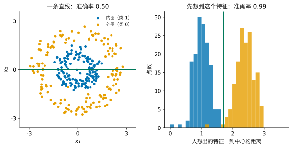
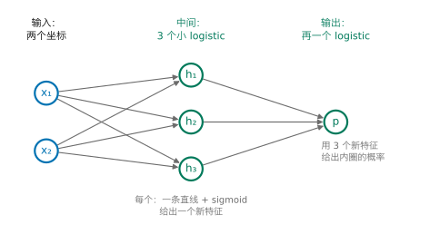
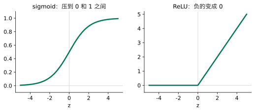
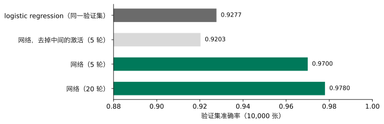
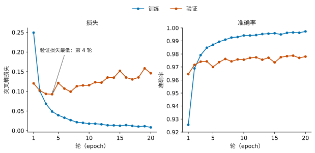
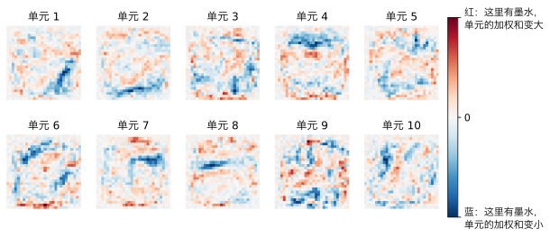
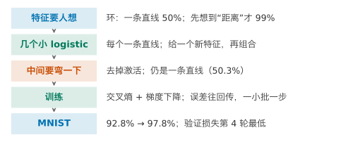

## 1. 动机：特征要靠人想到

Lesson 4 结尾有一份环形数据：内圈一类，外圈一类。logistic regression 只能画一条直线，准确率 50%，和瞎猜一样。我们先想到一个新特征“到中心的距离”，再交给 logistic regression，准确率 99%。

{fig-alt="左图是环形数据和一条水平直线，准确率 0.50；右图是两类到中心距离的直方图，蓝色在左、橙色在右，中间一条竖线，准确率 0.99"}

问题出在哪里？99% 靠的是**人先想到了这个特征**。环形数据只有两个坐标，画出来一看就知道。换成作业 2 的 MNIST：每张图 28 × 28 = 784 个像素。哪几个像素怎样组合起来，说明“这是一个 3”？没有人能写出来。Lesson 3 结尾也说过：特征要靠人想到。

请先想一想：如果不让人想特征，还有什么办法？

::: {.callout-note collapse="true" title="展开答案"}
让模型自己从原始输入里造特征，再用这些特征去分类。问题变成：模型能用什么“零件”造特征？
:::

我们想要的是：**模型自己造特征，人只给原始输入。**这一讲在环形数据上把办法想出来，再拿到 MNIST 上用。

**本讲之后你能做到：**

- 说清一个小网络里每个隐藏单元在做什么；
- 说明为什么中间必须有非线性；
- 用 Keras 在 MNIST 上训练作业 2 第 4 节的网络；
- 读训练与验证曲线：验证损失和验证准确率各指向第几轮，训练与验证的差距是否在拉大；
- 和 logistic regression 在同一个验证集上公平比较，并知道换随机种子带来的差别有多大。

## 2. 现成的零件：几个 logistic regression

模型能用什么造特征？手头现成的零件只有一个：Lesson 4 的 logistic regression。它拿两个坐标算一个加权和 $z = w_1x_1 + w_2x_2 + b$（和 Lesson 4 的 $z$ 一样，是进 sigmoid 之前的线性部分），再用 sigmoid 压成 0 到 1 之间的数。$z = 0$ 是一条直线，这个数说的是“点在这条线的哪一边”。

一条线不够。那么用几个这样的小 logistic regression：**每个给一个新特征**（“在第 $k$ 条线的哪一边”），再把这几个新特征交给最后一个 logistic regression，由它做判断。

先自己试一试。下面三条线，每条是一个小 logistic regression。机器的规则是：一个点**在三条线的内侧**，就判为内圈。



请拖动滑块：一条线最多能做到多少？三条线呢？三条线摆成什么形状最好？

::: {.callout-note collapse="true" title="展开答案"}
只用一条线，阴影只能是一个半平面，怎么摆都盖不住一圈蓝点而不盖住橙点。三条线围成一个三角形，正好圈住内圈；“看一种摆法”给出的三角形准确率 0.967。三角形的三个角会漏掉一点外圈或盖住一点外圈；线越多，围出的形状越接近圆。
:::

这三条线就是三个新特征。“在三条线的内侧都满足”也可以由最后一个 logistic regression 来做：三个新特征都接近 1 时，它们的加权和大，输出的概率就高。

{fig-alt="左边两个输入圆圈 x1、x2，各有箭头连到中间三个绿色圆圈 h1、h2、h3，三个再连到右边的输出 p"}

## 3. 让机器自己摆线：神经网络

手摆三条线很累。在 784 个像素上，根本没法手摆。能不能让机器自己摆？

能。图里的每一个权重（每条线的 $w_1$、$w_2$、$b$，以及最后那个 logistic regression 的权重）都还是数，仍然可以像 Lesson 4 那样：定一个损失（交叉熵），用梯度下降一步步改。中间这几个小 logistic regression 和最后那个一起训练出来，就叫**神经网络**（neural network）。中间那一层叫**隐藏层**（hidden layer），因为我们只看到输入和输出，看不到它；里面的每一个小 logistic regression 叫一个**单元**（unit）。



请先看 1 个单元，再依次点 2、3、4。准确率怎样变？4 个单元时，绿线围成了什么？

::: {.callout-note collapse="true" title="展开答案"}
1 个单元 0.69，2 个 0.82，3 个 0.97，4 个 0.997。1 个单元只有一条线，阴影是半平面；3 个单元围成三角形，和手摆的差不多；4 个单元围成四边形，几乎正好圈住内圈。我们没有告诉它“到中心的距离”，它自己用几条线围出了圈。
:::

## 4. 中间的 sigmoid 能省掉吗：激活函数

每个隐藏单元算完加权和，都过一次 sigmoid。这一步看起来多余：既然最后还有一个 logistic regression，中间能不能直接把加权和交出去？这样模型更简单。

请预测，再用下面的组件检查：点“去掉”，再依次点 1 到 4 个单元。



::: {.callout-note collapse="true" title="展开答案"}
无论几个单元，准确率都是 0.503，阴影的边界都只是一条直线。
:::

为什么？去掉 sigmoid 后，隐藏层给出的是 $h = W_1x + b_1$，输出用的是 $W_2h + b_2$。代进去：

$$
W_2(W_1x + b_1) + b_2 = (W_2W_1)\,x + (W_2b_1 + b_2).
$$

这还是“一组权重乘 $x$ 再加一个数”，和一个 logistic regression 一模一样。**直线叠直线，还是直线。**加多少层都一样。所以中间每个单元必须“弯一下”，这个弯一下的函数叫**激活函数**（activation function）。

我们要它有什么性质？第一，不是直线（否则又回到上面的情形）；第二，处处能求导或几乎处处能求导，因为训练要用梯度。满足这两点的候选很多，常用的有两种：

{fig-alt="左图 sigmoid 曲线，从 0 平滑升到 1；右图 ReLU，z 小于 0 时为 0，大于 0 时是一条斜线"}

- **sigmoid**：就是 Lesson 4 的那个，把数压到 0 和 1 之间；
- **ReLU**（rectified linear unit）：$\max(0, z)$，负的变成 0，正的不变。它在 0 处有一个折角，别处都能求导。

下面的组件多了一个 ReLU 按钮。点 ReLU，再依次点 1 到 4 个单元：



3 个单元 0.977，4 个 0.997，和 sigmoid（0.97、0.997）差不多。在这份数据上，两者一样好用。作业 2 的网络用 ReLU；层数多的网络为什么常用 ReLU，和 sigmoid 两头几乎是平的有关，本讲不验证，留给 Advanced Study 1 的第 2 题。

## 5. 怎样训练

训练还是 Lesson 4 的三样东西：交叉熵损失、梯度、一步步往下走。但有两个新问题。

**新问题一：隐藏层的权重怎样求梯度？**输出层的权重直接连着损失，梯度和 Lesson 4 一样。隐藏层的权重先改变隐藏单元的输出，再通过输出层改变损失，隔了一层。候选有两个：

1. 每个权重单独改一点点，重新算一遍损失，看变了多少。作业 2 的网络有 118,282 个权重，走一步就要算 11.8 万遍。
2. 用链式法则：先算损失对输出的导数（和 Lesson 4 一样，是预测概率减去真实标签），再按输出层的权重把它分给每个隐藏单元，再乘上这个单元激活函数的斜率，就得到这个单元的权重的梯度。整个网络只要从后往前算一遍。

选第二个。误差从输出一层层往回传，所以叫**反向传播**（backpropagation）。Keras 会自动做，不用自己写；推导见 Advanced Study 1。

**新问题二：每走一步，要看多少张图？**Lesson 4 每走一步都用全部训练数据算梯度。MNIST 的拟合部分有 50,000 张，候选也有两个：

1. 每步用全部 50,000 张：梯度准，但一步很贵；
2. 每步只用一小批，比如 32 张：梯度粗一些，但一步很便宜，同样的计算量可以走很多步。

同样把 50,000 张各看 5 遍，比较一下：每步用全部，只走了 5 步，验证准确率 0.573；每步 32 张，走了 7815 步，验证准确率 0.970。所以用小批。每步用的那一小批叫一个 **batch**；把全部训练数据看完一遍叫一**轮**（epoch），32 张一批时一轮是 1563 步。

最后一点：步长。Lesson 4 的步长要人挑，太大会乱跳，太小走不动。Keras 常用的 **adam** 是一种会自己调步长的梯度下降，每个权重的步长按它最近的梯度大小调整。这一讲只用它，不展开。

## 6. MNIST：784 个像素

现在回到作业 2 的 MNIST。划分和作业 2 相同：60,000 张训练图里，前 50,000 张拟合，后 10,000 张是验证集（Lesson 6）。像素除以 255，缩到 0 到 1。

**先要一个比较的基线。**Lesson 4 在课程的 MNIST 子集上用过多类 logistic regression（softmax）：7500 张图训练，测试准确率 0.908。本讲换成 Keras 自带的全部 MNIST：前 50,000 张图拟合，后 10,000 张做验证集。同样的方法（默认 $C = 1$）验证准确率 0.9277。它和 0.908 不能直接比：拟合用的图多了六倍多，$C$ 不同（Lesson 4 选的是 0.1，子集上默认 $C = 1$ 是 0.902），评估用的图也不同（这里是验证集，Lesson 4 是子集的测试集）。本讲只和 0.9277 比。

**网络。**输入 784 个像素；两个隐藏层，各 128 个 ReLU 单元；输出层 10 个单元，用 softmax 给出 10 个数字的概率，就是 Lesson 4 多类时的那个 softmax。这和作业 2 第 4 节的网络完全相同。

数一下权重有多少：第一层每个单元连着 784 个像素，再加一个常数，$784 \times 128 + 128 = 100{,}480$；第二层 $128 \times 128 + 128 = 16{,}512$；输出层 $128 \times 10 + 10 = 1{,}290$。一共 118,282 个。logistic regression 是 $784 \times 10 + 10 = 7{,}850$ 个。

{fig-alt="横向条形图：logistic regression 0.9277，去掉中间激活的网络 0.9203，网络训练 5 轮 0.9700，训练 20 轮 0.9780"}

训练 5 轮，验证准确率 0.9700，比 logistic regression 高 4 个多百分点。错的图从 723 张降到 300 张。

请预测：把中间两层的 ReLU 去掉，其余不变，会怎样？

::: {.callout-note collapse="true" title="展开答案"}
验证准确率 0.9203，回到 logistic regression 的水平（甚至略低）。原因和第 4 节一样：没有激活，三层叠起来仍是一组权重乘像素再加一个数，等于一个 logistic regression。网络多出来的 11 万个权重，没有带来任何新东西。
:::

## 7. 训练多久：训练与验证曲线

训练几轮才好？轮数越多，训练集上的损失越低。但我们关心的是没见过的图。Lesson 6 的办法：看验证集。

下面把网络训练 20 轮，每轮结束时记下训练集和验证集上的损失与准确率。

{fig-alt="左图训练损失从 0.25 一直降到 0.01；验证损失第 4 轮最低约 0.09，之后起伏上升到 0.15。右图训练准确率升到 0.997，验证准确率在 0.97 到 0.98 之间"}

请读图：训练损失和验证损失各怎样变？验证准确率呢？

::: {.callout-note collapse="true" title="展开答案"}
训练损失一直降，从 0.249 到 0.008，训练准确率到 0.997。验证损失第 4 轮最低（0.093），之后起伏着回升，第 20 轮是 0.146。验证准确率起伏很大（第 5 轮掉到 0.970，第 15 轮 0.974），总的看还在慢慢涨：第 4 轮 0.9743，第 20 轮 0.9780。
:::

两条验证曲线说的不一样，为什么？准确率只看“最大的概率是不是对的那个数字”；交叉熵还看给对的数字多大的概率。后期网络在训练集上越来越自信，在没见过的图上也越来越自信，包括错的那些：错的图被罚得越来越重，所以验证损失上升。同时，净有三十多张图从错变对，所以验证准确率还涨了一点。训练和验证之间的差距越拉越大（准确率 0.997 对 0.978），这正是 Lesson 6 里“在记训练集”的样子：训练集上的进步，大部分没有带到没见过的图上。

那么训练几轮？两条验证曲线指向不同的轮：按验证损失是第 4 轮，按验证准确率是 20 轮（只略好一点）。本课程的做法是：

1. **作业 2 的第 4 节，照题目训练 20 轮**，画出图 2，并在文字里写出这两条曲线的分歧。这样大家的结果可以比较。
2. **自己决定轮数时，以验证损失最低的那一轮为准**（这里是第 4 轮）：验证损失回升，说明网络开始在没见过的图上过于自信。让训练自动停在那里的办法，见 Advanced Study 3 的第 1 题。

**同一段代码，结果会变。**网络开始训练前，权重是随机抽的；每一批用哪 32 张图也是随机的。不固定这些随机，同一段代码每运行一次，结果都不一样。`keras.utils.set_random_seed(0)` 把它们固定下来，结果就可以复现；换一个种子，相当于换一次运气。下面只换种子，其余不变，第 20 轮的验证准确率：

| 种子 | 0 | 1 | 2 |
|---|---|---|---|
| 验证准确率 | 0.9780 | 0.9755 | 0.9781 |

三个种子最多相差 0.26 个百分点。所以比较两个网络时，差距要明显大于这个，才能说一个比另一个好；只差 0.1 个百分点，可能只是种子的运气。同样，第 4 轮到第 20 轮验证准确率涨的 0.37 个百分点，也只比种子的差别大一点：多训练 16 轮带来的好处，并不确定。

## 8. 隐藏单元学到了什么

第一层每个单元有 784 个权重，正好可以排回 28 × 28，画成一张图：红色是正的权重（那里有墨水，这个单元的加权和就变大，可以说它“喜欢”这里有一笔），蓝色是负的（那里有墨水，加权和变小，它“不喜欢”这里有一笔）。

{fig-alt="十个小方块，每个是 28 乘 28 的红蓝图案，有斜的条纹和成块的红蓝区域，没有一个像完整的数字"}

请看：这些单元像数字吗？

::: {.callout-note collapse="true" title="展开答案"}
不像任何一个完整的数字。每个单元对图上几块地方的明暗敏感：有的像一段斜的笔画，有的是左右两块相反的颜色。好几个单元里最显眼的那一笔是蓝色的：那里有墨水时，这个单元的加权和反而变小，它是在“排除”某种写法，而不是在找它。这些就是网络自己造的特征。后面的层怎样组合它们，本讲不去验证。它们也不好读：我们说不清单元 3 到底在找什么。这是网络的一个代价。
:::

## 9. 实现：用 Keras 完成

**读数据，按作业 2 划分（Section 6）：**

```python
import numpy as np                           # numbers and arrays
from tensorflow import keras                 # neural networks

(x_train, y_train), (x_test, y_test) = keras.datasets.mnist.load_data()   # about 11 MB; x_test is not used here
X = x_train.reshape(-1, 784) / 255.0         # 60,000 rows of 784 pixels, scaled to 0 to 1
y = y_train                                  # digits 0 to 9, already integers
X_fit = X[:50000]                            # fitting part: the first 50,000 images
y_fit = y[:50000]                            # and their digits
X_val = X[50000:]                            # validation set: the last 10,000 images
y_val = y[50000:]                            # and their digits
```

**搭网络、训练（Section 3 到 7）：**

```python
keras.utils.set_random_seed(0)               # fix the random starting weights and batches
model = keras.Sequential([
    keras.layers.Input((784,)),              # 784 pixels in
    keras.layers.Dense(128, activation="relu"),   # hidden layer 1: 128 units
    keras.layers.Dense(128, activation="relu"),   # hidden layer 2: 128 units
    keras.layers.Dense(10, activation="softmax"), # output: a probability for each digit
])
model.compile(optimizer="adam",                         # gradient descent that sets its own step sizes
              loss="sparse_categorical_crossentropy",   # cross-entropy; labels are integers 0 to 9
              metrics=["accuracy"])                     # also report accuracy
hist = model.fit(X_fit, y_fit, epochs=20,               # 20 passes over the fitting part
                 validation_data=(X_val, y_val),        # loss and accuracy on the validation set after every epoch
                 verbose=0)                             # print nothing while training
print(model.count_params())                  # 118282
print(hist.history["val_accuracy"][-1])      # validation accuracy after 20 epochs: 0.978
```

`Dense` 是“每个单元连着上一层的所有输入”的一层。`hist.history` 里有四串数：`loss`、`val_loss`、`accuracy`、`val_accuracy`，每轮一个，第 7 节的图就是用它们画的。在普通笔记本电脑上 20 轮约 40 秒。

**环形数据上的小网络（Section 3、4）：**

```python
rng = np.random.default_rng(0)               # the random numbers of the Lesson 4 ring
angle = rng.uniform(0, 2 * np.pi, 300)       # an angle for every point
inner_r = rng.normal(1.0, 0.25, 150)         # radius of the 150 inner points
outer_r = rng.normal(2.4, 0.3, 150)          # radius of the 150 outer points
radius = np.concatenate([inner_r, outer_r])  # all 300 radii
x1 = radius * np.cos(angle)                  # first coordinate
x2 = radius * np.sin(angle)                  # second coordinate
X_ring = np.column_stack([x1, x2])           # 300 rows, two columns
y_ring = np.repeat([1, 0], 150)              # 1 = inner ring (first 150), 0 = outer ring

keras.utils.set_random_seed(0)               # fix the random starting weights
ring_model = keras.Sequential([
    keras.layers.Input((2,)),                    # two coordinates in
    keras.layers.Dense(4, activation="sigmoid"), # 4 hidden units: 4 lines
    keras.layers.Dense(1, activation="sigmoid"), # one more logistic unit on top
])
ring_model.compile(optimizer=keras.optimizers.Adam(0.05),   # a larger step size than the default
                   loss="binary_crossentropy",              # cross-entropy for two classes
                   metrics=["accuracy"])                    # also report accuracy
hist_ring = ring_model.fit(X_ring, y_ring, epochs=300,      # 300 steps
                           batch_size=300, verbose=0)       # all 300 points in every step
print(hist_ring.history["accuracy"][-1])     # training accuracy: 0.997
```

把 `"sigmoid"`（隐藏层那一个）换成 `"linear"`，就是第 4 节的“去掉”：0.503。

## 10. 一页回顾

如果只读一页，读这里。

{fig-alt="五个方框的横向流程图：特征要人想、几个小 logistic regression、中间要弯一下、训练、MNIST"}

| 你看到的问题 | 可以做什么 | 用什么证据判断 |
|---|---|---|
| 一条直线分不开，特征又想不到 | 几个小 logistic regression（单元）各造一个特征，再组合：神经网络 | 环上 1 到 4 个单元：0.69 到 0.997 |
| 中间不加激活 | 必须加：sigmoid 或 ReLU | 去掉后环上 0.503，MNIST 0.9203 |
| 隐藏层的权重怎样求梯度 | 反向传播：链式法则从后往前算一遍 | 一次往回传，而不是每个权重各算一遍 |
| 数据太多，每步算全部太慢 | 每步一小批（batch），一轮是一个 epoch | 同样 5 轮：0.573 对 0.970 |
| 训练几轮 | 看验证损失和验证准确率 | 验证损失第 4 轮最低，之后回升 |
| 两个网络差一点点 | 换几个种子看差多少 | 三个种子相差 0.26 个百分点 |

## 11. 总结与局限

开场的问题是“特征要靠人想到”。神经网络的回答是：用很多个单元（小 logistic regression），让每个单元自己造一个特征，再一层层组合，全部一起用梯度下降训练。环上不用人想“距离”，4 个单元就到 0.997；MNIST 上从 logistic regression 的 0.9277 到 0.978。

**迁移题。**一个同学在作业 2 里把网络改成每层 512 个单元，其余不变（种子 0、20 轮），验证准确率 0.9803，比 128 个单元的 0.9780 高。这位同学说“512 个单元更好”。请不做计算回答：这个结论可信吗？你会让他们再做什么？

::: {.callout-note collapse="true" title="参考回答"}
不够可信。两者差 0.23 个百分点，和换种子带来的差别（0.26 个百分点）差不多，可能只是种子的运气。应该让他们两种网络各用几个种子训练，比较平均值和波动；还要看验证曲线：512 个单元的网络有约 67 万个权重，是 128 个单元时的 5.7 倍，更容易记训练集，它的验证损失第 3 轮就最低了，比 128 个单元还早一轮。只在验证集上比较，测试集留到最后用一次。
:::

**这个方法在哪里不可信。**

1. **参数多，要大量数据。**作业 2 的网络有 11.8 万个权重，是 logistic regression 的 15 倍。数据少时，它很快就会记住训练集。
2. **会记住训练集。**训练损失一直降，并不说明在变好；要靠验证曲线决定训练几轮。
3. **结果随种子变。**同一个网络、同一份数据，换种子差零点几个百分点。比较模型时要考虑这一点。
4. **特征不好读。**第一层的单元不像数字，我们说不清每个单元在找什么。

**回到开头的承诺。**现在，你可以：说清隐藏单元在环形数据上各画了一条线、合起来围出内圈；说明为什么中间必须有激活函数；用 Keras 在 MNIST 上训练作业 2 第 4 节的网络；读训练与验证曲线，说出验证损失和验证准确率各指向第几轮，并看出训练与验证的差距在拉大；在同一个验证集上和 logistic regression 比较，并用几个种子判断差别是否可信。

**30 秒反馈。**读完这一讲，请扫码留下匿名反馈或问题：哪里没看懂、哪里讲得太快，都对改进有用。

{fig-align="center" width="160px" fig-alt="反馈二维码"}

*以下是 Advanced Study，不影响主线，每个 Study 可以单独阅读。MPS311 鼓励选读。MPS439 的必做是一项深度主任务：Lab 9 的 Advanced A，它以本页 Study 1 和 2 为基础，但隐藏单元换成 ReLU、步长 0.5，自检值与这里不同；其余 Study 选读。*

---

## Advanced Study 1：推出反向传播的梯度

用第 2 节的小网络：两个输入、$m$ 个 sigmoid 隐藏单元、一个输出单元（也是 sigmoid）。对第 $i$ 个点：

$$
z_{ik} = \sum_j x_{ij}W_{jk} + b_k,\qquad h_{ik} = \sigma(z_{ik}),\qquad s_i = \sum_k h_{ik}v_k + c,\qquad p_i = \sigma(s_i).
$$

损失是 Lesson 4 的交叉熵 $L = -\frac{1}{n}\sum_i\big[y_i\log p_i + (1-y_i)\log(1-p_i)\big]$。

**第一步，输出层。**Lesson 4 Advanced Study 1 已经推过：

$$
\frac{\partial L}{\partial s_i} = \frac{p_i - y_i}{n}.
$$

所以 $\dfrac{\partial L}{\partial v_k} = \sum_i \dfrac{\partial L}{\partial s_i}\,h_{ik}$，$\dfrac{\partial L}{\partial c} = \sum_i \dfrac{\partial L}{\partial s_i}$。这和 Lesson 4 的梯度完全一样，只是输入从 $x$ 换成了隐藏单元的输出 $h$。

**第二步，往回传到隐藏单元。**$s_i$ 里 $h_{ik}$ 的系数是 $v_k$，所以 $\dfrac{\partial L}{\partial h_{ik}} = \dfrac{\partial L}{\partial s_i}\,v_k$。

**第三步，穿过激活函数。**sigmoid 的导数是 $\sigma'(z) = \sigma(z)(1-\sigma(z))$，所以

$$
\frac{\partial L}{\partial z_{ik}} = \frac{\partial L}{\partial h_{ik}}\;h_{ik}(1-h_{ik}).
$$

**第四步，隐藏层的权重。**$z_{ik}$ 里 $W_{jk}$ 的系数是 $x_{ij}$，所以

$$
\frac{\partial L}{\partial W_{jk}} = \sum_i x_{ij}\,\frac{\partial L}{\partial z_{ik}},\qquad \frac{\partial L}{\partial b_k} = \sum_i \frac{\partial L}{\partial z_{ik}}.
$$

每一步都只用到后一步已经算好的数，所以从输出往回算一遍，就得到全部梯度。层数更多时，第二、三步重复做。

接下来请自己做：

1. 把激活换成 ReLU，第三步变成什么？$z_{ik} < 0$ 的单元，它的权重在这一步会怎样？
2. 第 4 节说 sigmoid 两头的梯度接近 0。用第三步的式子说明：一个单元的 $z$ 很大或很小时，它的权重几乎不动。

## Advanced Study 2：用 numpy 写一个单隐藏层网络

用第 9 节的环形数据 `X_ring`、`y_ring`，4 个 sigmoid 隐藏单元，按 Study 1 的四步写梯度下降。

```python
import numpy as np                            # numbers and arrays

rng = np.random.default_rng(0)                # random starting weights
W1 = rng.normal(0, 1, (2, 4))                 # 2 inputs to 4 hidden units
b1 = np.zeros(4)                              # constants of the hidden units
w2 = rng.normal(0, 1, 4)                      # 4 hidden units to 1 output
b2 = 0.0                                      # constant of the output
for step in range(5000):                      # 5000 steps of gradient descent
    H = 1 / (1 + np.exp(-(X_ring @ W1 + b1)))   # hidden features, 300 x 4
    p = 1 / (1 + np.exp(-(H @ w2 + b2)))        # probability of the inner ring
    g = (p - y_ring) / len(y_ring)              # step 1: d loss / d output score
    gw2 = H.T @ g                               # gradient of the output weights
    gb2 = g.sum()                               # gradient of the output constant
    gH = np.outer(g, w2) * H * (1 - H)          # steps 2 and 3: back through each hidden sigmoid
    gW1 = X_ring.T @ gH                         # step 4: gradient of the hidden weights
    gb1 = gH.sum(axis=0)                        # step 4: gradient of the hidden constants
    W1 = W1 - gW1                               # step size 1.0
    b1 = b1 - gb1
    w2 = w2 - gw2
    b2 = b2 - gb2
print(((p > 0.5) == y_ring).mean())           # accuracy
```

5000 步后，损失从 0.887 降到 0.018，准确率 0.997，和第 9 节 Keras 的 4 个单元相同。

接下来请自己做：

1. 把 4 个单元改成 2 个、3 个，准确率怎样变？和第 3 节的组件比较。
2. 用 Study 1 之外的办法检查梯度：选一个权重，加上 $10^{-5}$ 重新算损失，用“损失的变化 ÷ $10^{-5}$”和代码里的梯度比较。这就是第 5 节的候选 1；它为什么只适合拿来检查，不适合拿来训练？
3. 把起始权重都设成 0，会发生什么？为什么？（提示：4 个单元一开始完全一样。）

## Advanced Study 3：开放问题

下面四个问题本讲没有展开，每个给出一个起点。

1. **提前停止。**第 7 节的验证损失第 4 轮最低。能不能让训练自动停在那里？起点：`keras.callbacks.EarlyStopping(monitor="val_loss", patience=3, restore_best_weights=True)`，传给 `fit` 的 `callbacks`。
2. **dropout。**训练时每一步随机关掉一部分隐藏单元，让网络不能依赖某一个单元。起点：在两个 `Dense` 之间加 `keras.layers.Dropout(0.2)`，看验证曲线怎样变。
3. **更宽还是更深。**每层 512 个单元、或者三层隐藏层，验证准确率会怎样？用迁移题的办法，几个种子一起比较。
4. **为什么 adam 比固定步长快。**起点：把 `optimizer="adam"` 换成 `keras.optimizers.SGD(0.01)`，比较 5 轮后的验证准确率。
