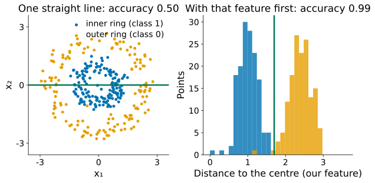
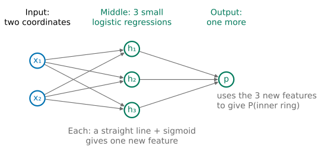
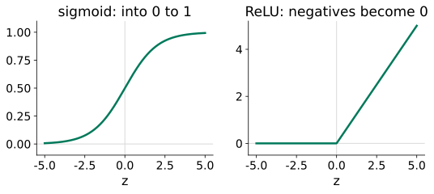
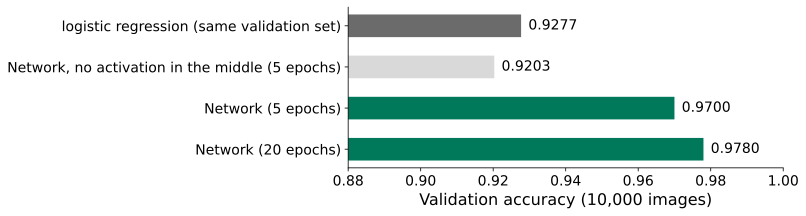
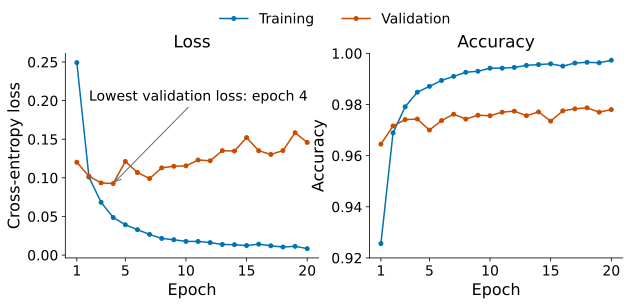
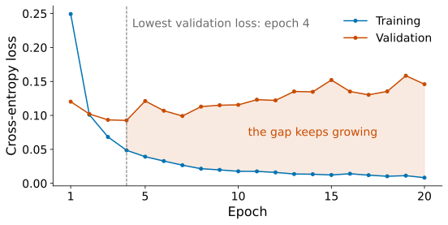
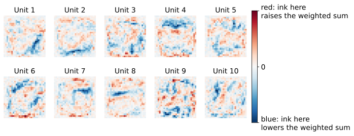

## The Lesson 4 ring: one line is not enough

::: {.stage}
{.fig .fig-f1 fig-alt="Left: the ring data with one straight line, accuracy 0.50. Right: histograms of the distance to the centre for the two classes, separated by one cut, accuracy 0.99"}

::: {.ask}
<small>Your turn</small>
The 99% needed a feature that **we** thought of. Who thinks of the feature that says "this is a 3" in 784 pixels?
:::
:::

::: {.notes}
约 2 分钟。回到 Lesson 4 结尾：logistic regression 只有一条直线，50%；先想到“到中心的距离”这个特征，99%。Lesson 3 结尾也说过特征要靠人想到。MNIST 每张图 784 个像素，没人能写出这样的特征。期待：让模型自己造特征。
:::

## [Problem:]{.stg} What we want

::: {.stage}
::: {.say .xl .center}
Give the model the raw input only. Let it **make its own features**.
:::

::: {.ask}
<small>Your turn</small>
From what parts could it build features? What do we already have that draws a line?
:::
:::

::: {.notes}
约 1 分钟。期待：Lesson 4 的 logistic regression，一个加权和加 sigmoid，就是一条直线，给出“在线的哪一边”。
:::

## What you will be able to do

::: {.stage .tight}
::: {.say .xl}
**Explain** what each small logistic regression in the middle does, **show** why the middle needs a bend, **train** the network of Assignment 2, and **read** its training and validation curves.
:::

::: {.flow .four}
<div><span>1</span>Combine lines</div>
<div><span>2</span>A bend in the middle</div>
<div><span>3</span>Training</div>
<div><span>4</span>MNIST</div>
:::
:::

::: {.notes}
约 1 分钟。能力承诺，念出四段路线。
:::

## [Combine lines:]{.stg} Place three lines yourself

::: {.stage .top}


::: {.say .center}
<small>Rule: a point inside all three lines is called inner (shaded).</small>
:::
:::

::: {.notes}
约 5 分钟。每条线是一个小 logistic regression。规则：在三条线内侧的点判为内圈。请学生指挥转动、平移。先勾“只用第 1 条线”：一条线怎么摆都盖不住一圈。三条线围成三角形；“Show one placement”给出 0.967。线越多越接近圆。
:::

## [Combine lines:]{.stg} Each line is a new feature

::: {.stage}
{.fig .fig-f2 fig-alt="Two inputs x1 and x2, each with arrows to three green circles h1, h2, h3; these connect to one output p"}

::: {.say .center}
Three small logistic regressions each give one feature. One more logistic regression combines them.
:::
:::

::: {.notes}
约 1.5 分钟。“三条线的内侧都满足”也可以由最后那个 logistic regression 来做：三个新特征都接近 1 时，加权和大，概率高。问：手摆很累，784 个像素没法手摆。怎么办？期待：所有权重都还是数，用交叉熵和梯度下降一起训练。
:::

## [Combine lines:]{.stg} Let the machine place the lines

::: {.stage .top}


::: {.say .center}
Trained together: a **neural network**. The middle layer is the **hidden layer**; each small logistic regression in it is a **unit**.
:::
:::

::: {.notes}
约 3 分钟。点名 neural network；中间那层看不见，叫 hidden layer；每个小 logistic regression 叫一个 unit。依次点 1 到 4：0.69、0.82、0.97、0.997。4 个单元围成四边形。没人告诉它“距离”。
:::

## [A bend in the middle:]{.stg} Can we drop the sigmoid in the middle?

::: {.stage}
::: {.say .xl .center}
Each hidden unit puts its weighted sum through a sigmoid. The output already has one.
:::

::: {.ask}
<small>Predict</small>
Pass the weighted sums on directly, without the sigmoid. With 4 units, what accuracy?
:::
:::

::: {.notes}
约 1 分钟。让学生先写下预测（0.997？还是更低？），下一页验证。
:::

## [A bend in the middle:]{.stg} Without it: 0.503, however many units

::: {.stage .top}

:::

::: {.notes}
约 2 分钟。点 “None”，再依次点 1 到 4：都是 0.503，边界只是一条直线。
:::

## [A bend in the middle:]{.stg} A line on top of lines is a line

::: {.stage}
::: {.formula .big}
$$
W_2(W_1x + b_1) + b_2 = (W_2W_1)\,x + (W_2b_1 + b_2)
$$
:::

::: {.say .center}
Still one set of weights times $x$, plus a number. Each unit must **bend**: an **activation function**.
:::

::: {.ask}
<small>Your turn</small>
What must a bend do to be useful here? Think of two requirements.
:::
:::

::: {.notes}
约 2.5 分钟。加多少层都一样。点名 activation function。期待两条要求：不是直线；能求导（训练要用梯度）。
:::

## [A bend in the middle:]{.stg} Two candidates

::: {.stage}
::: {.say .center}
Not a straight line, and with a slope we can compute.
:::

{.fig .fig-f3 fig-alt="Left: the sigmoid curve rising smoothly from 0 to 1. Right: ReLU, 0 for negative z and a straight line for positive z"}

::: {.say .center}
Sigmoid, or **ReLU**: $\max(0, z)$, negatives become 0.<br><small>$z$ is a unit's weighted sum, before the bend (as in Lesson 4).</small>
:::
:::

::: {.notes}
约 1.5 分钟。两个候选都满足两条要求。ReLU 在 0 处有一个折角，别处都能求导。下一页在环上比较。
:::

## [A bend in the middle:]{.stg} The second candidate: ReLU

::: {.stage .top}

:::

::: {.notes}
约 2 分钟。点 “ReLU”：3 个单元 0.977，4 个 0.997，和 sigmoid（0.97、0.997）差不多。作业 2 用 ReLU。为什么深的网络多用 ReLU（sigmoid 两头平），本讲不验证，留给 Note 的 Advanced Study 1。
:::

## [Training:]{.stg} How do the hidden weights get a gradient?

::: {.stage}
::: {.two .even}
::: {.tile .txt}
**Nudge each weight**

Change one weight a little, compute the loss again. Assignment 2's network: **118,282** times per step.
:::

::: {.tile .txt}
**Pass the error back**

The output's error (p minus y, Lesson 4) is shared out to each unit by its weight, times the slope of its bend. **One** pass backwards.
:::
:::

::: {.ask}
<small>Your turn</small>
Which would you use for 118,282 weights?
:::
:::

::: {.notes}
约 2 分钟。损失、梯度、一步步走，都和 Lesson 4 一样；新问题是隐藏层的权重隔了一层。先请学生说候选，再对照两张卡：每一步算 11.8 万次，还是往回算一次？
:::

## [Training:]{.stg} Pass the error back

::: {.stage}
::: {.say .xl .center}
Passing the error back layer by layer: **backpropagation**.
:::

::: {.say .center}
One pass backwards gives the gradient of every weight. Keras does it for you.
:::
:::

::: {.notes}
约 1 分钟。链式法则只给直觉，推导在 Note 的 Advanced Study 1。
:::

## [Training:]{.stg} How many images per step?

::: {.stage}
::: {.two .even}
::: {.tile .txt}
**All 50,000 per step**

Exact but expensive: 5 passes = 5 steps.
:::

::: {.tile .txt}
**32 per step**

Rough but cheap: 5 passes = 7,815 steps.
:::
:::

::: {.ask}
<small>Predict</small>
Same amount of computing. Which ends up better after 5 passes?
:::
:::

::: {.notes}
约 1.5 分钟。Lesson 4 每步用全部数据。请学生先写下预测。
:::

## [Training:]{.stg} Small batches win

::: {.stage}
::: {.two .even}
::: {.tile .txt}
**All 50,000 per step**

Validation accuracy **0.573**
:::

::: {.tile .txt}
**32 per step**

Validation accuracy **0.970**
:::
:::

::: {.say .center}
32 images per step: a **batch**. One pass over all the data: an **epoch** (1563 steps).
:::
:::

::: {.notes}
约 1 分钟。同样的计算量，小批走了一千多倍的步数。一批的梯度粗一些，但便宜。adam：会自己调步长的梯度下降，只用不展开。
:::

## [MNIST:]{.stg} The network of Assignment 2

::: {.stage}
::: {.say .xl .center}
784 pixels → 128 ReLU → 128 ReLU → 10 softmax (Lesson 4)
:::

::: {.say .center}
**118,282** weights: 784 × 128 + 128, then 128 × 128 + 128, then 128 × 10 + 10 (logistic regression: 7,850). First 50,000 images to fit, last 10,000 to validate.
:::

::: {.ask}
<small>Predict</small>
Logistic regression gets 0.9277 here (not comparable with Lesson 4's 0.908: 7,500 images and C = 0.1 there, 50,000 and C = 1 here). The network after 5 epochs? And without the ReLUs?
:::
:::

::: {.notes}
约 2 分钟。784×128+128 = 100,480；128×128+128 = 16,512；128×10+10 = 1,290。划分和作业 2 相同。先写下两个预测。
:::

## [MNIST:]{.stg} Validation accuracy

::: {.stage}
{.fig .fig-f4 fig-alt="Bar chart: logistic regression 0.9277, network without the activation 0.9203, network 5 epochs 0.9700, network 20 epochs 0.9780"}

::: {.say .center}
Mistakes fall from 723 to 300. Without the bend, the extra 110,000 weights add **nothing**.
:::
:::

::: {.notes}
约 1.5 分钟。去掉 ReLU：0.9203，回到 logistic regression 的水平，原因和环上一样。
:::

## [MNIST:]{.stg} How many epochs?

::: {.stage}
{.fig .fig-f5 fig-alt="Left: training loss falls from 0.25 to 0.01; validation loss is lowest at epoch 4 (about 0.09) and rises to 0.15. Right: training accuracy rises to 0.997; validation accuracy stays between 0.97 and 0.98"}

::: {.ask}
<small>Your turn</small>
After epoch 4, what is the network learning?
:::
:::

::: {.notes}
约 2 分钟。请学生先读图：训练损失一直降；验证损失第 4 轮最低，之后回升；验证准确率起伏。下一页给答案。
:::

## [MNIST:]{.stg} After epoch 4: mostly memorising

::: {.stage}
{.fig .fig-s1 fig-alt="Training and validation loss over 20 epochs; the gap between them is shaded and grows after epoch 4, where the validation loss is lowest"}

::: {.say .center}
The gap keeps growing: the training images are being memorised (Lesson 6). Accuracy still creeps up (0.9743 → 0.9780): more answers are right, but the wrong ones become over-confident, so the loss rises.

<small>Our rule: in Assignment 2, train the 20 epochs it asks for, use that model, and describe both curves; when you choose the number of epochs yourself, take the epoch with the **lowest validation loss** (here 4).</small>
:::
:::

::: {.notes}
约 2 分钟。两条验证曲线说的不一样：准确率只看最大概率对不对，交叉熵还看把握。按验证损失停在第 4 轮；作业 2 规定 20 轮，图 2 就是这两张图。Note 的 Advanced Study 3 有自动停止的办法。
:::


## [MNIST:]{.stg} Change only the seed

::: {.stage .bigtab}
| seed | 0 | 1 | 2 |
|---|---:|---:|---:|
| validation accuracy (20 epochs) | 0.9780 | 0.9755 | 0.9781 |

::: {.ask}
<small>Your turn</small>
A classmate uses 512 units per layer and gets **0.9803**. Is their network better?
:::
:::

::: {.notes}
约 2 分钟。权重的起点和每批用哪 32 张都是随机的，同一段代码每次结果不同；keras.utils.set_random_seed(0) 固定下来，结果可复现。只换种子就差 0.26 个百分点。请学生判断 512 单元的结果，下一页给答案。
:::

## [MNIST:]{.stg} Not yet

::: {.stage}
::: {.say .xl .center}
0.9803 − 0.9780 = **0.23** percentage points. Changing only the seed: up to **0.26** percentage points.
:::

::: {.say .center}
The lead is inside the seed's luck. Train both with a few seeds and compare the averages.
:::
:::

::: {.notes}
约 1.5 分钟。512 单元约 67 万权重，验证损失第 3 轮就最低了，更容易记训练集。只在验证集上比较，测试集最后用一次。
:::


## [MNIST:]{.stg} What did the first-layer units learn?

::: {.stage}
{.fig .fig-f6 fig-alt="Ten small 28 by 28 red and blue patterns, the weights of ten first-layer units; none looks like a whole digit"}

::: {.say .center}
Not whole digits: each unit responds to a few areas. Red: ink there raises the unit's weighted sum; blue: ink there lowers it, so a blue stroke is ink the unit does **not** want.
:::
:::

::: {.notes}
约 1.5 分钟。红是正权重，蓝是负权重。说不清每个单元在找什么，这是一个代价。后面的层怎样组合它们，本讲不验证。
:::

## Today in code

::: {.stage}
```python
keras.utils.set_random_seed(0)                    # fix the random start
model = keras.Sequential([
    keras.layers.Input((784,)),
    keras.layers.Dense(128, activation="relu"),   # hidden layer 1
    keras.layers.Dense(128, activation="relu"),   # hidden layer 2
    keras.layers.Dense(10, activation="softmax"), # one probability per digit
])
# adam: gradient descent that sets its own step size
model.compile(optimizer="adam", loss="sparse_categorical_crossentropy",
              metrics=["accuracy"])
hist = model.fit(X_fit, y_fit, epochs=20,
                 validation_data=(X_val, y_val), verbose=0)
# hist.history: loss, val_loss, accuracy, val_accuracy
```
:::

::: {.notes}
约 1 分钟。不讲语法。这正是作业 2 第 4 节的写法。Lab 9 会一步步做：搭网络、去掉激活、画曲线、换种子。
:::

## Back to the opening ring

::: {.stage}
::: {.say .xl .center}
Ring: 4 units reach **0.997**, with no feature from us. MNIST: **0.9277 → 0.978**.
:::

::: {.say .center}
The price: many weights, results that move with the seed, and memorising after a few epochs.
:::
:::

::: {.notes}
约 1 分钟。局限（口头）：参数多要大量数据；会记训练集，靠验证曲线；结果随种子变；特征不好读。
:::

## What you can do now {.final-slide}

::: {.takeaway}
::: {.rows .tiny .chain}
<div><span class="n">see it</span><div><b>One line fails on the ring</b><p>features need a person</p></div></div>
<div><span class="n">combine</span><div><b>Small logistic regressions</b><p>each a line, each a new feature</p></div></div>
<div><span class="n">bend</span><div><b>Activation function</b><p>without it, still one line</p></div></div>
<div><span class="n">train</span><div><b>Backpropagation, batches</b><p>cross-entropy and gradient descent</p></div></div>
<div><span class="n">MNIST</span><div><b>784 → 128 → 128 → 10</b><p>0.9277 → 0.978</p></div></div>
<div><span class="n">check</span><div><b>Validation curves, seeds</b><p>when it memorises; how much a seed moves it</p></div></div>
:::

::: {.qr}
{fig-alt="Feedback QR code for Lesson 9"}
<b>30-second feedback</b>
<p>After class: Lab 9</p>
:::
:::

::: {.notes}
约 1.5 分钟，课堂最终停在这一页。沿六行把整条链念一遍。答疑和扫码都在这里。课后 Lab 9，不预告下一讲。
:::
