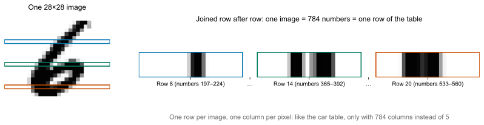
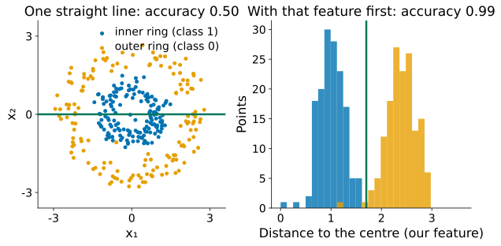
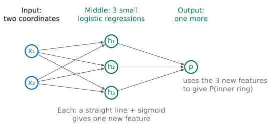
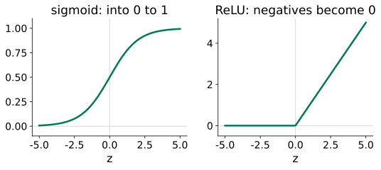
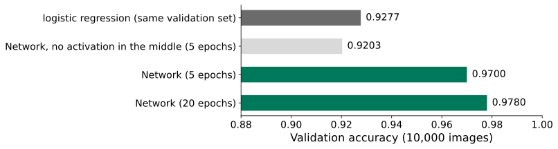
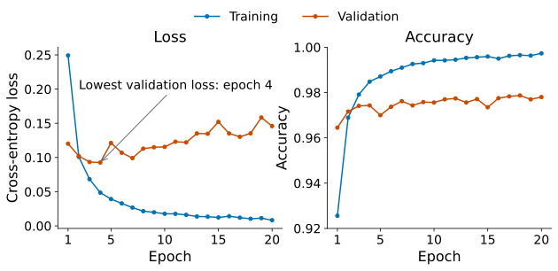
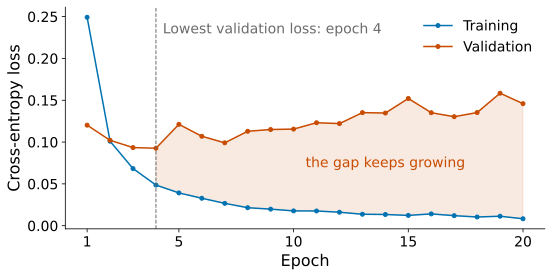
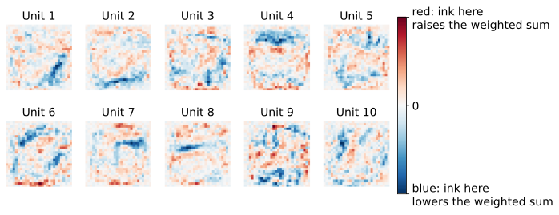

## [Problem:]{.stg} 784 pixels. Which ones say "this is a 6"?

::: {.stage .top}
{.fig .fig-digit fig-alt="A handwritten 6 as a 28 by 28 grid of pixels; three rows are pulled out into long strips of numbers"}

::: {.ask}
<small>Your turn</small>
A classifier needs features that say "6". We know two ways to make features. What are they?
:::

::: {.scan}
{fig-alt="QR code for today's live page"}
<b>Scan now</b>
votes, questions, feedback
:::
:::

::: {.notes}
约 1.5 分钟。先请大家扫码，页面整节课开着。一张手写的 6 是 784 个数。分类器要的是能说明“这是 6”的特征。到现在造特征有两种办法，请学生说：人想；PCA。下一页把两种办法摆在一起。
:::

## [Problem:]{.stg} Two ways we have, and what they miss

::: {.stage}
::: {.two .even}
::: {.tile .txt}
**A person thinks of one**

{.fig .fig-f1s fig-alt="Left: the ring data with one straight line, accuracy 0.50. Right: histograms of the distance to the centre for the two classes, separated by one cut, accuracy 0.99"}

Ring: one line 0.50; "distance from the centre" 0.99. Someone had to think of it.
:::

::: {.tile .txt}
**PCA makes them automatically**

It ignores the labels, and each score is a **weighted sum** of the inputs. On the ring it only turns the two axes: logistic regression on the two scores is still **0.503**.
:::
:::
:::

::: {.notes}
约 2 分钟。左：环形数据，内圈一类、外圈一类；一条直线 0.50；人想到“到中心的距离”，0.99。可 784 个像素上没人想得出。右：PCA 不用人想，手写数字上它让 QDA 跑起来了；但它不看标签，每个得分都是像素的加权和。环上两个主成分各留 54%、46%，只是转了坐标，logistic regression 仍 0.503（只留一个主成分 0.53）。“距离”是弯的，加权和造不出来。
:::

## [Problem:]{.stg} What we want

::: {.stage}
::: {.say .xl}
Give the model the raw input only. Let it **make its own features**: using the labels, and able to bend.
:::

::: {.ask}
<small>Your turn</small>
From what parts could it build features? What do we already have that draws a line?
:::
:::

::: {.notes}
约 1 分钟。期待：logistic regression，一个加权和加 sigmoid，就是一条直线，给出“在线的哪一边”。
:::

## What you will be able to do

::: {.stage .tight}
::: {.say .xl}
**Explain** what each small logistic regression in the middle does, **show** why the middle needs a bend, **train** the network of Assignment 2, and **read** its training and validation curves.
:::

::: {.flow .seven}
<div><span>1</span>Problem</div>
<div><span>2</span>Model</div>
<div><span>3</span>Loss</div>
<div><span>4</span>Solution</div>
<div><span>5</span>Application</div>
<div><span>6</span>Test</div>
<div><span>7</span>Extension and limits</div>
:::
:::

::: {.notes}
约 0.5 分钟。能力承诺，念路线。
:::

## [Problem:]{.stg} Place three lines yourself

::: {.stage .top}


::: {.say}
<small>Rule: a point inside all three lines is called inner (shaded).</small>
:::
:::

::: {.notes}
约 5 分钟。每条线是一个小 logistic regression。规则：在三条线内侧的点判为内圈。请学生指挥转动、平移。先勾“只用第 1 条线”：一条线怎么摆都盖不住一圈。三条线围成三角形；“Show one placement”给出 0.967。线越多越接近圆。
:::

## [Problem:]{.stg} Each line is a new feature

::: {.stage}
{.fig .fig-f2 fig-alt="Two inputs x1 and x2, each with arrows to three green circles h1, h2, h3; these connect to one output p"}

::: {.say}
Three small logistic regressions each give one feature. One more logistic regression combines them.
:::
:::

::: {.notes}
约 1.5 分钟。“三条线的内侧都满足”也可以由最后那个 logistic regression 来做：三个新特征都接近 1 时，加权和大，概率高。问：手摆很累，784 个像素没法手摆。怎么办？期待：所有权重都还是数，定一个损失，用梯度下降一起训练。
:::

## [Model:]{.stg} Let the machine place the lines

::: {.stage .top}


::: {.say}
Trained together: a **neural network**. The middle layer is the **hidden layer**; each small logistic regression in it is a **unit**.
:::
:::

::: {.notes}
约 3 分钟。点名 neural network；中间那层看不见，叫 hidden layer；每个小 logistic regression 叫一个 unit。依次点 1 到 4：0.69、0.82、0.97、0.997。4 个单元围成四边形。没人告诉它“距离”。
:::

## [Model:]{.stg} Drop the middle sigmoid?

::: {.stage}
::: {.say .xl}
Each hidden unit puts its weighted sum through a sigmoid. The output already has one.
:::

::: {.ask .vote}
<small>Vote on your phone</small>
Ring data, 4 hidden units, no sigmoid in the middle. Accuracy?

::: {.opts}
<span><b>A</b>about&nbsp;0.997</span>
<span><b>B</b>about&nbsp;0.82</span>
<span><b>C</b>about&nbsp;0.50</span>
:::
:::
:::

::: {.notes}
约 1.5 分钟。在右屏打开这一行的投票，30 秒，然后 Reveal；请选 A 的同学说理由。
:::

## [Model:]{.stg} Without it: 0.503, however many units

::: {.stage .top}

:::

::: {.notes}
约 2 分钟。点 “None”，再依次点 1 到 4：都是 0.503，边界只是一条直线。
:::

## [Model:]{.stg} A line on top of lines is a line

::: {.stage}
::: {.formula .big}
$$
W_2(W_1x + b_1) + b_2 = (W_2W_1)\,x + (W_2b_1 + b_2)
$$
:::

::: {.say}
Still one set of weights times $x$, plus a number. Each unit must **bend**: an **activation function**.
:::

::: {.ask}
<small>Your turn</small>
What must a bend do to be useful here? Think of two requirements.
:::
:::

::: {.notes}
约 2.5 分钟。加多少层都一样。点名 activation function。期待两条要求：不是直线；能求导（训练要用梯度）。
:::

## [Model:]{.stg} Two candidates

::: {.stage}
{.fig .fig-f3 fig-alt="Left: the sigmoid curve rising smoothly from 0 to 1. Right: ReLU, 0 for negative z and a straight line for positive z"}

::: {.say}
Not a straight line, and with a slope we can compute: sigmoid, or **ReLU**, $\max(0, z)$.<br><small>$z$ is a unit's weighted sum, before the bend.</small>
:::
:::

::: {.notes}
约 1.5 分钟。两个候选都满足两条要求。ReLU 在 0 处有一个折角，别处都能求导。下一页在环上比较。
:::

## [Model:]{.stg} The second candidate: ReLU

::: {.stage .top}

:::

::: {.notes}
约 2 分钟。点 “ReLU”：3 个单元 0.977，4 个 0.997，和 sigmoid（0.97、0.997）差不多。作业 2 用 ReLU。为什么深的网络多用 ReLU（sigmoid 两头平），本讲不验证，留给 Note 的 Advanced Study 1。说出模型的假设：类别的边界可以由几条直线各弯一下、再组合出来；线放在哪里由标签决定（和 PCA 不同）。
:::

## [Loss:]{.stg} What does training make small?

::: {.stage}
::: {.say .xl}
The same **cross-entropy** as logistic regression: $y_i$ is 1 or 0, the true class; $p_i$ is the network's probability of class 1.
:::

::: {.formula .big}
$$
L = -\frac{1}{n}\sum_i\big[y_i\log p_i + (1-y_i)\log(1-p_i)\big]
$$
:::

::: {.say}
The unknowns: every weight and constant (17 on the ring, 118,282 for Assignment 2). Ten digits: 10 outputs through a **softmax**, and $L = -\frac{1}{n}\sum_i \log p_{i,\,y_i}$. In Keras: `sparse_categorical_crossentropy`.
:::
:::

::: {.notes}
约 1.5 分钟。目标和 logistic regression 一样：给对的类别的概率越大越好。环上的组件就是让这个 L 尽量小训练出来的。未知数：环上 4 个单元 2×4+4+4+1 = 17 个。十个数字：输出层 10 个单元加 softmax，损失是对的那个数字的概率取负对数再平均；两类时就是上面的式子。Keras 里标签是整数时叫 sparse_categorical_crossentropy。
:::

## [Solution:]{.stg} How do the hidden weights get a gradient?

::: {.stage}
::: {.two .even}
::: {.tile .txt}
**Nudge each weight**

Change one weight a little, compute the loss again. Assignment 2's network: **118,282** times per step.
:::

::: {.tile .txt}
**Pass the error back**

The output's error (p minus y, as in logistic regression) is shared out to each unit by its weight, times the slope of its bend. **One** pass backwards.
:::
:::

::: {.ask}
<small>Your turn</small>
Which would you use for 118,282 weights?
:::
:::

::: {.notes}
约 2 分钟。求解还是梯度下降；新问题是隐藏层的权重隔了一层。先请学生说候选，再对照两张卡：每一步算 11.8 万次，还是往回算一次？
:::

## [Solution:]{.stg} Pass the error back

::: {.stage}
::: {.say .xl}
Passing the error back layer by layer: **backpropagation**.
:::

::: {.say}
One pass backwards gives the gradient of every weight. Keras does it for you.
:::
:::

::: {.notes}
约 1 分钟。链式法则只给直觉，推导在 Note 的 Advanced Study 1。
:::

## [Solution:]{.stg} How many images per step?

::: {.stage}
::: {.two .even}
::: {.tile .txt}
**All 50,000 per step**

Exact but expensive: 5 passes = 5 steps.
:::

::: {.tile .txt}
**32 per step**

Rough but cheap: 5 passes = 7,815 steps.
:::
:::

::: {.ask .vote}
<small>Vote on your phone</small>
Same computing, 5 passes over the data. Which ends better?

::: {.opts}
<span><b>A</b>all&nbsp;50,000 per step</span>
<span><b>B</b>32 per step</span>
<span><b>C</b>about the same</span>
:::
:::
:::

::: {.notes}
约 2 分钟。在右屏打开这一行的投票，30 秒，然后 Reveal；请选 A 的同学说为什么“精确”更好。到现在的梯度下降每步都用全部数据。请学生先写下预测。
:::

## [Solution:]{.stg} Small batches win

::: {.stage}
::: {.two .even}
::: {.tile .txt}
**All 50,000 per step**

Validation accuracy **0.573**
:::

::: {.tile .txt}
**32 per step**

Validation accuracy **0.970**
:::
:::

::: {.say}
32 images per step: a **batch**. One pass over all the data: an **epoch** (1563 steps).
:::
:::

::: {.notes}
约 1 分钟。同样的计算量，小批走了一千多倍的步数。一批的梯度粗一些，但便宜。adam：会自己调步长的梯度下降，只用不展开。
:::

## [Application:]{.stg} The network of Assignment 2

::: {.stage}
::: {.say .xl}
784 pixels → 128 ReLU → 128 ReLU → 10 softmax
:::

::: {.say}
**118,282** weights: 784 × 128 + 128, then 128 × 128 + 128, then 128 × 10 + 10 (logistic regression: 7,850). First 50,000 images to fit, last 10,000 to validate.
:::

::: {.ask}
<small>Predict</small>
Logistic regression gets 0.9277 on this split. The network after 5 epochs? And without the ReLUs?
:::
:::

::: {.notes}
约 2 分钟。784×128+128 = 100,480；128×128+128 = 16,512；128×10+10 = 1,290。划分和作业 2 相同。先写下两个预测。如果有学生拿 PCA + QDA 的 0.957 来比：那是另一种划分（5,625 张拟合、1,875 张验证），不能比；同一划分上的数是作业 2 第 3 节要算的。
:::

## [Application:]{.stg} Validation accuracy

::: {.stage}
{.fig .fig-f4 fig-alt="Bar chart: logistic regression 0.9277, network without the activation 0.9203, network 5 epochs 0.9700, network 20 epochs 0.9780"}

::: {.say}
Mistakes fall from 723 to 300. Without the bend, the extra 110,000 weights add **nothing**.
:::
:::

::: {.notes}
约 1.5 分钟。去掉 ReLU：0.9203，回到 logistic regression 的水平，原因和环上一样。
:::

## [Test:]{.stg} How many epochs?

::: {.stage}
{.fig .fig-f5 fig-alt="Left: training loss falls from 0.25 to 0.01; validation loss is lowest at epoch 4 (about 0.09) and rises to 0.15. Right: training accuracy rises to 0.997; validation accuracy stays between 0.97 and 0.98"}

::: {.ask}
<small>Your turn</small>
After epoch 4, what is the network learning?
:::
:::

::: {.notes}
约 2 分钟。检验：这个 0.970 什么时候不可信。请学生先读图：训练损失一直降；验证损失第 4 轮最低，之后回升；验证准确率起伏。下一页给答案。
:::

## [Test:]{.stg} After epoch 4: mostly memorising

::: {.stage}
{.fig .fig-s1 fig-alt="Training and validation loss over 20 epochs; the gap between them is shaded and grows after epoch 4, where the validation loss is lowest"}

::: {.say}
The gap keeps growing: the training images are being memorised. Accuracy still creeps up (0.9743 → 0.9780): more answers are right, but the wrong ones become over-confident, so the loss rises.

<small>Our rule: in Assignment 2, train the 20 epochs it asks for, use that model, and describe both curves; when you choose the number of epochs yourself, take the epoch with the **lowest validation loss** (here 4).</small>
:::
:::

::: {.notes}
约 2 分钟。两条验证曲线说的不一样：准确率只看最大概率对不对，交叉熵还看把握。按验证损失停在第 4 轮；作业 2 规定 20 轮，图 2 就是这两张图。自动停止的办法在扩展那一页。
:::

## [Test:]{.stg} Change only the seed

::: {.stage .bigtab}
| seed | 0 | 1 | 2 |
|---|---:|---:|---:|
| validation accuracy (20 epochs) | 0.9780 | 0.9755 | 0.9781 |

::: {.ask .vote}
<small>Vote on your phone</small>
512 units: 0.9803. Ours: 0.9780. Better?

::: {.opts}
<span><b>A</b>yes, it scores higher</span>
<span><b>B</b>can't tell yet</span>
:::
:::
:::

::: {.notes}
约 3 分钟。在右屏打开这一行的投票，30 秒，然后 Reveal；请选 A 和 B 的各一位说理由；答案是 B：差距在种子的随机范围之内。分歧大时让邻座讨论一分钟再 Vote again（本讲只在这一题这样做）。权重的起点和每批用哪 32 张都是随机的，同一段代码每次结果不同；keras.utils.set_random_seed(0) 固定下来，结果可复现。只换种子就差 0.26 个百分点。
:::

## [Test:]{.stg} Not yet

::: {.stage}
::: {.say .xl}
0.9803 − 0.9780 = **0.23** percentage points. Changing only the seed: up to **0.26** percentage points.
:::

::: {.say}
The lead is inside the seed's luck. Train both with a few seeds and compare the averages.
:::
:::

::: {.notes}
约 1.5 分钟。答案是“还说不准”：领先的 0.23 个百分点落在只换种子的波动（0.26）之内，要用几个种子比平均。顺带：512 单元约 67 万权重，验证损失第 3 轮就最低。只在验证集上比较，测试集最后用一次。
:::

## [Test:]{.stg} What did the first-layer units learn?

::: {.stage}
{.fig .fig-f6 fig-alt="Ten small 28 by 28 red and blue patterns, the weights of ten first-layer units; none looks like a whole digit"}

::: {.say}
Not whole digits: each unit responds to a few areas. Red: ink there raises the unit's weighted sum; blue: ink there lowers it, so a blue stroke is ink the unit does **not** want.
:::
:::

::: {.notes}
约 1.5 分钟。红是正权重，蓝是负权重。说不清每个单元在找什么，这是一个代价。可以口头对照：主成分也能排回 28×28，但它们不看标签；这些单元是看着标签训练出来的。
:::

## [Extension:]{.stg} Changes you can call directly

::: {.stage .ext}
| change | call | on our split, seed 0 |
|---|---|---|
| stop early | `EarlyStopping(monitor="val_loss", patience=3, restore_best_weights=True)` | stops at epoch 7, keeps epoch 4: 0.9743 |
| dropout | `Dropout(0.2)` after each hidden layer | lowest validation loss 0.078 (epoch 7), against 0.093 |
| wider, deeper | `Dense(512, ...)`, or one more `Dense` | 512 units: 0.9803, but see the seed |
| without Keras | `MLPClassifier(hidden_layer_sizes=(128, 128))` | the same network in scikit-learn |
:::

::: {.notes}
约 1 分钟。只念名字和结果，不讲细节；Note 第 8 节有表，Lab 的 Going further 和 Advanced C 可以试。不预告下一讲。
:::

## [Limitations:]{.stg} Where a network cannot be trusted

::: {.stage}
::: {.say .xl}
Ring: 4 units reach **0.997**, with no feature from us. MNIST: **0.9277 → 0.978**.
:::

::: {.say}
1. **Many weights:** 118,282, fifteen times logistic regression; it needs a lot of data.
2. **It memorises:** the training loss always falls; only the validation curve says when to stop.
3. **It moves with the seed:** tenths of a percentage point with nothing else changed.
4. **Its features are hard to read:** we cannot say what unit 3 looks for.
:::
:::

::: {.notes}
约 1.5 分钟。
:::

## Today in code

::: {.stage}
```python
keras.utils.set_random_seed(0)                    # fix the random start
model = keras.Sequential([
    keras.layers.Input((784,)),
    keras.layers.Dense(128, activation="relu"),   # hidden layer 1
    keras.layers.Dense(128, activation="relu"),   # hidden layer 2
    keras.layers.Dense(10, activation="softmax"), # one probability per digit
])
# adam: gradient descent that sets its own step size
model.compile(optimizer="adam", loss="sparse_categorical_crossentropy",
              metrics=["accuracy"])
hist = model.fit(X_fit, y_fit, epochs=20,
                 validation_data=(X_val, y_val), verbose=0)
# hist.history: loss, val_loss, accuracy, val_accuracy
```
:::

::: {.notes}
约 1 分钟。不讲语法。这正是作业 2 第 4 节的写法。Lab 9 会做：训练并读曲线、排查 AI 写的三段代码、换种子、测试集读一次。
:::

## What you can do now {.final-slide}

::: {.takeaway}
::: {.rows .tiny .chain}
<div><span class="n">problem</span><div><b>Features by hand, or PCA</b><p>one needs a person; the other ignores labels</p></div></div>
<div><span class="n">model</span><div><b>Small logistic regressions, bent</b><p>each a line, each a new feature; without the bend, still one line</p></div></div>
<div><span class="n">loss</span><div><b>Cross-entropy</b><p>softmax for ten digits</p></div></div>
<div><span class="n">solution</span><div><b>Backpropagation, batches</b><p>one pass back; 32 images per step</p></div></div>
<div><span class="n">apply</span><div><b>784 → 128 → 128 → 10</b><p>0.9277 → 0.978</p></div></div>
<div><span class="n">test</span><div><b>Validation curves, seeds</b><p>when it memorises; how much a seed moves it</p></div></div>
:::

::: {.qr}
{fig-alt="QR code for today's live page"}
<b>Feedback</b>
<p>After class: Lab 9</p>
:::
:::

::: {.notes}
约 1.5 分钟，课堂最终停在这一页。沿六行把整条链念一遍。答疑和扫码都在这里。课后 Lab 9，不预告下一讲。
:::
